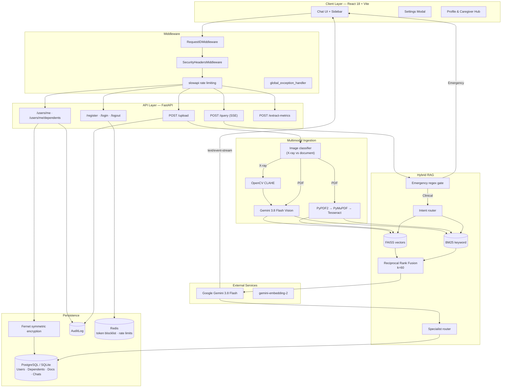
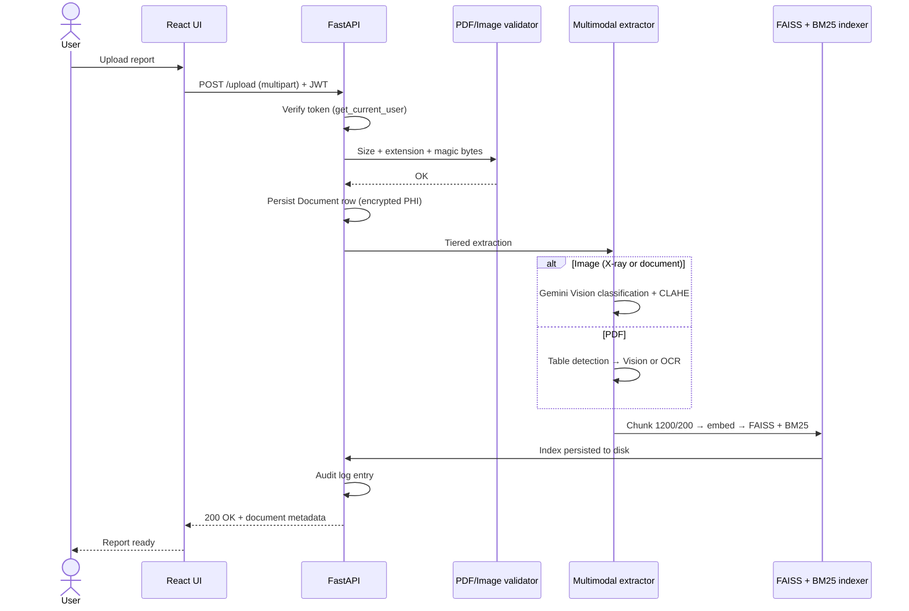
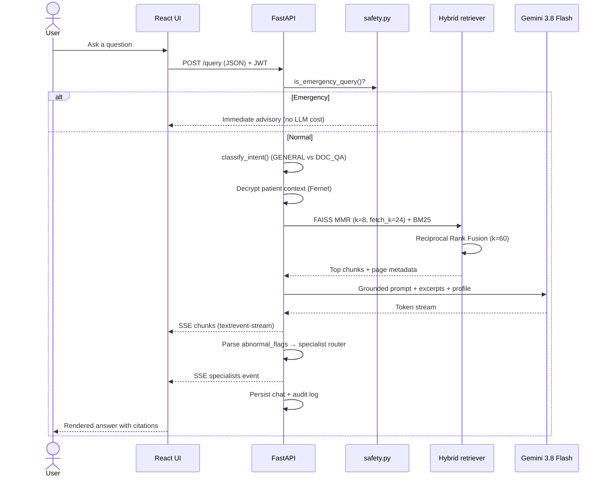

# MediSkye

**Making medical reports understandable for everyone.**

MediSkye is an AI-powered healthcare assistant that helps patients interpret diagnostic reports — blood tests, lipid panels, imaging summaries, X-rays, and scanned documents — in plain language. Upload a report, ask follow-up questions, and get cautious, context-grounded explanations powered by retrieval-augmented generation (RAG).

> **Disclaimer:** MediSkye is for educational and informational purposes only. It is **not** a substitute for professional medical advice, diagnosis, or treatment. Always consult a licensed healthcare provider.

---

## Table of contents

- [Live demo](#live-demo)
- [What MediSkye does](#what-mediskye-does)
- [System architecture](#system-architecture)
- [End-to-end workflows](#end-to-end-workflows)
- [Tech stack](#tech-stack)
- [Project structure](#project-structure)
- [Getting started](#getting-started)
- [Environment variables](#environment-variables)
- [API reference](#api-reference)
- [Testing & CI](#testing--ci)
- [Production deployment](#production-deployment)
- [Security & reliability](#security--reliability)
- [What's shipped](#whats-shipped)
- [Roadmap](#roadmap)
- [Contributing](#contributing)

---

## Live demo

| Service | URL |
|---------|-----|
| **Frontend** (React + Vite) | [mediskye-react.vercel.app](https://mediskye-react.vercel.app) (example) |
| **Backend** (FastAPI on Render) | [mediskye-51pi.onrender.com](https://mediskye-51pi.onrender.com) |
| **CI** | GitHub Actions — runs on every push to `main` |

<p align="center">
  
</p>

---

## What MediSkye does

Millions of people receive lab results but struggle to understand them. MediSkye closes that gap by:

1. **Extracting text** from uploaded documents — clean PDFs, scanned PDFs (via Tesseract OCR), images, and radiological scans (via Gemini Vision).
2. **Indexing the report** into a hybrid search store — FAISS (semantic) + BM25 (keyword), fused with Reciprocal Rank Fusion.
3. **Retrieving relevant sections** when you ask a question, with MMR diversity and page-level citations.
4. **Generating a plain-language answer** with Gemini 3.8 Flash, grounded in your report and personalized using your profile.
5. **Applying safety guardrails** — zero-cost emergency detection, intent classification, no definitive diagnoses, mandatory disclaimers.
6. **Recommending specialists** — algorithmic triage by category (cardiology, endocrinology, nephrology, etc.), never fake doctor data.

**Typical questions MediSkye can help with:**

- "Is my hemoglobin within the normal range?"
- "What does elevated LDL cholesterol mean?"
- "Can you explain my liver function test results?"
- "Given my diabetes, is this HbA1c concerning?"

---

## System architecture



---

## End-to-end workflows

### Upload workflow



### Query workflow (streaming)



---

## Tech stack

| Layer | Technology | Purpose |
|-------|------------|---------|
| **Frontend** | React 18 + Vite + Tailwind CSS | Upload UI, streaming chat, session management |
| **Routing** | React Router DOM 7 | Protected routes, auth boundaries |
| **Markdown** | react-markdown + remark-gfm | Render tables and formatted LLM output |
| **Backend** | FastAPI + Uvicorn (Python 3.12) | Async REST + SSE streaming |
| **Validation** | Pydantic v2 + pydantic-settings | Request/response schemas + env config |
| **ORM** | SQLAlchemy 2.0 (async) | Users, dependents, documents, chats, audit |
| **Migrations** | Alembic | Versioned schema changes |
| **Database** | PostgreSQL 15 (prod) · SQLite (dev) | Persistent storage |
| **LLM** | Google Gemini 3.8 Flash | Plain-language explanations + Vision |
| **Embeddings** | `gemini-embedding-2` | 768/1536-dim vectors for RAG |
| **Vector store** | FAISS (CPU) | Semantic similarity search |
| **Keyword search** | rank_bm25 | Sparse retrieval for exact numeric matches |
| **Fusion** | Reciprocal Rank Fusion (k=60) | Combine dense + sparse rankings |
| **Auth** | bcrypt + JWT (pyjwt) | Password hashing + stateless sessions |
| **Encryption** | cryptography (Fernet) | Field-level PHI encryption at rest |
| **Cache / blocklist** | Redis | JWT revocation + rate-limit storage |
| **Rate limiting** | slowapi | Abuse protection (5/min upload, 30/min query) |
| **PDF parsing** | PyPDF2 · PyMuPDF · Tesseract OCR | Tiered extraction (text → layout → scanned) |
| **Image processing** | OpenCV (CLAHE) + Pillow | Contrast enhancement for X-rays |
| **Testing** | pytest · pytest-asyncio · pytest-mock · Vitest | Backend + frontend suites |
| **CI** | GitHub Actions | Automated tests on every push |
| **Deployment** | Render (API) + Vercel (UI) | Production hosting |

---

## Project structure

```
MediSkye/
├── .github/
│   └── workflows/
│       └── tests.yml                    # CI: backend + frontend test jobs
├── backend/
│   ├── alembic/
│   │   └── versions/                    # Schema migrations
│   ├── app/
│   │   ├── api/v1/
│   │   │   ├── endpoints/               # auth, user, upload, query, metrics, health
│   │   │   └── router.py
│   │   ├── core/
│   │   │   ├── audit.py                 # Async audit logging
│   │   │   ├── auth.py                  # bcrypt + JWT
│   │   │   ├── config.py                # Pydantic BaseSettings
│   │   │   ├── limiter.py               # slowapi setup
│   │   │   ├── logging.py               # Structured logging
│   │   │   ├── redis_client.py          # Redis connection
│   │   │   └── security.py              # API key + sanitization
│   │   ├── db/
│   │   │   ├── database.py              # Async engine + session factory
│   │   │   ├── encryption.py            # EncryptedString (Fernet)
│   │   │   └── models.py                # User, Dependent, Document, Chat, AuditLog
│   │   ├── middleware/
│   │   │   ├── error_handler.py
│   │   │   ├── request_id.py
│   │   │   └── security_headers.py      # CSP, HSTS, X-Frame-Options
│   │   ├── rag/
│   │   │   ├── embedder.py              # gemini-embedding-2 wrapper
│   │   │   ├── hybrid_search.py         # BM25 + RRF
│   │   │   ├── intent_router.py         # GENERAL_HEALTH vs DOCUMENT_QA
│   │   │   ├── loader.py                # Multimodal extraction
│   │   │   ├── prompt_builder.py        # Grounded prompts
│   │   │   ├── retriever.py             # FAISS + MMR
│   │   │   ├── safety.py                # Emergency gate + disclaimers
│   │   │   └── specialist_router.py     # Specialty categorization
│   │   ├── schemas/                     # Pydantic request/response models
│   │   ├── services/                    # PDF validation, age calc
│   │   └── main.py                      # FastAPI app + lifespan
│   ├── tests/
│   │   ├── conftest.py                  # DB fixture, TEST_PASSWORD
│   │   ├── test_account_deletion_cleanup.py
│   │   ├── test_auth_secret.py
│   │   ├── test_config_validation.py
│   │   ├── test_health.py
│   │   ├── test_password_validation.py
│   │   ├── test_phase7_dependents.py
│   │   ├── test_query_general_health.py
│   │   ├── test_security.py
│   │   └── test_upload.py
│   ├── scripts/
│   │   └── wipe_test_phi.py             # Clear test PHI after key rotation
│   ├── alembic.ini
│   ├── Dockerfile
│   ├── docker-compose.yml               # Postgres + Redis + API
│   ├── pyproject.toml                   # pytest config + markers
│   ├── requirements.txt                 # Runtime deps
│   ├── requirements-dev.txt             # Dev + test deps
│   └── start.sh
├── frontend/
│   ├── src/
│   │   ├── components/                  # ChatApp, ChatWindow, ChatInput, etc.
│   │   ├── services/                    # api.js, speech.js
│   │   ├── test/
│   │   │   ├── setup.js                 # Vitest + jest-dom
│   │   │   ├── smoke.test.jsx
│   │   │   ├── ChatMessage.test.jsx
│   │   │   └── SettingsModal.test.jsx
│   │   ├── App.jsx
│   │   └── main.jsx
│   ├── package.json
│   ├── vitest.config.js
│   └── vite.config.js
├── docs/
├── flaws/                               # Historical flaw tracker
├── future-plans/
├── benchmarks.md                        # RAG retrieval math
├── Makefile                             # make test, make test-fast, etc.
├── .gitignore
└── README.md
```

---

## Getting started

### Prerequisites

- **Python 3.12+**
- **Node 22+** (for frontend + CI)
- **Google API key** with Gemini API enabled — [get one](https://aistudio.google.com/apikey)
- **Git**
- **Optional:** [Tesseract OCR](https://github.com/tesseract-ocr/tesseract) for scanned PDFs
- **Optional:** Redis (falls back to in-memory for dev)

### 1. Clone the repository

```bash
git clone https://github.com/AdityaSharma2k04/MediSkye.git
cd MediSkye
```

### 2. Configure environment

Create `backend/.env`:

```env
# Required
GOOGLE_API_KEY=your-google-api-key
FERNET_KEY=generate-with-command-below
JWT_SECRET_KEY=generate-with-command-below

# Optional
DATABASE_URL=sqlite+aiosqlite:///./mediskye.db
REDIS_URL=redis://localhost:6379/0
ENV=development
DEBUG=false
```

**Generate the required secrets:**

```bash
# Fernet key (for PHI encryption)
python -c "from cryptography.fernet import Fernet; print(Fernet.generate_key().decode())"

# JWT secret (32+ chars)
python -c "import secrets; print(secrets.token_urlsafe(32))"
```

> **Note:** The app refuses to start if `FERNET_KEY` or `JWT_SECRET_KEY` are missing or set to the old compromised default. This is by design (Phase 0 hardening).

### 3. Run the backend

```bash
cd backend
python -m venv .venv
.\.venv\Scripts\activate          # Windows
# source .venv/bin/activate       # macOS/Linux

pip install -r requirements-dev.txt

# Apply migrations
alembic upgrade head

# Start server
uvicorn app.main:app --reload --host 0.0.0.0 --port 8000
```

Backend: **http://localhost:8000** — API docs: **http://localhost:8000/docs**

### 4. Run the frontend (new terminal)

```bash
cd frontend
npm install
npm run dev
```

Frontend: **http://localhost:3000**

### 5. Use the app

1. Register an account (PHI consent required)
2. Upload a report (PDF, JPG, or PNG)
3. Wait for indexing to complete
4. Ask a question
5. Review the streamed answer with citations

---

## Environment variables

| Variable | Required | Default | Description |
|----------|----------|---------|-------------|
| `GOOGLE_API_KEY` | ✅ Yes | — | Gemini 3.8 Flash + embedding API key |
| `FERNET_KEY` | ✅ Yes | — | Fernet key for PHI field encryption |
| `JWT_SECRET_KEY` | ✅ Yes | — | HS256 secret for JWT signing (32+ chars) |
| `DATABASE_URL` | No | `sqlite+aiosqlite:///./mediskye.db` | Async SQLAlchemy DSN |
| `REDIS_URL` | No | `redis://localhost:6379/0` | Redis for token blocklist + rate limits |
| `ENV` | No | `development` | `development` / `production` |
| `DEBUG` | No | `false` | Enables SQL echo + verbose logs |
| `MEDISKYE_MAX_UPLOAD_MB` | No | `50` | Max upload size in MB |
| `MAX_PDF_PAGES` | No | `50` | Max pages per PDF |
| `ALLOWED_ORIGINS` | No | localhost | Comma-separated CORS origins |

### GitHub Actions secrets (for CI)

| Secret | Purpose |
|--------|---------|
| `FERNET_KEY_TEST` | Throwaway Fernet key for CI runs |
| `JWT_SECRET_KEY_TEST` | Throwaway JWT secret for CI runs |

---

## API reference

### Authentication

| Method | Endpoint | Description |
|--------|----------|-------------|
| `POST` | `/register` | Create account (email, password, PHI consent) |
| `POST` | `/login` | OAuth2 password flow → JWT |
| `POST` | `/logout` | Revoke current token (Redis blocklist) |

### User & dependents

| Method | Endpoint | Description |
|--------|----------|-------------|
| `GET` | `/users/me` | Current user profile |
| `PUT` | `/users/me` | Update profile fields |
| `DELETE` | `/users/me` | Delete account + all data (GDPR/CCPA) |
| `GET` | `/users/me/dependents` | List caregiver profiles |
| `POST` | `/users/me/dependents` | Create dependent profile |
| `PATCH` | `/users/me/dependents/{id}` | Update dependent |
| `DELETE` | `/users/me/dependents/{id}` | Delete dependent + linked docs |

### Reports & chat

| Method | Endpoint | Description |
|--------|----------|-------------|
| `POST` | `/upload` | Upload PDF/JPG/PNG (multipart) — rate limited 5/min |
| `POST` | `/query` | Ask a question — SSE stream — rate limited 30/min |
| `POST` | `/extract-metrics` | Structured lab metric extraction |

### Health

| Method | Endpoint | Description |
|--------|----------|-------------|
| `GET` | `/health` | Liveness + version info |
| `GET` | `/ready` | Readiness probe (DB + Redis) |

---

## Testing & CI

### Run tests locally

```bash
# Backend
cd backend
pytest tests -v

# Fast (stop on first failure, show slowest)
pytest tests -x --durations=5

# Skip integration tests
pytest tests -v -m "not integration"

# Frontend
cd frontend
npm test
```

### CI pipeline

Every push to `main` triggers `.github/workflows/tests.yml`:

- **`backend-test`** — Python 3.12, installs tesseract + poppler, runs `pytest -m "not integration"` with throwaway `FERNET_KEY` and `JWT_SECRET_KEY`
- **`frontend-test`** — Node 22, runs `npm ci` + `vitest run`

Both jobs must pass for a green build. Typical runtime: ~2–3 minutes.

### Test markers

| Marker | Purpose |
|--------|---------|
| `unit` | Fast, no external deps |
| `integration` | Requires network/Gemini — skipped in CI |
| `slow` | Runs > 1 second |

### What's covered

- ✅ Auth (JWT encode/decode, secret isolation, password validation, bcrypt 72-byte truncation)
- ✅ Startup guards (refuses to boot with compromised/missing keys)
- ✅ PHI encryption (raw SQL shows ciphertext, ORM shows plaintext)
- ✅ Account deletion cleanup (FAISS + BM25 files both removed)
- ✅ Dependent profiles (create, encrypt, retrieve, cross-user isolation)
- ✅ Upload validation (auth required, non-PDF rejected, empty file rejected)
- ✅ Constant-time API key comparison
- ✅ Prompt builder sanity (general health prompt returns non-empty)

---

## Production deployment

### Backend — Render

1. Create a **Web Service** connected to this repo
2. Set **Root Directory** to `backend`
3. **Build command:** `pip install -r requirements-dev.txt`
4. **Start command:** `uvicorn app.main:app --host 0.0.0.0 --port $PORT`
5. Add environment variables:
   - `GOOGLE_API_KEY`
   - `FERNET_KEY`
   - `JWT_SECRET_KEY`
   - `DATABASE_URL` (Postgres DSN — `postgresql+asyncpg://...`)
   - `REDIS_URL`
   - `ENV=production`
6. **Optional (OCR):** install Tesseract on the build environment

### Frontend — Vercel or Netlify

1. Connect the GitHub repo
2. Build command: `npm run build`, output: `dist`
3. Set `VITE_API_URL` env var to your deployed backend URL

### Production checklist

- [ ] `GOOGLE_API_KEY` set on Render
- [ ] `FERNET_KEY` set (never the old compromised value)
- [ ] `JWT_SECRET_KEY` set (32+ chars, never `GOOGLE_API_KEY`)
- [ ] `DATABASE_URL` points to Postgres
- [ ] `REDIS_URL` set (real Redis, not mock)
- [ ] `ALLOWED_ORIGINS` tightened to frontend domain (no wildcard)
- [ ] Tesseract installed if expecting scanned PDFs
- [ ] `alembic upgrade head` run on deploy

---

## Security & reliability

| Feature | Implementation |
|---------|----------------|
| **PHI encryption at rest** | Fernet (AES-128-CBC + HMAC-SHA256) on sensitive columns |
| **Field-level isolation** | `EncryptedString` type decorator on SQLAlchemy models |
| **Password hashing** | bcrypt with explicit 72-byte truncation (cross-platform safe) |
| **Auth** | JWT (HS256) with dedicated secret; not the Google API key |
| **Token revocation** | Redis-backed blocklist on logout |
| **Startup guards** | Refuses to boot with missing/compromised secrets |
| **Constant-time comparison** | `secrets.compare_digest` for API key checks |
| **Request tracing** | `X-Request-ID` propagated through middleware |
| **Security headers** | CSP, HSTS, X-Frame-Options via middleware |
| **Rate limiting** | 5 uploads/min, 30 queries/min per IP via slowapi |
| **Audit logging** | Async — every auth event, upload, deletion logged with user + IP |
| **Right to erasure** | `DELETE /users/me` clears DB rows + on-disk FAISS/BMC25 files |
| **Upload validation** | Size + extension + `%PDF` magic bytes + PyMuPDF decryption check |
| **Prompt injection resistance** | Untrusted content delimited in prompt tags |
| **Emergency fast path** | Zero-cost regex gate before LLM call |
| **Medical safety** | No definitive diagnoses, mandatory disclaimer on every response |

### Known limitations

- **In-memory caching** — vector stores rehydrate from disk on each query (pgvector migration planned)
- **Single-instance scaling** — FAISS/BM25 indexes live on local disk; horizontal scale requires pgvector
- **No async upload queue** — large PDFs block the request for 15–45s (ARQ planned)
- **No cost controls yet** — per-user token budgets planned for Phase 3

---

## What's shipped

### Phase 0 — Critical security remediation

| Area | Fix |
|------|-----|
| Startup safety | App refuses to boot without `FERNET_KEY` or `JWT_SECRET_KEY` |
| Key isolation | Dedicated JWT secret (was reusing `GOOGLE_API_KEY`) |
| Hardcoded secret | Removed committed Fernet key; added compromised-key kill-switch |
| Timing attacks | `secrets.compare_digest` for API key comparison |
| PHI cleanup | Account deletion now removes orphaned BM25 `.pkl` files |
| Missing import | Fixed `build_general_health_prompt` NameError crash |

### Phase 1.1 — CI + test infrastructure

| Area | Improvement |
|------|-------------|
| CI pipeline | GitHub Actions runs backend + frontend tests on every push |
| Requirements split | `requirements.txt` (runtime) vs `requirements-dev.txt` (test) |
| Test markers | `unit`, `integration`, `slow` registered in `pyproject.toml` |
| Frontend testing | Vitest + React Testing Library + jsdom setup |
| Makefile | `make test`, `make test-fast`, `make test-ci` |
| bcrypt fix | Truncate to 72 bytes before hashing (cross-platform) |
| Greenlet fix | `sqlalchemy[asyncio]` extra added to requirements |

### Phase 1.5 — UX & polish

| Area | Improvement |
|------|-------------|
| Markdown rendering | Replaced hand-rolled parser with `react-markdown` + `remark-gfm` — tables render properly |
| Settings rewrite | Account, Preferences, Security, Data & Privacy, About sections |
| Chat naming | Auto-named chats from document title or first query |
| Chat rename | 3-dot menu with inline rename |
| Delete confirmations | Type-to-confirm for destructive actions |
| Account wiring | Profile fields (name, DOB, sex, blood type) save on blur |
| Delete account | Direct `DELETE /users/me` with email confirmation |
| Header cleanup | Removed "Obsidian Theme" and "50MB PDF" from subtitle |
| HIPAA badge | Replaced with `End-to-end encrypted` (accurate claim) |
| Image support | Upload accepts PDF, JPG, PNG (was PDF only) |
| Fake data removed | Deleted placeholder doctor names, emails, phones |
| Specialist output | Generic category recommendations only |

### Also shipped

- **Caregiver / dependent mode** — separate profiles per family member with scoped encryption
- **Multi-tier PDF extraction** — PyPDF2 → PyMuPDF → Tesseract OCR with automatic fallback
- **X-ray ingestion** — OpenCV CLAHE + Gemini Vision for radiological analysis
- **Hybrid retrieval** — FAISS MMR (k=8, fetch_k=24) + BM25 fused with RRF (k=60)
- **Structured lab metrics** — `POST /extract-metrics` for tabular biomarker JSON
- **Voice dictation** — Web Speech API for hands-free queries

---

## Roadmap

| Phase | Status | Description |
|-------|--------|-------------|
| **0 — Security baseline** | ✅ Complete | Fernet, JWT isolation, kill-switches, bcrypt, timing-safe checks |
| **1.1 — CI + tests** | ✅ Complete | GitHub Actions, pytest + Vitest, requirements split |
| **1.5 — UX polish** | ✅ Complete | Markdown, settings, chat naming, delete confirmations |
| **2 — Patient memory** | 🔜 In progress | Cross-conversation facts, multi-doc chats, personalized context |
| **3 — Multimodal images** | Planned | Smart routing: OCR for screenshots, Vision for photos and handwriting |
| **4 — Architecture scale** | Planned | pgvector migration, ARQ async ingestion, real Redis |
| **5 — Production hardening** | Planned | Cost controls, prompt-injection eval suite, observability, WCAG AA |
| **6 — Compliance** | Planned | Data export, HIPAA BAA, disaster recovery runbook |
| **7 — Longitudinal trends** | Planned | Weight/HbA1c/BP tracking with chart views |
| **8 — Mobile + SMS** | Planned | Low-bandwidth access for elderly patients |

---

## Contributing

Contributions are welcome. To propose a change:

1. Fork the repository
2. Create a feature branch: `git checkout -b feature/your-feature`
3. Run tests: `cd backend && pytest tests -v` and `cd frontend && npm test`
4. Commit and open a pull request — CI must be green

Ideas we'd love help with: patient memory design, pgvector migration, prompt-injection eval suite, WCAG accessibility, frontend state management.

---

## License & disclaimer

MediSkye is intended for **educational and informational use**. It must not be used as a replacement for qualified medical professionals. The authors are not liable for medical decisions made based on AI-generated content.

Always seek advice from a licensed doctor for diagnosis and treatment.
