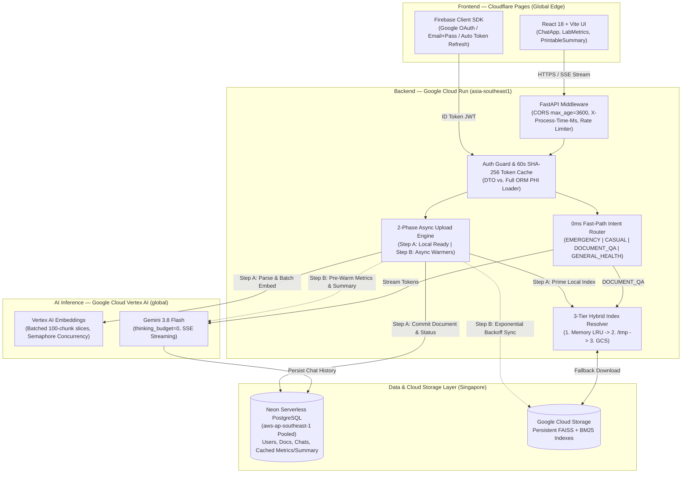

<div align="center">

# 🩺 MediSkye AI
### Production-Grade Clinical AI Assistant & Medical Lab Report Analyzer

[](https://fastapi.tiangolo.com/)
[](https://react.dev/)
[](https://vitejs.dev/)
[](https://cloud.google.com/vertex-ai)
[](https://neon.tech/)
[](https://firebase.google.com/)
[](https://cloud.google.com/run)
[](https://pages.cloudflare.com/)

**MediSkye** is a full-stack clinical intelligence platform that transforms complex medical PDFs and laboratory reports into clear, structured biomarker tables, printable physician-ready summaries, and interactive, grounded conversations—powered by a hybrid **FAISS + BM25 RAG pipeline** and **Google Cloud Vertex AI (`gemini-3.8-flash`)**.

[Live Demo](https://mediskye.pages.dev) • [Architecture](#-system-architecture--regional-topology) • [How Upload & Query Modes Work](#-how-every-upload--interaction-mode-works) • [Directory Map](#-repository-directory-map) • [Benchmarks](#-production-latency-benchmarks)

</div>

---

## ✨ Key Engineering Highlights

* **⚡ Two-Phase Asynchronous Upload Pipeline:** Decouples critical-path vector indexing (**Step A: ~3–5s**) from background LLM pre-warming and cloud storage syncing (**Step B**), unblocking the user interface immediately while warming caches behind the scenes.
* **🔍 Hybrid RAG Retrieval (FAISS + BM25):** Combines dense semantic vector embeddings (`models/gemini-embedding-2` batched in slices of 100) with lexical BM25 keyword scoring so exact clinical acronyms (`HbA1c`, `TSH`, `eGFR`, `hs-CRP`) never get lost in vector space.
* **🧠 0ms Deterministic Intent Router:** Fast-path routing intercepts `EMERGENCY` red-flag symptoms, `CASUAL` greetings, and document-bound `DOCUMENT_QA` queries in **0ms** without burning an extra LLM classification round-trip.
* **🗄️ 3-Tier Index & Database Caching:**
  * **Vector Index Tier:** In-Memory LRU Cache (`maxsize=10`) $\rightarrow$ Local Ephemeral `/tmp` Disk $\rightarrow$ Google Cloud Storage (`GCS`) fallback with `425/503 Retry-After` multi-instance protection.
  * **Clinical Artifact Tier:** Extracted biomarkers (`cached_metrics`) and printable clinical reports (`cached_summary`) are pre-warmed asynchronously upon upload and persisted in **Neon PostgreSQL**; the latest logged cached summary E2E p50 is **411.5 ms**.
* **🔐 HIPAA-Aligned Security & Auth Hot-Path Optimization:**
  * Unified **Firebase Authentication** (Google OAuth 2.0 + NIST SP 800-63B Email/Password with email verification enforcement).
  * **Fernet Symmetric Encryption** at rest for patient health profiles (`health_profile`) with strict SQLAlchemy `lazy="raise"` guards and lightweight Pydantic DTO separation (`get_current_user` vs. `get_current_user_full`) so encrypted PHI is never unnecessarily decrypted on standard API calls.
  * **60s SHA-256 Token TTL Cache** with instant eviction on profile updates or account deletion (`DELETE /users/me`).
* **📱 Mobile-First & Accessible UI:** Responsive drawer navigation for `375px` viewports, iOS Safari auto-zoom prevention, horizontal scroll wrappers for clinical tables, full keyboard focus trapping (`useFocusTrap`) across all modals, and multi-language (`i18n`) support.

---

## 🏗️ System Architecture & Regional Topology

The Cloud Build configuration deploys backend compute to **Singapore (`asia-southeast1`)** and sets Vertex AI inference to **`global`**. The configured Neon database is in **AWS Asia Pacific (Singapore, `ap-southeast-1`)**; static assets are served from **Cloudflare's Global Edge**.



---

## 🔄 How Every Upload & Interaction Mode Works

MediSkye supports **six distinct operational flows**, each engineered with its own isolated data pipeline and caching strategy:

### 1. Standard PDF Lab Report Upload (Two-Phase Async Pipeline)
When a user selects or drags-and-drops a `.pdf` medical report from their device:
1. **Client-Side Pre-Flight Validation (`ChatInput.jsx`):**
   * The backend enforces the configured upload-size limit (`MEDISKYE_MAX_UPLOAD_MB`, default `50 MB`) and page limit (`MAX_PDF_PAGES`, default `100`). Accepted extensions are `.pdf`, `.jpg`, `.jpeg`, and `.png`.
2. **Phase A — Critical Path to Unblock the User (`upload.py` — Target: 3–5s):**
   * **Text Extraction & Sanitization (`parse_ms`):** Extracts digital text pages via PyMuPDF/`pypdf`. If the PDF is a blank page or an un-OCRed scan (`len(text) < 20`), immediately raises a clean `422 Unprocessable Entity` with a user-friendly explanation.
   * **Clinical Chunking (`chunk_ms`):** Splits text into overlapping semantic blocks while preserving table row boundaries.
   * **Batched Embeddings (`embed_ms`):** Embeddings are generated in batches with bounded concurrency.
   * **Hybrid Index Construction (`faiss_build_ms`):** Builds both the dense **FAISS** vector index and lexical **BM25** index in a background thread (`asyncio.to_thread`), writing them immediately to `/tmp` and priming the **in-memory LRU cache**.
   * **Instant Unblock (`db_commit_ms`):** Creates the `Document` record in Neon PostgreSQL with `index_status = "local_ready"` and flips the upload job status to `COMPLETED`. The user's UI immediately unlocks for chatting!
3. **Phase B — Decoupled Post-Completion Background Workers (`upload.py`):**
   * After the user is unblocked, three independent background coroutines run concurrently via `asyncio.gather` (each opening its own isolated `AsyncSessionLocal()` database session to guarantee thread-safety):
     * **Worker 1 (GCS Sync):** Uploads the FAISS + BM25 index artifacts to Google Cloud Storage with 3–5 exponential-backoff retries, then flips `index_status = "synced"`.
     * **Worker 2 (Metrics Pre-Warming):** Calls Gemini (`thinking_budget=0`) to extract structured JSON biomarkers and writes them to `Document.cached_metrics`.
     * **Worker 3 (Summary Pre-Warming):** Calls Gemini (`thinking_budget=0`) to generate a structured clinical summary and writes it to `Document.cached_summary`.

---

### 2. 1-Click Sample Medical Report Onboarding (Zero-File Mobile Testing)
New users—especially on mobile phones—often don't have a PDF lab report readily accessible in their phone storage:
1. On the empty chat state (`ChatWindow.jsx`), clicking **"🧪 Try with a Sample Blood Test Report →"** fetches the static `/sample-report.pdf` bundle directly from Cloudflare's edge as a binary `Blob`.
2. The frontend wraps the blob into a native JavaScript `new File([blob], "Sample_Comprehensive_Metabolic_Panel.pdf", { type: "application/pdf" })` object in memory.
3. It pipes that `File` object directly into `handleFileUpload()`, triggering the full Phase A + Phase B pipeline in a single tap without requiring the user to download and re-upload a file.
4. A secondary *"Download Sample PDF"* action is also provided if the user prefers to inspect the raw PDF first.

---

### 3. Document-Grounded RAG Chat (`DOCUMENT_QA`)
When a user asks a question while a document is selected in the sidebar:
1. **0ms Fast-Path Intent Routing (`intent_router.py`):**
   * First checks for `EMERGENCY` red flags and `CASUAL` greetings in `0ms`.
   * Because `document_id` is attached, it immediately routes to `DOCUMENT_QA` in **0ms**, skipping the LLM classification call.
2. **3-Tier Hybrid Index Lookup & Multi-Instance Safeguard (`retriever.py` & `query.py`):**
   * Checks **Tier 1 (In-Memory LRU Cache)** $\rightarrow$ **Tier 2 (Local `/tmp` Disk)** $\rightarrow$ **Tier 3 (Google Cloud Storage)**.
   * **Multi-Instance Safety Gate:** If Cloud Run scales horizontally and a request hits a brand-new container while `index_status` is still `"building"` or before Phase B's GCS sync finishes, the handler checks index availability *before* writing any `Message` row or calling Vertex AI, returning `503 Service Unavailable` / `425 Too Early` with `Retry-After: 2`. The frontend `api.js` interceptor automatically waits 2s and retries transparently.
3. **Hybrid Retrieval & Prompt Sanitization (`prompt_builder.py`):**
   * Retrieves top chunks via combined FAISS + BM25 scores, strips internal RAG metadata headers so the AI never outputs phrases like *"Based on RAG chunk 2..."*, escapes the document filename against prompt injection, and injects the user's encrypted health profile context (if consented).
4. **Low-Latency SSE Token Streaming (`query.py`):**
   * Streams tokens from `gemini-3.8-flash` with `thinking_config=ThinkingConfig(thinking_budget=0)`, appends the clinical disclaimer upon stream completion, and saves both turns to Neon PostgreSQL for multi-device sync.

---

### 4. Standalone Health Chat, Casual Fast-Path & Emergency Interceptor
Users can also chat with MediSkye without uploading a document (`New Conversation`):
* **🚨 `EMERGENCY` Fast-Path (0ms):** Deterministic keyword matching for acute symptoms (*"chest pain"*, *"can't breathe"*, *"stroke"*, *"heart attack"*, *"severe bleeding"*, *"suicide"*). Immediately bypasses standard generation, emits a high-priority emergency warning instructing the user to call **112 / 911**, and triggers an unmissable red emergency banner in the UI.
* **👋 `CASUAL` Fast-Path (0ms):** Deterministic matching for greetings and pleasantries (*"hi"*, *"hello"*, *"hey mediskye"*, *"thanks"*, *"bye"*). Skips vector retrieval and **suppresses the medical disclaimer** so conversational greetings feel natural and human.
* **🩺 `GENERAL_HEALTH` Mode:** Answers general medical and wellness questions using Gemini 3.8 Flash with clinical safety guardrails and automatic medical disclaimers, persisting the thread in Neon DB.

---

### 5. Automated Lab Metrics Extraction & Clinical Triage Table (`LabMetrics.jsx`)
Clicking **"Lab Metrics"** on any uploaded document opens a clean, scannable clinical table:
* **Cache-First Serving (`metrics.py`):** Checks `if doc.cached_metrics is not None:`. Because Phase B pre-warms `cached_metrics` after upload, cached requests are served without another extraction call; the latest browser benchmark reports a cached-metrics p50 of **276.7 ms**. Supports `?force_refresh=true` if re-extraction is ever needed.
* **Post-Processing & Noise Filtering:** Automatically strips laboratory header/footer noise (such as `ISO 15189`, accreditation numbers, phone numbers, and facility addresses).
* **Abnormal-First Clinical Sorting:** Automatically sorts abnormal rows (**`High`** and **`Low`**) to the top of the table in red/amber text, followed by **`Normal`** biomarkers in emerald green—with zero visual clutter or emojis.

---

### 6. Printable Multi-Page Clinical Summary Export (`PrintableSummary.jsx`)
Clicking **"Export Summary"** generates a formal, physician-ready document suitable for printing or saving as PDF:
* **Dedicated Cached Endpoint (`POST /users/me/documents/{document_id}/summary`):** Returns the document-scoped summary or generates it on demand if it has not yet been cached.
* **Print-Optimized Layout:** Strips all emojis, renders clean clinical Markdown sections (*Executive Overview*, *Abnormal Findings by Organ System*, *Recommended Follow-Up Questions for Your Physician*), populates `<PrintableSummary/>`, and triggers `window.print()` with `@media print` CSS rules that hide the app sidebar/chat chrome and format clean page breaks.

---

## 📂 Repository Directory Map

This is a literal snapshot of files currently present under the local workspace root, independent of Git tracking. It excludes directories named exactly `node_modules`, `venv`, `__pycache__`, `.git`, and `dist`. Dot-directories such as `.venv` are included. Local `.env` files are represented by filename only; their contents are not included.

```text
Mediskye/
??? .amazonq/
?   ??? rules/
?       ??? memory-bank/
??? .github/
?   ??? workflows/
?       ??? tests.yml  # Project configuration or structured data.
??? backend/
?   ??? .venv/
?   ?   ??? Include/
?   ?   ?   ??? site/
?   ?   ?       ??? python3.14/
?   ?   ?           ??? greenlet/
?   ?   ?               ??? greenlet.h  # Generated local Python environment artifact.
?   ?   ??? Lib/
?   ?   ?   ??? site-packages/
?   ?   ?       ??? _pytest/
?   ?   ?       ?   ??? _code/
?   ?   ?       ?   ?   ??? __init__.py  # Installed Python package source or typing stub.
?   ?   ?       ?   ?   ??? code.py  # Installed Python package source or typing stub.
?   ?   ?       ?   ?   ??? source.py  # Installed Python package source or typing stub.
?   ?   ?       ?   ??? _io/
?   ?   ?       ?   ?   ??? __init__.py  # Installed Python package source or typing stub.
?   ?   ?       ?   ?   ??? pprint.py  # Installed Python package source or typing stub.
?   ?   ?       ?   ?   ??? saferepr.py  # Installed Python package source or typing stub.
?   ?   ?       ?   ?   ??? terminalwriter.py  # Installed Python package source or typing stub.
?   ?   ?       ?   ?   ??? wcwidth.py  # Installed Python package source or typing stub.
?   ?   ?       ?   ??? _py/
?   ?   ?       ?   ?   ??? __init__.py  # Installed Python package source or typing stub.
?   ?   ?       ?   ?   ??? error.py  # Installed Python package source or typing stub.
?   ?   ?       ?   ?   ??? path.py  # Installed Python package source or typing stub.
?   ?   ?       ?   ??? assertion/
?   ?   ?       ?   ?   ??? __init__.py  # Installed Python package source or typing stub.
?   ?   ?       ?   ?   ??? _compare_any.py  # Installed Python package source or typing stub.
?   ?   ?       ?   ?   ??? _compare_mapping.py  # Installed Python package source or typing stub.
?   ?   ?       ?   ?   ??? _compare_sequence.py  # Installed Python package source or typing stub.
?   ?   ?       ?   ?   ??? _compare_set.py  # Installed Python package source or typing stub.
?   ?   ?       ?   ?   ??? _guards.py  # Installed Python package source or typing stub.
?   ?   ?       ?   ?   ??? _typing.py  # Installed Python package source or typing stub.
?   ?   ?       ?   ?   ??? compare_text.py  # Installed Python package source or typing stub.
?   ?   ?       ?   ?   ??? highlight.py  # Installed Python package source or typing stub.
?   ?   ?       ?   ?   ??? rewrite.py  # Installed Python package source or typing stub.
?   ?   ?       ?   ?   ??? truncate.py  # Installed Python package source or typing stub.
?   ?   ?       ?   ?   ??? util.py  # Installed Python package source or typing stub.
?   ?   ?       ?   ??? config/
?   ?   ?       ?   ?   ??? __init__.py  # Installed Python package source or typing stub.
?   ?   ?       ?   ?   ??? argparsing.py  # Installed Python package source or typing stub.
?   ?   ?       ?   ?   ??? exceptions.py  # Installed Python package source or typing stub.
?   ?   ?       ?   ?   ??? findpaths.py  # Installed Python package source or typing stub.
?   ?   ?       ?   ??? mark/
?   ?   ?       ?   ?   ??? __init__.py  # Installed Python package source or typing stub.
?   ?   ?       ?   ?   ??? expression.py  # Installed Python package source or typing stub.
?   ?   ?       ?   ?   ??? structures.py  # Installed Python package source or typing stub.
?   ?   ?       ?   ??? __init__.py  # Installed Python package source or typing stub.
?   ?   ?       ?   ??? _argcomplete.py  # Installed Python package source or typing stub.
?   ?   ?       ?   ??? _version.py  # Installed Python package source or typing stub.
?   ?   ?       ?   ??? cacheprovider.py  # Installed Python package source or typing stub.
?   ?   ?       ?   ??? capture.py  # Installed Python package source or typing stub.
?   ?   ?       ?   ??? compat.py  # Installed Python package source or typing stub.
?   ?   ?       ?   ??? debugging.py  # Installed Python package source or typing stub.
?   ?   ?       ?   ??? deprecated.py  # Installed Python package source or typing stub.
?   ?   ?       ?   ??? doctest.py  # Installed Python package source or typing stub.
?   ?   ?       ?   ??? faulthandler.py  # Installed Python package source or typing stub.
?   ?   ?       ?   ??? fixtures.py  # Installed Python package source or typing stub.
?   ?   ?       ?   ??? freeze_support.py  # Installed Python package source or typing stub.
?   ?   ?       ?   ??? helpconfig.py  # Installed Python package source or typing stub.
?   ?   ?       ?   ??? hookspec.py  # Installed Python package source or typing stub.
?   ?   ?       ?   ??? junitxml.py  # Installed Python package source or typing stub.
?   ?   ?       ?   ??? legacypath.py  # Installed Python package source or typing stub.
?   ?   ?       ?   ??? logging.py  # Installed Python package source or typing stub.
?   ?   ?       ?   ??? main.py  # Installed Python package source or typing stub.
?   ?   ?       ?   ??? monkeypatch.py  # Installed Python package source or typing stub.
?   ?   ?       ?   ??? nodes.py  # Installed Python package source or typing stub.
?   ?   ?       ?   ??? outcomes.py  # Installed Python package source or typing stub.
?   ?   ?       ?   ??? pastebin.py  # Installed Python package source or typing stub.
?   ?   ?       ?   ??? pathlib.py  # Installed Python package source or typing stub.
?   ?   ?       ?   ??? py.typed  # Generated local Python environment artifact.
?   ?   ?       ?   ??? pytester.py  # Installed Python package source or typing stub.
?   ?   ?       ?   ??? pytester_assertions.py  # Installed Python package source or typing stub.
?   ?   ?       ?   ??? python.py  # Installed Python package source or typing stub.
?   ?   ?       ?   ??? python_api.py  # Installed Python package source or typing stub.
?   ?   ?       ?   ??? raises.py  # Installed Python package source or typing stub.
?   ?   ?       ?   ??? recwarn.py  # Installed Python package source or typing stub.
?   ?   ?       ?   ??? reports.py  # Installed Python package source or typing stub.
?   ?   ?       ?   ??? runner.py  # Installed Python package source or typing stub.
?   ?   ?       ?   ??? scope.py  # Installed Python package source or typing stub.
?   ?   ?       ?   ??? setuponly.py  # Installed Python package source or typing stub.
?   ?   ?       ?   ??? setupplan.py  # Installed Python package source or typing stub.
?   ?   ?       ?   ??? skipping.py  # Installed Python package source or typing stub.
?   ?   ?       ?   ??? stash.py  # Installed Python package source or typing stub.
?   ?   ?       ?   ??? stepwise.py  # Installed Python package source or typing stub.
?   ?   ?       ?   ??? subtests.py  # Installed Python package source or typing stub.
?   ?   ?       ?   ??? terminal.py  # Installed Python package source or typing stub.
?   ?   ?       ?   ??? terminalprogress.py  # Installed Python package source or typing stub.
?   ?   ?       ?   ??? threadexception.py  # Installed Python package source or typing stub.
?   ?   ?       ?   ??? timing.py  # Installed Python package source or typing stub.
?   ?   ?       ?   ??? tmpdir.py  # Installed Python package source or typing stub.
?   ?   ?       ?   ??? tracemalloc.py  # Installed Python package source or typing stub.
?   ?   ?       ?   ??? unittest.py  # Installed Python package source or typing stub.
?   ?   ?       ?   ??? unraisableexception.py  # Installed Python package source or typing stub.
?   ?   ?       ?   ??? warning_types.py  # Installed Python package source or typing stub.
?   ?   ?       ?   ??? warnings.py  # Installed Python package source or typing stub.
?   ?   ?       ??? _yaml/
?   ?   ?       ?   ??? __init__.py  # Installed Python package source or typing stub.
?   ?   ?       ??? aiohappyeyeballs/
?   ?   ?       ?   ??? __init__.py  # Installed Python package source or typing stub.
?   ?   ?       ?   ??? _staggered.py  # Installed Python package source or typing stub.
?   ?   ?       ?   ??? impl.py  # Installed Python package source or typing stub.
?   ?   ?       ?   ??? py.typed  # Generated local Python environment artifact.
?   ?   ?       ?   ??? types.py  # Installed Python package source or typing stub.
?   ?   ?       ?   ??? utils.py  # Installed Python package source or typing stub.
?   ?   ?       ??? aiohappyeyeballs-2.7.1.dist-info/
?   ?   ?       ?   ??? licenses/
?   ?   ?       ?   ?   ??? LICENSE  # Generated local Python environment artifact.
?   ?   ?       ?   ??? INSTALLER  # Generated local Python environment artifact.
?   ?   ?       ?   ??? METADATA  # Generated local Python environment artifact.
?   ?   ?       ?   ??? RECORD  # Generated local Python environment artifact.
?   ?   ?       ?   ??? WHEEL  # Generated local Python environment artifact.
?   ?   ?       ??? aiohttp/
?   ?   ?       ?   ??? _websocket/
?   ?   ?       ?   ?   ??? __init__.py  # Installed Python package source or typing stub.
?   ?   ?       ?   ?   ??? helpers.py  # Installed Python package source or typing stub.
?   ?   ?       ?   ?   ??? mask.cp314-win_amd64.pyd  # Python environment runtime binary.
?   ?   ?       ?   ?   ??? mask.pxd  # Generated local Python environment artifact.
?   ?   ?       ?   ?   ??? mask.pyx  # Generated local Python environment artifact.
?   ?   ?       ?   ?   ??? models.py  # Installed Python package source or typing stub.
?   ?   ?       ?   ?   ??? reader.py  # Installed Python package source or typing stub.
?   ?   ?       ?   ?   ??? reader_c.cp314-win_amd64.pyd  # Python environment runtime binary.
?   ?   ?       ?   ?   ??? reader_c.pxd  # Generated local Python environment artifact.
?   ?   ?       ?   ?   ??? reader_py.py  # Installed Python package source or typing stub.
?   ?   ?       ?   ?   ??? writer.py  # Installed Python package source or typing stub.
?   ?   ?       ?   ??? __init__.py  # Installed Python package source or typing stub.
?   ?   ?       ?   ??? _cookie_helpers.py  # Installed Python package source or typing stub.
?   ?   ?       ?   ??? _cparser.pxd  # Generated local Python environment artifact.
?   ?   ?       ?   ??? _find_header.pxd  # Generated local Python environment artifact.
?   ?   ?       ?   ??? _headers.pxi  # Generated local Python environment artifact.
?   ?   ?       ?   ??? _http_parser.cp314-win_amd64.pyd  # Python environment runtime binary.
?   ?   ?       ?   ??? _http_parser.pyx  # Generated local Python environment artifact.
?   ?   ?       ?   ??? _http_writer.cp314-win_amd64.pyd  # Python environment runtime binary.
?   ?   ?       ?   ??? _http_writer.pyx  # Generated local Python environment artifact.
?   ?   ?       ?   ??? abc.py  # Installed Python package source or typing stub.
?   ?   ?       ?   ??? base_protocol.py  # Installed Python package source or typing stub.
?   ?   ?       ?   ??? client.py  # Installed Python package source or typing stub.
?   ?   ?       ?   ??? client_exceptions.py  # Installed Python package source or typing stub.
?   ?   ?       ?   ??? client_middleware_digest_auth.py  # Installed Python package source or typing stub.
?   ?   ?       ?   ??? client_middlewares.py  # Installed Python package source or typing stub.
?   ?   ?       ?   ??? client_proto.py  # Installed Python package source or typing stub.
?   ?   ?       ?   ??? client_reqrep.py  # Installed Python package source or typing stub.
?   ?   ?       ?   ??? client_ws.py  # Installed Python package source or typing stub.
?   ?   ?       ?   ??? compression_utils.py  # Installed Python package source or typing stub.
?   ?   ?       ?   ??? connector.py  # Installed Python package source or typing stub.
?   ?   ?       ?   ??? cookiejar.py  # Installed Python package source or typing stub.
?   ?   ?       ?   ??? formdata.py  # Installed Python package source or typing stub.
?   ?   ?       ?   ??? hdrs.py  # Installed Python package source or typing stub.
?   ?   ?       ?   ??? helpers.py  # Installed Python package source or typing stub.
?   ?   ?       ?   ??? http.py  # Installed Python package source or typing stub.
?   ?   ?       ?   ??? http_exceptions.py  # Installed Python package source or typing stub.
?   ?   ?       ?   ??? http_parser.py  # Installed Python package source or typing stub.
?   ?   ?       ?   ??? http_websocket.py  # Installed Python package source or typing stub.
?   ?   ?       ?   ??? http_writer.py  # Installed Python package source or typing stub.
?   ?   ?       ?   ??? log.py  # Installed Python package source or typing stub.
?   ?   ?       ?   ??? multipart.py  # Installed Python package source or typing stub.
?   ?   ?       ?   ??? payload.py  # Installed Python package source or typing stub.
?   ?   ?       ?   ??? payload_streamer.py  # Installed Python package source or typing stub.
?   ?   ?       ?   ??? py.typed  # Generated local Python environment artifact.
?   ?   ?       ?   ??? pytest_plugin.py  # Installed Python package source or typing stub.
?   ?   ?       ?   ??? resolver.py  # Installed Python package source or typing stub.
?   ?   ?       ?   ??? streams.py  # Installed Python package source or typing stub.
?   ?   ?       ?   ??? tcp_helpers.py  # Installed Python package source or typing stub.
?   ?   ?       ?   ??? test_utils.py  # Installed Python package source or typing stub.
?   ?   ?       ?   ??? tracing.py  # Installed Python package source or typing stub.
?   ?   ?       ?   ??? typedefs.py  # Installed Python package source or typing stub.
?   ?   ?       ?   ??? web.py  # Installed Python package source or typing stub.
?   ?   ?       ?   ??? web_app.py  # Installed Python package source or typing stub.
?   ?   ?       ?   ??? web_exceptions.py  # Installed Python package source or typing stub.
?   ?   ?       ?   ??? web_fileresponse.py  # Installed Python package source or typing stub.
?   ?   ?       ?   ??? web_log.py  # Installed Python package source or typing stub.
?   ?   ?       ?   ??? web_middlewares.py  # Installed Python package source or typing stub.
?   ?   ?       ?   ??? web_protocol.py  # Installed Python package source or typing stub.
?   ?   ?       ?   ??? web_request.py  # Installed Python package source or typing stub.
?   ?   ?       ?   ??? web_response.py  # Installed Python package source or typing stub.
?   ?   ?       ?   ??? web_routedef.py  # Installed Python package source or typing stub.
?   ?   ?       ?   ??? web_runner.py  # Installed Python package source or typing stub.
?   ?   ?       ?   ??? web_server.py  # Installed Python package source or typing stub.
?   ?   ?       ?   ??? web_urldispatcher.py  # Installed Python package source or typing stub.
?   ?   ?       ?   ??? web_ws.py  # Installed Python package source or typing stub.
?   ?   ?       ?   ??? worker.py  # Installed Python package source or typing stub.
?   ?   ?       ??? aiohttp-3.14.5.dist-info/
?   ?   ?       ?   ??? licenses/
?   ?   ?       ?   ?   ??? vendor/
?   ?   ?       ?   ?   ?   ??? llhttp/
?   ?   ?       ?   ?   ?       ??? LICENSE  # Generated local Python environment artifact.
?   ?   ?       ?   ?   ??? LICENSE.txt  # Installed Python package metadata or configuration.
?   ?   ?       ?   ??? INSTALLER  # Generated local Python environment artifact.
?   ?   ?       ?   ??? METADATA  # Generated local Python environment artifact.
?   ?   ?       ?   ??? RECORD  # Generated local Python environment artifact.
?   ?   ?       ?   ??? top_level.txt  # Installed Python package metadata or configuration.
?   ?   ?       ?   ??? WHEEL  # Generated local Python environment artifact.
?   ?   ?       ??? aiosignal/
?   ?   ?       ?   ??? __init__.py  # Installed Python package source or typing stub.
?   ?   ?       ?   ??? py.typed  # Generated local Python environment artifact.
?   ?   ?       ??? aiosignal-1.4.0.dist-info/
?   ?   ?       ?   ??? licenses/
?   ?   ?       ?   ?   ??? LICENSE  # Generated local Python environment artifact.
?   ?   ?       ?   ??? INSTALLER  # Generated local Python environment artifact.
?   ?   ?       ?   ??? METADATA  # Generated local Python environment artifact.
?   ?   ?       ?   ??? RECORD  # Generated local Python environment artifact.
?   ?   ?       ?   ??? top_level.txt  # Installed Python package metadata or configuration.
?   ?   ?       ?   ??? WHEEL  # Generated local Python environment artifact.
?   ?   ?       ??? aiosqlite/
?   ?   ?       ?   ??? tests/
?   ?   ?       ?   ?   ??? __init__.py  # Installed Python package source or typing stub.
?   ?   ?       ?   ?   ??? __main__.py  # Installed Python package source or typing stub.
?   ?   ?       ?   ?   ??? helpers.py  # Installed Python package source or typing stub.
?   ?   ?       ?   ?   ??? perf.py  # Installed Python package source or typing stub.
?   ?   ?       ?   ?   ??? smoke.py  # Installed Python package source or typing stub.
?   ?   ?       ?   ??? __init__.py  # Installed Python package source or typing stub.
?   ?   ?       ?   ??? __version__.py  # Installed Python package source or typing stub.
?   ?   ?       ?   ??? context.py  # Installed Python package source or typing stub.
?   ?   ?       ?   ??? core.py  # Installed Python package source or typing stub.
?   ?   ?       ?   ??? cursor.py  # Installed Python package source or typing stub.
?   ?   ?       ?   ??? py.typed  # Generated local Python environment artifact.
?   ?   ?       ??? aiosqlite-0.22.1.dist-info/
?   ?   ?       ?   ??? licenses/
?   ?   ?       ?   ?   ??? LICENSE  # Generated local Python environment artifact.
?   ?   ?       ?   ??? INSTALLER  # Generated local Python environment artifact.
?   ?   ?       ?   ??? METADATA  # Generated local Python environment artifact.
?   ?   ?       ?   ??? RECORD  # Generated local Python environment artifact.
?   ?   ?       ?   ??? REQUESTED  # Generated local Python environment artifact.
?   ?   ?       ?   ??? WHEEL  # Generated local Python environment artifact.
?   ?   ?       ??? alembic/
?   ?   ?       ?   ??? autogenerate/
?   ?   ?       ?   ?   ??? compare/
?   ?   ?       ?   ?   ?   ??? __init__.py  # Installed Python package source or typing stub.
?   ?   ?       ?   ?   ?   ??? comments.py  # Installed Python package source or typing stub.
?   ?   ?       ?   ?   ?   ??? constraints.py  # Installed Python package source or typing stub.
?   ?   ?       ?   ?   ?   ??? schema.py  # Installed Python package source or typing stub.
?   ?   ?       ?   ?   ?   ??? server_defaults.py  # Installed Python package source or typing stub.
?   ?   ?       ?   ?   ?   ??? tables.py  # Installed Python package source or typing stub.
?   ?   ?       ?   ?   ?   ??? types.py  # Installed Python package source or typing stub.
?   ?   ?       ?   ?   ?   ??? util.py  # Installed Python package source or typing stub.
?   ?   ?       ?   ?   ??? __init__.py  # Installed Python package source or typing stub.
?   ?   ?       ?   ?   ??? api.py  # Installed Python package source or typing stub.
?   ?   ?       ?   ?   ??? render.py  # Installed Python package source or typing stub.
?   ?   ?       ?   ?   ??? rewriter.py  # Installed Python package source or typing stub.
?   ?   ?       ?   ??? ddl/
?   ?   ?       ?   ?   ??? __init__.py  # Installed Python package source or typing stub.
?   ?   ?       ?   ?   ??? _autogen.py  # Installed Python package source or typing stub.
?   ?   ?       ?   ?   ??? base.py  # Installed Python package source or typing stub.
?   ?   ?       ?   ?   ??? impl.py  # Installed Python package source or typing stub.
?   ?   ?       ?   ?   ??? mssql.py  # Installed Python package source or typing stub.
?   ?   ?       ?   ?   ??? mysql.py  # Installed Python package source or typing stub.
?   ?   ?       ?   ?   ??? oracle.py  # Installed Python package source or typing stub.
?   ?   ?       ?   ?   ??? postgresql.py  # Installed Python package source or typing stub.
?   ?   ?       ?   ?   ??? sqlite.py  # Installed Python package source or typing stub.
?   ?   ?       ?   ??? ext/
?   ?   ?       ?   ?   ??? __init__.py  # Installed Python package source or typing stub.
?   ?   ?       ?   ?   ??? checkconstraint_byname.py  # Installed Python package source or typing stub.
?   ?   ?       ?   ??? operations/
?   ?   ?       ?   ?   ??? __init__.py  # Installed Python package source or typing stub.
?   ?   ?       ?   ?   ??? base.py  # Installed Python package source or typing stub.
?   ?   ?       ?   ?   ??? batch.py  # Installed Python package source or typing stub.
?   ?   ?       ?   ?   ??? ops.py  # Installed Python package source or typing stub.
?   ?   ?       ?   ?   ??? schemaobj.py  # Installed Python package source or typing stub.
?   ?   ?       ?   ?   ??? toimpl.py  # Installed Python package source or typing stub.
?   ?   ?       ?   ??? runtime/
?   ?   ?       ?   ?   ??? __init__.py  # Installed Python package source or typing stub.
?   ?   ?       ?   ?   ??? environment.py  # Installed Python package source or typing stub.
?   ?   ?       ?   ?   ??? migration.py  # Installed Python package source or typing stub.
?   ?   ?       ?   ?   ??? plugins.py  # Installed Python package source or typing stub.
?   ?   ?       ?   ??? script/
?   ?   ?       ?   ?   ??? __init__.py  # Installed Python package source or typing stub.
?   ?   ?       ?   ?   ??? base.py  # Installed Python package source or typing stub.
?   ?   ?       ?   ?   ??? revision.py  # Installed Python package source or typing stub.
?   ?   ?       ?   ?   ??? write_hooks.py  # Installed Python package source or typing stub.
?   ?   ?       ?   ??? templates/
?   ?   ?       ?   ?   ??? async/
?   ?   ?       ?   ?   ?   ??? alembic.ini.mako  # Generated local Python environment artifact.
?   ?   ?       ?   ?   ?   ??? env.py  # Installed Python package source or typing stub.
?   ?   ?       ?   ?   ?   ??? README  # Generated local Python environment artifact.
?   ?   ?       ?   ?   ?   ??? script.py.mako  # Generated local Python environment artifact.
?   ?   ?       ?   ?   ??? generic/
?   ?   ?       ?   ?   ?   ??? alembic.ini.mako  # Generated local Python environment artifact.
?   ?   ?       ?   ?   ?   ??? env.py  # Installed Python package source or typing stub.
?   ?   ?       ?   ?   ?   ??? README  # Generated local Python environment artifact.
?   ?   ?       ?   ?   ?   ??? script.py.mako  # Generated local Python environment artifact.
?   ?   ?       ?   ?   ??? multidb/
?   ?   ?       ?   ?   ?   ??? alembic.ini.mako  # Generated local Python environment artifact.
?   ?   ?       ?   ?   ?   ??? env.py  # Installed Python package source or typing stub.
?   ?   ?       ?   ?   ?   ??? README  # Generated local Python environment artifact.
?   ?   ?       ?   ?   ?   ??? script.py.mako  # Generated local Python environment artifact.
?   ?   ?       ?   ?   ??? pyproject/
?   ?   ?       ?   ?   ?   ??? alembic.ini.mako  # Generated local Python environment artifact.
?   ?   ?       ?   ?   ?   ??? env.py  # Installed Python package source or typing stub.
?   ?   ?       ?   ?   ?   ??? pyproject.toml.mako  # Generated local Python environment artifact.
?   ?   ?       ?   ?   ?   ??? README  # Generated local Python environment artifact.
?   ?   ?       ?   ?   ?   ??? script.py.mako  # Generated local Python environment artifact.
?   ?   ?       ?   ?   ??? pyproject_async/
?   ?   ?       ?   ?       ??? alembic.ini.mako  # Generated local Python environment artifact.
?   ?   ?       ?   ?       ??? env.py  # Installed Python package source or typing stub.
?   ?   ?       ?   ?       ??? pyproject.toml.mako  # Generated local Python environment artifact.
?   ?   ?       ?   ?       ??? README  # Generated local Python environment artifact.
?   ?   ?       ?   ?       ??? script.py.mako  # Generated local Python environment artifact.
?   ?   ?       ?   ??? testing/
?   ?   ?       ?   ?   ??? plugin/
?   ?   ?       ?   ?   ?   ??? __init__.py  # Installed Python package source or typing stub.
?   ?   ?       ?   ?   ?   ??? bootstrap.py  # Installed Python package source or typing stub.
?   ?   ?       ?   ?   ??? suite/
?   ?   ?       ?   ?   ?   ??? __init__.py  # Installed Python package source or typing stub.
?   ?   ?       ?   ?   ?   ??? _autogen_fixtures.py  # Installed Python package source or typing stub.
?   ?   ?       ?   ?   ?   ??? test_autogen_comments.py  # Installed Python package source or typing stub.
?   ?   ?       ?   ?   ?   ??? test_autogen_computed.py  # Installed Python package source or typing stub.
?   ?   ?       ?   ?   ?   ??? test_autogen_diffs.py  # Installed Python package source or typing stub.
?   ?   ?       ?   ?   ?   ??? test_autogen_fks.py  # Installed Python package source or typing stub.
?   ?   ?       ?   ?   ?   ??? test_autogen_identity.py  # Installed Python package source or typing stub.
?   ?   ?       ?   ?   ?   ??? test_environment.py  # Installed Python package source or typing stub.
?   ?   ?       ?   ?   ?   ??? test_op.py  # Installed Python package source or typing stub.
?   ?   ?       ?   ?   ??? __init__.py  # Installed Python package source or typing stub.
?   ?   ?       ?   ?   ??? assertions.py  # Installed Python package source or typing stub.
?   ?   ?       ?   ?   ??? env.py  # Installed Python package source or typing stub.
?   ?   ?       ?   ?   ??? fixtures.py  # Installed Python package source or typing stub.
?   ?   ?       ?   ?   ??? requirements.py  # Installed Python package source or typing stub.
?   ?   ?       ?   ?   ??? schemacompare.py  # Installed Python package source or typing stub.
?   ?   ?       ?   ?   ??? util.py  # Installed Python package source or typing stub.
?   ?   ?       ?   ?   ??? warnings.py  # Installed Python package source or typing stub.
?   ?   ?       ?   ??? util/
?   ?   ?       ?   ?   ??? __init__.py  # Installed Python package source or typing stub.
?   ?   ?       ?   ?   ??? compat.py  # Installed Python package source or typing stub.
?   ?   ?       ?   ?   ??? editor.py  # Installed Python package source or typing stub.
?   ?   ?       ?   ?   ??? exc.py  # Installed Python package source or typing stub.
?   ?   ?       ?   ?   ??? langhelpers.py  # Installed Python package source or typing stub.
?   ?   ?       ?   ?   ??? messaging.py  # Installed Python package source or typing stub.
?   ?   ?       ?   ?   ??? pyfiles.py  # Installed Python package source or typing stub.
?   ?   ?       ?   ?   ??? sqla_compat.py  # Installed Python package source or typing stub.
?   ?   ?       ?   ??? __init__.py  # Installed Python package source or typing stub.
?   ?   ?       ?   ??? __main__.py  # Installed Python package source or typing stub.
?   ?   ?       ?   ??? command.py  # Installed Python package source or typing stub.
?   ?   ?       ?   ??? config.py  # Installed Python package source or typing stub.
?   ?   ?       ?   ??? context.py  # Installed Python package source or typing stub.
?   ?   ?       ?   ??? context.pyi  # Installed Python package source or typing stub.
?   ?   ?       ?   ??? environment.py  # Installed Python package source or typing stub.
?   ?   ?       ?   ??? migration.py  # Installed Python package source or typing stub.
?   ?   ?       ?   ??? op.py  # Installed Python package source or typing stub.
?   ?   ?       ?   ??? op.pyi  # Installed Python package source or typing stub.
?   ?   ?       ?   ??? py.typed  # Generated local Python environment artifact.
?   ?   ?       ??? alembic-1.20.1.dist-info/
?   ?   ?       ?   ??? licenses/
?   ?   ?       ?   ?   ??? LICENSE  # Generated local Python environment artifact.
?   ?   ?       ?   ??? entry_points.txt  # Installed Python package metadata or configuration.
?   ?   ?       ?   ??? INSTALLER  # Generated local Python environment artifact.
?   ?   ?       ?   ??? METADATA  # Generated local Python environment artifact.
?   ?   ?       ?   ??? RECORD  # Generated local Python environment artifact.
?   ?   ?       ?   ??? REQUESTED  # Generated local Python environment artifact.
?   ?   ?       ?   ??? top_level.txt  # Installed Python package metadata or configuration.
?   ?   ?       ?   ??? WHEEL  # Generated local Python environment artifact.
?   ?   ?       ??? annotated_doc/
?   ?   ?       ?   ??? __init__.py  # Installed Python package source or typing stub.
?   ?   ?       ?   ??? main.py  # Installed Python package source or typing stub.
?   ?   ?       ?   ??? py.typed  # Generated local Python environment artifact.
?   ?   ?       ??? annotated_doc-0.0.5.dist-info/
?   ?   ?       ?   ??? licenses/
?   ?   ?       ?   ?   ??? LICENSE  # Generated local Python environment artifact.
?   ?   ?       ?   ??? entry_points.txt  # Installed Python package metadata or configuration.
?   ?   ?       ?   ??? INSTALLER  # Generated local Python environment artifact.
?   ?   ?       ?   ??? METADATA  # Generated local Python environment artifact.
?   ?   ?       ?   ??? RECORD  # Generated local Python environment artifact.
?   ?   ?       ?   ??? WHEEL  # Generated local Python environment artifact.
?   ?   ?       ??? annotated_types/
?   ?   ?       ?   ??? __init__.py  # Installed Python package source or typing stub.
?   ?   ?       ?   ??? py.typed  # Generated local Python environment artifact.
?   ?   ?       ?   ??? test_cases.py  # Installed Python package source or typing stub.
?   ?   ?       ??? annotated_types-0.8.0.dist-info/
?   ?   ?       ?   ??? licenses/
?   ?   ?       ?   ?   ??? LICENSE  # Generated local Python environment artifact.
?   ?   ?       ?   ??? INSTALLER  # Generated local Python environment artifact.
?   ?   ?       ?   ??? METADATA  # Generated local Python environment artifact.
?   ?   ?       ?   ??? RECORD  # Generated local Python environment artifact.
?   ?   ?       ?   ??? WHEEL  # Generated local Python environment artifact.
?   ?   ?       ??? anyio/
?   ?   ?       ?   ??? _backends/
?   ?   ?       ?   ?   ??? __init__.py  # Installed Python package source or typing stub.
?   ?   ?       ?   ?   ??? _asyncio.py  # Installed Python package source or typing stub.
?   ?   ?       ?   ?   ??? _trio.py  # Installed Python package source or typing stub.
?   ?   ?       ?   ??? _core/
?   ?   ?       ?   ?   ??? __init__.py  # Installed Python package source or typing stub.
?   ?   ?       ?   ?   ??? _asyncio_selector_thread.py  # Installed Python package source or typing stub.
?   ?   ?       ?   ?   ??? _concurrency_utils.py  # Installed Python package source or typing stub.
?   ?   ?       ?   ?   ??? _contextmanagers.py  # Installed Python package source or typing stub.
?   ?   ?       ?   ?   ??? _eventloop.py  # Installed Python package source or typing stub.
?   ?   ?       ?   ?   ??? _exceptions.py  # Installed Python package source or typing stub.
?   ?   ?       ?   ?   ??? _fileio.py  # Installed Python package source or typing stub.
?   ?   ?       ?   ?   ??? _futures.py  # Installed Python package source or typing stub.
?   ?   ?       ?   ?   ??? _resources.py  # Installed Python package source or typing stub.
?   ?   ?       ?   ?   ??? _signals.py  # Installed Python package source or typing stub.
?   ?   ?       ?   ?   ??? _sockets.py  # Installed Python package source or typing stub.
?   ?   ?       ?   ?   ??? _streams.py  # Installed Python package source or typing stub.
?   ?   ?       ?   ?   ??? _subprocesses.py  # Installed Python package source or typing stub.
?   ?   ?       ?   ?   ??? _synchronization.py  # Installed Python package source or typing stub.
?   ?   ?       ?   ?   ??? _tasks.py  # Installed Python package source or typing stub.
?   ?   ?       ?   ?   ??? _tempfile.py  # Installed Python package source or typing stub.
?   ?   ?       ?   ?   ??? _testing.py  # Installed Python package source or typing stub.
?   ?   ?       ?   ?   ??? _typedattr.py  # Installed Python package source or typing stub.
?   ?   ?       ?   ??? abc/
?   ?   ?       ?   ?   ??? __init__.py  # Installed Python package source or typing stub.
?   ?   ?       ?   ?   ??? _eventloop.py  # Installed Python package source or typing stub.
?   ?   ?       ?   ?   ??? _resources.py  # Installed Python package source or typing stub.
?   ?   ?       ?   ?   ??? _sockets.py  # Installed Python package source or typing stub.
?   ?   ?       ?   ?   ??? _streams.py  # Installed Python package source or typing stub.
?   ?   ?       ?   ?   ??? _subprocesses.py  # Installed Python package source or typing stub.
?   ?   ?       ?   ?   ??? _tasks.py  # Installed Python package source or typing stub.
?   ?   ?       ?   ?   ??? _testing.py  # Installed Python package source or typing stub.
?   ?   ?       ?   ??? streams/
?   ?   ?       ?   ?   ??? __init__.py  # Installed Python package source or typing stub.
?   ?   ?       ?   ?   ??? buffered.py  # Installed Python package source or typing stub.
?   ?   ?       ?   ?   ??? file.py  # Installed Python package source or typing stub.
?   ?   ?       ?   ?   ??? memory.py  # Installed Python package source or typing stub.
?   ?   ?       ?   ?   ??? stapled.py  # Installed Python package source or typing stub.
?   ?   ?       ?   ?   ??? text.py  # Installed Python package source or typing stub.
?   ?   ?       ?   ?   ??? tls.py  # Installed Python package source or typing stub.
?   ?   ?       ?   ??? __init__.py  # Installed Python package source or typing stub.
?   ?   ?       ?   ??? _lazyimport.py  # Installed Python package source or typing stub.
?   ?   ?       ?   ??? from_thread.py  # Installed Python package source or typing stub.
?   ?   ?       ?   ??? functools.py  # Installed Python package source or typing stub.
?   ?   ?       ?   ??? itertools.py  # Installed Python package source or typing stub.
?   ?   ?       ?   ??? lowlevel.py  # Installed Python package source or typing stub.
?   ?   ?       ?   ??? py.typed  # Generated local Python environment artifact.
?   ?   ?       ?   ??? pytest_plugin.py  # Installed Python package source or typing stub.
?   ?   ?       ?   ??? to_interpreter.py  # Installed Python package source or typing stub.
?   ?   ?       ?   ??? to_process.py  # Installed Python package source or typing stub.
?   ?   ?       ?   ??? to_thread.py  # Installed Python package source or typing stub.
?   ?   ?       ??? anyio-4.15.1.dist-info/
?   ?   ?       ?   ??? licenses/
?   ?   ?       ?   ?   ??? LICENSE  # Generated local Python environment artifact.
?   ?   ?       ?   ??? entry_points.txt  # Installed Python package metadata or configuration.
?   ?   ?       ?   ??? INSTALLER  # Generated local Python environment artifact.
?   ?   ?       ?   ??? METADATA  # Generated local Python environment artifact.
?   ?   ?       ?   ??? RECORD  # Generated local Python environment artifact.
?   ?   ?       ?   ??? top_level.txt  # Installed Python package metadata or configuration.
?   ?   ?       ?   ??? WHEEL  # Generated local Python environment artifact.
?   ?   ?       ??? asyncpg/
?   ?   ?       ?   ??? _testbase/
?   ?   ?       ?   ?   ??? __init__.py  # Installed Python package source or typing stub.
?   ?   ?       ?   ?   ??? fuzzer.py  # Installed Python package source or typing stub.
?   ?   ?       ?   ??? exceptions/
?   ?   ?       ?   ?   ??? __init__.py  # Installed Python package source or typing stub.
?   ?   ?       ?   ?   ??? _base.py  # Installed Python package source or typing stub.
?   ?   ?       ?   ??? pgproto/
?   ?   ?       ?   ?   ??? codecs/
?   ?   ?       ?   ?   ?   ??? __init__.pxd  # Generated local Python environment artifact.
?   ?   ?       ?   ?   ?   ??? bits.pyx  # Generated local Python environment artifact.
?   ?   ?       ?   ?   ?   ??? bytea.pyx  # Generated local Python environment artifact.
?   ?   ?       ?   ?   ?   ??? context.pyx  # Generated local Python environment artifact.
?   ?   ?       ?   ?   ?   ??? datetime.pyx  # Generated local Python environment artifact.
?   ?   ?       ?   ?   ?   ??? float.pyx  # Generated local Python environment artifact.
?   ?   ?       ?   ?   ?   ??? geometry.pyx  # Generated local Python environment artifact.
?   ?   ?       ?   ?   ?   ??? hstore.pyx  # Generated local Python environment artifact.
?   ?   ?       ?   ?   ?   ??? int.pyx  # Generated local Python environment artifact.
?   ?   ?       ?   ?   ?   ??? json.pyx  # Generated local Python environment artifact.
?   ?   ?       ?   ?   ?   ??? jsonpath.pyx  # Generated local Python environment artifact.
?   ?   ?       ?   ?   ?   ??? misc.pyx  # Generated local Python environment artifact.
?   ?   ?       ?   ?   ?   ??? network.pyx  # Generated local Python environment artifact.
?   ?   ?       ?   ?   ?   ??? numeric.pyx  # Generated local Python environment artifact.
?   ?   ?       ?   ?   ?   ??? pg_snapshot.pyx  # Generated local Python environment artifact.
?   ?   ?       ?   ?   ?   ??? text.pyx  # Generated local Python environment artifact.
?   ?   ?       ?   ?   ?   ??? tid.pyx  # Generated local Python environment artifact.
?   ?   ?       ?   ?   ?   ??? uuid.pyx  # Generated local Python environment artifact.
?   ?   ?       ?   ?   ??? __init__.pxd  # Generated local Python environment artifact.
?   ?   ?       ?   ?   ??? __init__.py  # Installed Python package source or typing stub.
?   ?   ?       ?   ?   ??? buffer.pxd  # Generated local Python environment artifact.
?   ?   ?       ?   ?   ??? buffer.pxi  # Generated local Python environment artifact.
?   ?   ?       ?   ?   ??? buffer.pyx  # Generated local Python environment artifact.
?   ?   ?       ?   ?   ??? consts.pxi  # Generated local Python environment artifact.
?   ?   ?       ?   ?   ??? cpythonx.pxd  # Generated local Python environment artifact.
?   ?   ?       ?   ?   ??? debug.pxd  # Generated local Python environment artifact.
?   ?   ?       ?   ?   ??? frb.pxd  # Generated local Python environment artifact.
?   ?   ?       ?   ?   ??? frb.pyx  # Generated local Python environment artifact.
?   ?   ?       ?   ?   ??? hton.pxd  # Generated local Python environment artifact.
?   ?   ?       ?   ?   ??? pgproto.cp314-win_amd64.pyd  # Python environment runtime binary.
?   ?   ?       ?   ?   ??? pgproto.pxd  # Generated local Python environment artifact.
?   ?   ?       ?   ?   ??? pgproto.pyi  # Installed Python package source or typing stub.
?   ?   ?       ?   ?   ??? pgproto.pyx  # Generated local Python environment artifact.
?   ?   ?       ?   ?   ??? tohex.pxd  # Generated local Python environment artifact.
?   ?   ?       ?   ?   ??? types.py  # Installed Python package source or typing stub.
?   ?   ?       ?   ?   ??? uuid.pyx  # Generated local Python environment artifact.
?   ?   ?       ?   ??? protocol/
?   ?   ?       ?   ?   ??? codecs/
?   ?   ?       ?   ?   ?   ??? __init__.py  # Installed Python package source or typing stub.
?   ?   ?       ?   ?   ?   ??? array.pyx  # Generated local Python environment artifact.
?   ?   ?       ?   ?   ?   ??? base.pxd  # Generated local Python environment artifact.
?   ?   ?       ?   ?   ?   ??? base.pyx  # Generated local Python environment artifact.
?   ?   ?       ?   ?   ?   ??? pgproto.pyx  # Generated local Python environment artifact.
?   ?   ?       ?   ?   ?   ??? range.pyx  # Generated local Python environment artifact.
?   ?   ?       ?   ?   ?   ??? record.pyx  # Generated local Python environment artifact.
?   ?   ?       ?   ?   ?   ??? textutils.pyx  # Generated local Python environment artifact.
?   ?   ?       ?   ?   ??? __init__.py  # Installed Python package source or typing stub.
?   ?   ?       ?   ?   ??? consts.pxi  # Generated local Python environment artifact.
?   ?   ?       ?   ?   ??? coreproto.pxd  # Generated local Python environment artifact.
?   ?   ?       ?   ?   ??? coreproto.pyx  # Generated local Python environment artifact.
?   ?   ?       ?   ?   ??? cpythonx.pxd  # Generated local Python environment artifact.
?   ?   ?       ?   ?   ??? encodings.pyx  # Generated local Python environment artifact.
?   ?   ?       ?   ?   ??? pgtypes.pxi  # Generated local Python environment artifact.
?   ?   ?       ?   ?   ??? prepared_stmt.pxd  # Generated local Python environment artifact.
?   ?   ?       ?   ?   ??? prepared_stmt.pyx  # Generated local Python environment artifact.
?   ?   ?       ?   ?   ??? protocol.cp314-win_amd64.pyd  # Python environment runtime binary.
?   ?   ?       ?   ?   ??? protocol.pxd  # Generated local Python environment artifact.
?   ?   ?       ?   ?   ??? protocol.pyi  # Installed Python package source or typing stub.
?   ?   ?       ?   ?   ??? protocol.pyx  # Generated local Python environment artifact.
?   ?   ?       ?   ?   ??? record.cp314-win_amd64.pyd  # Python environment runtime binary.
?   ?   ?       ?   ?   ??? record.pyi  # Installed Python package source or typing stub.
?   ?   ?       ?   ?   ??? recordcapi.pxd  # Generated local Python environment artifact.
?   ?   ?       ?   ?   ??? scram.pxd  # Generated local Python environment artifact.
?   ?   ?       ?   ?   ??? scram.pyx  # Generated local Python environment artifact.
?   ?   ?       ?   ?   ??? settings.pxd  # Generated local Python environment artifact.
?   ?   ?       ?   ?   ??? settings.pyx  # Generated local Python environment artifact.
?   ?   ?       ?   ??? __init__.py  # Installed Python package source or typing stub.
?   ?   ?       ?   ??? _asyncio_compat.py  # Installed Python package source or typing stub.
?   ?   ?       ?   ??? _version.py  # Installed Python package source or typing stub.
?   ?   ?       ?   ??? cluster.py  # Installed Python package source or typing stub.
?   ?   ?       ?   ??? compat.py  # Installed Python package source or typing stub.
?   ?   ?       ?   ??? connect_utils.py  # Installed Python package source or typing stub.
?   ?   ?       ?   ??? connection.py  # Installed Python package source or typing stub.
?   ?   ?       ?   ??? connresource.py  # Installed Python package source or typing stub.
?   ?   ?       ?   ??? cursor.py  # Installed Python package source or typing stub.
?   ?   ?       ?   ??? introspection.py  # Installed Python package source or typing stub.
?   ?   ?       ?   ??? pool.py  # Installed Python package source or typing stub.
?   ?   ?       ?   ??? prepared_stmt.py  # Installed Python package source or typing stub.
?   ?   ?       ?   ??? serverversion.py  # Installed Python package source or typing stub.
?   ?   ?       ?   ??? transaction.py  # Installed Python package source or typing stub.
?   ?   ?       ?   ??? types.py  # Installed Python package source or typing stub.
?   ?   ?       ?   ??? utils.py  # Installed Python package source or typing stub.
?   ?   ?       ??? asyncpg-0.32.0.dist-info/
?   ?   ?       ?   ??? licenses/
?   ?   ?       ?   ?   ??? LICENSE  # Generated local Python environment artifact.
?   ?   ?       ?   ??? INSTALLER  # Generated local Python environment artifact.
?   ?   ?       ?   ??? METADATA  # Generated local Python environment artifact.
?   ?   ?       ?   ??? RECORD  # Generated local Python environment artifact.
?   ?   ?       ?   ??? REQUESTED  # Generated local Python environment artifact.
?   ?   ?       ?   ??? top_level.txt  # Installed Python package metadata or configuration.
?   ?   ?       ?   ??? WHEEL  # Generated local Python environment artifact.
?   ?   ?       ??? attr/
?   ?   ?       ?   ??? __init__.py  # Installed Python package source or typing stub.
?   ?   ?       ?   ??? __init__.pyi  # Installed Python package source or typing stub.
?   ?   ?       ?   ??? _cmp.py  # Installed Python package source or typing stub.
?   ?   ?       ?   ??? _cmp.pyi  # Installed Python package source or typing stub.
?   ?   ?       ?   ??? _compat.py  # Installed Python package source or typing stub.
?   ?   ?       ?   ??? _config.py  # Installed Python package source or typing stub.
?   ?   ?       ?   ??? _funcs.py  # Installed Python package source or typing stub.
?   ?   ?       ?   ??? _make.py  # Installed Python package source or typing stub.
?   ?   ?       ?   ??? _next_gen.py  # Installed Python package source or typing stub.
?   ?   ?       ?   ??? _typing_compat.pyi  # Installed Python package source or typing stub.
?   ?   ?       ?   ??? _version_info.py  # Installed Python package source or typing stub.
?   ?   ?       ?   ??? _version_info.pyi  # Installed Python package source or typing stub.
?   ?   ?       ?   ??? converters.py  # Installed Python package source or typing stub.
?   ?   ?       ?   ??? converters.pyi  # Installed Python package source or typing stub.
?   ?   ?       ?   ??? exceptions.py  # Installed Python package source or typing stub.
?   ?   ?       ?   ??? exceptions.pyi  # Installed Python package source or typing stub.
?   ?   ?       ?   ??? filters.py  # Installed Python package source or typing stub.
?   ?   ?       ?   ??? filters.pyi  # Installed Python package source or typing stub.
?   ?   ?       ?   ??? py.typed  # Generated local Python environment artifact.
?   ?   ?       ?   ??? setters.py  # Installed Python package source or typing stub.
?   ?   ?       ?   ??? setters.pyi  # Installed Python package source or typing stub.
?   ?   ?       ?   ??? validators.py  # Installed Python package source or typing stub.
?   ?   ?       ?   ??? validators.pyi  # Installed Python package source or typing stub.
?   ?   ?       ??? attrs/
?   ?   ?       ?   ??? __init__.py  # Installed Python package source or typing stub.
?   ?   ?       ?   ??? __init__.pyi  # Installed Python package source or typing stub.
?   ?   ?       ?   ??? converters.py  # Installed Python package source or typing stub.
?   ?   ?       ?   ??? exceptions.py  # Installed Python package source or typing stub.
?   ?   ?       ?   ??? filters.py  # Installed Python package source or typing stub.
?   ?   ?       ?   ??? py.typed  # Generated local Python environment artifact.
?   ?   ?       ?   ??? setters.py  # Installed Python package source or typing stub.
?   ?   ?       ?   ??? validators.py  # Installed Python package source or typing stub.
?   ?   ?       ??? attrs-26.1.0.dist-info/
?   ?   ?       ?   ??? licenses/
?   ?   ?       ?   ?   ??? LICENSE  # Generated local Python environment artifact.
?   ?   ?       ?   ??? INSTALLER  # Generated local Python environment artifact.
?   ?   ?       ?   ??? METADATA  # Generated local Python environment artifact.
?   ?   ?       ?   ??? RECORD  # Generated local Python environment artifact.
?   ?   ?       ?   ??? WHEEL  # Generated local Python environment artifact.
?   ?   ?       ??? bcrypt/
?   ?   ?       ?   ??? __about__.py  # Installed Python package source or typing stub.
?   ?   ?       ?   ??? __init__.py  # Installed Python package source or typing stub.
?   ?   ?       ?   ??? _bcrypt.pyd  # Python environment runtime binary.
?   ?   ?       ?   ??? _bcrypt.pyi  # Installed Python package source or typing stub.
?   ?   ?       ?   ??? py.typed  # Generated local Python environment artifact.
?   ?   ?       ??? bcrypt-4.0.1.dist-info/
?   ?   ?       ?   ??? INSTALLER  # Generated local Python environment artifact.
?   ?   ?       ?   ??? LICENSE  # Generated local Python environment artifact.
?   ?   ?       ?   ??? METADATA  # Generated local Python environment artifact.
?   ?   ?       ?   ??? RECORD  # Generated local Python environment artifact.
?   ?   ?       ?   ??? REQUESTED  # Generated local Python environment artifact.
?   ?   ?       ?   ??? top_level.txt  # Installed Python package metadata or configuration.
?   ?   ?       ?   ??? WHEEL  # Generated local Python environment artifact.
?   ?   ?       ??? cachecontrol/
?   ?   ?       ?   ??? caches/
?   ?   ?       ?   ?   ??? __init__.py  # Installed Python package source or typing stub.
?   ?   ?       ?   ?   ??? file_cache.py  # Installed Python package source or typing stub.
?   ?   ?       ?   ?   ??? redis_cache.py  # Installed Python package source or typing stub.
?   ?   ?       ?   ??? __init__.py  # Installed Python package source or typing stub.
?   ?   ?       ?   ??? _cmd.py  # Installed Python package source or typing stub.
?   ?   ?       ?   ??? adapter.py  # Installed Python package source or typing stub.
?   ?   ?       ?   ??? cache.py  # Installed Python package source or typing stub.
?   ?   ?       ?   ??? controller.py  # Installed Python package source or typing stub.
?   ?   ?       ?   ??? filewrapper.py  # Installed Python package source or typing stub.
?   ?   ?       ?   ??? heuristics.py  # Installed Python package source or typing stub.
?   ?   ?       ?   ??? py.typed  # Generated local Python environment artifact.
?   ?   ?       ?   ??? serialize.py  # Installed Python package source or typing stub.
?   ?   ?       ?   ??? wrapper.py  # Installed Python package source or typing stub.
?   ?   ?       ??? cachecontrol-0.14.4.dist-info/
?   ?   ?       ?   ??? licenses/
?   ?   ?       ?   ?   ??? LICENSE.txt  # Installed Python package metadata or configuration.
?   ?   ?       ?   ??? entry_points.txt  # Installed Python package metadata or configuration.
?   ?   ?       ?   ??? INSTALLER  # Generated local Python environment artifact.
?   ?   ?       ?   ??? METADATA  # Generated local Python environment artifact.
?   ?   ?       ?   ??? RECORD  # Generated local Python environment artifact.
?   ?   ?       ?   ??? WHEEL  # Generated local Python environment artifact.
?   ?   ?       ??? certifi/
?   ?   ?       ?   ??? tests/
?   ?   ?       ?   ?   ??? __init__.py  # Installed Python package source or typing stub.
?   ?   ?       ?   ?   ??? test_certify.py  # Installed Python package source or typing stub.
?   ?   ?       ?   ??? __init__.py  # Installed Python package source or typing stub.
?   ?   ?       ?   ??? __main__.py  # Installed Python package source or typing stub.
?   ?   ?       ?   ??? cacert.pem  # Generated local Python environment artifact.
?   ?   ?       ?   ??? core.py  # Installed Python package source or typing stub.
?   ?   ?       ?   ??? py.typed  # Generated local Python environment artifact.
?   ?   ?       ??? certifi-2026.10.19.dist-info/
?   ?   ?       ?   ??? licenses/
?   ?   ?       ?   ?   ??? LICENSE  # Generated local Python environment artifact.
?   ?   ?       ?   ??? INSTALLER  # Generated local Python environment artifact.
?   ?   ?       ?   ??? METADATA  # Generated local Python environment artifact.
?   ?   ?       ?   ??? RECORD  # Generated local Python environment artifact.
?   ?   ?       ?   ??? top_level.txt  # Installed Python package metadata or configuration.
?   ?   ?       ?   ??? WHEEL  # Generated local Python environment artifact.
?   ?   ?       ??? cffi/
?   ?   ?       ?   ??? __init__.py  # Installed Python package source or typing stub.
?   ?   ?       ?   ??? _cffi_errors.h  # Generated local Python environment artifact.
?   ?   ?       ?   ??? _cffi_gen_src.py  # Installed Python package source or typing stub.
?   ?   ?       ?   ??? _cffi_include.h  # Generated local Python environment artifact.
?   ?   ?       ?   ??? _embedding.h  # Generated local Python environment artifact.
?   ?   ?       ?   ??? _imp_emulation.py  # Installed Python package source or typing stub.
?   ?   ?       ?   ??? _shimmed_dist_utils.py  # Installed Python package source or typing stub.
?   ?   ?       ?   ??? api.py  # Installed Python package source or typing stub.
?   ?   ?       ?   ??? backend_ctypes.py  # Installed Python package source or typing stub.
?   ?   ?       ?   ??? cffi_opcode.py  # Installed Python package source or typing stub.
?   ?   ?       ?   ??? commontypes.py  # Installed Python package source or typing stub.
?   ?   ?       ?   ??? cparser.py  # Installed Python package source or typing stub.
?   ?   ?       ?   ??? error.py  # Installed Python package source or typing stub.
?   ?   ?       ?   ??? ffiplatform.py  # Installed Python package source or typing stub.
?   ?   ?       ?   ??? gen_src.py  # Installed Python package source or typing stub.
?   ?   ?       ?   ??? lock.py  # Installed Python package source or typing stub.
?   ?   ?       ?   ??? model.py  # Installed Python package source or typing stub.
?   ?   ?       ?   ??? parse_c_type.h  # Generated local Python environment artifact.
?   ?   ?       ?   ??? pkgconfig.py  # Installed Python package source or typing stub.
?   ?   ?       ?   ??? recompiler.py  # Installed Python package source or typing stub.
?   ?   ?       ?   ??? setuptools_ext.py  # Installed Python package source or typing stub.
?   ?   ?       ?   ??? vengine_cpy.py  # Installed Python package source or typing stub.
?   ?   ?       ?   ??? vengine_gen.py  # Installed Python package source or typing stub.
?   ?   ?       ?   ??? verifier.py  # Installed Python package source or typing stub.
?   ?   ?       ??? cffi-2.1.1.dist-info/
?   ?   ?       ?   ??? licenses/
?   ?   ?       ?   ?   ??? LICENSE  # Generated local Python environment artifact.
?   ?   ?       ?   ??? entry_points.txt  # Installed Python package metadata or configuration.
?   ?   ?       ?   ??? INSTALLER  # Generated local Python environment artifact.
?   ?   ?       ?   ??? METADATA  # Generated local Python environment artifact.
?   ?   ?       ?   ??? RECORD  # Generated local Python environment artifact.
?   ?   ?       ?   ??? top_level.txt  # Installed Python package metadata or configuration.
?   ?   ?       ?   ??? WHEEL  # Generated local Python environment artifact.
?   ?   ?       ??? charset_normalizer/
?   ?   ?       ?   ??? cli/
?   ?   ?       ?   ?   ??? __init__.py  # Installed Python package source or typing stub.
?   ?   ?       ?   ?   ??? __main__.py  # Installed Python package source or typing stub.
?   ?   ?       ?   ??? __init__.py  # Installed Python package source or typing stub.
?   ?   ?       ?   ??? __main__.py  # Installed Python package source or typing stub.
?   ?   ?       ?   ??? api.py  # Installed Python package source or typing stub.
?   ?   ?       ?   ??? cd.cp314-win_amd64.pyd  # Python environment runtime binary.
?   ?   ?       ?   ??? cd.py  # Installed Python package source or typing stub.
?   ?   ?       ?   ??? constant.py  # Installed Python package source or typing stub.
?   ?   ?       ?   ??? legacy.py  # Installed Python package source or typing stub.
?   ?   ?       ?   ??? md.cp314-win_amd64.pyd  # Python environment runtime binary.
?   ?   ?       ?   ??? md.py  # Installed Python package source or typing stub.
?   ?   ?       ?   ??? models.py  # Installed Python package source or typing stub.
?   ?   ?       ?   ??? py.typed  # Generated local Python environment artifact.
?   ?   ?       ?   ??? utils.py  # Installed Python package source or typing stub.
?   ?   ?       ?   ??? version.py  # Installed Python package source or typing stub.
?   ?   ?       ??? charset_normalizer-3.5.2.dist-info/
?   ?   ?       ?   ??? licenses/
?   ?   ?       ?   ?   ??? LICENSE  # Generated local Python environment artifact.
?   ?   ?       ?   ??? entry_points.txt  # Installed Python package metadata or configuration.
?   ?   ?       ?   ??? INSTALLER  # Generated local Python environment artifact.
?   ?   ?       ?   ??? METADATA  # Generated local Python environment artifact.
?   ?   ?       ?   ??? RECORD  # Generated local Python environment artifact.
?   ?   ?       ?   ??? top_level.txt  # Installed Python package metadata or configuration.
?   ?   ?       ?   ??? WHEEL  # Generated local Python environment artifact.
?   ?   ?       ??? click/
?   ?   ?       ?   ??? __init__.py  # Installed Python package source or typing stub.
?   ?   ?       ?   ??? _compat.py  # Installed Python package source or typing stub.
?   ?   ?       ?   ??? _termui_impl.py  # Installed Python package source or typing stub.
?   ?   ?       ?   ??? _textwrap.py  # Installed Python package source or typing stub.
?   ?   ?       ?   ??? _utils.py  # Installed Python package source or typing stub.
?   ?   ?       ?   ??? _winconsole.py  # Installed Python package source or typing stub.
?   ?   ?       ?   ??? core.py  # Installed Python package source or typing stub.
?   ?   ?       ?   ??? decorators.py  # Installed Python package source or typing stub.
?   ?   ?       ?   ??? exceptions.py  # Installed Python package source or typing stub.
?   ?   ?       ?   ??? formatting.py  # Installed Python package source or typing stub.
?   ?   ?       ?   ??? globals.py  # Installed Python package source or typing stub.
?   ?   ?       ?   ??? parser.py  # Installed Python package source or typing stub.
?   ?   ?       ?   ??? py.typed  # Generated local Python environment artifact.
?   ?   ?       ?   ??? shell_completion.py  # Installed Python package source or typing stub.
?   ?   ?       ?   ??? termui.py  # Installed Python package source or typing stub.
?   ?   ?       ?   ??? testing.py  # Installed Python package source or typing stub.
?   ?   ?       ?   ??? types.py  # Installed Python package source or typing stub.
?   ?   ?       ?   ??? utils.py  # Installed Python package source or typing stub.
?   ?   ?       ??? click-8.5.0.dist-info/
?   ?   ?       ?   ??? licenses/
?   ?   ?       ?   ?   ??? LICENSE.txt  # Installed Python package metadata or configuration.
?   ?   ?       ?   ??? INSTALLER  # Generated local Python environment artifact.
?   ?   ?       ?   ??? METADATA  # Generated local Python environment artifact.
?   ?   ?       ?   ??? RECORD  # Generated local Python environment artifact.
?   ?   ?       ?   ??? WHEEL  # Generated local Python environment artifact.
?   ?   ?       ??? colorama/
?   ?   ?       ?   ??? tests/
?   ?   ?       ?   ?   ??? __init__.py  # Installed Python package source or typing stub.
?   ?   ?       ?   ?   ??? ansi_test.py  # Installed Python package source or typing stub.
?   ?   ?       ?   ?   ??? ansitowin32_test.py  # Installed Python package source or typing stub.
?   ?   ?       ?   ?   ??? initialise_test.py  # Installed Python package source or typing stub.
?   ?   ?       ?   ?   ??? isatty_test.py  # Installed Python package source or typing stub.
?   ?   ?       ?   ?   ??? utils.py  # Installed Python package source or typing stub.
?   ?   ?       ?   ?   ??? winterm_test.py  # Installed Python package source or typing stub.
?   ?   ?       ?   ??? __init__.py  # Installed Python package source or typing stub.
?   ?   ?       ?   ??? ansi.py  # Installed Python package source or typing stub.
?   ?   ?       ?   ??? ansitowin32.py  # Installed Python package source or typing stub.
?   ?   ?       ?   ??? initialise.py  # Installed Python package source or typing stub.
?   ?   ?       ?   ??? win32.py  # Installed Python package source or typing stub.
?   ?   ?       ?   ??? winterm.py  # Installed Python package source or typing stub.
?   ?   ?       ??? colorama-0.4.6.dist-info/
?   ?   ?       ?   ??? licenses/
?   ?   ?       ?   ?   ??? LICENSE.txt  # Installed Python package metadata or configuration.
?   ?   ?       ?   ??? INSTALLER  # Generated local Python environment artifact.
?   ?   ?       ?   ??? METADATA  # Generated local Python environment artifact.
?   ?   ?       ?   ??? RECORD  # Generated local Python environment artifact.
?   ?   ?       ?   ??? WHEEL  # Generated local Python environment artifact.
?   ?   ?       ??? cryptography/
?   ?   ?       ?   ??? hazmat/
?   ?   ?       ?   ?   ??? asn1/
?   ?   ?       ?   ?   ?   ??? __init__.py  # Installed Python package source or typing stub.
?   ?   ?       ?   ?   ?   ??? asn1.py  # Installed Python package source or typing stub.
?   ?   ?       ?   ?   ??? backends/
?   ?   ?       ?   ?   ?   ??? openssl/
?   ?   ?       ?   ?   ?   ?   ??? __init__.py  # Installed Python package source or typing stub.
?   ?   ?       ?   ?   ?   ?   ??? backend.py  # Installed Python package source or typing stub.
?   ?   ?       ?   ?   ?   ??? __init__.py  # Installed Python package source or typing stub.
?   ?   ?       ?   ?   ??? bindings/
?   ?   ?       ?   ?   ?   ??? _rust/
?   ?   ?       ?   ?   ?   ?   ??? openssl/
?   ?   ?       ?   ?   ?   ?   ?   ??? __init__.pyi  # Installed Python package source or typing stub.
?   ?   ?       ?   ?   ?   ?   ?   ??? aead.pyi  # Installed Python package source or typing stub.
?   ?   ?       ?   ?   ?   ?   ?   ??? ciphers.pyi  # Installed Python package source or typing stub.
?   ?   ?       ?   ?   ?   ?   ?   ??? cmac.pyi  # Installed Python package source or typing stub.
?   ?   ?       ?   ?   ?   ?   ?   ??? dh.pyi  # Installed Python package source or typing stub.
?   ?   ?       ?   ?   ?   ?   ?   ??? dsa.pyi  # Installed Python package source or typing stub.
?   ?   ?       ?   ?   ?   ?   ?   ??? ec.pyi  # Installed Python package source or typing stub.
?   ?   ?       ?   ?   ?   ?   ?   ??? ed25519.pyi  # Installed Python package source or typing stub.
?   ?   ?       ?   ?   ?   ?   ?   ??? ed448.pyi  # Installed Python package source or typing stub.
?   ?   ?       ?   ?   ?   ?   ?   ??? hashes.pyi  # Installed Python package source or typing stub.
?   ?   ?       ?   ?   ?   ?   ?   ??? hmac.pyi  # Installed Python package source or typing stub.
?   ?   ?       ?   ?   ?   ?   ?   ??? hpke.pyi  # Installed Python package source or typing stub.
?   ?   ?       ?   ?   ?   ?   ?   ??? kdf.pyi  # Installed Python package source or typing stub.
?   ?   ?       ?   ?   ?   ?   ?   ??? keys.pyi  # Installed Python package source or typing stub.
?   ?   ?       ?   ?   ?   ?   ?   ??? keywrap.pyi  # Installed Python package source or typing stub.
?   ?   ?       ?   ?   ?   ?   ?   ??? mldsa.pyi  # Installed Python package source or typing stub.
?   ?   ?       ?   ?   ?   ?   ?   ??? mlkem.pyi  # Installed Python package source or typing stub.
?   ?   ?       ?   ?   ?   ?   ?   ??? poly1305.pyi  # Installed Python package source or typing stub.
?   ?   ?       ?   ?   ?   ?   ?   ??? rsa.pyi  # Installed Python package source or typing stub.
?   ?   ?       ?   ?   ?   ?   ?   ??? x25519.pyi  # Installed Python package source or typing stub.
?   ?   ?       ?   ?   ?   ?   ?   ??? x448.pyi  # Installed Python package source or typing stub.
?   ?   ?       ?   ?   ?   ?   ??? __init__.pyi  # Installed Python package source or typing stub.
?   ?   ?       ?   ?   ?   ?   ??? _openssl.pyi  # Installed Python package source or typing stub.
?   ?   ?       ?   ?   ?   ?   ??? asn1.pyi  # Installed Python package source or typing stub.
?   ?   ?       ?   ?   ?   ?   ??? cobblestone.pyi  # Installed Python package source or typing stub.
?   ?   ?       ?   ?   ?   ?   ??? declarative_asn1.pyi  # Installed Python package source or typing stub.
?   ?   ?       ?   ?   ?   ?   ??? exceptions.pyi  # Installed Python package source or typing stub.
?   ?   ?       ?   ?   ?   ?   ??? ocsp.pyi  # Installed Python package source or typing stub.
?   ?   ?       ?   ?   ?   ?   ??? pkcs12.pyi  # Installed Python package source or typing stub.
?   ?   ?       ?   ?   ?   ?   ??? pkcs7.pyi  # Installed Python package source or typing stub.
?   ?   ?       ?   ?   ?   ?   ??? test_support.pyi  # Installed Python package source or typing stub.
?   ?   ?       ?   ?   ?   ?   ??? x509.pyi  # Installed Python package source or typing stub.
?   ?   ?       ?   ?   ?   ??? openssl/
?   ?   ?       ?   ?   ?   ?   ??? __init__.py  # Installed Python package source or typing stub.
?   ?   ?       ?   ?   ?   ?   ??? _conditional.py  # Installed Python package source or typing stub.
?   ?   ?       ?   ?   ?   ?   ??? binding.py  # Installed Python package source or typing stub.
?   ?   ?       ?   ?   ?   ??? __init__.py  # Installed Python package source or typing stub.
?   ?   ?       ?   ?   ?   ??? _rust.pyd  # Python environment runtime binary.
?   ?   ?       ?   ?   ??? decrepit/
?   ?   ?       ?   ?   ?   ??? ciphers/
?   ?   ?       ?   ?   ?   ?   ??? __init__.py  # Installed Python package source or typing stub.
?   ?   ?       ?   ?   ?   ?   ??? algorithms.py  # Installed Python package source or typing stub.
?   ?   ?       ?   ?   ?   ?   ??? modes.py  # Installed Python package source or typing stub.
?   ?   ?       ?   ?   ?   ??? __init__.py  # Installed Python package source or typing stub.
?   ?   ?       ?   ?   ??? primitives/
?   ?   ?       ?   ?   ?   ??? asymmetric/
?   ?   ?       ?   ?   ?   ?   ??? __init__.py  # Installed Python package source or typing stub.
?   ?   ?       ?   ?   ?   ?   ??? dh.py  # Installed Python package source or typing stub.
?   ?   ?       ?   ?   ?   ?   ??? dsa.py  # Installed Python package source or typing stub.
?   ?   ?       ?   ?   ?   ?   ??? ec.py  # Installed Python package source or typing stub.
?   ?   ?       ?   ?   ?   ?   ??? ed25519.py  # Installed Python package source or typing stub.
?   ?   ?       ?   ?   ?   ?   ??? ed448.py  # Installed Python package source or typing stub.
?   ?   ?       ?   ?   ?   ?   ??? mldsa.py  # Installed Python package source or typing stub.
?   ?   ?       ?   ?   ?   ?   ??? mlkem.py  # Installed Python package source or typing stub.
?   ?   ?       ?   ?   ?   ?   ??? padding.py  # Installed Python package source or typing stub.
?   ?   ?       ?   ?   ?   ?   ??? rsa.py  # Installed Python package source or typing stub.
?   ?   ?       ?   ?   ?   ?   ??? types.py  # Installed Python package source or typing stub.
?   ?   ?       ?   ?   ?   ?   ??? utils.py  # Installed Python package source or typing stub.
?   ?   ?       ?   ?   ?   ?   ??? x25519.py  # Installed Python package source or typing stub.
?   ?   ?       ?   ?   ?   ?   ??? x448.py  # Installed Python package source or typing stub.
?   ?   ?       ?   ?   ?   ??? ciphers/
?   ?   ?       ?   ?   ?   ?   ??? __init__.py  # Installed Python package source or typing stub.
?   ?   ?       ?   ?   ?   ?   ??? aead.py  # Installed Python package source or typing stub.
?   ?   ?       ?   ?   ?   ?   ??? algorithms.py  # Installed Python package source or typing stub.
?   ?   ?       ?   ?   ?   ?   ??? base.py  # Installed Python package source or typing stub.
?   ?   ?       ?   ?   ?   ?   ??? modes.py  # Installed Python package source or typing stub.
?   ?   ?       ?   ?   ?   ??? kdf/
?   ?   ?       ?   ?   ?   ?   ??? __init__.py  # Installed Python package source or typing stub.
?   ?   ?       ?   ?   ?   ?   ??? argon2.py  # Installed Python package source or typing stub.
?   ?   ?       ?   ?   ?   ?   ??? concatkdf.py  # Installed Python package source or typing stub.
?   ?   ?       ?   ?   ?   ?   ??? hkdf.py  # Installed Python package source or typing stub.
?   ?   ?       ?   ?   ?   ?   ??? kbkdf.py  # Installed Python package source or typing stub.
?   ?   ?       ?   ?   ?   ?   ??? pbkdf2.py  # Installed Python package source or typing stub.
?   ?   ?       ?   ?   ?   ?   ??? scrypt.py  # Installed Python package source or typing stub.
?   ?   ?       ?   ?   ?   ?   ??? x963kdf.py  # Installed Python package source or typing stub.
?   ?   ?       ?   ?   ?   ??? serialization/
?   ?   ?       ?   ?   ?   ?   ??? __init__.py  # Installed Python package source or typing stub.
?   ?   ?       ?   ?   ?   ?   ??? base.py  # Installed Python package source or typing stub.
?   ?   ?       ?   ?   ?   ?   ??? pkcs12.py  # Installed Python package source or typing stub.
?   ?   ?       ?   ?   ?   ?   ??? pkcs7.py  # Installed Python package source or typing stub.
?   ?   ?       ?   ?   ?   ?   ??? ssh.py  # Installed Python package source or typing stub.
?   ?   ?       ?   ?   ?   ??? twofactor/
?   ?   ?       ?   ?   ?   ?   ??? __init__.py  # Installed Python package source or typing stub.
?   ?   ?       ?   ?   ?   ?   ??? hotp.py  # Installed Python package source or typing stub.
?   ?   ?       ?   ?   ?   ?   ??? totp.py  # Installed Python package source or typing stub.
?   ?   ?       ?   ?   ?   ??? __init__.py  # Installed Python package source or typing stub.
?   ?   ?       ?   ?   ?   ??? _asymmetric.py  # Installed Python package source or typing stub.
?   ?   ?       ?   ?   ?   ??? _cipheralgorithm.py  # Installed Python package source or typing stub.
?   ?   ?       ?   ?   ?   ??? _modes.py  # Installed Python package source or typing stub.
?   ?   ?       ?   ?   ?   ??? _serialization.py  # Installed Python package source or typing stub.
?   ?   ?       ?   ?   ?   ??? cmac.py  # Installed Python package source or typing stub.
?   ?   ?       ?   ?   ?   ??? constant_time.py  # Installed Python package source or typing stub.
?   ?   ?       ?   ?   ?   ??? hashes.py  # Installed Python package source or typing stub.
?   ?   ?       ?   ?   ?   ??? hmac.py  # Installed Python package source or typing stub.
?   ?   ?       ?   ?   ?   ??? hpke.py  # Installed Python package source or typing stub.
?   ?   ?       ?   ?   ?   ??? keywrap.py  # Installed Python package source or typing stub.
?   ?   ?       ?   ?   ?   ??? padding.py  # Installed Python package source or typing stub.
?   ?   ?       ?   ?   ?   ??? poly1305.py  # Installed Python package source or typing stub.
?   ?   ?       ?   ?   ??? __init__.py  # Installed Python package source or typing stub.
?   ?   ?       ?   ?   ??? _oid.py  # Installed Python package source or typing stub.
?   ?   ?       ?   ??? x509/
?   ?   ?       ?   ?   ??? __init__.py  # Installed Python package source or typing stub.
?   ?   ?       ?   ?   ??? base.py  # Installed Python package source or typing stub.
?   ?   ?       ?   ?   ??? certificate_transparency.py  # Installed Python package source or typing stub.
?   ?   ?       ?   ?   ??? extensions.py  # Installed Python package source or typing stub.
?   ?   ?       ?   ?   ??? general_name.py  # Installed Python package source or typing stub.
?   ?   ?       ?   ?   ??? name.py  # Installed Python package source or typing stub.
?   ?   ?       ?   ?   ??? ocsp.py  # Installed Python package source or typing stub.
?   ?   ?       ?   ?   ??? oid.py  # Installed Python package source or typing stub.
?   ?   ?       ?   ?   ??? verification.py  # Installed Python package source or typing stub.
?   ?   ?       ?   ??? __about__.py  # Installed Python package source or typing stub.
?   ?   ?       ?   ??? __init__.py  # Installed Python package source or typing stub.
?   ?   ?       ?   ??? cobblestone.py  # Installed Python package source or typing stub.
?   ?   ?       ?   ??? exceptions.py  # Installed Python package source or typing stub.
?   ?   ?       ?   ??? fernet.py  # Installed Python package source or typing stub.
?   ?   ?       ?   ??? py.typed  # Generated local Python environment artifact.
?   ?   ?       ?   ??? utils.py  # Installed Python package source or typing stub.
?   ?   ?       ??? cryptography-50.0.2.dist-info/
?   ?   ?       ?   ??? licenses/
?   ?   ?       ?   ?   ??? LICENSE  # Generated local Python environment artifact.
?   ?   ?       ?   ?   ??? LICENSE.APACHE  # Generated local Python environment artifact.
?   ?   ?       ?   ?   ??? LICENSE.BSD  # Generated local Python environment artifact.
?   ?   ?       ?   ??? sboms/
?   ?   ?       ?   ?   ??? cryptography-rust.cyclonedx.json  # Installed Python package metadata or configuration.
?   ?   ?       ?   ?   ??? sbom.json  # Installed Python package metadata or configuration.
?   ?   ?       ?   ??? INSTALLER  # Generated local Python environment artifact.
?   ?   ?       ?   ??? METADATA  # Generated local Python environment artifact.
?   ?   ?       ?   ??? RECORD  # Generated local Python environment artifact.
?   ?   ?       ?   ??? REQUESTED  # Generated local Python environment artifact.
?   ?   ?       ?   ??? WHEEL  # Generated local Python environment artifact.
?   ?   ?       ??? cv2/
?   ?   ?       ?   ??? aruco/
?   ?   ?       ?   ?   ??? __init__.pyi  # Installed Python package source or typing stub.
?   ?   ?       ?   ??? barcode/
?   ?   ?       ?   ?   ??? __init__.pyi  # Installed Python package source or typing stub.
?   ?   ?       ?   ??? ccm/
?   ?   ?       ?   ?   ??? __init__.pyi  # Installed Python package source or typing stub.
?   ?   ?       ?   ??? cuda/
?   ?   ?       ?   ?   ??? __init__.pyi  # Installed Python package source or typing stub.
?   ?   ?       ?   ??? data/
?   ?   ?       ?   ?   ??? __init__.py  # Installed Python package source or typing stub.
?   ?   ?       ?   ??? detail/
?   ?   ?       ?   ?   ??? __init__.pyi  # Installed Python package source or typing stub.
?   ?   ?       ?   ??? dnn/
?   ?   ?       ?   ?   ??? __init__.pyi  # Installed Python package source or typing stub.
?   ?   ?       ?   ??? Error/
?   ?   ?       ?   ?   ??? __init__.pyi  # Installed Python package source or typing stub.
?   ?   ?       ?   ??? fisheye/
?   ?   ?       ?   ?   ??? __init__.pyi  # Installed Python package source or typing stub.
?   ?   ?       ?   ??? flann/
?   ?   ?       ?   ?   ??? __init__.pyi  # Installed Python package source or typing stub.
?   ?   ?       ?   ??? instr/
?   ?   ?       ?   ?   ??? __init__.pyi  # Installed Python package source or typing stub.
?   ?   ?       ?   ??? ipp/
?   ?   ?       ?   ?   ??? __init__.pyi  # Installed Python package source or typing stub.
?   ?   ?       ?   ??? mat_wrapper/
?   ?   ?       ?   ?   ??? __init__.py  # Installed Python package source or typing stub.
?   ?   ?       ?   ??? mcc/
?   ?   ?       ?   ?   ??? __init__.pyi  # Installed Python package source or typing stub.
?   ?   ?       ?   ??? misc/
?   ?   ?       ?   ?   ??? __init__.py  # Installed Python package source or typing stub.
?   ?   ?       ?   ?   ??? version.py  # Installed Python package source or typing stub.
?   ?   ?       ?   ??? ocl/
?   ?   ?       ?   ?   ??? __init__.pyi  # Installed Python package source or typing stub.
?   ?   ?       ?   ??? ogl/
?   ?   ?       ?   ?   ??? __init__.pyi  # Installed Python package source or typing stub.
?   ?   ?       ?   ??? parallel/
?   ?   ?       ?   ?   ??? __init__.pyi  # Installed Python package source or typing stub.
?   ?   ?       ?   ??? samples/
?   ?   ?       ?   ?   ??? __init__.pyi  # Installed Python package source or typing stub.
?   ?   ?       ?   ??? segmentation/
?   ?   ?       ?   ?   ??? __init__.pyi  # Installed Python package source or typing stub.
?   ?   ?       ?   ??? typing/
?   ?   ?       ?   ?   ??? __init__.py  # Installed Python package source or typing stub.
?   ?   ?       ?   ??? utils/
?   ?   ?       ?   ?   ??? fs/
?   ?   ?       ?   ?   ?   ??? __init__.pyi  # Installed Python package source or typing stub.
?   ?   ?       ?   ?   ??? logging/
?   ?   ?       ?   ?   ?   ??? __init__.pyi  # Installed Python package source or typing stub.
?   ?   ?       ?   ?   ??? nested/
?   ?   ?       ?   ?   ?   ??? __init__.pyi  # Installed Python package source or typing stub.
?   ?   ?       ?   ?   ??? __init__.py  # Installed Python package source or typing stub.
?   ?   ?       ?   ?   ??? __init__.pyi  # Installed Python package source or typing stub.
?   ?   ?       ?   ??? videoio_registry/
?   ?   ?       ?   ?   ??? __init__.pyi  # Installed Python package source or typing stub.
?   ?   ?       ?   ??? __init__.py  # Installed Python package source or typing stub.
?   ?   ?       ?   ??? __init__.pyi  # Installed Python package source or typing stub.
?   ?   ?       ?   ??? config-3.py  # Installed Python package source or typing stub.
?   ?   ?       ?   ??? config.py  # Installed Python package source or typing stub.
?   ?   ?       ?   ??? cv2.pyd  # Python environment runtime binary.
?   ?   ?       ?   ??? LICENSE-3RD-PARTY.txt  # Installed Python package metadata or configuration.
?   ?   ?       ?   ??? LICENSE.txt  # Installed Python package metadata or configuration.
?   ?   ?       ?   ??? load_config_py2.py  # Installed Python package source or typing stub.
?   ?   ?       ?   ??? load_config_py3.py  # Installed Python package source or typing stub.
?   ?   ?       ?   ??? opencv_videoio_ffmpeg500_64.dll  # Python environment runtime binary.
?   ?   ?       ?   ??? py.typed  # Generated local Python environment artifact.
?   ?   ?       ?   ??? version.py  # Installed Python package source or typing stub.
?   ?   ?       ??? deprecated/
?   ?   ?       ?   ??? __init__.py  # Installed Python package source or typing stub.
?   ?   ?       ?   ??? classic.py  # Installed Python package source or typing stub.
?   ?   ?       ?   ??? google.py  # Installed Python package source or typing stub.
?   ?   ?       ?   ??? numpy.py  # Installed Python package source or typing stub.
?   ?   ?       ?   ??? params.py  # Installed Python package source or typing stub.
?   ?   ?       ?   ??? py.typed  # Generated local Python environment artifact.
?   ?   ?       ?   ??? sphinx.py  # Installed Python package source or typing stub.
?   ?   ?       ??? deprecated-3.0.0.dist-info/
?   ?   ?       ?   ??? licenses/
?   ?   ?       ?   ?   ??? LICENSE.md  # Generated local Python environment artifact.
?   ?   ?       ?   ??? INSTALLER  # Generated local Python environment artifact.
?   ?   ?       ?   ??? METADATA  # Generated local Python environment artifact.
?   ?   ?       ?   ??? RECORD  # Generated local Python environment artifact.
?   ?   ?       ?   ??? WHEEL  # Generated local Python environment artifact.
?   ?   ?       ??? distro/
?   ?   ?       ?   ??? __init__.py  # Installed Python package source or typing stub.
?   ?   ?       ?   ??? __main__.py  # Installed Python package source or typing stub.
?   ?   ?       ?   ??? distro.py  # Installed Python package source or typing stub.
?   ?   ?       ?   ??? py.typed  # Generated local Python environment artifact.
?   ?   ?       ??? distro-1.9.0.dist-info/
?   ?   ?       ?   ??? entry_points.txt  # Installed Python package metadata or configuration.
?   ?   ?       ?   ??? INSTALLER  # Generated local Python environment artifact.
?   ?   ?       ?   ??? LICENSE  # Generated local Python environment artifact.
?   ?   ?       ?   ??? METADATA  # Generated local Python environment artifact.
?   ?   ?       ?   ??? RECORD  # Generated local Python environment artifact.
?   ?   ?       ?   ??? top_level.txt  # Installed Python package metadata or configuration.
?   ?   ?       ?   ??? WHEEL  # Generated local Python environment artifact.
?   ?   ?       ??? dns/
?   ?   ?       ?   ??? dnssecalgs/
?   ?   ?       ?   ?   ??? __init__.py  # Installed Python package source or typing stub.
?   ?   ?       ?   ?   ??? base.py  # Installed Python package source or typing stub.
?   ?   ?       ?   ?   ??? cryptography.py  # Installed Python package source or typing stub.
?   ?   ?       ?   ?   ??? dsa.py  # Installed Python package source or typing stub.
?   ?   ?       ?   ?   ??? ecdsa.py  # Installed Python package source or typing stub.
?   ?   ?       ?   ?   ??? eddsa.py  # Installed Python package source or typing stub.
?   ?   ?       ?   ?   ??? mldsa.py  # Installed Python package source or typing stub.
?   ?   ?       ?   ?   ??? rsa.py  # Installed Python package source or typing stub.
?   ?   ?       ?   ??? quic/
?   ?   ?       ?   ?   ??? __init__.py  # Installed Python package source or typing stub.
?   ?   ?       ?   ?   ??? _asyncio.py  # Installed Python package source or typing stub.
?   ?   ?       ?   ?   ??? _common.py  # Installed Python package source or typing stub.
?   ?   ?       ?   ?   ??? _sync.py  # Installed Python package source or typing stub.
?   ?   ?       ?   ?   ??? _trio.py  # Installed Python package source or typing stub.
?   ?   ?       ?   ??? rdtypes/
?   ?   ?       ?   ?   ??? ANY/
?   ?   ?       ?   ?   ?   ??? __init__.py  # Installed Python package source or typing stub.
?   ?   ?       ?   ?   ?   ??? AFSDB.py  # Installed Python package source or typing stub.
?   ?   ?       ?   ?   ?   ??? AMTRELAY.py  # Installed Python package source or typing stub.
?   ?   ?       ?   ?   ?   ??? AVC.py  # Installed Python package source or typing stub.
?   ?   ?       ?   ?   ?   ??? BRID.py  # Installed Python package source or typing stub.
?   ?   ?       ?   ?   ?   ??? CAA.py  # Installed Python package source or typing stub.
?   ?   ?       ?   ?   ?   ??? CDNSKEY.py  # Installed Python package source or typing stub.
?   ?   ?       ?   ?   ?   ??? CDS.py  # Installed Python package source or typing stub.
?   ?   ?       ?   ?   ?   ??? CERT.py  # Installed Python package source or typing stub.
?   ?   ?       ?   ?   ?   ??? CNAME.py  # Installed Python package source or typing stub.
?   ?   ?       ?   ?   ?   ??? CSYNC.py  # Installed Python package source or typing stub.
?   ?   ?       ?   ?   ?   ??? DLV.py  # Installed Python package source or typing stub.
?   ?   ?       ?   ?   ?   ??? DNAME.py  # Installed Python package source or typing stub.
?   ?   ?       ?   ?   ?   ??? DNSKEY.py  # Installed Python package source or typing stub.
?   ?   ?       ?   ?   ?   ??? DS.py  # Installed Python package source or typing stub.
?   ?   ?       ?   ?   ?   ??? DSYNC.py  # Installed Python package source or typing stub.
?   ?   ?       ?   ?   ?   ??? EUI48.py  # Installed Python package source or typing stub.
?   ?   ?       ?   ?   ?   ??? EUI64.py  # Installed Python package source or typing stub.
?   ?   ?       ?   ?   ?   ??? GPOS.py  # Installed Python package source or typing stub.
?   ?   ?       ?   ?   ?   ??? HHIT.py  # Installed Python package source or typing stub.
?   ?   ?       ?   ?   ?   ??? HINFO.py  # Installed Python package source or typing stub.
?   ?   ?       ?   ?   ?   ??? HIP.py  # Installed Python package source or typing stub.
?   ?   ?       ?   ?   ?   ??? ISDN.py  # Installed Python package source or typing stub.
?   ?   ?       ?   ?   ?   ??? KEY.py  # Installed Python package source or typing stub.
?   ?   ?       ?   ?   ?   ??? L32.py  # Installed Python package source or typing stub.
?   ?   ?       ?   ?   ?   ??? L64.py  # Installed Python package source or typing stub.
?   ?   ?       ?   ?   ?   ??? LOC.py  # Installed Python package source or typing stub.
?   ?   ?       ?   ?   ?   ??? LP.py  # Installed Python package source or typing stub.
?   ?   ?       ?   ?   ?   ??? MX.py  # Installed Python package source or typing stub.
?   ?   ?       ?   ?   ?   ??? NID.py  # Installed Python package source or typing stub.
?   ?   ?       ?   ?   ?   ??? NINFO.py  # Installed Python package source or typing stub.
?   ?   ?       ?   ?   ?   ??? NS.py  # Installed Python package source or typing stub.
?   ?   ?       ?   ?   ?   ??? NSEC.py  # Installed Python package source or typing stub.
?   ?   ?       ?   ?   ?   ??? NSEC3.py  # Installed Python package source or typing stub.
?   ?   ?       ?   ?   ?   ??? NSEC3PARAM.py  # Installed Python package source or typing stub.
?   ?   ?       ?   ?   ?   ??? OPENPGPKEY.py  # Installed Python package source or typing stub.
?   ?   ?       ?   ?   ?   ??? OPT.py  # Installed Python package source or typing stub.
?   ?   ?       ?   ?   ?   ??? PTR.py  # Installed Python package source or typing stub.
?   ?   ?       ?   ?   ?   ??? RESINFO.py  # Installed Python package source or typing stub.
?   ?   ?       ?   ?   ?   ??? RP.py  # Installed Python package source or typing stub.
?   ?   ?       ?   ?   ?   ??? RRSIG.py  # Installed Python package source or typing stub.
?   ?   ?       ?   ?   ?   ??? RT.py  # Installed Python package source or typing stub.
?   ?   ?       ?   ?   ?   ??? SIG.py  # Installed Python package source or typing stub.
?   ?   ?       ?   ?   ?   ??? SMIMEA.py  # Installed Python package source or typing stub.
?   ?   ?       ?   ?   ?   ??? SOA.py  # Installed Python package source or typing stub.
?   ?   ?       ?   ?   ?   ??? SPF.py  # Installed Python package source or typing stub.
?   ?   ?       ?   ?   ?   ??? SSHFP.py  # Installed Python package source or typing stub.
?   ?   ?       ?   ?   ?   ??? TKEY.py  # Installed Python package source or typing stub.
?   ?   ?       ?   ?   ?   ??? TLSA.py  # Installed Python package source or typing stub.
?   ?   ?       ?   ?   ?   ??? TSIG.py  # Installed Python package source or typing stub.
?   ?   ?       ?   ?   ?   ??? TXT.py  # Installed Python package source or typing stub.
?   ?   ?       ?   ?   ?   ??? URI.py  # Installed Python package source or typing stub.
?   ?   ?       ?   ?   ?   ??? WALLET.py  # Installed Python package source or typing stub.
?   ?   ?       ?   ?   ?   ??? X25.py  # Installed Python package source or typing stub.
?   ?   ?       ?   ?   ?   ??? ZONEMD.py  # Installed Python package source or typing stub.
?   ?   ?       ?   ?   ??? CH/
?   ?   ?       ?   ?   ?   ??? __init__.py  # Installed Python package source or typing stub.
?   ?   ?       ?   ?   ?   ??? A.py  # Installed Python package source or typing stub.
?   ?   ?       ?   ?   ??? IN/
?   ?   ?       ?   ?   ?   ??? __init__.py  # Installed Python package source or typing stub.
?   ?   ?       ?   ?   ?   ??? A.py  # Installed Python package source or typing stub.
?   ?   ?       ?   ?   ?   ??? AAAA.py  # Installed Python package source or typing stub.
?   ?   ?       ?   ?   ?   ??? APL.py  # Installed Python package source or typing stub.
?   ?   ?       ?   ?   ?   ??? DHCID.py  # Installed Python package source or typing stub.
?   ?   ?       ?   ?   ?   ??? HTTPS.py  # Installed Python package source or typing stub.
?   ?   ?       ?   ?   ?   ??? IPSECKEY.py  # Installed Python package source or typing stub.
?   ?   ?       ?   ?   ?   ??? KX.py  # Installed Python package source or typing stub.
?   ?   ?       ?   ?   ?   ??? NAPTR.py  # Installed Python package source or typing stub.
?   ?   ?       ?   ?   ?   ??? NSAP.py  # Installed Python package source or typing stub.
?   ?   ?       ?   ?   ?   ??? NSAP_PTR.py  # Installed Python package source or typing stub.
?   ?   ?       ?   ?   ?   ??? PX.py  # Installed Python package source or typing stub.
?   ?   ?       ?   ?   ?   ??? SRV.py  # Installed Python package source or typing stub.
?   ?   ?       ?   ?   ?   ??? SVCB.py  # Installed Python package source or typing stub.
?   ?   ?       ?   ?   ?   ??? WKS.py  # Installed Python package source or typing stub.
?   ?   ?       ?   ?   ??? __init__.py  # Installed Python package source or typing stub.
?   ?   ?       ?   ?   ??? base64base.py  # Installed Python package source or typing stub.
?   ?   ?       ?   ?   ??? dnskeybase.py  # Installed Python package source or typing stub.
?   ?   ?       ?   ?   ??? dsbase.py  # Installed Python package source or typing stub.
?   ?   ?       ?   ?   ??? euibase.py  # Installed Python package source or typing stub.
?   ?   ?       ?   ?   ??? mxbase.py  # Installed Python package source or typing stub.
?   ?   ?       ?   ?   ??? nsbase.py  # Installed Python package source or typing stub.
?   ?   ?       ?   ?   ??? rrsigbase.py  # Installed Python package source or typing stub.
?   ?   ?       ?   ?   ??? svcbbase.py  # Installed Python package source or typing stub.
?   ?   ?       ?   ?   ??? tlsabase.py  # Installed Python package source or typing stub.
?   ?   ?       ?   ?   ??? txtbase.py  # Installed Python package source or typing stub.
?   ?   ?       ?   ?   ??? util.py  # Installed Python package source or typing stub.
?   ?   ?       ?   ??? __init__.py  # Installed Python package source or typing stub.
?   ?   ?       ?   ??? _asyncbackend.py  # Installed Python package source or typing stub.
?   ?   ?       ?   ??? _asyncio_backend.py  # Installed Python package source or typing stub.
?   ?   ?       ?   ??? _ddr.py  # Installed Python package source or typing stub.
?   ?   ?       ?   ??? _features.py  # Installed Python package source or typing stub.
?   ?   ?       ?   ??? _file_util.py  # Installed Python package source or typing stub.
?   ?   ?       ?   ??? _immutable_ctx.py  # Installed Python package source or typing stub.
?   ?   ?       ?   ??? _no_ssl.py  # Installed Python package source or typing stub.
?   ?   ?       ?   ??? _render_util.py  # Installed Python package source or typing stub.
?   ?   ?       ?   ??? _text_util.py  # Installed Python package source or typing stub.
?   ?   ?       ?   ??? _tls_util.py  # Installed Python package source or typing stub.
?   ?   ?       ?   ??? _trio_backend.py  # Installed Python package source or typing stub.
?   ?   ?       ?   ??? asyncbackend.py  # Installed Python package source or typing stub.
?   ?   ?       ?   ??? asyncquery.py  # Installed Python package source or typing stub.
?   ?   ?       ?   ??? asyncresolver.py  # Installed Python package source or typing stub.
?   ?   ?       ?   ??? btree.py  # Installed Python package source or typing stub.
?   ?   ?       ?   ??? btreezone.py  # Installed Python package source or typing stub.
?   ?   ?       ?   ??? dnssec.py  # Installed Python package source or typing stub.
?   ?   ?       ?   ??? dnssectypes.py  # Installed Python package source or typing stub.
?   ?   ?       ?   ??? e164.py  # Installed Python package source or typing stub.
?   ?   ?       ?   ??? edns.py  # Installed Python package source or typing stub.
?   ?   ?       ?   ??? entropy.py  # Installed Python package source or typing stub.
?   ?   ?       ?   ??? enum.py  # Installed Python package source or typing stub.
?   ?   ?       ?   ??? exception.py  # Installed Python package source or typing stub.
?   ?   ?       ?   ??? flags.py  # Installed Python package source or typing stub.
?   ?   ?       ?   ??? grange.py  # Installed Python package source or typing stub.
?   ?   ?       ?   ??? immutable.py  # Installed Python package source or typing stub.
?   ?   ?       ?   ??? inet.py  # Installed Python package source or typing stub.
?   ?   ?       ?   ??? ipv4.py  # Installed Python package source or typing stub.
?   ?   ?       ?   ??? ipv6.py  # Installed Python package source or typing stub.
?   ?   ?       ?   ??? message.py  # Installed Python package source or typing stub.
?   ?   ?       ?   ??? name.py  # Installed Python package source or typing stub.
?   ?   ?       ?   ??? namedict.py  # Installed Python package source or typing stub.
?   ?   ?       ?   ??? nameserver.py  # Installed Python package source or typing stub.
?   ?   ?       ?   ??? node.py  # Installed Python package source or typing stub.
?   ?   ?       ?   ??? opcode.py  # Installed Python package source or typing stub.
?   ?   ?       ?   ??? py.typed  # Generated local Python environment artifact.
?   ?   ?       ?   ??? query.py  # Installed Python package source or typing stub.
?   ?   ?       ?   ??? rcode.py  # Installed Python package source or typing stub.
?   ?   ?       ?   ??? rdata.py  # Installed Python package source or typing stub.
?   ?   ?       ?   ??? rdataclass.py  # Installed Python package source or typing stub.
?   ?   ?       ?   ??? rdataset.py  # Installed Python package source or typing stub.
?   ?   ?       ?   ??? rdatatype.py  # Installed Python package source or typing stub.
?   ?   ?       ?   ??? renderer.py  # Installed Python package source or typing stub.
?   ?   ?       ?   ??? resolver.py  # Installed Python package source or typing stub.
?   ?   ?       ?   ??? reversename.py  # Installed Python package source or typing stub.
?   ?   ?       ?   ??? rrset.py  # Installed Python package source or typing stub.
?   ?   ?       ?   ??? serial.py  # Installed Python package source or typing stub.
?   ?   ?       ?   ??? set.py  # Installed Python package source or typing stub.
?   ?   ?       ?   ??? style.py  # Installed Python package source or typing stub.
?   ?   ?       ?   ??? tokenizer.py  # Installed Python package source or typing stub.
?   ?   ?       ?   ??? transaction.py  # Installed Python package source or typing stub.
?   ?   ?       ?   ??? tsig.py  # Installed Python package source or typing stub.
?   ?   ?       ?   ??? tsigkeyring.py  # Installed Python package source or typing stub.
?   ?   ?       ?   ??? ttl.py  # Installed Python package source or typing stub.
?   ?   ?       ?   ??? update.py  # Installed Python package source or typing stub.
?   ?   ?       ?   ??? version.py  # Installed Python package source or typing stub.
?   ?   ?       ?   ??? versioned.py  # Installed Python package source or typing stub.
?   ?   ?       ?   ??? win32util.py  # Installed Python package source or typing stub.
?   ?   ?       ?   ??? wire.py  # Installed Python package source or typing stub.
?   ?   ?       ?   ??? wirebase.py  # Installed Python package source or typing stub.
?   ?   ?       ?   ??? xfr.py  # Installed Python package source or typing stub.
?   ?   ?       ?   ??? zone.py  # Installed Python package source or typing stub.
?   ?   ?       ?   ??? zonefile.py  # Installed Python package source or typing stub.
?   ?   ?       ?   ??? zonetypes.py  # Installed Python package source or typing stub.
?   ?   ?       ??? dnspython-2.9.0.dist-info/
?   ?   ?       ?   ??? INSTALLER  # Generated local Python environment artifact.
?   ?   ?       ?   ??? METADATA  # Generated local Python environment artifact.
?   ?   ?       ?   ??? RECORD  # Generated local Python environment artifact.
?   ?   ?       ?   ??? WHEEL  # Generated local Python environment artifact.
?   ?   ?       ??? dotenv/
?   ?   ?       ?   ??? __init__.py  # Installed Python package source or typing stub.
?   ?   ?       ?   ??? __main__.py  # Installed Python package source or typing stub.
?   ?   ?       ?   ??? cli.py  # Installed Python package source or typing stub.
?   ?   ?       ?   ??? ipython.py  # Installed Python package source or typing stub.
?   ?   ?       ?   ??? main.py  # Installed Python package source or typing stub.
?   ?   ?       ?   ??? parser.py  # Installed Python package source or typing stub.
?   ?   ?       ?   ??? py.typed  # Generated local Python environment artifact.
?   ?   ?       ?   ??? variables.py  # Installed Python package source or typing stub.
?   ?   ?       ?   ??? version.py  # Installed Python package source or typing stub.
?   ?   ?       ??? email_validator/
?   ?   ?       ?   ??? __init__.py  # Installed Python package source or typing stub.
?   ?   ?       ?   ??? __main__.py  # Installed Python package source or typing stub.
?   ?   ?       ?   ??? deliverability.py  # Installed Python package source or typing stub.
?   ?   ?       ?   ??? exceptions.py  # Installed Python package source or typing stub.
?   ?   ?       ?   ??? py.typed  # Generated local Python environment artifact.
?   ?   ?       ?   ??? rfc_constants.py  # Installed Python package source or typing stub.
?   ?   ?       ?   ??? syntax.py  # Installed Python package source or typing stub.
?   ?   ?       ?   ??? types.py  # Installed Python package source or typing stub.
?   ?   ?       ?   ??? validate_email.py  # Installed Python package source or typing stub.
?   ?   ?       ?   ??? version.py  # Installed Python package source or typing stub.
?   ?   ?       ??? email_validator-2.3.0.dist-info/
?   ?   ?       ?   ??? licenses/
?   ?   ?       ?   ?   ??? LICENSE  # Generated local Python environment artifact.
?   ?   ?       ?   ??? entry_points.txt  # Installed Python package metadata or configuration.
?   ?   ?       ?   ??? INSTALLER  # Generated local Python environment artifact.
?   ?   ?       ?   ??? METADATA  # Generated local Python environment artifact.
?   ?   ?       ?   ??? RECORD  # Generated local Python environment artifact.
?   ?   ?       ?   ??? REQUESTED  # Generated local Python environment artifact.
?   ?   ?       ?   ??? top_level.txt  # Installed Python package metadata or configuration.
?   ?   ?       ?   ??? WHEEL  # Generated local Python environment artifact.
?   ?   ?       ??? faiss/
?   ?   ?       ?   ??? contrib/
?   ?   ?       ?   ?   ??? torch/
?   ?   ?       ?   ?   ?   ??? __init__.py  # Installed Python package source or typing stub.
?   ?   ?       ?   ?   ?   ??? clustering.py  # Installed Python package source or typing stub.
?   ?   ?       ?   ?   ?   ??? quantization.py  # Installed Python package source or typing stub.
?   ?   ?       ?   ?   ?   ??? README.md  # Generated local Python environment artifact.
?   ?   ?       ?   ?   ??? __init__.py  # Installed Python package source or typing stub.
?   ?   ?       ?   ?   ??? big_batch_search.py  # Installed Python package source or typing stub.
?   ?   ?       ?   ?   ??? client_server.py  # Installed Python package source or typing stub.
?   ?   ?       ?   ?   ??? clustering.py  # Installed Python package source or typing stub.
?   ?   ?       ?   ?   ??? datasets.py  # Installed Python package source or typing stub.
?   ?   ?       ?   ?   ??? evaluation.py  # Installed Python package source or typing stub.
?   ?   ?       ?   ?   ??? exhaustive_search.py  # Installed Python package source or typing stub.
?   ?   ?       ?   ?   ??? factory_tools.py  # Installed Python package source or typing stub.
?   ?   ?       ?   ?   ??? inspect_tools.py  # Installed Python package source or typing stub.
?   ?   ?       ?   ?   ??? ivf_tools.py  # Installed Python package source or typing stub.
?   ?   ?       ?   ?   ??? ondisk.py  # Installed Python package source or typing stub.
?   ?   ?       ?   ?   ??? rpc.py  # Installed Python package source or typing stub.
?   ?   ?       ?   ?   ??? torch_utils.py  # Installed Python package source or typing stub.
?   ?   ?       ?   ?   ??? vecs_io.py  # Installed Python package source or typing stub.
?   ?   ?       ?   ??? __init__.py  # Installed Python package source or typing stub.
?   ?   ?       ?   ??? __init__.pyi  # Installed Python package source or typing stub.
?   ?   ?       ?   ??? _swigfaiss.pyd  # Python environment runtime binary.
?   ?   ?       ?   ??? array_conversions.py  # Installed Python package source or typing stub.
?   ?   ?       ?   ??? class_wrappers.py  # Installed Python package source or typing stub.
?   ?   ?       ?   ??? extra_wrappers.py  # Installed Python package source or typing stub.
?   ?   ?       ?   ??? faiss.dll  # Python environment runtime binary.
?   ?   ?       ?   ??? gpu_wrappers.py  # Installed Python package source or typing stub.
?   ?   ?       ?   ??? loader.py  # Installed Python package source or typing stub.
?   ?   ?       ?   ??? py.typed  # Generated local Python environment artifact.
?   ?   ?       ?   ??? swigfaiss.py  # Installed Python package source or typing stub.
?   ?   ?       ??? faiss_cpu-1.15.1.dist-info/
?   ?   ?       ?   ??? licenses/
?   ?   ?       ?   ?   ??? LICENSE  # Generated local Python environment artifact.
?   ?   ?       ?   ?   ??? THIRD_PARTY_NOTICES  # Generated local Python environment artifact.
?   ?   ?       ?   ??? DELVEWHEEL  # Generated local Python environment artifact.
?   ?   ?       ?   ??? INSTALLER  # Generated local Python environment artifact.
?   ?   ?       ?   ??? METADATA  # Generated local Python environment artifact.
?   ?   ?       ?   ??? RECORD  # Generated local Python environment artifact.
?   ?   ?       ?   ??? REQUESTED  # Generated local Python environment artifact.
?   ?   ?       ?   ??? WHEEL  # Generated local Python environment artifact.
?   ?   ?       ??? faiss_cpu.libs/
?   ?   ?       ?   ??? libopenblas.dll  # Python environment runtime binary.
?   ?   ?       ?   ??? msvcp140.dll  # Python environment runtime binary.
?   ?   ?       ?   ??? vcomp140.dll  # Python environment runtime binary.
?   ?   ?       ??? fastapi/
?   ?   ?       ?   ??? .agents/
?   ?   ?       ?   ?   ??? skills/
?   ?   ?       ?   ?       ??? fastapi/
?   ?   ?       ?   ?           ??? references/
?   ?   ?       ?   ?           ?   ??? dependencies.md  # Generated local Python environment artifact.
?   ?   ?       ?   ?           ?   ??? other-tools.md  # Generated local Python environment artifact.
?   ?   ?       ?   ?           ?   ??? path-operations.md  # Generated local Python environment artifact.
?   ?   ?       ?   ?           ?   ??? pydantic.md  # Generated local Python environment artifact.
?   ?   ?       ?   ?           ?   ??? responses.md  # Generated local Python environment artifact.
?   ?   ?       ?   ?           ?   ??? streaming.md  # Generated local Python environment artifact.
?   ?   ?       ?   ?           ??? SKILL.md  # Generated local Python environment artifact.
?   ?   ?       ?   ??? _compat/
?   ?   ?       ?   ?   ??? __init__.py  # Installed Python package source or typing stub.
?   ?   ?       ?   ?   ??? shared.py  # Installed Python package source or typing stub.
?   ?   ?       ?   ?   ??? v2.py  # Installed Python package source or typing stub.
?   ?   ?       ?   ??? dependencies/
?   ?   ?       ?   ?   ??? __init__.py  # Installed Python package source or typing stub.
?   ?   ?       ?   ?   ??? models.py  # Installed Python package source or typing stub.
?   ?   ?       ?   ?   ??? utils.py  # Installed Python package source or typing stub.
?   ?   ?       ?   ??? middleware/
?   ?   ?       ?   ?   ??? __init__.py  # Installed Python package source or typing stub.
?   ?   ?       ?   ?   ??? asyncexitstack.py  # Installed Python package source or typing stub.
?   ?   ?       ?   ?   ??? cors.py  # Installed Python package source or typing stub.
?   ?   ?       ?   ?   ??? gzip.py  # Installed Python package source or typing stub.
?   ?   ?       ?   ?   ??? httpsredirect.py  # Installed Python package source or typing stub.
?   ?   ?       ?   ?   ??? trustedhost.py  # Installed Python package source or typing stub.
?   ?   ?       ?   ?   ??? wsgi.py  # Installed Python package source or typing stub.
?   ?   ?       ?   ??? openapi/
?   ?   ?       ?   ?   ??? __init__.py  # Installed Python package source or typing stub.
?   ?   ?       ?   ?   ??? constants.py  # Installed Python package source or typing stub.
?   ?   ?       ?   ?   ??? docs.py  # Installed Python package source or typing stub.
?   ?   ?       ?   ?   ??? models.py  # Installed Python package source or typing stub.
?   ?   ?       ?   ?   ??? utils.py  # Installed Python package source or typing stub.
?   ?   ?       ?   ??? security/
?   ?   ?       ?   ?   ??? __init__.py  # Installed Python package source or typing stub.
?   ?   ?       ?   ?   ??? api_key.py  # Installed Python package source or typing stub.
?   ?   ?       ?   ?   ??? base.py  # Installed Python package source or typing stub.
?   ?   ?       ?   ?   ??? http.py  # Installed Python package source or typing stub.
?   ?   ?       ?   ?   ??? oauth2.py  # Installed Python package source or typing stub.
?   ?   ?       ?   ?   ??? open_id_connect_url.py  # Installed Python package source or typing stub.
?   ?   ?       ?   ?   ??? utils.py  # Installed Python package source or typing stub.
?   ?   ?       ?   ??? telemetry/
?   ?   ?       ?   ?   ??? __init__.py  # Installed Python package source or typing stub.
?   ?   ?       ?   ?   ??? _api.py  # Installed Python package source or typing stub.
?   ?   ?       ?   ?   ??? _asgi.py  # Installed Python package source or typing stub.
?   ?   ?       ?   ?   ??? _runtime.py  # Installed Python package source or typing stub.
?   ?   ?       ?   ??? __init__.py  # Installed Python package source or typing stub.
?   ?   ?       ?   ??? __main__.py  # Installed Python package source or typing stub.
?   ?   ?       ?   ??? applications.py  # Installed Python package source or typing stub.
?   ?   ?       ?   ??? background.py  # Installed Python package source or typing stub.
?   ?   ?       ?   ??? cli.py  # Installed Python package source or typing stub.
?   ?   ?       ?   ??? concurrency.py  # Installed Python package source or typing stub.
?   ?   ?       ?   ??? datastructures.py  # Installed Python package source or typing stub.
?   ?   ?       ?   ??? encoders.py  # Installed Python package source or typing stub.
?   ?   ?       ?   ??? exception_handlers.py  # Installed Python package source or typing stub.
?   ?   ?       ?   ??? exceptions.py  # Installed Python package source or typing stub.
?   ?   ?       ?   ??? logger.py  # Installed Python package source or typing stub.
?   ?   ?       ?   ??? param_functions.py  # Installed Python package source or typing stub.
?   ?   ?       ?   ??? params.py  # Installed Python package source or typing stub.
?   ?   ?       ?   ??? py.typed  # Generated local Python environment artifact.
?   ?   ?       ?   ??? requests.py  # Installed Python package source or typing stub.
?   ?   ?       ?   ??? responses.py  # Installed Python package source or typing stub.
?   ?   ?       ?   ??? routing.py  # Installed Python package source or typing stub.
?   ?   ?       ?   ??? sse.py  # Installed Python package source or typing stub.
?   ?   ?       ?   ??? staticfiles.py  # Installed Python package source or typing stub.
?   ?   ?       ?   ??? templating.py  # Installed Python package source or typing stub.
?   ?   ?       ?   ??? testclient.py  # Installed Python package source or typing stub.
?   ?   ?       ?   ??? types.py  # Installed Python package source or typing stub.
?   ?   ?       ?   ??? utils.py  # Installed Python package source or typing stub.
?   ?   ?       ?   ??? websockets.py  # Installed Python package source or typing stub.
?   ?   ?       ??? fastapi-0.160.0.dist-info/
?   ?   ?       ?   ??? licenses/
?   ?   ?       ?   ?   ??? LICENSE  # Generated local Python environment artifact.
?   ?   ?       ?   ??? entry_points.txt  # Installed Python package metadata or configuration.
?   ?   ?       ?   ??? INSTALLER  # Generated local Python environment artifact.
?   ?   ?       ?   ??? METADATA  # Generated local Python environment artifact.
?   ?   ?       ?   ??? RECORD  # Generated local Python environment artifact.
?   ?   ?       ?   ??? REQUESTED  # Generated local Python environment artifact.
?   ?   ?       ?   ??? WHEEL  # Generated local Python environment artifact.
?   ?   ?       ??? filetype/
?   ?   ?       ?   ??? types/
?   ?   ?       ?   ?   ??? __init__.py  # Installed Python package source or typing stub.
?   ?   ?       ?   ?   ??? application.py  # Installed Python package source or typing stub.
?   ?   ?       ?   ?   ??? archive.py  # Installed Python package source or typing stub.
?   ?   ?       ?   ?   ??? audio.py  # Installed Python package source or typing stub.
?   ?   ?       ?   ?   ??? base.py  # Installed Python package source or typing stub.
?   ?   ?       ?   ?   ??? document.py  # Installed Python package source or typing stub.
?   ?   ?       ?   ?   ??? font.py  # Installed Python package source or typing stub.
?   ?   ?       ?   ?   ??? image.py  # Installed Python package source or typing stub.
?   ?   ?       ?   ?   ??? isobmff.py  # Installed Python package source or typing stub.
?   ?   ?       ?   ?   ??? video.py  # Installed Python package source or typing stub.
?   ?   ?       ?   ??? __init__.py  # Installed Python package source or typing stub.
?   ?   ?       ?   ??? __main__.py  # Installed Python package source or typing stub.
?   ?   ?       ?   ??? filetype.py  # Installed Python package source or typing stub.
?   ?   ?       ?   ??? helpers.py  # Installed Python package source or typing stub.
?   ?   ?       ?   ??? match.py  # Installed Python package source or typing stub.
?   ?   ?       ?   ??? utils.py  # Installed Python package source or typing stub.
?   ?   ?       ??? filetype-1.2.0.dist-info/
?   ?   ?       ?   ??? entry_points.txt  # Installed Python package metadata or configuration.
?   ?   ?       ?   ??? INSTALLER  # Generated local Python environment artifact.
?   ?   ?       ?   ??? LICENSE  # Generated local Python environment artifact.
?   ?   ?       ?   ??? METADATA  # Generated local Python environment artifact.
?   ?   ?       ?   ??? RECORD  # Generated local Python environment artifact.
?   ?   ?       ?   ??? top_level.txt  # Installed Python package metadata or configuration.
?   ?   ?       ?   ??? WHEEL  # Generated local Python environment artifact.
?   ?   ?       ?   ??? zip-safe  # Generated local Python environment artifact.
?   ?   ?       ??? firebase_admin/
?   ?   ?       ?   ??? __about__.py  # Installed Python package source or typing stub.
?   ?   ?       ?   ??? __init__.py  # Installed Python package source or typing stub.
?   ?   ?       ?   ??? _auth_client.py  # Installed Python package source or typing stub.
?   ?   ?       ?   ??? _auth_providers.py  # Installed Python package source or typing stub.
?   ?   ?       ?   ??? _auth_utils.py  # Installed Python package source or typing stub.
?   ?   ?       ?   ??? _http_client.py  # Installed Python package source or typing stub.
?   ?   ?       ?   ??? _messaging_encoder.py  # Installed Python package source or typing stub.
?   ?   ?       ?   ??? _messaging_utils.py  # Installed Python package source or typing stub.
?   ?   ?       ?   ??? _retry.py  # Installed Python package source or typing stub.
?   ?   ?       ?   ??? _rfc3339.py  # Installed Python package source or typing stub.
?   ?   ?       ?   ??? _sseclient.py  # Installed Python package source or typing stub.
?   ?   ?       ?   ??? _token_gen.py  # Installed Python package source or typing stub.
?   ?   ?       ?   ??? _user_identifier.py  # Installed Python package source or typing stub.
?   ?   ?       ?   ??? _user_import.py  # Installed Python package source or typing stub.
?   ?   ?       ?   ??? _user_mgt.py  # Installed Python package source or typing stub.
?   ?   ?       ?   ??? _utils.py  # Installed Python package source or typing stub.
?   ?   ?       ?   ??? app_check.py  # Installed Python package source or typing stub.
?   ?   ?       ?   ??? auth.py  # Installed Python package source or typing stub.
?   ?   ?       ?   ??? credentials.py  # Installed Python package source or typing stub.
?   ?   ?       ?   ??? db.py  # Installed Python package source or typing stub.
?   ?   ?       ?   ??? exceptions.py  # Installed Python package source or typing stub.
?   ?   ?       ?   ??? firestore.py  # Installed Python package source or typing stub.
?   ?   ?       ?   ??? firestore_async.py  # Installed Python package source or typing stub.
?   ?   ?       ?   ??? functions.py  # Installed Python package source or typing stub.
?   ?   ?       ?   ??? instance_id.py  # Installed Python package source or typing stub.
?   ?   ?       ?   ??? messaging.py  # Installed Python package source or typing stub.
?   ?   ?       ?   ??? ml.py  # Installed Python package source or typing stub.
?   ?   ?       ?   ??? phone_number_verification.py  # Installed Python package source or typing stub.
?   ?   ?       ?   ??? project_management.py  # Installed Python package source or typing stub.
?   ?   ?       ?   ??? remote_config.py  # Installed Python package source or typing stub.
?   ?   ?       ?   ??? storage.py  # Installed Python package source or typing stub.
?   ?   ?       ?   ??? tenant_mgt.py  # Installed Python package source or typing stub.
?   ?   ?       ??? firebase_admin-7.7.0.dist-info/
?   ?   ?       ?   ??? licenses/
?   ?   ?       ?   ?   ??? LICENSE  # Generated local Python environment artifact.
?   ?   ?       ?   ??? INSTALLER  # Generated local Python environment artifact.
?   ?   ?       ?   ??? METADATA  # Generated local Python environment artifact.
?   ?   ?       ?   ??? RECORD  # Generated local Python environment artifact.
?   ?   ?       ?   ??? REQUESTED  # Generated local Python environment artifact.
?   ?   ?       ?   ??? top_level.txt  # Installed Python package metadata or configuration.
?   ?   ?       ?   ??? WHEEL  # Generated local Python environment artifact.
?   ?   ?       ??? fitz/
?   ?   ?       ?   ??? __init__.py  # Installed Python package source or typing stub.
?   ?   ?       ?   ??? table.py  # Installed Python package source or typing stub.
?   ?   ?       ?   ??? utils.py  # Installed Python package source or typing stub.
?   ?   ?       ??? flatbuffers/
?   ?   ?       ?   ??? __init__.py  # Installed Python package source or typing stub.
?   ?   ?       ?   ??? _version.py  # Installed Python package source or typing stub.
?   ?   ?       ?   ??? builder.py  # Installed Python package source or typing stub.
?   ?   ?       ?   ??? compat.py  # Installed Python package source or typing stub.
?   ?   ?       ?   ??? encode.py  # Installed Python package source or typing stub.
?   ?   ?       ?   ??? flexbuffers.py  # Installed Python package source or typing stub.
?   ?   ?       ?   ??? number_types.py  # Installed Python package source or typing stub.
?   ?   ?       ?   ??? packer.py  # Installed Python package source or typing stub.
?   ?   ?       ?   ??? table.py  # Installed Python package source or typing stub.
?   ?   ?       ?   ??? util.py  # Installed Python package source or typing stub.
?   ?   ?       ??? flatbuffers-25.12.19.dist-info/
?   ?   ?       ?   ??? INSTALLER  # Generated local Python environment artifact.
?   ?   ?       ?   ??? METADATA  # Generated local Python environment artifact.
?   ?   ?       ?   ??? RECORD  # Generated local Python environment artifact.
?   ?   ?       ?   ??? top_level.txt  # Installed Python package metadata or configuration.
?   ?   ?       ?   ??? WHEEL  # Generated local Python environment artifact.
?   ?   ?       ??? frozenlist/
?   ?   ?       ?   ??? __init__.py  # Installed Python package source or typing stub.
?   ?   ?       ?   ??? __init__.pyi  # Installed Python package source or typing stub.
?   ?   ?       ?   ??? _frozenlist.cp314-win_amd64.pyd  # Python environment runtime binary.
?   ?   ?       ?   ??? _frozenlist.pyx  # Generated local Python environment artifact.
?   ?   ?       ?   ??? py.typed  # Generated local Python environment artifact.
?   ?   ?       ??? frozenlist-1.8.0.dist-info/
?   ?   ?       ?   ??? licenses/
?   ?   ?       ?   ?   ??? LICENSE  # Generated local Python environment artifact.
?   ?   ?       ?   ??? INSTALLER  # Generated local Python environment artifact.
?   ?   ?       ?   ??? METADATA  # Generated local Python environment artifact.
?   ?   ?       ?   ??? RECORD  # Generated local Python environment artifact.
?   ?   ?       ?   ??? top_level.txt  # Installed Python package metadata or configuration.
?   ?   ?       ?   ??? WHEEL  # Generated local Python environment artifact.
?   ?   ?       ??? google/
?   ?   ?       ?   ??? _async_resumable_media/
?   ?   ?       ?   ?   ??? requests/
?   ?   ?       ?   ?   ?   ??? __init__.py  # Installed Python package source or typing stub.
?   ?   ?       ?   ?   ?   ??? _request_helpers.py  # Installed Python package source or typing stub.
?   ?   ?       ?   ?   ?   ??? download.py  # Installed Python package source or typing stub.
?   ?   ?       ?   ?   ?   ??? upload.py  # Installed Python package source or typing stub.
?   ?   ?       ?   ?   ??? __init__.py  # Installed Python package source or typing stub.
?   ?   ?       ?   ?   ??? _download.py  # Installed Python package source or typing stub.
?   ?   ?       ?   ?   ??? _helpers.py  # Installed Python package source or typing stub.
?   ?   ?       ?   ?   ??? _upload.py  # Installed Python package source or typing stub.
?   ?   ?       ?   ??? _upb/
?   ?   ?       ?   ?   ??? _message.pyd  # Python environment runtime binary.
?   ?   ?       ?   ??? api/
?   ?   ?       ?   ?   ??? annotations.proto  # Generated local Python environment artifact.
?   ?   ?       ?   ?   ??? annotations_pb2.py  # Installed Python package source or typing stub.
?   ?   ?       ?   ?   ??? annotations_pb2.pyi  # Installed Python package source or typing stub.
?   ?   ?       ?   ?   ??? auth.proto  # Generated local Python environment artifact.
?   ?   ?       ?   ?   ??? auth_pb2.py  # Installed Python package source or typing stub.
?   ?   ?       ?   ?   ??? auth_pb2.pyi  # Installed Python package source or typing stub.
?   ?   ?       ?   ?   ??? backend.proto  # Generated local Python environment artifact.
?   ?   ?       ?   ?   ??? backend_pb2.py  # Installed Python package source or typing stub.
?   ?   ?       ?   ?   ??? backend_pb2.pyi  # Installed Python package source or typing stub.
?   ?   ?       ?   ?   ??? billing.proto  # Generated local Python environment artifact.
?   ?   ?       ?   ?   ??? billing_pb2.py  # Installed Python package source or typing stub.
?   ?   ?       ?   ?   ??? billing_pb2.pyi  # Installed Python package source or typing stub.
?   ?   ?       ?   ?   ??? client.proto  # Generated local Python environment artifact.
?   ?   ?       ?   ?   ??? client_pb2.py  # Installed Python package source or typing stub.
?   ?   ?       ?   ?   ??? client_pb2.pyi  # Installed Python package source or typing stub.
?   ?   ?       ?   ?   ??? config_change.proto  # Generated local Python environment artifact.
?   ?   ?       ?   ?   ??? config_change_pb2.py  # Installed Python package source or typing stub.
?   ?   ?       ?   ?   ??? config_change_pb2.pyi  # Installed Python package source or typing stub.
?   ?   ?       ?   ?   ??? consumer.proto  # Generated local Python environment artifact.
?   ?   ?       ?   ?   ??? consumer_pb2.py  # Installed Python package source or typing stub.
?   ?   ?       ?   ?   ??? consumer_pb2.pyi  # Installed Python package source or typing stub.
?   ?   ?       ?   ?   ??? context.proto  # Generated local Python environment artifact.
?   ?   ?       ?   ?   ??? context_pb2.py  # Installed Python package source or typing stub.
?   ?   ?       ?   ?   ??? context_pb2.pyi  # Installed Python package source or typing stub.
?   ?   ?       ?   ?   ??? control.proto  # Generated local Python environment artifact.
?   ?   ?       ?   ?   ??? control_pb2.py  # Installed Python package source or typing stub.
?   ?   ?       ?   ?   ??? control_pb2.pyi  # Installed Python package source or typing stub.
?   ?   ?       ?   ?   ??? distribution.proto  # Generated local Python environment artifact.
?   ?   ?       ?   ?   ??? distribution_pb2.py  # Installed Python package source or typing stub.
?   ?   ?       ?   ?   ??? distribution_pb2.pyi  # Installed Python package source or typing stub.
?   ?   ?       ?   ?   ??? documentation.proto  # Generated local Python environment artifact.
?   ?   ?       ?   ?   ??? documentation_pb2.py  # Installed Python package source or typing stub.
?   ?   ?       ?   ?   ??? documentation_pb2.pyi  # Installed Python package source or typing stub.
?   ?   ?       ?   ?   ??? endpoint.proto  # Generated local Python environment artifact.
?   ?   ?       ?   ?   ??? endpoint_pb2.py  # Installed Python package source or typing stub.
?   ?   ?       ?   ?   ??? endpoint_pb2.pyi  # Installed Python package source or typing stub.
?   ?   ?       ?   ?   ??? error_reason.proto  # Generated local Python environment artifact.
?   ?   ?       ?   ?   ??? error_reason_pb2.py  # Installed Python package source or typing stub.
?   ?   ?       ?   ?   ??? error_reason_pb2.pyi  # Installed Python package source or typing stub.
?   ?   ?       ?   ?   ??? field_behavior.proto  # Generated local Python environment artifact.
?   ?   ?       ?   ?   ??? field_behavior_pb2.py  # Installed Python package source or typing stub.
?   ?   ?       ?   ?   ??? field_behavior_pb2.pyi  # Installed Python package source or typing stub.
?   ?   ?       ?   ?   ??? field_info.proto  # Generated local Python environment artifact.
?   ?   ?       ?   ?   ??? field_info_pb2.py  # Installed Python package source or typing stub.
?   ?   ?       ?   ?   ??? field_info_pb2.pyi  # Installed Python package source or typing stub.
?   ?   ?       ?   ?   ??? http.proto  # Generated local Python environment artifact.
?   ?   ?       ?   ?   ??? http_pb2.py  # Installed Python package source or typing stub.
?   ?   ?       ?   ?   ??? http_pb2.pyi  # Installed Python package source or typing stub.
?   ?   ?       ?   ?   ??? httpbody.proto  # Generated local Python environment artifact.
?   ?   ?       ?   ?   ??? httpbody_pb2.py  # Installed Python package source or typing stub.
?   ?   ?       ?   ?   ??? httpbody_pb2.pyi  # Installed Python package source or typing stub.
?   ?   ?       ?   ?   ??? label.proto  # Generated local Python environment artifact.
?   ?   ?       ?   ?   ??? label_pb2.py  # Installed Python package source or typing stub.
?   ?   ?       ?   ?   ??? label_pb2.pyi  # Installed Python package source or typing stub.
?   ?   ?       ?   ?   ??? launch_stage.proto  # Generated local Python environment artifact.
?   ?   ?       ?   ?   ??? launch_stage_pb2.py  # Installed Python package source or typing stub.
?   ?   ?       ?   ?   ??? launch_stage_pb2.pyi  # Installed Python package source or typing stub.
?   ?   ?       ?   ?   ??? log.proto  # Generated local Python environment artifact.
?   ?   ?       ?   ?   ??? log_pb2.py  # Installed Python package source or typing stub.
?   ?   ?       ?   ?   ??? log_pb2.pyi  # Installed Python package source or typing stub.
?   ?   ?       ?   ?   ??? logging.proto  # Generated local Python environment artifact.
?   ?   ?       ?   ?   ??? logging_pb2.py  # Installed Python package source or typing stub.
?   ?   ?       ?   ?   ??? logging_pb2.pyi  # Installed Python package source or typing stub.
?   ?   ?       ?   ?   ??? metric.proto  # Generated local Python environment artifact.
?   ?   ?       ?   ?   ??? metric_pb2.py  # Installed Python package source or typing stub.
?   ?   ?       ?   ?   ??? metric_pb2.pyi  # Installed Python package source or typing stub.
?   ?   ?       ?   ?   ??? monitored_resource.proto  # Generated local Python environment artifact.
?   ?   ?       ?   ?   ??? monitored_resource_pb2.py  # Installed Python package source or typing stub.
?   ?   ?       ?   ?   ??? monitored_resource_pb2.pyi  # Installed Python package source or typing stub.
?   ?   ?       ?   ?   ??? monitoring.proto  # Generated local Python environment artifact.
?   ?   ?       ?   ?   ??? monitoring_pb2.py  # Installed Python package source or typing stub.
?   ?   ?       ?   ?   ??? monitoring_pb2.pyi  # Installed Python package source or typing stub.
?   ?   ?       ?   ?   ??? policy.proto  # Generated local Python environment artifact.
?   ?   ?       ?   ?   ??? policy_pb2.py  # Installed Python package source or typing stub.
?   ?   ?       ?   ?   ??? policy_pb2.pyi  # Installed Python package source or typing stub.
?   ?   ?       ?   ?   ??? quota.proto  # Generated local Python environment artifact.
?   ?   ?       ?   ?   ??? quota_pb2.py  # Installed Python package source or typing stub.
?   ?   ?       ?   ?   ??? quota_pb2.pyi  # Installed Python package source or typing stub.
?   ?   ?       ?   ?   ??? resource.proto  # Generated local Python environment artifact.
?   ?   ?       ?   ?   ??? resource_pb2.py  # Installed Python package source or typing stub.
?   ?   ?       ?   ?   ??? resource_pb2.pyi  # Installed Python package source or typing stub.
?   ?   ?       ?   ?   ??? routing.proto  # Generated local Python environment artifact.
?   ?   ?       ?   ?   ??? routing_pb2.py  # Installed Python package source or typing stub.
?   ?   ?       ?   ?   ??? routing_pb2.pyi  # Installed Python package source or typing stub.
?   ?   ?       ?   ?   ??? service.proto  # Generated local Python environment artifact.
?   ?   ?       ?   ?   ??? service_pb2.py  # Installed Python package source or typing stub.
?   ?   ?       ?   ?   ??? service_pb2.pyi  # Installed Python package source or typing stub.
?   ?   ?       ?   ?   ??? source_info.proto  # Generated local Python environment artifact.
?   ?   ?       ?   ?   ??? source_info_pb2.py  # Installed Python package source or typing stub.
?   ?   ?       ?   ?   ??? source_info_pb2.pyi  # Installed Python package source or typing stub.
?   ?   ?       ?   ?   ??? system_parameter.proto  # Generated local Python environment artifact.
?   ?   ?       ?   ?   ??? system_parameter_pb2.py  # Installed Python package source or typing stub.
?   ?   ?       ?   ?   ??? system_parameter_pb2.pyi  # Installed Python package source or typing stub.
?   ?   ?       ?   ?   ??? usage.proto  # Generated local Python environment artifact.
?   ?   ?       ?   ?   ??? usage_pb2.py  # Installed Python package source or typing stub.
?   ?   ?       ?   ?   ??? usage_pb2.pyi  # Installed Python package source or typing stub.
?   ?   ?       ?   ?   ??? visibility.proto  # Generated local Python environment artifact.
?   ?   ?       ?   ?   ??? visibility_pb2.py  # Installed Python package source or typing stub.
?   ?   ?       ?   ?   ??? visibility_pb2.pyi  # Installed Python package source or typing stub.
?   ?   ?       ?   ??? api_core/
?   ?   ?       ?   ?   ??? future/
?   ?   ?       ?   ?   ?   ??? __init__.py  # Installed Python package source or typing stub.
?   ?   ?       ?   ?   ?   ??? _helpers.py  # Installed Python package source or typing stub.
?   ?   ?       ?   ?   ?   ??? async_future.py  # Installed Python package source or typing stub.
?   ?   ?       ?   ?   ?   ??? base.py  # Installed Python package source or typing stub.
?   ?   ?       ?   ?   ?   ??? polling.py  # Installed Python package source or typing stub.
?   ?   ?       ?   ?   ??? gapic_v1/
?   ?   ?       ?   ?   ?   ??? __init__.py  # Installed Python package source or typing stub.
?   ?   ?       ?   ?   ?   ??? client_info.py  # Installed Python package source or typing stub.
?   ?   ?       ?   ?   ?   ??? config.py  # Installed Python package source or typing stub.
?   ?   ?       ?   ?   ?   ??? config_async.py  # Installed Python package source or typing stub.
?   ?   ?       ?   ?   ?   ??? method.py  # Installed Python package source or typing stub.
?   ?   ?       ?   ?   ?   ??? method_async.py  # Installed Python package source or typing stub.
?   ?   ?       ?   ?   ?   ??? requests.py  # Installed Python package source or typing stub.
?   ?   ?       ?   ?   ?   ??? routing_header.py  # Installed Python package source or typing stub.
?   ?   ?       ?   ?   ??? operations_v1/
?   ?   ?       ?   ?   ?   ??? transports/
?   ?   ?       ?   ?   ?   ?   ??? __init__.py  # Installed Python package source or typing stub.
?   ?   ?       ?   ?   ?   ?   ??? base.py  # Installed Python package source or typing stub.
?   ?   ?       ?   ?   ?   ?   ??? rest.py  # Installed Python package source or typing stub.
?   ?   ?       ?   ?   ?   ?   ??? rest_asyncio.py  # Installed Python package source or typing stub.
?   ?   ?       ?   ?   ?   ??? __init__.py  # Installed Python package source or typing stub.
?   ?   ?       ?   ?   ?   ??? abstract_operations_base_client.py  # Installed Python package source or typing stub.
?   ?   ?       ?   ?   ?   ??? abstract_operations_client.py  # Installed Python package source or typing stub.
?   ?   ?       ?   ?   ?   ??? operations_async_client.py  # Installed Python package source or typing stub.
?   ?   ?       ?   ?   ?   ??? operations_client.py  # Installed Python package source or typing stub.
?   ?   ?       ?   ?   ?   ??? operations_client_config.py  # Installed Python package source or typing stub.
?   ?   ?       ?   ?   ?   ??? operations_rest_client_async.py  # Installed Python package source or typing stub.
?   ?   ?       ?   ?   ?   ??? pagers.py  # Installed Python package source or typing stub.
?   ?   ?       ?   ?   ?   ??? pagers_async.py  # Installed Python package source or typing stub.
?   ?   ?       ?   ?   ?   ??? pagers_base.py  # Installed Python package source or typing stub.
?   ?   ?       ?   ?   ??? resumable_transfer/
?   ?   ?       ?   ?   ?   ??? __init__.py  # Installed Python package source or typing stub.
?   ?   ?       ?   ?   ?   ??? common.py  # Installed Python package source or typing stub.
?   ?   ?       ?   ?   ?   ??? upload.py  # Installed Python package source or typing stub.
?   ?   ?       ?   ?   ?   ??? upload_async.py  # Installed Python package source or typing stub.
?   ?   ?       ?   ?   ?   ??? upload_state.py  # Installed Python package source or typing stub.
?   ?   ?       ?   ?   ??? retry/
?   ?   ?       ?   ?   ?   ??? __init__.py  # Installed Python package source or typing stub.
?   ?   ?       ?   ?   ?   ??? retry_base.py  # Installed Python package source or typing stub.
?   ?   ?       ?   ?   ?   ??? retry_streaming.py  # Installed Python package source or typing stub.
?   ?   ?       ?   ?   ?   ??? retry_streaming_async.py  # Installed Python package source or typing stub.
?   ?   ?       ?   ?   ?   ??? retry_unary.py  # Installed Python package source or typing stub.
?   ?   ?       ?   ?   ?   ??? retry_unary_async.py  # Installed Python package source or typing stub.
?   ?   ?       ?   ?   ??? __init__.py  # Installed Python package source or typing stub.
?   ?   ?       ?   ?   ??? _feature_gating_helpers.py  # Installed Python package source or typing stub.
?   ?   ?       ?   ?   ??? _observability.py  # Installed Python package source or typing stub.
?   ?   ?       ?   ?   ??? _python_package_support.py  # Installed Python package source or typing stub.
?   ?   ?       ?   ?   ??? _python_version_support.py  # Installed Python package source or typing stub.
?   ?   ?       ?   ?   ??? _rest_streaming_base.py  # Installed Python package source or typing stub.
?   ?   ?       ?   ?   ??? bidi.py  # Installed Python package source or typing stub.
?   ?   ?       ?   ?   ??? bidi_async.py  # Installed Python package source or typing stub.
?   ?   ?       ?   ?   ??? bidi_base.py  # Installed Python package source or typing stub.
?   ?   ?       ?   ?   ??? client_info.py  # Installed Python package source or typing stub.
?   ?   ?       ?   ?   ??? client_logging.py  # Installed Python package source or typing stub.
?   ?   ?       ?   ?   ??? client_options.py  # Installed Python package source or typing stub.
?   ?   ?       ?   ?   ??? datetime_helpers.py  # Installed Python package source or typing stub.
?   ?   ?       ?   ?   ??? exceptions.py  # Installed Python package source or typing stub.
?   ?   ?       ?   ?   ??? extended_operation.py  # Installed Python package source or typing stub.
?   ?   ?       ?   ?   ??? general_helpers.py  # Installed Python package source or typing stub.
?   ?   ?       ?   ?   ??? grpc_helpers.py  # Installed Python package source or typing stub.
?   ?   ?       ?   ?   ??? grpc_helpers_async.py  # Installed Python package source or typing stub.
?   ?   ?       ?   ?   ??? iam.py  # Installed Python package source or typing stub.
?   ?   ?       ?   ?   ??? operation.py  # Installed Python package source or typing stub.
?   ?   ?       ?   ?   ??? operation_async.py  # Installed Python package source or typing stub.
?   ?   ?       ?   ?   ??? page_iterator.py  # Installed Python package source or typing stub.
?   ?   ?       ?   ?   ??? page_iterator_async.py  # Installed Python package source or typing stub.
?   ?   ?       ?   ?   ??? path_template.py  # Installed Python package source or typing stub.
?   ?   ?       ?   ?   ??? protobuf_helpers.py  # Installed Python package source or typing stub.
?   ?   ?       ?   ?   ??? py.typed  # Generated local Python environment artifact.
?   ?   ?       ?   ?   ??? rest_helpers.py  # Installed Python package source or typing stub.
?   ?   ?       ?   ?   ??? rest_streaming.py  # Installed Python package source or typing stub.
?   ?   ?       ?   ?   ??? rest_streaming_async.py  # Installed Python package source or typing stub.
?   ?   ?       ?   ?   ??? retry_async.py  # Installed Python package source or typing stub.
?   ?   ?       ?   ?   ??? timeout.py  # Installed Python package source or typing stub.
?   ?   ?       ?   ?   ??? universe.py  # Installed Python package source or typing stub.
?   ?   ?       ?   ?   ??? version.py  # Installed Python package source or typing stub.
?   ?   ?       ?   ?   ??? version_header.py  # Installed Python package source or typing stub.
?   ?   ?       ?   ??? auth/
?   ?   ?       ?   ?   ??? aio/
?   ?   ?       ?   ?   ?   ??? transport/
?   ?   ?       ?   ?   ?   ?   ??? __init__.py  # Installed Python package source or typing stub.
?   ?   ?       ?   ?   ?   ?   ??? aiohttp.py  # Installed Python package source or typing stub.
?   ?   ?       ?   ?   ?   ?   ??? mtls.py  # Installed Python package source or typing stub.
?   ?   ?       ?   ?   ?   ?   ??? sessions.py  # Installed Python package source or typing stub.
?   ?   ?       ?   ?   ?   ??? __init__.py  # Installed Python package source or typing stub.
?   ?   ?       ?   ?   ?   ??? _helpers.py  # Installed Python package source or typing stub.
?   ?   ?       ?   ?   ?   ??? credentials.py  # Installed Python package source or typing stub.
?   ?   ?       ?   ?   ??? compute_engine/
?   ?   ?       ?   ?   ?   ??? __init__.py  # Installed Python package source or typing stub.
?   ?   ?       ?   ?   ?   ??? _metadata.py  # Installed Python package source or typing stub.
?   ?   ?       ?   ?   ?   ??? _mtls.py  # Installed Python package source or typing stub.
?   ?   ?       ?   ?   ?   ??? credentials.py  # Installed Python package source or typing stub.
?   ?   ?       ?   ?   ??? crypt/
?   ?   ?       ?   ?   ?   ??? __init__.py  # Installed Python package source or typing stub.
?   ?   ?       ?   ?   ?   ??? _cryptography_rsa.py  # Installed Python package source or typing stub.
?   ?   ?       ?   ?   ?   ??? _helpers.py  # Installed Python package source or typing stub.
?   ?   ?       ?   ?   ?   ??? _python_rsa.py  # Installed Python package source or typing stub.
?   ?   ?       ?   ?   ?   ??? base.py  # Installed Python package source or typing stub.
?   ?   ?       ?   ?   ?   ??? es.py  # Installed Python package source or typing stub.
?   ?   ?       ?   ?   ?   ??? es256.py  # Installed Python package source or typing stub.
?   ?   ?       ?   ?   ?   ??? rsa.py  # Installed Python package source or typing stub.
?   ?   ?       ?   ?   ??? transport/
?   ?   ?       ?   ?   ?   ??? __init__.py  # Installed Python package source or typing stub.
?   ?   ?       ?   ?   ?   ??? _aiohttp_requests.py  # Installed Python package source or typing stub.
?   ?   ?       ?   ?   ?   ??? _custom_tls_signer.py  # Installed Python package source or typing stub.
?   ?   ?       ?   ?   ?   ??? _http_client.py  # Installed Python package source or typing stub.
?   ?   ?       ?   ?   ?   ??? _mtls_helper.py  # Installed Python package source or typing stub.
?   ?   ?       ?   ?   ?   ??? _requests_base.py  # Installed Python package source or typing stub.
?   ?   ?       ?   ?   ?   ??? grpc.py  # Installed Python package source or typing stub.
?   ?   ?       ?   ?   ?   ??? mtls.py  # Installed Python package source or typing stub.
?   ?   ?       ?   ?   ?   ??? requests.py  # Installed Python package source or typing stub.
?   ?   ?       ?   ?   ?   ??? urllib3.py  # Installed Python package source or typing stub.
?   ?   ?       ?   ?   ??? __init__.py  # Installed Python package source or typing stub.
?   ?   ?       ?   ?   ??? _agent_identity_utils.py  # Installed Python package source or typing stub.
?   ?   ?       ?   ?   ??? _cache.py  # Installed Python package source or typing stub.
?   ?   ?       ?   ?   ??? _cloud_sdk.py  # Installed Python package source or typing stub.
?   ?   ?       ?   ?   ??? _credentials_async.py  # Installed Python package source or typing stub.
?   ?   ?       ?   ?   ??? _credentials_base.py  # Installed Python package source or typing stub.
?   ?   ?       ?   ?   ??? _default.py  # Installed Python package source or typing stub.
?   ?   ?       ?   ?   ??? _default_async.py  # Installed Python package source or typing stub.
?   ?   ?       ?   ?   ??? _exponential_backoff.py  # Installed Python package source or typing stub.
?   ?   ?       ?   ?   ??? _helpers.py  # Installed Python package source or typing stub.
?   ?   ?       ?   ?   ??? _jwt_async.py  # Installed Python package source or typing stub.
?   ?   ?       ?   ?   ??? _oauth2client.py  # Installed Python package source or typing stub.
?   ?   ?       ?   ?   ??? _refresh_worker.py  # Installed Python package source or typing stub.
?   ?   ?       ?   ?   ??? _regional_access_boundary_utils.py  # Installed Python package source or typing stub.
?   ?   ?       ?   ?   ??? _service_account_info.py  # Installed Python package source or typing stub.
?   ?   ?       ?   ?   ??? api_key.py  # Installed Python package source or typing stub.
?   ?   ?       ?   ?   ??? app_engine.py  # Installed Python package source or typing stub.
?   ?   ?       ?   ?   ??? aws.py  # Installed Python package source or typing stub.
?   ?   ?       ?   ?   ??? credentials.py  # Installed Python package source or typing stub.
?   ?   ?       ?   ?   ??? downscoped.py  # Installed Python package source or typing stub.
?   ?   ?       ?   ?   ??? environment_vars.py  # Installed Python package source or typing stub.
?   ?   ?       ?   ?   ??? exceptions.py  # Installed Python package source or typing stub.
?   ?   ?       ?   ?   ??? external_account.py  # Installed Python package source or typing stub.
?   ?   ?       ?   ?   ??? external_account_authorized_user.py  # Installed Python package source or typing stub.
?   ?   ?       ?   ?   ??? iam.py  # Installed Python package source or typing stub.
?   ?   ?       ?   ?   ??? identity_pool.py  # Installed Python package source or typing stub.
?   ?   ?       ?   ?   ??? impersonated_credentials.py  # Installed Python package source or typing stub.
?   ?   ?       ?   ?   ??? jwt.py  # Installed Python package source or typing stub.
?   ?   ?       ?   ?   ??? metrics.py  # Installed Python package source or typing stub.
?   ?   ?       ?   ?   ??? pluggable.py  # Installed Python package source or typing stub.
?   ?   ?       ?   ?   ??? py.typed  # Generated local Python environment artifact.
?   ?   ?       ?   ?   ??? version.py  # Installed Python package source or typing stub.
?   ?   ?       ?   ??? cloud/
?   ?   ?       ?   ?   ??? _helpers/
?   ?   ?       ?   ?   ?   ??? __init__.py  # Installed Python package source or typing stub.
?   ?   ?       ?   ?   ?   ??? py.typed  # Generated local Python environment artifact.
?   ?   ?       ?   ?   ??? _http/
?   ?   ?       ?   ?   ?   ??? __init__.py  # Installed Python package source or typing stub.
?   ?   ?       ?   ?   ?   ??? py.typed  # Generated local Python environment artifact.
?   ?   ?       ?   ?   ??? _storage/
?   ?   ?       ?   ?   ?   ??? __init__.py  # Installed Python package source or typing stub.
?   ?   ?       ?   ?   ?   ??? gapic_version.py  # Installed Python package source or typing stub.
?   ?   ?       ?   ?   ?   ??? py.typed  # Generated local Python environment artifact.
?   ?   ?       ?   ?   ??? _storage_v2/
?   ?   ?       ?   ?   ?   ??? services/
?   ?   ?       ?   ?   ?   ?   ??? storage/
?   ?   ?       ?   ?   ?   ?   ?   ??? transports/
?   ?   ?       ?   ?   ?   ?   ?   ?   ??? __init__.py  # Installed Python package source or typing stub.
?   ?   ?       ?   ?   ?   ?   ?   ?   ??? base.py  # Installed Python package source or typing stub.
?   ?   ?       ?   ?   ?   ?   ?   ?   ??? grpc.py  # Installed Python package source or typing stub.
?   ?   ?       ?   ?   ?   ?   ?   ?   ??? grpc_asyncio.py  # Installed Python package source or typing stub.
?   ?   ?       ?   ?   ?   ?   ?   ??? __init__.py  # Installed Python package source or typing stub.
?   ?   ?       ?   ?   ?   ?   ?   ??? async_client.py  # Installed Python package source or typing stub.
?   ?   ?       ?   ?   ?   ?   ?   ??? client.py  # Installed Python package source or typing stub.
?   ?   ?       ?   ?   ?   ?   ?   ??? pagers.py  # Installed Python package source or typing stub.
?   ?   ?       ?   ?   ?   ?   ??? __init__.py  # Installed Python package source or typing stub.
?   ?   ?       ?   ?   ?   ??? types/
?   ?   ?       ?   ?   ?   ?   ??? __init__.py  # Installed Python package source or typing stub.
?   ?   ?       ?   ?   ?   ?   ??? storage.py  # Installed Python package source or typing stub.
?   ?   ?       ?   ?   ?   ??? __init__.py  # Installed Python package source or typing stub.
?   ?   ?       ?   ?   ?   ??? _compat.py  # Installed Python package source or typing stub.
?   ?   ?       ?   ?   ?   ??? gapic_metadata.json  # Installed Python package metadata or configuration.
?   ?   ?       ?   ?   ?   ??? gapic_version.py  # Installed Python package source or typing stub.
?   ?   ?       ?   ?   ?   ??? py.typed  # Generated local Python environment artifact.
?   ?   ?       ?   ?   ??? _testing/
?   ?   ?       ?   ?   ?   ??? __init__.py  # Installed Python package source or typing stub.
?   ?   ?       ?   ?   ?   ??? py.typed  # Generated local Python environment artifact.
?   ?   ?       ?   ?   ??? client/
?   ?   ?       ?   ?   ?   ??? __init__.py  # Installed Python package source or typing stub.
?   ?   ?       ?   ?   ?   ??? py.typed  # Generated local Python environment artifact.
?   ?   ?       ?   ?   ??? environment_vars/
?   ?   ?       ?   ?   ?   ??? __init__.py  # Installed Python package source or typing stub.
?   ?   ?       ?   ?   ?   ??? py.typed  # Generated local Python environment artifact.
?   ?   ?       ?   ?   ??? exceptions/
?   ?   ?       ?   ?   ?   ??? __init__.py  # Installed Python package source or typing stub.
?   ?   ?       ?   ?   ?   ??? py.typed  # Generated local Python environment artifact.
?   ?   ?       ?   ?   ??? firestore/
?   ?   ?       ?   ?   ?   ??? __init__.py  # Installed Python package source or typing stub.
?   ?   ?       ?   ?   ?   ??? gapic_version.py  # Installed Python package source or typing stub.
?   ?   ?       ?   ?   ?   ??? py.typed  # Generated local Python environment artifact.
?   ?   ?       ?   ?   ??? firestore_admin/
?   ?   ?       ?   ?   ?   ??? __init__.py  # Installed Python package source or typing stub.
?   ?   ?       ?   ?   ?   ??? gapic_version.py  # Installed Python package source or typing stub.
?   ?   ?       ?   ?   ?   ??? py.typed  # Generated local Python environment artifact.
?   ?   ?       ?   ?   ??? firestore_admin_v1/
?   ?   ?       ?   ?   ?   ??? services/
?   ?   ?       ?   ?   ?   ?   ??? firestore_admin/
?   ?   ?       ?   ?   ?   ?   ?   ??? transports/
?   ?   ?       ?   ?   ?   ?   ?   ?   ??? __init__.py  # Installed Python package source or typing stub.
?   ?   ?       ?   ?   ?   ?   ?   ?   ??? base.py  # Installed Python package source or typing stub.
?   ?   ?       ?   ?   ?   ?   ?   ?   ??? grpc.py  # Installed Python package source or typing stub.
?   ?   ?       ?   ?   ?   ?   ?   ?   ??? grpc_asyncio.py  # Installed Python package source or typing stub.
?   ?   ?       ?   ?   ?   ?   ?   ?   ??? rest.py  # Installed Python package source or typing stub.
?   ?   ?       ?   ?   ?   ?   ?   ?   ??? rest_base.py  # Installed Python package source or typing stub.
?   ?   ?       ?   ?   ?   ?   ?   ??? __init__.py  # Installed Python package source or typing stub.
?   ?   ?       ?   ?   ?   ?   ?   ??? async_client.py  # Installed Python package source or typing stub.
?   ?   ?       ?   ?   ?   ?   ?   ??? client.py  # Installed Python package source or typing stub.
?   ?   ?       ?   ?   ?   ?   ?   ??? pagers.py  # Installed Python package source or typing stub.
?   ?   ?       ?   ?   ?   ?   ??? __init__.py  # Installed Python package source or typing stub.
?   ?   ?       ?   ?   ?   ??? types/
?   ?   ?       ?   ?   ?   ?   ??? __init__.py  # Installed Python package source or typing stub.
?   ?   ?       ?   ?   ?   ?   ??? backup.py  # Installed Python package source or typing stub.
?   ?   ?       ?   ?   ?   ?   ??? database.py  # Installed Python package source or typing stub.
?   ?   ?       ?   ?   ?   ?   ??? field.py  # Installed Python package source or typing stub.
?   ?   ?       ?   ?   ?   ?   ??? firestore_admin.py  # Installed Python package source or typing stub.
?   ?   ?       ?   ?   ?   ?   ??? index.py  # Installed Python package source or typing stub.
?   ?   ?       ?   ?   ?   ?   ??? location.py  # Installed Python package source or typing stub.
?   ?   ?       ?   ?   ?   ?   ??? operation.py  # Installed Python package source or typing stub.
?   ?   ?       ?   ?   ?   ?   ??? realtime_updates.py  # Installed Python package source or typing stub.
?   ?   ?       ?   ?   ?   ?   ??? schedule.py  # Installed Python package source or typing stub.
?   ?   ?       ?   ?   ?   ?   ??? snapshot.py  # Installed Python package source or typing stub.
?   ?   ?       ?   ?   ?   ?   ??? user_creds.py  # Installed Python package source or typing stub.
?   ?   ?       ?   ?   ?   ??? __init__.py  # Installed Python package source or typing stub.
?   ?   ?       ?   ?   ?   ??? _compat.py  # Installed Python package source or typing stub.
?   ?   ?       ?   ?   ?   ??? gapic_metadata.json  # Installed Python package metadata or configuration.
?   ?   ?       ?   ?   ?   ??? gapic_version.py  # Installed Python package source or typing stub.
?   ?   ?       ?   ?   ?   ??? py.typed  # Generated local Python environment artifact.
?   ?   ?       ?   ?   ??? firestore_bundle/
?   ?   ?       ?   ?   ?   ??? services/
?   ?   ?       ?   ?   ?   ?   ??? __init__.py  # Installed Python package source or typing stub.
?   ?   ?       ?   ?   ?   ??? types/
?   ?   ?       ?   ?   ?   ?   ??? __init__.py  # Installed Python package source or typing stub.
?   ?   ?       ?   ?   ?   ?   ??? bundle.py  # Installed Python package source or typing stub.
?   ?   ?       ?   ?   ?   ??? __init__.py  # Installed Python package source or typing stub.
?   ?   ?       ?   ?   ?   ??? _compat.py  # Installed Python package source or typing stub.
?   ?   ?       ?   ?   ?   ??? _helpers.py  # Installed Python package source or typing stub.
?   ?   ?       ?   ?   ?   ??? bundle.py  # Installed Python package source or typing stub.
?   ?   ?       ?   ?   ?   ??? gapic_metadata.json  # Installed Python package metadata or configuration.
?   ?   ?       ?   ?   ?   ??? gapic_version.py  # Installed Python package source or typing stub.
?   ?   ?       ?   ?   ?   ??? py.typed  # Generated local Python environment artifact.
?   ?   ?       ?   ?   ??? firestore_v1/
?   ?   ?       ?   ?   ?   ??? services/
?   ?   ?       ?   ?   ?   ?   ??? firestore/
?   ?   ?       ?   ?   ?   ?   ?   ??? transports/
?   ?   ?       ?   ?   ?   ?   ?   ?   ??? __init__.py  # Installed Python package source or typing stub.
?   ?   ?       ?   ?   ?   ?   ?   ?   ??? base.py  # Installed Python package source or typing stub.
?   ?   ?       ?   ?   ?   ?   ?   ?   ??? grpc.py  # Installed Python package source or typing stub.
?   ?   ?       ?   ?   ?   ?   ?   ?   ??? grpc_asyncio.py  # Installed Python package source or typing stub.
?   ?   ?       ?   ?   ?   ?   ?   ?   ??? rest.py  # Installed Python package source or typing stub.
?   ?   ?       ?   ?   ?   ?   ?   ?   ??? rest_base.py  # Installed Python package source or typing stub.
?   ?   ?       ?   ?   ?   ?   ?   ??? __init__.py  # Installed Python package source or typing stub.
?   ?   ?       ?   ?   ?   ?   ?   ??? async_client.py  # Installed Python package source or typing stub.
?   ?   ?       ?   ?   ?   ?   ?   ??? client.py  # Installed Python package source or typing stub.
?   ?   ?       ?   ?   ?   ?   ?   ??? pagers.py  # Installed Python package source or typing stub.
?   ?   ?       ?   ?   ?   ?   ??? __init__.py  # Installed Python package source or typing stub.
?   ?   ?       ?   ?   ?   ??? types/
?   ?   ?       ?   ?   ?   ?   ??? __init__.py  # Installed Python package source or typing stub.
?   ?   ?       ?   ?   ?   ?   ??? aggregation_result.py  # Installed Python package source or typing stub.
?   ?   ?       ?   ?   ?   ?   ??? bloom_filter.py  # Installed Python package source or typing stub.
?   ?   ?       ?   ?   ?   ?   ??? common.py  # Installed Python package source or typing stub.
?   ?   ?       ?   ?   ?   ?   ??? document.py  # Installed Python package source or typing stub.
?   ?   ?       ?   ?   ?   ?   ??? explain_stats.py  # Installed Python package source or typing stub.
?   ?   ?       ?   ?   ?   ?   ??? firestore.py  # Installed Python package source or typing stub.
?   ?   ?       ?   ?   ?   ?   ??? pipeline.py  # Installed Python package source or typing stub.
?   ?   ?       ?   ?   ?   ?   ??? query.py  # Installed Python package source or typing stub.
?   ?   ?       ?   ?   ?   ?   ??? query_profile.py  # Installed Python package source or typing stub.
?   ?   ?       ?   ?   ?   ?   ??? write.py  # Installed Python package source or typing stub.
?   ?   ?       ?   ?   ?   ??? __init__.py  # Installed Python package source or typing stub.
?   ?   ?       ?   ?   ?   ??? _compat.py  # Installed Python package source or typing stub.
?   ?   ?       ?   ?   ?   ??? _helpers.py  # Installed Python package source or typing stub.
?   ?   ?       ?   ?   ?   ??? aggregation.py  # Installed Python package source or typing stub.
?   ?   ?       ?   ?   ?   ??? async_aggregation.py  # Installed Python package source or typing stub.
?   ?   ?       ?   ?   ?   ??? async_batch.py  # Installed Python package source or typing stub.
?   ?   ?       ?   ?   ?   ??? async_client.py  # Installed Python package source or typing stub.
?   ?   ?       ?   ?   ?   ??? async_collection.py  # Installed Python package source or typing stub.
?   ?   ?       ?   ?   ?   ??? async_document.py  # Installed Python package source or typing stub.
?   ?   ?       ?   ?   ?   ??? async_pipeline.py  # Installed Python package source or typing stub.
?   ?   ?       ?   ?   ?   ??? async_query.py  # Installed Python package source or typing stub.
?   ?   ?       ?   ?   ?   ??? async_stream_generator.py  # Installed Python package source or typing stub.
?   ?   ?       ?   ?   ?   ??? async_transaction.py  # Installed Python package source or typing stub.
?   ?   ?       ?   ?   ?   ??? async_vector_query.py  # Installed Python package source or typing stub.
?   ?   ?       ?   ?   ?   ??? base_aggregation.py  # Installed Python package source or typing stub.
?   ?   ?       ?   ?   ?   ??? base_batch.py  # Installed Python package source or typing stub.
?   ?   ?       ?   ?   ?   ??? base_client.py  # Installed Python package source or typing stub.
?   ?   ?       ?   ?   ?   ??? base_collection.py  # Installed Python package source or typing stub.
?   ?   ?       ?   ?   ?   ??? base_document.py  # Installed Python package source or typing stub.
?   ?   ?       ?   ?   ?   ??? base_pipeline.py  # Installed Python package source or typing stub.
?   ?   ?       ?   ?   ?   ??? base_query.py  # Installed Python package source or typing stub.
?   ?   ?       ?   ?   ?   ??? base_transaction.py  # Installed Python package source or typing stub.
?   ?   ?       ?   ?   ?   ??? base_vector_query.py  # Installed Python package source or typing stub.
?   ?   ?       ?   ?   ?   ??? batch.py  # Installed Python package source or typing stub.
?   ?   ?       ?   ?   ?   ??? bson.py  # Installed Python package source or typing stub.
?   ?   ?       ?   ?   ?   ??? bulk_batch.py  # Installed Python package source or typing stub.
?   ?   ?       ?   ?   ?   ??? bulk_writer.py  # Installed Python package source or typing stub.
?   ?   ?       ?   ?   ?   ??? client.py  # Installed Python package source or typing stub.
?   ?   ?       ?   ?   ?   ??? collection.py  # Installed Python package source or typing stub.
?   ?   ?       ?   ?   ?   ??? document.py  # Installed Python package source or typing stub.
?   ?   ?       ?   ?   ?   ??? field_path.py  # Installed Python package source or typing stub.
?   ?   ?       ?   ?   ?   ??? gapic_metadata.json  # Installed Python package metadata or configuration.
?   ?   ?       ?   ?   ?   ??? gapic_version.py  # Installed Python package source or typing stub.
?   ?   ?       ?   ?   ?   ??? order.py  # Installed Python package source or typing stub.
?   ?   ?       ?   ?   ?   ??? pipeline.py  # Installed Python package source or typing stub.
?   ?   ?       ?   ?   ?   ??? pipeline_expressions.py  # Installed Python package source or typing stub.
?   ?   ?       ?   ?   ?   ??? pipeline_result.py  # Installed Python package source or typing stub.
?   ?   ?       ?   ?   ?   ??? pipeline_source.py  # Installed Python package source or typing stub.
?   ?   ?       ?   ?   ?   ??? pipeline_stages.py  # Installed Python package source or typing stub.
?   ?   ?       ?   ?   ?   ??? pipeline_types.py  # Installed Python package source or typing stub.
?   ?   ?       ?   ?   ?   ??? py.typed  # Generated local Python environment artifact.
?   ?   ?       ?   ?   ?   ??? query.py  # Installed Python package source or typing stub.
?   ?   ?       ?   ?   ?   ??? query_profile.py  # Installed Python package source or typing stub.
?   ?   ?       ?   ?   ?   ??? query_results.py  # Installed Python package source or typing stub.
?   ?   ?       ?   ?   ?   ??? rate_limiter.py  # Installed Python package source or typing stub.
?   ?   ?       ?   ?   ?   ??? stream_generator.py  # Installed Python package source or typing stub.
?   ?   ?       ?   ?   ?   ??? transaction.py  # Installed Python package source or typing stub.
?   ?   ?       ?   ?   ?   ??? transforms.py  # Installed Python package source or typing stub.
?   ?   ?       ?   ?   ?   ??? vector.py  # Installed Python package source or typing stub.
?   ?   ?       ?   ?   ?   ??? vector_query.py  # Installed Python package source or typing stub.
?   ?   ?       ?   ?   ?   ??? watch.py  # Installed Python package source or typing stub.
?   ?   ?       ?   ?   ??? location/
?   ?   ?       ?   ?   ?   ??? locations.proto  # Generated local Python environment artifact.
?   ?   ?       ?   ?   ?   ??? locations_pb2.py  # Installed Python package source or typing stub.
?   ?   ?       ?   ?   ?   ??? locations_pb2.pyi  # Installed Python package source or typing stub.
?   ?   ?       ?   ?   ??? obsolete/
?   ?   ?       ?   ?   ?   ??? __init__.py  # Installed Python package source or typing stub.
?   ?   ?       ?   ?   ?   ??? py.typed  # Generated local Python environment artifact.
?   ?   ?       ?   ?   ??? operation/
?   ?   ?       ?   ?   ?   ??? __init__.py  # Installed Python package source or typing stub.
?   ?   ?       ?   ?   ?   ??? py.typed  # Generated local Python environment artifact.
?   ?   ?       ?   ?   ??? storage/
?   ?   ?       ?   ?   ?   ??? _experimental/
?   ?   ?       ?   ?   ?   ?   ??? asyncio/
?   ?   ?       ?   ?   ?   ?   ?   ??? retry/
?   ?   ?       ?   ?   ?   ?   ?   ?   ??? _helpers.py  # Installed Python package source or typing stub.
?   ?   ?       ?   ?   ?   ?   ?   ?   ??? base_strategy.py  # Installed Python package source or typing stub.
?   ?   ?       ?   ?   ?   ?   ?   ?   ??? bidi_stream_retry_manager.py  # Installed Python package source or typing stub.
?   ?   ?       ?   ?   ?   ?   ?   ?   ??? reads_resumption_strategy.py  # Installed Python package source or typing stub.
?   ?   ?       ?   ?   ?   ?   ?   ?   ??? writes_resumption_strategy.py  # Installed Python package source or typing stub.
?   ?   ?       ?   ?   ?   ?   ?   ??? _utils.py  # Installed Python package source or typing stub.
?   ?   ?       ?   ?   ?   ?   ?   ??? async_abstract_object_stream.py  # Installed Python package source or typing stub.
?   ?   ?       ?   ?   ?   ?   ?   ??? async_appendable_object_writer.py  # Installed Python package source or typing stub.
?   ?   ?       ?   ?   ?   ?   ?   ??? async_grpc_client.py  # Installed Python package source or typing stub.
?   ?   ?       ?   ?   ?   ?   ?   ??? async_multi_range_downloader.py  # Installed Python package source or typing stub.
?   ?   ?       ?   ?   ?   ?   ?   ??? async_read_object_stream.py  # Installed Python package source or typing stub.
?   ?   ?       ?   ?   ?   ?   ?   ??? async_write_object_stream.py  # Installed Python package source or typing stub.
?   ?   ?       ?   ?   ?   ?   ??? grpc_client.py  # Installed Python package source or typing stub.
?   ?   ?       ?   ?   ?   ??? _media/
?   ?   ?       ?   ?   ?   ?   ??? requests/
?   ?   ?       ?   ?   ?   ?   ?   ??? __init__.py  # Installed Python package source or typing stub.
?   ?   ?       ?   ?   ?   ?   ?   ??? _request_helpers.py  # Installed Python package source or typing stub.
?   ?   ?       ?   ?   ?   ?   ?   ??? download.py  # Installed Python package source or typing stub.
?   ?   ?       ?   ?   ?   ?   ?   ??? upload.py  # Installed Python package source or typing stub.
?   ?   ?       ?   ?   ?   ?   ??? __init__.py  # Installed Python package source or typing stub.
?   ?   ?       ?   ?   ?   ?   ??? _download.py  # Installed Python package source or typing stub.
?   ?   ?       ?   ?   ?   ?   ??? _helpers.py  # Installed Python package source or typing stub.
?   ?   ?       ?   ?   ?   ?   ??? _upload.py  # Installed Python package source or typing stub.
?   ?   ?       ?   ?   ?   ?   ??? common.py  # Installed Python package source or typing stub.
?   ?   ?       ?   ?   ?   ?   ??? py.typed  # Generated local Python environment artifact.
?   ?   ?       ?   ?   ?   ??? asyncio/
?   ?   ?       ?   ?   ?   ?   ??? retry/
?   ?   ?       ?   ?   ?   ?   ?   ??? _helpers.py  # Installed Python package source or typing stub.
?   ?   ?       ?   ?   ?   ?   ?   ??? base_strategy.py  # Installed Python package source or typing stub.
?   ?   ?       ?   ?   ?   ?   ?   ??? bidi_stream_retry_manager.py  # Installed Python package source or typing stub.
?   ?   ?       ?   ?   ?   ?   ?   ??? reads_resumption_strategy.py  # Installed Python package source or typing stub.
?   ?   ?       ?   ?   ?   ?   ?   ??? writes_resumption_strategy.py  # Installed Python package source or typing stub.
?   ?   ?       ?   ?   ?   ?   ??? _stream_multiplexer.py  # Installed Python package source or typing stub.
?   ?   ?       ?   ?   ?   ?   ??? _utils.py  # Installed Python package source or typing stub.
?   ?   ?       ?   ?   ?   ?   ??? async_abstract_object_stream.py  # Installed Python package source or typing stub.
?   ?   ?       ?   ?   ?   ?   ??? async_appendable_object_writer.py  # Installed Python package source or typing stub.
?   ?   ?       ?   ?   ?   ?   ??? async_grpc_client.py  # Installed Python package source or typing stub.
?   ?   ?       ?   ?   ?   ?   ??? async_multi_range_downloader.py  # Installed Python package source or typing stub.
?   ?   ?       ?   ?   ?   ?   ??? async_read_object_stream.py  # Installed Python package source or typing stub.
?   ?   ?       ?   ?   ?   ?   ??? async_write_object_stream.py  # Installed Python package source or typing stub.
?   ?   ?       ?   ?   ?   ??? __init__.py  # Installed Python package source or typing stub.
?   ?   ?       ?   ?   ?   ??? _bucket_metadata_cache.py  # Installed Python package source or typing stub.
?   ?   ?       ?   ?   ?   ??? _grpc_conversions.py  # Installed Python package source or typing stub.
?   ?   ?       ?   ?   ?   ??? _helpers.py  # Installed Python package source or typing stub.
?   ?   ?       ?   ?   ?   ??? _http.py  # Installed Python package source or typing stub.
?   ?   ?       ?   ?   ?   ??? _lru_cache.py  # Installed Python package source or typing stub.
?   ?   ?       ?   ?   ?   ??? _opentelemetry_metrics.py  # Installed Python package source or typing stub.
?   ?   ?       ?   ?   ?   ??? _opentelemetry_tracing.py  # Installed Python package source or typing stub.
?   ?   ?       ?   ?   ?   ??? _signing.py  # Installed Python package source or typing stub.
?   ?   ?       ?   ?   ?   ??? acl.py  # Installed Python package source or typing stub.
?   ?   ?       ?   ?   ?   ??? batch.py  # Installed Python package source or typing stub.
?   ?   ?       ?   ?   ?   ??? blob.py  # Installed Python package source or typing stub.
?   ?   ?       ?   ?   ?   ??? bucket.py  # Installed Python package source or typing stub.
?   ?   ?       ?   ?   ?   ??? client.py  # Installed Python package source or typing stub.
?   ?   ?       ?   ?   ?   ??? constants.py  # Installed Python package source or typing stub.
?   ?   ?       ?   ?   ?   ??? exceptions.py  # Installed Python package source or typing stub.
?   ?   ?       ?   ?   ?   ??? fileio.py  # Installed Python package source or typing stub.
?   ?   ?       ?   ?   ?   ??? grpc_client.py  # Installed Python package source or typing stub.
?   ?   ?       ?   ?   ?   ??? hmac_key.py  # Installed Python package source or typing stub.
?   ?   ?       ?   ?   ?   ??? iam.py  # Installed Python package source or typing stub.
?   ?   ?       ?   ?   ?   ??? ip_filter.py  # Installed Python package source or typing stub.
?   ?   ?       ?   ?   ?   ??? notification.py  # Installed Python package source or typing stub.
?   ?   ?       ?   ?   ?   ??? retry.py  # Installed Python package source or typing stub.
?   ?   ?       ?   ?   ?   ??? transfer_manager.py  # Installed Python package source or typing stub.
?   ?   ?       ?   ?   ?   ??? version.py  # Installed Python package source or typing stub.
?   ?   ?       ?   ?   ??? common_resources.proto  # Generated local Python environment artifact.
?   ?   ?       ?   ?   ??? common_resources_pb2.py  # Installed Python package source or typing stub.
?   ?   ?       ?   ?   ??? common_resources_pb2.pyi  # Installed Python package source or typing stub.
?   ?   ?       ?   ?   ??? extended_operations.proto  # Generated local Python environment artifact.
?   ?   ?       ?   ?   ??? extended_operations_pb2.py  # Installed Python package source or typing stub.
?   ?   ?       ?   ?   ??? extended_operations_pb2.pyi  # Installed Python package source or typing stub.
?   ?   ?       ?   ?   ??? version.py  # Installed Python package source or typing stub.
?   ?   ?       ?   ??? gapic/
?   ?   ?       ?   ?   ??? metadata/
?   ?   ?       ?   ?       ??? gapic_metadata.proto  # Generated local Python environment artifact.
?   ?   ?       ?   ?       ??? gapic_metadata_pb2.py  # Installed Python package source or typing stub.
?   ?   ?       ?   ?       ??? gapic_metadata_pb2.pyi  # Installed Python package source or typing stub.
?   ?   ?       ?   ??? genai/
?   ?   ?       ?   ?   ??? _gaos/
?   ?   ?       ?   ?   ?   ??? _hooks/
?   ?   ?       ?   ?   ?   ?   ??? __init__.py  # Installed Python package source or typing stub.
?   ?   ?       ?   ?   ?   ?   ??? adapters.py  # Installed Python package source or typing stub.
?   ?   ?       ?   ?   ?   ?   ??? asyncregistration.py  # Installed Python package source or typing stub.
?   ?   ?       ?   ?   ?   ?   ??? asyncsdkhooks.py  # Installed Python package source or typing stub.
?   ?   ?       ?   ?   ?   ?   ??? asynctypes.py  # Installed Python package source or typing stub.
?   ?   ?       ?   ?   ?   ?   ??? google_genai_auth.py  # Installed Python package source or typing stub.
?   ?   ?       ?   ?   ?   ?   ??? registration.py  # Installed Python package source or typing stub.
?   ?   ?       ?   ?   ?   ?   ??? sdkhooks.py  # Installed Python package source or typing stub.
?   ?   ?       ?   ?   ?   ?   ??? types.py  # Installed Python package source or typing stub.
?   ?   ?       ?   ?   ?   ??? errors/
?   ?   ?       ?   ?   ?   ?   ??? __init__.py  # Installed Python package source or typing stub.
?   ?   ?       ?   ?   ?   ?   ??? cancelinteractionbyid.py  # Installed Python package source or typing stub.
?   ?   ?       ?   ?   ?   ?   ??? createinteraction.py  # Installed Python package source or typing stub.
?   ?   ?       ?   ?   ?   ?   ??? deleteinteraction.py  # Installed Python package source or typing stub.
?   ?   ?       ?   ?   ?   ?   ??? genaidefaulterror.py  # Installed Python package source or typing stub.
?   ?   ?       ?   ?   ?   ?   ??? genaierror.py  # Installed Python package source or typing stub.
?   ?   ?       ?   ?   ?   ?   ??? getinteractionbyid.py  # Installed Python package source or typing stub.
?   ?   ?       ?   ?   ?   ?   ??? no_response_error.py  # Installed Python package source or typing stub.
?   ?   ?       ?   ?   ?   ?   ??? responsevalidationerror.py  # Installed Python package source or typing stub.
?   ?   ?       ?   ?   ?   ??? lib/
?   ?   ?       ?   ?   ?   ?   ??? compat_errors.py  # Installed Python package source or typing stub.
?   ?   ?       ?   ?   ?   ??? models/
?   ?   ?       ?   ?   ?   ?   ??? internal/
?   ?   ?       ?   ?   ?   ?   ?   ??? __init__.py  # Installed Python package source or typing stub.
?   ?   ?       ?   ?   ?   ?   ?   ??? globals.py  # Installed Python package source or typing stub.
?   ?   ?       ?   ?   ?   ?   ??? __init__.py  # Installed Python package source or typing stub.
?   ?   ?       ?   ?   ?   ?   ??? cancelinteractionbyid.py  # Installed Python package source or typing stub.
?   ?   ?       ?   ?   ?   ?   ??? createagent.py  # Installed Python package source or typing stub.
?   ?   ?       ?   ?   ?   ?   ??? createcredential.py  # Installed Python package source or typing stub.
?   ?   ?       ?   ?   ?   ?   ??? createenvironment.py  # Installed Python package source or typing stub.
?   ?   ?       ?   ?   ?   ?   ??? createinteraction.py  # Installed Python package source or typing stub.
?   ?   ?       ?   ?   ?   ?   ??? createtrigger.py  # Installed Python package source or typing stub.
?   ?   ?       ?   ?   ?   ?   ??? createvoice.py  # Installed Python package source or typing stub.
?   ?   ?       ?   ?   ?   ?   ??? createwebhook.py  # Installed Python package source or typing stub.
?   ?   ?       ?   ?   ?   ?   ??? deleteagent.py  # Installed Python package source or typing stub.
?   ?   ?       ?   ?   ?   ?   ??? deletecredential.py  # Installed Python package source or typing stub.
?   ?   ?       ?   ?   ?   ?   ??? deleteenvironment.py  # Installed Python package source or typing stub.
?   ?   ?       ?   ?   ?   ?   ??? deleteinteraction.py  # Installed Python package source or typing stub.
?   ?   ?       ?   ?   ?   ?   ??? deletetrigger.py  # Installed Python package source or typing stub.
?   ?   ?       ?   ?   ?   ?   ??? deletevoice.py  # Installed Python package source or typing stub.
?   ?   ?       ?   ?   ?   ?   ??? deletewebhook.py  # Installed Python package source or typing stub.
?   ?   ?       ?   ?   ?   ?   ??? getagent.py  # Installed Python package source or typing stub.
?   ?   ?       ?   ?   ?   ?   ??? getcredential.py  # Installed Python package source or typing stub.
?   ?   ?       ?   ?   ?   ?   ??? getenvironment.py  # Installed Python package source or typing stub.
?   ?   ?       ?   ?   ?   ?   ??? getenvironmentfiles.py  # Installed Python package source or typing stub.
?   ?   ?       ?   ?   ?   ?   ??? getinteractionbyid.py  # Installed Python package source or typing stub.
?   ?   ?       ?   ?   ?   ?   ??? gettrigger.py  # Installed Python package source or typing stub.
?   ?   ?       ?   ?   ?   ?   ??? getvoice.py  # Installed Python package source or typing stub.
?   ?   ?       ?   ?   ?   ?   ??? getwebhook.py  # Installed Python package source or typing stub.
?   ?   ?       ?   ?   ?   ?   ??? listagents.py  # Installed Python package source or typing stub.
?   ?   ?       ?   ?   ?   ?   ??? listcredentials.py  # Installed Python package source or typing stub.
?   ?   ?       ?   ?   ?   ?   ??? listenvironments.py  # Installed Python package source or typing stub.
?   ?   ?       ?   ?   ?   ?   ??? listtriggerexecutions.py  # Installed Python package source or typing stub.
?   ?   ?       ?   ?   ?   ?   ??? listtriggers.py  # Installed Python package source or typing stub.
?   ?   ?       ?   ?   ?   ?   ??? listvoices.py  # Installed Python package source or typing stub.
?   ?   ?       ?   ?   ?   ?   ??? listwebhooks.py  # Installed Python package source or typing stub.
?   ?   ?       ?   ?   ?   ?   ??? pingwebhook.py  # Installed Python package source or typing stub.
?   ?   ?       ?   ?   ?   ?   ??? rotatesigningsecret.py  # Installed Python package source or typing stub.
?   ?   ?       ?   ?   ?   ?   ??? runtrigger.py  # Installed Python package source or typing stub.
?   ?   ?       ?   ?   ?   ?   ??? startenvironmentfileupload.py  # Installed Python package source or typing stub.
?   ?   ?       ?   ?   ?   ?   ??? updatecredential.py  # Installed Python package source or typing stub.
?   ?   ?       ?   ?   ?   ?   ??? updatetrigger.py  # Installed Python package source or typing stub.
?   ?   ?       ?   ?   ?   ?   ??? updatewebhook.py  # Installed Python package source or typing stub.
?   ?   ?       ?   ?   ?   ??? resources/
?   ?   ?       ?   ?   ?   ?   ??? agents/
?   ?   ?       ?   ?   ?   ?   ?   ??? __init__.py  # Installed Python package source or typing stub.
?   ?   ?       ?   ?   ?   ?   ??? credentials/
?   ?   ?       ?   ?   ?   ?   ?   ??? __init__.py  # Installed Python package source or typing stub.
?   ?   ?       ?   ?   ?   ?   ??? environments/
?   ?   ?       ?   ?   ?   ?   ?   ??? __init__.py  # Installed Python package source or typing stub.
?   ?   ?       ?   ?   ?   ?   ??? interactions/
?   ?   ?       ?   ?   ?   ?   ?   ??? annotation/
?   ?   ?       ?   ?   ?   ?   ?   ?   ??? __init__.py  # Installed Python package source or typing stub.
?   ?   ?       ?   ?   ?   ?   ?   ??? codeexecutioncallstep/
?   ?   ?       ?   ?   ?   ?   ?   ?   ??? __init__.py  # Installed Python package source or typing stub.
?   ?   ?       ?   ?   ?   ?   ?   ??? codemenderagentconfig/
?   ?   ?       ?   ?   ?   ?   ?   ?   ??? findrequest/
?   ?   ?       ?   ?   ?   ?   ?   ?   ?   ??? __init__.py  # Installed Python package source or typing stub.
?   ?   ?       ?   ?   ?   ?   ?   ?   ??? fixrequest/
?   ?   ?       ?   ?   ?   ?   ?   ?   ?   ??? __init__.py  # Installed Python package source or typing stub.
?   ?   ?       ?   ?   ?   ?   ?   ?   ??? __init__.py  # Installed Python package source or typing stub.
?   ?   ?       ?   ?   ?   ?   ?   ??? environment/
?   ?   ?       ?   ?   ?   ?   ?   ?   ??? environmentnetworkegressallowlist/
?   ?   ?       ?   ?   ?   ?   ?   ?   ?   ??? __init__.py  # Installed Python package source or typing stub.
?   ?   ?       ?   ?   ?   ?   ?   ?   ??? __init__.py  # Installed Python package source or typing stub.
?   ?   ?       ?   ?   ?   ?   ?   ??? errorevent/
?   ?   ?       ?   ?   ?   ?   ?   ?   ??? __init__.py  # Installed Python package source or typing stub.
?   ?   ?       ?   ?   ?   ?   ?   ??? googlemapscallstep/
?   ?   ?       ?   ?   ?   ?   ?   ?   ??? __init__.py  # Installed Python package source or typing stub.
?   ?   ?       ?   ?   ?   ?   ?   ??? googlemapsresult/
?   ?   ?       ?   ?   ?   ?   ?   ?   ??? place/
?   ?   ?       ?   ?   ?   ?   ?   ?   ?   ??? __init__.py  # Installed Python package source or typing stub.
?   ?   ?       ?   ?   ?   ?   ?   ?   ??? __init__.py  # Installed Python package source or typing stub.
?   ?   ?       ?   ?   ?   ?   ?   ??? googlemapsresultstep/
?   ?   ?       ?   ?   ?   ?   ?   ?   ??? result/
?   ?   ?       ?   ?   ?   ?   ?   ?   ?   ??? place/
?   ?   ?       ?   ?   ?   ?   ?   ?   ?   ?   ??? __init__.py  # Installed Python package source or typing stub.
?   ?   ?       ?   ?   ?   ?   ?   ?   ?   ??? __init__.py  # Installed Python package source or typing stub.
?   ?   ?       ?   ?   ?   ?   ?   ?   ??? __init__.py  # Installed Python package source or typing stub.
?   ?   ?       ?   ?   ?   ?   ?   ??? googlesearchcallstep/
?   ?   ?       ?   ?   ?   ?   ?   ?   ??? __init__.py  # Installed Python package source or typing stub.
?   ?   ?       ?   ?   ?   ?   ?   ??? googlesearchresultstep/
?   ?   ?       ?   ?   ?   ?   ?   ?   ??? __init__.py  # Installed Python package source or typing stub.
?   ?   ?       ?   ?   ?   ?   ?   ??? placecitation/
?   ?   ?       ?   ?   ?   ?   ?   ?   ??? __init__.py  # Installed Python package source or typing stub.
?   ?   ?       ?   ?   ?   ?   ?   ??? retrievalcalldelta/
?   ?   ?       ?   ?   ?   ?   ?   ?   ??? __init__.py  # Installed Python package source or typing stub.
?   ?   ?       ?   ?   ?   ?   ?   ??? retrievalcallstep/
?   ?   ?       ?   ?   ?   ?   ?   ?   ??? __init__.py  # Installed Python package source or typing stub.
?   ?   ?       ?   ?   ?   ?   ?   ??? stepdelta/
?   ?   ?       ?   ?   ?   ?   ?   ?   ??? __init__.py  # Installed Python package source or typing stub.
?   ?   ?       ?   ?   ?   ?   ?   ??? tool/
?   ?   ?       ?   ?   ?   ?   ?   ?   ??? retrieval/
?   ?   ?       ?   ?   ?   ?   ?   ?   ?   ??? __init__.py  # Installed Python package source or typing stub.
?   ?   ?       ?   ?   ?   ?   ?   ?   ??? __init__.py  # Installed Python package source or typing stub.
?   ?   ?       ?   ?   ?   ?   ?   ??? transcriptionmode/
?   ?   ?       ?   ?   ?   ?   ?   ?   ??? __init__.py  # Installed Python package source or typing stub.
?   ?   ?       ?   ?   ?   ?   ?   ??? urlcontextcallstep/
?   ?   ?       ?   ?   ?   ?   ?   ?   ??? __init__.py  # Installed Python package source or typing stub.
?   ?   ?       ?   ?   ?   ?   ?   ??? urlcontextresultstep/
?   ?   ?       ?   ?   ?   ?   ?   ?   ??? __init__.py  # Installed Python package source or typing stub.
?   ?   ?       ?   ?   ?   ?   ?   ??? usage/
?   ?   ?       ?   ?   ?   ?   ?   ?   ??? __init__.py  # Installed Python package source or typing stub.
?   ?   ?       ?   ?   ?   ?   ?   ??? videocontent/
?   ?   ?       ?   ?   ?   ?   ?   ?   ??? __init__.py  # Installed Python package source or typing stub.
?   ?   ?       ?   ?   ?   ?   ?   ??? __init__.py  # Installed Python package source or typing stub.
?   ?   ?       ?   ?   ?   ?   ??? triggers/
?   ?   ?       ?   ?   ?   ?   ?   ??? __init__.py  # Installed Python package source or typing stub.
?   ?   ?       ?   ?   ?   ?   ??? voices/
?   ?   ?       ?   ?   ?   ?   ?   ??? createvoicerequest/
?   ?   ?       ?   ?   ?   ?   ?   ?   ??? __init__.py  # Installed Python package source or typing stub.
?   ?   ?       ?   ?   ?   ?   ?   ??? voicelistresponse/
?   ?   ?       ?   ?   ?   ?   ?   ?   ??? __init__.py  # Installed Python package source or typing stub.
?   ?   ?       ?   ?   ?   ?   ?   ??? __init__.py  # Installed Python package source or typing stub.
?   ?   ?       ?   ?   ?   ?   ??? webhooks/
?   ?   ?       ?   ?   ?   ?   ?   ??? __init__.py  # Installed Python package source or typing stub.
?   ?   ?       ?   ?   ?   ?   ??? __init__.py  # Installed Python package source or typing stub.
?   ?   ?       ?   ?   ?   ??? types/
?   ?   ?       ?   ?   ?   ?   ??? agents/
?   ?   ?       ?   ?   ?   ?   ?   ??? __init__.py  # Installed Python package source or typing stub.
?   ?   ?       ?   ?   ?   ?   ?   ??? agent.py  # Installed Python package source or typing stub.
?   ?   ?       ?   ?   ?   ?   ?   ??? agentlistresponse.py  # Installed Python package source or typing stub.
?   ?   ?       ?   ?   ?   ?   ?   ??? agenttool.py  # Installed Python package source or typing stub.
?   ?   ?       ?   ?   ?   ?   ??? credentials/
?   ?   ?       ?   ?   ?   ?   ?   ??? __init__.py  # Installed Python package source or typing stub.
?   ?   ?       ?   ?   ?   ?   ?   ??? credential.py  # Installed Python package source or typing stub.
?   ?   ?       ?   ?   ?   ?   ?   ??? credentialcreateparams.py  # Installed Python package source or typing stub.
?   ?   ?       ?   ?   ?   ?   ?   ??? credentiallistresponse.py  # Installed Python package source or typing stub.
?   ?   ?       ?   ?   ?   ?   ?   ??? credentialupdate.py  # Installed Python package source or typing stub.
?   ?   ?       ?   ?   ?   ?   ?   ??? environmentvariableconfig.py  # Installed Python package source or typing stub.
?   ?   ?       ?   ?   ?   ?   ?   ??? environmentvariableupdateconfig.py  # Installed Python package source or typing stub.
?   ?   ?       ?   ?   ?   ?   ?   ??? httpbearerconfig.py  # Installed Python package source or typing stub.
?   ?   ?       ?   ?   ?   ?   ?   ??? httpbearerupdateconfig.py  # Installed Python package source or typing stub.
?   ?   ?       ?   ?   ?   ?   ?   ??? injectionlocation_enum.py  # Installed Python package source or typing stub.
?   ?   ?       ?   ?   ?   ?   ?   ??? oauth2config.py  # Installed Python package source or typing stub.
?   ?   ?       ?   ?   ?   ?   ?   ??? oauth2updateconfig.py  # Installed Python package source or typing stub.
?   ?   ?       ?   ?   ?   ?   ??? environments/
?   ?   ?       ?   ?   ?   ?   ?   ??? __init__.py  # Installed Python package source or typing stub.
?   ?   ?       ?   ?   ?   ?   ?   ??? createenvironmentrequest.py  # Installed Python package source or typing stub.
?   ?   ?       ?   ?   ?   ?   ?   ??? environment.py  # Installed Python package source or typing stub.
?   ?   ?       ?   ?   ?   ?   ?   ??? environmentfile.py  # Installed Python package source or typing stub.
?   ?   ?       ?   ?   ?   ?   ?   ??? getenvironmentfilesresponse.py  # Installed Python package source or typing stub.
?   ?   ?       ?   ?   ?   ?   ?   ??? listenvironmentsresponse.py  # Installed Python package source or typing stub.
?   ?   ?       ?   ?   ?   ?   ??? interactions/
?   ?   ?       ?   ?   ?   ?   ?   ??? __init__.py  # Installed Python package source or typing stub.
?   ?   ?       ?   ?   ?   ?   ?   ??? agentoption.py  # Installed Python package source or typing stub.
?   ?   ?       ?   ?   ?   ?   ?   ??? allowedtools.py  # Installed Python package source or typing stub.
?   ?   ?       ?   ?   ?   ?   ?   ??? allowlistentry.py  # Installed Python package source or typing stub.
?   ?   ?       ?   ?   ?   ?   ?   ??? annotation.py  # Installed Python package source or typing stub.
?   ?   ?       ?   ?   ?   ?   ?   ??? antigravityagentconfig.py  # Installed Python package source or typing stub.
?   ?   ?       ?   ?   ?   ?   ?   ??? argumentsdelta.py  # Installed Python package source or typing stub.
?   ?   ?       ?   ?   ?   ?   ?   ??? audiocontent.py  # Installed Python package source or typing stub.
?   ?   ?       ?   ?   ?   ?   ?   ??? audiodelta.py  # Installed Python package source or typing stub.
?   ?   ?       ?   ?   ?   ?   ?   ??? audioresponseformat.py  # Installed Python package source or typing stub.
?   ?   ?       ?   ?   ?   ?   ?   ??? codeexecution.py  # Installed Python package source or typing stub.
?   ?   ?       ?   ?   ?   ?   ?   ??? codeexecutioncallarguments.py  # Installed Python package source or typing stub.
?   ?   ?       ?   ?   ?   ?   ?   ??? codeexecutioncalldelta.py  # Installed Python package source or typing stub.
?   ?   ?       ?   ?   ?   ?   ?   ??? codeexecutioncallstep.py  # Installed Python package source or typing stub.
?   ?   ?       ?   ?   ?   ?   ?   ??? codeexecutionresultdelta.py  # Installed Python package source or typing stub.
?   ?   ?       ?   ?   ?   ?   ?   ??? codeexecutionresultstep.py  # Installed Python package source or typing stub.
?   ?   ?       ?   ?   ?   ?   ?   ??? codemenderagentconfig.py  # Installed Python package source or typing stub.
?   ?   ?       ?   ?   ?   ?   ?   ??? computeruse.py  # Installed Python package source or typing stub.
?   ?   ?       ?   ?   ?   ?   ?   ??? content.py  # Installed Python package source or typing stub.
?   ?   ?       ?   ?   ?   ?   ?   ??? createagentinteraction.py  # Installed Python package source or typing stub.
?   ?   ?       ?   ?   ?   ?   ?   ??? createmodelinteraction.py  # Installed Python package source or typing stub.
?   ?   ?       ?   ?   ?   ?   ?   ??? deepresearchagentconfig.py  # Installed Python package source or typing stub.
?   ?   ?       ?   ?   ?   ?   ?   ??? documentcontent.py  # Installed Python package source or typing stub.
?   ?   ?       ?   ?   ?   ?   ?   ??? documentdelta.py  # Installed Python package source or typing stub.
?   ?   ?       ?   ?   ?   ?   ?   ??? dynamicagentconfig.py  # Installed Python package source or typing stub.
?   ?   ?       ?   ?   ?   ?   ?   ??? empty.py  # Installed Python package source or typing stub.
?   ?   ?       ?   ?   ?   ?   ?   ??? environment.py  # Installed Python package source or typing stub.
?   ?   ?       ?   ?   ?   ?   ?   ??? environmentnetworkegressallowlist.py  # Installed Python package source or typing stub.
?   ?   ?       ?   ?   ?   ?   ?   ??? envvar.py  # Installed Python package source or typing stub.
?   ?   ?       ?   ?   ?   ?   ?   ??? error.py  # Installed Python package source or typing stub.
?   ?   ?       ?   ?   ?   ?   ?   ??? errorevent.py  # Installed Python package source or typing stub.
?   ?   ?       ?   ?   ?   ?   ?   ??? exaaisearchconfig.py  # Installed Python package source or typing stub.
?   ?   ?       ?   ?   ?   ?   ?   ??? filecitation.py  # Installed Python package source or typing stub.
?   ?   ?       ?   ?   ?   ?   ?   ??? filecontent.py  # Installed Python package source or typing stub.
?   ?   ?       ?   ?   ?   ?   ?   ??? filesearch.py  # Installed Python package source or typing stub.
?   ?   ?       ?   ?   ?   ?   ?   ??? filesearchcalldelta.py  # Installed Python package source or typing stub.
?   ?   ?       ?   ?   ?   ?   ?   ??? filesearchcallstep.py  # Installed Python package source or typing stub.
?   ?   ?       ?   ?   ?   ?   ?   ??? filesearchresult.py  # Installed Python package source or typing stub.
?   ?   ?       ?   ?   ?   ?   ?   ??? filesearchresultdelta.py  # Installed Python package source or typing stub.
?   ?   ?       ?   ?   ?   ?   ?   ??? filesearchresultstep.py  # Installed Python package source or typing stub.
?   ?   ?       ?   ?   ?   ?   ?   ??? filter_.py  # Installed Python package source or typing stub.
?   ?   ?       ?   ?   ?   ?   ?   ??? findrequest.py  # Installed Python package source or typing stub.
?   ?   ?       ?   ?   ?   ?   ?   ??? fixrequest.py  # Installed Python package source or typing stub.
?   ?   ?       ?   ?   ?   ?   ?   ??? function.py  # Installed Python package source or typing stub.
?   ?   ?       ?   ?   ?   ?   ?   ??? functioncallstep.py  # Installed Python package source or typing stub.
?   ?   ?       ?   ?   ?   ?   ?   ??? functionresultdelta.py  # Installed Python package source or typing stub.
?   ?   ?       ?   ?   ?   ?   ?   ??? functionresultstep.py  # Installed Python package source or typing stub.
?   ?   ?       ?   ?   ?   ?   ?   ??? functionresultsubcontent.py  # Installed Python package source or typing stub.
?   ?   ?       ?   ?   ?   ?   ?   ??? generationconfig.py  # Installed Python package source or typing stub.
?   ?   ?       ?   ?   ?   ?   ?   ??? googlemaps.py  # Installed Python package source or typing stub.
?   ?   ?       ?   ?   ?   ?   ?   ??? googlemapscallarguments.py  # Installed Python package source or typing stub.
?   ?   ?       ?   ?   ?   ?   ?   ??? googlemapscalldelta.py  # Installed Python package source or typing stub.
?   ?   ?       ?   ?   ?   ?   ?   ??? googlemapscallstep.py  # Installed Python package source or typing stub.
?   ?   ?       ?   ?   ?   ?   ?   ??? googlemapsresult.py  # Installed Python package source or typing stub.
?   ?   ?       ?   ?   ?   ?   ?   ??? googlemapsresultdelta.py  # Installed Python package source or typing stub.
?   ?   ?       ?   ?   ?   ?   ?   ??? googlemapsresultplaces.py  # Installed Python package source or typing stub.
?   ?   ?       ?   ?   ?   ?   ?   ??? googlemapsresultstep.py  # Installed Python package source or typing stub.
?   ?   ?       ?   ?   ?   ?   ?   ??? googlesearch.py  # Installed Python package source or typing stub.
?   ?   ?       ?   ?   ?   ?   ?   ??? googlesearchcallarguments.py  # Installed Python package source or typing stub.
?   ?   ?       ?   ?   ?   ?   ?   ??? googlesearchcalldelta.py  # Installed Python package source or typing stub.
?   ?   ?       ?   ?   ?   ?   ?   ??? googlesearchcallstep.py  # Installed Python package source or typing stub.
?   ?   ?       ?   ?   ?   ?   ?   ??? googlesearchresult.py  # Installed Python package source or typing stub.
?   ?   ?       ?   ?   ?   ?   ?   ??? googlesearchresultdelta.py  # Installed Python package source or typing stub.
?   ?   ?       ?   ?   ?   ?   ?   ??? googlesearchresultstep.py  # Installed Python package source or typing stub.
?   ?   ?       ?   ?   ?   ?   ?   ??? groundingtoolcount.py  # Installed Python package source or typing stub.
?   ?   ?       ?   ?   ?   ?   ?   ??? harmcategory.py  # Installed Python package source or typing stub.
?   ?   ?       ?   ?   ?   ?   ?   ??? hybridsearch.py  # Installed Python package source or typing stub.
?   ?   ?       ?   ?   ?   ?   ?   ??? imageconfig.py  # Installed Python package source or typing stub.
?   ?   ?       ?   ?   ?   ?   ?   ??? imagecontent.py  # Installed Python package source or typing stub.
?   ?   ?       ?   ?   ?   ?   ?   ??? imagedelta.py  # Installed Python package source or typing stub.
?   ?   ?       ?   ?   ?   ?   ?   ??? imageresponseformat.py  # Installed Python package source or typing stub.
?   ?   ?       ?   ?   ?   ?   ?   ??? interaction.py  # Installed Python package source or typing stub.
?   ?   ?       ?   ?   ?   ?   ?   ??? interactioncompletedevent.py  # Installed Python package source or typing stub.
?   ?   ?       ?   ?   ?   ?   ?   ??? interactioncreatedevent.py  # Installed Python package source or typing stub.
?   ?   ?       ?   ?   ?   ?   ?   ??? interactionsinput.py  # Installed Python package source or typing stub.
?   ?   ?       ?   ?   ?   ?   ?   ??? interactionsseevent.py  # Installed Python package source or typing stub.
?   ?   ?       ?   ?   ?   ?   ?   ??? interactionsseeventinteraction.py  # Installed Python package source or typing stub.
?   ?   ?       ?   ?   ?   ?   ?   ??? interactionssestreamevent.py  # Installed Python package source or typing stub.
?   ?   ?       ?   ?   ?   ?   ?   ??? interactionstatusupdate.py  # Installed Python package source or typing stub.
?   ?   ?       ?   ?   ?   ?   ?   ??? mcpserver.py  # Installed Python package source or typing stub.
?   ?   ?       ?   ?   ?   ?   ?   ??? mcpservertoolcalldelta.py  # Installed Python package source or typing stub.
?   ?   ?       ?   ?   ?   ?   ?   ??? mcpservertoolcallstep.py  # Installed Python package source or typing stub.
?   ?   ?       ?   ?   ?   ?   ?   ??? mcpservertoolresultdelta.py  # Installed Python package source or typing stub.
?   ?   ?       ?   ?   ?   ?   ?   ??? mcpservertoolresultstep.py  # Installed Python package source or typing stub.
?   ?   ?       ?   ?   ?   ?   ?   ??? mediaprocessing.py  # Installed Python package source or typing stub.
?   ?   ?       ?   ?   ?   ?   ?   ??? mediaresolution.py  # Installed Python package source or typing stub.
?   ?   ?       ?   ?   ?   ?   ?   ??? modalitytokens.py  # Installed Python package source or typing stub.
?   ?   ?       ?   ?   ?   ?   ?   ??? model.py  # Installed Python package source or typing stub.
?   ?   ?       ?   ?   ?   ?   ?   ??? modeloutputstep.py  # Installed Python package source or typing stub.
?   ?   ?       ?   ?   ?   ?   ?   ??? parallelaisearchconfig.py  # Installed Python package source or typing stub.
?   ?   ?       ?   ?   ?   ?   ?   ??? placecitation.py  # Installed Python package source or typing stub.
?   ?   ?       ?   ?   ?   ?   ?   ??? processingcalldelta.py  # Installed Python package source or typing stub.
?   ?   ?       ?   ?   ?   ?   ?   ??? processingcallstep.py  # Installed Python package source or typing stub.
?   ?   ?       ?   ?   ?   ?   ?   ??? processingresultdelta.py  # Installed Python package source or typing stub.
?   ?   ?       ?   ?   ?   ?   ?   ??? processingresultstep.py  # Installed Python package source or typing stub.
?   ?   ?       ?   ?   ?   ?   ?   ??? ragresource.py  # Installed Python package source or typing stub.
?   ?   ?       ?   ?   ?   ?   ?   ??? ragretrievalconfig.py  # Installed Python package source or typing stub.
?   ?   ?       ?   ?   ?   ?   ?   ??? ragstoreconfig.py  # Installed Python package source or typing stub.
?   ?   ?       ?   ?   ?   ?   ?   ??? ranking.py  # Installed Python package source or typing stub.
?   ?   ?       ?   ?   ?   ?   ?   ??? rankservice.py  # Installed Python package source or typing stub.
?   ?   ?       ?   ?   ?   ?   ?   ??? responseformat.py  # Installed Python package source or typing stub.
?   ?   ?       ?   ?   ?   ?   ?   ??? responsemodality.py  # Installed Python package source or typing stub.
?   ?   ?       ?   ?   ?   ?   ?   ??? retrieval.py  # Installed Python package source or typing stub.
?   ?   ?       ?   ?   ?   ?   ?   ??? retrievalcallarguments.py  # Installed Python package source or typing stub.
?   ?   ?       ?   ?   ?   ?   ?   ??? retrievalcalldelta.py  # Installed Python package source or typing stub.
?   ?   ?       ?   ?   ?   ?   ?   ??? retrievalcallstep.py  # Installed Python package source or typing stub.
?   ?   ?       ?   ?   ?   ?   ?   ??? retrievalresultdelta.py  # Installed Python package source or typing stub.
?   ?   ?       ?   ?   ?   ?   ?   ??? retrievalresultstep.py  # Installed Python package source or typing stub.
?   ?   ?       ?   ?   ?   ?   ?   ??? reviewsnippet.py  # Installed Python package source or typing stub.
?   ?   ?       ?   ?   ?   ?   ?   ??? safetysetting.py  # Installed Python package source or typing stub.
?   ?   ?       ?   ?   ?   ?   ?   ??? servicetier.py  # Installed Python package source or typing stub.
?   ?   ?       ?   ?   ?   ?   ?   ??? sessionconfig.py  # Installed Python package source or typing stub.
?   ?   ?       ?   ?   ?   ?   ?   ??? smarttranscriptionmode.py  # Installed Python package source or typing stub.
?   ?   ?       ?   ?   ?   ?   ?   ??? source.py  # Installed Python package source or typing stub.
?   ?   ?       ?   ?   ?   ?   ?   ??? speakerconfig.py  # Installed Python package source or typing stub.
?   ?   ?       ?   ?   ?   ?   ?   ??? speechannotation.py  # Installed Python package source or typing stub.
?   ?   ?       ?   ?   ?   ?   ?   ??? speechconfig.py  # Installed Python package source or typing stub.
?   ?   ?       ?   ?   ?   ?   ?   ??? staticmediaprocessing.py  # Installed Python package source or typing stub.
?   ?   ?       ?   ?   ?   ?   ?   ??? status.py  # Installed Python package source or typing stub.
?   ?   ?       ?   ?   ?   ?   ?   ??? step.py  # Installed Python package source or typing stub.
?   ?   ?       ?   ?   ?   ?   ?   ??? stepdelta.py  # Installed Python package source or typing stub.
?   ?   ?       ?   ?   ?   ?   ?   ??? stepdeltadata.py  # Installed Python package source or typing stub.
?   ?   ?       ?   ?   ?   ?   ?   ??? stepdeltametadata.py  # Installed Python package source or typing stub.
?   ?   ?       ?   ?   ?   ?   ?   ??? stepstart.py  # Installed Python package source or typing stub.
?   ?   ?       ?   ?   ?   ?   ?   ??? stepstop.py  # Installed Python package source or typing stub.
?   ?   ?       ?   ?   ?   ?   ?   ??? textannotationdelta.py  # Installed Python package source or typing stub.
?   ?   ?       ?   ?   ?   ?   ?   ??? textcontent.py  # Installed Python package source or typing stub.
?   ?   ?       ?   ?   ?   ?   ?   ??? textdelta.py  # Installed Python package source or typing stub.
?   ?   ?       ?   ?   ?   ?   ?   ??? textresponseformat.py  # Installed Python package source or typing stub.
?   ?   ?       ?   ?   ?   ?   ?   ??? thinkinglevel.py  # Installed Python package source or typing stub.
?   ?   ?       ?   ?   ?   ?   ?   ??? thinkingsummaries.py  # Installed Python package source or typing stub.
?   ?   ?       ?   ?   ?   ?   ?   ??? thoughtsignaturedelta.py  # Installed Python package source or typing stub.
?   ?   ?       ?   ?   ?   ?   ?   ??? thoughtstep.py  # Installed Python package source or typing stub.
?   ?   ?       ?   ?   ?   ?   ?   ??? thoughtsummarycontent.py  # Installed Python package source or typing stub.
?   ?   ?       ?   ?   ?   ?   ?   ??? thoughtsummarydelta.py  # Installed Python package source or typing stub.
?   ?   ?       ?   ?   ?   ?   ?   ??? tool.py  # Installed Python package source or typing stub.
?   ?   ?       ?   ?   ?   ?   ?   ??? toolchoiceconfig.py  # Installed Python package source or typing stub.
?   ?   ?       ?   ?   ?   ?   ?   ??? toolchoicetype.py  # Installed Python package source or typing stub.
?   ?   ?       ?   ?   ?   ?   ?   ??? transcriptionconfig.py  # Installed Python package source or typing stub.
?   ?   ?       ?   ?   ?   ?   ?   ??? transcriptionmode.py  # Installed Python package source or typing stub.
?   ?   ?       ?   ?   ?   ?   ?   ??? urlcitation.py  # Installed Python package source or typing stub.
?   ?   ?       ?   ?   ?   ?   ?   ??? urlcontext.py  # Installed Python package source or typing stub.
?   ?   ?       ?   ?   ?   ?   ?   ??? urlcontextcallarguments.py  # Installed Python package source or typing stub.
?   ?   ?       ?   ?   ?   ?   ?   ??? urlcontextcalldelta.py  # Installed Python package source or typing stub.
?   ?   ?       ?   ?   ?   ?   ?   ??? urlcontextcallstep.py  # Installed Python package source or typing stub.
?   ?   ?       ?   ?   ?   ?   ?   ??? urlcontextresult.py  # Installed Python package source or typing stub.
?   ?   ?       ?   ?   ?   ?   ?   ??? urlcontextresultdelta.py  # Installed Python package source or typing stub.
?   ?   ?       ?   ?   ?   ?   ?   ??? urlcontextresultstep.py  # Installed Python package source or typing stub.
?   ?   ?       ?   ?   ?   ?   ?   ??? usage.py  # Installed Python package source or typing stub.
?   ?   ?       ?   ?   ?   ?   ?   ??? userinputstep.py  # Installed Python package source or typing stub.
?   ?   ?       ?   ?   ?   ?   ?   ??? verbatimtranscriptionmode.py  # Installed Python package source or typing stub.
?   ?   ?       ?   ?   ?   ?   ?   ??? vertexaisearchconfig.py  # Installed Python package source or typing stub.
?   ?   ?       ?   ?   ?   ?   ?   ??? videoconfig.py  # Installed Python package source or typing stub.
?   ?   ?       ?   ?   ?   ?   ?   ??? videocontent.py  # Installed Python package source or typing stub.
?   ?   ?       ?   ?   ?   ?   ?   ??? videodelta.py  # Installed Python package source or typing stub.
?   ?   ?       ?   ?   ?   ?   ?   ??? videoresponseformat.py  # Installed Python package source or typing stub.
?   ?   ?       ?   ?   ?   ?   ?   ??? webhookconfig.py  # Installed Python package source or typing stub.
?   ?   ?       ?   ?   ?   ?   ?   ??? wordinfo.py  # Installed Python package source or typing stub.
?   ?   ?       ?   ?   ?   ?   ??? triggers/
?   ?   ?       ?   ?   ?   ?   ?   ??? __init__.py  # Installed Python package source or typing stub.
?   ?   ?       ?   ?   ?   ?   ?   ??? listtriggerexecutionsresponse.py  # Installed Python package source or typing stub.
?   ?   ?       ?   ?   ?   ?   ?   ??? listtriggersresponse.py  # Installed Python package source or typing stub.
?   ?   ?       ?   ?   ?   ?   ?   ??? trigger.py  # Installed Python package source or typing stub.
?   ?   ?       ?   ?   ?   ?   ?   ??? triggercreateparams.py  # Installed Python package source or typing stub.
?   ?   ?       ?   ?   ?   ?   ?   ??? triggerexecution.py  # Installed Python package source or typing stub.
?   ?   ?       ?   ?   ?   ?   ?   ??? triggerupdate.py  # Installed Python package source or typing stub.
?   ?   ?       ?   ?   ?   ?   ??? voices/
?   ?   ?       ?   ?   ?   ?   ?   ??? __init__.py  # Installed Python package source or typing stub.
?   ?   ?       ?   ?   ?   ?   ?   ??? audiodata.py  # Installed Python package source or typing stub.
?   ?   ?       ?   ?   ?   ?   ?   ??? createvoicerequest.py  # Installed Python package source or typing stub.
?   ?   ?       ?   ?   ?   ?   ?   ??? deletevoiceresponse.py  # Installed Python package source or typing stub.
?   ?   ?       ?   ?   ?   ?   ?   ??? listvoicesresponse.py  # Installed Python package source or typing stub.
?   ?   ?       ?   ?   ?   ?   ?   ??? pitch.py  # Installed Python package source or typing stub.
?   ?   ?       ?   ?   ?   ?   ?   ??? promptedvoice.py  # Installed Python package source or typing stub.
?   ?   ?       ?   ?   ?   ?   ?   ??? replicatedvoice.py  # Installed Python package source or typing stub.
?   ?   ?       ?   ?   ?   ?   ?   ??? voice_input.py  # Installed Python package source or typing stub.
?   ?   ?       ?   ?   ?   ?   ?   ??? voice_output.py  # Installed Python package source or typing stub.
?   ?   ?       ?   ?   ?   ?   ?   ??? voicetype.py  # Installed Python package source or typing stub.
?   ?   ?       ?   ?   ?   ?   ??? webhooks/
?   ?   ?       ?   ?   ?   ?   ?   ??? __init__.py  # Installed Python package source or typing stub.
?   ?   ?       ?   ?   ?   ?   ?   ??? pingwebhookrequest.py  # Installed Python package source or typing stub.
?   ?   ?       ?   ?   ?   ?   ?   ??? rotatesigningsecretrequest.py  # Installed Python package source or typing stub.
?   ?   ?       ?   ?   ?   ?   ?   ??? signingsecret.py  # Installed Python package source or typing stub.
?   ?   ?       ?   ?   ?   ?   ?   ??? webhook.py  # Installed Python package source or typing stub.
?   ?   ?       ?   ?   ?   ?   ?   ??? webhooklistresponse.py  # Installed Python package source or typing stub.
?   ?   ?       ?   ?   ?   ?   ?   ??? webhookpingresponse.py  # Installed Python package source or typing stub.
?   ?   ?       ?   ?   ?   ?   ?   ??? webhookrotatesigningsecretresponse.py  # Installed Python package source or typing stub.
?   ?   ?       ?   ?   ?   ?   ?   ??? webhookupdate.py  # Installed Python package source or typing stub.
?   ?   ?       ?   ?   ?   ?   ??? __init__.py  # Installed Python package source or typing stub.
?   ?   ?       ?   ?   ?   ?   ??? base64fileinput.py  # Installed Python package source or typing stub.
?   ?   ?       ?   ?   ?   ?   ??? basemodel.py  # Installed Python package source or typing stub.
?   ?   ?       ?   ?   ?   ?   ??? security.py  # Installed Python package source or typing stub.
?   ?   ?       ?   ?   ?   ??? utils/
?   ?   ?       ?   ?   ?   ?   ??? __init__.py  # Installed Python package source or typing stub.
?   ?   ?       ?   ?   ?   ?   ??? annotations.py  # Installed Python package source or typing stub.
?   ?   ?       ?   ?   ?   ?   ??? datetimes.py  # Installed Python package source or typing stub.
?   ?   ?       ?   ?   ?   ?   ??? dynamic_imports.py  # Installed Python package source or typing stub.
?   ?   ?       ?   ?   ?   ?   ??? enums.py  # Installed Python package source or typing stub.
?   ?   ?       ?   ?   ?   ?   ??? eventstreaming.py  # Installed Python package source or typing stub.
?   ?   ?       ?   ?   ?   ?   ??? forms.py  # Installed Python package source or typing stub.
?   ?   ?       ?   ?   ?   ?   ??? headers.py  # Installed Python package source or typing stub.
?   ?   ?       ?   ?   ?   ?   ??? logger.py  # Installed Python package source or typing stub.
?   ?   ?       ?   ?   ?   ?   ??? metadata.py  # Installed Python package source or typing stub.
?   ?   ?       ?   ?   ?   ?   ??? queryparams.py  # Installed Python package source or typing stub.
?   ?   ?       ?   ?   ?   ?   ??? requestbodies.py  # Installed Python package source or typing stub.
?   ?   ?       ?   ?   ?   ?   ??? response_helpers.py  # Installed Python package source or typing stub.
?   ?   ?       ?   ?   ?   ?   ??? retries.py  # Installed Python package source or typing stub.
?   ?   ?       ?   ?   ?   ?   ??? security.py  # Installed Python package source or typing stub.
?   ?   ?       ?   ?   ?   ?   ??? serializers.py  # Installed Python package source or typing stub.
?   ?   ?       ?   ?   ?   ?   ??? unions.py  # Installed Python package source or typing stub.
?   ?   ?       ?   ?   ?   ?   ??? unmarshal_json_response.py  # Installed Python package source or typing stub.
?   ?   ?       ?   ?   ?   ?   ??? url.py  # Installed Python package source or typing stub.
?   ?   ?       ?   ?   ?   ?   ??? values.py  # Installed Python package source or typing stub.
?   ?   ?       ?   ?   ?   ??? __init__.py  # Installed Python package source or typing stub.
?   ?   ?       ?   ?   ?   ??? _internal.py  # Installed Python package source or typing stub.
?   ?   ?       ?   ?   ?   ??? _version.py  # Installed Python package source or typing stub.
?   ?   ?       ?   ?   ?   ??? agents.py  # Installed Python package source or typing stub.
?   ?   ?       ?   ?   ?   ??? basesdk.py  # Installed Python package source or typing stub.
?   ?   ?       ?   ?   ?   ??? credentials.py  # Installed Python package source or typing stub.
?   ?   ?       ?   ?   ?   ??? environments.py  # Installed Python package source or typing stub.
?   ?   ?       ?   ?   ?   ??? files.py  # Installed Python package source or typing stub.
?   ?   ?       ?   ?   ?   ??? google_genai.py  # Installed Python package source or typing stub.
?   ?   ?       ?   ?   ?   ??? httpclient.py  # Installed Python package source or typing stub.
?   ?   ?       ?   ?   ?   ??? interactions.py  # Installed Python package source or typing stub.
?   ?   ?       ?   ?   ?   ??? sdk.py  # Installed Python package source or typing stub.
?   ?   ?       ?   ?   ?   ??? sdkconfiguration.py  # Installed Python package source or typing stub.
?   ?   ?       ?   ?   ?   ??? triggers.py  # Installed Python package source or typing stub.
?   ?   ?       ?   ?   ?   ??? voices.py  # Installed Python package source or typing stub.
?   ?   ?       ?   ?   ?   ??? webhooks.py  # Installed Python package source or typing stub.
?   ?   ?       ?   ?   ??? tests/
?   ?   ?       ?   ?   ?   ??? afc/
?   ?   ?       ?   ?   ?   ?   ??? __init__.py  # Installed Python package source or typing stub.
?   ?   ?       ?   ?   ?   ?   ??? test_convert_if_exist_pydantic_model.py  # Installed Python package source or typing stub.
?   ?   ?       ?   ?   ?   ?   ??? test_convert_number_values_for_function_call_args.py  # Installed Python package source or typing stub.
?   ?   ?       ?   ?   ?   ?   ??? test_find_afc_incompatible_tool_indexes.py  # Installed Python package source or typing stub.
?   ?   ?       ?   ?   ?   ?   ??? test_generate_content_stream_afc.py  # Installed Python package source or typing stub.
?   ?   ?       ?   ?   ?   ?   ??? test_generate_content_stream_afc_thoughts.py  # Installed Python package source or typing stub.
?   ?   ?       ?   ?   ?   ?   ??? test_get_function_map.py  # Installed Python package source or typing stub.
?   ?   ?       ?   ?   ?   ?   ??? test_get_function_response_parts.py  # Installed Python package source or typing stub.
?   ?   ?       ?   ?   ?   ?   ??? test_get_max_remote_calls_for_afc.py  # Installed Python package source or typing stub.
?   ?   ?       ?   ?   ?   ?   ??? test_get_usage_header.py  # Installed Python package source or typing stub.
?   ?   ?       ?   ?   ?   ?   ??? test_invoke_function_from_dict_args.py  # Installed Python package source or typing stub.
?   ?   ?       ?   ?   ?   ?   ??? test_raise_error_for_afc_incompatible_config.py  # Installed Python package source or typing stub.
?   ?   ?       ?   ?   ?   ?   ??? test_should_append_afc_history.py  # Installed Python package source or typing stub.
?   ?   ?       ?   ?   ?   ?   ??? test_should_disable_afc.py  # Installed Python package source or typing stub.
?   ?   ?       ?   ?   ?   ??? batches/
?   ?   ?       ?   ?   ?   ?   ??? __init__.py  # Installed Python package source or typing stub.
?   ?   ?       ?   ?   ?   ?   ??? test_cancel.py  # Installed Python package source or typing stub.
?   ?   ?       ?   ?   ?   ?   ??? test_create.py  # Installed Python package source or typing stub.
?   ?   ?       ?   ?   ?   ?   ??? test_create_with_bigquery.py  # Installed Python package source or typing stub.
?   ?   ?       ?   ?   ?   ?   ??? test_create_with_file.py  # Installed Python package source or typing stub.
?   ?   ?       ?   ?   ?   ?   ??? test_create_with_gcs.py  # Installed Python package source or typing stub.
?   ?   ?       ?   ?   ?   ?   ??? test_create_with_inlined_requests.py  # Installed Python package source or typing stub.
?   ?   ?       ?   ?   ?   ?   ??? test_create_with_vertex_dataset.py  # Installed Python package source or typing stub.
?   ?   ?       ?   ?   ?   ?   ??? test_delete.py  # Installed Python package source or typing stub.
?   ?   ?       ?   ?   ?   ?   ??? test_embedding.py  # Installed Python package source or typing stub.
?   ?   ?       ?   ?   ?   ?   ??? test_get.py  # Installed Python package source or typing stub.
?   ?   ?       ?   ?   ?   ?   ??? test_list.py  # Installed Python package source or typing stub.
?   ?   ?       ?   ?   ?   ??? caches/
?   ?   ?       ?   ?   ?   ?   ??? __init__.py  # Installed Python package source or typing stub.
?   ?   ?       ?   ?   ?   ?   ??? constants.py  # Installed Python package source or typing stub.
?   ?   ?       ?   ?   ?   ?   ??? test_create.py  # Installed Python package source or typing stub.
?   ?   ?       ?   ?   ?   ?   ??? test_create_custom_url.py  # Installed Python package source or typing stub.
?   ?   ?       ?   ?   ?   ?   ??? test_delete.py  # Installed Python package source or typing stub.
?   ?   ?       ?   ?   ?   ?   ??? test_delete_custom_url.py  # Installed Python package source or typing stub.
?   ?   ?       ?   ?   ?   ?   ??? test_get.py  # Installed Python package source or typing stub.
?   ?   ?       ?   ?   ?   ?   ??? test_get_custom_url.py  # Installed Python package source or typing stub.
?   ?   ?       ?   ?   ?   ?   ??? test_list.py  # Installed Python package source or typing stub.
?   ?   ?       ?   ?   ?   ?   ??? test_update.py  # Installed Python package source or typing stub.
?   ?   ?       ?   ?   ?   ?   ??? test_update_custom_url.py  # Installed Python package source or typing stub.
?   ?   ?       ?   ?   ?   ??? chats/
?   ?   ?       ?   ?   ?   ?   ??? __init__.py  # Installed Python package source or typing stub.
?   ?   ?       ?   ?   ?   ?   ??? test_continuation_token.py  # Installed Python package source or typing stub.
?   ?   ?       ?   ?   ?   ?   ??? test_get_history.py  # Installed Python package source or typing stub.
?   ?   ?       ?   ?   ?   ?   ??? test_send_message.py  # Installed Python package source or typing stub.
?   ?   ?       ?   ?   ?   ?   ??? test_send_message_continuation_token.py  # Installed Python package source or typing stub.
?   ?   ?       ?   ?   ?   ?   ??? test_validate_response.py  # Installed Python package source or typing stub.
?   ?   ?       ?   ?   ?   ??? client/
?   ?   ?       ?   ?   ?   ?   ??? __init__.py  # Installed Python package source or typing stub.
?   ?   ?       ?   ?   ?   ?   ??? test_async_stream.py  # Installed Python package source or typing stub.
?   ?   ?       ?   ?   ?   ?   ??? test_client_close.py  # Installed Python package source or typing stub.
?   ?   ?       ?   ?   ?   ?   ??? test_client_initialization.py  # Installed Python package source or typing stub.
?   ?   ?       ?   ?   ?   ?   ??? test_client_requests.py  # Installed Python package source or typing stub.
?   ?   ?       ?   ?   ?   ?   ??? test_custom_client.py  # Installed Python package source or typing stub.
?   ?   ?       ?   ?   ?   ?   ??? test_http_options.py  # Installed Python package source or typing stub.
?   ?   ?       ?   ?   ?   ?   ??? test_httpx2_client.py  # Installed Python package source or typing stub.
?   ?   ?       ?   ?   ?   ?   ??? test_replay_client_equality.py  # Installed Python package source or typing stub.
?   ?   ?       ?   ?   ?   ?   ??? test_retries.py  # Installed Python package source or typing stub.
?   ?   ?       ?   ?   ?   ?   ??? test_upload_errors.py  # Installed Python package source or typing stub.
?   ?   ?       ?   ?   ?   ??? common/
?   ?   ?       ?   ?   ?   ?   ??? __init__.py  # Installed Python package source or typing stub.
?   ?   ?       ?   ?   ?   ?   ??? test_common.py  # Installed Python package source or typing stub.
?   ?   ?       ?   ?   ?   ?   ??? test_duck_type.py  # Installed Python package source or typing stub.
?   ?   ?       ?   ?   ?   ??? documents/
?   ?   ?       ?   ?   ?   ?   ??? __init__.py  # Installed Python package source or typing stub.
?   ?   ?       ?   ?   ?   ?   ??? test_delete.py  # Installed Python package source or typing stub.
?   ?   ?       ?   ?   ?   ?   ??? test_get.py  # Installed Python package source or typing stub.
?   ?   ?       ?   ?   ?   ?   ??? test_list.py  # Installed Python package source or typing stub.
?   ?   ?       ?   ?   ?   ??? errors/
?   ?   ?       ?   ?   ?   ?   ??? __init__.py  # Installed Python package source or typing stub.
?   ?   ?       ?   ?   ?   ?   ??? test_api_error.py  # Installed Python package source or typing stub.
?   ?   ?       ?   ?   ?   ??? file_search_stores/
?   ?   ?       ?   ?   ?   ?   ??? __init__.py  # Installed Python package source or typing stub.
?   ?   ?       ?   ?   ?   ?   ??? test_create.py  # Installed Python package source or typing stub.
?   ?   ?       ?   ?   ?   ?   ??? test_delete.py  # Installed Python package source or typing stub.
?   ?   ?       ?   ?   ?   ?   ??? test_get.py  # Installed Python package source or typing stub.
?   ?   ?       ?   ?   ?   ?   ??? test_import_file.py  # Installed Python package source or typing stub.
?   ?   ?       ?   ?   ?   ?   ??? test_list.py  # Installed Python package source or typing stub.
?   ?   ?       ?   ?   ?   ?   ??? test_multimodal_flow.py  # Installed Python package source or typing stub.
?   ?   ?       ?   ?   ?   ?   ??? test_upload_to_file_search_store.py  # Installed Python package source or typing stub.
?   ?   ?       ?   ?   ?   ??? files/
?   ?   ?       ?   ?   ?   ?   ??? __init__.py  # Installed Python package source or typing stub.
?   ?   ?       ?   ?   ?   ?   ??? test_delete.py  # Installed Python package source or typing stub.
?   ?   ?       ?   ?   ?   ?   ??? test_download.py  # Installed Python package source or typing stub.
?   ?   ?       ?   ?   ?   ?   ??? test_get.py  # Installed Python package source or typing stub.
?   ?   ?       ?   ?   ?   ?   ??? test_list.py  # Installed Python package source or typing stub.
?   ?   ?       ?   ?   ?   ?   ??? test_register.py  # Installed Python package source or typing stub.
?   ?   ?       ?   ?   ?   ?   ??? test_register_table.py  # Installed Python package source or typing stub.
?   ?   ?       ?   ?   ?   ?   ??? test_upload.py  # Installed Python package source or typing stub.
?   ?   ?       ?   ?   ?   ??? gaos/
?   ?   ?       ?   ?   ?   ?   ??? __init__.py  # Installed Python package source or typing stub.
?   ?   ?       ?   ?   ?   ?   ??? test_credentials_lifecycle.py  # Installed Python package source or typing stub.
?   ?   ?       ?   ?   ?   ?   ??? test_environments_lifecycle.py  # Installed Python package source or typing stub.
?   ?   ?       ?   ?   ?   ?   ??? test_triggers_lifecycle.py  # Installed Python package source or typing stub.
?   ?   ?       ?   ?   ?   ?   ??? test_voices_lifecycle.py  # Installed Python package source or typing stub.
?   ?   ?       ?   ?   ?   ??? imports/
?   ?   ?       ?   ?   ?   ?   ??? test_no_optional_imports.py  # Installed Python package source or typing stub.
?   ?   ?       ?   ?   ?   ??? interactions/
?   ?   ?       ?   ?   ?   ?   ??? __init__.py  # Installed Python package source or typing stub.
?   ?   ?       ?   ?   ?   ?   ??? test_auth.py  # Installed Python package source or typing stub.
?   ?   ?       ?   ?   ?   ?   ??? test_httpx_compat.py  # Installed Python package source or typing stub.
?   ?   ?       ?   ?   ?   ?   ??? test_integration.py  # Installed Python package source or typing stub.
?   ?   ?       ?   ?   ?   ?   ??? test_paths.py  # Installed Python package source or typing stub.
?   ?   ?       ?   ?   ?   ??? live/
?   ?   ?       ?   ?   ?   ?   ??? __init__.py  # Installed Python package source or typing stub.
?   ?   ?       ?   ?   ?   ?   ??? test_live.py  # Installed Python package source or typing stub.
?   ?   ?       ?   ?   ?   ?   ??? test_live_music.py  # Installed Python package source or typing stub.
?   ?   ?       ?   ?   ?   ?   ??? test_live_response.py  # Installed Python package source or typing stub.
?   ?   ?       ?   ?   ?   ?   ??? test_send_client_content.py  # Installed Python package source or typing stub.
?   ?   ?       ?   ?   ?   ?   ??? test_send_context_update.py  # Installed Python package source or typing stub.
?   ?   ?       ?   ?   ?   ?   ??? test_send_realtime_input.py  # Installed Python package source or typing stub.
?   ?   ?       ?   ?   ?   ?   ??? test_send_tool_response.py  # Installed Python package source or typing stub.
?   ?   ?       ?   ?   ?   ??? live_api/
?   ?   ?       ?   ?   ?   ?   ??? __init__.py  # Installed Python package source or typing stub.
?   ?   ?       ?   ?   ?   ?   ??? conftest.py  # Installed Python package source or typing stub.
?   ?   ?       ?   ?   ?   ?   ??? test_live_session.py  # Installed Python package source or typing stub.
?   ?   ?       ?   ?   ?   ??? local_tokenizer/
?   ?   ?       ?   ?   ?   ?   ??? __init__.py  # Installed Python package source or typing stub.
?   ?   ?       ?   ?   ?   ?   ??? test_local_tokenizer.py  # Installed Python package source or typing stub.
?   ?   ?       ?   ?   ?   ?   ??? test_local_tokenizer_loader.py  # Installed Python package source or typing stub.
?   ?   ?       ?   ?   ?   ??? mcp/
?   ?   ?       ?   ?   ?   ?   ??? __init__.py  # Installed Python package source or typing stub.
?   ?   ?       ?   ?   ?   ?   ??? test_has_mcp_tool_usage.py  # Installed Python package source or typing stub.
?   ?   ?       ?   ?   ?   ?   ??? test_mcp_to_gemini_tools.py  # Installed Python package source or typing stub.
?   ?   ?       ?   ?   ?   ?   ??? test_parse_config_for_mcp_sessions.py  # Installed Python package source or typing stub.
?   ?   ?       ?   ?   ?   ?   ??? test_parse_config_for_mcp_usage.py  # Installed Python package source or typing stub.
?   ?   ?       ?   ?   ?   ?   ??? test_set_mcp_usage_header.py  # Installed Python package source or typing stub.
?   ?   ?       ?   ?   ?   ??? models/
?   ?   ?       ?   ?   ?   ?   ??? __init__.py  # Installed Python package source or typing stub.
?   ?   ?       ?   ?   ?   ?   ??? constants.py  # Installed Python package source or typing stub.
?   ?   ?       ?   ?   ?   ?   ??? test_compute_tokens.py  # Installed Python package source or typing stub.
?   ?   ?       ?   ?   ?   ?   ??? test_count_tokens.py  # Installed Python package source or typing stub.
?   ?   ?       ?   ?   ?   ?   ??? test_delete.py  # Installed Python package source or typing stub.
?   ?   ?       ?   ?   ?   ?   ??? test_edit_image.py  # Installed Python package source or typing stub.
?   ?   ?       ?   ?   ?   ?   ??? test_embed_content.py  # Installed Python package source or typing stub.
?   ?   ?       ?   ?   ?   ?   ??? test_function_call_streaming.py  # Installed Python package source or typing stub.
?   ?   ?       ?   ?   ?   ?   ??? test_gc_continuation_token.py  # Installed Python package source or typing stub.
?   ?   ?       ?   ?   ?   ?   ??? test_generate_content.py  # Installed Python package source or typing stub.
?   ?   ?       ?   ?   ?   ?   ??? test_generate_content_cached_content.py  # Installed Python package source or typing stub.
?   ?   ?       ?   ?   ?   ?   ??? test_generate_content_config_zero_value.py  # Installed Python package source or typing stub.
?   ?   ?       ?   ?   ?   ?   ??? test_generate_content_continuation_token.py  # Installed Python package source or typing stub.
?   ?   ?       ?   ?   ?   ?   ??? test_generate_content_from_apikey.py  # Installed Python package source or typing stub.
?   ?   ?       ?   ?   ?   ?   ??? test_generate_content_http_options.py  # Installed Python package source or typing stub.
?   ?   ?       ?   ?   ?   ?   ??? test_generate_content_image_generation.py  # Installed Python package source or typing stub.
?   ?   ?       ?   ?   ?   ?   ??? test_generate_content_mcp.py  # Installed Python package source or typing stub.
?   ?   ?       ?   ?   ?   ?   ??? test_generate_content_media_resolution.py  # Installed Python package source or typing stub.
?   ?   ?       ?   ?   ?   ?   ??? test_generate_content_model.py  # Installed Python package source or typing stub.
?   ?   ?       ?   ?   ?   ?   ??? test_generate_content_multi_regional.py  # Installed Python package source or typing stub.
?   ?   ?       ?   ?   ?   ?   ??? test_generate_content_part.py  # Installed Python package source or typing stub.
?   ?   ?       ?   ?   ?   ?   ??? test_generate_content_thought.py  # Installed Python package source or typing stub.
?   ?   ?       ?   ?   ?   ?   ??? test_generate_content_tools.py  # Installed Python package source or typing stub.
?   ?   ?       ?   ?   ?   ?   ??? test_generate_images.py  # Installed Python package source or typing stub.
?   ?   ?       ?   ?   ?   ?   ??? test_generate_videos.py  # Installed Python package source or typing stub.
?   ?   ?       ?   ?   ?   ?   ??? test_get.py  # Installed Python package source or typing stub.
?   ?   ?       ?   ?   ?   ?   ??? test_list.py  # Installed Python package source or typing stub.
?   ?   ?       ?   ?   ?   ?   ??? test_recontext_image.py  # Installed Python package source or typing stub.
?   ?   ?       ?   ?   ?   ?   ??? test_segment_image.py  # Installed Python package source or typing stub.
?   ?   ?       ?   ?   ?   ?   ??? test_update.py  # Installed Python package source or typing stub.
?   ?   ?       ?   ?   ?   ??? operations/
?   ?   ?       ?   ?   ?   ?   ??? __init__.py  # Installed Python package source or typing stub.
?   ?   ?       ?   ?   ?   ?   ??? test_get.py  # Installed Python package source or typing stub.
?   ?   ?       ?   ?   ?   ??? public_samples/
?   ?   ?       ?   ?   ?   ?   ??? __init__.py  # Installed Python package source or typing stub.
?   ?   ?       ?   ?   ?   ?   ??? test_gemini_text_only.py  # Installed Python package source or typing stub.
?   ?   ?       ?   ?   ?   ??? shared/
?   ?   ?       ?   ?   ?   ?   ??? batches/
?   ?   ?       ?   ?   ?   ?   ?   ??? __init__.py  # Installed Python package source or typing stub.
?   ?   ?       ?   ?   ?   ?   ?   ??? test_create_delete.py  # Installed Python package source or typing stub.
?   ?   ?       ?   ?   ?   ?   ?   ??? test_create_get_cancel.py  # Installed Python package source or typing stub.
?   ?   ?       ?   ?   ?   ?   ?   ??? test_list.py  # Installed Python package source or typing stub.
?   ?   ?       ?   ?   ?   ?   ??? caches/
?   ?   ?       ?   ?   ?   ?   ?   ??? __init__.py  # Installed Python package source or typing stub.
?   ?   ?       ?   ?   ?   ?   ?   ??? test_create_get_delete.py  # Installed Python package source or typing stub.
?   ?   ?       ?   ?   ?   ?   ?   ??? test_create_update_get.py  # Installed Python package source or typing stub.
?   ?   ?       ?   ?   ?   ?   ?   ??? test_list.py  # Installed Python package source or typing stub.
?   ?   ?       ?   ?   ?   ?   ??? chats/
?   ?   ?       ?   ?   ?   ?   ?   ??? __init__.py  # Installed Python package source or typing stub.
?   ?   ?       ?   ?   ?   ?   ?   ??? test_send_message.py  # Installed Python package source or typing stub.
?   ?   ?       ?   ?   ?   ?   ?   ??? test_send_message_stream.py  # Installed Python package source or typing stub.
?   ?   ?       ?   ?   ?   ?   ??? files/
?   ?   ?       ?   ?   ?   ?   ?   ??? __init__.py  # Installed Python package source or typing stub.
?   ?   ?       ?   ?   ?   ?   ?   ??? test_list.py  # Installed Python package source or typing stub.
?   ?   ?       ?   ?   ?   ?   ?   ??? test_upload_get_delete.py  # Installed Python package source or typing stub.
?   ?   ?       ?   ?   ?   ?   ??? models/
?   ?   ?       ?   ?   ?   ?   ?   ??? __init__.py  # Installed Python package source or typing stub.
?   ?   ?       ?   ?   ?   ?   ?   ??? test_compute_tokens.py  # Installed Python package source or typing stub.
?   ?   ?       ?   ?   ?   ?   ?   ??? test_count_tokens.py  # Installed Python package source or typing stub.
?   ?   ?       ?   ?   ?   ?   ?   ??? test_edit_image.py  # Installed Python package source or typing stub.
?   ?   ?       ?   ?   ?   ?   ?   ??? test_embed.py  # Installed Python package source or typing stub.
?   ?   ?       ?   ?   ?   ?   ?   ??? test_generate_content.py  # Installed Python package source or typing stub.
?   ?   ?       ?   ?   ?   ?   ?   ??? test_generate_content_stream.py  # Installed Python package source or typing stub.
?   ?   ?       ?   ?   ?   ?   ?   ??? test_generate_images.py  # Installed Python package source or typing stub.
?   ?   ?       ?   ?   ?   ?   ?   ??? test_generate_videos.py  # Installed Python package source or typing stub.
?   ?   ?       ?   ?   ?   ?   ?   ??? test_list.py  # Installed Python package source or typing stub.
?   ?   ?       ?   ?   ?   ?   ?   ??? test_recontext_image.py  # Installed Python package source or typing stub.
?   ?   ?       ?   ?   ?   ?   ?   ??? test_segment_image.py  # Installed Python package source or typing stub.
?   ?   ?       ?   ?   ?   ?   ??? tunings/
?   ?   ?       ?   ?   ?   ?   ?   ??? __init__.py  # Installed Python package source or typing stub.
?   ?   ?       ?   ?   ?   ?   ?   ??? test_create.py  # Installed Python package source or typing stub.
?   ?   ?       ?   ?   ?   ?   ?   ??? test_create_get_cancel.py  # Installed Python package source or typing stub.
?   ?   ?       ?   ?   ?   ?   ?   ??? test_list.py  # Installed Python package source or typing stub.
?   ?   ?       ?   ?   ?   ?   ??? __init__.py  # Installed Python package source or typing stub.
?   ?   ?       ?   ?   ?   ??? tokens/
?   ?   ?       ?   ?   ?   ?   ??? __init__.py  # Installed Python package source or typing stub.
?   ?   ?       ?   ?   ?   ?   ??? test_create.py  # Installed Python package source or typing stub.
?   ?   ?       ?   ?   ?   ??? transformers/
?   ?   ?       ?   ?   ?   ?   ??? __init__.py  # Installed Python package source or typing stub.
?   ?   ?       ?   ?   ?   ?   ??? test_blobs.py  # Installed Python package source or typing stub.
?   ?   ?       ?   ?   ?   ?   ??? test_bytes.py  # Installed Python package source or typing stub.
?   ?   ?       ?   ?   ?   ?   ??? test_function_responses.py  # Installed Python package source or typing stub.
?   ?   ?       ?   ?   ?   ?   ??? test_schema.py  # Installed Python package source or typing stub.
?   ?   ?       ?   ?   ?   ?   ??? test_t_batch.py  # Installed Python package source or typing stub.
?   ?   ?       ?   ?   ?   ?   ??? test_t_content.py  # Installed Python package source or typing stub.
?   ?   ?       ?   ?   ?   ?   ??? test_t_contents.py  # Installed Python package source or typing stub.
?   ?   ?       ?   ?   ?   ?   ??? test_t_part.py  # Installed Python package source or typing stub.
?   ?   ?       ?   ?   ?   ?   ??? test_t_parts.py  # Installed Python package source or typing stub.
?   ?   ?       ?   ?   ?   ?   ??? test_t_tool.py  # Installed Python package source or typing stub.
?   ?   ?       ?   ?   ?   ?   ??? test_t_tools.py  # Installed Python package source or typing stub.
?   ?   ?       ?   ?   ?   ??? tunings/
?   ?   ?       ?   ?   ?   ?   ??? __init__.py  # Installed Python package source or typing stub.
?   ?   ?       ?   ?   ?   ?   ??? test_cancel.py  # Installed Python package source or typing stub.
?   ?   ?       ?   ?   ?   ?   ??? test_end_to_end.py  # Installed Python package source or typing stub.
?   ?   ?       ?   ?   ?   ?   ??? test_get.py  # Installed Python package source or typing stub.
?   ?   ?       ?   ?   ?   ?   ??? test_list.py  # Installed Python package source or typing stub.
?   ?   ?       ?   ?   ?   ?   ??? test_tune.py  # Installed Python package source or typing stub.
?   ?   ?       ?   ?   ?   ?   ??? test_validate_reward.py  # Installed Python package source or typing stub.
?   ?   ?       ?   ?   ?   ??? types/
?   ?   ?       ?   ?   ?   ?   ??? __init__.py  # Installed Python package source or typing stub.
?   ?   ?       ?   ?   ?   ?   ??? test_bytes_internal.py  # Installed Python package source or typing stub.
?   ?   ?       ?   ?   ?   ?   ??? test_bytes_type.py  # Installed Python package source or typing stub.
?   ?   ?       ?   ?   ?   ?   ??? test_future.py  # Installed Python package source or typing stub.
?   ?   ?       ?   ?   ?   ?   ??? test_optional_types.py  # Installed Python package source or typing stub.
?   ?   ?       ?   ?   ?   ?   ??? test_part_type.py  # Installed Python package source or typing stub.
?   ?   ?       ?   ?   ?   ?   ??? test_schema_from_json_schema.py  # Installed Python package source or typing stub.
?   ?   ?       ?   ?   ?   ?   ??? test_schema_json_schema.py  # Installed Python package source or typing stub.
?   ?   ?       ?   ?   ?   ?   ??? test_types.py  # Installed Python package source or typing stub.
?   ?   ?       ?   ?   ?   ??? __init__.py  # Installed Python package source or typing stub.
?   ?   ?       ?   ?   ?   ??? conftest.py  # Installed Python package source or typing stub.
?   ?   ?       ?   ?   ?   ??? pytest_helper.py  # Installed Python package source or typing stub.
?   ?   ?       ?   ?   ??? __init__.py  # Installed Python package source or typing stub.
?   ?   ?       ?   ?   ??? _adapters.py  # Installed Python package source or typing stub.
?   ?   ?       ?   ?   ??? _api_client.py  # Installed Python package source or typing stub.
?   ?   ?       ?   ?   ??? _api_module.py  # Installed Python package source or typing stub.
?   ?   ?       ?   ?   ??? _automatic_function_calling_util.py  # Installed Python package source or typing stub.
?   ?   ?       ?   ?   ??? _base_transformers.py  # Installed Python package source or typing stub.
?   ?   ?       ?   ?   ??? _base_url.py  # Installed Python package source or typing stub.
?   ?   ?       ?   ?   ??? _common.py  # Installed Python package source or typing stub.
?   ?   ?       ?   ?   ??? _extra_utils.py  # Installed Python package source or typing stub.
?   ?   ?       ?   ?   ??? _live_converters.py  # Installed Python package source or typing stub.
?   ?   ?       ?   ?   ??? _local_tokenizer_loader.py  # Installed Python package source or typing stub.
?   ?   ?       ?   ?   ??? _mcp_utils.py  # Installed Python package source or typing stub.
?   ?   ?       ?   ?   ??? _operations_converters.py  # Installed Python package source or typing stub.
?   ?   ?       ?   ?   ??? _replay_api_client.py  # Installed Python package source or typing stub.
?   ?   ?       ?   ?   ??? _test_api_client.py  # Installed Python package source or typing stub.
?   ?   ?       ?   ?   ??? _tokens_converters.py  # Installed Python package source or typing stub.
?   ?   ?       ?   ?   ??? _transformers.py  # Installed Python package source or typing stub.
?   ?   ?       ?   ?   ??? agents.py  # Installed Python package source or typing stub.
?   ?   ?       ?   ?   ??? batches.py  # Installed Python package source or typing stub.
?   ?   ?       ?   ?   ??? caches.py  # Installed Python package source or typing stub.
?   ?   ?       ?   ?   ??? chats.py  # Installed Python package source or typing stub.
?   ?   ?       ?   ?   ??? client.py  # Installed Python package source or typing stub.
?   ?   ?       ?   ?   ??? credentials.py  # Installed Python package source or typing stub.
?   ?   ?       ?   ?   ??? documents.py  # Installed Python package source or typing stub.
?   ?   ?       ?   ?   ??? environments.py  # Installed Python package source or typing stub.
?   ?   ?       ?   ?   ??? errors.py  # Installed Python package source or typing stub.
?   ?   ?       ?   ?   ??? file_search_stores.py  # Installed Python package source or typing stub.
?   ?   ?       ?   ?   ??? files.py  # Installed Python package source or typing stub.
?   ?   ?       ?   ?   ??? interactions.py  # Installed Python package source or typing stub.
?   ?   ?       ?   ?   ??? live.py  # Installed Python package source or typing stub.
?   ?   ?       ?   ?   ??? live_music.py  # Installed Python package source or typing stub.
?   ?   ?       ?   ?   ??? local_tokenizer.py  # Installed Python package source or typing stub.
?   ?   ?       ?   ?   ??? models.py  # Installed Python package source or typing stub.
?   ?   ?       ?   ?   ??? operations.py  # Installed Python package source or typing stub.
?   ?   ?       ?   ?   ??? pagers.py  # Installed Python package source or typing stub.
?   ?   ?       ?   ?   ??? py.typed  # Generated local Python environment artifact.
?   ?   ?       ?   ?   ??? tokens.py  # Installed Python package source or typing stub.
?   ?   ?       ?   ?   ??? triggers.py  # Installed Python package source or typing stub.
?   ?   ?       ?   ?   ??? tunings.py  # Installed Python package source or typing stub.
?   ?   ?       ?   ?   ??? types.py  # Installed Python package source or typing stub.
?   ?   ?       ?   ?   ??? version.py  # Installed Python package source or typing stub.
?   ?   ?       ?   ?   ??? voices.py  # Installed Python package source or typing stub.
?   ?   ?       ?   ?   ??? webhooks.py  # Installed Python package source or typing stub.
?   ?   ?       ?   ??? logging/
?   ?   ?       ?   ?   ??? type/
?   ?   ?       ?   ?       ??? http_request.proto  # Generated local Python environment artifact.
?   ?   ?       ?   ?       ??? http_request_pb2.py  # Installed Python package source or typing stub.
?   ?   ?       ?   ?       ??? http_request_pb2.pyi  # Installed Python package source or typing stub.
?   ?   ?       ?   ?       ??? log_severity.proto  # Generated local Python environment artifact.
?   ?   ?       ?   ?       ??? log_severity_pb2.py  # Installed Python package source or typing stub.
?   ?   ?       ?   ?       ??? log_severity_pb2.pyi  # Installed Python package source or typing stub.
?   ?   ?       ?   ??? longrunning/
?   ?   ?       ?   ?   ??? operations_grpc.py  # Installed Python package source or typing stub.
?   ?   ?       ?   ?   ??? operations_grpc_pb2.py  # Installed Python package source or typing stub.
?   ?   ?       ?   ?   ??? operations_pb2.py  # Installed Python package source or typing stub.
?   ?   ?       ?   ?   ??? operations_pb2_grpc.py  # Installed Python package source or typing stub.
?   ?   ?       ?   ?   ??? operations_proto.proto  # Generated local Python environment artifact.
?   ?   ?       ?   ?   ??? operations_proto.py  # Installed Python package source or typing stub.
?   ?   ?       ?   ?   ??? operations_proto_pb2.py  # Installed Python package source or typing stub.
?   ?   ?       ?   ?   ??? operations_proto_pb2.pyi  # Installed Python package source or typing stub.
?   ?   ?       ?   ??? oauth2/
?   ?   ?       ?   ?   ??? __init__.py  # Installed Python package source or typing stub.
?   ?   ?       ?   ?   ??? _client.py  # Installed Python package source or typing stub.
?   ?   ?       ?   ?   ??? _client_async.py  # Installed Python package source or typing stub.
?   ?   ?       ?   ?   ??? _credentials_async.py  # Installed Python package source or typing stub.
?   ?   ?       ?   ?   ??? _id_token_async.py  # Installed Python package source or typing stub.
?   ?   ?       ?   ?   ??? _reauth_async.py  # Installed Python package source or typing stub.
?   ?   ?       ?   ?   ??? _service_account_async.py  # Installed Python package source or typing stub.
?   ?   ?       ?   ?   ??? challenges.py  # Installed Python package source or typing stub.
?   ?   ?       ?   ?   ??? credentials.py  # Installed Python package source or typing stub.
?   ?   ?       ?   ?   ??? gdch_credentials.py  # Installed Python package source or typing stub.
?   ?   ?       ?   ?   ??? id_token.py  # Installed Python package source or typing stub.
?   ?   ?       ?   ?   ??? py.typed  # Generated local Python environment artifact.
?   ?   ?       ?   ?   ??? reauth.py  # Installed Python package source or typing stub.
?   ?   ?       ?   ?   ??? service_account.py  # Installed Python package source or typing stub.
?   ?   ?       ?   ?   ??? sts.py  # Installed Python package source or typing stub.
?   ?   ?       ?   ?   ??? utils.py  # Installed Python package source or typing stub.
?   ?   ?       ?   ?   ??? webauthn_handler.py  # Installed Python package source or typing stub.
?   ?   ?       ?   ?   ??? webauthn_handler_factory.py  # Installed Python package source or typing stub.
?   ?   ?       ?   ?   ??? webauthn_types.py  # Installed Python package source or typing stub.
?   ?   ?       ?   ??? protobuf/
?   ?   ?       ?   ?   ??? compiler/
?   ?   ?       ?   ?   ?   ??? __init__.py  # Installed Python package source or typing stub.
?   ?   ?       ?   ?   ?   ??? plugin_pb2.py  # Installed Python package source or typing stub.
?   ?   ?       ?   ?   ??? internal/
?   ?   ?       ?   ?   ?   ??? __init__.py  # Installed Python package source or typing stub.
?   ?   ?       ?   ?   ?   ??? api_implementation.py  # Installed Python package source or typing stub.
?   ?   ?       ?   ?   ?   ??? builder.py  # Installed Python package source or typing stub.
?   ?   ?       ?   ?   ?   ??? containers.py  # Installed Python package source or typing stub.
?   ?   ?       ?   ?   ?   ??? decoder.py  # Installed Python package source or typing stub.
?   ?   ?       ?   ?   ?   ??? encoder.py  # Installed Python package source or typing stub.
?   ?   ?       ?   ?   ?   ??? enum_type_wrapper.py  # Installed Python package source or typing stub.
?   ?   ?       ?   ?   ?   ??? extension_dict.py  # Installed Python package source or typing stub.
?   ?   ?       ?   ?   ?   ??? field_mask.py  # Installed Python package source or typing stub.
?   ?   ?       ?   ?   ?   ??? json_format_benchmark.py  # Installed Python package source or typing stub.
?   ?   ?       ?   ?   ?   ??? message_benchmark.py  # Installed Python package source or typing stub.
?   ?   ?       ?   ?   ?   ??? message_listener.py  # Installed Python package source or typing stub.
?   ?   ?       ?   ?   ?   ??? python_edition_defaults.py  # Installed Python package source or typing stub.
?   ?   ?       ?   ?   ?   ??? python_message.py  # Installed Python package source or typing stub.
?   ?   ?       ?   ?   ?   ??? testing_refleaks.py  # Installed Python package source or typing stub.
?   ?   ?       ?   ?   ?   ??? type_checkers.py  # Installed Python package source or typing stub.
?   ?   ?       ?   ?   ?   ??? well_known_types.py  # Installed Python package source or typing stub.
?   ?   ?       ?   ?   ?   ??? wire_format.py  # Installed Python package source or typing stub.
?   ?   ?       ?   ?   ??? pyext/
?   ?   ?       ?   ?   ?   ??? __init__.py  # Installed Python package source or typing stub.
?   ?   ?       ?   ?   ?   ??? cpp_message.py  # Installed Python package source or typing stub.
?   ?   ?       ?   ?   ??? testdata/
?   ?   ?       ?   ?   ?   ??? __init__.py  # Installed Python package source or typing stub.
?   ?   ?       ?   ?   ??? util/
?   ?   ?       ?   ?   ?   ??? __init__.py  # Installed Python package source or typing stub.
?   ?   ?       ?   ?   ??? __init__.py  # Installed Python package source or typing stub.
?   ?   ?       ?   ?   ??? any.py  # Installed Python package source or typing stub.
?   ?   ?       ?   ?   ??? any_pb2.py  # Installed Python package source or typing stub.
?   ?   ?       ?   ?   ??? api_pb2.py  # Installed Python package source or typing stub.
?   ?   ?       ?   ?   ??? descriptor.py  # Installed Python package source or typing stub.
?   ?   ?       ?   ?   ??? descriptor_database.py  # Installed Python package source or typing stub.
?   ?   ?       ?   ?   ??? descriptor_pb2.py  # Installed Python package source or typing stub.
?   ?   ?       ?   ?   ??? descriptor_pool.py  # Installed Python package source or typing stub.
?   ?   ?       ?   ?   ??? duration.py  # Installed Python package source or typing stub.
?   ?   ?       ?   ?   ??? duration_pb2.py  # Installed Python package source or typing stub.
?   ?   ?       ?   ?   ??? empty_pb2.py  # Installed Python package source or typing stub.
?   ?   ?       ?   ?   ??? field_mask_pb2.py  # Installed Python package source or typing stub.
?   ?   ?       ?   ?   ??? json_enumvalue_options_pb2.py  # Installed Python package source or typing stub.
?   ?   ?       ?   ?   ??? json_format.py  # Installed Python package source or typing stub.
?   ?   ?       ?   ?   ??? json_options_pb2.py  # Installed Python package source or typing stub.
?   ?   ?       ?   ?   ??? message.py  # Installed Python package source or typing stub.
?   ?   ?       ?   ?   ??? message_factory.py  # Installed Python package source or typing stub.
?   ?   ?       ?   ?   ??? proto.py  # Installed Python package source or typing stub.
?   ?   ?       ?   ?   ??? proto_builder.py  # Installed Python package source or typing stub.
?   ?   ?       ?   ?   ??? proto_json.py  # Installed Python package source or typing stub.
?   ?   ?       ?   ?   ??? proto_text.py  # Installed Python package source or typing stub.
?   ?   ?       ?   ?   ??? reflection.py  # Installed Python package source or typing stub.
?   ?   ?       ?   ?   ??? runtime_version.py  # Installed Python package source or typing stub.
?   ?   ?       ?   ?   ??? service_reflection.py  # Installed Python package source or typing stub.
?   ?   ?       ?   ?   ??? source_context_pb2.py  # Installed Python package source or typing stub.
?   ?   ?       ?   ?   ??? struct_pb2.py  # Installed Python package source or typing stub.
?   ?   ?       ?   ?   ??? symbol_database.py  # Installed Python package source or typing stub.
?   ?   ?       ?   ?   ??? text_encoding.py  # Installed Python package source or typing stub.
?   ?   ?       ?   ?   ??? text_format.py  # Installed Python package source or typing stub.
?   ?   ?       ?   ?   ??? timestamp.py  # Installed Python package source or typing stub.
?   ?   ?       ?   ?   ??? timestamp_pb2.py  # Installed Python package source or typing stub.
?   ?   ?       ?   ?   ??? type_pb2.py  # Installed Python package source or typing stub.
?   ?   ?       ?   ?   ??? unknown_fields.py  # Installed Python package source or typing stub.
?   ?   ?       ?   ?   ??? wrappers_pb2.py  # Installed Python package source or typing stub.
?   ?   ?       ?   ??? resumable_media/
?   ?   ?       ?   ?   ??? requests/
?   ?   ?       ?   ?   ?   ??? __init__.py  # Installed Python package source or typing stub.
?   ?   ?       ?   ?   ?   ??? _request_helpers.py  # Installed Python package source or typing stub.
?   ?   ?       ?   ?   ?   ??? download.py  # Installed Python package source or typing stub.
?   ?   ?       ?   ?   ?   ??? upload.py  # Installed Python package source or typing stub.
?   ?   ?       ?   ?   ??? __init__.py  # Installed Python package source or typing stub.
?   ?   ?       ?   ?   ??? _download.py  # Installed Python package source or typing stub.
?   ?   ?       ?   ?   ??? _helpers.py  # Installed Python package source or typing stub.
?   ?   ?       ?   ?   ??? _upload.py  # Installed Python package source or typing stub.
?   ?   ?       ?   ?   ??? common.py  # Installed Python package source or typing stub.
?   ?   ?       ?   ?   ??? py.typed  # Generated local Python environment artifact.
?   ?   ?       ?   ??? rpc/
?   ?   ?       ?   ?   ??? context/
?   ?   ?       ?   ?   ?   ??? attribute_context.proto  # Generated local Python environment artifact.
?   ?   ?       ?   ?   ?   ??? attribute_context_pb2.py  # Installed Python package source or typing stub.
?   ?   ?       ?   ?   ?   ??? attribute_context_pb2.pyi  # Installed Python package source or typing stub.
?   ?   ?       ?   ?   ?   ??? audit_context.proto  # Generated local Python environment artifact.
?   ?   ?       ?   ?   ?   ??? audit_context_pb2.py  # Installed Python package source or typing stub.
?   ?   ?       ?   ?   ?   ??? audit_context_pb2.pyi  # Installed Python package source or typing stub.
?   ?   ?       ?   ?   ??? code.proto  # Generated local Python environment artifact.
?   ?   ?       ?   ?   ??? code_pb2.py  # Installed Python package source or typing stub.
?   ?   ?       ?   ?   ??? code_pb2.pyi  # Installed Python package source or typing stub.
?   ?   ?       ?   ?   ??? error_details.proto  # Generated local Python environment artifact.
?   ?   ?       ?   ?   ??? error_details_pb2.py  # Installed Python package source or typing stub.
?   ?   ?       ?   ?   ??? error_details_pb2.pyi  # Installed Python package source or typing stub.
?   ?   ?       ?   ?   ??? http.proto  # Generated local Python environment artifact.
?   ?   ?       ?   ?   ??? http_pb2.py  # Installed Python package source or typing stub.
?   ?   ?       ?   ?   ??? http_pb2.pyi  # Installed Python package source or typing stub.
?   ?   ?       ?   ?   ??? status.proto  # Generated local Python environment artifact.
?   ?   ?       ?   ?   ??? status_pb2.py  # Installed Python package source or typing stub.
?   ?   ?       ?   ?   ??? status_pb2.pyi  # Installed Python package source or typing stub.
?   ?   ?       ?   ??? type/
?   ?   ?       ?       ??? calendar_period.proto  # Generated local Python environment artifact.
?   ?   ?       ?       ??? calendar_period_pb2.py  # Installed Python package source or typing stub.
?   ?   ?       ?       ??? calendar_period_pb2.pyi  # Installed Python package source or typing stub.
?   ?   ?       ?       ??? color.proto  # Generated local Python environment artifact.
?   ?   ?       ?       ??? color_pb2.py  # Installed Python package source or typing stub.
?   ?   ?       ?       ??? color_pb2.pyi  # Installed Python package source or typing stub.
?   ?   ?       ?       ??? date.proto  # Generated local Python environment artifact.
?   ?   ?       ?       ??? date_pb2.py  # Installed Python package source or typing stub.
?   ?   ?       ?       ??? date_pb2.pyi  # Installed Python package source or typing stub.
?   ?   ?       ?       ??? datetime.proto  # Generated local Python environment artifact.
?   ?   ?       ?       ??? datetime_pb2.py  # Installed Python package source or typing stub.
?   ?   ?       ?       ??? datetime_pb2.pyi  # Installed Python package source or typing stub.
?   ?   ?       ?       ??? dayofweek.proto  # Generated local Python environment artifact.
?   ?   ?       ?       ??? dayofweek_pb2.py  # Installed Python package source or typing stub.
?   ?   ?       ?       ??? dayofweek_pb2.pyi  # Installed Python package source or typing stub.
?   ?   ?       ?       ??? decimal.proto  # Generated local Python environment artifact.
?   ?   ?       ?       ??? decimal_pb2.py  # Installed Python package source or typing stub.
?   ?   ?       ?       ??? decimal_pb2.pyi  # Installed Python package source or typing stub.
?   ?   ?       ?       ??? expr.proto  # Generated local Python environment artifact.
?   ?   ?       ?       ??? expr_pb2.py  # Installed Python package source or typing stub.
?   ?   ?       ?       ??? expr_pb2.pyi  # Installed Python package source or typing stub.
?   ?   ?       ?       ??? fraction.proto  # Generated local Python environment artifact.
?   ?   ?       ?       ??? fraction_pb2.py  # Installed Python package source or typing stub.
?   ?   ?       ?       ??? fraction_pb2.pyi  # Installed Python package source or typing stub.
?   ?   ?       ?       ??? interval.proto  # Generated local Python environment artifact.
?   ?   ?       ?       ??? interval_pb2.py  # Installed Python package source or typing stub.
?   ?   ?       ?       ??? interval_pb2.pyi  # Installed Python package source or typing stub.
?   ?   ?       ?       ??? latlng.proto  # Generated local Python environment artifact.
?   ?   ?       ?       ??? latlng_pb2.py  # Installed Python package source or typing stub.
?   ?   ?       ?       ??? latlng_pb2.pyi  # Installed Python package source or typing stub.
?   ?   ?       ?       ??? localized_text.proto  # Generated local Python environment artifact.
?   ?   ?       ?       ??? localized_text_pb2.py  # Installed Python package source or typing stub.
?   ?   ?       ?       ??? localized_text_pb2.pyi  # Installed Python package source or typing stub.
?   ?   ?       ?       ??? money.proto  # Generated local Python environment artifact.
?   ?   ?       ?       ??? money_pb2.py  # Installed Python package source or typing stub.
?   ?   ?       ?       ??? money_pb2.pyi  # Installed Python package source or typing stub.
?   ?   ?       ?       ??? month.proto  # Generated local Python environment artifact.
?   ?   ?       ?       ??? month_pb2.py  # Installed Python package source or typing stub.
?   ?   ?       ?       ??? month_pb2.pyi  # Installed Python package source or typing stub.
?   ?   ?       ?       ??? phone_number.proto  # Generated local Python environment artifact.
?   ?   ?       ?       ??? phone_number_pb2.py  # Installed Python package source or typing stub.
?   ?   ?       ?       ??? phone_number_pb2.pyi  # Installed Python package source or typing stub.
?   ?   ?       ?       ??? postal_address.proto  # Generated local Python environment artifact.
?   ?   ?       ?       ??? postal_address_pb2.py  # Installed Python package source or typing stub.
?   ?   ?       ?       ??? postal_address_pb2.pyi  # Installed Python package source or typing stub.
?   ?   ?       ?       ??? quaternion.proto  # Generated local Python environment artifact.
?   ?   ?       ?       ??? quaternion_pb2.py  # Installed Python package source or typing stub.
?   ?   ?       ?       ??? quaternion_pb2.pyi  # Installed Python package source or typing stub.
?   ?   ?       ?       ??? timeofday.proto  # Generated local Python environment artifact.
?   ?   ?       ?       ??? timeofday_pb2.py  # Installed Python package source or typing stub.
?   ?   ?       ?       ??? timeofday_pb2.pyi  # Installed Python package source or typing stub.
?   ?   ?       ??? google_api_core-2.42.0.dist-info/
?   ?   ?       ?   ??? licenses/
?   ?   ?       ?   ?   ??? LICENSE  # Generated local Python environment artifact.
?   ?   ?       ?   ??? INSTALLER  # Generated local Python environment artifact.
?   ?   ?       ?   ??? METADATA  # Generated local Python environment artifact.
?   ?   ?       ?   ??? RECORD  # Generated local Python environment artifact.
?   ?   ?       ?   ??? top_level.txt  # Installed Python package metadata or configuration.
?   ?   ?       ?   ??? WHEEL  # Generated local Python environment artifact.
?   ?   ?       ??? google_auth-2.62.0.dist-info/
?   ?   ?       ?   ??? licenses/
?   ?   ?       ?   ?   ??? LICENSE  # Generated local Python environment artifact.
?   ?   ?       ?   ??? INSTALLER  # Generated local Python environment artifact.
?   ?   ?       ?   ??? METADATA  # Generated local Python environment artifact.
?   ?   ?       ?   ??? RECORD  # Generated local Python environment artifact.
?   ?   ?       ?   ??? top_level.txt  # Installed Python package metadata or configuration.
?   ?   ?       ?   ??? WHEEL  # Generated local Python environment artifact.
?   ?   ?       ??? google_cloud_core-2.8.0.dist-info/
?   ?   ?       ?   ??? licenses/
?   ?   ?       ?   ?   ??? LICENSE  # Generated local Python environment artifact.
?   ?   ?       ?   ??? INSTALLER  # Generated local Python environment artifact.
?   ?   ?       ?   ??? METADATA  # Generated local Python environment artifact.
?   ?   ?       ?   ??? RECORD  # Generated local Python environment artifact.
?   ?   ?       ?   ??? top_level.txt  # Installed Python package metadata or configuration.
?   ?   ?       ?   ??? WHEEL  # Generated local Python environment artifact.
?   ?   ?       ??? google_cloud_firestore-2.34.1.dist-info/
?   ?   ?       ?   ??? licenses/
?   ?   ?       ?   ?   ??? LICENSE  # Generated local Python environment artifact.
?   ?   ?       ?   ??? INSTALLER  # Generated local Python environment artifact.
?   ?   ?       ?   ??? METADATA  # Generated local Python environment artifact.
?   ?   ?       ?   ??? RECORD  # Generated local Python environment artifact.
?   ?   ?       ?   ??? top_level.txt  # Installed Python package metadata or configuration.
?   ?   ?       ?   ??? WHEEL  # Generated local Python environment artifact.
?   ?   ?       ??? google_cloud_storage-3.17.1.dist-info/
?   ?   ?       ?   ??? licenses/
?   ?   ?       ?   ?   ??? LICENSE  # Generated local Python environment artifact.
?   ?   ?       ?   ??? INSTALLER  # Generated local Python environment artifact.
?   ?   ?       ?   ??? METADATA  # Generated local Python environment artifact.
?   ?   ?       ?   ??? RECORD  # Generated local Python environment artifact.
?   ?   ?       ?   ??? REQUESTED  # Generated local Python environment artifact.
?   ?   ?       ?   ??? top_level.txt  # Installed Python package metadata or configuration.
?   ?   ?       ?   ??? WHEEL  # Generated local Python environment artifact.
?   ?   ?       ??? google_crc32c/
?   ?   ?       ?   ??? extra-dll/
?   ?   ?       ?   ?   ??? crc32c.dll  # Python environment runtime binary.
?   ?   ?       ?   ??? __config__.py  # Installed Python package source or typing stub.
?   ?   ?       ?   ??? __init__.py  # Installed Python package source or typing stub.
?   ?   ?       ?   ??? _checksum.py  # Installed Python package source or typing stub.
?   ?   ?       ?   ??? _crc32c.c  # Generated local Python environment artifact.
?   ?   ?       ?   ??? _crc32c.cp314-win_amd64.pyd  # Python environment runtime binary.
?   ?   ?       ?   ??? cext.py  # Installed Python package source or typing stub.
?   ?   ?       ?   ??? py.typed  # Generated local Python environment artifact.
?   ?   ?       ?   ??? python.py  # Installed Python package source or typing stub.
?   ?   ?       ??? google_crc32c-1.9.0.dist-info/
?   ?   ?       ?   ??? licenses/
?   ?   ?       ?   ?   ??? LICENSE  # Generated local Python environment artifact.
?   ?   ?       ?   ??? INSTALLER  # Generated local Python environment artifact.
?   ?   ?       ?   ??? METADATA  # Generated local Python environment artifact.
?   ?   ?       ?   ??? RECORD  # Generated local Python environment artifact.
?   ?   ?       ?   ??? top_level.txt  # Installed Python package metadata or configuration.
?   ?   ?       ?   ??? WHEEL  # Generated local Python environment artifact.
?   ?   ?       ?   ??? zip-safe  # Generated local Python environment artifact.
?   ?   ?       ??? google_genai-2.32.0.dist-info/
?   ?   ?       ?   ??? licenses/
?   ?   ?       ?   ?   ??? LICENSE  # Generated local Python environment artifact.
?   ?   ?       ?   ??? INSTALLER  # Generated local Python environment artifact.
?   ?   ?       ?   ??? METADATA  # Generated local Python environment artifact.
?   ?   ?       ?   ??? RECORD  # Generated local Python environment artifact.
?   ?   ?       ?   ??? REQUESTED  # Generated local Python environment artifact.
?   ?   ?       ?   ??? top_level.txt  # Installed Python package metadata or configuration.
?   ?   ?       ?   ??? WHEEL  # Generated local Python environment artifact.
?   ?   ?       ??? google_resumable_media-2.11.0.dist-info/
?   ?   ?       ?   ??? licenses/
?   ?   ?       ?   ?   ??? LICENSE  # Generated local Python environment artifact.
?   ?   ?       ?   ??? INSTALLER  # Generated local Python environment artifact.
?   ?   ?       ?   ??? METADATA  # Generated local Python environment artifact.
?   ?   ?       ?   ??? RECORD  # Generated local Python environment artifact.
?   ?   ?       ?   ??? top_level.txt  # Installed Python package metadata or configuration.
?   ?   ?       ?   ??? WHEEL  # Generated local Python environment artifact.
?   ?   ?       ??? googleapis_common_protos-1.75.5.dist-info/
?   ?   ?       ?   ??? licenses/
?   ?   ?       ?   ?   ??? LICENSE  # Generated local Python environment artifact.
?   ?   ?       ?   ??? INSTALLER  # Generated local Python environment artifact.
?   ?   ?       ?   ??? METADATA  # Generated local Python environment artifact.
?   ?   ?       ?   ??? RECORD  # Generated local Python environment artifact.
?   ?   ?       ?   ??? top_level.txt  # Installed Python package metadata or configuration.
?   ?   ?       ?   ??? WHEEL  # Generated local Python environment artifact.
?   ?   ?       ??? greenlet/
?   ?   ?       ?   ??? platform/
?   ?   ?       ?   ?   ??? __init__.py  # Installed Python package source or typing stub.
?   ?   ?       ?   ?   ??? setup_switch_x64_masm.cmd  # Generated local Python environment artifact.
?   ?   ?       ?   ?   ??? switch_aarch64_gcc.h  # Generated local Python environment artifact.
?   ?   ?       ?   ?   ??? switch_alpha_unix.h  # Generated local Python environment artifact.
?   ?   ?       ?   ?   ??? switch_amd64_unix.h  # Generated local Python environment artifact.
?   ?   ?       ?   ?   ??? switch_arm32_gcc.h  # Generated local Python environment artifact.
?   ?   ?       ?   ?   ??? switch_arm32_ios.h  # Generated local Python environment artifact.
?   ?   ?       ?   ?   ??? switch_arm64_masm.asm  # Generated local Python environment artifact.
?   ?   ?       ?   ?   ??? switch_arm64_masm.obj  # Generated local Python environment artifact.
?   ?   ?       ?   ?   ??? switch_arm64_msvc.h  # Generated local Python environment artifact.
?   ?   ?       ?   ?   ??? switch_csky_gcc.h  # Generated local Python environment artifact.
?   ?   ?       ?   ?   ??? switch_loongarch64_linux.h  # Generated local Python environment artifact.
?   ?   ?       ?   ?   ??? switch_m68k_gcc.h  # Generated local Python environment artifact.
?   ?   ?       ?   ?   ??? switch_mips_unix.h  # Generated local Python environment artifact.
?   ?   ?       ?   ?   ??? switch_ppc64_aix.h  # Generated local Python environment artifact.
?   ?   ?       ?   ?   ??? switch_ppc64_linux.h  # Generated local Python environment artifact.
?   ?   ?       ?   ?   ??? switch_ppc_aix.h  # Generated local Python environment artifact.
?   ?   ?       ?   ?   ??? switch_ppc_linux.h  # Generated local Python environment artifact.
?   ?   ?       ?   ?   ??? switch_ppc_macosx.h  # Generated local Python environment artifact.
?   ?   ?       ?   ?   ??? switch_ppc_unix.h  # Generated local Python environment artifact.
?   ?   ?       ?   ?   ??? switch_riscv_unix.h  # Generated local Python environment artifact.
?   ?   ?       ?   ?   ??? switch_s390_unix.h  # Generated local Python environment artifact.
?   ?   ?       ?   ?   ??? switch_sh_gcc.h  # Generated local Python environment artifact.
?   ?   ?       ?   ?   ??? switch_sparc_sun_gcc.h  # Generated local Python environment artifact.
?   ?   ?       ?   ?   ??? switch_x32_unix.h  # Generated local Python environment artifact.
?   ?   ?       ?   ?   ??? switch_x64_masm.asm  # Generated local Python environment artifact.
?   ?   ?       ?   ?   ??? switch_x64_masm.obj  # Generated local Python environment artifact.
?   ?   ?       ?   ?   ??? switch_x64_msvc.h  # Generated local Python environment artifact.
?   ?   ?       ?   ?   ??? switch_x86_msvc.h  # Generated local Python environment artifact.
?   ?   ?       ?   ?   ??? switch_x86_unix.h  # Generated local Python environment artifact.
?   ?   ?       ?   ??? tests/
?   ?   ?       ?   ?   ??? __init__.py  # Installed Python package source or typing stub.
?   ?   ?       ?   ?   ??? _test_extension.c  # Generated local Python environment artifact.
?   ?   ?       ?   ?   ??? _test_extension.cp314-win_amd64.pyd  # Python environment runtime binary.
?   ?   ?       ?   ?   ??? _test_extension_cpp.cp314-win_amd64.pyd  # Python environment runtime binary.
?   ?   ?       ?   ?   ??? _test_extension_cpp.cpp  # Generated local Python environment artifact.
?   ?   ?       ?   ?   ??? fail_c_stack_refs_suspended_gc.py  # Installed Python package source or typing stub.
?   ?   ?       ?   ?   ??? fail_clearing_run_switches.py  # Installed Python package source or typing stub.
?   ?   ?       ?   ?   ??? fail_cpp_exception.py  # Installed Python package source or typing stub.
?   ?   ?       ?   ?   ??? fail_initialstub_already_started.py  # Installed Python package source or typing stub.
?   ?   ?       ?   ?   ??? fail_issue_515_freethread_gc.py  # Installed Python package source or typing stub.
?   ?   ?       ?   ?   ??? fail_slp_switch.py  # Installed Python package source or typing stub.
?   ?   ?       ?   ?   ??? fail_switch_critical_section.py  # Installed Python package source or typing stub.
?   ?   ?       ?   ?   ??? fail_switch_three_greenlets.py  # Installed Python package source or typing stub.
?   ?   ?       ?   ?   ??? fail_switch_three_greenlets2.py  # Installed Python package source or typing stub.
?   ?   ?       ?   ?   ??? fail_switch_two_greenlets.py  # Installed Python package source or typing stub.
?   ?   ?       ?   ?   ??? leakcheck.py  # Installed Python package source or typing stub.
?   ?   ?       ?   ?   ??? test_contextvars.py  # Installed Python package source or typing stub.
?   ?   ?       ?   ?   ??? test_cpp.py  # Installed Python package source or typing stub.
?   ?   ?       ?   ?   ??? test_extension_interface.py  # Installed Python package source or typing stub.
?   ?   ?       ?   ?   ??? test_gc.py  # Installed Python package source or typing stub.
?   ?   ?       ?   ?   ??? test_generator.py  # Installed Python package source or typing stub.
?   ?   ?       ?   ?   ??? test_generator_nested.py  # Installed Python package source or typing stub.
?   ?   ?       ?   ?   ??? test_greenlet.py  # Installed Python package source or typing stub.
?   ?   ?       ?   ?   ??? test_greenlet_trash.py  # Installed Python package source or typing stub.
?   ?   ?       ?   ?   ??? test_interpreter_shutdown.py  # Installed Python package source or typing stub.
?   ?   ?       ?   ?   ??? test_leaks.py  # Installed Python package source or typing stub.
?   ?   ?       ?   ?   ??? test_stack_saved.py  # Installed Python package source or typing stub.
?   ?   ?       ?   ?   ??? test_throw.py  # Installed Python package source or typing stub.
?   ?   ?       ?   ?   ??? test_tracing.py  # Installed Python package source or typing stub.
?   ?   ?       ?   ?   ??? test_version.py  # Installed Python package source or typing stub.
?   ?   ?       ?   ?   ??? test_weakref.py  # Installed Python package source or typing stub.
?   ?   ?       ?   ??? __init__.py  # Installed Python package source or typing stub.
?   ?   ?       ?   ??? _greenlet.cp314-win_amd64.pyd  # Python environment runtime binary.
?   ?   ?       ?   ??? CObjects.cpp  # Generated local Python environment artifact.
?   ?   ?       ?   ??? greenlet.cpp  # Generated local Python environment artifact.
?   ?   ?       ?   ??? greenlet.h  # Generated local Python environment artifact.
?   ?   ?       ?   ??? greenlet_allocator.hpp  # Generated local Python environment artifact.
?   ?   ?       ?   ??? greenlet_compiler_compat.hpp  # Generated local Python environment artifact.
?   ?   ?       ?   ??? greenlet_cpython_compat.hpp  # Generated local Python environment artifact.
?   ?   ?       ?   ??? greenlet_exceptions.hpp  # Generated local Python environment artifact.
?   ?   ?       ?   ??? greenlet_internal.hpp  # Generated local Python environment artifact.
?   ?   ?       ?   ??? greenlet_msvc_compat.hpp  # Generated local Python environment artifact.
?   ?   ?       ?   ??? greenlet_refs.hpp  # Generated local Python environment artifact.
?   ?   ?       ?   ??? greenlet_slp_switch.hpp  # Generated local Python environment artifact.
?   ?   ?       ?   ??? greenlet_thread_support.hpp  # Generated local Python environment artifact.
?   ?   ?       ?   ??? PyGreenlet.cpp  # Generated local Python environment artifact.
?   ?   ?       ?   ??? PyGreenlet.hpp  # Generated local Python environment artifact.
?   ?   ?       ?   ??? PyGreenletUnswitchable.cpp  # Generated local Python environment artifact.
?   ?   ?       ?   ??? PyModule.cpp  # Generated local Python environment artifact.
?   ?   ?       ?   ??? slp_platformselect.h  # Generated local Python environment artifact.
?   ?   ?       ?   ??? TBrokenGreenlet.cpp  # Generated local Python environment artifact.
?   ?   ?       ?   ??? TExceptionState.cpp  # Generated local Python environment artifact.
?   ?   ?       ?   ??? TGreenlet.cpp  # Generated local Python environment artifact.
?   ?   ?       ?   ??? TGreenlet.hpp  # Generated local Python environment artifact.
?   ?   ?       ?   ??? TGreenletGlobals.cpp  # Generated local Python environment artifact.
?   ?   ?       ?   ??? TMainGreenlet.cpp  # Generated local Python environment artifact.
?   ?   ?       ?   ??? TPythonState.cpp  # Generated local Python environment artifact.
?   ?   ?       ?   ??? TStackState.cpp  # Generated local Python environment artifact.
?   ?   ?       ?   ??? TThreadState.hpp  # Generated local Python environment artifact.
?   ?   ?       ?   ??? TThreadStateCreator.hpp  # Generated local Python environment artifact.
?   ?   ?       ?   ??? TThreadStateDestroy.cpp  # Generated local Python environment artifact.
?   ?   ?       ?   ??? TUserGreenlet.cpp  # Generated local Python environment artifact.
?   ?   ?       ??? greenlet-3.5.6.dist-info/
?   ?   ?       ?   ??? licenses/
?   ?   ?       ?   ?   ??? LICENSE  # Generated local Python environment artifact.
?   ?   ?       ?   ?   ??? LICENSE.PSF  # Generated local Python environment artifact.
?   ?   ?       ?   ??? INSTALLER  # Generated local Python environment artifact.
?   ?   ?       ?   ??? METADATA  # Generated local Python environment artifact.
?   ?   ?       ?   ??? RECORD  # Generated local Python environment artifact.
?   ?   ?       ?   ??? top_level.txt  # Installed Python package metadata or configuration.
?   ?   ?       ?   ??? WHEEL  # Generated local Python environment artifact.
?   ?   ?       ??? grpc/
?   ?   ?       ?   ??? _cython/
?   ?   ?       ?   ?   ??? _credentials/
?   ?   ?       ?   ?   ?   ??? roots.pem  # Generated local Python environment artifact.
?   ?   ?       ?   ?   ??? _cygrpc/
?   ?   ?       ?   ?   ?   ??? private_key_signing/
?   ?   ?       ?   ?   ?   ?   ??? private_key_signer_py_wrapper.cc  # Generated local Python environment artifact.
?   ?   ?       ?   ?   ?   ?   ??? private_key_signer_py_wrapper.h  # Generated local Python environment artifact.
?   ?   ?       ?   ?   ?   ??? __init__.py  # Installed Python package source or typing stub.
?   ?   ?       ?   ?   ??? __init__.py  # Installed Python package source or typing stub.
?   ?   ?       ?   ?   ??? cygrpc.cp314-win_amd64.pyd  # Python environment runtime binary.
?   ?   ?       ?   ?   ??? cygrpc.pyi  # Installed Python package source or typing stub.
?   ?   ?       ?   ??? aio/
?   ?   ?       ?   ?   ??? __init__.py  # Installed Python package source or typing stub.
?   ?   ?       ?   ?   ??? _base_call.py  # Installed Python package source or typing stub.
?   ?   ?       ?   ?   ??? _base_channel.py  # Installed Python package source or typing stub.
?   ?   ?       ?   ?   ??? _base_server.py  # Installed Python package source or typing stub.
?   ?   ?       ?   ?   ??? _call.py  # Installed Python package source or typing stub.
?   ?   ?       ?   ?   ??? _channel.py  # Installed Python package source or typing stub.
?   ?   ?       ?   ?   ??? _interceptor.py  # Installed Python package source or typing stub.
?   ?   ?       ?   ?   ??? _metadata.py  # Installed Python package source or typing stub.
?   ?   ?       ?   ?   ??? _server.py  # Installed Python package source or typing stub.
?   ?   ?       ?   ?   ??? _typing.py  # Installed Python package source or typing stub.
?   ?   ?       ?   ?   ??? _utils.py  # Installed Python package source or typing stub.
?   ?   ?       ?   ??? beta/
?   ?   ?       ?   ?   ??? __init__.py  # Installed Python package source or typing stub.
?   ?   ?       ?   ?   ??? _client_adaptations.py  # Installed Python package source or typing stub.
?   ?   ?       ?   ?   ??? _metadata.py  # Installed Python package source or typing stub.
?   ?   ?       ?   ?   ??? _server_adaptations.py  # Installed Python package source or typing stub.
?   ?   ?       ?   ?   ??? implementations.py  # Installed Python package source or typing stub.
?   ?   ?       ?   ?   ??? interfaces.py  # Installed Python package source or typing stub.
?   ?   ?       ?   ?   ??? utilities.py  # Installed Python package source or typing stub.
?   ?   ?       ?   ??? experimental/
?   ?   ?       ?   ?   ??? aio/
?   ?   ?       ?   ?   ?   ??? __init__.py  # Installed Python package source or typing stub.
?   ?   ?       ?   ?   ??? __init__.py  # Installed Python package source or typing stub.
?   ?   ?       ?   ?   ??? gevent.py  # Installed Python package source or typing stub.
?   ?   ?       ?   ?   ??? session_cache.py  # Installed Python package source or typing stub.
?   ?   ?       ?   ??? framework/
?   ?   ?       ?   ?   ??? common/
?   ?   ?       ?   ?   ?   ??? __init__.py  # Installed Python package source or typing stub.
?   ?   ?       ?   ?   ?   ??? cardinality.py  # Installed Python package source or typing stub.
?   ?   ?       ?   ?   ?   ??? style.py  # Installed Python package source or typing stub.
?   ?   ?       ?   ?   ??? foundation/
?   ?   ?       ?   ?   ?   ??? __init__.py  # Installed Python package source or typing stub.
?   ?   ?       ?   ?   ?   ??? abandonment.py  # Installed Python package source or typing stub.
?   ?   ?       ?   ?   ?   ??? callable_util.py  # Installed Python package source or typing stub.
?   ?   ?       ?   ?   ?   ??? future.py  # Installed Python package source or typing stub.
?   ?   ?       ?   ?   ?   ??? logging_pool.py  # Installed Python package source or typing stub.
?   ?   ?       ?   ?   ?   ??? stream.py  # Installed Python package source or typing stub.
?   ?   ?       ?   ?   ?   ??? stream_util.py  # Installed Python package source or typing stub.
?   ?   ?       ?   ?   ??? interfaces/
?   ?   ?       ?   ?   ?   ??? base/
?   ?   ?       ?   ?   ?   ?   ??? __init__.py  # Installed Python package source or typing stub.
?   ?   ?       ?   ?   ?   ?   ??? base.py  # Installed Python package source or typing stub.
?   ?   ?       ?   ?   ?   ?   ??? utilities.py  # Installed Python package source or typing stub.
?   ?   ?       ?   ?   ?   ??? face/
?   ?   ?       ?   ?   ?   ?   ??? __init__.py  # Installed Python package source or typing stub.
?   ?   ?       ?   ?   ?   ?   ??? face.py  # Installed Python package source or typing stub.
?   ?   ?       ?   ?   ?   ?   ??? utilities.py  # Installed Python package source or typing stub.
?   ?   ?       ?   ?   ?   ??? __init__.py  # Installed Python package source or typing stub.
?   ?   ?       ?   ?   ??? __init__.py  # Installed Python package source or typing stub.
?   ?   ?       ?   ??? __init__.py  # Installed Python package source or typing stub.
?   ?   ?       ?   ??? _auth.py  # Installed Python package source or typing stub.
?   ?   ?       ?   ??? _channel.py  # Installed Python package source or typing stub.
?   ?   ?       ?   ??? _common.py  # Installed Python package source or typing stub.
?   ?   ?       ?   ??? _compression.py  # Installed Python package source or typing stub.
?   ?   ?       ?   ??? _grpcio_metadata.py  # Installed Python package source or typing stub.
?   ?   ?       ?   ??? _interceptor.py  # Installed Python package source or typing stub.
?   ?   ?       ?   ??? _observability.py  # Installed Python package source or typing stub.
?   ?   ?       ?   ??? _plugin_wrapping.py  # Installed Python package source or typing stub.
?   ?   ?       ?   ??? _runtime_protos.py  # Installed Python package source or typing stub.
?   ?   ?       ?   ??? _server.py  # Installed Python package source or typing stub.
?   ?   ?       ?   ??? _simple_stubs.py  # Installed Python package source or typing stub.
?   ?   ?       ?   ??? _typing.py  # Installed Python package source or typing stub.
?   ?   ?       ?   ??? _utilities.py  # Installed Python package source or typing stub.
?   ?   ?       ??? grpc_status/
?   ?   ?       ?   ??? __init__.py  # Installed Python package source or typing stub.
?   ?   ?       ?   ??? _async.py  # Installed Python package source or typing stub.
?   ?   ?       ?   ??? _common.py  # Installed Python package source or typing stub.
?   ?   ?       ?   ??? rpc_status.py  # Installed Python package source or typing stub.
?   ?   ?       ??? grpcio-1.84.1.dist-info/
?   ?   ?       ?   ??? licenses/
?   ?   ?       ?   ?   ??? LICENSE  # Generated local Python environment artifact.
?   ?   ?       ?   ??? INSTALLER  # Generated local Python environment artifact.
?   ?   ?       ?   ??? METADATA  # Generated local Python environment artifact.
?   ?   ?       ?   ??? RECORD  # Generated local Python environment artifact.
?   ?   ?       ?   ??? top_level.txt  # Installed Python package metadata or configuration.
?   ?   ?       ?   ??? WHEEL  # Generated local Python environment artifact.
?   ?   ?       ??? grpcio_status-1.84.1.dist-info/
?   ?   ?       ?   ??? licenses/
?   ?   ?       ?   ?   ??? LICENSE  # Generated local Python environment artifact.
?   ?   ?       ?   ??? INSTALLER  # Generated local Python environment artifact.
?   ?   ?       ?   ??? METADATA  # Generated local Python environment artifact.
?   ?   ?       ?   ??? RECORD  # Generated local Python environment artifact.
?   ?   ?       ?   ??? top_level.txt  # Installed Python package metadata or configuration.
?   ?   ?       ?   ??? WHEEL  # Generated local Python environment artifact.
?   ?   ?       ??? h11/
?   ?   ?       ?   ??? __init__.py  # Installed Python package source or typing stub.
?   ?   ?       ?   ??? _abnf.py  # Installed Python package source or typing stub.
?   ?   ?       ?   ??? _connection.py  # Installed Python package source or typing stub.
?   ?   ?       ?   ??? _events.py  # Installed Python package source or typing stub.
?   ?   ?       ?   ??? _headers.py  # Installed Python package source or typing stub.
?   ?   ?       ?   ??? _readers.py  # Installed Python package source or typing stub.
?   ?   ?       ?   ??? _receivebuffer.py  # Installed Python package source or typing stub.
?   ?   ?       ?   ??? _state.py  # Installed Python package source or typing stub.
?   ?   ?       ?   ??? _util.py  # Installed Python package source or typing stub.
?   ?   ?       ?   ??? _version.py  # Installed Python package source or typing stub.
?   ?   ?       ?   ??? _writers.py  # Installed Python package source or typing stub.
?   ?   ?       ?   ??? py.typed  # Generated local Python environment artifact.
?   ?   ?       ??? h11-0.16.0.dist-info/
?   ?   ?       ?   ??? licenses/
?   ?   ?       ?   ?   ??? LICENSE.txt  # Installed Python package metadata or configuration.
?   ?   ?       ?   ??? INSTALLER  # Generated local Python environment artifact.
?   ?   ?       ?   ??? METADATA  # Generated local Python environment artifact.
?   ?   ?       ?   ??? RECORD  # Generated local Python environment artifact.
?   ?   ?       ?   ??? top_level.txt  # Installed Python package metadata or configuration.
?   ?   ?       ?   ??? WHEEL  # Generated local Python environment artifact.
?   ?   ?       ??? h2/
?   ?   ?       ?   ??? __init__.py  # Installed Python package source or typing stub.
?   ?   ?       ?   ??? _typing.py  # Installed Python package source or typing stub.
?   ?   ?       ?   ??? config.py  # Installed Python package source or typing stub.
?   ?   ?       ?   ??? connection.py  # Installed Python package source or typing stub.
?   ?   ?       ?   ??? errors.py  # Installed Python package source or typing stub.
?   ?   ?       ?   ??? events.py  # Installed Python package source or typing stub.
?   ?   ?       ?   ??? exceptions.py  # Installed Python package source or typing stub.
?   ?   ?       ?   ??? frame_buffer.py  # Installed Python package source or typing stub.
?   ?   ?       ?   ??? py.typed  # Generated local Python environment artifact.
?   ?   ?       ?   ??? settings.py  # Installed Python package source or typing stub.
?   ?   ?       ?   ??? stream.py  # Installed Python package source or typing stub.
?   ?   ?       ?   ??? utilities.py  # Installed Python package source or typing stub.
?   ?   ?       ?   ??? windows.py  # Installed Python package source or typing stub.
?   ?   ?       ??? h2-4.4.1.dist-info/
?   ?   ?       ?   ??? licenses/
?   ?   ?       ?   ?   ??? LICENSE  # Generated local Python environment artifact.
?   ?   ?       ?   ??? INSTALLER  # Generated local Python environment artifact.
?   ?   ?       ?   ??? METADATA  # Generated local Python environment artifact.
?   ?   ?       ?   ??? RECORD  # Generated local Python environment artifact.
?   ?   ?       ?   ??? top_level.txt  # Installed Python package metadata or configuration.
?   ?   ?       ?   ??? WHEEL  # Generated local Python environment artifact.
?   ?   ?       ??? hpack/
?   ?   ?       ?   ??? __init__.py  # Installed Python package source or typing stub.
?   ?   ?       ?   ??? exceptions.py  # Installed Python package source or typing stub.
?   ?   ?       ?   ??? hpack.py  # Installed Python package source or typing stub.
?   ?   ?       ?   ??? huffman.py  # Installed Python package source or typing stub.
?   ?   ?       ?   ??? huffman_constants.py  # Installed Python package source or typing stub.
?   ?   ?       ?   ??? huffman_table.py  # Installed Python package source or typing stub.
?   ?   ?       ?   ??? py.typed  # Generated local Python environment artifact.
?   ?   ?       ?   ??? struct.py  # Installed Python package source or typing stub.
?   ?   ?       ?   ??? table.py  # Installed Python package source or typing stub.
?   ?   ?       ??? hpack-4.2.0.dist-info/
?   ?   ?       ?   ??? licenses/
?   ?   ?       ?   ?   ??? LICENSE  # Generated local Python environment artifact.
?   ?   ?       ?   ??? INSTALLER  # Generated local Python environment artifact.
?   ?   ?       ?   ??? METADATA  # Generated local Python environment artifact.
?   ?   ?       ?   ??? RECORD  # Generated local Python environment artifact.
?   ?   ?       ?   ??? top_level.txt  # Installed Python package metadata or configuration.
?   ?   ?       ?   ??? WHEEL  # Generated local Python environment artifact.
?   ?   ?       ??? httpcore/
?   ?   ?       ?   ??? _async/
?   ?   ?       ?   ?   ??? __init__.py  # Installed Python package source or typing stub.
?   ?   ?       ?   ?   ??? connection.py  # Installed Python package source or typing stub.
?   ?   ?       ?   ?   ??? connection_pool.py  # Installed Python package source or typing stub.
?   ?   ?       ?   ?   ??? http11.py  # Installed Python package source or typing stub.
?   ?   ?       ?   ?   ??? http2.py  # Installed Python package source or typing stub.
?   ?   ?       ?   ?   ??? http_proxy.py  # Installed Python package source or typing stub.
?   ?   ?       ?   ?   ??? interfaces.py  # Installed Python package source or typing stub.
?   ?   ?       ?   ?   ??? socks_proxy.py  # Installed Python package source or typing stub.
?   ?   ?       ?   ??? _backends/
?   ?   ?       ?   ?   ??? __init__.py  # Installed Python package source or typing stub.
?   ?   ?       ?   ?   ??? anyio.py  # Installed Python package source or typing stub.
?   ?   ?       ?   ?   ??? auto.py  # Installed Python package source or typing stub.
?   ?   ?       ?   ?   ??? base.py  # Installed Python package source or typing stub.
?   ?   ?       ?   ?   ??? mock.py  # Installed Python package source or typing stub.
?   ?   ?       ?   ?   ??? sync.py  # Installed Python package source or typing stub.
?   ?   ?       ?   ?   ??? trio.py  # Installed Python package source or typing stub.
?   ?   ?       ?   ??? _sync/
?   ?   ?       ?   ?   ??? __init__.py  # Installed Python package source or typing stub.
?   ?   ?       ?   ?   ??? connection.py  # Installed Python package source or typing stub.
?   ?   ?       ?   ?   ??? connection_pool.py  # Installed Python package source or typing stub.
?   ?   ?       ?   ?   ??? http11.py  # Installed Python package source or typing stub.
?   ?   ?       ?   ?   ??? http2.py  # Installed Python package source or typing stub.
?   ?   ?       ?   ?   ??? http_proxy.py  # Installed Python package source or typing stub.
?   ?   ?       ?   ?   ??? interfaces.py  # Installed Python package source or typing stub.
?   ?   ?       ?   ?   ??? socks_proxy.py  # Installed Python package source or typing stub.
?   ?   ?       ?   ??? __init__.py  # Installed Python package source or typing stub.
?   ?   ?       ?   ??? _api.py  # Installed Python package source or typing stub.
?   ?   ?       ?   ??? _exceptions.py  # Installed Python package source or typing stub.
?   ?   ?       ?   ??? _models.py  # Installed Python package source or typing stub.
?   ?   ?       ?   ??? _ssl.py  # Installed Python package source or typing stub.
?   ?   ?       ?   ??? _synchronization.py  # Installed Python package source or typing stub.
?   ?   ?       ?   ??? _trace.py  # Installed Python package source or typing stub.
?   ?   ?       ?   ??? _utils.py  # Installed Python package source or typing stub.
?   ?   ?       ?   ??? py.typed  # Generated local Python environment artifact.
?   ?   ?       ??? httpcore-1.0.9.dist-info/
?   ?   ?       ?   ??? licenses/
?   ?   ?       ?   ?   ??? LICENSE.md  # Generated local Python environment artifact.
?   ?   ?       ?   ??? INSTALLER  # Generated local Python environment artifact.
?   ?   ?       ?   ??? METADATA  # Generated local Python environment artifact.
?   ?   ?       ?   ??? RECORD  # Generated local Python environment artifact.
?   ?   ?       ?   ??? WHEEL  # Generated local Python environment artifact.
?   ?   ?       ??? httpcore2/
?   ?   ?       ?   ??? _async/
?   ?   ?       ?   ?   ??? __init__.py  # Installed Python package source or typing stub.
?   ?   ?       ?   ?   ??? connection.py  # Installed Python package source or typing stub.
?   ?   ?       ?   ?   ??? connection_pool.py  # Installed Python package source or typing stub.
?   ?   ?       ?   ?   ??? http11.py  # Installed Python package source or typing stub.
?   ?   ?       ?   ?   ??? http2.py  # Installed Python package source or typing stub.
?   ?   ?       ?   ?   ??? http_proxy.py  # Installed Python package source or typing stub.
?   ?   ?       ?   ?   ??? interfaces.py  # Installed Python package source or typing stub.
?   ?   ?       ?   ?   ??? socks_proxy.py  # Installed Python package source or typing stub.
?   ?   ?       ?   ??? _backends/
?   ?   ?       ?   ?   ??? __init__.py  # Installed Python package source or typing stub.
?   ?   ?       ?   ?   ??? anyio.py  # Installed Python package source or typing stub.
?   ?   ?       ?   ?   ??? auto.py  # Installed Python package source or typing stub.
?   ?   ?       ?   ?   ??? base.py  # Installed Python package source or typing stub.
?   ?   ?       ?   ?   ??? mock.py  # Installed Python package source or typing stub.
?   ?   ?       ?   ?   ??? sync.py  # Installed Python package source or typing stub.
?   ?   ?       ?   ?   ??? trio.py  # Installed Python package source or typing stub.
?   ?   ?       ?   ??? _sync/
?   ?   ?       ?   ?   ??? __init__.py  # Installed Python package source or typing stub.
?   ?   ?       ?   ?   ??? connection.py  # Installed Python package source or typing stub.
?   ?   ?       ?   ?   ??? connection_pool.py  # Installed Python package source or typing stub.
?   ?   ?       ?   ?   ??? http11.py  # Installed Python package source or typing stub.
?   ?   ?       ?   ?   ??? http2.py  # Installed Python package source or typing stub.
?   ?   ?       ?   ?   ??? http_proxy.py  # Installed Python package source or typing stub.
?   ?   ?       ?   ?   ??? interfaces.py  # Installed Python package source or typing stub.
?   ?   ?       ?   ?   ??? socks_proxy.py  # Installed Python package source or typing stub.
?   ?   ?       ?   ??? __init__.py  # Installed Python package source or typing stub.
?   ?   ?       ?   ??? _api.py  # Installed Python package source or typing stub.
?   ?   ?       ?   ??? _exceptions.py  # Installed Python package source or typing stub.
?   ?   ?       ?   ??? _models.py  # Installed Python package source or typing stub.
?   ?   ?       ?   ??? _ssl.py  # Installed Python package source or typing stub.
?   ?   ?       ?   ??? _synchronization.py  # Installed Python package source or typing stub.
?   ?   ?       ?   ??? _trace.py  # Installed Python package source or typing stub.
?   ?   ?       ?   ??? _utils.py  # Installed Python package source or typing stub.
?   ?   ?       ?   ??? py.typed  # Generated local Python environment artifact.
?   ?   ?       ??? httpcore2-2.16.0.dist-info/
?   ?   ?       ?   ??? licenses/
?   ?   ?       ?   ?   ??? LICENSE.md  # Generated local Python environment artifact.
?   ?   ?       ?   ??? INSTALLER  # Generated local Python environment artifact.
?   ?   ?       ?   ??? METADATA  # Generated local Python environment artifact.
?   ?   ?       ?   ??? RECORD  # Generated local Python environment artifact.
?   ?   ?       ?   ??? WHEEL  # Generated local Python environment artifact.
?   ?   ?       ??? httpx/
?   ?   ?       ?   ??? _transports/
?   ?   ?       ?   ?   ??? __init__.py  # Installed Python package source or typing stub.
?   ?   ?       ?   ?   ??? asgi.py  # Installed Python package source or typing stub.
?   ?   ?       ?   ?   ??? base.py  # Installed Python package source or typing stub.
?   ?   ?       ?   ?   ??? default.py  # Installed Python package source or typing stub.
?   ?   ?       ?   ?   ??? mock.py  # Installed Python package source or typing stub.
?   ?   ?       ?   ?   ??? wsgi.py  # Installed Python package source or typing stub.
?   ?   ?       ?   ??? __init__.py  # Installed Python package source or typing stub.
?   ?   ?       ?   ??? __version__.py  # Installed Python package source or typing stub.
?   ?   ?       ?   ??? _api.py  # Installed Python package source or typing stub.
?   ?   ?       ?   ??? _auth.py  # Installed Python package source or typing stub.
?   ?   ?       ?   ??? _client.py  # Installed Python package source or typing stub.
?   ?   ?       ?   ??? _config.py  # Installed Python package source or typing stub.
?   ?   ?       ?   ??? _content.py  # Installed Python package source or typing stub.
?   ?   ?       ?   ??? _decoders.py  # Installed Python package source or typing stub.
?   ?   ?       ?   ??? _exceptions.py  # Installed Python package source or typing stub.
?   ?   ?       ?   ??? _main.py  # Installed Python package source or typing stub.
?   ?   ?       ?   ??? _models.py  # Installed Python package source or typing stub.
?   ?   ?       ?   ??? _multipart.py  # Installed Python package source or typing stub.
?   ?   ?       ?   ??? _status_codes.py  # Installed Python package source or typing stub.
?   ?   ?       ?   ??? _types.py  # Installed Python package source or typing stub.
?   ?   ?       ?   ??? _urlparse.py  # Installed Python package source or typing stub.
?   ?   ?       ?   ??? _urls.py  # Installed Python package source or typing stub.
?   ?   ?       ?   ??? _utils.py  # Installed Python package source or typing stub.
?   ?   ?       ?   ??? py.typed  # Generated local Python environment artifact.
?   ?   ?       ??? httpx-0.28.1.dist-info/
?   ?   ?       ?   ??? licenses/
?   ?   ?       ?   ?   ??? LICENSE.md  # Generated local Python environment artifact.
?   ?   ?       ?   ??? entry_points.txt  # Installed Python package metadata or configuration.
?   ?   ?       ?   ??? INSTALLER  # Generated local Python environment artifact.
?   ?   ?       ?   ??? METADATA  # Generated local Python environment artifact.
?   ?   ?       ?   ??? RECORD  # Generated local Python environment artifact.
?   ?   ?       ?   ??? REQUESTED  # Generated local Python environment artifact.
?   ?   ?       ?   ??? WHEEL  # Generated local Python environment artifact.
?   ?   ?       ??? httpx2/
?   ?   ?       ?   ??? _transports/
?   ?   ?       ?   ?   ??? __init__.py  # Installed Python package source or typing stub.
?   ?   ?       ?   ?   ??? asgi.py  # Installed Python package source or typing stub.
?   ?   ?       ?   ?   ??? base.py  # Installed Python package source or typing stub.
?   ?   ?       ?   ?   ??? default.py  # Installed Python package source or typing stub.
?   ?   ?       ?   ?   ??? mock.py  # Installed Python package source or typing stub.
?   ?   ?       ?   ?   ??? wsgi.py  # Installed Python package source or typing stub.
?   ?   ?       ?   ??? websockets/
?   ?   ?       ?   ?   ??? __init__.py  # Installed Python package source or typing stub.
?   ?   ?       ?   ?   ??? _api.py  # Installed Python package source or typing stub.
?   ?   ?       ?   ?   ??? _exceptions.py  # Installed Python package source or typing stub.
?   ?   ?       ?   ?   ??? _ping.py  # Installed Python package source or typing stub.
?   ?   ?       ?   ?   ??? _transport.py  # Installed Python package source or typing stub.
?   ?   ?       ?   ??? __init__.py  # Installed Python package source or typing stub.
?   ?   ?       ?   ??? __version__.py  # Installed Python package source or typing stub.
?   ?   ?       ?   ??? _alias.py  # Installed Python package source or typing stub.
?   ?   ?       ?   ??? _api.py  # Installed Python package source or typing stub.
?   ?   ?       ?   ??? _auth.py  # Installed Python package source or typing stub.
?   ?   ?       ?   ??? _client.py  # Installed Python package source or typing stub.
?   ?   ?       ?   ??? _config.py  # Installed Python package source or typing stub.
?   ?   ?       ?   ??? _content.py  # Installed Python package source or typing stub.
?   ?   ?       ?   ??? _cookies.py  # Installed Python package source or typing stub.
?   ?   ?       ?   ??? _decoders.py  # Installed Python package source or typing stub.
?   ?   ?       ?   ??? _exceptions.py  # Installed Python package source or typing stub.
?   ?   ?       ?   ??? _main.py  # Installed Python package source or typing stub.
?   ?   ?       ?   ??? _models.py  # Installed Python package source or typing stub.
?   ?   ?       ?   ??? _multipart.py  # Installed Python package source or typing stub.
?   ?   ?       ?   ??? _sse.py  # Installed Python package source or typing stub.
?   ?   ?       ?   ??? _status_codes.py  # Installed Python package source or typing stub.
?   ?   ?       ?   ??? _types.py  # Installed Python package source or typing stub.
?   ?   ?       ?   ??? _urlparse.py  # Installed Python package source or typing stub.
?   ?   ?       ?   ??? _urls.py  # Installed Python package source or typing stub.
?   ?   ?       ?   ??? _utils.py  # Installed Python package source or typing stub.
?   ?   ?       ?   ??? py.typed  # Generated local Python environment artifact.
?   ?   ?       ??? httpx2-2.16.0.dist-info/
?   ?   ?       ?   ??? licenses/
?   ?   ?       ?   ?   ??? LICENSE.md  # Generated local Python environment artifact.
?   ?   ?       ?   ??? entry_points.txt  # Installed Python package metadata or configuration.
?   ?   ?       ?   ??? INSTALLER  # Generated local Python environment artifact.
?   ?   ?       ?   ??? METADATA  # Generated local Python environment artifact.
?   ?   ?       ?   ??? RECORD  # Generated local Python environment artifact.
?   ?   ?       ?   ??? WHEEL  # Generated local Python environment artifact.
?   ?   ?       ??? httpx_sse/
?   ?   ?       ?   ??? __init__.py  # Installed Python package source or typing stub.
?   ?   ?       ?   ??? _api.py  # Installed Python package source or typing stub.
?   ?   ?       ?   ??? _decoders.py  # Installed Python package source or typing stub.
?   ?   ?       ?   ??? _exceptions.py  # Installed Python package source or typing stub.
?   ?   ?       ?   ??? _models.py  # Installed Python package source or typing stub.
?   ?   ?       ?   ??? py.typed  # Generated local Python environment artifact.
?   ?   ?       ??? httpx_sse-0.4.3.dist-info/
?   ?   ?       ?   ??? licenses/
?   ?   ?       ?   ?   ??? LICENSE  # Generated local Python environment artifact.
?   ?   ?       ?   ??? INSTALLER  # Generated local Python environment artifact.
?   ?   ?       ?   ??? METADATA  # Generated local Python environment artifact.
?   ?   ?       ?   ??? RECORD  # Generated local Python environment artifact.
?   ?   ?       ?   ??? top_level.txt  # Installed Python package metadata or configuration.
?   ?   ?       ?   ??? WHEEL  # Generated local Python environment artifact.
?   ?   ?       ??? hyperframe/
?   ?   ?       ?   ??? __init__.py  # Installed Python package source or typing stub.
?   ?   ?       ?   ??? exceptions.py  # Installed Python package source or typing stub.
?   ?   ?       ?   ??? flags.py  # Installed Python package source or typing stub.
?   ?   ?       ?   ??? frame.py  # Installed Python package source or typing stub.
?   ?   ?       ?   ??? py.typed  # Generated local Python environment artifact.
?   ?   ?       ??? hyperframe-6.1.0.dist-info/
?   ?   ?       ?   ??? INSTALLER  # Generated local Python environment artifact.
?   ?   ?       ?   ??? LICENSE  # Generated local Python environment artifact.
?   ?   ?       ?   ??? METADATA  # Generated local Python environment artifact.
?   ?   ?       ?   ??? RECORD  # Generated local Python environment artifact.
?   ?   ?       ?   ??? top_level.txt  # Installed Python package metadata or configuration.
?   ?   ?       ?   ??? WHEEL  # Generated local Python environment artifact.
?   ?   ?       ??? idna/
?   ?   ?       ?   ??? __init__.py  # Installed Python package source or typing stub.
?   ?   ?       ?   ??? __main__.py  # Installed Python package source or typing stub.
?   ?   ?       ?   ??? cli.py  # Installed Python package source or typing stub.
?   ?   ?       ?   ??? codec.py  # Installed Python package source or typing stub.
?   ?   ?       ?   ??? compat.py  # Installed Python package source or typing stub.
?   ?   ?       ?   ??? core.py  # Installed Python package source or typing stub.
?   ?   ?       ?   ??? idnadata.py  # Installed Python package source or typing stub.
?   ?   ?       ?   ??? intranges.py  # Installed Python package source or typing stub.
?   ?   ?       ?   ??? package_data.py  # Installed Python package source or typing stub.
?   ?   ?       ?   ??? py.typed  # Generated local Python environment artifact.
?   ?   ?       ?   ??? uts46data.py  # Installed Python package source or typing stub.
?   ?   ?       ??? idna-3.20.dist-info/
?   ?   ?       ?   ??? licenses/
?   ?   ?       ?   ?   ??? LICENSE.md  # Generated local Python environment artifact.
?   ?   ?       ?   ??? entry_points.txt  # Installed Python package metadata or configuration.
?   ?   ?       ?   ??? INSTALLER  # Generated local Python environment artifact.
?   ?   ?       ?   ??? METADATA  # Generated local Python environment artifact.
?   ?   ?       ?   ??? RECORD  # Generated local Python environment artifact.
?   ?   ?       ?   ??? WHEEL  # Generated local Python environment artifact.
?   ?   ?       ??? iniconfig/
?   ?   ?       ?   ??? __init__.py  # Installed Python package source or typing stub.
?   ?   ?       ?   ??? _parse.py  # Installed Python package source or typing stub.
?   ?   ?       ?   ??? _version.py  # Installed Python package source or typing stub.
?   ?   ?       ?   ??? exceptions.py  # Installed Python package source or typing stub.
?   ?   ?       ?   ??? py.typed  # Generated local Python environment artifact.
?   ?   ?       ??? iniconfig-2.3.1.dist-info/
?   ?   ?       ?   ??? licenses/
?   ?   ?       ?   ?   ??? LICENSE  # Generated local Python environment artifact.
?   ?   ?       ?   ??? INSTALLER  # Generated local Python environment artifact.
?   ?   ?       ?   ??? METADATA  # Generated local Python environment artifact.
?   ?   ?       ?   ??? RECORD  # Generated local Python environment artifact.
?   ?   ?       ?   ??? top_level.txt  # Installed Python package metadata or configuration.
?   ?   ?       ?   ??? WHEEL  # Generated local Python environment artifact.
?   ?   ?       ??? jsonpatch-1.36.dist-info/
?   ?   ?       ?   ??? licenses/
?   ?   ?       ?   ?   ??? AUTHORS  # Generated local Python environment artifact.
?   ?   ?       ?   ?   ??? LICENSE  # Generated local Python environment artifact.
?   ?   ?       ?   ??? entry_points.txt  # Installed Python package metadata or configuration.
?   ?   ?       ?   ??? INSTALLER  # Generated local Python environment artifact.
?   ?   ?       ?   ??? METADATA  # Generated local Python environment artifact.
?   ?   ?       ?   ??? RECORD  # Generated local Python environment artifact.
?   ?   ?       ?   ??? top_level.txt  # Installed Python package metadata or configuration.
?   ?   ?       ?   ??? WHEEL  # Generated local Python environment artifact.
?   ?   ?       ??? jsonpointer-3.4.dist-info/
?   ?   ?       ?   ??? licenses/
?   ?   ?       ?   ?   ??? AUTHORS  # Generated local Python environment artifact.
?   ?   ?       ?   ?   ??? LICENSE.txt  # Installed Python package metadata or configuration.
?   ?   ?       ?   ??? INSTALLER  # Generated local Python environment artifact.
?   ?   ?       ?   ??? METADATA  # Generated local Python environment artifact.
?   ?   ?       ?   ??? RECORD  # Generated local Python environment artifact.
?   ?   ?       ?   ??? top_level.txt  # Installed Python package metadata or configuration.
?   ?   ?       ?   ??? WHEEL  # Generated local Python environment artifact.
?   ?   ?       ??? jwt/
?   ?   ?       ?   ??? __init__.py  # Installed Python package source or typing stub.
?   ?   ?       ?   ??? algorithms.py  # Installed Python package source or typing stub.
?   ?   ?       ?   ??? api_jwk.py  # Installed Python package source or typing stub.
?   ?   ?       ?   ??? api_jws.py  # Installed Python package source or typing stub.
?   ?   ?       ?   ??? api_jwt.py  # Installed Python package source or typing stub.
?   ?   ?       ?   ??? exceptions.py  # Installed Python package source or typing stub.
?   ?   ?       ?   ??? help.py  # Installed Python package source or typing stub.
?   ?   ?       ?   ??? jwk_set_cache.py  # Installed Python package source or typing stub.
?   ?   ?       ?   ??? jwks_client.py  # Installed Python package source or typing stub.
?   ?   ?       ?   ??? py.typed  # Generated local Python environment artifact.
?   ?   ?       ?   ??? types.py  # Installed Python package source or typing stub.
?   ?   ?       ?   ??? utils.py  # Installed Python package source or typing stub.
?   ?   ?       ?   ??? warnings.py  # Installed Python package source or typing stub.
?   ?   ?       ??? langchain/
?   ?   ?       ?   ??? agents/
?   ?   ?       ?   ?   ??? middleware/
?   ?   ?       ?   ?   ?   ??? __init__.py  # Installed Python package source or typing stub.
?   ?   ?       ?   ?   ?   ??? _execution.py  # Installed Python package source or typing stub.
?   ?   ?       ?   ?   ?   ??? _redaction.py  # Installed Python package source or typing stub.
?   ?   ?       ?   ?   ?   ??? _retry.py  # Installed Python package source or typing stub.
?   ?   ?       ?   ?   ?   ??? _trace_policy.py  # Installed Python package source or typing stub.
?   ?   ?       ?   ?   ?   ??? context_editing.py  # Installed Python package source or typing stub.
?   ?   ?       ?   ?   ?   ??? file_search.py  # Installed Python package source or typing stub.
?   ?   ?       ?   ?   ?   ??? human_in_the_loop.py  # Installed Python package source or typing stub.
?   ?   ?       ?   ?   ?   ??? internal_call_transformer.py  # Installed Python package source or typing stub.
?   ?   ?       ?   ?   ?   ??? model_call_limit.py  # Installed Python package source or typing stub.
?   ?   ?       ?   ?   ?   ??? model_fallback.py  # Installed Python package source or typing stub.
?   ?   ?       ?   ?   ?   ??? model_retry.py  # Installed Python package source or typing stub.
?   ?   ?       ?   ?   ?   ??? pii.py  # Installed Python package source or typing stub.
?   ?   ?       ?   ?   ?   ??? provider_tool_search.py  # Installed Python package source or typing stub.
?   ?   ?       ?   ?   ?   ??? shell_tool.py  # Installed Python package source or typing stub.
?   ?   ?       ?   ?   ?   ??? summarization.py  # Installed Python package source or typing stub.
?   ?   ?       ?   ?   ?   ??? todo.py  # Installed Python package source or typing stub.
?   ?   ?       ?   ?   ?   ??? tool_call_limit.py  # Installed Python package source or typing stub.
?   ?   ?       ?   ?   ?   ??? tool_emulator.py  # Installed Python package source or typing stub.
?   ?   ?       ?   ?   ?   ??? tool_error.py  # Installed Python package source or typing stub.
?   ?   ?       ?   ?   ?   ??? tool_retry.py  # Installed Python package source or typing stub.
?   ?   ?       ?   ?   ?   ??? tool_selection.py  # Installed Python package source or typing stub.
?   ?   ?       ?   ?   ?   ??? types.py  # Installed Python package source or typing stub.
?   ?   ?       ?   ?   ??? __init__.py  # Installed Python package source or typing stub.
?   ?   ?       ?   ?   ??? _subagent_transformer.py  # Installed Python package source or typing stub.
?   ?   ?       ?   ?   ??? factory.py  # Installed Python package source or typing stub.
?   ?   ?       ?   ?   ??? structured_output.py  # Installed Python package source or typing stub.
?   ?   ?       ?   ??? chat_models/
?   ?   ?       ?   ?   ??? __init__.py  # Installed Python package source or typing stub.
?   ?   ?       ?   ?   ??? base.py  # Installed Python package source or typing stub.
?   ?   ?       ?   ??? embeddings/
?   ?   ?       ?   ?   ??? __init__.py  # Installed Python package source or typing stub.
?   ?   ?       ?   ?   ??? base.py  # Installed Python package source or typing stub.
?   ?   ?       ?   ??? mcp/
?   ?   ?       ?   ?   ??? __init__.py  # Installed Python package source or typing stub.
?   ?   ?       ?   ?   ??? adapter.py  # Installed Python package source or typing stub.
?   ?   ?       ?   ?   ??? elicitation.py  # Installed Python package source or typing stub.
?   ?   ?       ?   ?   ??? tools.py  # Installed Python package source or typing stub.
?   ?   ?       ?   ??? messages/
?   ?   ?       ?   ?   ??? __init__.py  # Installed Python package source or typing stub.
?   ?   ?       ?   ??? rate_limiters/
?   ?   ?       ?   ?   ??? __init__.py  # Installed Python package source or typing stub.
?   ?   ?       ?   ??? tools/
?   ?   ?       ?   ?   ??? __init__.py  # Installed Python package source or typing stub.
?   ?   ?       ?   ?   ??? tool_node.py  # Installed Python package source or typing stub.
?   ?   ?       ?   ??? __init__.py  # Installed Python package source or typing stub.
?   ?   ?       ?   ??? py.typed  # Generated local Python environment artifact.
?   ?   ?       ??? langchain-1.4.7.dist-info/
?   ?   ?       ?   ??? licenses/
?   ?   ?       ?   ?   ??? LICENSE  # Generated local Python environment artifact.
?   ?   ?       ?   ??? INSTALLER  # Generated local Python environment artifact.
?   ?   ?       ?   ??? METADATA  # Generated local Python environment artifact.
?   ?   ?       ?   ??? RECORD  # Generated local Python environment artifact.
?   ?   ?       ?   ??? REQUESTED  # Generated local Python environment artifact.
?   ?   ?       ?   ??? WHEEL  # Generated local Python environment artifact.
?   ?   ?       ??? langchain_classic/
?   ?   ?       ?   ??? _api/
?   ?   ?       ?   ?   ??? __init__.py  # Installed Python package source or typing stub.
?   ?   ?       ?   ?   ??? deprecation.py  # Installed Python package source or typing stub.
?   ?   ?       ?   ?   ??? interactive_env.py  # Installed Python package source or typing stub.
?   ?   ?       ?   ?   ??? module_import.py  # Installed Python package source or typing stub.
?   ?   ?       ?   ?   ??? path.py  # Installed Python package source or typing stub.
?   ?   ?       ?   ??? adapters/
?   ?   ?       ?   ?   ??? __init__.py  # Installed Python package source or typing stub.
?   ?   ?       ?   ?   ??? openai.py  # Installed Python package source or typing stub.
?   ?   ?       ?   ??? agents/
?   ?   ?       ?   ?   ??? agent_toolkits/
?   ?   ?       ?   ?   ?   ??? ainetwork/
?   ?   ?       ?   ?   ?   ?   ??? __init__.py  # Installed Python package source or typing stub.
?   ?   ?       ?   ?   ?   ?   ??? toolkit.py  # Installed Python package source or typing stub.
?   ?   ?       ?   ?   ?   ??? amadeus/
?   ?   ?       ?   ?   ?   ?   ??? __init__.py  # Installed Python package source or typing stub.
?   ?   ?       ?   ?   ?   ?   ??? toolkit.py  # Installed Python package source or typing stub.
?   ?   ?       ?   ?   ?   ??? clickup/
?   ?   ?       ?   ?   ?   ?   ??? __init__.py  # Installed Python package source or typing stub.
?   ?   ?       ?   ?   ?   ?   ??? toolkit.py  # Installed Python package source or typing stub.
?   ?   ?       ?   ?   ?   ??? conversational_retrieval/
?   ?   ?       ?   ?   ?   ?   ??? __init__.py  # Installed Python package source or typing stub.
?   ?   ?       ?   ?   ?   ?   ??? openai_functions.py  # Installed Python package source or typing stub.
?   ?   ?       ?   ?   ?   ?   ??? tool.py  # Installed Python package source or typing stub.
?   ?   ?       ?   ?   ?   ??? csv/
?   ?   ?       ?   ?   ?   ?   ??? __init__.py  # Installed Python package source or typing stub.
?   ?   ?       ?   ?   ?   ??? file_management/
?   ?   ?       ?   ?   ?   ?   ??? __init__.py  # Installed Python package source or typing stub.
?   ?   ?       ?   ?   ?   ?   ??? toolkit.py  # Installed Python package source or typing stub.
?   ?   ?       ?   ?   ?   ??? github/
?   ?   ?       ?   ?   ?   ?   ??? __init__.py  # Installed Python package source or typing stub.
?   ?   ?       ?   ?   ?   ?   ??? toolkit.py  # Installed Python package source or typing stub.
?   ?   ?       ?   ?   ?   ??? gitlab/
?   ?   ?       ?   ?   ?   ?   ??? __init__.py  # Installed Python package source or typing stub.
?   ?   ?       ?   ?   ?   ?   ??? toolkit.py  # Installed Python package source or typing stub.
?   ?   ?       ?   ?   ?   ??? gmail/
?   ?   ?       ?   ?   ?   ?   ??? __init__.py  # Installed Python package source or typing stub.
?   ?   ?       ?   ?   ?   ?   ??? toolkit.py  # Installed Python package source or typing stub.
?   ?   ?       ?   ?   ?   ??? jira/
?   ?   ?       ?   ?   ?   ?   ??? __init__.py  # Installed Python package source or typing stub.
?   ?   ?       ?   ?   ?   ?   ??? toolkit.py  # Installed Python package source or typing stub.
?   ?   ?       ?   ?   ?   ??? json/
?   ?   ?       ?   ?   ?   ?   ??? __init__.py  # Installed Python package source or typing stub.
?   ?   ?       ?   ?   ?   ?   ??? base.py  # Installed Python package source or typing stub.
?   ?   ?       ?   ?   ?   ?   ??? prompt.py  # Installed Python package source or typing stub.
?   ?   ?       ?   ?   ?   ?   ??? toolkit.py  # Installed Python package source or typing stub.
?   ?   ?       ?   ?   ?   ??? multion/
?   ?   ?       ?   ?   ?   ?   ??? __init__.py  # Installed Python package source or typing stub.
?   ?   ?       ?   ?   ?   ?   ??? toolkit.py  # Installed Python package source or typing stub.
?   ?   ?       ?   ?   ?   ??? nasa/
?   ?   ?       ?   ?   ?   ?   ??? __init__.py  # Installed Python package source or typing stub.
?   ?   ?       ?   ?   ?   ?   ??? toolkit.py  # Installed Python package source or typing stub.
?   ?   ?       ?   ?   ?   ??? nla/
?   ?   ?       ?   ?   ?   ?   ??? __init__.py  # Installed Python package source or typing stub.
?   ?   ?       ?   ?   ?   ?   ??? tool.py  # Installed Python package source or typing stub.
?   ?   ?       ?   ?   ?   ?   ??? toolkit.py  # Installed Python package source or typing stub.
?   ?   ?       ?   ?   ?   ??? office365/
?   ?   ?       ?   ?   ?   ?   ??? __init__.py  # Installed Python package source or typing stub.
?   ?   ?       ?   ?   ?   ?   ??? toolkit.py  # Installed Python package source or typing stub.
?   ?   ?       ?   ?   ?   ??? openapi/
?   ?   ?       ?   ?   ?   ?   ??? __init__.py  # Installed Python package source or typing stub.
?   ?   ?       ?   ?   ?   ?   ??? base.py  # Installed Python package source or typing stub.
?   ?   ?       ?   ?   ?   ?   ??? planner.py  # Installed Python package source or typing stub.
?   ?   ?       ?   ?   ?   ?   ??? planner_prompt.py  # Installed Python package source or typing stub.
?   ?   ?       ?   ?   ?   ?   ??? prompt.py  # Installed Python package source or typing stub.
?   ?   ?       ?   ?   ?   ?   ??? spec.py  # Installed Python package source or typing stub.
?   ?   ?       ?   ?   ?   ?   ??? toolkit.py  # Installed Python package source or typing stub.
?   ?   ?       ?   ?   ?   ??? pandas/
?   ?   ?       ?   ?   ?   ?   ??? __init__.py  # Installed Python package source or typing stub.
?   ?   ?       ?   ?   ?   ??? playwright/
?   ?   ?       ?   ?   ?   ?   ??? __init__.py  # Installed Python package source or typing stub.
?   ?   ?       ?   ?   ?   ?   ??? toolkit.py  # Installed Python package source or typing stub.
?   ?   ?       ?   ?   ?   ??? powerbi/
?   ?   ?       ?   ?   ?   ?   ??? __init__.py  # Installed Python package source or typing stub.
?   ?   ?       ?   ?   ?   ?   ??? base.py  # Installed Python package source or typing stub.
?   ?   ?       ?   ?   ?   ?   ??? chat_base.py  # Installed Python package source or typing stub.
?   ?   ?       ?   ?   ?   ?   ??? prompt.py  # Installed Python package source or typing stub.
?   ?   ?       ?   ?   ?   ?   ??? toolkit.py  # Installed Python package source or typing stub.
?   ?   ?       ?   ?   ?   ??? python/
?   ?   ?       ?   ?   ?   ?   ??? __init__.py  # Installed Python package source or typing stub.
?   ?   ?       ?   ?   ?   ??? slack/
?   ?   ?       ?   ?   ?   ?   ??? __init__.py  # Installed Python package source or typing stub.
?   ?   ?       ?   ?   ?   ?   ??? toolkit.py  # Installed Python package source or typing stub.
?   ?   ?       ?   ?   ?   ??? spark/
?   ?   ?       ?   ?   ?   ?   ??? __init__.py  # Installed Python package source or typing stub.
?   ?   ?       ?   ?   ?   ??? spark_sql/
?   ?   ?       ?   ?   ?   ?   ??? __init__.py  # Installed Python package source or typing stub.
?   ?   ?       ?   ?   ?   ?   ??? base.py  # Installed Python package source or typing stub.
?   ?   ?       ?   ?   ?   ?   ??? prompt.py  # Installed Python package source or typing stub.
?   ?   ?       ?   ?   ?   ?   ??? toolkit.py  # Installed Python package source or typing stub.
?   ?   ?       ?   ?   ?   ??? sql/
?   ?   ?       ?   ?   ?   ?   ??? __init__.py  # Installed Python package source or typing stub.
?   ?   ?       ?   ?   ?   ?   ??? base.py  # Installed Python package source or typing stub.
?   ?   ?       ?   ?   ?   ?   ??? prompt.py  # Installed Python package source or typing stub.
?   ?   ?       ?   ?   ?   ?   ??? toolkit.py  # Installed Python package source or typing stub.
?   ?   ?       ?   ?   ?   ??? steam/
?   ?   ?       ?   ?   ?   ?   ??? __init__.py  # Installed Python package source or typing stub.
?   ?   ?       ?   ?   ?   ?   ??? toolkit.py  # Installed Python package source or typing stub.
?   ?   ?       ?   ?   ?   ??? vectorstore/
?   ?   ?       ?   ?   ?   ?   ??? __init__.py  # Installed Python package source or typing stub.
?   ?   ?       ?   ?   ?   ?   ??? base.py  # Installed Python package source or typing stub.
?   ?   ?       ?   ?   ?   ?   ??? prompt.py  # Installed Python package source or typing stub.
?   ?   ?       ?   ?   ?   ?   ??? toolkit.py  # Installed Python package source or typing stub.
?   ?   ?       ?   ?   ?   ??? xorbits/
?   ?   ?       ?   ?   ?   ?   ??? __init__.py  # Installed Python package source or typing stub.
?   ?   ?       ?   ?   ?   ??? zapier/
?   ?   ?       ?   ?   ?   ?   ??? __init__.py  # Installed Python package source or typing stub.
?   ?   ?       ?   ?   ?   ?   ??? toolkit.py  # Installed Python package source or typing stub.
?   ?   ?       ?   ?   ?   ??? __init__.py  # Installed Python package source or typing stub.
?   ?   ?       ?   ?   ?   ??? azure_cognitive_services.py  # Installed Python package source or typing stub.
?   ?   ?       ?   ?   ?   ??? base.py  # Installed Python package source or typing stub.
?   ?   ?       ?   ?   ??? chat/
?   ?   ?       ?   ?   ?   ??? __init__.py  # Installed Python package source or typing stub.
?   ?   ?       ?   ?   ?   ??? base.py  # Installed Python package source or typing stub.
?   ?   ?       ?   ?   ?   ??? output_parser.py  # Installed Python package source or typing stub.
?   ?   ?       ?   ?   ?   ??? prompt.py  # Installed Python package source or typing stub.
?   ?   ?       ?   ?   ??? conversational/
?   ?   ?       ?   ?   ?   ??? __init__.py  # Installed Python package source or typing stub.
?   ?   ?       ?   ?   ?   ??? base.py  # Installed Python package source or typing stub.
?   ?   ?       ?   ?   ?   ??? output_parser.py  # Installed Python package source or typing stub.
?   ?   ?       ?   ?   ?   ??? prompt.py  # Installed Python package source or typing stub.
?   ?   ?       ?   ?   ??? conversational_chat/
?   ?   ?       ?   ?   ?   ??? __init__.py  # Installed Python package source or typing stub.
?   ?   ?       ?   ?   ?   ??? base.py  # Installed Python package source or typing stub.
?   ?   ?       ?   ?   ?   ??? output_parser.py  # Installed Python package source or typing stub.
?   ?   ?       ?   ?   ?   ??? prompt.py  # Installed Python package source or typing stub.
?   ?   ?       ?   ?   ??? format_scratchpad/
?   ?   ?       ?   ?   ?   ??? __init__.py  # Installed Python package source or typing stub.
?   ?   ?       ?   ?   ?   ??? log.py  # Installed Python package source or typing stub.
?   ?   ?       ?   ?   ?   ??? log_to_messages.py  # Installed Python package source or typing stub.
?   ?   ?       ?   ?   ?   ??? openai_functions.py  # Installed Python package source or typing stub.
?   ?   ?       ?   ?   ?   ??? openai_tools.py  # Installed Python package source or typing stub.
?   ?   ?       ?   ?   ?   ??? tools.py  # Installed Python package source or typing stub.
?   ?   ?       ?   ?   ?   ??? xml.py  # Installed Python package source or typing stub.
?   ?   ?       ?   ?   ??? json_chat/
?   ?   ?       ?   ?   ?   ??? __init__.py  # Installed Python package source or typing stub.
?   ?   ?       ?   ?   ?   ??? base.py  # Installed Python package source or typing stub.
?   ?   ?       ?   ?   ?   ??? prompt.py  # Installed Python package source or typing stub.
?   ?   ?       ?   ?   ??? mrkl/
?   ?   ?       ?   ?   ?   ??? __init__.py  # Installed Python package source or typing stub.
?   ?   ?       ?   ?   ?   ??? base.py  # Installed Python package source or typing stub.
?   ?   ?       ?   ?   ?   ??? output_parser.py  # Installed Python package source or typing stub.
?   ?   ?       ?   ?   ?   ??? prompt.py  # Installed Python package source or typing stub.
?   ?   ?       ?   ?   ??? openai_assistant/
?   ?   ?       ?   ?   ?   ??? __init__.py  # Installed Python package source or typing stub.
?   ?   ?       ?   ?   ?   ??? base.py  # Installed Python package source or typing stub.
?   ?   ?       ?   ?   ??? openai_functions_agent/
?   ?   ?       ?   ?   ?   ??? __init__.py  # Installed Python package source or typing stub.
?   ?   ?       ?   ?   ?   ??? agent_token_buffer_memory.py  # Installed Python package source or typing stub.
?   ?   ?       ?   ?   ?   ??? base.py  # Installed Python package source or typing stub.
?   ?   ?       ?   ?   ??? openai_functions_multi_agent/
?   ?   ?       ?   ?   ?   ??? __init__.py  # Installed Python package source or typing stub.
?   ?   ?       ?   ?   ?   ??? base.py  # Installed Python package source or typing stub.
?   ?   ?       ?   ?   ??? openai_tools/
?   ?   ?       ?   ?   ?   ??? __init__.py  # Installed Python package source or typing stub.
?   ?   ?       ?   ?   ?   ??? base.py  # Installed Python package source or typing stub.
?   ?   ?       ?   ?   ??? output_parsers/
?   ?   ?       ?   ?   ?   ??? __init__.py  # Installed Python package source or typing stub.
?   ?   ?       ?   ?   ?   ??? json.py  # Installed Python package source or typing stub.
?   ?   ?       ?   ?   ?   ??? openai_functions.py  # Installed Python package source or typing stub.
?   ?   ?       ?   ?   ?   ??? openai_tools.py  # Installed Python package source or typing stub.
?   ?   ?       ?   ?   ?   ??? react_json_single_input.py  # Installed Python package source or typing stub.
?   ?   ?       ?   ?   ?   ??? react_single_input.py  # Installed Python package source or typing stub.
?   ?   ?       ?   ?   ?   ??? self_ask.py  # Installed Python package source or typing stub.
?   ?   ?       ?   ?   ?   ??? tools.py  # Installed Python package source or typing stub.
?   ?   ?       ?   ?   ?   ??? xml.py  # Installed Python package source or typing stub.
?   ?   ?       ?   ?   ??? react/
?   ?   ?       ?   ?   ?   ??? __init__.py  # Installed Python package source or typing stub.
?   ?   ?       ?   ?   ?   ??? agent.py  # Installed Python package source or typing stub.
?   ?   ?       ?   ?   ?   ??? base.py  # Installed Python package source or typing stub.
?   ?   ?       ?   ?   ?   ??? output_parser.py  # Installed Python package source or typing stub.
?   ?   ?       ?   ?   ?   ??? textworld_prompt.py  # Installed Python package source or typing stub.
?   ?   ?       ?   ?   ?   ??? wiki_prompt.py  # Installed Python package source or typing stub.
?   ?   ?       ?   ?   ??? self_ask_with_search/
?   ?   ?       ?   ?   ?   ??? __init__.py  # Installed Python package source or typing stub.
?   ?   ?       ?   ?   ?   ??? base.py  # Installed Python package source or typing stub.
?   ?   ?       ?   ?   ?   ??? output_parser.py  # Installed Python package source or typing stub.
?   ?   ?       ?   ?   ?   ??? prompt.py  # Installed Python package source or typing stub.
?   ?   ?       ?   ?   ??? structured_chat/
?   ?   ?       ?   ?   ?   ??? __init__.py  # Installed Python package source or typing stub.
?   ?   ?       ?   ?   ?   ??? base.py  # Installed Python package source or typing stub.
?   ?   ?       ?   ?   ?   ??? output_parser.py  # Installed Python package source or typing stub.
?   ?   ?       ?   ?   ?   ??? prompt.py  # Installed Python package source or typing stub.
?   ?   ?       ?   ?   ??? tool_calling_agent/
?   ?   ?       ?   ?   ?   ??? __init__.py  # Installed Python package source or typing stub.
?   ?   ?       ?   ?   ?   ??? base.py  # Installed Python package source or typing stub.
?   ?   ?       ?   ?   ??? xml/
?   ?   ?       ?   ?   ?   ??? __init__.py  # Installed Python package source or typing stub.
?   ?   ?       ?   ?   ?   ??? base.py  # Installed Python package source or typing stub.
?   ?   ?       ?   ?   ?   ??? prompt.py  # Installed Python package source or typing stub.
?   ?   ?       ?   ?   ??? __init__.py  # Installed Python package source or typing stub.
?   ?   ?       ?   ?   ??? agent.py  # Installed Python package source or typing stub.
?   ?   ?       ?   ?   ??? agent_iterator.py  # Installed Python package source or typing stub.
?   ?   ?       ?   ?   ??? agent_types.py  # Installed Python package source or typing stub.
?   ?   ?       ?   ?   ??? initialize.py  # Installed Python package source or typing stub.
?   ?   ?       ?   ?   ??? load_tools.py  # Installed Python package source or typing stub.
?   ?   ?       ?   ?   ??? loading.py  # Installed Python package source or typing stub.
?   ?   ?       ?   ?   ??? schema.py  # Installed Python package source or typing stub.
?   ?   ?       ?   ?   ??? tools.py  # Installed Python package source or typing stub.
?   ?   ?       ?   ?   ??? types.py  # Installed Python package source or typing stub.
?   ?   ?       ?   ?   ??? utils.py  # Installed Python package source or typing stub.
?   ?   ?       ?   ??? callbacks/
?   ?   ?       ?   ?   ??? streamlit/
?   ?   ?       ?   ?   ?   ??? __init__.py  # Installed Python package source or typing stub.
?   ?   ?       ?   ?   ?   ??? mutable_expander.py  # Installed Python package source or typing stub.
?   ?   ?       ?   ?   ?   ??? streamlit_callback_handler.py  # Installed Python package source or typing stub.
?   ?   ?       ?   ?   ??? tracers/
?   ?   ?       ?   ?   ?   ??? __init__.py  # Installed Python package source or typing stub.
?   ?   ?       ?   ?   ?   ??? base.py  # Installed Python package source or typing stub.
?   ?   ?       ?   ?   ?   ??? comet.py  # Installed Python package source or typing stub.
?   ?   ?       ?   ?   ?   ??? evaluation.py  # Installed Python package source or typing stub.
?   ?   ?       ?   ?   ?   ??? langchain.py  # Installed Python package source or typing stub.
?   ?   ?       ?   ?   ?   ??? log_stream.py  # Installed Python package source or typing stub.
?   ?   ?       ?   ?   ?   ??? logging.py  # Installed Python package source or typing stub.
?   ?   ?       ?   ?   ?   ??? root_listeners.py  # Installed Python package source or typing stub.
?   ?   ?       ?   ?   ?   ??? run_collector.py  # Installed Python package source or typing stub.
?   ?   ?       ?   ?   ?   ??? schemas.py  # Installed Python package source or typing stub.
?   ?   ?       ?   ?   ?   ??? stdout.py  # Installed Python package source or typing stub.
?   ?   ?       ?   ?   ?   ??? wandb.py  # Installed Python package source or typing stub.
?   ?   ?       ?   ?   ??? __init__.py  # Installed Python package source or typing stub.
?   ?   ?       ?   ?   ??? aim_callback.py  # Installed Python package source or typing stub.
?   ?   ?       ?   ?   ??? argilla_callback.py  # Installed Python package source or typing stub.
?   ?   ?       ?   ?   ??? arize_callback.py  # Installed Python package source or typing stub.
?   ?   ?       ?   ?   ??? arthur_callback.py  # Installed Python package source or typing stub.
?   ?   ?       ?   ?   ??? base.py  # Installed Python package source or typing stub.
?   ?   ?       ?   ?   ??? clearml_callback.py  # Installed Python package source or typing stub.
?   ?   ?       ?   ?   ??? comet_ml_callback.py  # Installed Python package source or typing stub.
?   ?   ?       ?   ?   ??? confident_callback.py  # Installed Python package source or typing stub.
?   ?   ?       ?   ?   ??? context_callback.py  # Installed Python package source or typing stub.
?   ?   ?       ?   ?   ??? file.py  # Installed Python package source or typing stub.
?   ?   ?       ?   ?   ??? flyte_callback.py  # Installed Python package source or typing stub.
?   ?   ?       ?   ?   ??? human.py  # Installed Python package source or typing stub.
?   ?   ?       ?   ?   ??? infino_callback.py  # Installed Python package source or typing stub.
?   ?   ?       ?   ?   ??? labelstudio_callback.py  # Installed Python package source or typing stub.
?   ?   ?       ?   ?   ??? llmonitor_callback.py  # Installed Python package source or typing stub.
?   ?   ?       ?   ?   ??? manager.py  # Installed Python package source or typing stub.
?   ?   ?       ?   ?   ??? mlflow_callback.py  # Installed Python package source or typing stub.
?   ?   ?       ?   ?   ??? openai_info.py  # Installed Python package source or typing stub.
?   ?   ?       ?   ?   ??? promptlayer_callback.py  # Installed Python package source or typing stub.
?   ?   ?       ?   ?   ??? sagemaker_callback.py  # Installed Python package source or typing stub.
?   ?   ?       ?   ?   ??? stdout.py  # Installed Python package source or typing stub.
?   ?   ?       ?   ?   ??? streaming_aiter.py  # Installed Python package source or typing stub.
?   ?   ?       ?   ?   ??? streaming_aiter_final_only.py  # Installed Python package source or typing stub.
?   ?   ?       ?   ?   ??? streaming_stdout.py  # Installed Python package source or typing stub.
?   ?   ?       ?   ?   ??? streaming_stdout_final_only.py  # Installed Python package source or typing stub.
?   ?   ?       ?   ?   ??? trubrics_callback.py  # Installed Python package source or typing stub.
?   ?   ?       ?   ?   ??? utils.py  # Installed Python package source or typing stub.
?   ?   ?       ?   ?   ??? wandb_callback.py  # Installed Python package source or typing stub.
?   ?   ?       ?   ?   ??? whylabs_callback.py  # Installed Python package source or typing stub.
?   ?   ?       ?   ??? chains/
?   ?   ?       ?   ?   ??? api/
?   ?   ?       ?   ?   ?   ??? openapi/
?   ?   ?       ?   ?   ?   ?   ??? __init__.py  # Installed Python package source or typing stub.
?   ?   ?       ?   ?   ?   ?   ??? chain.py  # Installed Python package source or typing stub.
?   ?   ?       ?   ?   ?   ?   ??? prompts.py  # Installed Python package source or typing stub.
?   ?   ?       ?   ?   ?   ?   ??? requests_chain.py  # Installed Python package source or typing stub.
?   ?   ?       ?   ?   ?   ?   ??? response_chain.py  # Installed Python package source or typing stub.
?   ?   ?       ?   ?   ?   ??? __init__.py  # Installed Python package source or typing stub.
?   ?   ?       ?   ?   ?   ??? base.py  # Installed Python package source or typing stub.
?   ?   ?       ?   ?   ?   ??? news_docs.py  # Installed Python package source or typing stub.
?   ?   ?       ?   ?   ?   ??? open_meteo_docs.py  # Installed Python package source or typing stub.
?   ?   ?       ?   ?   ?   ??? podcast_docs.py  # Installed Python package source or typing stub.
?   ?   ?       ?   ?   ?   ??? prompt.py  # Installed Python package source or typing stub.
?   ?   ?       ?   ?   ?   ??? tmdb_docs.py  # Installed Python package source or typing stub.
?   ?   ?       ?   ?   ??? chat_vector_db/
?   ?   ?       ?   ?   ?   ??? __init__.py  # Installed Python package source or typing stub.
?   ?   ?       ?   ?   ?   ??? prompts.py  # Installed Python package source or typing stub.
?   ?   ?       ?   ?   ??? combine_documents/
?   ?   ?       ?   ?   ?   ??? __init__.py  # Installed Python package source or typing stub.
?   ?   ?       ?   ?   ?   ??? base.py  # Installed Python package source or typing stub.
?   ?   ?       ?   ?   ?   ??? map_reduce.py  # Installed Python package source or typing stub.
?   ?   ?       ?   ?   ?   ??? map_rerank.py  # Installed Python package source or typing stub.
?   ?   ?       ?   ?   ?   ??? reduce.py  # Installed Python package source or typing stub.
?   ?   ?       ?   ?   ?   ??? refine.py  # Installed Python package source or typing stub.
?   ?   ?       ?   ?   ?   ??? stuff.py  # Installed Python package source or typing stub.
?   ?   ?       ?   ?   ??? constitutional_ai/
?   ?   ?       ?   ?   ?   ??? __init__.py  # Installed Python package source or typing stub.
?   ?   ?       ?   ?   ?   ??? base.py  # Installed Python package source or typing stub.
?   ?   ?       ?   ?   ?   ??? models.py  # Installed Python package source or typing stub.
?   ?   ?       ?   ?   ?   ??? principles.py  # Installed Python package source or typing stub.
?   ?   ?       ?   ?   ?   ??? prompts.py  # Installed Python package source or typing stub.
?   ?   ?       ?   ?   ??? conversation/
?   ?   ?       ?   ?   ?   ??? __init__.py  # Installed Python package source or typing stub.
?   ?   ?       ?   ?   ?   ??? base.py  # Installed Python package source or typing stub.
?   ?   ?       ?   ?   ?   ??? memory.py  # Installed Python package source or typing stub.
?   ?   ?       ?   ?   ?   ??? prompt.py  # Installed Python package source or typing stub.
?   ?   ?       ?   ?   ??? conversational_retrieval/
?   ?   ?       ?   ?   ?   ??? __init__.py  # Installed Python package source or typing stub.
?   ?   ?       ?   ?   ?   ??? base.py  # Installed Python package source or typing stub.
?   ?   ?       ?   ?   ?   ??? prompts.py  # Installed Python package source or typing stub.
?   ?   ?       ?   ?   ??? elasticsearch_database/
?   ?   ?       ?   ?   ?   ??? __init__.py  # Installed Python package source or typing stub.
?   ?   ?       ?   ?   ?   ??? base.py  # Installed Python package source or typing stub.
?   ?   ?       ?   ?   ?   ??? prompts.py  # Installed Python package source or typing stub.
?   ?   ?       ?   ?   ??? ernie_functions/
?   ?   ?       ?   ?   ?   ??? __init__.py  # Installed Python package source or typing stub.
?   ?   ?       ?   ?   ?   ??? base.py  # Installed Python package source or typing stub.
?   ?   ?       ?   ?   ??? flare/
?   ?   ?       ?   ?   ?   ??? __init__.py  # Installed Python package source or typing stub.
?   ?   ?       ?   ?   ?   ??? base.py  # Installed Python package source or typing stub.
?   ?   ?       ?   ?   ?   ??? prompts.py  # Installed Python package source or typing stub.
?   ?   ?       ?   ?   ??? graph_qa/
?   ?   ?       ?   ?   ?   ??? __init__.py  # Installed Python package source or typing stub.
?   ?   ?       ?   ?   ?   ??? arangodb.py  # Installed Python package source or typing stub.
?   ?   ?       ?   ?   ?   ??? base.py  # Installed Python package source or typing stub.
?   ?   ?       ?   ?   ?   ??? cypher.py  # Installed Python package source or typing stub.
?   ?   ?       ?   ?   ?   ??? cypher_utils.py  # Installed Python package source or typing stub.
?   ?   ?       ?   ?   ?   ??? falkordb.py  # Installed Python package source or typing stub.
?   ?   ?       ?   ?   ?   ??? gremlin.py  # Installed Python package source or typing stub.
?   ?   ?       ?   ?   ?   ??? hugegraph.py  # Installed Python package source or typing stub.
?   ?   ?       ?   ?   ?   ??? kuzu.py  # Installed Python package source or typing stub.
?   ?   ?       ?   ?   ?   ??? nebulagraph.py  # Installed Python package source or typing stub.
?   ?   ?       ?   ?   ?   ??? neptune_cypher.py  # Installed Python package source or typing stub.
?   ?   ?       ?   ?   ?   ??? neptune_sparql.py  # Installed Python package source or typing stub.
?   ?   ?       ?   ?   ?   ??? ontotext_graphdb.py  # Installed Python package source or typing stub.
?   ?   ?       ?   ?   ?   ??? prompts.py  # Installed Python package source or typing stub.
?   ?   ?       ?   ?   ?   ??? sparql.py  # Installed Python package source or typing stub.
?   ?   ?       ?   ?   ??? hyde/
?   ?   ?       ?   ?   ?   ??? __init__.py  # Installed Python package source or typing stub.
?   ?   ?       ?   ?   ?   ??? base.py  # Installed Python package source or typing stub.
?   ?   ?       ?   ?   ?   ??? prompts.py  # Installed Python package source or typing stub.
?   ?   ?       ?   ?   ??? llm_bash/
?   ?   ?       ?   ?   ?   ??? __init__.py  # Installed Python package source or typing stub.
?   ?   ?       ?   ?   ??? llm_checker/
?   ?   ?       ?   ?   ?   ??? __init__.py  # Installed Python package source or typing stub.
?   ?   ?       ?   ?   ?   ??? base.py  # Installed Python package source or typing stub.
?   ?   ?       ?   ?   ?   ??? prompt.py  # Installed Python package source or typing stub.
?   ?   ?       ?   ?   ??? llm_math/
?   ?   ?       ?   ?   ?   ??? __init__.py  # Installed Python package source or typing stub.
?   ?   ?       ?   ?   ?   ??? base.py  # Installed Python package source or typing stub.
?   ?   ?       ?   ?   ?   ??? prompt.py  # Installed Python package source or typing stub.
?   ?   ?       ?   ?   ??? llm_summarization_checker/
?   ?   ?       ?   ?   ?   ??? prompts/
?   ?   ?       ?   ?   ?   ?   ??? are_all_true_prompt.txt  # Installed Python package metadata or configuration.
?   ?   ?       ?   ?   ?   ?   ??? check_facts.txt  # Installed Python package metadata or configuration.
?   ?   ?       ?   ?   ?   ?   ??? create_facts.txt  # Installed Python package metadata or configuration.
?   ?   ?       ?   ?   ?   ?   ??? revise_summary.txt  # Installed Python package metadata or configuration.
?   ?   ?       ?   ?   ?   ??? __init__.py  # Installed Python package source or typing stub.
?   ?   ?       ?   ?   ?   ??? base.py  # Installed Python package source or typing stub.
?   ?   ?       ?   ?   ??? llm_symbolic_math/
?   ?   ?       ?   ?   ?   ??? __init__.py  # Installed Python package source or typing stub.
?   ?   ?       ?   ?   ??? natbot/
?   ?   ?       ?   ?   ?   ??? __init__.py  # Installed Python package source or typing stub.
?   ?   ?       ?   ?   ?   ??? base.py  # Installed Python package source or typing stub.
?   ?   ?       ?   ?   ?   ??? crawler.py  # Installed Python package source or typing stub.
?   ?   ?       ?   ?   ?   ??? prompt.py  # Installed Python package source or typing stub.
?   ?   ?       ?   ?   ??? openai_functions/
?   ?   ?       ?   ?   ?   ??? __init__.py  # Installed Python package source or typing stub.
?   ?   ?       ?   ?   ?   ??? base.py  # Installed Python package source or typing stub.
?   ?   ?       ?   ?   ?   ??? citation_fuzzy_match.py  # Installed Python package source or typing stub.
?   ?   ?       ?   ?   ?   ??? extraction.py  # Installed Python package source or typing stub.
?   ?   ?       ?   ?   ?   ??? openapi.py  # Installed Python package source or typing stub.
?   ?   ?       ?   ?   ?   ??? qa_with_structure.py  # Installed Python package source or typing stub.
?   ?   ?       ?   ?   ?   ??? tagging.py  # Installed Python package source or typing stub.
?   ?   ?       ?   ?   ?   ??? utils.py  # Installed Python package source or typing stub.
?   ?   ?       ?   ?   ??? openai_tools/
?   ?   ?       ?   ?   ?   ??? __init__.py  # Installed Python package source or typing stub.
?   ?   ?       ?   ?   ?   ??? extraction.py  # Installed Python package source or typing stub.
?   ?   ?       ?   ?   ??? qa_generation/
?   ?   ?       ?   ?   ?   ??? __init__.py  # Installed Python package source or typing stub.
?   ?   ?       ?   ?   ?   ??? base.py  # Installed Python package source or typing stub.
?   ?   ?       ?   ?   ?   ??? prompt.py  # Installed Python package source or typing stub.
?   ?   ?       ?   ?   ??? qa_with_sources/
?   ?   ?       ?   ?   ?   ??? __init__.py  # Installed Python package source or typing stub.
?   ?   ?       ?   ?   ?   ??? base.py  # Installed Python package source or typing stub.
?   ?   ?       ?   ?   ?   ??? loading.py  # Installed Python package source or typing stub.
?   ?   ?       ?   ?   ?   ??? map_reduce_prompt.py  # Installed Python package source or typing stub.
?   ?   ?       ?   ?   ?   ??? refine_prompts.py  # Installed Python package source or typing stub.
?   ?   ?       ?   ?   ?   ??? retrieval.py  # Installed Python package source or typing stub.
?   ?   ?       ?   ?   ?   ??? stuff_prompt.py  # Installed Python package source or typing stub.
?   ?   ?       ?   ?   ?   ??? vector_db.py  # Installed Python package source or typing stub.
?   ?   ?       ?   ?   ??? query_constructor/
?   ?   ?       ?   ?   ?   ??? __init__.py  # Installed Python package source or typing stub.
?   ?   ?       ?   ?   ?   ??? base.py  # Installed Python package source or typing stub.
?   ?   ?       ?   ?   ?   ??? ir.py  # Installed Python package source or typing stub.
?   ?   ?       ?   ?   ?   ??? parser.py  # Installed Python package source or typing stub.
?   ?   ?       ?   ?   ?   ??? prompt.py  # Installed Python package source or typing stub.
?   ?   ?       ?   ?   ?   ??? schema.py  # Installed Python package source or typing stub.
?   ?   ?       ?   ?   ??? question_answering/
?   ?   ?       ?   ?   ?   ??? __init__.py  # Installed Python package source or typing stub.
?   ?   ?       ?   ?   ?   ??? chain.py  # Installed Python package source or typing stub.
?   ?   ?       ?   ?   ?   ??? map_reduce_prompt.py  # Installed Python package source or typing stub.
?   ?   ?       ?   ?   ?   ??? map_rerank_prompt.py  # Installed Python package source or typing stub.
?   ?   ?       ?   ?   ?   ??? refine_prompts.py  # Installed Python package source or typing stub.
?   ?   ?       ?   ?   ?   ??? stuff_prompt.py  # Installed Python package source or typing stub.
?   ?   ?       ?   ?   ??? retrieval_qa/
?   ?   ?       ?   ?   ?   ??? __init__.py  # Installed Python package source or typing stub.
?   ?   ?       ?   ?   ?   ??? base.py  # Installed Python package source or typing stub.
?   ?   ?       ?   ?   ?   ??? prompt.py  # Installed Python package source or typing stub.
?   ?   ?       ?   ?   ??? router/
?   ?   ?       ?   ?   ?   ??? __init__.py  # Installed Python package source or typing stub.
?   ?   ?       ?   ?   ?   ??? base.py  # Installed Python package source or typing stub.
?   ?   ?       ?   ?   ?   ??? embedding_router.py  # Installed Python package source or typing stub.
?   ?   ?       ?   ?   ?   ??? llm_router.py  # Installed Python package source or typing stub.
?   ?   ?       ?   ?   ?   ??? multi_prompt.py  # Installed Python package source or typing stub.
?   ?   ?       ?   ?   ?   ??? multi_prompt_prompt.py  # Installed Python package source or typing stub.
?   ?   ?       ?   ?   ?   ??? multi_retrieval_prompt.py  # Installed Python package source or typing stub.
?   ?   ?       ?   ?   ?   ??? multi_retrieval_qa.py  # Installed Python package source or typing stub.
?   ?   ?       ?   ?   ??? sql_database/
?   ?   ?       ?   ?   ?   ??? __init__.py  # Installed Python package source or typing stub.
?   ?   ?       ?   ?   ?   ??? prompt.py  # Installed Python package source or typing stub.
?   ?   ?       ?   ?   ?   ??? query.py  # Installed Python package source or typing stub.
?   ?   ?       ?   ?   ??? structured_output/
?   ?   ?       ?   ?   ?   ??? __init__.py  # Installed Python package source or typing stub.
?   ?   ?       ?   ?   ?   ??? base.py  # Installed Python package source or typing stub.
?   ?   ?       ?   ?   ??? summarize/
?   ?   ?       ?   ?   ?   ??? __init__.py  # Installed Python package source or typing stub.
?   ?   ?       ?   ?   ?   ??? chain.py  # Installed Python package source or typing stub.
?   ?   ?       ?   ?   ?   ??? map_reduce_prompt.py  # Installed Python package source or typing stub.
?   ?   ?       ?   ?   ?   ??? refine_prompts.py  # Installed Python package source or typing stub.
?   ?   ?       ?   ?   ?   ??? stuff_prompt.py  # Installed Python package source or typing stub.
?   ?   ?       ?   ?   ??? __init__.py  # Installed Python package source or typing stub.
?   ?   ?       ?   ?   ??? base.py  # Installed Python package source or typing stub.
?   ?   ?       ?   ?   ??? example_generator.py  # Installed Python package source or typing stub.
?   ?   ?       ?   ?   ??? history_aware_retriever.py  # Installed Python package source or typing stub.
?   ?   ?       ?   ?   ??? llm.py  # Installed Python package source or typing stub.
?   ?   ?       ?   ?   ??? llm_requests.py  # Installed Python package source or typing stub.
?   ?   ?       ?   ?   ??? loading.py  # Installed Python package source or typing stub.
?   ?   ?       ?   ?   ??? mapreduce.py  # Installed Python package source or typing stub.
?   ?   ?       ?   ?   ??? moderation.py  # Installed Python package source or typing stub.
?   ?   ?       ?   ?   ??? prompt_selector.py  # Installed Python package source or typing stub.
?   ?   ?       ?   ?   ??? retrieval.py  # Installed Python package source or typing stub.
?   ?   ?       ?   ?   ??? sequential.py  # Installed Python package source or typing stub.
?   ?   ?       ?   ?   ??? transform.py  # Installed Python package source or typing stub.
?   ?   ?       ?   ??? chat_loaders/
?   ?   ?       ?   ?   ??? __init__.py  # Installed Python package source or typing stub.
?   ?   ?       ?   ?   ??? base.py  # Installed Python package source or typing stub.
?   ?   ?       ?   ?   ??? facebook_messenger.py  # Installed Python package source or typing stub.
?   ?   ?       ?   ?   ??? gmail.py  # Installed Python package source or typing stub.
?   ?   ?       ?   ?   ??? imessage.py  # Installed Python package source or typing stub.
?   ?   ?       ?   ?   ??? langsmith.py  # Installed Python package source or typing stub.
?   ?   ?       ?   ?   ??? slack.py  # Installed Python package source or typing stub.
?   ?   ?       ?   ?   ??? telegram.py  # Installed Python package source or typing stub.
?   ?   ?       ?   ?   ??? utils.py  # Installed Python package source or typing stub.
?   ?   ?       ?   ?   ??? whatsapp.py  # Installed Python package source or typing stub.
?   ?   ?       ?   ??? chat_models/
?   ?   ?       ?   ?   ??? __init__.py  # Installed Python package source or typing stub.
?   ?   ?       ?   ?   ??? anthropic.py  # Installed Python package source or typing stub.
?   ?   ?       ?   ?   ??? anyscale.py  # Installed Python package source or typing stub.
?   ?   ?       ?   ?   ??? azure_openai.py  # Installed Python package source or typing stub.
?   ?   ?       ?   ?   ??? azureml_endpoint.py  # Installed Python package source or typing stub.
?   ?   ?       ?   ?   ??? baichuan.py  # Installed Python package source or typing stub.
?   ?   ?       ?   ?   ??? baidu_qianfan_endpoint.py  # Installed Python package source or typing stub.
?   ?   ?       ?   ?   ??? base.py  # Installed Python package source or typing stub.
?   ?   ?       ?   ?   ??? bedrock.py  # Installed Python package source or typing stub.
?   ?   ?       ?   ?   ??? cohere.py  # Installed Python package source or typing stub.
?   ?   ?       ?   ?   ??? databricks.py  # Installed Python package source or typing stub.
?   ?   ?       ?   ?   ??? ernie.py  # Installed Python package source or typing stub.
?   ?   ?       ?   ?   ??? everlyai.py  # Installed Python package source or typing stub.
?   ?   ?       ?   ?   ??? fake.py  # Installed Python package source or typing stub.
?   ?   ?       ?   ?   ??? fireworks.py  # Installed Python package source or typing stub.
?   ?   ?       ?   ?   ??? gigachat.py  # Installed Python package source or typing stub.
?   ?   ?       ?   ?   ??? google_palm.py  # Installed Python package source or typing stub.
?   ?   ?       ?   ?   ??? human.py  # Installed Python package source or typing stub.
?   ?   ?       ?   ?   ??? hunyuan.py  # Installed Python package source or typing stub.
?   ?   ?       ?   ?   ??? javelin_ai_gateway.py  # Installed Python package source or typing stub.
?   ?   ?       ?   ?   ??? jinachat.py  # Installed Python package source or typing stub.
?   ?   ?       ?   ?   ??? konko.py  # Installed Python package source or typing stub.
?   ?   ?       ?   ?   ??? litellm.py  # Installed Python package source or typing stub.
?   ?   ?       ?   ?   ??? meta.py  # Installed Python package source or typing stub.
?   ?   ?       ?   ?   ??? minimax.py  # Installed Python package source or typing stub.
?   ?   ?       ?   ?   ??? mlflow.py  # Installed Python package source or typing stub.
?   ?   ?       ?   ?   ??? mlflow_ai_gateway.py  # Installed Python package source or typing stub.
?   ?   ?       ?   ?   ??? ollama.py  # Installed Python package source or typing stub.
?   ?   ?       ?   ?   ??? openai.py  # Installed Python package source or typing stub.
?   ?   ?       ?   ?   ??? pai_eas_endpoint.py  # Installed Python package source or typing stub.
?   ?   ?       ?   ?   ??? promptlayer_openai.py  # Installed Python package source or typing stub.
?   ?   ?       ?   ?   ??? tongyi.py  # Installed Python package source or typing stub.
?   ?   ?       ?   ?   ??? vertexai.py  # Installed Python package source or typing stub.
?   ?   ?       ?   ?   ??? volcengine_maas.py  # Installed Python package source or typing stub.
?   ?   ?       ?   ?   ??? yandex.py  # Installed Python package source or typing stub.
?   ?   ?       ?   ??? docstore/
?   ?   ?       ?   ?   ??? __init__.py  # Installed Python package source or typing stub.
?   ?   ?       ?   ?   ??? arbitrary_fn.py  # Installed Python package source or typing stub.
?   ?   ?       ?   ?   ??? base.py  # Installed Python package source or typing stub.
?   ?   ?       ?   ?   ??? document.py  # Installed Python package source or typing stub.
?   ?   ?       ?   ?   ??? in_memory.py  # Installed Python package source or typing stub.
?   ?   ?       ?   ?   ??? wikipedia.py  # Installed Python package source or typing stub.
?   ?   ?       ?   ??? document_loaders/
?   ?   ?       ?   ?   ??? blob_loaders/
?   ?   ?       ?   ?   ?   ??? __init__.py  # Installed Python package source or typing stub.
?   ?   ?       ?   ?   ?   ??? file_system.py  # Installed Python package source or typing stub.
?   ?   ?       ?   ?   ?   ??? schema.py  # Installed Python package source or typing stub.
?   ?   ?       ?   ?   ?   ??? youtube_audio.py  # Installed Python package source or typing stub.
?   ?   ?       ?   ?   ??? parsers/
?   ?   ?       ?   ?   ?   ??? html/
?   ?   ?       ?   ?   ?   ?   ??? __init__.py  # Installed Python package source or typing stub.
?   ?   ?       ?   ?   ?   ?   ??? bs4.py  # Installed Python package source or typing stub.
?   ?   ?       ?   ?   ?   ??? language/
?   ?   ?       ?   ?   ?   ?   ??? __init__.py  # Installed Python package source or typing stub.
?   ?   ?       ?   ?   ?   ?   ??? cobol.py  # Installed Python package source or typing stub.
?   ?   ?       ?   ?   ?   ?   ??? code_segmenter.py  # Installed Python package source or typing stub.
?   ?   ?       ?   ?   ?   ?   ??? javascript.py  # Installed Python package source or typing stub.
?   ?   ?       ?   ?   ?   ?   ??? language_parser.py  # Installed Python package source or typing stub.
?   ?   ?       ?   ?   ?   ?   ??? python.py  # Installed Python package source or typing stub.
?   ?   ?       ?   ?   ?   ??? __init__.py  # Installed Python package source or typing stub.
?   ?   ?       ?   ?   ?   ??? audio.py  # Installed Python package source or typing stub.
?   ?   ?       ?   ?   ?   ??? docai.py  # Installed Python package source or typing stub.
?   ?   ?       ?   ?   ?   ??? generic.py  # Installed Python package source or typing stub.
?   ?   ?       ?   ?   ?   ??? grobid.py  # Installed Python package source or typing stub.
?   ?   ?       ?   ?   ?   ??? msword.py  # Installed Python package source or typing stub.
?   ?   ?       ?   ?   ?   ??? pdf.py  # Installed Python package source or typing stub.
?   ?   ?       ?   ?   ?   ??? registry.py  # Installed Python package source or typing stub.
?   ?   ?       ?   ?   ?   ??? txt.py  # Installed Python package source or typing stub.
?   ?   ?       ?   ?   ??? __init__.py  # Installed Python package source or typing stub.
?   ?   ?       ?   ?   ??? acreom.py  # Installed Python package source or typing stub.
?   ?   ?       ?   ?   ??? airbyte.py  # Installed Python package source or typing stub.
?   ?   ?       ?   ?   ??? airbyte_json.py  # Installed Python package source or typing stub.
?   ?   ?       ?   ?   ??? airtable.py  # Installed Python package source or typing stub.
?   ?   ?       ?   ?   ??? apify_dataset.py  # Installed Python package source or typing stub.
?   ?   ?       ?   ?   ??? arcgis_loader.py  # Installed Python package source or typing stub.
?   ?   ?       ?   ?   ??? arxiv.py  # Installed Python package source or typing stub.
?   ?   ?       ?   ?   ??? assemblyai.py  # Installed Python package source or typing stub.
?   ?   ?       ?   ?   ??? async_html.py  # Installed Python package source or typing stub.
?   ?   ?       ?   ?   ??? azlyrics.py  # Installed Python package source or typing stub.
?   ?   ?       ?   ?   ??? azure_ai_data.py  # Installed Python package source or typing stub.
?   ?   ?       ?   ?   ??? azure_blob_storage_container.py  # Installed Python package source or typing stub.
?   ?   ?       ?   ?   ??? azure_blob_storage_file.py  # Installed Python package source or typing stub.
?   ?   ?       ?   ?   ??? baiducloud_bos_directory.py  # Installed Python package source or typing stub.
?   ?   ?       ?   ?   ??? baiducloud_bos_file.py  # Installed Python package source or typing stub.
?   ?   ?       ?   ?   ??? base.py  # Installed Python package source or typing stub.
?   ?   ?       ?   ?   ??? base_o365.py  # Installed Python package source or typing stub.
?   ?   ?       ?   ?   ??? bibtex.py  # Installed Python package source or typing stub.
?   ?   ?       ?   ?   ??? bigquery.py  # Installed Python package source or typing stub.
?   ?   ?       ?   ?   ??? bilibili.py  # Installed Python package source or typing stub.
?   ?   ?       ?   ?   ??? blackboard.py  # Installed Python package source or typing stub.
?   ?   ?       ?   ?   ??? blockchain.py  # Installed Python package source or typing stub.
?   ?   ?       ?   ?   ??? brave_search.py  # Installed Python package source or typing stub.
?   ?   ?       ?   ?   ??? browserless.py  # Installed Python package source or typing stub.
?   ?   ?       ?   ?   ??? chatgpt.py  # Installed Python package source or typing stub.
?   ?   ?       ?   ?   ??? chromium.py  # Installed Python package source or typing stub.
?   ?   ?       ?   ?   ??? college_confidential.py  # Installed Python package source or typing stub.
?   ?   ?       ?   ?   ??? concurrent.py  # Installed Python package source or typing stub.
?   ?   ?       ?   ?   ??? confluence.py  # Installed Python package source or typing stub.
?   ?   ?       ?   ?   ??? conllu.py  # Installed Python package source or typing stub.
?   ?   ?       ?   ?   ??? couchbase.py  # Installed Python package source or typing stub.
?   ?   ?       ?   ?   ??? csv_loader.py  # Installed Python package source or typing stub.
?   ?   ?       ?   ?   ??? cube_semantic.py  # Installed Python package source or typing stub.
?   ?   ?       ?   ?   ??? datadog_logs.py  # Installed Python package source or typing stub.
?   ?   ?       ?   ?   ??? dataframe.py  # Installed Python package source or typing stub.
?   ?   ?       ?   ?   ??? diffbot.py  # Installed Python package source or typing stub.
?   ?   ?       ?   ?   ??? directory.py  # Installed Python package source or typing stub.
?   ?   ?       ?   ?   ??? discord.py  # Installed Python package source or typing stub.
?   ?   ?       ?   ?   ??? docugami.py  # Installed Python package source or typing stub.
?   ?   ?       ?   ?   ??? docusaurus.py  # Installed Python package source or typing stub.
?   ?   ?       ?   ?   ??? dropbox.py  # Installed Python package source or typing stub.
?   ?   ?       ?   ?   ??? duckdb_loader.py  # Installed Python package source or typing stub.
?   ?   ?       ?   ?   ??? email.py  # Installed Python package source or typing stub.
?   ?   ?       ?   ?   ??? epub.py  # Installed Python package source or typing stub.
?   ?   ?       ?   ?   ??? etherscan.py  # Installed Python package source or typing stub.
?   ?   ?       ?   ?   ??? evernote.py  # Installed Python package source or typing stub.
?   ?   ?       ?   ?   ??? excel.py  # Installed Python package source or typing stub.
?   ?   ?       ?   ?   ??? facebook_chat.py  # Installed Python package source or typing stub.
?   ?   ?       ?   ?   ??? fauna.py  # Installed Python package source or typing stub.
?   ?   ?       ?   ?   ??? figma.py  # Installed Python package source or typing stub.
?   ?   ?       ?   ?   ??? gcs_directory.py  # Installed Python package source or typing stub.
?   ?   ?       ?   ?   ??? gcs_file.py  # Installed Python package source or typing stub.
?   ?   ?       ?   ?   ??? generic.py  # Installed Python package source or typing stub.
?   ?   ?       ?   ?   ??? geodataframe.py  # Installed Python package source or typing stub.
?   ?   ?       ?   ?   ??? git.py  # Installed Python package source or typing stub.
?   ?   ?       ?   ?   ??? gitbook.py  # Installed Python package source or typing stub.
?   ?   ?       ?   ?   ??? github.py  # Installed Python package source or typing stub.
?   ?   ?       ?   ?   ??? google_speech_to_text.py  # Installed Python package source or typing stub.
?   ?   ?       ?   ?   ??? googledrive.py  # Installed Python package source or typing stub.
?   ?   ?       ?   ?   ??? gutenberg.py  # Installed Python package source or typing stub.
?   ?   ?       ?   ?   ??? helpers.py  # Installed Python package source or typing stub.
?   ?   ?       ?   ?   ??? hn.py  # Installed Python package source or typing stub.
?   ?   ?       ?   ?   ??? html.py  # Installed Python package source or typing stub.
?   ?   ?       ?   ?   ??? html_bs.py  # Installed Python package source or typing stub.
?   ?   ?       ?   ?   ??? hugging_face_dataset.py  # Installed Python package source or typing stub.
?   ?   ?       ?   ?   ??? ifixit.py  # Installed Python package source or typing stub.
?   ?   ?       ?   ?   ??? image.py  # Installed Python package source or typing stub.
?   ?   ?       ?   ?   ??? image_captions.py  # Installed Python package source or typing stub.
?   ?   ?       ?   ?   ??? imsdb.py  # Installed Python package source or typing stub.
?   ?   ?       ?   ?   ??? iugu.py  # Installed Python package source or typing stub.
?   ?   ?       ?   ?   ??? joplin.py  # Installed Python package source or typing stub.
?   ?   ?       ?   ?   ??? json_loader.py  # Installed Python package source or typing stub.
?   ?   ?       ?   ?   ??? lakefs.py  # Installed Python package source or typing stub.
?   ?   ?       ?   ?   ??? larksuite.py  # Installed Python package source or typing stub.
?   ?   ?       ?   ?   ??? markdown.py  # Installed Python package source or typing stub.
?   ?   ?       ?   ?   ??? mastodon.py  # Installed Python package source or typing stub.
?   ?   ?       ?   ?   ??? max_compute.py  # Installed Python package source or typing stub.
?   ?   ?       ?   ?   ??? mediawikidump.py  # Installed Python package source or typing stub.
?   ?   ?       ?   ?   ??? merge.py  # Installed Python package source or typing stub.
?   ?   ?       ?   ?   ??? mhtml.py  # Installed Python package source or typing stub.
?   ?   ?       ?   ?   ??? modern_treasury.py  # Installed Python package source or typing stub.
?   ?   ?       ?   ?   ??? mongodb.py  # Installed Python package source or typing stub.
?   ?   ?       ?   ?   ??? news.py  # Installed Python package source or typing stub.
?   ?   ?       ?   ?   ??? notebook.py  # Installed Python package source or typing stub.
?   ?   ?       ?   ?   ??? notion.py  # Installed Python package source or typing stub.
?   ?   ?       ?   ?   ??? notiondb.py  # Installed Python package source or typing stub.
?   ?   ?       ?   ?   ??? nuclia.py  # Installed Python package source or typing stub.
?   ?   ?       ?   ?   ??? obs_directory.py  # Installed Python package source or typing stub.
?   ?   ?       ?   ?   ??? obs_file.py  # Installed Python package source or typing stub.
?   ?   ?       ?   ?   ??? obsidian.py  # Installed Python package source or typing stub.
?   ?   ?       ?   ?   ??? odt.py  # Installed Python package source or typing stub.
?   ?   ?       ?   ?   ??? onedrive.py  # Installed Python package source or typing stub.
?   ?   ?       ?   ?   ??? onedrive_file.py  # Installed Python package source or typing stub.
?   ?   ?       ?   ?   ??? onenote.py  # Installed Python package source or typing stub.
?   ?   ?       ?   ?   ??? open_city_data.py  # Installed Python package source or typing stub.
?   ?   ?       ?   ?   ??? org_mode.py  # Installed Python package source or typing stub.
?   ?   ?       ?   ?   ??? pdf.py  # Installed Python package source or typing stub.
?   ?   ?       ?   ?   ??? polars_dataframe.py  # Installed Python package source or typing stub.
?   ?   ?       ?   ?   ??? powerpoint.py  # Installed Python package source or typing stub.
?   ?   ?       ?   ?   ??? psychic.py  # Installed Python package source or typing stub.
?   ?   ?       ?   ?   ??? pubmed.py  # Installed Python package source or typing stub.
?   ?   ?       ?   ?   ??? pyspark_dataframe.py  # Installed Python package source or typing stub.
?   ?   ?       ?   ?   ??? python.py  # Installed Python package source or typing stub.
?   ?   ?       ?   ?   ??? quip.py  # Installed Python package source or typing stub.
?   ?   ?       ?   ?   ??? readthedocs.py  # Installed Python package source or typing stub.
?   ?   ?       ?   ?   ??? recursive_url_loader.py  # Installed Python package source or typing stub.
?   ?   ?       ?   ?   ??? reddit.py  # Installed Python package source or typing stub.
?   ?   ?       ?   ?   ??? roam.py  # Installed Python package source or typing stub.
?   ?   ?       ?   ?   ??? rocksetdb.py  # Installed Python package source or typing stub.
?   ?   ?       ?   ?   ??? rspace.py  # Installed Python package source or typing stub.
?   ?   ?       ?   ?   ??? rss.py  # Installed Python package source or typing stub.
?   ?   ?       ?   ?   ??? rst.py  # Installed Python package source or typing stub.
?   ?   ?       ?   ?   ??? rtf.py  # Installed Python package source or typing stub.
?   ?   ?       ?   ?   ??? s3_directory.py  # Installed Python package source or typing stub.
?   ?   ?       ?   ?   ??? s3_file.py  # Installed Python package source or typing stub.
?   ?   ?       ?   ?   ??? sharepoint.py  # Installed Python package source or typing stub.
?   ?   ?       ?   ?   ??? sitemap.py  # Installed Python package source or typing stub.
?   ?   ?       ?   ?   ??? slack_directory.py  # Installed Python package source or typing stub.
?   ?   ?       ?   ?   ??? snowflake_loader.py  # Installed Python package source or typing stub.
?   ?   ?       ?   ?   ??? spreedly.py  # Installed Python package source or typing stub.
?   ?   ?       ?   ?   ??? srt.py  # Installed Python package source or typing stub.
?   ?   ?       ?   ?   ??? stripe.py  # Installed Python package source or typing stub.
?   ?   ?       ?   ?   ??? telegram.py  # Installed Python package source or typing stub.
?   ?   ?       ?   ?   ??? tencent_cos_directory.py  # Installed Python package source or typing stub.
?   ?   ?       ?   ?   ??? tencent_cos_file.py  # Installed Python package source or typing stub.
?   ?   ?       ?   ?   ??? tensorflow_datasets.py  # Installed Python package source or typing stub.
?   ?   ?       ?   ?   ??? text.py  # Installed Python package source or typing stub.
?   ?   ?       ?   ?   ??? tomarkdown.py  # Installed Python package source or typing stub.
?   ?   ?       ?   ?   ??? toml.py  # Installed Python package source or typing stub.
?   ?   ?       ?   ?   ??? trello.py  # Installed Python package source or typing stub.
?   ?   ?       ?   ?   ??? tsv.py  # Installed Python package source or typing stub.
?   ?   ?       ?   ?   ??? twitter.py  # Installed Python package source or typing stub.
?   ?   ?       ?   ?   ??? unstructured.py  # Installed Python package source or typing stub.
?   ?   ?       ?   ?   ??? url.py  # Installed Python package source or typing stub.
?   ?   ?       ?   ?   ??? url_playwright.py  # Installed Python package source or typing stub.
?   ?   ?       ?   ?   ??? url_selenium.py  # Installed Python package source or typing stub.
?   ?   ?       ?   ?   ??? weather.py  # Installed Python package source or typing stub.
?   ?   ?       ?   ?   ??? web_base.py  # Installed Python package source or typing stub.
?   ?   ?       ?   ?   ??? whatsapp_chat.py  # Installed Python package source or typing stub.
?   ?   ?       ?   ?   ??? wikipedia.py  # Installed Python package source or typing stub.
?   ?   ?       ?   ?   ??? word_document.py  # Installed Python package source or typing stub.
?   ?   ?       ?   ?   ??? xml.py  # Installed Python package source or typing stub.
?   ?   ?       ?   ?   ??? xorbits.py  # Installed Python package source or typing stub.
?   ?   ?       ?   ?   ??? youtube.py  # Installed Python package source or typing stub.
?   ?   ?       ?   ??? document_transformers/
?   ?   ?       ?   ?   ??? xsl/
?   ?   ?       ?   ?   ?   ??? html_chunks_with_headers.xslt  # Generated local Python environment artifact.
?   ?   ?       ?   ?   ??? __init__.py  # Installed Python package source or typing stub.
?   ?   ?       ?   ?   ??? beautiful_soup_transformer.py  # Installed Python package source or typing stub.
?   ?   ?       ?   ?   ??? doctran_text_extract.py  # Installed Python package source or typing stub.
?   ?   ?       ?   ?   ??? doctran_text_qa.py  # Installed Python package source or typing stub.
?   ?   ?       ?   ?   ??? doctran_text_translate.py  # Installed Python package source or typing stub.
?   ?   ?       ?   ?   ??? embeddings_redundant_filter.py  # Installed Python package source or typing stub.
?   ?   ?       ?   ?   ??? google_translate.py  # Installed Python package source or typing stub.
?   ?   ?       ?   ?   ??? html2text.py  # Installed Python package source or typing stub.
?   ?   ?       ?   ?   ??? long_context_reorder.py  # Installed Python package source or typing stub.
?   ?   ?       ?   ?   ??? nuclia_text_transform.py  # Installed Python package source or typing stub.
?   ?   ?       ?   ?   ??? openai_functions.py  # Installed Python package source or typing stub.
?   ?   ?       ?   ??? embeddings/
?   ?   ?       ?   ?   ??? __init__.py  # Installed Python package source or typing stub.
?   ?   ?       ?   ?   ??? aleph_alpha.py  # Installed Python package source or typing stub.
?   ?   ?       ?   ?   ??? awa.py  # Installed Python package source or typing stub.
?   ?   ?       ?   ?   ??? azure_openai.py  # Installed Python package source or typing stub.
?   ?   ?       ?   ?   ??? baidu_qianfan_endpoint.py  # Installed Python package source or typing stub.
?   ?   ?       ?   ?   ??? base.py  # Installed Python package source or typing stub.
?   ?   ?       ?   ?   ??? bedrock.py  # Installed Python package source or typing stub.
?   ?   ?       ?   ?   ??? bookend.py  # Installed Python package source or typing stub.
?   ?   ?       ?   ?   ??? cache.py  # Installed Python package source or typing stub.
?   ?   ?       ?   ?   ??? clarifai.py  # Installed Python package source or typing stub.
?   ?   ?       ?   ?   ??? cloudflare_workersai.py  # Installed Python package source or typing stub.
?   ?   ?       ?   ?   ??? cohere.py  # Installed Python package source or typing stub.
?   ?   ?       ?   ?   ??? dashscope.py  # Installed Python package source or typing stub.
?   ?   ?       ?   ?   ??? databricks.py  # Installed Python package source or typing stub.
?   ?   ?       ?   ?   ??? deepinfra.py  # Installed Python package source or typing stub.
?   ?   ?       ?   ?   ??? edenai.py  # Installed Python package source or typing stub.
?   ?   ?       ?   ?   ??? elasticsearch.py  # Installed Python package source or typing stub.
?   ?   ?       ?   ?   ??? embaas.py  # Installed Python package source or typing stub.
?   ?   ?       ?   ?   ??? ernie.py  # Installed Python package source or typing stub.
?   ?   ?       ?   ?   ??? fake.py  # Installed Python package source or typing stub.
?   ?   ?       ?   ?   ??? fastembed.py  # Installed Python package source or typing stub.
?   ?   ?       ?   ?   ??? google_palm.py  # Installed Python package source or typing stub.
?   ?   ?       ?   ?   ??? gpt4all.py  # Installed Python package source or typing stub.
?   ?   ?       ?   ?   ??? gradient_ai.py  # Installed Python package source or typing stub.
?   ?   ?       ?   ?   ??? huggingface.py  # Installed Python package source or typing stub.
?   ?   ?       ?   ?   ??? huggingface_hub.py  # Installed Python package source or typing stub.
?   ?   ?       ?   ?   ??? infinity.py  # Installed Python package source or typing stub.
?   ?   ?       ?   ?   ??? javelin_ai_gateway.py  # Installed Python package source or typing stub.
?   ?   ?       ?   ?   ??? jina.py  # Installed Python package source or typing stub.
?   ?   ?       ?   ?   ??? johnsnowlabs.py  # Installed Python package source or typing stub.
?   ?   ?       ?   ?   ??? llamacpp.py  # Installed Python package source or typing stub.
?   ?   ?       ?   ?   ??? llm_rails.py  # Installed Python package source or typing stub.
?   ?   ?       ?   ?   ??? localai.py  # Installed Python package source or typing stub.
?   ?   ?       ?   ?   ??? minimax.py  # Installed Python package source or typing stub.
?   ?   ?       ?   ?   ??? mlflow.py  # Installed Python package source or typing stub.
?   ?   ?       ?   ?   ??? mlflow_gateway.py  # Installed Python package source or typing stub.
?   ?   ?       ?   ?   ??? modelscope_hub.py  # Installed Python package source or typing stub.
?   ?   ?       ?   ?   ??? mosaicml.py  # Installed Python package source or typing stub.
?   ?   ?       ?   ?   ??? nlpcloud.py  # Installed Python package source or typing stub.
?   ?   ?       ?   ?   ??? octoai_embeddings.py  # Installed Python package source or typing stub.
?   ?   ?       ?   ?   ??? ollama.py  # Installed Python package source or typing stub.
?   ?   ?       ?   ?   ??? openai.py  # Installed Python package source or typing stub.
?   ?   ?       ?   ?   ??? sagemaker_endpoint.py  # Installed Python package source or typing stub.
?   ?   ?       ?   ?   ??? self_hosted.py  # Installed Python package source or typing stub.
?   ?   ?       ?   ?   ??? self_hosted_hugging_face.py  # Installed Python package source or typing stub.
?   ?   ?       ?   ?   ??? sentence_transformer.py  # Installed Python package source or typing stub.
?   ?   ?       ?   ?   ??? spacy_embeddings.py  # Installed Python package source or typing stub.
?   ?   ?       ?   ?   ??? tensorflow_hub.py  # Installed Python package source or typing stub.
?   ?   ?       ?   ?   ??? vertexai.py  # Installed Python package source or typing stub.
?   ?   ?       ?   ?   ??? voyageai.py  # Installed Python package source or typing stub.
?   ?   ?       ?   ?   ??? xinference.py  # Installed Python package source or typing stub.
?   ?   ?       ?   ??? evaluation/
?   ?   ?       ?   ?   ??? agents/
?   ?   ?       ?   ?   ?   ??? __init__.py  # Installed Python package source or typing stub.
?   ?   ?       ?   ?   ?   ??? trajectory_eval_chain.py  # Installed Python package source or typing stub.
?   ?   ?       ?   ?   ?   ??? trajectory_eval_prompt.py  # Installed Python package source or typing stub.
?   ?   ?       ?   ?   ??? comparison/
?   ?   ?       ?   ?   ?   ??? __init__.py  # Installed Python package source or typing stub.
?   ?   ?       ?   ?   ?   ??? eval_chain.py  # Installed Python package source or typing stub.
?   ?   ?       ?   ?   ?   ??? prompt.py  # Installed Python package source or typing stub.
?   ?   ?       ?   ?   ??? criteria/
?   ?   ?       ?   ?   ?   ??? __init__.py  # Installed Python package source or typing stub.
?   ?   ?       ?   ?   ?   ??? eval_chain.py  # Installed Python package source or typing stub.
?   ?   ?       ?   ?   ?   ??? prompt.py  # Installed Python package source or typing stub.
?   ?   ?       ?   ?   ??? embedding_distance/
?   ?   ?       ?   ?   ?   ??? __init__.py  # Installed Python package source or typing stub.
?   ?   ?       ?   ?   ?   ??? base.py  # Installed Python package source or typing stub.
?   ?   ?       ?   ?   ??? exact_match/
?   ?   ?       ?   ?   ?   ??? __init__.py  # Installed Python package source or typing stub.
?   ?   ?       ?   ?   ?   ??? base.py  # Installed Python package source or typing stub.
?   ?   ?       ?   ?   ??? parsing/
?   ?   ?       ?   ?   ?   ??? __init__.py  # Installed Python package source or typing stub.
?   ?   ?       ?   ?   ?   ??? base.py  # Installed Python package source or typing stub.
?   ?   ?       ?   ?   ?   ??? json_distance.py  # Installed Python package source or typing stub.
?   ?   ?       ?   ?   ?   ??? json_schema.py  # Installed Python package source or typing stub.
?   ?   ?       ?   ?   ??? qa/
?   ?   ?       ?   ?   ?   ??? __init__.py  # Installed Python package source or typing stub.
?   ?   ?       ?   ?   ?   ??? eval_chain.py  # Installed Python package source or typing stub.
?   ?   ?       ?   ?   ?   ??? eval_prompt.py  # Installed Python package source or typing stub.
?   ?   ?       ?   ?   ?   ??? generate_chain.py  # Installed Python package source or typing stub.
?   ?   ?       ?   ?   ?   ??? generate_prompt.py  # Installed Python package source or typing stub.
?   ?   ?       ?   ?   ??? regex_match/
?   ?   ?       ?   ?   ?   ??? __init__.py  # Installed Python package source or typing stub.
?   ?   ?       ?   ?   ?   ??? base.py  # Installed Python package source or typing stub.
?   ?   ?       ?   ?   ??? scoring/
?   ?   ?       ?   ?   ?   ??? __init__.py  # Installed Python package source or typing stub.
?   ?   ?       ?   ?   ?   ??? eval_chain.py  # Installed Python package source or typing stub.
?   ?   ?       ?   ?   ?   ??? prompt.py  # Installed Python package source or typing stub.
?   ?   ?       ?   ?   ??? string_distance/
?   ?   ?       ?   ?   ?   ??? __init__.py  # Installed Python package source or typing stub.
?   ?   ?       ?   ?   ?   ??? base.py  # Installed Python package source or typing stub.
?   ?   ?       ?   ?   ??? __init__.py  # Installed Python package source or typing stub.
?   ?   ?       ?   ?   ??? loading.py  # Installed Python package source or typing stub.
?   ?   ?       ?   ?   ??? schema.py  # Installed Python package source or typing stub.
?   ?   ?       ?   ??? graphs/
?   ?   ?       ?   ?   ??? __init__.py  # Installed Python package source or typing stub.
?   ?   ?       ?   ?   ??? arangodb_graph.py  # Installed Python package source or typing stub.
?   ?   ?       ?   ?   ??? falkordb_graph.py  # Installed Python package source or typing stub.
?   ?   ?       ?   ?   ??? graph_document.py  # Installed Python package source or typing stub.
?   ?   ?       ?   ?   ??? graph_store.py  # Installed Python package source or typing stub.
?   ?   ?       ?   ?   ??? hugegraph.py  # Installed Python package source or typing stub.
?   ?   ?       ?   ?   ??? kuzu_graph.py  # Installed Python package source or typing stub.
?   ?   ?       ?   ?   ??? memgraph_graph.py  # Installed Python package source or typing stub.
?   ?   ?       ?   ?   ??? nebula_graph.py  # Installed Python package source or typing stub.
?   ?   ?       ?   ?   ??? neo4j_graph.py  # Installed Python package source or typing stub.
?   ?   ?       ?   ?   ??? neptune_graph.py  # Installed Python package source or typing stub.
?   ?   ?       ?   ?   ??? networkx_graph.py  # Installed Python package source or typing stub.
?   ?   ?       ?   ?   ??? rdf_graph.py  # Installed Python package source or typing stub.
?   ?   ?       ?   ??? indexes/
?   ?   ?       ?   ?   ??? prompts/
?   ?   ?       ?   ?   ?   ??? __init__.py  # Installed Python package source or typing stub.
?   ?   ?       ?   ?   ?   ??? entity_extraction.py  # Installed Python package source or typing stub.
?   ?   ?       ?   ?   ?   ??? entity_summarization.py  # Installed Python package source or typing stub.
?   ?   ?       ?   ?   ?   ??? knowledge_triplet_extraction.py  # Installed Python package source or typing stub.
?   ?   ?       ?   ?   ??? __init__.py  # Installed Python package source or typing stub.
?   ?   ?       ?   ?   ??? _api.py  # Installed Python package source or typing stub.
?   ?   ?       ?   ?   ??? _sql_record_manager.py  # Installed Python package source or typing stub.
?   ?   ?       ?   ?   ??? graph.py  # Installed Python package source or typing stub.
?   ?   ?       ?   ?   ??? vectorstore.py  # Installed Python package source or typing stub.
?   ?   ?       ?   ??? llms/
?   ?   ?       ?   ?   ??? grammars/
?   ?   ?       ?   ?   ?   ??? json.gbnf  # Generated local Python environment artifact.
?   ?   ?       ?   ?   ?   ??? list.gbnf  # Generated local Python environment artifact.
?   ?   ?       ?   ?   ??? __init__.py  # Installed Python package source or typing stub.
?   ?   ?       ?   ?   ??? ai21.py  # Installed Python package source or typing stub.
?   ?   ?       ?   ?   ??? aleph_alpha.py  # Installed Python package source or typing stub.
?   ?   ?       ?   ?   ??? amazon_api_gateway.py  # Installed Python package source or typing stub.
?   ?   ?       ?   ?   ??? anthropic.py  # Installed Python package source or typing stub.
?   ?   ?       ?   ?   ??? anyscale.py  # Installed Python package source or typing stub.
?   ?   ?       ?   ?   ??? arcee.py  # Installed Python package source or typing stub.
?   ?   ?       ?   ?   ??? aviary.py  # Installed Python package source or typing stub.
?   ?   ?       ?   ?   ??? azureml_endpoint.py  # Installed Python package source or typing stub.
?   ?   ?       ?   ?   ??? baidu_qianfan_endpoint.py  # Installed Python package source or typing stub.
?   ?   ?       ?   ?   ??? bananadev.py  # Installed Python package source or typing stub.
?   ?   ?       ?   ?   ??? base.py  # Installed Python package source or typing stub.
?   ?   ?       ?   ?   ??? baseten.py  # Installed Python package source or typing stub.
?   ?   ?       ?   ?   ??? beam.py  # Installed Python package source or typing stub.
?   ?   ?       ?   ?   ??? bedrock.py  # Installed Python package source or typing stub.
?   ?   ?       ?   ?   ??? bittensor.py  # Installed Python package source or typing stub.
?   ?   ?       ?   ?   ??? cerebriumai.py  # Installed Python package source or typing stub.
?   ?   ?       ?   ?   ??? chatglm.py  # Installed Python package source or typing stub.
?   ?   ?       ?   ?   ??? clarifai.py  # Installed Python package source or typing stub.
?   ?   ?       ?   ?   ??? cloudflare_workersai.py  # Installed Python package source or typing stub.
?   ?   ?       ?   ?   ??? cohere.py  # Installed Python package source or typing stub.
?   ?   ?       ?   ?   ??? ctransformers.py  # Installed Python package source or typing stub.
?   ?   ?       ?   ?   ??? ctranslate2.py  # Installed Python package source or typing stub.
?   ?   ?       ?   ?   ??? databricks.py  # Installed Python package source or typing stub.
?   ?   ?       ?   ?   ??? deepinfra.py  # Installed Python package source or typing stub.
?   ?   ?       ?   ?   ??? deepsparse.py  # Installed Python package source or typing stub.
?   ?   ?       ?   ?   ??? edenai.py  # Installed Python package source or typing stub.
?   ?   ?       ?   ?   ??? fake.py  # Installed Python package source or typing stub.
?   ?   ?       ?   ?   ??? fireworks.py  # Installed Python package source or typing stub.
?   ?   ?       ?   ?   ??? forefrontai.py  # Installed Python package source or typing stub.
?   ?   ?       ?   ?   ??? gigachat.py  # Installed Python package source or typing stub.
?   ?   ?       ?   ?   ??? google_palm.py  # Installed Python package source or typing stub.
?   ?   ?       ?   ?   ??? gooseai.py  # Installed Python package source or typing stub.
?   ?   ?       ?   ?   ??? gpt4all.py  # Installed Python package source or typing stub.
?   ?   ?       ?   ?   ??? gradient_ai.py  # Installed Python package source or typing stub.
?   ?   ?       ?   ?   ??? huggingface_endpoint.py  # Installed Python package source or typing stub.
?   ?   ?       ?   ?   ??? huggingface_hub.py  # Installed Python package source or typing stub.
?   ?   ?       ?   ?   ??? huggingface_pipeline.py  # Installed Python package source or typing stub.
?   ?   ?       ?   ?   ??? huggingface_text_gen_inference.py  # Installed Python package source or typing stub.
?   ?   ?       ?   ?   ??? human.py  # Installed Python package source or typing stub.
?   ?   ?       ?   ?   ??? javelin_ai_gateway.py  # Installed Python package source or typing stub.
?   ?   ?       ?   ?   ??? koboldai.py  # Installed Python package source or typing stub.
?   ?   ?       ?   ?   ??? llamacpp.py  # Installed Python package source or typing stub.
?   ?   ?       ?   ?   ??? loading.py  # Installed Python package source or typing stub.
?   ?   ?       ?   ?   ??? manifest.py  # Installed Python package source or typing stub.
?   ?   ?       ?   ?   ??? minimax.py  # Installed Python package source or typing stub.
?   ?   ?       ?   ?   ??? mlflow.py  # Installed Python package source or typing stub.
?   ?   ?       ?   ?   ??? mlflow_ai_gateway.py  # Installed Python package source or typing stub.
?   ?   ?       ?   ?   ??? modal.py  # Installed Python package source or typing stub.
?   ?   ?       ?   ?   ??? mosaicml.py  # Installed Python package source or typing stub.
?   ?   ?       ?   ?   ??? nlpcloud.py  # Installed Python package source or typing stub.
?   ?   ?       ?   ?   ??? octoai_endpoint.py  # Installed Python package source or typing stub.
?   ?   ?       ?   ?   ??? ollama.py  # Installed Python package source or typing stub.
?   ?   ?       ?   ?   ??? opaqueprompts.py  # Installed Python package source or typing stub.
?   ?   ?       ?   ?   ??? openai.py  # Installed Python package source or typing stub.
?   ?   ?       ?   ?   ??? openllm.py  # Installed Python package source or typing stub.
?   ?   ?       ?   ?   ??? openlm.py  # Installed Python package source or typing stub.
?   ?   ?       ?   ?   ??? pai_eas_endpoint.py  # Installed Python package source or typing stub.
?   ?   ?       ?   ?   ??? petals.py  # Installed Python package source or typing stub.
?   ?   ?       ?   ?   ??? pipelineai.py  # Installed Python package source or typing stub.
?   ?   ?       ?   ?   ??? predibase.py  # Installed Python package source or typing stub.
?   ?   ?       ?   ?   ??? predictionguard.py  # Installed Python package source or typing stub.
?   ?   ?       ?   ?   ??? promptlayer_openai.py  # Installed Python package source or typing stub.
?   ?   ?       ?   ?   ??? replicate.py  # Installed Python package source or typing stub.
?   ?   ?       ?   ?   ??? rwkv.py  # Installed Python package source or typing stub.
?   ?   ?       ?   ?   ??? sagemaker_endpoint.py  # Installed Python package source or typing stub.
?   ?   ?       ?   ?   ??? self_hosted.py  # Installed Python package source or typing stub.
?   ?   ?       ?   ?   ??? self_hosted_hugging_face.py  # Installed Python package source or typing stub.
?   ?   ?       ?   ?   ??? stochasticai.py  # Installed Python package source or typing stub.
?   ?   ?       ?   ?   ??? symblai_nebula.py  # Installed Python package source or typing stub.
?   ?   ?       ?   ?   ??? textgen.py  # Installed Python package source or typing stub.
?   ?   ?       ?   ?   ??? titan_takeoff.py  # Installed Python package source or typing stub.
?   ?   ?       ?   ?   ??? titan_takeoff_pro.py  # Installed Python package source or typing stub.
?   ?   ?       ?   ?   ??? together.py  # Installed Python package source or typing stub.
?   ?   ?       ?   ?   ??? tongyi.py  # Installed Python package source or typing stub.
?   ?   ?       ?   ?   ??? utils.py  # Installed Python package source or typing stub.
?   ?   ?       ?   ?   ??? vertexai.py  # Installed Python package source or typing stub.
?   ?   ?       ?   ?   ??? vllm.py  # Installed Python package source or typing stub.
?   ?   ?       ?   ?   ??? volcengine_maas.py  # Installed Python package source or typing stub.
?   ?   ?       ?   ?   ??? watsonxllm.py  # Installed Python package source or typing stub.
?   ?   ?       ?   ?   ??? writer.py  # Installed Python package source or typing stub.
?   ?   ?       ?   ?   ??? xinference.py  # Installed Python package source or typing stub.
?   ?   ?       ?   ?   ??? yandex.py  # Installed Python package source or typing stub.
?   ?   ?       ?   ??? load/
?   ?   ?       ?   ?   ??? __init__.py  # Installed Python package source or typing stub.
?   ?   ?       ?   ?   ??? dump.py  # Installed Python package source or typing stub.
?   ?   ?       ?   ?   ??? load.py  # Installed Python package source or typing stub.
?   ?   ?       ?   ?   ??? serializable.py  # Installed Python package source or typing stub.
?   ?   ?       ?   ??? memory/
?   ?   ?       ?   ?   ??? chat_message_histories/
?   ?   ?       ?   ?   ?   ??? __init__.py  # Installed Python package source or typing stub.
?   ?   ?       ?   ?   ?   ??? astradb.py  # Installed Python package source or typing stub.
?   ?   ?       ?   ?   ?   ??? cassandra.py  # Installed Python package source or typing stub.
?   ?   ?       ?   ?   ?   ??? cosmos_db.py  # Installed Python package source or typing stub.
?   ?   ?       ?   ?   ?   ??? dynamodb.py  # Installed Python package source or typing stub.
?   ?   ?       ?   ?   ?   ??? elasticsearch.py  # Installed Python package source or typing stub.
?   ?   ?       ?   ?   ?   ??? file.py  # Installed Python package source or typing stub.
?   ?   ?       ?   ?   ?   ??? firestore.py  # Installed Python package source or typing stub.
?   ?   ?       ?   ?   ?   ??? in_memory.py  # Installed Python package source or typing stub.
?   ?   ?       ?   ?   ?   ??? momento.py  # Installed Python package source or typing stub.
?   ?   ?       ?   ?   ?   ??? mongodb.py  # Installed Python package source or typing stub.
?   ?   ?       ?   ?   ?   ??? neo4j.py  # Installed Python package source or typing stub.
?   ?   ?       ?   ?   ?   ??? postgres.py  # Installed Python package source or typing stub.
?   ?   ?       ?   ?   ?   ??? redis.py  # Installed Python package source or typing stub.
?   ?   ?       ?   ?   ?   ??? rocksetdb.py  # Installed Python package source or typing stub.
?   ?   ?       ?   ?   ?   ??? singlestoredb.py  # Installed Python package source or typing stub.
?   ?   ?       ?   ?   ?   ??? sql.py  # Installed Python package source or typing stub.
?   ?   ?       ?   ?   ?   ??? streamlit.py  # Installed Python package source or typing stub.
?   ?   ?       ?   ?   ?   ??? upstash_redis.py  # Installed Python package source or typing stub.
?   ?   ?       ?   ?   ?   ??? xata.py  # Installed Python package source or typing stub.
?   ?   ?       ?   ?   ?   ??? zep.py  # Installed Python package source or typing stub.
?   ?   ?       ?   ?   ??? __init__.py  # Installed Python package source or typing stub.
?   ?   ?       ?   ?   ??? buffer.py  # Installed Python package source or typing stub.
?   ?   ?       ?   ?   ??? buffer_window.py  # Installed Python package source or typing stub.
?   ?   ?       ?   ?   ??? chat_memory.py  # Installed Python package source or typing stub.
?   ?   ?       ?   ?   ??? combined.py  # Installed Python package source or typing stub.
?   ?   ?       ?   ?   ??? entity.py  # Installed Python package source or typing stub.
?   ?   ?       ?   ?   ??? kg.py  # Installed Python package source or typing stub.
?   ?   ?       ?   ?   ??? motorhead_memory.py  # Installed Python package source or typing stub.
?   ?   ?       ?   ?   ??? prompt.py  # Installed Python package source or typing stub.
?   ?   ?       ?   ?   ??? readonly.py  # Installed Python package source or typing stub.
?   ?   ?       ?   ?   ??? simple.py  # Installed Python package source or typing stub.
?   ?   ?       ?   ?   ??? summary.py  # Installed Python package source or typing stub.
?   ?   ?       ?   ?   ??? summary_buffer.py  # Installed Python package source or typing stub.
?   ?   ?       ?   ?   ??? token_buffer.py  # Installed Python package source or typing stub.
?   ?   ?       ?   ?   ??? utils.py  # Installed Python package source or typing stub.
?   ?   ?       ?   ?   ??? vectorstore.py  # Installed Python package source or typing stub.
?   ?   ?       ?   ?   ??? vectorstore_token_buffer_memory.py  # Installed Python package source or typing stub.
?   ?   ?       ?   ?   ??? zep_memory.py  # Installed Python package source or typing stub.
?   ?   ?       ?   ??? output_parsers/
?   ?   ?       ?   ?   ??? __init__.py  # Installed Python package source or typing stub.
?   ?   ?       ?   ?   ??? boolean.py  # Installed Python package source or typing stub.
?   ?   ?       ?   ?   ??? combining.py  # Installed Python package source or typing stub.
?   ?   ?       ?   ?   ??? datetime.py  # Installed Python package source or typing stub.
?   ?   ?       ?   ?   ??? enum.py  # Installed Python package source or typing stub.
?   ?   ?       ?   ?   ??? ernie_functions.py  # Installed Python package source or typing stub.
?   ?   ?       ?   ?   ??? fix.py  # Installed Python package source or typing stub.
?   ?   ?       ?   ?   ??? format_instructions.py  # Installed Python package source or typing stub.
?   ?   ?       ?   ?   ??? json.py  # Installed Python package source or typing stub.
?   ?   ?       ?   ?   ??? list.py  # Installed Python package source or typing stub.
?   ?   ?       ?   ?   ??? loading.py  # Installed Python package source or typing stub.
?   ?   ?       ?   ?   ??? openai_functions.py  # Installed Python package source or typing stub.
?   ?   ?       ?   ?   ??? openai_tools.py  # Installed Python package source or typing stub.
?   ?   ?       ?   ?   ??? pandas_dataframe.py  # Installed Python package source or typing stub.
?   ?   ?       ?   ?   ??? prompts.py  # Installed Python package source or typing stub.
?   ?   ?       ?   ?   ??? pydantic.py  # Installed Python package source or typing stub.
?   ?   ?       ?   ?   ??? rail_parser.py  # Installed Python package source or typing stub.
?   ?   ?       ?   ?   ??? regex.py  # Installed Python package source or typing stub.
?   ?   ?       ?   ?   ??? regex_dict.py  # Installed Python package source or typing stub.
?   ?   ?       ?   ?   ??? retry.py  # Installed Python package source or typing stub.
?   ?   ?       ?   ?   ??? structured.py  # Installed Python package source or typing stub.
?   ?   ?       ?   ?   ??? xml.py  # Installed Python package source or typing stub.
?   ?   ?       ?   ?   ??? yaml.py  # Installed Python package source or typing stub.
?   ?   ?       ?   ??? prompts/
?   ?   ?       ?   ?   ??? example_selector/
?   ?   ?       ?   ?   ?   ??? __init__.py  # Installed Python package source or typing stub.
?   ?   ?       ?   ?   ?   ??? base.py  # Installed Python package source or typing stub.
?   ?   ?       ?   ?   ?   ??? length_based.py  # Installed Python package source or typing stub.
?   ?   ?       ?   ?   ?   ??? ngram_overlap.py  # Installed Python package source or typing stub.
?   ?   ?       ?   ?   ?   ??? semantic_similarity.py  # Installed Python package source or typing stub.
?   ?   ?       ?   ?   ??? __init__.py  # Installed Python package source or typing stub.
?   ?   ?       ?   ?   ??? base.py  # Installed Python package source or typing stub.
?   ?   ?       ?   ?   ??? chat.py  # Installed Python package source or typing stub.
?   ?   ?       ?   ?   ??? few_shot.py  # Installed Python package source or typing stub.
?   ?   ?       ?   ?   ??? few_shot_with_templates.py  # Installed Python package source or typing stub.
?   ?   ?       ?   ?   ??? loading.py  # Installed Python package source or typing stub.
?   ?   ?       ?   ?   ??? prompt.py  # Installed Python package source or typing stub.
?   ?   ?       ?   ??? retrievers/
?   ?   ?       ?   ?   ??? document_compressors/
?   ?   ?       ?   ?   ?   ??? __init__.py  # Installed Python package source or typing stub.
?   ?   ?       ?   ?   ?   ??? base.py  # Installed Python package source or typing stub.
?   ?   ?       ?   ?   ?   ??? chain_extract.py  # Installed Python package source or typing stub.
?   ?   ?       ?   ?   ?   ??? chain_extract_prompt.py  # Installed Python package source or typing stub.
?   ?   ?       ?   ?   ?   ??? chain_filter.py  # Installed Python package source or typing stub.
?   ?   ?       ?   ?   ?   ??? chain_filter_prompt.py  # Installed Python package source or typing stub.
?   ?   ?       ?   ?   ?   ??? cohere_rerank.py  # Installed Python package source or typing stub.
?   ?   ?       ?   ?   ?   ??? cross_encoder.py  # Installed Python package source or typing stub.
?   ?   ?       ?   ?   ?   ??? cross_encoder_rerank.py  # Installed Python package source or typing stub.
?   ?   ?       ?   ?   ?   ??? embeddings_filter.py  # Installed Python package source or typing stub.
?   ?   ?       ?   ?   ?   ??? flashrank_rerank.py  # Installed Python package source or typing stub.
?   ?   ?       ?   ?   ?   ??? listwise_rerank.py  # Installed Python package source or typing stub.
?   ?   ?       ?   ?   ??? self_query/
?   ?   ?       ?   ?   ?   ??? __init__.py  # Installed Python package source or typing stub.
?   ?   ?       ?   ?   ?   ??? astradb.py  # Installed Python package source or typing stub.
?   ?   ?       ?   ?   ?   ??? base.py  # Installed Python package source or typing stub.
?   ?   ?       ?   ?   ?   ??? chroma.py  # Installed Python package source or typing stub.
?   ?   ?       ?   ?   ?   ??? dashvector.py  # Installed Python package source or typing stub.
?   ?   ?       ?   ?   ?   ??? databricks_vector_search.py  # Installed Python package source or typing stub.
?   ?   ?       ?   ?   ?   ??? deeplake.py  # Installed Python package source or typing stub.
?   ?   ?       ?   ?   ?   ??? dingo.py  # Installed Python package source or typing stub.
?   ?   ?       ?   ?   ?   ??? elasticsearch.py  # Installed Python package source or typing stub.
?   ?   ?       ?   ?   ?   ??? milvus.py  # Installed Python package source or typing stub.
?   ?   ?       ?   ?   ?   ??? mongodb_atlas.py  # Installed Python package source or typing stub.
?   ?   ?       ?   ?   ?   ??? myscale.py  # Installed Python package source or typing stub.
?   ?   ?       ?   ?   ?   ??? opensearch.py  # Installed Python package source or typing stub.
?   ?   ?       ?   ?   ?   ??? pgvector.py  # Installed Python package source or typing stub.
?   ?   ?       ?   ?   ?   ??? pinecone.py  # Installed Python package source or typing stub.
?   ?   ?       ?   ?   ?   ??? qdrant.py  # Installed Python package source or typing stub.
?   ?   ?       ?   ?   ?   ??? redis.py  # Installed Python package source or typing stub.
?   ?   ?       ?   ?   ?   ??? supabase.py  # Installed Python package source or typing stub.
?   ?   ?       ?   ?   ?   ??? tencentvectordb.py  # Installed Python package source or typing stub.
?   ?   ?       ?   ?   ?   ??? timescalevector.py  # Installed Python package source or typing stub.
?   ?   ?       ?   ?   ?   ??? vectara.py  # Installed Python package source or typing stub.
?   ?   ?       ?   ?   ?   ??? weaviate.py  # Installed Python package source or typing stub.
?   ?   ?       ?   ?   ??? __init__.py  # Installed Python package source or typing stub.
?   ?   ?       ?   ?   ??? arcee.py  # Installed Python package source or typing stub.
?   ?   ?       ?   ?   ??? arxiv.py  # Installed Python package source or typing stub.
?   ?   ?       ?   ?   ??? azure_ai_search.py  # Installed Python package source or typing stub.
?   ?   ?       ?   ?   ??? bedrock.py  # Installed Python package source or typing stub.
?   ?   ?       ?   ?   ??? bm25.py  # Installed Python package source or typing stub.
?   ?   ?       ?   ?   ??? chaindesk.py  # Installed Python package source or typing stub.
?   ?   ?       ?   ?   ??? chatgpt_plugin_retriever.py  # Installed Python package source or typing stub.
?   ?   ?       ?   ?   ??? cohere_rag_retriever.py  # Installed Python package source or typing stub.
?   ?   ?       ?   ?   ??? contextual_compression.py  # Installed Python package source or typing stub.
?   ?   ?       ?   ?   ??? databerry.py  # Installed Python package source or typing stub.
?   ?   ?       ?   ?   ??? docarray.py  # Installed Python package source or typing stub.
?   ?   ?       ?   ?   ??? elastic_search_bm25.py  # Installed Python package source or typing stub.
?   ?   ?       ?   ?   ??? embedchain.py  # Installed Python package source or typing stub.
?   ?   ?       ?   ?   ??? ensemble.py  # Installed Python package source or typing stub.
?   ?   ?       ?   ?   ??? google_cloud_documentai_warehouse.py  # Installed Python package source or typing stub.
?   ?   ?       ?   ?   ??? google_vertex_ai_search.py  # Installed Python package source or typing stub.
?   ?   ?       ?   ?   ??? kay.py  # Installed Python package source or typing stub.
?   ?   ?       ?   ?   ??? kendra.py  # Installed Python package source or typing stub.
?   ?   ?       ?   ?   ??? knn.py  # Installed Python package source or typing stub.
?   ?   ?       ?   ?   ??? llama_index.py  # Installed Python package source or typing stub.
?   ?   ?       ?   ?   ??? merger_retriever.py  # Installed Python package source or typing stub.
?   ?   ?       ?   ?   ??? metal.py  # Installed Python package source or typing stub.
?   ?   ?       ?   ?   ??? milvus.py  # Installed Python package source or typing stub.
?   ?   ?       ?   ?   ??? multi_query.py  # Installed Python package source or typing stub.
?   ?   ?       ?   ?   ??? multi_vector.py  # Installed Python package source or typing stub.
?   ?   ?       ?   ?   ??? outline.py  # Installed Python package source or typing stub.
?   ?   ?       ?   ?   ??? parent_document_retriever.py  # Installed Python package source or typing stub.
?   ?   ?       ?   ?   ??? pinecone_hybrid_search.py  # Installed Python package source or typing stub.
?   ?   ?       ?   ?   ??? pubmed.py  # Installed Python package source or typing stub.
?   ?   ?       ?   ?   ??? pupmed.py  # Installed Python package source or typing stub.
?   ?   ?       ?   ?   ??? re_phraser.py  # Installed Python package source or typing stub.
?   ?   ?       ?   ?   ??? remote_retriever.py  # Installed Python package source or typing stub.
?   ?   ?       ?   ?   ??? svm.py  # Installed Python package source or typing stub.
?   ?   ?       ?   ?   ??? tavily_search_api.py  # Installed Python package source or typing stub.
?   ?   ?       ?   ?   ??? tfidf.py  # Installed Python package source or typing stub.
?   ?   ?       ?   ?   ??? time_weighted_retriever.py  # Installed Python package source or typing stub.
?   ?   ?       ?   ?   ??? vespa_retriever.py  # Installed Python package source or typing stub.
?   ?   ?       ?   ?   ??? weaviate_hybrid_search.py  # Installed Python package source or typing stub.
?   ?   ?       ?   ?   ??? web_research.py  # Installed Python package source or typing stub.
?   ?   ?       ?   ?   ??? wikipedia.py  # Installed Python package source or typing stub.
?   ?   ?       ?   ?   ??? you.py  # Installed Python package source or typing stub.
?   ?   ?       ?   ?   ??? zep.py  # Installed Python package source or typing stub.
?   ?   ?       ?   ?   ??? zilliz.py  # Installed Python package source or typing stub.
?   ?   ?       ?   ??? runnables/
?   ?   ?       ?   ?   ??? __init__.py  # Installed Python package source or typing stub.
?   ?   ?       ?   ?   ??? hub.py  # Installed Python package source or typing stub.
?   ?   ?       ?   ?   ??? openai_functions.py  # Installed Python package source or typing stub.
?   ?   ?       ?   ??? schema/
?   ?   ?       ?   ?   ??? callbacks/
?   ?   ?       ?   ?   ?   ??? tracers/
?   ?   ?       ?   ?   ?   ?   ??? __init__.py  # Installed Python package source or typing stub.
?   ?   ?       ?   ?   ?   ?   ??? base.py  # Installed Python package source or typing stub.
?   ?   ?       ?   ?   ?   ?   ??? evaluation.py  # Installed Python package source or typing stub.
?   ?   ?       ?   ?   ?   ?   ??? langchain.py  # Installed Python package source or typing stub.
?   ?   ?       ?   ?   ?   ?   ??? log_stream.py  # Installed Python package source or typing stub.
?   ?   ?       ?   ?   ?   ?   ??? root_listeners.py  # Installed Python package source or typing stub.
?   ?   ?       ?   ?   ?   ?   ??? run_collector.py  # Installed Python package source or typing stub.
?   ?   ?       ?   ?   ?   ?   ??? schemas.py  # Installed Python package source or typing stub.
?   ?   ?       ?   ?   ?   ?   ??? stdout.py  # Installed Python package source or typing stub.
?   ?   ?       ?   ?   ?   ??? __init__.py  # Installed Python package source or typing stub.
?   ?   ?       ?   ?   ?   ??? base.py  # Installed Python package source or typing stub.
?   ?   ?       ?   ?   ?   ??? manager.py  # Installed Python package source or typing stub.
?   ?   ?       ?   ?   ?   ??? stdout.py  # Installed Python package source or typing stub.
?   ?   ?       ?   ?   ?   ??? streaming_stdout.py  # Installed Python package source or typing stub.
?   ?   ?       ?   ?   ??? runnable/
?   ?   ?       ?   ?   ?   ??? __init__.py  # Installed Python package source or typing stub.
?   ?   ?       ?   ?   ?   ??? base.py  # Installed Python package source or typing stub.
?   ?   ?       ?   ?   ?   ??? branch.py  # Installed Python package source or typing stub.
?   ?   ?       ?   ?   ?   ??? config.py  # Installed Python package source or typing stub.
?   ?   ?       ?   ?   ?   ??? configurable.py  # Installed Python package source or typing stub.
?   ?   ?       ?   ?   ?   ??? fallbacks.py  # Installed Python package source or typing stub.
?   ?   ?       ?   ?   ?   ??? history.py  # Installed Python package source or typing stub.
?   ?   ?       ?   ?   ?   ??? passthrough.py  # Installed Python package source or typing stub.
?   ?   ?       ?   ?   ?   ??? retry.py  # Installed Python package source or typing stub.
?   ?   ?       ?   ?   ?   ??? router.py  # Installed Python package source or typing stub.
?   ?   ?       ?   ?   ?   ??? utils.py  # Installed Python package source or typing stub.
?   ?   ?       ?   ?   ??? __init__.py  # Installed Python package source or typing stub.
?   ?   ?       ?   ?   ??? agent.py  # Installed Python package source or typing stub.
?   ?   ?       ?   ?   ??? cache.py  # Installed Python package source or typing stub.
?   ?   ?       ?   ?   ??? chat.py  # Installed Python package source or typing stub.
?   ?   ?       ?   ?   ??? chat_history.py  # Installed Python package source or typing stub.
?   ?   ?       ?   ?   ??? document.py  # Installed Python package source or typing stub.
?   ?   ?       ?   ?   ??? embeddings.py  # Installed Python package source or typing stub.
?   ?   ?       ?   ?   ??? exceptions.py  # Installed Python package source or typing stub.
?   ?   ?       ?   ?   ??? language_model.py  # Installed Python package source or typing stub.
?   ?   ?       ?   ?   ??? memory.py  # Installed Python package source or typing stub.
?   ?   ?       ?   ?   ??? messages.py  # Installed Python package source or typing stub.
?   ?   ?       ?   ?   ??? output.py  # Installed Python package source or typing stub.
?   ?   ?       ?   ?   ??? output_parser.py  # Installed Python package source or typing stub.
?   ?   ?       ?   ?   ??? prompt.py  # Installed Python package source or typing stub.
?   ?   ?       ?   ?   ??? prompt_template.py  # Installed Python package source or typing stub.
?   ?   ?       ?   ?   ??? retriever.py  # Installed Python package source or typing stub.
?   ?   ?       ?   ?   ??? storage.py  # Installed Python package source or typing stub.
?   ?   ?       ?   ?   ??? vectorstore.py  # Installed Python package source or typing stub.
?   ?   ?       ?   ??? smith/
?   ?   ?       ?   ?   ??? evaluation/
?   ?   ?       ?   ?   ?   ??? __init__.py  # Installed Python package source or typing stub.
?   ?   ?       ?   ?   ?   ??? config.py  # Installed Python package source or typing stub.
?   ?   ?       ?   ?   ?   ??? name_generation.py  # Installed Python package source or typing stub.
?   ?   ?       ?   ?   ?   ??? progress.py  # Installed Python package source or typing stub.
?   ?   ?       ?   ?   ?   ??? runner_utils.py  # Installed Python package source or typing stub.
?   ?   ?       ?   ?   ?   ??? string_run_evaluator.py  # Installed Python package source or typing stub.
?   ?   ?       ?   ?   ??? __init__.py  # Installed Python package source or typing stub.
?   ?   ?       ?   ??? storage/
?   ?   ?       ?   ?   ??? __init__.py  # Installed Python package source or typing stub.
?   ?   ?       ?   ?   ??? _lc_store.py  # Installed Python package source or typing stub.
?   ?   ?       ?   ?   ??? encoder_backed.py  # Installed Python package source or typing stub.
?   ?   ?       ?   ?   ??? exceptions.py  # Installed Python package source or typing stub.
?   ?   ?       ?   ?   ??? file_system.py  # Installed Python package source or typing stub.
?   ?   ?       ?   ?   ??? in_memory.py  # Installed Python package source or typing stub.
?   ?   ?       ?   ?   ??? redis.py  # Installed Python package source or typing stub.
?   ?   ?       ?   ?   ??? upstash_redis.py  # Installed Python package source or typing stub.
?   ?   ?       ?   ??? tools/
?   ?   ?       ?   ?   ??? ainetwork/
?   ?   ?       ?   ?   ?   ??? __init__.py  # Installed Python package source or typing stub.
?   ?   ?       ?   ?   ?   ??? app.py  # Installed Python package source or typing stub.
?   ?   ?       ?   ?   ?   ??? base.py  # Installed Python package source or typing stub.
?   ?   ?       ?   ?   ?   ??? owner.py  # Installed Python package source or typing stub.
?   ?   ?       ?   ?   ?   ??? rule.py  # Installed Python package source or typing stub.
?   ?   ?       ?   ?   ?   ??? transfer.py  # Installed Python package source or typing stub.
?   ?   ?       ?   ?   ?   ??? value.py  # Installed Python package source or typing stub.
?   ?   ?       ?   ?   ??? amadeus/
?   ?   ?       ?   ?   ?   ??? __init__.py  # Installed Python package source or typing stub.
?   ?   ?       ?   ?   ?   ??? base.py  # Installed Python package source or typing stub.
?   ?   ?       ?   ?   ?   ??? closest_airport.py  # Installed Python package source or typing stub.
?   ?   ?       ?   ?   ?   ??? flight_search.py  # Installed Python package source or typing stub.
?   ?   ?       ?   ?   ??? arxiv/
?   ?   ?       ?   ?   ?   ??? __init__.py  # Installed Python package source or typing stub.
?   ?   ?       ?   ?   ?   ??? tool.py  # Installed Python package source or typing stub.
?   ?   ?       ?   ?   ??? azure_cognitive_services/
?   ?   ?       ?   ?   ?   ??? __init__.py  # Installed Python package source or typing stub.
?   ?   ?       ?   ?   ?   ??? form_recognizer.py  # Installed Python package source or typing stub.
?   ?   ?       ?   ?   ?   ??? image_analysis.py  # Installed Python package source or typing stub.
?   ?   ?       ?   ?   ?   ??? speech2text.py  # Installed Python package source or typing stub.
?   ?   ?       ?   ?   ?   ??? text2speech.py  # Installed Python package source or typing stub.
?   ?   ?       ?   ?   ?   ??? text_analytics_health.py  # Installed Python package source or typing stub.
?   ?   ?       ?   ?   ??? bearly/
?   ?   ?       ?   ?   ?   ??? __init__.py  # Installed Python package source or typing stub.
?   ?   ?       ?   ?   ?   ??? tool.py  # Installed Python package source or typing stub.
?   ?   ?       ?   ?   ??? bing_search/
?   ?   ?       ?   ?   ?   ??? __init__.py  # Installed Python package source or typing stub.
?   ?   ?       ?   ?   ?   ??? tool.py  # Installed Python package source or typing stub.
?   ?   ?       ?   ?   ??? brave_search/
?   ?   ?       ?   ?   ?   ??? __init__.py  # Installed Python package source or typing stub.
?   ?   ?       ?   ?   ?   ??? tool.py  # Installed Python package source or typing stub.
?   ?   ?       ?   ?   ??? clickup/
?   ?   ?       ?   ?   ?   ??? __init__.py  # Installed Python package source or typing stub.
?   ?   ?       ?   ?   ?   ??? tool.py  # Installed Python package source or typing stub.
?   ?   ?       ?   ?   ??? dataforseo_api_search/
?   ?   ?       ?   ?   ?   ??? __init__.py  # Installed Python package source or typing stub.
?   ?   ?       ?   ?   ?   ??? tool.py  # Installed Python package source or typing stub.
?   ?   ?       ?   ?   ??? ddg_search/
?   ?   ?       ?   ?   ?   ??? __init__.py  # Installed Python package source or typing stub.
?   ?   ?       ?   ?   ?   ??? tool.py  # Installed Python package source or typing stub.
?   ?   ?       ?   ?   ??? e2b_data_analysis/
?   ?   ?       ?   ?   ?   ??? __init__.py  # Installed Python package source or typing stub.
?   ?   ?       ?   ?   ?   ??? tool.py  # Installed Python package source or typing stub.
?   ?   ?       ?   ?   ??? edenai/
?   ?   ?       ?   ?   ?   ??? __init__.py  # Installed Python package source or typing stub.
?   ?   ?       ?   ?   ?   ??? audio_speech_to_text.py  # Installed Python package source or typing stub.
?   ?   ?       ?   ?   ?   ??? audio_text_to_speech.py  # Installed Python package source or typing stub.
?   ?   ?       ?   ?   ?   ??? edenai_base_tool.py  # Installed Python package source or typing stub.
?   ?   ?       ?   ?   ?   ??? image_explicitcontent.py  # Installed Python package source or typing stub.
?   ?   ?       ?   ?   ?   ??? image_objectdetection.py  # Installed Python package source or typing stub.
?   ?   ?       ?   ?   ?   ??? ocr_identityparser.py  # Installed Python package source or typing stub.
?   ?   ?       ?   ?   ?   ??? ocr_invoiceparser.py  # Installed Python package source or typing stub.
?   ?   ?       ?   ?   ?   ??? text_moderation.py  # Installed Python package source or typing stub.
?   ?   ?       ?   ?   ??? eleven_labs/
?   ?   ?       ?   ?   ?   ??? __init__.py  # Installed Python package source or typing stub.
?   ?   ?       ?   ?   ?   ??? models.py  # Installed Python package source or typing stub.
?   ?   ?       ?   ?   ?   ??? text2speech.py  # Installed Python package source or typing stub.
?   ?   ?       ?   ?   ??? file_management/
?   ?   ?       ?   ?   ?   ??? __init__.py  # Installed Python package source or typing stub.
?   ?   ?       ?   ?   ?   ??? copy.py  # Installed Python package source or typing stub.
?   ?   ?       ?   ?   ?   ??? delete.py  # Installed Python package source or typing stub.
?   ?   ?       ?   ?   ?   ??? file_search.py  # Installed Python package source or typing stub.
?   ?   ?       ?   ?   ?   ??? list_dir.py  # Installed Python package source or typing stub.
?   ?   ?       ?   ?   ?   ??? move.py  # Installed Python package source or typing stub.
?   ?   ?       ?   ?   ?   ??? read.py  # Installed Python package source or typing stub.
?   ?   ?       ?   ?   ?   ??? write.py  # Installed Python package source or typing stub.
?   ?   ?       ?   ?   ??? github/
?   ?   ?       ?   ?   ?   ??? __init__.py  # Installed Python package source or typing stub.
?   ?   ?       ?   ?   ?   ??? tool.py  # Installed Python package source or typing stub.
?   ?   ?       ?   ?   ??? gitlab/
?   ?   ?       ?   ?   ?   ??? __init__.py  # Installed Python package source or typing stub.
?   ?   ?       ?   ?   ?   ??? tool.py  # Installed Python package source or typing stub.
?   ?   ?       ?   ?   ??? gmail/
?   ?   ?       ?   ?   ?   ??? __init__.py  # Installed Python package source or typing stub.
?   ?   ?       ?   ?   ?   ??? base.py  # Installed Python package source or typing stub.
?   ?   ?       ?   ?   ?   ??? create_draft.py  # Installed Python package source or typing stub.
?   ?   ?       ?   ?   ?   ??? get_message.py  # Installed Python package source or typing stub.
?   ?   ?       ?   ?   ?   ??? get_thread.py  # Installed Python package source or typing stub.
?   ?   ?       ?   ?   ?   ??? search.py  # Installed Python package source or typing stub.
?   ?   ?       ?   ?   ?   ??? send_message.py  # Installed Python package source or typing stub.
?   ?   ?       ?   ?   ??? golden_query/
?   ?   ?       ?   ?   ?   ??? __init__.py  # Installed Python package source or typing stub.
?   ?   ?       ?   ?   ?   ??? tool.py  # Installed Python package source or typing stub.
?   ?   ?       ?   ?   ??? google_cloud/
?   ?   ?       ?   ?   ?   ??? __init__.py  # Installed Python package source or typing stub.
?   ?   ?       ?   ?   ?   ??? texttospeech.py  # Installed Python package source or typing stub.
?   ?   ?       ?   ?   ??? google_finance/
?   ?   ?       ?   ?   ?   ??? __init__.py  # Installed Python package source or typing stub.
?   ?   ?       ?   ?   ?   ??? tool.py  # Installed Python package source or typing stub.
?   ?   ?       ?   ?   ??? google_jobs/
?   ?   ?       ?   ?   ?   ??? __init__.py  # Installed Python package source or typing stub.
?   ?   ?       ?   ?   ?   ??? tool.py  # Installed Python package source or typing stub.
?   ?   ?       ?   ?   ??? google_lens/
?   ?   ?       ?   ?   ?   ??? __init__.py  # Installed Python package source or typing stub.
?   ?   ?       ?   ?   ?   ??? tool.py  # Installed Python package source or typing stub.
?   ?   ?       ?   ?   ??? google_places/
?   ?   ?       ?   ?   ?   ??? __init__.py  # Installed Python package source or typing stub.
?   ?   ?       ?   ?   ?   ??? tool.py  # Installed Python package source or typing stub.
?   ?   ?       ?   ?   ??? google_scholar/
?   ?   ?       ?   ?   ?   ??? __init__.py  # Installed Python package source or typing stub.
?   ?   ?       ?   ?   ?   ??? tool.py  # Installed Python package source or typing stub.
?   ?   ?       ?   ?   ??? google_search/
?   ?   ?       ?   ?   ?   ??? __init__.py  # Installed Python package source or typing stub.
?   ?   ?       ?   ?   ?   ??? tool.py  # Installed Python package source or typing stub.
?   ?   ?       ?   ?   ??? google_serper/
?   ?   ?       ?   ?   ?   ??? __init__.py  # Installed Python package source or typing stub.
?   ?   ?       ?   ?   ?   ??? tool.py  # Installed Python package source or typing stub.
?   ?   ?       ?   ?   ??? google_trends/
?   ?   ?       ?   ?   ?   ??? __init__.py  # Installed Python package source or typing stub.
?   ?   ?       ?   ?   ?   ??? tool.py  # Installed Python package source or typing stub.
?   ?   ?       ?   ?   ??? graphql/
?   ?   ?       ?   ?   ?   ??? __init__.py  # Installed Python package source or typing stub.
?   ?   ?       ?   ?   ?   ??? tool.py  # Installed Python package source or typing stub.
?   ?   ?       ?   ?   ??? human/
?   ?   ?       ?   ?   ?   ??? __init__.py  # Installed Python package source or typing stub.
?   ?   ?       ?   ?   ?   ??? tool.py  # Installed Python package source or typing stub.
?   ?   ?       ?   ?   ??? interaction/
?   ?   ?       ?   ?   ?   ??? __init__.py  # Installed Python package source or typing stub.
?   ?   ?       ?   ?   ?   ??? tool.py  # Installed Python package source or typing stub.
?   ?   ?       ?   ?   ??? jira/
?   ?   ?       ?   ?   ?   ??? __init__.py  # Installed Python package source or typing stub.
?   ?   ?       ?   ?   ?   ??? tool.py  # Installed Python package source or typing stub.
?   ?   ?       ?   ?   ??? json/
?   ?   ?       ?   ?   ?   ??? __init__.py  # Installed Python package source or typing stub.
?   ?   ?       ?   ?   ?   ??? tool.py  # Installed Python package source or typing stub.
?   ?   ?       ?   ?   ??? memorize/
?   ?   ?       ?   ?   ?   ??? __init__.py  # Installed Python package source or typing stub.
?   ?   ?       ?   ?   ?   ??? tool.py  # Installed Python package source or typing stub.
?   ?   ?       ?   ?   ??? merriam_webster/
?   ?   ?       ?   ?   ?   ??? __init__.py  # Installed Python package source or typing stub.
?   ?   ?       ?   ?   ?   ??? tool.py  # Installed Python package source or typing stub.
?   ?   ?       ?   ?   ??? metaphor_search/
?   ?   ?       ?   ?   ?   ??? __init__.py  # Installed Python package source or typing stub.
?   ?   ?       ?   ?   ?   ??? tool.py  # Installed Python package source or typing stub.
?   ?   ?       ?   ?   ??? multion/
?   ?   ?       ?   ?   ?   ??? __init__.py  # Installed Python package source or typing stub.
?   ?   ?       ?   ?   ?   ??? close_session.py  # Installed Python package source or typing stub.
?   ?   ?       ?   ?   ?   ??? create_session.py  # Installed Python package source or typing stub.
?   ?   ?       ?   ?   ?   ??? update_session.py  # Installed Python package source or typing stub.
?   ?   ?       ?   ?   ??? nasa/
?   ?   ?       ?   ?   ?   ??? __init__.py  # Installed Python package source or typing stub.
?   ?   ?       ?   ?   ?   ??? tool.py  # Installed Python package source or typing stub.
?   ?   ?       ?   ?   ??? nuclia/
?   ?   ?       ?   ?   ?   ??? __init__.py  # Installed Python package source or typing stub.
?   ?   ?       ?   ?   ?   ??? tool.py  # Installed Python package source or typing stub.
?   ?   ?       ?   ?   ??? office365/
?   ?   ?       ?   ?   ?   ??? __init__.py  # Installed Python package source or typing stub.
?   ?   ?       ?   ?   ?   ??? base.py  # Installed Python package source or typing stub.
?   ?   ?       ?   ?   ?   ??? create_draft_message.py  # Installed Python package source or typing stub.
?   ?   ?       ?   ?   ?   ??? events_search.py  # Installed Python package source or typing stub.
?   ?   ?       ?   ?   ?   ??? messages_search.py  # Installed Python package source or typing stub.
?   ?   ?       ?   ?   ?   ??? send_event.py  # Installed Python package source or typing stub.
?   ?   ?       ?   ?   ?   ??? send_message.py  # Installed Python package source or typing stub.
?   ?   ?       ?   ?   ??? openapi/
?   ?   ?       ?   ?   ?   ??? utils/
?   ?   ?       ?   ?   ?   ?   ??? __init__.py  # Installed Python package source or typing stub.
?   ?   ?       ?   ?   ?   ?   ??? api_models.py  # Installed Python package source or typing stub.
?   ?   ?       ?   ?   ?   ?   ??? openapi_utils.py  # Installed Python package source or typing stub.
?   ?   ?       ?   ?   ?   ??? __init__.py  # Installed Python package source or typing stub.
?   ?   ?       ?   ?   ??? openweathermap/
?   ?   ?       ?   ?   ?   ??? __init__.py  # Installed Python package source or typing stub.
?   ?   ?       ?   ?   ?   ??? tool.py  # Installed Python package source or typing stub.
?   ?   ?       ?   ?   ??? playwright/
?   ?   ?       ?   ?   ?   ??? __init__.py  # Installed Python package source or typing stub.
?   ?   ?       ?   ?   ?   ??? base.py  # Installed Python package source or typing stub.
?   ?   ?       ?   ?   ?   ??? click.py  # Installed Python package source or typing stub.
?   ?   ?       ?   ?   ?   ??? current_page.py  # Installed Python package source or typing stub.
?   ?   ?       ?   ?   ?   ??? extract_hyperlinks.py  # Installed Python package source or typing stub.
?   ?   ?       ?   ?   ?   ??? extract_text.py  # Installed Python package source or typing stub.
?   ?   ?       ?   ?   ?   ??? get_elements.py  # Installed Python package source or typing stub.
?   ?   ?       ?   ?   ?   ??? navigate.py  # Installed Python package source or typing stub.
?   ?   ?       ?   ?   ?   ??? navigate_back.py  # Installed Python package source or typing stub.
?   ?   ?       ?   ?   ??? powerbi/
?   ?   ?       ?   ?   ?   ??? __init__.py  # Installed Python package source or typing stub.
?   ?   ?       ?   ?   ?   ??? tool.py  # Installed Python package source or typing stub.
?   ?   ?       ?   ?   ??? pubmed/
?   ?   ?       ?   ?   ?   ??? __init__.py  # Installed Python package source or typing stub.
?   ?   ?       ?   ?   ?   ??? tool.py  # Installed Python package source or typing stub.
?   ?   ?       ?   ?   ??? python/
?   ?   ?       ?   ?   ?   ??? __init__.py  # Installed Python package source or typing stub.
?   ?   ?       ?   ?   ??? reddit_search/
?   ?   ?       ?   ?   ?   ??? __init__.py  # Installed Python package source or typing stub.
?   ?   ?       ?   ?   ?   ??? tool.py  # Installed Python package source or typing stub.
?   ?   ?       ?   ?   ??? requests/
?   ?   ?       ?   ?   ?   ??? __init__.py  # Installed Python package source or typing stub.
?   ?   ?       ?   ?   ?   ??? tool.py  # Installed Python package source or typing stub.
?   ?   ?       ?   ?   ??? scenexplain/
?   ?   ?       ?   ?   ?   ??? __init__.py  # Installed Python package source or typing stub.
?   ?   ?       ?   ?   ?   ??? tool.py  # Installed Python package source or typing stub.
?   ?   ?       ?   ?   ??? searchapi/
?   ?   ?       ?   ?   ?   ??? __init__.py  # Installed Python package source or typing stub.
?   ?   ?       ?   ?   ?   ??? tool.py  # Installed Python package source or typing stub.
?   ?   ?       ?   ?   ??? searx_search/
?   ?   ?       ?   ?   ?   ??? __init__.py  # Installed Python package source or typing stub.
?   ?   ?       ?   ?   ?   ??? tool.py  # Installed Python package source or typing stub.
?   ?   ?       ?   ?   ??? shell/
?   ?   ?       ?   ?   ?   ??? __init__.py  # Installed Python package source or typing stub.
?   ?   ?       ?   ?   ?   ??? tool.py  # Installed Python package source or typing stub.
?   ?   ?       ?   ?   ??? slack/
?   ?   ?       ?   ?   ?   ??? __init__.py  # Installed Python package source or typing stub.
?   ?   ?       ?   ?   ?   ??? base.py  # Installed Python package source or typing stub.
?   ?   ?       ?   ?   ?   ??? get_channel.py  # Installed Python package source or typing stub.
?   ?   ?       ?   ?   ?   ??? get_message.py  # Installed Python package source or typing stub.
?   ?   ?       ?   ?   ?   ??? schedule_message.py  # Installed Python package source or typing stub.
?   ?   ?       ?   ?   ?   ??? send_message.py  # Installed Python package source or typing stub.
?   ?   ?       ?   ?   ??? sleep/
?   ?   ?       ?   ?   ?   ??? __init__.py  # Installed Python package source or typing stub.
?   ?   ?       ?   ?   ?   ??? tool.py  # Installed Python package source or typing stub.
?   ?   ?       ?   ?   ??? spark_sql/
?   ?   ?       ?   ?   ?   ??? __init__.py  # Installed Python package source or typing stub.
?   ?   ?       ?   ?   ?   ??? tool.py  # Installed Python package source or typing stub.
?   ?   ?       ?   ?   ??? sql_database/
?   ?   ?       ?   ?   ?   ??? __init__.py  # Installed Python package source or typing stub.
?   ?   ?       ?   ?   ?   ??? prompt.py  # Installed Python package source or typing stub.
?   ?   ?       ?   ?   ?   ??? tool.py  # Installed Python package source or typing stub.
?   ?   ?       ?   ?   ??? stackexchange/
?   ?   ?       ?   ?   ?   ??? __init__.py  # Installed Python package source or typing stub.
?   ?   ?       ?   ?   ?   ??? tool.py  # Installed Python package source or typing stub.
?   ?   ?       ?   ?   ??? steam/
?   ?   ?       ?   ?   ?   ??? __init__.py  # Installed Python package source or typing stub.
?   ?   ?       ?   ?   ?   ??? tool.py  # Installed Python package source or typing stub.
?   ?   ?       ?   ?   ??? steamship_image_generation/
?   ?   ?       ?   ?   ?   ??? __init__.py  # Installed Python package source or typing stub.
?   ?   ?       ?   ?   ?   ??? tool.py  # Installed Python package source or typing stub.
?   ?   ?       ?   ?   ??? tavily_search/
?   ?   ?       ?   ?   ?   ??? __init__.py  # Installed Python package source or typing stub.
?   ?   ?       ?   ?   ?   ??? tool.py  # Installed Python package source or typing stub.
?   ?   ?       ?   ?   ??? vectorstore/
?   ?   ?       ?   ?   ?   ??? __init__.py  # Installed Python package source or typing stub.
?   ?   ?       ?   ?   ?   ??? tool.py  # Installed Python package source or typing stub.
?   ?   ?       ?   ?   ??? wikipedia/
?   ?   ?       ?   ?   ?   ??? __init__.py  # Installed Python package source or typing stub.
?   ?   ?       ?   ?   ?   ??? tool.py  # Installed Python package source or typing stub.
?   ?   ?       ?   ?   ??? wolfram_alpha/
?   ?   ?       ?   ?   ?   ??? __init__.py  # Installed Python package source or typing stub.
?   ?   ?       ?   ?   ?   ??? tool.py  # Installed Python package source or typing stub.
?   ?   ?       ?   ?   ??? youtube/
?   ?   ?       ?   ?   ?   ??? __init__.py  # Installed Python package source or typing stub.
?   ?   ?       ?   ?   ?   ??? search.py  # Installed Python package source or typing stub.
?   ?   ?       ?   ?   ??? zapier/
?   ?   ?       ?   ?   ?   ??? __init__.py  # Installed Python package source or typing stub.
?   ?   ?       ?   ?   ?   ??? tool.py  # Installed Python package source or typing stub.
?   ?   ?       ?   ?   ??? __init__.py  # Installed Python package source or typing stub.
?   ?   ?       ?   ?   ??? base.py  # Installed Python package source or typing stub.
?   ?   ?       ?   ?   ??? convert_to_openai.py  # Installed Python package source or typing stub.
?   ?   ?       ?   ?   ??? ifttt.py  # Installed Python package source or typing stub.
?   ?   ?       ?   ?   ??? plugin.py  # Installed Python package source or typing stub.
?   ?   ?       ?   ?   ??? render.py  # Installed Python package source or typing stub.
?   ?   ?       ?   ?   ??? retriever.py  # Installed Python package source or typing stub.
?   ?   ?       ?   ?   ??? yahoo_finance_news.py  # Installed Python package source or typing stub.
?   ?   ?       ?   ??? utilities/
?   ?   ?       ?   ?   ??? __init__.py  # Installed Python package source or typing stub.
?   ?   ?       ?   ?   ??? alpha_vantage.py  # Installed Python package source or typing stub.
?   ?   ?       ?   ?   ??? anthropic.py  # Installed Python package source or typing stub.
?   ?   ?       ?   ?   ??? apify.py  # Installed Python package source or typing stub.
?   ?   ?       ?   ?   ??? arcee.py  # Installed Python package source or typing stub.
?   ?   ?       ?   ?   ??? arxiv.py  # Installed Python package source or typing stub.
?   ?   ?       ?   ?   ??? asyncio.py  # Installed Python package source or typing stub.
?   ?   ?       ?   ?   ??? awslambda.py  # Installed Python package source or typing stub.
?   ?   ?       ?   ?   ??? bibtex.py  # Installed Python package source or typing stub.
?   ?   ?       ?   ?   ??? bing_search.py  # Installed Python package source or typing stub.
?   ?   ?       ?   ?   ??? brave_search.py  # Installed Python package source or typing stub.
?   ?   ?       ?   ?   ??? clickup.py  # Installed Python package source or typing stub.
?   ?   ?       ?   ?   ??? dalle_image_generator.py  # Installed Python package source or typing stub.
?   ?   ?       ?   ?   ??? dataforseo_api_search.py  # Installed Python package source or typing stub.
?   ?   ?       ?   ?   ??? duckduckgo_search.py  # Installed Python package source or typing stub.
?   ?   ?       ?   ?   ??? github.py  # Installed Python package source or typing stub.
?   ?   ?       ?   ?   ??? gitlab.py  # Installed Python package source or typing stub.
?   ?   ?       ?   ?   ??? golden_query.py  # Installed Python package source or typing stub.
?   ?   ?       ?   ?   ??? google_finance.py  # Installed Python package source or typing stub.
?   ?   ?       ?   ?   ??? google_jobs.py  # Installed Python package source or typing stub.
?   ?   ?       ?   ?   ??? google_lens.py  # Installed Python package source or typing stub.
?   ?   ?       ?   ?   ??? google_places_api.py  # Installed Python package source or typing stub.
?   ?   ?       ?   ?   ??? google_scholar.py  # Installed Python package source or typing stub.
?   ?   ?       ?   ?   ??? google_search.py  # Installed Python package source or typing stub.
?   ?   ?       ?   ?   ??? google_serper.py  # Installed Python package source or typing stub.
?   ?   ?       ?   ?   ??? google_trends.py  # Installed Python package source or typing stub.
?   ?   ?       ?   ?   ??? graphql.py  # Installed Python package source or typing stub.
?   ?   ?       ?   ?   ??? jira.py  # Installed Python package source or typing stub.
?   ?   ?       ?   ?   ??? max_compute.py  # Installed Python package source or typing stub.
?   ?   ?       ?   ?   ??? merriam_webster.py  # Installed Python package source or typing stub.
?   ?   ?       ?   ?   ??? metaphor_search.py  # Installed Python package source or typing stub.
?   ?   ?       ?   ?   ??? nasa.py  # Installed Python package source or typing stub.
?   ?   ?       ?   ?   ??? opaqueprompts.py  # Installed Python package source or typing stub.
?   ?   ?       ?   ?   ??? openapi.py  # Installed Python package source or typing stub.
?   ?   ?       ?   ?   ??? openweathermap.py  # Installed Python package source or typing stub.
?   ?   ?       ?   ?   ??? outline.py  # Installed Python package source or typing stub.
?   ?   ?       ?   ?   ??? portkey.py  # Installed Python package source or typing stub.
?   ?   ?       ?   ?   ??? powerbi.py  # Installed Python package source or typing stub.
?   ?   ?       ?   ?   ??? pubmed.py  # Installed Python package source or typing stub.
?   ?   ?       ?   ?   ??? python.py  # Installed Python package source or typing stub.
?   ?   ?       ?   ?   ??? reddit_search.py  # Installed Python package source or typing stub.
?   ?   ?       ?   ?   ??? redis.py  # Installed Python package source or typing stub.
?   ?   ?       ?   ?   ??? requests.py  # Installed Python package source or typing stub.
?   ?   ?       ?   ?   ??? scenexplain.py  # Installed Python package source or typing stub.
?   ?   ?       ?   ?   ??? searchapi.py  # Installed Python package source or typing stub.
?   ?   ?       ?   ?   ??? searx_search.py  # Installed Python package source or typing stub.
?   ?   ?       ?   ?   ??? serpapi.py  # Installed Python package source or typing stub.
?   ?   ?       ?   ?   ??? spark_sql.py  # Installed Python package source or typing stub.
?   ?   ?       ?   ?   ??? sql_database.py  # Installed Python package source or typing stub.
?   ?   ?       ?   ?   ??? stackexchange.py  # Installed Python package source or typing stub.
?   ?   ?       ?   ?   ??? steam.py  # Installed Python package source or typing stub.
?   ?   ?       ?   ?   ??? tavily_search.py  # Installed Python package source or typing stub.
?   ?   ?       ?   ?   ??? tensorflow_datasets.py  # Installed Python package source or typing stub.
?   ?   ?       ?   ?   ??? twilio.py  # Installed Python package source or typing stub.
?   ?   ?       ?   ?   ??? vertexai.py  # Installed Python package source or typing stub.
?   ?   ?       ?   ?   ??? wikipedia.py  # Installed Python package source or typing stub.
?   ?   ?       ?   ?   ??? wolfram_alpha.py  # Installed Python package source or typing stub.
?   ?   ?       ?   ?   ??? zapier.py  # Installed Python package source or typing stub.
?   ?   ?       ?   ??? utils/
?   ?   ?       ?   ?   ??? __init__.py  # Installed Python package source or typing stub.
?   ?   ?       ?   ?   ??? aiter.py  # Installed Python package source or typing stub.
?   ?   ?       ?   ?   ??? env.py  # Installed Python package source or typing stub.
?   ?   ?       ?   ?   ??? ernie_functions.py  # Installed Python package source or typing stub.
?   ?   ?       ?   ?   ??? formatting.py  # Installed Python package source or typing stub.
?   ?   ?       ?   ?   ??? html.py  # Installed Python package source or typing stub.
?   ?   ?       ?   ?   ??? input.py  # Installed Python package source or typing stub.
?   ?   ?       ?   ?   ??? iter.py  # Installed Python package source or typing stub.
?   ?   ?       ?   ?   ??? json_schema.py  # Installed Python package source or typing stub.
?   ?   ?       ?   ?   ??? math.py  # Installed Python package source or typing stub.
?   ?   ?       ?   ?   ??? openai.py  # Installed Python package source or typing stub.
?   ?   ?       ?   ?   ??? openai_functions.py  # Installed Python package source or typing stub.
?   ?   ?       ?   ?   ??? pydantic.py  # Installed Python package source or typing stub.
?   ?   ?       ?   ?   ??? strings.py  # Installed Python package source or typing stub.
?   ?   ?       ?   ?   ??? utils.py  # Installed Python package source or typing stub.
?   ?   ?       ?   ??? vectorstores/
?   ?   ?       ?   ?   ??? docarray/
?   ?   ?       ?   ?   ?   ??? __init__.py  # Installed Python package source or typing stub.
?   ?   ?       ?   ?   ?   ??? base.py  # Installed Python package source or typing stub.
?   ?   ?       ?   ?   ?   ??? hnsw.py  # Installed Python package source or typing stub.
?   ?   ?       ?   ?   ?   ??? in_memory.py  # Installed Python package source or typing stub.
?   ?   ?       ?   ?   ??? redis/
?   ?   ?       ?   ?   ?   ??? __init__.py  # Installed Python package source or typing stub.
?   ?   ?       ?   ?   ?   ??? base.py  # Installed Python package source or typing stub.
?   ?   ?       ?   ?   ?   ??? filters.py  # Installed Python package source or typing stub.
?   ?   ?       ?   ?   ?   ??? schema.py  # Installed Python package source or typing stub.
?   ?   ?       ?   ?   ??? __init__.py  # Installed Python package source or typing stub.
?   ?   ?       ?   ?   ??? alibabacloud_opensearch.py  # Installed Python package source or typing stub.
?   ?   ?       ?   ?   ??? analyticdb.py  # Installed Python package source or typing stub.
?   ?   ?       ?   ?   ??? annoy.py  # Installed Python package source or typing stub.
?   ?   ?       ?   ?   ??? astradb.py  # Installed Python package source or typing stub.
?   ?   ?       ?   ?   ??? atlas.py  # Installed Python package source or typing stub.
?   ?   ?       ?   ?   ??? awadb.py  # Installed Python package source or typing stub.
?   ?   ?       ?   ?   ??? azure_cosmos_db.py  # Installed Python package source or typing stub.
?   ?   ?       ?   ?   ??? azuresearch.py  # Installed Python package source or typing stub.
?   ?   ?       ?   ?   ??? bageldb.py  # Installed Python package source or typing stub.
?   ?   ?       ?   ?   ??? baiducloud_vector_search.py  # Installed Python package source or typing stub.
?   ?   ?       ?   ?   ??? base.py  # Installed Python package source or typing stub.
?   ?   ?       ?   ?   ??? cassandra.py  # Installed Python package source or typing stub.
?   ?   ?       ?   ?   ??? chroma.py  # Installed Python package source or typing stub.
?   ?   ?       ?   ?   ??? clarifai.py  # Installed Python package source or typing stub.
?   ?   ?       ?   ?   ??? clickhouse.py  # Installed Python package source or typing stub.
?   ?   ?       ?   ?   ??? dashvector.py  # Installed Python package source or typing stub.
?   ?   ?       ?   ?   ??? databricks_vector_search.py  # Installed Python package source or typing stub.
?   ?   ?       ?   ?   ??? deeplake.py  # Installed Python package source or typing stub.
?   ?   ?       ?   ?   ??? dingo.py  # Installed Python package source or typing stub.
?   ?   ?       ?   ?   ??? elastic_vector_search.py  # Installed Python package source or typing stub.
?   ?   ?       ?   ?   ??? elasticsearch.py  # Installed Python package source or typing stub.
?   ?   ?       ?   ?   ??? epsilla.py  # Installed Python package source or typing stub.
?   ?   ?       ?   ?   ??? faiss.py  # Installed Python package source or typing stub.
?   ?   ?       ?   ?   ??? hippo.py  # Installed Python package source or typing stub.
?   ?   ?       ?   ?   ??? hologres.py  # Installed Python package source or typing stub.
?   ?   ?       ?   ?   ??? lancedb.py  # Installed Python package source or typing stub.
?   ?   ?       ?   ?   ??? llm_rails.py  # Installed Python package source or typing stub.
?   ?   ?       ?   ?   ??? marqo.py  # Installed Python package source or typing stub.
?   ?   ?       ?   ?   ??? matching_engine.py  # Installed Python package source or typing stub.
?   ?   ?       ?   ?   ??? meilisearch.py  # Installed Python package source or typing stub.
?   ?   ?       ?   ?   ??? milvus.py  # Installed Python package source or typing stub.
?   ?   ?       ?   ?   ??? momento_vector_index.py  # Installed Python package source or typing stub.
?   ?   ?       ?   ?   ??? mongodb_atlas.py  # Installed Python package source or typing stub.
?   ?   ?       ?   ?   ??? myscale.py  # Installed Python package source or typing stub.
?   ?   ?       ?   ?   ??? neo4j_vector.py  # Installed Python package source or typing stub.
?   ?   ?       ?   ?   ??? nucliadb.py  # Installed Python package source or typing stub.
?   ?   ?       ?   ?   ??? opensearch_vector_search.py  # Installed Python package source or typing stub.
?   ?   ?       ?   ?   ??? pgembedding.py  # Installed Python package source or typing stub.
?   ?   ?       ?   ?   ??? pgvecto_rs.py  # Installed Python package source or typing stub.
?   ?   ?       ?   ?   ??? pgvector.py  # Installed Python package source or typing stub.
?   ?   ?       ?   ?   ??? pinecone.py  # Installed Python package source or typing stub.
?   ?   ?       ?   ?   ??? qdrant.py  # Installed Python package source or typing stub.
?   ?   ?       ?   ?   ??? rocksetdb.py  # Installed Python package source or typing stub.
?   ?   ?       ?   ?   ??? scann.py  # Installed Python package source or typing stub.
?   ?   ?       ?   ?   ??? semadb.py  # Installed Python package source or typing stub.
?   ?   ?       ?   ?   ??? singlestoredb.py  # Installed Python package source or typing stub.
?   ?   ?       ?   ?   ??? sklearn.py  # Installed Python package source or typing stub.
?   ?   ?       ?   ?   ??? sqlitevss.py  # Installed Python package source or typing stub.
?   ?   ?       ?   ?   ??? starrocks.py  # Installed Python package source or typing stub.
?   ?   ?       ?   ?   ??? supabase.py  # Installed Python package source or typing stub.
?   ?   ?       ?   ?   ??? tair.py  # Installed Python package source or typing stub.
?   ?   ?       ?   ?   ??? tencentvectordb.py  # Installed Python package source or typing stub.
?   ?   ?       ?   ?   ??? tiledb.py  # Installed Python package source or typing stub.
?   ?   ?       ?   ?   ??? timescalevector.py  # Installed Python package source or typing stub.
?   ?   ?       ?   ?   ??? typesense.py  # Installed Python package source or typing stub.
?   ?   ?       ?   ?   ??? usearch.py  # Installed Python package source or typing stub.
?   ?   ?       ?   ?   ??? utils.py  # Installed Python package source or typing stub.
?   ?   ?       ?   ?   ??? vald.py  # Installed Python package source or typing stub.
?   ?   ?       ?   ?   ??? vearch.py  # Installed Python package source or typing stub.
?   ?   ?       ?   ?   ??? vectara.py  # Installed Python package source or typing stub.
?   ?   ?       ?   ?   ??? vespa.py  # Installed Python package source or typing stub.
?   ?   ?       ?   ?   ??? weaviate.py  # Installed Python package source or typing stub.
?   ?   ?       ?   ?   ??? xata.py  # Installed Python package source or typing stub.
?   ?   ?       ?   ?   ??? yellowbrick.py  # Installed Python package source or typing stub.
?   ?   ?       ?   ?   ??? zep.py  # Installed Python package source or typing stub.
?   ?   ?       ?   ?   ??? zilliz.py  # Installed Python package source or typing stub.
?   ?   ?       ?   ??? __init__.py  # Installed Python package source or typing stub.
?   ?   ?       ?   ??? base_language.py  # Installed Python package source or typing stub.
?   ?   ?       ?   ??? base_memory.py  # Installed Python package source or typing stub.
?   ?   ?       ?   ??? cache.py  # Installed Python package source or typing stub.
?   ?   ?       ?   ??? env.py  # Installed Python package source or typing stub.
?   ?   ?       ?   ??? example_generator.py  # Installed Python package source or typing stub.
?   ?   ?       ?   ??? formatting.py  # Installed Python package source or typing stub.
?   ?   ?       ?   ??? globals.py  # Installed Python package source or typing stub.
?   ?   ?       ?   ??? hub.py  # Installed Python package source or typing stub.
?   ?   ?       ?   ??? input.py  # Installed Python package source or typing stub.
?   ?   ?       ?   ??? model_laboratory.py  # Installed Python package source or typing stub.
?   ?   ?       ?   ??? py.typed  # Generated local Python environment artifact.
?   ?   ?       ?   ??? python.py  # Installed Python package source or typing stub.
?   ?   ?       ?   ??? requests.py  # Installed Python package source or typing stub.
?   ?   ?       ?   ??? serpapi.py  # Installed Python package source or typing stub.
?   ?   ?       ?   ??? sql_database.py  # Installed Python package source or typing stub.
?   ?   ?       ?   ??? text_splitter.py  # Installed Python package source or typing stub.
?   ?   ?       ??? langchain_classic-1.0.8.dist-info/
?   ?   ?       ?   ??? licenses/
?   ?   ?       ?   ?   ??? LICENSE  # Generated local Python environment artifact.
?   ?   ?       ?   ??? INSTALLER  # Generated local Python environment artifact.
?   ?   ?       ?   ??? METADATA  # Generated local Python environment artifact.
?   ?   ?       ?   ??? RECORD  # Generated local Python environment artifact.
?   ?   ?       ?   ??? WHEEL  # Generated local Python environment artifact.
?   ?   ?       ??? langchain_community/
?   ?   ?       ?   ??? adapters/
?   ?   ?       ?   ?   ??? __init__.py  # Installed Python package source or typing stub.
?   ?   ?       ?   ?   ??? openai.py  # Installed Python package source or typing stub.
?   ?   ?       ?   ??? agent_toolkits/
?   ?   ?       ?   ?   ??? ainetwork/
?   ?   ?       ?   ?   ?   ??? __init__.py  # Installed Python package source or typing stub.
?   ?   ?       ?   ?   ?   ??? toolkit.py  # Installed Python package source or typing stub.
?   ?   ?       ?   ?   ??? amadeus/
?   ?   ?       ?   ?   ?   ??? __init__.py  # Installed Python package source or typing stub.
?   ?   ?       ?   ?   ?   ??? toolkit.py  # Installed Python package source or typing stub.
?   ?   ?       ?   ?   ??? cassandra_database/
?   ?   ?       ?   ?   ?   ??? __init__.py  # Installed Python package source or typing stub.
?   ?   ?       ?   ?   ?   ??? toolkit.py  # Installed Python package source or typing stub.
?   ?   ?       ?   ?   ??? clickup/
?   ?   ?       ?   ?   ?   ??? __init__.py  # Installed Python package source or typing stub.
?   ?   ?       ?   ?   ?   ??? toolkit.py  # Installed Python package source or typing stub.
?   ?   ?       ?   ?   ??? cogniswitch/
?   ?   ?       ?   ?   ?   ??? __init__.py  # Installed Python package source or typing stub.
?   ?   ?       ?   ?   ?   ??? toolkit.py  # Installed Python package source or typing stub.
?   ?   ?       ?   ?   ??? connery/
?   ?   ?       ?   ?   ?   ??? __init__.py  # Installed Python package source or typing stub.
?   ?   ?       ?   ?   ?   ??? toolkit.py  # Installed Python package source or typing stub.
?   ?   ?       ?   ?   ??? csv/
?   ?   ?       ?   ?   ?   ??? __init__.py  # Installed Python package source or typing stub.
?   ?   ?       ?   ?   ??? file_management/
?   ?   ?       ?   ?   ?   ??? __init__.py  # Installed Python package source or typing stub.
?   ?   ?       ?   ?   ?   ??? toolkit.py  # Installed Python package source or typing stub.
?   ?   ?       ?   ?   ??? financial_datasets/
?   ?   ?       ?   ?   ?   ??? __init__.py  # Installed Python package source or typing stub.
?   ?   ?       ?   ?   ?   ??? toolkit.py  # Installed Python package source or typing stub.
?   ?   ?       ?   ?   ??? github/
?   ?   ?       ?   ?   ?   ??? __init__.py  # Installed Python package source or typing stub.
?   ?   ?       ?   ?   ?   ??? toolkit.py  # Installed Python package source or typing stub.
?   ?   ?       ?   ?   ??? gitlab/
?   ?   ?       ?   ?   ?   ??? __init__.py  # Installed Python package source or typing stub.
?   ?   ?       ?   ?   ?   ??? toolkit.py  # Installed Python package source or typing stub.
?   ?   ?       ?   ?   ??? gmail/
?   ?   ?       ?   ?   ?   ??? __init__.py  # Installed Python package source or typing stub.
?   ?   ?       ?   ?   ?   ??? toolkit.py  # Installed Python package source or typing stub.
?   ?   ?       ?   ?   ??? jira/
?   ?   ?       ?   ?   ?   ??? __init__.py  # Installed Python package source or typing stub.
?   ?   ?       ?   ?   ?   ??? toolkit.py  # Installed Python package source or typing stub.
?   ?   ?       ?   ?   ??? json/
?   ?   ?       ?   ?   ?   ??? __init__.py  # Installed Python package source or typing stub.
?   ?   ?       ?   ?   ?   ??? base.py  # Installed Python package source or typing stub.
?   ?   ?       ?   ?   ?   ??? prompt.py  # Installed Python package source or typing stub.
?   ?   ?       ?   ?   ?   ??? toolkit.py  # Installed Python package source or typing stub.
?   ?   ?       ?   ?   ??? multion/
?   ?   ?       ?   ?   ?   ??? __init__.py  # Installed Python package source or typing stub.
?   ?   ?       ?   ?   ?   ??? toolkit.py  # Installed Python package source or typing stub.
?   ?   ?       ?   ?   ??? nasa/
?   ?   ?       ?   ?   ?   ??? __init__.py  # Installed Python package source or typing stub.
?   ?   ?       ?   ?   ?   ??? toolkit.py  # Installed Python package source or typing stub.
?   ?   ?       ?   ?   ??? nla/
?   ?   ?       ?   ?   ?   ??? __init__.py  # Installed Python package source or typing stub.
?   ?   ?       ?   ?   ?   ??? tool.py  # Installed Python package source or typing stub.
?   ?   ?       ?   ?   ?   ??? toolkit.py  # Installed Python package source or typing stub.
?   ?   ?       ?   ?   ??? office365/
?   ?   ?       ?   ?   ?   ??? __init__.py  # Installed Python package source or typing stub.
?   ?   ?       ?   ?   ?   ??? toolkit.py  # Installed Python package source or typing stub.
?   ?   ?       ?   ?   ??? openapi/
?   ?   ?       ?   ?   ?   ??? __init__.py  # Installed Python package source or typing stub.
?   ?   ?       ?   ?   ?   ??? base.py  # Installed Python package source or typing stub.
?   ?   ?       ?   ?   ?   ??? planner.py  # Installed Python package source or typing stub.
?   ?   ?       ?   ?   ?   ??? planner_prompt.py  # Installed Python package source or typing stub.
?   ?   ?       ?   ?   ?   ??? prompt.py  # Installed Python package source or typing stub.
?   ?   ?       ?   ?   ?   ??? spec.py  # Installed Python package source or typing stub.
?   ?   ?       ?   ?   ?   ??? toolkit.py  # Installed Python package source or typing stub.
?   ?   ?       ?   ?   ??? playwright/
?   ?   ?       ?   ?   ?   ??? __init__.py  # Installed Python package source or typing stub.
?   ?   ?       ?   ?   ?   ??? toolkit.py  # Installed Python package source or typing stub.
?   ?   ?       ?   ?   ??? polygon/
?   ?   ?       ?   ?   ?   ??? __init__.py  # Installed Python package source or typing stub.
?   ?   ?       ?   ?   ?   ??? toolkit.py  # Installed Python package source or typing stub.
?   ?   ?       ?   ?   ??? powerbi/
?   ?   ?       ?   ?   ?   ??? __init__.py  # Installed Python package source or typing stub.
?   ?   ?       ?   ?   ?   ??? base.py  # Installed Python package source or typing stub.
?   ?   ?       ?   ?   ?   ??? chat_base.py  # Installed Python package source or typing stub.
?   ?   ?       ?   ?   ?   ??? prompt.py  # Installed Python package source or typing stub.
?   ?   ?       ?   ?   ?   ??? toolkit.py  # Installed Python package source or typing stub.
?   ?   ?       ?   ?   ??? slack/
?   ?   ?       ?   ?   ?   ??? __init__.py  # Installed Python package source or typing stub.
?   ?   ?       ?   ?   ?   ??? toolkit.py  # Installed Python package source or typing stub.
?   ?   ?       ?   ?   ??? spark_sql/
?   ?   ?       ?   ?   ?   ??? __init__.py  # Installed Python package source or typing stub.
?   ?   ?       ?   ?   ?   ??? base.py  # Installed Python package source or typing stub.
?   ?   ?       ?   ?   ?   ??? prompt.py  # Installed Python package source or typing stub.
?   ?   ?       ?   ?   ?   ??? toolkit.py  # Installed Python package source or typing stub.
?   ?   ?       ?   ?   ??? sql/
?   ?   ?       ?   ?   ?   ??? __init__.py  # Installed Python package source or typing stub.
?   ?   ?       ?   ?   ?   ??? base.py  # Installed Python package source or typing stub.
?   ?   ?       ?   ?   ?   ??? prompt.py  # Installed Python package source or typing stub.
?   ?   ?       ?   ?   ?   ??? toolkit.py  # Installed Python package source or typing stub.
?   ?   ?       ?   ?   ??? steam/
?   ?   ?       ?   ?   ?   ??? __init__.py  # Installed Python package source or typing stub.
?   ?   ?       ?   ?   ?   ??? toolkit.py  # Installed Python package source or typing stub.
?   ?   ?       ?   ?   ??? xorbits/
?   ?   ?       ?   ?   ?   ??? __init__.py  # Installed Python package source or typing stub.
?   ?   ?       ?   ?   ??? zapier/
?   ?   ?       ?   ?   ?   ??? __init__.py  # Installed Python package source or typing stub.
?   ?   ?       ?   ?   ?   ??? toolkit.py  # Installed Python package source or typing stub.
?   ?   ?       ?   ?   ??? __init__.py  # Installed Python package source or typing stub.
?   ?   ?       ?   ?   ??? azure_ai_services.py  # Installed Python package source or typing stub.
?   ?   ?       ?   ?   ??? azure_cognitive_services.py  # Installed Python package source or typing stub.
?   ?   ?       ?   ?   ??? base.py  # Installed Python package source or typing stub.
?   ?   ?       ?   ?   ??? load_tools.py  # Installed Python package source or typing stub.
?   ?   ?       ?   ??? agents/
?   ?   ?       ?   ?   ??? openai_assistant/
?   ?   ?       ?   ?   ?   ??? __init__.py  # Installed Python package source or typing stub.
?   ?   ?       ?   ?   ?   ??? base.py  # Installed Python package source or typing stub.
?   ?   ?       ?   ?   ??? __init__.py  # Installed Python package source or typing stub.
?   ?   ?       ?   ??? callbacks/
?   ?   ?       ?   ?   ??? streamlit/
?   ?   ?       ?   ?   ?   ??? __init__.py  # Installed Python package source or typing stub.
?   ?   ?       ?   ?   ?   ??? mutable_expander.py  # Installed Python package source or typing stub.
?   ?   ?       ?   ?   ?   ??? streamlit_callback_handler.py  # Installed Python package source or typing stub.
?   ?   ?       ?   ?   ??? tracers/
?   ?   ?       ?   ?   ?   ??? __init__.py  # Installed Python package source or typing stub.
?   ?   ?       ?   ?   ?   ??? comet.py  # Installed Python package source or typing stub.
?   ?   ?       ?   ?   ?   ??? wandb.py  # Installed Python package source or typing stub.
?   ?   ?       ?   ?   ??? __init__.py  # Installed Python package source or typing stub.
?   ?   ?       ?   ?   ??? aim_callback.py  # Installed Python package source or typing stub.
?   ?   ?       ?   ?   ??? argilla_callback.py  # Installed Python package source or typing stub.
?   ?   ?       ?   ?   ??? arize_callback.py  # Installed Python package source or typing stub.
?   ?   ?       ?   ?   ??? arthur_callback.py  # Installed Python package source or typing stub.
?   ?   ?       ?   ?   ??? bedrock_anthropic_callback.py  # Installed Python package source or typing stub.
?   ?   ?       ?   ?   ??? clearml_callback.py  # Installed Python package source or typing stub.
?   ?   ?       ?   ?   ??? comet_ml_callback.py  # Installed Python package source or typing stub.
?   ?   ?       ?   ?   ??? confident_callback.py  # Installed Python package source or typing stub.
?   ?   ?       ?   ?   ??? context_callback.py  # Installed Python package source or typing stub.
?   ?   ?       ?   ?   ??? fiddler_callback.py  # Installed Python package source or typing stub.
?   ?   ?       ?   ?   ??? flyte_callback.py  # Installed Python package source or typing stub.
?   ?   ?       ?   ?   ??? human.py  # Installed Python package source or typing stub.
?   ?   ?       ?   ?   ??? infino_callback.py  # Installed Python package source or typing stub.
?   ?   ?       ?   ?   ??? labelstudio_callback.py  # Installed Python package source or typing stub.
?   ?   ?       ?   ?   ??? llmonitor_callback.py  # Installed Python package source or typing stub.
?   ?   ?       ?   ?   ??? manager.py  # Installed Python package source or typing stub.
?   ?   ?       ?   ?   ??? mlflow_callback.py  # Installed Python package source or typing stub.
?   ?   ?       ?   ?   ??? openai_info.py  # Installed Python package source or typing stub.
?   ?   ?       ?   ?   ??? promptlayer_callback.py  # Installed Python package source or typing stub.
?   ?   ?       ?   ?   ??? sagemaker_callback.py  # Installed Python package source or typing stub.
?   ?   ?       ?   ?   ??? trubrics_callback.py  # Installed Python package source or typing stub.
?   ?   ?       ?   ?   ??? upstash_ratelimit_callback.py  # Installed Python package source or typing stub.
?   ?   ?       ?   ?   ??? uptrain_callback.py  # Installed Python package source or typing stub.
?   ?   ?       ?   ?   ??? utils.py  # Installed Python package source or typing stub.
?   ?   ?       ?   ?   ??? wandb_callback.py  # Installed Python package source or typing stub.
?   ?   ?       ?   ?   ??? whylabs_callback.py  # Installed Python package source or typing stub.
?   ?   ?       ?   ??? chains/
?   ?   ?       ?   ?   ??? ernie_functions/
?   ?   ?       ?   ?   ?   ??? __init__.py  # Installed Python package source or typing stub.
?   ?   ?       ?   ?   ?   ??? base.py  # Installed Python package source or typing stub.
?   ?   ?       ?   ?   ??? graph_qa/
?   ?   ?       ?   ?   ?   ??? __init__.py  # Installed Python package source or typing stub.
?   ?   ?       ?   ?   ?   ??? arangodb.py  # Installed Python package source or typing stub.
?   ?   ?       ?   ?   ?   ??? base.py  # Installed Python package source or typing stub.
?   ?   ?       ?   ?   ?   ??? cypher.py  # Installed Python package source or typing stub.
?   ?   ?       ?   ?   ?   ??? cypher_utils.py  # Installed Python package source or typing stub.
?   ?   ?       ?   ?   ?   ??? falkordb.py  # Installed Python package source or typing stub.
?   ?   ?       ?   ?   ?   ??? gremlin.py  # Installed Python package source or typing stub.
?   ?   ?       ?   ?   ?   ??? hugegraph.py  # Installed Python package source or typing stub.
?   ?   ?       ?   ?   ?   ??? kuzu.py  # Installed Python package source or typing stub.
?   ?   ?       ?   ?   ?   ??? memgraph.py  # Installed Python package source or typing stub.
?   ?   ?       ?   ?   ?   ??? nebulagraph.py  # Installed Python package source or typing stub.
?   ?   ?       ?   ?   ?   ??? ontotext_graphdb.py  # Installed Python package source or typing stub.
?   ?   ?       ?   ?   ?   ??? prompts.py  # Installed Python package source or typing stub.
?   ?   ?       ?   ?   ?   ??? sparql.py  # Installed Python package source or typing stub.
?   ?   ?       ?   ?   ??? natbot/
?   ?   ?       ?   ?   ?   ??? __init__.py  # Installed Python package source or typing stub.
?   ?   ?       ?   ?   ?   ??? base.py  # Installed Python package source or typing stub.
?   ?   ?       ?   ?   ?   ??? crawler.py  # Installed Python package source or typing stub.
?   ?   ?       ?   ?   ?   ??? prompt.py  # Installed Python package source or typing stub.
?   ?   ?       ?   ?   ??? openapi/
?   ?   ?       ?   ?   ?   ??? __init__.py  # Installed Python package source or typing stub.
?   ?   ?       ?   ?   ?   ??? chain.py  # Installed Python package source or typing stub.
?   ?   ?       ?   ?   ?   ??? prompts.py  # Installed Python package source or typing stub.
?   ?   ?       ?   ?   ?   ??? requests_chain.py  # Installed Python package source or typing stub.
?   ?   ?       ?   ?   ?   ??? response_chain.py  # Installed Python package source or typing stub.
?   ?   ?       ?   ?   ??? pebblo_retrieval/
?   ?   ?       ?   ?   ?   ??? __init__.py  # Installed Python package source or typing stub.
?   ?   ?       ?   ?   ?   ??? base.py  # Installed Python package source or typing stub.
?   ?   ?       ?   ?   ?   ??? enforcement_filters.py  # Installed Python package source or typing stub.
?   ?   ?       ?   ?   ?   ??? models.py  # Installed Python package source or typing stub.
?   ?   ?       ?   ?   ?   ??? utilities.py  # Installed Python package source or typing stub.
?   ?   ?       ?   ?   ??? __init__.py  # Installed Python package source or typing stub.
?   ?   ?       ?   ?   ??? llm_requests.py  # Installed Python package source or typing stub.
?   ?   ?       ?   ??? chat_loaders/
?   ?   ?       ?   ?   ??? __init__.py  # Installed Python package source or typing stub.
?   ?   ?       ?   ?   ??? base.py  # Installed Python package source or typing stub.
?   ?   ?       ?   ?   ??? facebook_messenger.py  # Installed Python package source or typing stub.
?   ?   ?       ?   ?   ??? imessage.py  # Installed Python package source or typing stub.
?   ?   ?       ?   ?   ??? langsmith.py  # Installed Python package source or typing stub.
?   ?   ?       ?   ?   ??? slack.py  # Installed Python package source or typing stub.
?   ?   ?       ?   ?   ??? telegram.py  # Installed Python package source or typing stub.
?   ?   ?       ?   ?   ??? utils.py  # Installed Python package source or typing stub.
?   ?   ?       ?   ?   ??? whatsapp.py  # Installed Python package source or typing stub.
?   ?   ?       ?   ??? chat_message_histories/
?   ?   ?       ?   ?   ??? __init__.py  # Installed Python package source or typing stub.
?   ?   ?       ?   ?   ??? cassandra.py  # Installed Python package source or typing stub.
?   ?   ?       ?   ?   ??? cosmos_db.py  # Installed Python package source or typing stub.
?   ?   ?       ?   ?   ??? dynamodb.py  # Installed Python package source or typing stub.
?   ?   ?       ?   ?   ??? elasticsearch.py  # Installed Python package source or typing stub.
?   ?   ?       ?   ?   ??? file.py  # Installed Python package source or typing stub.
?   ?   ?       ?   ?   ??? firestore.py  # Installed Python package source or typing stub.
?   ?   ?       ?   ?   ??? in_memory.py  # Installed Python package source or typing stub.
?   ?   ?       ?   ?   ??? kafka.py  # Installed Python package source or typing stub.
?   ?   ?       ?   ?   ??? momento.py  # Installed Python package source or typing stub.
?   ?   ?       ?   ?   ??? postgres.py  # Installed Python package source or typing stub.
?   ?   ?       ?   ?   ??? redis.py  # Installed Python package source or typing stub.
?   ?   ?       ?   ?   ??? rocksetdb.py  # Installed Python package source or typing stub.
?   ?   ?       ?   ?   ??? singlestoredb.py  # Installed Python package source or typing stub.
?   ?   ?       ?   ?   ??? sql.py  # Installed Python package source or typing stub.
?   ?   ?       ?   ?   ??? streamlit.py  # Installed Python package source or typing stub.
?   ?   ?       ?   ?   ??? tidb.py  # Installed Python package source or typing stub.
?   ?   ?       ?   ?   ??? upstash_redis.py  # Installed Python package source or typing stub.
?   ?   ?       ?   ?   ??? xata.py  # Installed Python package source or typing stub.
?   ?   ?       ?   ?   ??? zep.py  # Installed Python package source or typing stub.
?   ?   ?       ?   ?   ??? zep_cloud.py  # Installed Python package source or typing stub.
?   ?   ?       ?   ??? chat_models/
?   ?   ?       ?   ?   ??? __init__.py  # Installed Python package source or typing stub.
?   ?   ?       ?   ?   ??? anyscale.py  # Installed Python package source or typing stub.
?   ?   ?       ?   ?   ??? azureml_endpoint.py  # Installed Python package source or typing stub.
?   ?   ?       ?   ?   ??? baichuan.py  # Installed Python package source or typing stub.
?   ?   ?       ?   ?   ??? baidu_qianfan_endpoint.py  # Installed Python package source or typing stub.
?   ?   ?       ?   ?   ??? coze.py  # Installed Python package source or typing stub.
?   ?   ?       ?   ?   ??? dappier.py  # Installed Python package source or typing stub.
?   ?   ?       ?   ?   ??? deepinfra.py  # Installed Python package source or typing stub.
?   ?   ?       ?   ?   ??? edenai.py  # Installed Python package source or typing stub.
?   ?   ?       ?   ?   ??? ernie.py  # Installed Python package source or typing stub.
?   ?   ?       ?   ?   ??? everlyai.py  # Installed Python package source or typing stub.
?   ?   ?       ?   ?   ??? fake.py  # Installed Python package source or typing stub.
?   ?   ?       ?   ?   ??? friendli.py  # Installed Python package source or typing stub.
?   ?   ?       ?   ?   ??? google_palm.py  # Installed Python package source or typing stub.
?   ?   ?       ?   ?   ??? gpt_router.py  # Installed Python package source or typing stub.
?   ?   ?       ?   ?   ??? human.py  # Installed Python package source or typing stub.
?   ?   ?       ?   ?   ??? hunyuan.py  # Installed Python package source or typing stub.
?   ?   ?       ?   ?   ??? javelin_ai_gateway.py  # Installed Python package source or typing stub.
?   ?   ?       ?   ?   ??? jinachat.py  # Installed Python package source or typing stub.
?   ?   ?       ?   ?   ??? kinetica.py  # Installed Python package source or typing stub.
?   ?   ?       ?   ?   ??? konko.py  # Installed Python package source or typing stub.
?   ?   ?       ?   ?   ??? llama_edge.py  # Installed Python package source or typing stub.
?   ?   ?       ?   ?   ??? llamacpp.py  # Installed Python package source or typing stub.
?   ?   ?       ?   ?   ??? maritalk.py  # Installed Python package source or typing stub.
?   ?   ?       ?   ?   ??? meta.py  # Installed Python package source or typing stub.
?   ?   ?       ?   ?   ??? minimax.py  # Installed Python package source or typing stub.
?   ?   ?       ?   ?   ??? mlflow.py  # Installed Python package source or typing stub.
?   ?   ?       ?   ?   ??? mlflow_ai_gateway.py  # Installed Python package source or typing stub.
?   ?   ?       ?   ?   ??? mlx.py  # Installed Python package source or typing stub.
?   ?   ?       ?   ?   ??? moonshot.py  # Installed Python package source or typing stub.
?   ?   ?       ?   ?   ??? naver.py  # Installed Python package source or typing stub.
?   ?   ?       ?   ?   ??? oci_data_science.py  # Installed Python package source or typing stub.
?   ?   ?       ?   ?   ??? oci_generative_ai.py  # Installed Python package source or typing stub.
?   ?   ?       ?   ?   ??? octoai.py  # Installed Python package source or typing stub.
?   ?   ?       ?   ?   ??? openai.py  # Installed Python package source or typing stub.
?   ?   ?       ?   ?   ??? outlines.py  # Installed Python package source or typing stub.
?   ?   ?       ?   ?   ??? pai_eas_endpoint.py  # Installed Python package source or typing stub.
?   ?   ?       ?   ?   ??? premai.py  # Installed Python package source or typing stub.
?   ?   ?       ?   ?   ??? promptlayer_openai.py  # Installed Python package source or typing stub.
?   ?   ?       ?   ?   ??? reka.py  # Installed Python package source or typing stub.
?   ?   ?       ?   ?   ??? snowflake.py  # Installed Python package source or typing stub.
?   ?   ?       ?   ?   ??? sparkllm.py  # Installed Python package source or typing stub.
?   ?   ?       ?   ?   ??? symblai_nebula.py  # Installed Python package source or typing stub.
?   ?   ?       ?   ?   ??? tongyi.py  # Installed Python package source or typing stub.
?   ?   ?       ?   ?   ??? volcengine_maas.py  # Installed Python package source or typing stub.
?   ?   ?       ?   ?   ??? writer.py  # Installed Python package source or typing stub.
?   ?   ?       ?   ?   ??? yandex.py  # Installed Python package source or typing stub.
?   ?   ?       ?   ?   ??? yi.py  # Installed Python package source or typing stub.
?   ?   ?       ?   ?   ??? yuan2.py  # Installed Python package source or typing stub.
?   ?   ?       ?   ?   ??? zhipuai.py  # Installed Python package source or typing stub.
?   ?   ?       ?   ??? cross_encoders/
?   ?   ?       ?   ?   ??? __init__.py  # Installed Python package source or typing stub.
?   ?   ?       ?   ?   ??? base.py  # Installed Python package source or typing stub.
?   ?   ?       ?   ?   ??? fake.py  # Installed Python package source or typing stub.
?   ?   ?       ?   ?   ??? huggingface.py  # Installed Python package source or typing stub.
?   ?   ?       ?   ?   ??? sagemaker_endpoint.py  # Installed Python package source or typing stub.
?   ?   ?       ?   ??? docstore/
?   ?   ?       ?   ?   ??? __init__.py  # Installed Python package source or typing stub.
?   ?   ?       ?   ?   ??? arbitrary_fn.py  # Installed Python package source or typing stub.
?   ?   ?       ?   ?   ??? base.py  # Installed Python package source or typing stub.
?   ?   ?       ?   ?   ??? document.py  # Installed Python package source or typing stub.
?   ?   ?       ?   ?   ??? in_memory.py  # Installed Python package source or typing stub.
?   ?   ?       ?   ?   ??? wikipedia.py  # Installed Python package source or typing stub.
?   ?   ?       ?   ??? document_compressors/
?   ?   ?       ?   ?   ??? __init__.py  # Installed Python package source or typing stub.
?   ?   ?       ?   ?   ??? dashscope_rerank.py  # Installed Python package source or typing stub.
?   ?   ?       ?   ?   ??? flashrank_rerank.py  # Installed Python package source or typing stub.
?   ?   ?       ?   ?   ??? infinity_rerank.py  # Installed Python package source or typing stub.
?   ?   ?       ?   ?   ??? jina_rerank.py  # Installed Python package source or typing stub.
?   ?   ?       ?   ?   ??? llmlingua_filter.py  # Installed Python package source or typing stub.
?   ?   ?       ?   ?   ??? openvino_rerank.py  # Installed Python package source or typing stub.
?   ?   ?       ?   ?   ??? rankllm_rerank.py  # Installed Python package source or typing stub.
?   ?   ?       ?   ?   ??? volcengine_rerank.py  # Installed Python package source or typing stub.
?   ?   ?       ?   ??? document_loaders/
?   ?   ?       ?   ?   ??? blob_loaders/
?   ?   ?       ?   ?   ?   ??? __init__.py  # Installed Python package source or typing stub.
?   ?   ?       ?   ?   ?   ??? cloud_blob_loader.py  # Installed Python package source or typing stub.
?   ?   ?       ?   ?   ?   ??? file_system.py  # Installed Python package source or typing stub.
?   ?   ?       ?   ?   ?   ??? schema.py  # Installed Python package source or typing stub.
?   ?   ?       ?   ?   ?   ??? youtube_audio.py  # Installed Python package source or typing stub.
?   ?   ?       ?   ?   ??? parsers/
?   ?   ?       ?   ?   ?   ??? html/
?   ?   ?       ?   ?   ?   ?   ??? __init__.py  # Installed Python package source or typing stub.
?   ?   ?       ?   ?   ?   ?   ??? bs4.py  # Installed Python package source or typing stub.
?   ?   ?       ?   ?   ?   ??? language/
?   ?   ?       ?   ?   ?   ?   ??? __init__.py  # Installed Python package source or typing stub.
?   ?   ?       ?   ?   ?   ?   ??? c.py  # Installed Python package source or typing stub.
?   ?   ?       ?   ?   ?   ?   ??? cobol.py  # Installed Python package source or typing stub.
?   ?   ?       ?   ?   ?   ?   ??? code_segmenter.py  # Installed Python package source or typing stub.
?   ?   ?       ?   ?   ?   ?   ??? cpp.py  # Installed Python package source or typing stub.
?   ?   ?       ?   ?   ?   ?   ??? csharp.py  # Installed Python package source or typing stub.
?   ?   ?       ?   ?   ?   ?   ??? elixir.py  # Installed Python package source or typing stub.
?   ?   ?       ?   ?   ?   ?   ??? go.py  # Installed Python package source or typing stub.
?   ?   ?       ?   ?   ?   ?   ??? java.py  # Installed Python package source or typing stub.
?   ?   ?       ?   ?   ?   ?   ??? javascript.py  # Installed Python package source or typing stub.
?   ?   ?       ?   ?   ?   ?   ??? kotlin.py  # Installed Python package source or typing stub.
?   ?   ?       ?   ?   ?   ?   ??? language_parser.py  # Installed Python package source or typing stub.
?   ?   ?       ?   ?   ?   ?   ??? lua.py  # Installed Python package source or typing stub.
?   ?   ?       ?   ?   ?   ?   ??? perl.py  # Installed Python package source or typing stub.
?   ?   ?       ?   ?   ?   ?   ??? php.py  # Installed Python package source or typing stub.
?   ?   ?       ?   ?   ?   ?   ??? python.py  # Installed Python package source or typing stub.
?   ?   ?       ?   ?   ?   ?   ??? ruby.py  # Installed Python package source or typing stub.
?   ?   ?       ?   ?   ?   ?   ??? rust.py  # Installed Python package source or typing stub.
?   ?   ?       ?   ?   ?   ?   ??? scala.py  # Installed Python package source or typing stub.
?   ?   ?       ?   ?   ?   ?   ??? sql.py  # Installed Python package source or typing stub.
?   ?   ?       ?   ?   ?   ?   ??? tree_sitter_segmenter.py  # Installed Python package source or typing stub.
?   ?   ?       ?   ?   ?   ?   ??? typescript.py  # Installed Python package source or typing stub.
?   ?   ?       ?   ?   ?   ??? __init__.py  # Installed Python package source or typing stub.
?   ?   ?       ?   ?   ?   ??? audio.py  # Installed Python package source or typing stub.
?   ?   ?       ?   ?   ?   ??? doc_intelligence.py  # Installed Python package source or typing stub.
?   ?   ?       ?   ?   ?   ??? docai.py  # Installed Python package source or typing stub.
?   ?   ?       ?   ?   ?   ??? documentloader_adapter.py  # Installed Python package source or typing stub.
?   ?   ?       ?   ?   ?   ??? generic.py  # Installed Python package source or typing stub.
?   ?   ?       ?   ?   ?   ??? grobid.py  # Installed Python package source or typing stub.
?   ?   ?       ?   ?   ?   ??? images.py  # Installed Python package source or typing stub.
?   ?   ?       ?   ?   ?   ??? msword.py  # Installed Python package source or typing stub.
?   ?   ?       ?   ?   ?   ??? pdf.py  # Installed Python package source or typing stub.
?   ?   ?       ?   ?   ?   ??? registry.py  # Installed Python package source or typing stub.
?   ?   ?       ?   ?   ?   ??? txt.py  # Installed Python package source or typing stub.
?   ?   ?       ?   ?   ?   ??? vsdx.py  # Installed Python package source or typing stub.
?   ?   ?       ?   ?   ??? __init__.py  # Installed Python package source or typing stub.
?   ?   ?       ?   ?   ??? acreom.py  # Installed Python package source or typing stub.
?   ?   ?       ?   ?   ??? airbyte.py  # Installed Python package source or typing stub.
?   ?   ?       ?   ?   ??? airbyte_json.py  # Installed Python package source or typing stub.
?   ?   ?       ?   ?   ??? airtable.py  # Installed Python package source or typing stub.
?   ?   ?       ?   ?   ??? apify_dataset.py  # Installed Python package source or typing stub.
?   ?   ?       ?   ?   ??? arcgis_loader.py  # Installed Python package source or typing stub.
?   ?   ?       ?   ?   ??? arxiv.py  # Installed Python package source or typing stub.
?   ?   ?       ?   ?   ??? assemblyai.py  # Installed Python package source or typing stub.
?   ?   ?       ?   ?   ??? astradb.py  # Installed Python package source or typing stub.
?   ?   ?       ?   ?   ??? async_html.py  # Installed Python package source or typing stub.
?   ?   ?       ?   ?   ??? athena.py  # Installed Python package source or typing stub.
?   ?   ?       ?   ?   ??? azlyrics.py  # Installed Python package source or typing stub.
?   ?   ?       ?   ?   ??? azure_ai_data.py  # Installed Python package source or typing stub.
?   ?   ?       ?   ?   ??? azure_blob_storage_container.py  # Installed Python package source or typing stub.
?   ?   ?       ?   ?   ??? azure_blob_storage_file.py  # Installed Python package source or typing stub.
?   ?   ?       ?   ?   ??? baiducloud_bos_directory.py  # Installed Python package source or typing stub.
?   ?   ?       ?   ?   ??? baiducloud_bos_file.py  # Installed Python package source or typing stub.
?   ?   ?       ?   ?   ??? base.py  # Installed Python package source or typing stub.
?   ?   ?       ?   ?   ??? base_o365.py  # Installed Python package source or typing stub.
?   ?   ?       ?   ?   ??? bibtex.py  # Installed Python package source or typing stub.
?   ?   ?       ?   ?   ??? bigquery.py  # Installed Python package source or typing stub.
?   ?   ?       ?   ?   ??? bilibili.py  # Installed Python package source or typing stub.
?   ?   ?       ?   ?   ??? blackboard.py  # Installed Python package source or typing stub.
?   ?   ?       ?   ?   ??? blockchain.py  # Installed Python package source or typing stub.
?   ?   ?       ?   ?   ??? brave_search.py  # Installed Python package source or typing stub.
?   ?   ?       ?   ?   ??? browserbase.py  # Installed Python package source or typing stub.
?   ?   ?       ?   ?   ??? browserless.py  # Installed Python package source or typing stub.
?   ?   ?       ?   ?   ??? cassandra.py  # Installed Python package source or typing stub.
?   ?   ?       ?   ?   ??? chatgpt.py  # Installed Python package source or typing stub.
?   ?   ?       ?   ?   ??? chm.py  # Installed Python package source or typing stub.
?   ?   ?       ?   ?   ??? chromium.py  # Installed Python package source or typing stub.
?   ?   ?       ?   ?   ??? college_confidential.py  # Installed Python package source or typing stub.
?   ?   ?       ?   ?   ??? concurrent.py  # Installed Python package source or typing stub.
?   ?   ?       ?   ?   ??? confluence.py  # Installed Python package source or typing stub.
?   ?   ?       ?   ?   ??? conllu.py  # Installed Python package source or typing stub.
?   ?   ?       ?   ?   ??? couchbase.py  # Installed Python package source or typing stub.
?   ?   ?       ?   ?   ??? csv_loader.py  # Installed Python package source or typing stub.
?   ?   ?       ?   ?   ??? cube_semantic.py  # Installed Python package source or typing stub.
?   ?   ?       ?   ?   ??? datadog_logs.py  # Installed Python package source or typing stub.
?   ?   ?       ?   ?   ??? dataframe.py  # Installed Python package source or typing stub.
?   ?   ?       ?   ?   ??? dedoc.py  # Installed Python package source or typing stub.
?   ?   ?       ?   ?   ??? diffbot.py  # Installed Python package source or typing stub.
?   ?   ?       ?   ?   ??? directory.py  # Installed Python package source or typing stub.
?   ?   ?       ?   ?   ??? discord.py  # Installed Python package source or typing stub.
?   ?   ?       ?   ?   ??? doc_intelligence.py  # Installed Python package source or typing stub.
?   ?   ?       ?   ?   ??? docugami.py  # Installed Python package source or typing stub.
?   ?   ?       ?   ?   ??? docusaurus.py  # Installed Python package source or typing stub.
?   ?   ?       ?   ?   ??? dropbox.py  # Installed Python package source or typing stub.
?   ?   ?       ?   ?   ??? duckdb_loader.py  # Installed Python package source or typing stub.
?   ?   ?       ?   ?   ??? email.py  # Installed Python package source or typing stub.
?   ?   ?       ?   ?   ??? epub.py  # Installed Python package source or typing stub.
?   ?   ?       ?   ?   ??? etherscan.py  # Installed Python package source or typing stub.
?   ?   ?       ?   ?   ??? evernote.py  # Installed Python package source or typing stub.
?   ?   ?       ?   ?   ??? excel.py  # Installed Python package source or typing stub.
?   ?   ?       ?   ?   ??? facebook_chat.py  # Installed Python package source or typing stub.
?   ?   ?       ?   ?   ??? fauna.py  # Installed Python package source or typing stub.
?   ?   ?       ?   ?   ??? figma.py  # Installed Python package source or typing stub.
?   ?   ?       ?   ?   ??? firecrawl.py  # Installed Python package source or typing stub.
?   ?   ?       ?   ?   ??? gcs_directory.py  # Installed Python package source or typing stub.
?   ?   ?       ?   ?   ??? gcs_file.py  # Installed Python package source or typing stub.
?   ?   ?       ?   ?   ??? generic.py  # Installed Python package source or typing stub.
?   ?   ?       ?   ?   ??? geodataframe.py  # Installed Python package source or typing stub.
?   ?   ?       ?   ?   ??? git.py  # Installed Python package source or typing stub.
?   ?   ?       ?   ?   ??? gitbook.py  # Installed Python package source or typing stub.
?   ?   ?       ?   ?   ??? github.py  # Installed Python package source or typing stub.
?   ?   ?       ?   ?   ??? glue_catalog.py  # Installed Python package source or typing stub.
?   ?   ?       ?   ?   ??? google_speech_to_text.py  # Installed Python package source or typing stub.
?   ?   ?       ?   ?   ??? googledrive.py  # Installed Python package source or typing stub.
?   ?   ?       ?   ?   ??? gutenberg.py  # Installed Python package source or typing stub.
?   ?   ?       ?   ?   ??? helpers.py  # Installed Python package source or typing stub.
?   ?   ?       ?   ?   ??? hn.py  # Installed Python package source or typing stub.
?   ?   ?       ?   ?   ??? html.py  # Installed Python package source or typing stub.
?   ?   ?       ?   ?   ??? html_bs.py  # Installed Python package source or typing stub.
?   ?   ?       ?   ?   ??? hugging_face_dataset.py  # Installed Python package source or typing stub.
?   ?   ?       ?   ?   ??? hugging_face_model.py  # Installed Python package source or typing stub.
?   ?   ?       ?   ?   ??? ifixit.py  # Installed Python package source or typing stub.
?   ?   ?       ?   ?   ??? image.py  # Installed Python package source or typing stub.
?   ?   ?       ?   ?   ??? image_captions.py  # Installed Python package source or typing stub.
?   ?   ?       ?   ?   ??? imsdb.py  # Installed Python package source or typing stub.
?   ?   ?       ?   ?   ??? iugu.py  # Installed Python package source or typing stub.
?   ?   ?       ?   ?   ??? joplin.py  # Installed Python package source or typing stub.
?   ?   ?       ?   ?   ??? json_loader.py  # Installed Python package source or typing stub.
?   ?   ?       ?   ?   ??? kinetica_loader.py  # Installed Python package source or typing stub.
?   ?   ?       ?   ?   ??? lakefs.py  # Installed Python package source or typing stub.
?   ?   ?       ?   ?   ??? larksuite.py  # Installed Python package source or typing stub.
?   ?   ?       ?   ?   ??? llmsherpa.py  # Installed Python package source or typing stub.
?   ?   ?       ?   ?   ??? markdown.py  # Installed Python package source or typing stub.
?   ?   ?       ?   ?   ??? mastodon.py  # Installed Python package source or typing stub.
?   ?   ?       ?   ?   ??? max_compute.py  # Installed Python package source or typing stub.
?   ?   ?       ?   ?   ??? mediawikidump.py  # Installed Python package source or typing stub.
?   ?   ?       ?   ?   ??? merge.py  # Installed Python package source or typing stub.
?   ?   ?       ?   ?   ??? mhtml.py  # Installed Python package source or typing stub.
?   ?   ?       ?   ?   ??? mintbase.py  # Installed Python package source or typing stub.
?   ?   ?       ?   ?   ??? modern_treasury.py  # Installed Python package source or typing stub.
?   ?   ?       ?   ?   ??? mongodb.py  # Installed Python package source or typing stub.
?   ?   ?       ?   ?   ??? needle.py  # Installed Python package source or typing stub.
?   ?   ?       ?   ?   ??? news.py  # Installed Python package source or typing stub.
?   ?   ?       ?   ?   ??? notebook.py  # Installed Python package source or typing stub.
?   ?   ?       ?   ?   ??? notion.py  # Installed Python package source or typing stub.
?   ?   ?       ?   ?   ??? notiondb.py  # Installed Python package source or typing stub.
?   ?   ?       ?   ?   ??? nuclia.py  # Installed Python package source or typing stub.
?   ?   ?       ?   ?   ??? obs_directory.py  # Installed Python package source or typing stub.
?   ?   ?       ?   ?   ??? obs_file.py  # Installed Python package source or typing stub.
?   ?   ?       ?   ?   ??? obsidian.py  # Installed Python package source or typing stub.
?   ?   ?       ?   ?   ??? odt.py  # Installed Python package source or typing stub.
?   ?   ?       ?   ?   ??? onedrive.py  # Installed Python package source or typing stub.
?   ?   ?       ?   ?   ??? onedrive_file.py  # Installed Python package source or typing stub.
?   ?   ?       ?   ?   ??? onenote.py  # Installed Python package source or typing stub.
?   ?   ?       ?   ?   ??? open_city_data.py  # Installed Python package source or typing stub.
?   ?   ?       ?   ?   ??? oracleadb_loader.py  # Installed Python package source or typing stub.
?   ?   ?       ?   ?   ??? oracleai.py  # Installed Python package source or typing stub.
?   ?   ?       ?   ?   ??? org_mode.py  # Installed Python package source or typing stub.
?   ?   ?       ?   ?   ??? pdf.py  # Installed Python package source or typing stub.
?   ?   ?       ?   ?   ??? pebblo.py  # Installed Python package source or typing stub.
?   ?   ?       ?   ?   ??? polars_dataframe.py  # Installed Python package source or typing stub.
?   ?   ?       ?   ?   ??? powerpoint.py  # Installed Python package source or typing stub.
?   ?   ?       ?   ?   ??? psychic.py  # Installed Python package source or typing stub.
?   ?   ?       ?   ?   ??? pubmed.py  # Installed Python package source or typing stub.
?   ?   ?       ?   ?   ??? pyspark_dataframe.py  # Installed Python package source or typing stub.
?   ?   ?       ?   ?   ??? python.py  # Installed Python package source or typing stub.
?   ?   ?       ?   ?   ??? quip.py  # Installed Python package source or typing stub.
?   ?   ?       ?   ?   ??? readthedocs.py  # Installed Python package source or typing stub.
?   ?   ?       ?   ?   ??? recursive_url_loader.py  # Installed Python package source or typing stub.
?   ?   ?       ?   ?   ??? reddit.py  # Installed Python package source or typing stub.
?   ?   ?       ?   ?   ??? roam.py  # Installed Python package source or typing stub.
?   ?   ?       ?   ?   ??? rocksetdb.py  # Installed Python package source or typing stub.
?   ?   ?       ?   ?   ??? rspace.py  # Installed Python package source or typing stub.
?   ?   ?       ?   ?   ??? rss.py  # Installed Python package source or typing stub.
?   ?   ?       ?   ?   ??? rst.py  # Installed Python package source or typing stub.
?   ?   ?       ?   ?   ??? rtf.py  # Installed Python package source or typing stub.
?   ?   ?       ?   ?   ??? s3_directory.py  # Installed Python package source or typing stub.
?   ?   ?       ?   ?   ??? s3_file.py  # Installed Python package source or typing stub.
?   ?   ?       ?   ?   ??? scrapfly.py  # Installed Python package source or typing stub.
?   ?   ?       ?   ?   ??? scrapingant.py  # Installed Python package source or typing stub.
?   ?   ?       ?   ?   ??? sharepoint.py  # Installed Python package source or typing stub.
?   ?   ?       ?   ?   ??? sitemap.py  # Installed Python package source or typing stub.
?   ?   ?       ?   ?   ??? slack_directory.py  # Installed Python package source or typing stub.
?   ?   ?       ?   ?   ??? snowflake_loader.py  # Installed Python package source or typing stub.
?   ?   ?       ?   ?   ??? spider.py  # Installed Python package source or typing stub.
?   ?   ?       ?   ?   ??? spreedly.py  # Installed Python package source or typing stub.
?   ?   ?       ?   ?   ??? sql_database.py  # Installed Python package source or typing stub.
?   ?   ?       ?   ?   ??? srt.py  # Installed Python package source or typing stub.
?   ?   ?       ?   ?   ??? stripe.py  # Installed Python package source or typing stub.
?   ?   ?       ?   ?   ??? surrealdb.py  # Installed Python package source or typing stub.
?   ?   ?       ?   ?   ??? telegram.py  # Installed Python package source or typing stub.
?   ?   ?       ?   ?   ??? tencent_cos_directory.py  # Installed Python package source or typing stub.
?   ?   ?       ?   ?   ??? tencent_cos_file.py  # Installed Python package source or typing stub.
?   ?   ?       ?   ?   ??? tensorflow_datasets.py  # Installed Python package source or typing stub.
?   ?   ?       ?   ?   ??? text.py  # Installed Python package source or typing stub.
?   ?   ?       ?   ?   ??? tidb.py  # Installed Python package source or typing stub.
?   ?   ?       ?   ?   ??? tomarkdown.py  # Installed Python package source or typing stub.
?   ?   ?       ?   ?   ??? toml.py  # Installed Python package source or typing stub.
?   ?   ?       ?   ?   ??? trello.py  # Installed Python package source or typing stub.
?   ?   ?       ?   ?   ??? tsv.py  # Installed Python package source or typing stub.
?   ?   ?       ?   ?   ??? twitter.py  # Installed Python package source or typing stub.
?   ?   ?       ?   ?   ??? unstructured.py  # Installed Python package source or typing stub.
?   ?   ?       ?   ?   ??? url.py  # Installed Python package source or typing stub.
?   ?   ?       ?   ?   ??? url_playwright.py  # Installed Python package source or typing stub.
?   ?   ?       ?   ?   ??? url_selenium.py  # Installed Python package source or typing stub.
?   ?   ?       ?   ?   ??? vsdx.py  # Installed Python package source or typing stub.
?   ?   ?       ?   ?   ??? weather.py  # Installed Python package source or typing stub.
?   ?   ?       ?   ?   ??? web_base.py  # Installed Python package source or typing stub.
?   ?   ?       ?   ?   ??? whatsapp_chat.py  # Installed Python package source or typing stub.
?   ?   ?       ?   ?   ??? wikipedia.py  # Installed Python package source or typing stub.
?   ?   ?       ?   ?   ??? word_document.py  # Installed Python package source or typing stub.
?   ?   ?       ?   ?   ??? xml.py  # Installed Python package source or typing stub.
?   ?   ?       ?   ?   ??? xorbits.py  # Installed Python package source or typing stub.
?   ?   ?       ?   ?   ??? youtube.py  # Installed Python package source or typing stub.
?   ?   ?       ?   ?   ??? yuque.py  # Installed Python package source or typing stub.
?   ?   ?       ?   ??? document_transformers/
?   ?   ?       ?   ?   ??? xsl/
?   ?   ?       ?   ?   ?   ??? html_chunks_with_headers.xslt  # Generated local Python environment artifact.
?   ?   ?       ?   ?   ??? __init__.py  # Installed Python package source or typing stub.
?   ?   ?       ?   ?   ??? beautiful_soup_transformer.py  # Installed Python package source or typing stub.
?   ?   ?       ?   ?   ??? doctran_text_extract.py  # Installed Python package source or typing stub.
?   ?   ?       ?   ?   ??? doctran_text_qa.py  # Installed Python package source or typing stub.
?   ?   ?       ?   ?   ??? doctran_text_translate.py  # Installed Python package source or typing stub.
?   ?   ?       ?   ?   ??? embeddings_redundant_filter.py  # Installed Python package source or typing stub.
?   ?   ?       ?   ?   ??? google_translate.py  # Installed Python package source or typing stub.
?   ?   ?       ?   ?   ??? html2text.py  # Installed Python package source or typing stub.
?   ?   ?       ?   ?   ??? long_context_reorder.py  # Installed Python package source or typing stub.
?   ?   ?       ?   ?   ??? markdownify.py  # Installed Python package source or typing stub.
?   ?   ?       ?   ?   ??? nuclia_text_transform.py  # Installed Python package source or typing stub.
?   ?   ?       ?   ?   ??? openai_functions.py  # Installed Python package source or typing stub.
?   ?   ?       ?   ??? embeddings/
?   ?   ?       ?   ?   ??? __init__.py  # Installed Python package source or typing stub.
?   ?   ?       ?   ?   ??? aleph_alpha.py  # Installed Python package source or typing stub.
?   ?   ?       ?   ?   ??? anyscale.py  # Installed Python package source or typing stub.
?   ?   ?       ?   ?   ??? ascend.py  # Installed Python package source or typing stub.
?   ?   ?       ?   ?   ??? awa.py  # Installed Python package source or typing stub.
?   ?   ?       ?   ?   ??? azure_openai.py  # Installed Python package source or typing stub.
?   ?   ?       ?   ?   ??? baichuan.py  # Installed Python package source or typing stub.
?   ?   ?       ?   ?   ??? baidu_qianfan_endpoint.py  # Installed Python package source or typing stub.
?   ?   ?       ?   ?   ??? bedrock.py  # Installed Python package source or typing stub.
?   ?   ?       ?   ?   ??? bookend.py  # Installed Python package source or typing stub.
?   ?   ?       ?   ?   ??? clarifai.py  # Installed Python package source or typing stub.
?   ?   ?       ?   ?   ??? cloudflare_workersai.py  # Installed Python package source or typing stub.
?   ?   ?       ?   ?   ??? clova.py  # Installed Python package source or typing stub.
?   ?   ?       ?   ?   ??? cohere.py  # Installed Python package source or typing stub.
?   ?   ?       ?   ?   ??? dashscope.py  # Installed Python package source or typing stub.
?   ?   ?       ?   ?   ??? databricks.py  # Installed Python package source or typing stub.
?   ?   ?       ?   ?   ??? deepinfra.py  # Installed Python package source or typing stub.
?   ?   ?       ?   ?   ??? edenai.py  # Installed Python package source or typing stub.
?   ?   ?       ?   ?   ??? elasticsearch.py  # Installed Python package source or typing stub.
?   ?   ?       ?   ?   ??? embaas.py  # Installed Python package source or typing stub.
?   ?   ?       ?   ?   ??? ernie.py  # Installed Python package source or typing stub.
?   ?   ?       ?   ?   ??? fake.py  # Installed Python package source or typing stub.
?   ?   ?       ?   ?   ??? fastembed.py  # Installed Python package source or typing stub.
?   ?   ?       ?   ?   ??? gigachat.py  # Installed Python package source or typing stub.
?   ?   ?       ?   ?   ??? google_palm.py  # Installed Python package source or typing stub.
?   ?   ?       ?   ?   ??? gpt4all.py  # Installed Python package source or typing stub.
?   ?   ?       ?   ?   ??? gradient_ai.py  # Installed Python package source or typing stub.
?   ?   ?       ?   ?   ??? huggingface.py  # Installed Python package source or typing stub.
?   ?   ?       ?   ?   ??? huggingface_hub.py  # Installed Python package source or typing stub.
?   ?   ?       ?   ?   ??? hunyuan.py  # Installed Python package source or typing stub.
?   ?   ?       ?   ?   ??? infinity.py  # Installed Python package source or typing stub.
?   ?   ?       ?   ?   ??? infinity_local.py  # Installed Python package source or typing stub.
?   ?   ?       ?   ?   ??? ipex_llm.py  # Installed Python package source or typing stub.
?   ?   ?       ?   ?   ??? itrex.py  # Installed Python package source or typing stub.
?   ?   ?       ?   ?   ??? javelin_ai_gateway.py  # Installed Python package source or typing stub.
?   ?   ?       ?   ?   ??? jina.py  # Installed Python package source or typing stub.
?   ?   ?       ?   ?   ??? johnsnowlabs.py  # Installed Python package source or typing stub.
?   ?   ?       ?   ?   ??? laser.py  # Installed Python package source or typing stub.
?   ?   ?       ?   ?   ??? llamacpp.py  # Installed Python package source or typing stub.
?   ?   ?       ?   ?   ??? llamafile.py  # Installed Python package source or typing stub.
?   ?   ?       ?   ?   ??? llm_rails.py  # Installed Python package source or typing stub.
?   ?   ?       ?   ?   ??? localai.py  # Installed Python package source or typing stub.
?   ?   ?       ?   ?   ??? minimax.py  # Installed Python package source or typing stub.
?   ?   ?       ?   ?   ??? mlflow.py  # Installed Python package source or typing stub.
?   ?   ?       ?   ?   ??? mlflow_gateway.py  # Installed Python package source or typing stub.
?   ?   ?       ?   ?   ??? model2vec.py  # Installed Python package source or typing stub.
?   ?   ?       ?   ?   ??? modelscope_hub.py  # Installed Python package source or typing stub.
?   ?   ?       ?   ?   ??? mosaicml.py  # Installed Python package source or typing stub.
?   ?   ?       ?   ?   ??? naver.py  # Installed Python package source or typing stub.
?   ?   ?       ?   ?   ??? nemo.py  # Installed Python package source or typing stub.
?   ?   ?       ?   ?   ??? nlpcloud.py  # Installed Python package source or typing stub.
?   ?   ?       ?   ?   ??? oci_generative_ai.py  # Installed Python package source or typing stub.
?   ?   ?       ?   ?   ??? octoai_embeddings.py  # Installed Python package source or typing stub.
?   ?   ?       ?   ?   ??? ollama.py  # Installed Python package source or typing stub.
?   ?   ?       ?   ?   ??? openai.py  # Installed Python package source or typing stub.
?   ?   ?       ?   ?   ??? openvino.py  # Installed Python package source or typing stub.
?   ?   ?       ?   ?   ??? optimum_intel.py  # Installed Python package source or typing stub.
?   ?   ?       ?   ?   ??? oracleai.py  # Installed Python package source or typing stub.
?   ?   ?       ?   ?   ??? ovhcloud.py  # Installed Python package source or typing stub.
?   ?   ?       ?   ?   ??? premai.py  # Installed Python package source or typing stub.
?   ?   ?       ?   ?   ??? sagemaker_endpoint.py  # Installed Python package source or typing stub.
?   ?   ?       ?   ?   ??? sambanova.py  # Installed Python package source or typing stub.
?   ?   ?       ?   ?   ??? self_hosted.py  # Installed Python package source or typing stub.
?   ?   ?       ?   ?   ??? self_hosted_hugging_face.py  # Installed Python package source or typing stub.
?   ?   ?       ?   ?   ??? sentence_transformer.py  # Installed Python package source or typing stub.
?   ?   ?       ?   ?   ??? solar.py  # Installed Python package source or typing stub.
?   ?   ?       ?   ?   ??? spacy_embeddings.py  # Installed Python package source or typing stub.
?   ?   ?       ?   ?   ??? sparkllm.py  # Installed Python package source or typing stub.
?   ?   ?       ?   ?   ??? tensorflow_hub.py  # Installed Python package source or typing stub.
?   ?   ?       ?   ?   ??? text2vec.py  # Installed Python package source or typing stub.
?   ?   ?       ?   ?   ??? textembed.py  # Installed Python package source or typing stub.
?   ?   ?       ?   ?   ??? titan_takeoff.py  # Installed Python package source or typing stub.
?   ?   ?       ?   ?   ??? vertexai.py  # Installed Python package source or typing stub.
?   ?   ?       ?   ?   ??? volcengine.py  # Installed Python package source or typing stub.
?   ?   ?       ?   ?   ??? voyageai.py  # Installed Python package source or typing stub.
?   ?   ?       ?   ?   ??? xinference.py  # Installed Python package source or typing stub.
?   ?   ?       ?   ?   ??? yandex.py  # Installed Python package source or typing stub.
?   ?   ?       ?   ?   ??? zhipuai.py  # Installed Python package source or typing stub.
?   ?   ?       ?   ??? example_selectors/
?   ?   ?       ?   ?   ??? __init__.py  # Installed Python package source or typing stub.
?   ?   ?       ?   ?   ??? ngram_overlap.py  # Installed Python package source or typing stub.
?   ?   ?       ?   ??? graph_vectorstores/
?   ?   ?       ?   ?   ??? extractors/
?   ?   ?       ?   ?   ?   ??? __init__.py  # Installed Python package source or typing stub.
?   ?   ?       ?   ?   ?   ??? gliner_link_extractor.py  # Installed Python package source or typing stub.
?   ?   ?       ?   ?   ?   ??? hierarchy_link_extractor.py  # Installed Python package source or typing stub.
?   ?   ?       ?   ?   ?   ??? html_link_extractor.py  # Installed Python package source or typing stub.
?   ?   ?       ?   ?   ?   ??? keybert_link_extractor.py  # Installed Python package source or typing stub.
?   ?   ?       ?   ?   ?   ??? link_extractor.py  # Installed Python package source or typing stub.
?   ?   ?       ?   ?   ?   ??? link_extractor_adapter.py  # Installed Python package source or typing stub.
?   ?   ?       ?   ?   ?   ??? link_extractor_transformer.py  # Installed Python package source or typing stub.
?   ?   ?       ?   ?   ??? __init__.py  # Installed Python package source or typing stub.
?   ?   ?       ?   ?   ??? base.py  # Installed Python package source or typing stub.
?   ?   ?       ?   ?   ??? cassandra.py  # Installed Python package source or typing stub.
?   ?   ?       ?   ?   ??? links.py  # Installed Python package source or typing stub.
?   ?   ?       ?   ?   ??? mmr_helper.py  # Installed Python package source or typing stub.
?   ?   ?       ?   ?   ??? networkx.py  # Installed Python package source or typing stub.
?   ?   ?       ?   ?   ??? visualize.py  # Installed Python package source or typing stub.
?   ?   ?       ?   ??? graphs/
?   ?   ?       ?   ?   ??? __init__.py  # Installed Python package source or typing stub.
?   ?   ?       ?   ?   ??? age_graph.py  # Installed Python package source or typing stub.
?   ?   ?       ?   ?   ??? arangodb_graph.py  # Installed Python package source or typing stub.
?   ?   ?       ?   ?   ??? falkordb_graph.py  # Installed Python package source or typing stub.
?   ?   ?       ?   ?   ??? graph_document.py  # Installed Python package source or typing stub.
?   ?   ?       ?   ?   ??? graph_store.py  # Installed Python package source or typing stub.
?   ?   ?       ?   ?   ??? gremlin_graph.py  # Installed Python package source or typing stub.
?   ?   ?       ?   ?   ??? hugegraph.py  # Installed Python package source or typing stub.
?   ?   ?       ?   ?   ??? index_creator.py  # Installed Python package source or typing stub.
?   ?   ?       ?   ?   ??? kuzu_graph.py  # Installed Python package source or typing stub.
?   ?   ?       ?   ?   ??? memgraph_graph.py  # Installed Python package source or typing stub.
?   ?   ?       ?   ?   ??? nebula_graph.py  # Installed Python package source or typing stub.
?   ?   ?       ?   ?   ??? neo4j_graph.py  # Installed Python package source or typing stub.
?   ?   ?       ?   ?   ??? neptune_graph.py  # Installed Python package source or typing stub.
?   ?   ?       ?   ?   ??? neptune_rdf_graph.py  # Installed Python package source or typing stub.
?   ?   ?       ?   ?   ??? networkx_graph.py  # Installed Python package source or typing stub.
?   ?   ?       ?   ?   ??? ontotext_graphdb_graph.py  # Installed Python package source or typing stub.
?   ?   ?       ?   ?   ??? rdf_graph.py  # Installed Python package source or typing stub.
?   ?   ?       ?   ?   ??? tigergraph_graph.py  # Installed Python package source or typing stub.
?   ?   ?       ?   ??? indexes/
?   ?   ?       ?   ?   ??? __init__.py  # Installed Python package source or typing stub.
?   ?   ?       ?   ?   ??? _document_manager.py  # Installed Python package source or typing stub.
?   ?   ?       ?   ?   ??? _sql_record_manager.py  # Installed Python package source or typing stub.
?   ?   ?       ?   ?   ??? base.py  # Installed Python package source or typing stub.
?   ?   ?       ?   ??? llms/
?   ?   ?       ?   ?   ??? grammars/
?   ?   ?       ?   ?   ?   ??? json.gbnf  # Generated local Python environment artifact.
?   ?   ?       ?   ?   ?   ??? list.gbnf  # Generated local Python environment artifact.
?   ?   ?       ?   ?   ??? __init__.py  # Installed Python package source or typing stub.
?   ?   ?       ?   ?   ??? ai21.py  # Installed Python package source or typing stub.
?   ?   ?       ?   ?   ??? aleph_alpha.py  # Installed Python package source or typing stub.
?   ?   ?       ?   ?   ??? amazon_api_gateway.py  # Installed Python package source or typing stub.
?   ?   ?       ?   ?   ??? anthropic.py  # Installed Python package source or typing stub.
?   ?   ?       ?   ?   ??? anyscale.py  # Installed Python package source or typing stub.
?   ?   ?       ?   ?   ??? aphrodite.py  # Installed Python package source or typing stub.
?   ?   ?       ?   ?   ??? arcee.py  # Installed Python package source or typing stub.
?   ?   ?       ?   ?   ??? aviary.py  # Installed Python package source or typing stub.
?   ?   ?       ?   ?   ??? azureml_endpoint.py  # Installed Python package source or typing stub.
?   ?   ?       ?   ?   ??? baichuan.py  # Installed Python package source or typing stub.
?   ?   ?       ?   ?   ??? baidu_qianfan_endpoint.py  # Installed Python package source or typing stub.
?   ?   ?       ?   ?   ??? bananadev.py  # Installed Python package source or typing stub.
?   ?   ?       ?   ?   ??? beam.py  # Installed Python package source or typing stub.
?   ?   ?       ?   ?   ??? bedrock.py  # Installed Python package source or typing stub.
?   ?   ?       ?   ?   ??? bigdl_llm.py  # Installed Python package source or typing stub.
?   ?   ?       ?   ?   ??? bittensor.py  # Installed Python package source or typing stub.
?   ?   ?       ?   ?   ??? cerebriumai.py  # Installed Python package source or typing stub.
?   ?   ?       ?   ?   ??? chatglm.py  # Installed Python package source or typing stub.
?   ?   ?       ?   ?   ??? chatglm3.py  # Installed Python package source or typing stub.
?   ?   ?       ?   ?   ??? clarifai.py  # Installed Python package source or typing stub.
?   ?   ?       ?   ?   ??? cloudflare_workersai.py  # Installed Python package source or typing stub.
?   ?   ?       ?   ?   ??? cohere.py  # Installed Python package source or typing stub.
?   ?   ?       ?   ?   ??? ctransformers.py  # Installed Python package source or typing stub.
?   ?   ?       ?   ?   ??? ctranslate2.py  # Installed Python package source or typing stub.
?   ?   ?       ?   ?   ??? databricks.py  # Installed Python package source or typing stub.
?   ?   ?       ?   ?   ??? deepinfra.py  # Installed Python package source or typing stub.
?   ?   ?       ?   ?   ??? deepsparse.py  # Installed Python package source or typing stub.
?   ?   ?       ?   ?   ??? edenai.py  # Installed Python package source or typing stub.
?   ?   ?       ?   ?   ??? exllamav2.py  # Installed Python package source or typing stub.
?   ?   ?       ?   ?   ??? fake.py  # Installed Python package source or typing stub.
?   ?   ?       ?   ?   ??? fireworks.py  # Installed Python package source or typing stub.
?   ?   ?       ?   ?   ??? forefrontai.py  # Installed Python package source or typing stub.
?   ?   ?       ?   ?   ??? friendli.py  # Installed Python package source or typing stub.
?   ?   ?       ?   ?   ??? gigachat.py  # Installed Python package source or typing stub.
?   ?   ?       ?   ?   ??? google_palm.py  # Installed Python package source or typing stub.
?   ?   ?       ?   ?   ??? gooseai.py  # Installed Python package source or typing stub.
?   ?   ?       ?   ?   ??? gpt4all.py  # Installed Python package source or typing stub.
?   ?   ?       ?   ?   ??? gradient_ai.py  # Installed Python package source or typing stub.
?   ?   ?       ?   ?   ??? huggingface_endpoint.py  # Installed Python package source or typing stub.
?   ?   ?       ?   ?   ??? huggingface_hub.py  # Installed Python package source or typing stub.
?   ?   ?       ?   ?   ??? huggingface_pipeline.py  # Installed Python package source or typing stub.
?   ?   ?       ?   ?   ??? huggingface_text_gen_inference.py  # Installed Python package source or typing stub.
?   ?   ?       ?   ?   ??? human.py  # Installed Python package source or typing stub.
?   ?   ?       ?   ?   ??? ipex_llm.py  # Installed Python package source or typing stub.
?   ?   ?       ?   ?   ??? javelin_ai_gateway.py  # Installed Python package source or typing stub.
?   ?   ?       ?   ?   ??? koboldai.py  # Installed Python package source or typing stub.
?   ?   ?       ?   ?   ??? konko.py  # Installed Python package source or typing stub.
?   ?   ?       ?   ?   ??? layerup_security.py  # Installed Python package source or typing stub.
?   ?   ?       ?   ?   ??? llamacpp.py  # Installed Python package source or typing stub.
?   ?   ?       ?   ?   ??? llamafile.py  # Installed Python package source or typing stub.
?   ?   ?       ?   ?   ??? loading.py  # Installed Python package source or typing stub.
?   ?   ?       ?   ?   ??? manifest.py  # Installed Python package source or typing stub.
?   ?   ?       ?   ?   ??? minimax.py  # Installed Python package source or typing stub.
?   ?   ?       ?   ?   ??? mlflow.py  # Installed Python package source or typing stub.
?   ?   ?       ?   ?   ??? mlflow_ai_gateway.py  # Installed Python package source or typing stub.
?   ?   ?       ?   ?   ??? mlx_pipeline.py  # Installed Python package source or typing stub.
?   ?   ?       ?   ?   ??? modal.py  # Installed Python package source or typing stub.
?   ?   ?       ?   ?   ??? moonshot.py  # Installed Python package source or typing stub.
?   ?   ?       ?   ?   ??? mosaicml.py  # Installed Python package source or typing stub.
?   ?   ?       ?   ?   ??? nlpcloud.py  # Installed Python package source or typing stub.
?   ?   ?       ?   ?   ??? oci_data_science_model_deployment_endpoint.py  # Installed Python package source or typing stub.
?   ?   ?       ?   ?   ??? oci_generative_ai.py  # Installed Python package source or typing stub.
?   ?   ?       ?   ?   ??? octoai_endpoint.py  # Installed Python package source or typing stub.
?   ?   ?       ?   ?   ??? ollama.py  # Installed Python package source or typing stub.
?   ?   ?       ?   ?   ??? opaqueprompts.py  # Installed Python package source or typing stub.
?   ?   ?       ?   ?   ??? openai.py  # Installed Python package source or typing stub.
?   ?   ?       ?   ?   ??? openllm.py  # Installed Python package source or typing stub.
?   ?   ?       ?   ?   ??? openlm.py  # Installed Python package source or typing stub.
?   ?   ?       ?   ?   ??? outlines.py  # Installed Python package source or typing stub.
?   ?   ?       ?   ?   ??? pai_eas_endpoint.py  # Installed Python package source or typing stub.
?   ?   ?       ?   ?   ??? petals.py  # Installed Python package source or typing stub.
?   ?   ?       ?   ?   ??? pipelineai.py  # Installed Python package source or typing stub.
?   ?   ?       ?   ?   ??? predibase.py  # Installed Python package source or typing stub.
?   ?   ?       ?   ?   ??? predictionguard.py  # Installed Python package source or typing stub.
?   ?   ?       ?   ?   ??? promptlayer_openai.py  # Installed Python package source or typing stub.
?   ?   ?       ?   ?   ??? replicate.py  # Installed Python package source or typing stub.
?   ?   ?       ?   ?   ??? rwkv.py  # Installed Python package source or typing stub.
?   ?   ?       ?   ?   ??? sagemaker_endpoint.py  # Installed Python package source or typing stub.
?   ?   ?       ?   ?   ??? sambanova.py  # Installed Python package source or typing stub.
?   ?   ?       ?   ?   ??? self_hosted.py  # Installed Python package source or typing stub.
?   ?   ?       ?   ?   ??? self_hosted_hugging_face.py  # Installed Python package source or typing stub.
?   ?   ?       ?   ?   ??? solar.py  # Installed Python package source or typing stub.
?   ?   ?       ?   ?   ??? sparkllm.py  # Installed Python package source or typing stub.
?   ?   ?       ?   ?   ??? stochasticai.py  # Installed Python package source or typing stub.
?   ?   ?       ?   ?   ??? symblai_nebula.py  # Installed Python package source or typing stub.
?   ?   ?       ?   ?   ??? textgen.py  # Installed Python package source or typing stub.
?   ?   ?       ?   ?   ??? titan_takeoff.py  # Installed Python package source or typing stub.
?   ?   ?       ?   ?   ??? together.py  # Installed Python package source or typing stub.
?   ?   ?       ?   ?   ??? tongyi.py  # Installed Python package source or typing stub.
?   ?   ?       ?   ?   ??? utils.py  # Installed Python package source or typing stub.
?   ?   ?       ?   ?   ??? vertexai.py  # Installed Python package source or typing stub.
?   ?   ?       ?   ?   ??? vllm.py  # Installed Python package source or typing stub.
?   ?   ?       ?   ?   ??? volcengine_maas.py  # Installed Python package source or typing stub.
?   ?   ?       ?   ?   ??? watsonxllm.py  # Installed Python package source or typing stub.
?   ?   ?       ?   ?   ??? weight_only_quantization.py  # Installed Python package source or typing stub.
?   ?   ?       ?   ?   ??? writer.py  # Installed Python package source or typing stub.
?   ?   ?       ?   ?   ??? xinference.py  # Installed Python package source or typing stub.
?   ?   ?       ?   ?   ??? yandex.py  # Installed Python package source or typing stub.
?   ?   ?       ?   ?   ??? yi.py  # Installed Python package source or typing stub.
?   ?   ?       ?   ?   ??? you.py  # Installed Python package source or typing stub.
?   ?   ?       ?   ?   ??? yuan2.py  # Installed Python package source or typing stub.
?   ?   ?       ?   ??? memory/
?   ?   ?       ?   ?   ??? __init__.py  # Installed Python package source or typing stub.
?   ?   ?       ?   ?   ??? kg.py  # Installed Python package source or typing stub.
?   ?   ?       ?   ?   ??? motorhead_memory.py  # Installed Python package source or typing stub.
?   ?   ?       ?   ?   ??? zep_cloud_memory.py  # Installed Python package source or typing stub.
?   ?   ?       ?   ?   ??? zep_memory.py  # Installed Python package source or typing stub.
?   ?   ?       ?   ??? output_parsers/
?   ?   ?       ?   ?   ??? __init__.py  # Installed Python package source or typing stub.
?   ?   ?       ?   ?   ??? ernie_functions.py  # Installed Python package source or typing stub.
?   ?   ?       ?   ?   ??? rail_parser.py  # Installed Python package source or typing stub.
?   ?   ?       ?   ??? query_constructors/
?   ?   ?       ?   ?   ??? __init__.py  # Installed Python package source or typing stub.
?   ?   ?       ?   ?   ??? astradb.py  # Installed Python package source or typing stub.
?   ?   ?       ?   ?   ??? chroma.py  # Installed Python package source or typing stub.
?   ?   ?       ?   ?   ??? dashvector.py  # Installed Python package source or typing stub.
?   ?   ?       ?   ?   ??? databricks_vector_search.py  # Installed Python package source or typing stub.
?   ?   ?       ?   ?   ??? deeplake.py  # Installed Python package source or typing stub.
?   ?   ?       ?   ?   ??? dingo.py  # Installed Python package source or typing stub.
?   ?   ?       ?   ?   ??? elasticsearch.py  # Installed Python package source or typing stub.
?   ?   ?       ?   ?   ??? hanavector.py  # Installed Python package source or typing stub.
?   ?   ?       ?   ?   ??? milvus.py  # Installed Python package source or typing stub.
?   ?   ?       ?   ?   ??? mongodb_atlas.py  # Installed Python package source or typing stub.
?   ?   ?       ?   ?   ??? myscale.py  # Installed Python package source or typing stub.
?   ?   ?       ?   ?   ??? neo4j.py  # Installed Python package source or typing stub.
?   ?   ?       ?   ?   ??? opensearch.py  # Installed Python package source or typing stub.
?   ?   ?       ?   ?   ??? pgvector.py  # Installed Python package source or typing stub.
?   ?   ?       ?   ?   ??? pinecone.py  # Installed Python package source or typing stub.
?   ?   ?       ?   ?   ??? qdrant.py  # Installed Python package source or typing stub.
?   ?   ?       ?   ?   ??? redis.py  # Installed Python package source or typing stub.
?   ?   ?       ?   ?   ??? supabase.py  # Installed Python package source or typing stub.
?   ?   ?       ?   ?   ??? tencentvectordb.py  # Installed Python package source or typing stub.
?   ?   ?       ?   ?   ??? timescalevector.py  # Installed Python package source or typing stub.
?   ?   ?       ?   ?   ??? vectara.py  # Installed Python package source or typing stub.
?   ?   ?       ?   ?   ??? weaviate.py  # Installed Python package source or typing stub.
?   ?   ?       ?   ??? retrievers/
?   ?   ?       ?   ?   ??? __init__.py  # Installed Python package source or typing stub.
?   ?   ?       ?   ?   ??? arcee.py  # Installed Python package source or typing stub.
?   ?   ?       ?   ?   ??? arxiv.py  # Installed Python package source or typing stub.
?   ?   ?       ?   ?   ??? asknews.py  # Installed Python package source or typing stub.
?   ?   ?       ?   ?   ??? azure_ai_search.py  # Installed Python package source or typing stub.
?   ?   ?       ?   ?   ??? bedrock.py  # Installed Python package source or typing stub.
?   ?   ?       ?   ?   ??? bm25.py  # Installed Python package source or typing stub.
?   ?   ?       ?   ?   ??? breebs.py  # Installed Python package source or typing stub.
?   ?   ?       ?   ?   ??? chaindesk.py  # Installed Python package source or typing stub.
?   ?   ?       ?   ?   ??? chatgpt_plugin_retriever.py  # Installed Python package source or typing stub.
?   ?   ?       ?   ?   ??? cohere_rag_retriever.py  # Installed Python package source or typing stub.
?   ?   ?       ?   ?   ??? databerry.py  # Installed Python package source or typing stub.
?   ?   ?       ?   ?   ??? docarray.py  # Installed Python package source or typing stub.
?   ?   ?       ?   ?   ??? dria_index.py  # Installed Python package source or typing stub.
?   ?   ?       ?   ?   ??? elastic_search_bm25.py  # Installed Python package source or typing stub.
?   ?   ?       ?   ?   ??? embedchain.py  # Installed Python package source or typing stub.
?   ?   ?       ?   ?   ??? google_cloud_documentai_warehouse.py  # Installed Python package source or typing stub.
?   ?   ?       ?   ?   ??? google_vertex_ai_search.py  # Installed Python package source or typing stub.
?   ?   ?       ?   ?   ??? kay.py  # Installed Python package source or typing stub.
?   ?   ?       ?   ?   ??? kendra.py  # Installed Python package source or typing stub.
?   ?   ?       ?   ?   ??? knn.py  # Installed Python package source or typing stub.
?   ?   ?       ?   ?   ??? llama_index.py  # Installed Python package source or typing stub.
?   ?   ?       ?   ?   ??? metal.py  # Installed Python package source or typing stub.
?   ?   ?       ?   ?   ??? milvus.py  # Installed Python package source or typing stub.
?   ?   ?       ?   ?   ??? nanopq.py  # Installed Python package source or typing stub.
?   ?   ?       ?   ?   ??? needle.py  # Installed Python package source or typing stub.
?   ?   ?       ?   ?   ??? outline.py  # Installed Python package source or typing stub.
?   ?   ?       ?   ?   ??? pinecone_hybrid_search.py  # Installed Python package source or typing stub.
?   ?   ?       ?   ?   ??? pubmed.py  # Installed Python package source or typing stub.
?   ?   ?       ?   ?   ??? pupmed.py  # Installed Python package source or typing stub.
?   ?   ?       ?   ?   ??? rememberizer.py  # Installed Python package source or typing stub.
?   ?   ?       ?   ?   ??? remote_retriever.py  # Installed Python package source or typing stub.
?   ?   ?       ?   ?   ??? svm.py  # Installed Python package source or typing stub.
?   ?   ?       ?   ?   ??? tavily_search_api.py  # Installed Python package source or typing stub.
?   ?   ?       ?   ?   ??? tfidf.py  # Installed Python package source or typing stub.
?   ?   ?       ?   ?   ??? thirdai_neuraldb.py  # Installed Python package source or typing stub.
?   ?   ?       ?   ?   ??? vespa_retriever.py  # Installed Python package source or typing stub.
?   ?   ?       ?   ?   ??? weaviate_hybrid_search.py  # Installed Python package source or typing stub.
?   ?   ?       ?   ?   ??? web_research.py  # Installed Python package source or typing stub.
?   ?   ?       ?   ?   ??? wikipedia.py  # Installed Python package source or typing stub.
?   ?   ?       ?   ?   ??? you.py  # Installed Python package source or typing stub.
?   ?   ?       ?   ?   ??? zep.py  # Installed Python package source or typing stub.
?   ?   ?       ?   ?   ??? zep_cloud.py  # Installed Python package source or typing stub.
?   ?   ?       ?   ?   ??? zilliz.py  # Installed Python package source or typing stub.
?   ?   ?       ?   ??? storage/
?   ?   ?       ?   ?   ??? __init__.py  # Installed Python package source or typing stub.
?   ?   ?       ?   ?   ??? astradb.py  # Installed Python package source or typing stub.
?   ?   ?       ?   ?   ??? cassandra.py  # Installed Python package source or typing stub.
?   ?   ?       ?   ?   ??? exceptions.py  # Installed Python package source or typing stub.
?   ?   ?       ?   ?   ??? mongodb.py  # Installed Python package source or typing stub.
?   ?   ?       ?   ?   ??? redis.py  # Installed Python package source or typing stub.
?   ?   ?       ?   ?   ??? sql.py  # Installed Python package source or typing stub.
?   ?   ?       ?   ?   ??? upstash_redis.py  # Installed Python package source or typing stub.
?   ?   ?       ?   ??? tools/
?   ?   ?       ?   ?   ??? ainetwork/
?   ?   ?       ?   ?   ?   ??? __init__.py  # Installed Python package source or typing stub.
?   ?   ?       ?   ?   ?   ??? app.py  # Installed Python package source or typing stub.
?   ?   ?       ?   ?   ?   ??? base.py  # Installed Python package source or typing stub.
?   ?   ?       ?   ?   ?   ??? owner.py  # Installed Python package source or typing stub.
?   ?   ?       ?   ?   ?   ??? rule.py  # Installed Python package source or typing stub.
?   ?   ?       ?   ?   ?   ??? transfer.py  # Installed Python package source or typing stub.
?   ?   ?       ?   ?   ?   ??? utils.py  # Installed Python package source or typing stub.
?   ?   ?       ?   ?   ?   ??? value.py  # Installed Python package source or typing stub.
?   ?   ?       ?   ?   ??? amadeus/
?   ?   ?       ?   ?   ?   ??? __init__.py  # Installed Python package source or typing stub.
?   ?   ?       ?   ?   ?   ??? base.py  # Installed Python package source or typing stub.
?   ?   ?       ?   ?   ?   ??? closest_airport.py  # Installed Python package source or typing stub.
?   ?   ?       ?   ?   ?   ??? flight_search.py  # Installed Python package source or typing stub.
?   ?   ?       ?   ?   ?   ??? utils.py  # Installed Python package source or typing stub.
?   ?   ?       ?   ?   ??? arxiv/
?   ?   ?       ?   ?   ?   ??? __init__.py  # Installed Python package source or typing stub.
?   ?   ?       ?   ?   ?   ??? tool.py  # Installed Python package source or typing stub.
?   ?   ?       ?   ?   ??? asknews/
?   ?   ?       ?   ?   ?   ??? __init__.py  # Installed Python package source or typing stub.
?   ?   ?       ?   ?   ?   ??? tool.py  # Installed Python package source or typing stub.
?   ?   ?       ?   ?   ??? audio/
?   ?   ?       ?   ?   ?   ??? __init__.py  # Installed Python package source or typing stub.
?   ?   ?       ?   ?   ?   ??? huggingface_text_to_speech_inference.py  # Installed Python package source or typing stub.
?   ?   ?       ?   ?   ??? azure_ai_services/
?   ?   ?       ?   ?   ?   ??? __init__.py  # Installed Python package source or typing stub.
?   ?   ?       ?   ?   ?   ??? document_intelligence.py  # Installed Python package source or typing stub.
?   ?   ?       ?   ?   ?   ??? image_analysis.py  # Installed Python package source or typing stub.
?   ?   ?       ?   ?   ?   ??? speech_to_text.py  # Installed Python package source or typing stub.
?   ?   ?       ?   ?   ?   ??? text_analytics_for_health.py  # Installed Python package source or typing stub.
?   ?   ?       ?   ?   ?   ??? text_to_speech.py  # Installed Python package source or typing stub.
?   ?   ?       ?   ?   ?   ??? utils.py  # Installed Python package source or typing stub.
?   ?   ?       ?   ?   ??? azure_cognitive_services/
?   ?   ?       ?   ?   ?   ??? __init__.py  # Installed Python package source or typing stub.
?   ?   ?       ?   ?   ?   ??? form_recognizer.py  # Installed Python package source or typing stub.
?   ?   ?       ?   ?   ?   ??? image_analysis.py  # Installed Python package source or typing stub.
?   ?   ?       ?   ?   ?   ??? speech2text.py  # Installed Python package source or typing stub.
?   ?   ?       ?   ?   ?   ??? text2speech.py  # Installed Python package source or typing stub.
?   ?   ?       ?   ?   ?   ??? text_analytics_health.py  # Installed Python package source or typing stub.
?   ?   ?       ?   ?   ?   ??? utils.py  # Installed Python package source or typing stub.
?   ?   ?       ?   ?   ??? bearly/
?   ?   ?       ?   ?   ?   ??? __init__.py  # Installed Python package source or typing stub.
?   ?   ?       ?   ?   ?   ??? tool.py  # Installed Python package source or typing stub.
?   ?   ?       ?   ?   ??? bing_search/
?   ?   ?       ?   ?   ?   ??? __init__.py  # Installed Python package source or typing stub.
?   ?   ?       ?   ?   ?   ??? tool.py  # Installed Python package source or typing stub.
?   ?   ?       ?   ?   ??? brave_search/
?   ?   ?       ?   ?   ?   ??? __init__.py  # Installed Python package source or typing stub.
?   ?   ?       ?   ?   ?   ??? tool.py  # Installed Python package source or typing stub.
?   ?   ?       ?   ?   ??? cassandra_database/
?   ?   ?       ?   ?   ?   ??? __init__.py  # Installed Python package source or typing stub.
?   ?   ?       ?   ?   ?   ??? prompt.py  # Installed Python package source or typing stub.
?   ?   ?       ?   ?   ?   ??? tool.py  # Installed Python package source or typing stub.
?   ?   ?       ?   ?   ??? clickup/
?   ?   ?       ?   ?   ?   ??? __init__.py  # Installed Python package source or typing stub.
?   ?   ?       ?   ?   ?   ??? prompt.py  # Installed Python package source or typing stub.
?   ?   ?       ?   ?   ?   ??? tool.py  # Installed Python package source or typing stub.
?   ?   ?       ?   ?   ??? cogniswitch/
?   ?   ?       ?   ?   ?   ??? __init__.py  # Installed Python package source or typing stub.
?   ?   ?       ?   ?   ?   ??? tool.py  # Installed Python package source or typing stub.
?   ?   ?       ?   ?   ??? connery/
?   ?   ?       ?   ?   ?   ??? __init__.py  # Installed Python package source or typing stub.
?   ?   ?       ?   ?   ?   ??? models.py  # Installed Python package source or typing stub.
?   ?   ?       ?   ?   ?   ??? service.py  # Installed Python package source or typing stub.
?   ?   ?       ?   ?   ?   ??? tool.py  # Installed Python package source or typing stub.
?   ?   ?       ?   ?   ??? databricks/
?   ?   ?       ?   ?   ?   ??? __init__.py  # Installed Python package source or typing stub.
?   ?   ?       ?   ?   ?   ??? _execution.py  # Installed Python package source or typing stub.
?   ?   ?       ?   ?   ?   ??? tool.py  # Installed Python package source or typing stub.
?   ?   ?       ?   ?   ??? dataforseo_api_search/
?   ?   ?       ?   ?   ?   ??? __init__.py  # Installed Python package source or typing stub.
?   ?   ?       ?   ?   ?   ??? tool.py  # Installed Python package source or typing stub.
?   ?   ?       ?   ?   ??? dataherald/
?   ?   ?       ?   ?   ?   ??? __init__.py  # Installed Python package source or typing stub.
?   ?   ?       ?   ?   ?   ??? tool.py  # Installed Python package source or typing stub.
?   ?   ?       ?   ?   ??? ddg_search/
?   ?   ?       ?   ?   ?   ??? __init__.py  # Installed Python package source or typing stub.
?   ?   ?       ?   ?   ?   ??? tool.py  # Installed Python package source or typing stub.
?   ?   ?       ?   ?   ??? e2b_data_analysis/
?   ?   ?       ?   ?   ?   ??? __init__.py  # Installed Python package source or typing stub.
?   ?   ?       ?   ?   ?   ??? tool.py  # Installed Python package source or typing stub.
?   ?   ?       ?   ?   ?   ??? unparse.py  # Installed Python package source or typing stub.
?   ?   ?       ?   ?   ??? edenai/
?   ?   ?       ?   ?   ?   ??? __init__.py  # Installed Python package source or typing stub.
?   ?   ?       ?   ?   ?   ??? audio_speech_to_text.py  # Installed Python package source or typing stub.
?   ?   ?       ?   ?   ?   ??? audio_text_to_speech.py  # Installed Python package source or typing stub.
?   ?   ?       ?   ?   ?   ??? edenai_base_tool.py  # Installed Python package source or typing stub.
?   ?   ?       ?   ?   ?   ??? image_explicitcontent.py  # Installed Python package source or typing stub.
?   ?   ?       ?   ?   ?   ??? image_objectdetection.py  # Installed Python package source or typing stub.
?   ?   ?       ?   ?   ?   ??? ocr_identityparser.py  # Installed Python package source or typing stub.
?   ?   ?       ?   ?   ?   ??? ocr_invoiceparser.py  # Installed Python package source or typing stub.
?   ?   ?       ?   ?   ?   ??? text_moderation.py  # Installed Python package source or typing stub.
?   ?   ?       ?   ?   ??? eleven_labs/
?   ?   ?       ?   ?   ?   ??? __init__.py  # Installed Python package source or typing stub.
?   ?   ?       ?   ?   ?   ??? models.py  # Installed Python package source or typing stub.
?   ?   ?       ?   ?   ?   ??? text2speech.py  # Installed Python package source or typing stub.
?   ?   ?       ?   ?   ??? few_shot/
?   ?   ?       ?   ?   ?   ??? __init__.py  # Installed Python package source or typing stub.
?   ?   ?       ?   ?   ?   ??? tool.py  # Installed Python package source or typing stub.
?   ?   ?       ?   ?   ??? file_management/
?   ?   ?       ?   ?   ?   ??? __init__.py  # Installed Python package source or typing stub.
?   ?   ?       ?   ?   ?   ??? copy.py  # Installed Python package source or typing stub.
?   ?   ?       ?   ?   ?   ??? delete.py  # Installed Python package source or typing stub.
?   ?   ?       ?   ?   ?   ??? file_search.py  # Installed Python package source or typing stub.
?   ?   ?       ?   ?   ?   ??? list_dir.py  # Installed Python package source or typing stub.
?   ?   ?       ?   ?   ?   ??? move.py  # Installed Python package source or typing stub.
?   ?   ?       ?   ?   ?   ??? read.py  # Installed Python package source or typing stub.
?   ?   ?       ?   ?   ?   ??? utils.py  # Installed Python package source or typing stub.
?   ?   ?       ?   ?   ?   ??? write.py  # Installed Python package source or typing stub.
?   ?   ?       ?   ?   ??? financial_datasets/
?   ?   ?       ?   ?   ?   ??? __init__.py  # Installed Python package source or typing stub.
?   ?   ?       ?   ?   ?   ??? balance_sheets.py  # Installed Python package source or typing stub.
?   ?   ?       ?   ?   ?   ??? cash_flow_statements.py  # Installed Python package source or typing stub.
?   ?   ?       ?   ?   ?   ??? income_statements.py  # Installed Python package source or typing stub.
?   ?   ?       ?   ?   ??? github/
?   ?   ?       ?   ?   ?   ??? __init__.py  # Installed Python package source or typing stub.
?   ?   ?       ?   ?   ?   ??? prompt.py  # Installed Python package source or typing stub.
?   ?   ?       ?   ?   ?   ??? tool.py  # Installed Python package source or typing stub.
?   ?   ?       ?   ?   ??? gitlab/
?   ?   ?       ?   ?   ?   ??? __init__.py  # Installed Python package source or typing stub.
?   ?   ?       ?   ?   ?   ??? prompt.py  # Installed Python package source or typing stub.
?   ?   ?       ?   ?   ?   ??? tool.py  # Installed Python package source or typing stub.
?   ?   ?       ?   ?   ??? gmail/
?   ?   ?       ?   ?   ?   ??? __init__.py  # Installed Python package source or typing stub.
?   ?   ?       ?   ?   ?   ??? base.py  # Installed Python package source or typing stub.
?   ?   ?       ?   ?   ?   ??? create_draft.py  # Installed Python package source or typing stub.
?   ?   ?       ?   ?   ?   ??? get_message.py  # Installed Python package source or typing stub.
?   ?   ?       ?   ?   ?   ??? get_thread.py  # Installed Python package source or typing stub.
?   ?   ?       ?   ?   ?   ??? search.py  # Installed Python package source or typing stub.
?   ?   ?       ?   ?   ?   ??? send_message.py  # Installed Python package source or typing stub.
?   ?   ?       ?   ?   ?   ??? utils.py  # Installed Python package source or typing stub.
?   ?   ?       ?   ?   ??? golden_query/
?   ?   ?       ?   ?   ?   ??? __init__.py  # Installed Python package source or typing stub.
?   ?   ?       ?   ?   ?   ??? tool.py  # Installed Python package source or typing stub.
?   ?   ?       ?   ?   ??? google_cloud/
?   ?   ?       ?   ?   ?   ??? __init__.py  # Installed Python package source or typing stub.
?   ?   ?       ?   ?   ?   ??? texttospeech.py  # Installed Python package source or typing stub.
?   ?   ?       ?   ?   ??? google_finance/
?   ?   ?       ?   ?   ?   ??? __init__.py  # Installed Python package source or typing stub.
?   ?   ?       ?   ?   ?   ??? tool.py  # Installed Python package source or typing stub.
?   ?   ?       ?   ?   ??? google_jobs/
?   ?   ?       ?   ?   ?   ??? __init__.py  # Installed Python package source or typing stub.
?   ?   ?       ?   ?   ?   ??? tool.py  # Installed Python package source or typing stub.
?   ?   ?       ?   ?   ??? google_lens/
?   ?   ?       ?   ?   ?   ??? __init__.py  # Installed Python package source or typing stub.
?   ?   ?       ?   ?   ?   ??? tool.py  # Installed Python package source or typing stub.
?   ?   ?       ?   ?   ??? google_scholar/
?   ?   ?       ?   ?   ?   ??? __init__.py  # Installed Python package source or typing stub.
?   ?   ?       ?   ?   ?   ??? tool.py  # Installed Python package source or typing stub.
?   ?   ?       ?   ?   ??? google_serper/
?   ?   ?       ?   ?   ?   ??? __init__.py  # Installed Python package source or typing stub.
?   ?   ?       ?   ?   ?   ??? tool.py  # Installed Python package source or typing stub.
?   ?   ?       ?   ?   ??? google_trends/
?   ?   ?       ?   ?   ?   ??? __init__.py  # Installed Python package source or typing stub.
?   ?   ?       ?   ?   ?   ??? tool.py  # Installed Python package source or typing stub.
?   ?   ?       ?   ?   ??? graphql/
?   ?   ?       ?   ?   ?   ??? __init__.py  # Installed Python package source or typing stub.
?   ?   ?       ?   ?   ?   ??? tool.py  # Installed Python package source or typing stub.
?   ?   ?       ?   ?   ??? human/
?   ?   ?       ?   ?   ?   ??? __init__.py  # Installed Python package source or typing stub.
?   ?   ?       ?   ?   ?   ??? tool.py  # Installed Python package source or typing stub.
?   ?   ?       ?   ?   ??? interaction/
?   ?   ?       ?   ?   ?   ??? __init__.py  # Installed Python package source or typing stub.
?   ?   ?       ?   ?   ?   ??? tool.py  # Installed Python package source or typing stub.
?   ?   ?       ?   ?   ??? jina_search/
?   ?   ?       ?   ?   ?   ??? __init__.py  # Installed Python package source or typing stub.
?   ?   ?       ?   ?   ?   ??? tool.py  # Installed Python package source or typing stub.
?   ?   ?       ?   ?   ??? jira/
?   ?   ?       ?   ?   ?   ??? __init__.py  # Installed Python package source or typing stub.
?   ?   ?       ?   ?   ?   ??? prompt.py  # Installed Python package source or typing stub.
?   ?   ?       ?   ?   ?   ??? tool.py  # Installed Python package source or typing stub.
?   ?   ?       ?   ?   ??? json/
?   ?   ?       ?   ?   ?   ??? __init__.py  # Installed Python package source or typing stub.
?   ?   ?       ?   ?   ?   ??? tool.py  # Installed Python package source or typing stub.
?   ?   ?       ?   ?   ??? memorize/
?   ?   ?       ?   ?   ?   ??? __init__.py  # Installed Python package source or typing stub.
?   ?   ?       ?   ?   ?   ??? tool.py  # Installed Python package source or typing stub.
?   ?   ?       ?   ?   ??? merriam_webster/
?   ?   ?       ?   ?   ?   ??? __init__.py  # Installed Python package source or typing stub.
?   ?   ?       ?   ?   ?   ??? tool.py  # Installed Python package source or typing stub.
?   ?   ?       ?   ?   ??? metaphor_search/
?   ?   ?       ?   ?   ?   ??? __init__.py  # Installed Python package source or typing stub.
?   ?   ?       ?   ?   ?   ??? tool.py  # Installed Python package source or typing stub.
?   ?   ?       ?   ?   ??? mojeek_search/
?   ?   ?       ?   ?   ?   ??? __init__.py  # Installed Python package source or typing stub.
?   ?   ?       ?   ?   ?   ??? tool.py  # Installed Python package source or typing stub.
?   ?   ?       ?   ?   ??? multion/
?   ?   ?       ?   ?   ?   ??? __init__.py  # Installed Python package source or typing stub.
?   ?   ?       ?   ?   ?   ??? close_session.py  # Installed Python package source or typing stub.
?   ?   ?       ?   ?   ?   ??? create_session.py  # Installed Python package source or typing stub.
?   ?   ?       ?   ?   ?   ??? update_session.py  # Installed Python package source or typing stub.
?   ?   ?       ?   ?   ??? nasa/
?   ?   ?       ?   ?   ?   ??? __init__.py  # Installed Python package source or typing stub.
?   ?   ?       ?   ?   ?   ??? prompt.py  # Installed Python package source or typing stub.
?   ?   ?       ?   ?   ?   ??? tool.py  # Installed Python package source or typing stub.
?   ?   ?       ?   ?   ??? nuclia/
?   ?   ?       ?   ?   ?   ??? __init__.py  # Installed Python package source or typing stub.
?   ?   ?       ?   ?   ?   ??? tool.py  # Installed Python package source or typing stub.
?   ?   ?       ?   ?   ??? office365/
?   ?   ?       ?   ?   ?   ??? __init__.py  # Installed Python package source or typing stub.
?   ?   ?       ?   ?   ?   ??? base.py  # Installed Python package source or typing stub.
?   ?   ?       ?   ?   ?   ??? create_draft_message.py  # Installed Python package source or typing stub.
?   ?   ?       ?   ?   ?   ??? events_search.py  # Installed Python package source or typing stub.
?   ?   ?       ?   ?   ?   ??? messages_search.py  # Installed Python package source or typing stub.
?   ?   ?       ?   ?   ?   ??? send_event.py  # Installed Python package source or typing stub.
?   ?   ?       ?   ?   ?   ??? send_message.py  # Installed Python package source or typing stub.
?   ?   ?       ?   ?   ?   ??? utils.py  # Installed Python package source or typing stub.
?   ?   ?       ?   ?   ??? openai_dalle_image_generation/
?   ?   ?       ?   ?   ?   ??? __init__.py  # Installed Python package source or typing stub.
?   ?   ?       ?   ?   ?   ??? tool.py  # Installed Python package source or typing stub.
?   ?   ?       ?   ?   ??? openapi/
?   ?   ?       ?   ?   ?   ??? utils/
?   ?   ?       ?   ?   ?   ?   ??? __init__.py  # Installed Python package source or typing stub.
?   ?   ?       ?   ?   ?   ?   ??? api_models.py  # Installed Python package source or typing stub.
?   ?   ?       ?   ?   ?   ?   ??? openapi_utils.py  # Installed Python package source or typing stub.
?   ?   ?       ?   ?   ?   ??? __init__.py  # Installed Python package source or typing stub.
?   ?   ?       ?   ?   ??? openweathermap/
?   ?   ?       ?   ?   ?   ??? __init__.py  # Installed Python package source or typing stub.
?   ?   ?       ?   ?   ?   ??? tool.py  # Installed Python package source or typing stub.
?   ?   ?       ?   ?   ??? passio_nutrition_ai/
?   ?   ?       ?   ?   ?   ??? __init__.py  # Installed Python package source or typing stub.
?   ?   ?       ?   ?   ?   ??? tool.py  # Installed Python package source or typing stub.
?   ?   ?       ?   ?   ??? playwright/
?   ?   ?       ?   ?   ?   ??? __init__.py  # Installed Python package source or typing stub.
?   ?   ?       ?   ?   ?   ??? base.py  # Installed Python package source or typing stub.
?   ?   ?       ?   ?   ?   ??? click.py  # Installed Python package source or typing stub.
?   ?   ?       ?   ?   ?   ??? current_page.py  # Installed Python package source or typing stub.
?   ?   ?       ?   ?   ?   ??? extract_hyperlinks.py  # Installed Python package source or typing stub.
?   ?   ?       ?   ?   ?   ??? extract_text.py  # Installed Python package source or typing stub.
?   ?   ?       ?   ?   ?   ??? get_elements.py  # Installed Python package source or typing stub.
?   ?   ?       ?   ?   ?   ??? navigate.py  # Installed Python package source or typing stub.
?   ?   ?       ?   ?   ?   ??? navigate_back.py  # Installed Python package source or typing stub.
?   ?   ?       ?   ?   ?   ??? utils.py  # Installed Python package source or typing stub.
?   ?   ?       ?   ?   ??? polygon/
?   ?   ?       ?   ?   ?   ??? __init__.py  # Installed Python package source or typing stub.
?   ?   ?       ?   ?   ?   ??? aggregates.py  # Installed Python package source or typing stub.
?   ?   ?       ?   ?   ?   ??? financials.py  # Installed Python package source or typing stub.
?   ?   ?       ?   ?   ?   ??? last_quote.py  # Installed Python package source or typing stub.
?   ?   ?       ?   ?   ?   ??? ticker_news.py  # Installed Python package source or typing stub.
?   ?   ?       ?   ?   ??? powerbi/
?   ?   ?       ?   ?   ?   ??? __init__.py  # Installed Python package source or typing stub.
?   ?   ?       ?   ?   ?   ??? prompt.py  # Installed Python package source or typing stub.
?   ?   ?       ?   ?   ?   ??? tool.py  # Installed Python package source or typing stub.
?   ?   ?       ?   ?   ??? pubmed/
?   ?   ?       ?   ?   ?   ??? __init__.py  # Installed Python package source or typing stub.
?   ?   ?       ?   ?   ?   ??? tool.py  # Installed Python package source or typing stub.
?   ?   ?       ?   ?   ??? reddit_search/
?   ?   ?       ?   ?   ?   ??? tool.py  # Installed Python package source or typing stub.
?   ?   ?       ?   ?   ??? requests/
?   ?   ?       ?   ?   ?   ??? __init__.py  # Installed Python package source or typing stub.
?   ?   ?       ?   ?   ?   ??? tool.py  # Installed Python package source or typing stub.
?   ?   ?       ?   ?   ??? riza/
?   ?   ?       ?   ?   ?   ??? __init__.py  # Installed Python package source or typing stub.
?   ?   ?       ?   ?   ?   ??? command.py  # Installed Python package source or typing stub.
?   ?   ?       ?   ?   ??? scenexplain/
?   ?   ?       ?   ?   ?   ??? __init__.py  # Installed Python package source or typing stub.
?   ?   ?       ?   ?   ?   ??? tool.py  # Installed Python package source or typing stub.
?   ?   ?       ?   ?   ??? searchapi/
?   ?   ?       ?   ?   ?   ??? __init__.py  # Installed Python package source or typing stub.
?   ?   ?       ?   ?   ?   ??? tool.py  # Installed Python package source or typing stub.
?   ?   ?       ?   ?   ??? searx_search/
?   ?   ?       ?   ?   ?   ??? __init__.py  # Installed Python package source or typing stub.
?   ?   ?       ?   ?   ?   ??? tool.py  # Installed Python package source or typing stub.
?   ?   ?       ?   ?   ??? semanticscholar/
?   ?   ?       ?   ?   ?   ??? __init__.py  # Installed Python package source or typing stub.
?   ?   ?       ?   ?   ?   ??? tool.py  # Installed Python package source or typing stub.
?   ?   ?       ?   ?   ??? shell/
?   ?   ?       ?   ?   ?   ??? __init__.py  # Installed Python package source or typing stub.
?   ?   ?       ?   ?   ?   ??? tool.py  # Installed Python package source or typing stub.
?   ?   ?       ?   ?   ??? slack/
?   ?   ?       ?   ?   ?   ??? __init__.py  # Installed Python package source or typing stub.
?   ?   ?       ?   ?   ?   ??? base.py  # Installed Python package source or typing stub.
?   ?   ?       ?   ?   ?   ??? get_channel.py  # Installed Python package source or typing stub.
?   ?   ?       ?   ?   ?   ??? get_message.py  # Installed Python package source or typing stub.
?   ?   ?       ?   ?   ?   ??? schedule_message.py  # Installed Python package source or typing stub.
?   ?   ?       ?   ?   ?   ??? send_message.py  # Installed Python package source or typing stub.
?   ?   ?       ?   ?   ?   ??? utils.py  # Installed Python package source or typing stub.
?   ?   ?       ?   ?   ??? sleep/
?   ?   ?       ?   ?   ?   ??? __init__.py  # Installed Python package source or typing stub.
?   ?   ?       ?   ?   ?   ??? tool.py  # Installed Python package source or typing stub.
?   ?   ?       ?   ?   ??? spark_sql/
?   ?   ?       ?   ?   ?   ??? __init__.py  # Installed Python package source or typing stub.
?   ?   ?       ?   ?   ?   ??? prompt.py  # Installed Python package source or typing stub.
?   ?   ?       ?   ?   ?   ??? tool.py  # Installed Python package source or typing stub.
?   ?   ?       ?   ?   ??? sql_database/
?   ?   ?       ?   ?   ?   ??? __init__.py  # Installed Python package source or typing stub.
?   ?   ?       ?   ?   ?   ??? prompt.py  # Installed Python package source or typing stub.
?   ?   ?       ?   ?   ?   ??? tool.py  # Installed Python package source or typing stub.
?   ?   ?       ?   ?   ??? stackexchange/
?   ?   ?       ?   ?   ?   ??? __init__.py  # Installed Python package source or typing stub.
?   ?   ?       ?   ?   ?   ??? tool.py  # Installed Python package source or typing stub.
?   ?   ?       ?   ?   ??? steam/
?   ?   ?       ?   ?   ?   ??? __init__.py  # Installed Python package source or typing stub.
?   ?   ?       ?   ?   ?   ??? prompt.py  # Installed Python package source or typing stub.
?   ?   ?       ?   ?   ?   ??? tool.py  # Installed Python package source or typing stub.
?   ?   ?       ?   ?   ??? steamship_image_generation/
?   ?   ?       ?   ?   ?   ??? __init__.py  # Installed Python package source or typing stub.
?   ?   ?       ?   ?   ?   ??? tool.py  # Installed Python package source or typing stub.
?   ?   ?       ?   ?   ?   ??? utils.py  # Installed Python package source or typing stub.
?   ?   ?       ?   ?   ??? tavily_search/
?   ?   ?       ?   ?   ?   ??? __init__.py  # Installed Python package source or typing stub.
?   ?   ?       ?   ?   ?   ??? tool.py  # Installed Python package source or typing stub.
?   ?   ?       ?   ?   ??? vectorstore/
?   ?   ?       ?   ?   ?   ??? __init__.py  # Installed Python package source or typing stub.
?   ?   ?       ?   ?   ?   ??? tool.py  # Installed Python package source or typing stub.
?   ?   ?       ?   ?   ??? wikidata/
?   ?   ?       ?   ?   ?   ??? __init__.py  # Installed Python package source or typing stub.
?   ?   ?       ?   ?   ?   ??? tool.py  # Installed Python package source or typing stub.
?   ?   ?       ?   ?   ??? wikipedia/
?   ?   ?       ?   ?   ?   ??? __init__.py  # Installed Python package source or typing stub.
?   ?   ?       ?   ?   ?   ??? tool.py  # Installed Python package source or typing stub.
?   ?   ?       ?   ?   ??? wolfram_alpha/
?   ?   ?       ?   ?   ?   ??? __init__.py  # Installed Python package source or typing stub.
?   ?   ?       ?   ?   ?   ??? tool.py  # Installed Python package source or typing stub.
?   ?   ?       ?   ?   ??? you/
?   ?   ?       ?   ?   ?   ??? __init__.py  # Installed Python package source or typing stub.
?   ?   ?       ?   ?   ?   ??? tool.py  # Installed Python package source or typing stub.
?   ?   ?       ?   ?   ??? youtube/
?   ?   ?       ?   ?   ?   ??? __init__.py  # Installed Python package source or typing stub.
?   ?   ?       ?   ?   ?   ??? search.py  # Installed Python package source or typing stub.
?   ?   ?       ?   ?   ??? zapier/
?   ?   ?       ?   ?   ?   ??? __init__.py  # Installed Python package source or typing stub.
?   ?   ?       ?   ?   ?   ??? prompt.py  # Installed Python package source or typing stub.
?   ?   ?       ?   ?   ?   ??? tool.py  # Installed Python package source or typing stub.
?   ?   ?       ?   ?   ??? zenguard/
?   ?   ?       ?   ?   ?   ??? __init__.py  # Installed Python package source or typing stub.
?   ?   ?       ?   ?   ?   ??? tool.py  # Installed Python package source or typing stub.
?   ?   ?       ?   ?   ??? __init__.py  # Installed Python package source or typing stub.
?   ?   ?       ?   ?   ??? convert_to_openai.py  # Installed Python package source or typing stub.
?   ?   ?       ?   ?   ??? google_books.py  # Installed Python package source or typing stub.
?   ?   ?       ?   ?   ??? ifttt.py  # Installed Python package source or typing stub.
?   ?   ?       ?   ?   ??? plugin.py  # Installed Python package source or typing stub.
?   ?   ?       ?   ?   ??? render.py  # Installed Python package source or typing stub.
?   ?   ?       ?   ?   ??? yahoo_finance_news.py  # Installed Python package source or typing stub.
?   ?   ?       ?   ??? utilities/
?   ?   ?       ?   ?   ??? __init__.py  # Installed Python package source or typing stub.
?   ?   ?       ?   ?   ??? alpha_vantage.py  # Installed Python package source or typing stub.
?   ?   ?       ?   ?   ??? anthropic.py  # Installed Python package source or typing stub.
?   ?   ?       ?   ?   ??? apify.py  # Installed Python package source or typing stub.
?   ?   ?       ?   ?   ??? arcee.py  # Installed Python package source or typing stub.
?   ?   ?       ?   ?   ??? arxiv.py  # Installed Python package source or typing stub.
?   ?   ?       ?   ?   ??? asknews.py  # Installed Python package source or typing stub.
?   ?   ?       ?   ?   ??? astradb.py  # Installed Python package source or typing stub.
?   ?   ?       ?   ?   ??? awslambda.py  # Installed Python package source or typing stub.
?   ?   ?       ?   ?   ??? bibtex.py  # Installed Python package source or typing stub.
?   ?   ?       ?   ?   ??? bing_search.py  # Installed Python package source or typing stub.
?   ?   ?       ?   ?   ??? brave_search.py  # Installed Python package source or typing stub.
?   ?   ?       ?   ?   ??? cassandra.py  # Installed Python package source or typing stub.
?   ?   ?       ?   ?   ??? cassandra_database.py  # Installed Python package source or typing stub.
?   ?   ?       ?   ?   ??? clickup.py  # Installed Python package source or typing stub.
?   ?   ?       ?   ?   ??? dalle_image_generator.py  # Installed Python package source or typing stub.
?   ?   ?       ?   ?   ??? dataforseo_api_search.py  # Installed Python package source or typing stub.
?   ?   ?       ?   ?   ??? dataherald.py  # Installed Python package source or typing stub.
?   ?   ?       ?   ?   ??? dria_index.py  # Installed Python package source or typing stub.
?   ?   ?       ?   ?   ??? duckduckgo_search.py  # Installed Python package source or typing stub.
?   ?   ?       ?   ?   ??? financial_datasets.py  # Installed Python package source or typing stub.
?   ?   ?       ?   ?   ??? github.py  # Installed Python package source or typing stub.
?   ?   ?       ?   ?   ??? gitlab.py  # Installed Python package source or typing stub.
?   ?   ?       ?   ?   ??? golden_query.py  # Installed Python package source or typing stub.
?   ?   ?       ?   ?   ??? google_books.py  # Installed Python package source or typing stub.
?   ?   ?       ?   ?   ??? google_finance.py  # Installed Python package source or typing stub.
?   ?   ?       ?   ?   ??? google_jobs.py  # Installed Python package source or typing stub.
?   ?   ?       ?   ?   ??? google_lens.py  # Installed Python package source or typing stub.
?   ?   ?       ?   ?   ??? google_scholar.py  # Installed Python package source or typing stub.
?   ?   ?       ?   ?   ??? google_search.py  # Installed Python package source or typing stub.
?   ?   ?       ?   ?   ??? google_serper.py  # Installed Python package source or typing stub.
?   ?   ?       ?   ?   ??? google_trends.py  # Installed Python package source or typing stub.
?   ?   ?       ?   ?   ??? graphql.py  # Installed Python package source or typing stub.
?   ?   ?       ?   ?   ??? infobip.py  # Installed Python package source or typing stub.
?   ?   ?       ?   ?   ??? jina_search.py  # Installed Python package source or typing stub.
?   ?   ?       ?   ?   ??? jira.py  # Installed Python package source or typing stub.
?   ?   ?       ?   ?   ??? max_compute.py  # Installed Python package source or typing stub.
?   ?   ?       ?   ?   ??? merriam_webster.py  # Installed Python package source or typing stub.
?   ?   ?       ?   ?   ??? metaphor_search.py  # Installed Python package source or typing stub.
?   ?   ?       ?   ?   ??? mojeek_search.py  # Installed Python package source or typing stub.
?   ?   ?       ?   ?   ??? nasa.py  # Installed Python package source or typing stub.
?   ?   ?       ?   ?   ??? nvidia_riva.py  # Installed Python package source or typing stub.
?   ?   ?       ?   ?   ??? opaqueprompts.py  # Installed Python package source or typing stub.
?   ?   ?       ?   ?   ??? openapi.py  # Installed Python package source or typing stub.
?   ?   ?       ?   ?   ??? openweathermap.py  # Installed Python package source or typing stub.
?   ?   ?       ?   ?   ??? outline.py  # Installed Python package source or typing stub.
?   ?   ?       ?   ?   ??? passio_nutrition_ai.py  # Installed Python package source or typing stub.
?   ?   ?       ?   ?   ??? pebblo.py  # Installed Python package source or typing stub.
?   ?   ?       ?   ?   ??? polygon.py  # Installed Python package source or typing stub.
?   ?   ?       ?   ?   ??? portkey.py  # Installed Python package source or typing stub.
?   ?   ?       ?   ?   ??? powerbi.py  # Installed Python package source or typing stub.
?   ?   ?       ?   ?   ??? pubmed.py  # Installed Python package source or typing stub.
?   ?   ?       ?   ?   ??? python.py  # Installed Python package source or typing stub.
?   ?   ?       ?   ?   ??? reddit_search.py  # Installed Python package source or typing stub.
?   ?   ?       ?   ?   ??? redis.py  # Installed Python package source or typing stub.
?   ?   ?       ?   ?   ??? rememberizer.py  # Installed Python package source or typing stub.
?   ?   ?       ?   ?   ??? requests.py  # Installed Python package source or typing stub.
?   ?   ?       ?   ?   ??? scenexplain.py  # Installed Python package source or typing stub.
?   ?   ?       ?   ?   ??? searchapi.py  # Installed Python package source or typing stub.
?   ?   ?       ?   ?   ??? searx_search.py  # Installed Python package source or typing stub.
?   ?   ?       ?   ?   ??? semanticscholar.py  # Installed Python package source or typing stub.
?   ?   ?       ?   ?   ??? serpapi.py  # Installed Python package source or typing stub.
?   ?   ?       ?   ?   ??? spark_sql.py  # Installed Python package source or typing stub.
?   ?   ?       ?   ?   ??? sql_database.py  # Installed Python package source or typing stub.
?   ?   ?       ?   ?   ??? stackexchange.py  # Installed Python package source or typing stub.
?   ?   ?       ?   ?   ??? steam.py  # Installed Python package source or typing stub.
?   ?   ?       ?   ?   ??? tavily_search.py  # Installed Python package source or typing stub.
?   ?   ?       ?   ?   ??? tensorflow_datasets.py  # Installed Python package source or typing stub.
?   ?   ?       ?   ?   ??? twilio.py  # Installed Python package source or typing stub.
?   ?   ?       ?   ?   ??? vertexai.py  # Installed Python package source or typing stub.
?   ?   ?       ?   ?   ??? wikidata.py  # Installed Python package source or typing stub.
?   ?   ?       ?   ?   ??? wikipedia.py  # Installed Python package source or typing stub.
?   ?   ?       ?   ?   ??? wolfram_alpha.py  # Installed Python package source or typing stub.
?   ?   ?       ?   ?   ??? you.py  # Installed Python package source or typing stub.
?   ?   ?       ?   ?   ??? zapier.py  # Installed Python package source or typing stub.
?   ?   ?       ?   ??? utils/
?   ?   ?       ?   ?   ??? __init__.py  # Installed Python package source or typing stub.
?   ?   ?       ?   ?   ??? ernie_functions.py  # Installed Python package source or typing stub.
?   ?   ?       ?   ?   ??? google.py  # Installed Python package source or typing stub.
?   ?   ?       ?   ?   ??? math.py  # Installed Python package source or typing stub.
?   ?   ?       ?   ?   ??? openai.py  # Installed Python package source or typing stub.
?   ?   ?       ?   ?   ??? openai_functions.py  # Installed Python package source or typing stub.
?   ?   ?       ?   ?   ??? user_agent.py  # Installed Python package source or typing stub.
?   ?   ?       ?   ??? vectorstores/
?   ?   ?       ?   ?   ??? docarray/
?   ?   ?       ?   ?   ?   ??? __init__.py  # Installed Python package source or typing stub.
?   ?   ?       ?   ?   ?   ??? base.py  # Installed Python package source or typing stub.
?   ?   ?       ?   ?   ?   ??? hnsw.py  # Installed Python package source or typing stub.
?   ?   ?       ?   ?   ?   ??? in_memory.py  # Installed Python package source or typing stub.
?   ?   ?       ?   ?   ??? redis/
?   ?   ?       ?   ?   ?   ??? __init__.py  # Installed Python package source or typing stub.
?   ?   ?       ?   ?   ?   ??? base.py  # Installed Python package source or typing stub.
?   ?   ?       ?   ?   ?   ??? constants.py  # Installed Python package source or typing stub.
?   ?   ?       ?   ?   ?   ??? filters.py  # Installed Python package source or typing stub.
?   ?   ?       ?   ?   ?   ??? schema.py  # Installed Python package source or typing stub.
?   ?   ?       ?   ?   ??? __init__.py  # Installed Python package source or typing stub.
?   ?   ?       ?   ?   ??? aerospike.py  # Installed Python package source or typing stub.
?   ?   ?       ?   ?   ??? alibabacloud_opensearch.py  # Installed Python package source or typing stub.
?   ?   ?       ?   ?   ??? analyticdb.py  # Installed Python package source or typing stub.
?   ?   ?       ?   ?   ??? annoy.py  # Installed Python package source or typing stub.
?   ?   ?       ?   ?   ??? apache_doris.py  # Installed Python package source or typing stub.
?   ?   ?       ?   ?   ??? aperturedb.py  # Installed Python package source or typing stub.
?   ?   ?       ?   ?   ??? astradb.py  # Installed Python package source or typing stub.
?   ?   ?       ?   ?   ??? atlas.py  # Installed Python package source or typing stub.
?   ?   ?       ?   ?   ??? awadb.py  # Installed Python package source or typing stub.
?   ?   ?       ?   ?   ??? azure_cosmos_db.py  # Installed Python package source or typing stub.
?   ?   ?       ?   ?   ??? azure_cosmos_db_no_sql.py  # Installed Python package source or typing stub.
?   ?   ?       ?   ?   ??? azuresearch.py  # Installed Python package source or typing stub.
?   ?   ?       ?   ?   ??? bagel.py  # Installed Python package source or typing stub.
?   ?   ?       ?   ?   ??? bageldb.py  # Installed Python package source or typing stub.
?   ?   ?       ?   ?   ??? baiducloud_vector_search.py  # Installed Python package source or typing stub.
?   ?   ?       ?   ?   ??? baiduvectordb.py  # Installed Python package source or typing stub.
?   ?   ?       ?   ?   ??? bigquery_vector_search.py  # Installed Python package source or typing stub.
?   ?   ?       ?   ?   ??? cassandra.py  # Installed Python package source or typing stub.
?   ?   ?       ?   ?   ??? chroma.py  # Installed Python package source or typing stub.
?   ?   ?       ?   ?   ??? clarifai.py  # Installed Python package source or typing stub.
?   ?   ?       ?   ?   ??? clickhouse.py  # Installed Python package source or typing stub.
?   ?   ?       ?   ?   ??? couchbase.py  # Installed Python package source or typing stub.
?   ?   ?       ?   ?   ??? dashvector.py  # Installed Python package source or typing stub.
?   ?   ?       ?   ?   ??? dingo.py  # Installed Python package source or typing stub.
?   ?   ?       ?   ?   ??? documentdb.py  # Installed Python package source or typing stub.
?   ?   ?       ?   ?   ??? duckdb.py  # Installed Python package source or typing stub.
?   ?   ?       ?   ?   ??? ecloud_vector_search.py  # Installed Python package source or typing stub.
?   ?   ?       ?   ?   ??? elastic_vector_search.py  # Installed Python package source or typing stub.
?   ?   ?       ?   ?   ??? elasticsearch.py  # Installed Python package source or typing stub.
?   ?   ?       ?   ?   ??? epsilla.py  # Installed Python package source or typing stub.
?   ?   ?       ?   ?   ??? faiss.py  # Installed Python package source or typing stub.
?   ?   ?       ?   ?   ??? falkordb_vector.py  # Installed Python package source or typing stub.
?   ?   ?       ?   ?   ??? hippo.py  # Installed Python package source or typing stub.
?   ?   ?       ?   ?   ??? hologres.py  # Installed Python package source or typing stub.
?   ?   ?       ?   ?   ??? infinispanvs.py  # Installed Python package source or typing stub.
?   ?   ?       ?   ?   ??? inmemory.py  # Installed Python package source or typing stub.
?   ?   ?       ?   ?   ??? jaguar.py  # Installed Python package source or typing stub.
?   ?   ?       ?   ?   ??? kdbai.py  # Installed Python package source or typing stub.
?   ?   ?       ?   ?   ??? kinetica.py  # Installed Python package source or typing stub.
?   ?   ?       ?   ?   ??? lancedb.py  # Installed Python package source or typing stub.
?   ?   ?       ?   ?   ??? lantern.py  # Installed Python package source or typing stub.
?   ?   ?       ?   ?   ??? llm_rails.py  # Installed Python package source or typing stub.
?   ?   ?       ?   ?   ??? manticore_search.py  # Installed Python package source or typing stub.
?   ?   ?       ?   ?   ??? marqo.py  # Installed Python package source or typing stub.
?   ?   ?       ?   ?   ??? meilisearch.py  # Installed Python package source or typing stub.
?   ?   ?       ?   ?   ??? milvus.py  # Installed Python package source or typing stub.
?   ?   ?       ?   ?   ??? momento_vector_index.py  # Installed Python package source or typing stub.
?   ?   ?       ?   ?   ??? myscale.py  # Installed Python package source or typing stub.
?   ?   ?       ?   ?   ??? nucliadb.py  # Installed Python package source or typing stub.
?   ?   ?       ?   ?   ??? opensearch_vector_search.py  # Installed Python package source or typing stub.
?   ?   ?       ?   ?   ??? pathway.py  # Installed Python package source or typing stub.
?   ?   ?       ?   ?   ??? pgembedding.py  # Installed Python package source or typing stub.
?   ?   ?       ?   ?   ??? pgvecto_rs.py  # Installed Python package source or typing stub.
?   ?   ?       ?   ?   ??? pgvector.py  # Installed Python package source or typing stub.
?   ?   ?       ?   ?   ??? relyt.py  # Installed Python package source or typing stub.
?   ?   ?       ?   ?   ??? rocksetdb.py  # Installed Python package source or typing stub.
?   ?   ?       ?   ?   ??? scann.py  # Installed Python package source or typing stub.
?   ?   ?       ?   ?   ??? semadb.py  # Installed Python package source or typing stub.
?   ?   ?       ?   ?   ??? singlestoredb.py  # Installed Python package source or typing stub.
?   ?   ?       ?   ?   ??? sklearn.py  # Installed Python package source or typing stub.
?   ?   ?       ?   ?   ??? sqlitevec.py  # Installed Python package source or typing stub.
?   ?   ?       ?   ?   ??? sqlitevss.py  # Installed Python package source or typing stub.
?   ?   ?       ?   ?   ??? starrocks.py  # Installed Python package source or typing stub.
?   ?   ?       ?   ?   ??? supabase.py  # Installed Python package source or typing stub.
?   ?   ?       ?   ?   ??? surrealdb.py  # Installed Python package source or typing stub.
?   ?   ?       ?   ?   ??? tablestore.py  # Installed Python package source or typing stub.
?   ?   ?       ?   ?   ??? tair.py  # Installed Python package source or typing stub.
?   ?   ?       ?   ?   ??? tencentvectordb.py  # Installed Python package source or typing stub.
?   ?   ?       ?   ?   ??? thirdai_neuraldb.py  # Installed Python package source or typing stub.
?   ?   ?       ?   ?   ??? tidb_vector.py  # Installed Python package source or typing stub.
?   ?   ?       ?   ?   ??? tiledb.py  # Installed Python package source or typing stub.
?   ?   ?       ?   ?   ??? timescalevector.py  # Installed Python package source or typing stub.
?   ?   ?       ?   ?   ??? typesense.py  # Installed Python package source or typing stub.
?   ?   ?       ?   ?   ??? upstash.py  # Installed Python package source or typing stub.
?   ?   ?       ?   ?   ??? usearch.py  # Installed Python package source or typing stub.
?   ?   ?       ?   ?   ??? utils.py  # Installed Python package source or typing stub.
?   ?   ?       ?   ?   ??? vald.py  # Installed Python package source or typing stub.
?   ?   ?       ?   ?   ??? vearch.py  # Installed Python package source or typing stub.
?   ?   ?       ?   ?   ??? vectara.py  # Installed Python package source or typing stub.
?   ?   ?       ?   ?   ??? vespa.py  # Installed Python package source or typing stub.
?   ?   ?       ?   ?   ??? vikingdb.py  # Installed Python package source or typing stub.
?   ?   ?       ?   ?   ??? vlite.py  # Installed Python package source or typing stub.
?   ?   ?       ?   ?   ??? xata.py  # Installed Python package source or typing stub.
?   ?   ?       ?   ?   ??? yellowbrick.py  # Installed Python package source or typing stub.
?   ?   ?       ?   ?   ??? zep.py  # Installed Python package source or typing stub.
?   ?   ?       ?   ?   ??? zep_cloud.py  # Installed Python package source or typing stub.
?   ?   ?       ?   ?   ??? zilliz.py  # Installed Python package source or typing stub.
?   ?   ?       ?   ??? __init__.py  # Installed Python package source or typing stub.
?   ?   ?       ?   ??? cache.py  # Installed Python package source or typing stub.
?   ?   ?       ?   ??? py.typed  # Generated local Python environment artifact.
?   ?   ?       ??? langchain_community-0.4.2.dist-info/
?   ?   ?       ?   ??? INSTALLER  # Generated local Python environment artifact.
?   ?   ?       ?   ??? METADATA  # Generated local Python environment artifact.
?   ?   ?       ?   ??? RECORD  # Generated local Python environment artifact.
?   ?   ?       ?   ??? REQUESTED  # Generated local Python environment artifact.
?   ?   ?       ?   ??? WHEEL  # Generated local Python environment artifact.
?   ?   ?       ??? langchain_core/
?   ?   ?       ?   ??? _api/
?   ?   ?       ?   ?   ??? __init__.py  # Installed Python package source or typing stub.
?   ?   ?       ?   ?   ??? beta_decorator.py  # Installed Python package source or typing stub.
?   ?   ?       ?   ?   ??? deprecation.py  # Installed Python package source or typing stub.
?   ?   ?       ?   ?   ??? internal.py  # Installed Python package source or typing stub.
?   ?   ?       ?   ?   ??? path.py  # Installed Python package source or typing stub.
?   ?   ?       ?   ??? _security/
?   ?   ?       ?   ?   ??? __init__.py  # Installed Python package source or typing stub.
?   ?   ?       ?   ?   ??? _exceptions.py  # Installed Python package source or typing stub.
?   ?   ?       ?   ?   ??? _policy.py  # Installed Python package source or typing stub.
?   ?   ?       ?   ?   ??? _ssrf_protection.py  # Installed Python package source or typing stub.
?   ?   ?       ?   ?   ??? _transport.py  # Installed Python package source or typing stub.
?   ?   ?       ?   ??? callbacks/
?   ?   ?       ?   ?   ??? __init__.py  # Installed Python package source or typing stub.
?   ?   ?       ?   ?   ??? base.py  # Installed Python package source or typing stub.
?   ?   ?       ?   ?   ??? file.py  # Installed Python package source or typing stub.
?   ?   ?       ?   ?   ??? manager.py  # Installed Python package source or typing stub.
?   ?   ?       ?   ?   ??? stdout.py  # Installed Python package source or typing stub.
?   ?   ?       ?   ?   ??? streaming_stdout.py  # Installed Python package source or typing stub.
?   ?   ?       ?   ?   ??? usage.py  # Installed Python package source or typing stub.
?   ?   ?       ?   ??? document_loaders/
?   ?   ?       ?   ?   ??? __init__.py  # Installed Python package source or typing stub.
?   ?   ?       ?   ?   ??? base.py  # Installed Python package source or typing stub.
?   ?   ?       ?   ?   ??? blob_loaders.py  # Installed Python package source or typing stub.
?   ?   ?       ?   ?   ??? langsmith.py  # Installed Python package source or typing stub.
?   ?   ?       ?   ??? documents/
?   ?   ?       ?   ?   ??? __init__.py  # Installed Python package source or typing stub.
?   ?   ?       ?   ?   ??? base.py  # Installed Python package source or typing stub.
?   ?   ?       ?   ?   ??? compressor.py  # Installed Python package source or typing stub.
?   ?   ?       ?   ?   ??? transformers.py  # Installed Python package source or typing stub.
?   ?   ?       ?   ??? embeddings/
?   ?   ?       ?   ?   ??? __init__.py  # Installed Python package source or typing stub.
?   ?   ?       ?   ?   ??? embeddings.py  # Installed Python package source or typing stub.
?   ?   ?       ?   ?   ??? fake.py  # Installed Python package source or typing stub.
?   ?   ?       ?   ??? example_selectors/
?   ?   ?       ?   ?   ??? __init__.py  # Installed Python package source or typing stub.
?   ?   ?       ?   ?   ??? base.py  # Installed Python package source or typing stub.
?   ?   ?       ?   ?   ??? length_based.py  # Installed Python package source or typing stub.
?   ?   ?       ?   ?   ??? semantic_similarity.py  # Installed Python package source or typing stub.
?   ?   ?       ?   ??? indexing/
?   ?   ?       ?   ?   ??? __init__.py  # Installed Python package source or typing stub.
?   ?   ?       ?   ?   ??? api.py  # Installed Python package source or typing stub.
?   ?   ?       ?   ?   ??? base.py  # Installed Python package source or typing stub.
?   ?   ?       ?   ?   ??? in_memory.py  # Installed Python package source or typing stub.
?   ?   ?       ?   ??? language_models/
?   ?   ?       ?   ?   ??? __init__.py  # Installed Python package source or typing stub.
?   ?   ?       ?   ?   ??? _compat_bridge.py  # Installed Python package source or typing stub.
?   ?   ?       ?   ?   ??? _utils.py  # Installed Python package source or typing stub.
?   ?   ?       ?   ?   ??? base.py  # Installed Python package source or typing stub.
?   ?   ?       ?   ?   ??? chat_model_stream.py  # Installed Python package source or typing stub.
?   ?   ?       ?   ?   ??? chat_models.py  # Installed Python package source or typing stub.
?   ?   ?       ?   ?   ??? fake.py  # Installed Python package source or typing stub.
?   ?   ?       ?   ?   ??? fake_chat_models.py  # Installed Python package source or typing stub.
?   ?   ?       ?   ?   ??? llms.py  # Installed Python package source or typing stub.
?   ?   ?       ?   ?   ??? model_profile.py  # Installed Python package source or typing stub.
?   ?   ?       ?   ??? load/
?   ?   ?       ?   ?   ??? __init__.py  # Installed Python package source or typing stub.
?   ?   ?       ?   ?   ??? _validation.py  # Installed Python package source or typing stub.
?   ?   ?       ?   ?   ??? dump.py  # Installed Python package source or typing stub.
?   ?   ?       ?   ?   ??? load.py  # Installed Python package source or typing stub.
?   ?   ?       ?   ?   ??? mapping.py  # Installed Python package source or typing stub.
?   ?   ?       ?   ?   ??? serializable.py  # Installed Python package source or typing stub.
?   ?   ?       ?   ??? messages/
?   ?   ?       ?   ?   ??? block_translators/
?   ?   ?       ?   ?   ?   ??? __init__.py  # Installed Python package source or typing stub.
?   ?   ?       ?   ?   ?   ??? anthropic.py  # Installed Python package source or typing stub.
?   ?   ?       ?   ?   ?   ??? bedrock.py  # Installed Python package source or typing stub.
?   ?   ?       ?   ?   ?   ??? bedrock_converse.py  # Installed Python package source or typing stub.
?   ?   ?       ?   ?   ?   ??? google_genai.py  # Installed Python package source or typing stub.
?   ?   ?       ?   ?   ?   ??? google_vertexai.py  # Installed Python package source or typing stub.
?   ?   ?       ?   ?   ?   ??? groq.py  # Installed Python package source or typing stub.
?   ?   ?       ?   ?   ?   ??? langchain_v0.py  # Installed Python package source or typing stub.
?   ?   ?       ?   ?   ?   ??? openai.py  # Installed Python package source or typing stub.
?   ?   ?       ?   ?   ??? __init__.py  # Installed Python package source or typing stub.
?   ?   ?       ?   ?   ??? ai.py  # Installed Python package source or typing stub.
?   ?   ?       ?   ?   ??? base.py  # Installed Python package source or typing stub.
?   ?   ?       ?   ?   ??? chat.py  # Installed Python package source or typing stub.
?   ?   ?       ?   ?   ??? content.py  # Installed Python package source or typing stub.
?   ?   ?       ?   ?   ??? function.py  # Installed Python package source or typing stub.
?   ?   ?       ?   ?   ??? human.py  # Installed Python package source or typing stub.
?   ?   ?       ?   ?   ??? modifier.py  # Installed Python package source or typing stub.
?   ?   ?       ?   ?   ??? system.py  # Installed Python package source or typing stub.
?   ?   ?       ?   ?   ??? tool.py  # Installed Python package source or typing stub.
?   ?   ?       ?   ?   ??? utils.py  # Installed Python package source or typing stub.
?   ?   ?       ?   ??? output_parsers/
?   ?   ?       ?   ?   ??? __init__.py  # Installed Python package source or typing stub.
?   ?   ?       ?   ?   ??? base.py  # Installed Python package source or typing stub.
?   ?   ?       ?   ?   ??? format_instructions.py  # Installed Python package source or typing stub.
?   ?   ?       ?   ?   ??? json.py  # Installed Python package source or typing stub.
?   ?   ?       ?   ?   ??? list.py  # Installed Python package source or typing stub.
?   ?   ?       ?   ?   ??? openai_functions.py  # Installed Python package source or typing stub.
?   ?   ?       ?   ?   ??? openai_tools.py  # Installed Python package source or typing stub.
?   ?   ?       ?   ?   ??? pydantic.py  # Installed Python package source or typing stub.
?   ?   ?       ?   ?   ??? string.py  # Installed Python package source or typing stub.
?   ?   ?       ?   ?   ??? transform.py  # Installed Python package source or typing stub.
?   ?   ?       ?   ?   ??? xml.py  # Installed Python package source or typing stub.
?   ?   ?       ?   ??? outputs/
?   ?   ?       ?   ?   ??? __init__.py  # Installed Python package source or typing stub.
?   ?   ?       ?   ?   ??? chat_generation.py  # Installed Python package source or typing stub.
?   ?   ?       ?   ?   ??? chat_result.py  # Installed Python package source or typing stub.
?   ?   ?       ?   ?   ??? generation.py  # Installed Python package source or typing stub.
?   ?   ?       ?   ?   ??? llm_result.py  # Installed Python package source or typing stub.
?   ?   ?       ?   ?   ??? run_info.py  # Installed Python package source or typing stub.
?   ?   ?       ?   ??? prompts/
?   ?   ?       ?   ?   ??? __init__.py  # Installed Python package source or typing stub.
?   ?   ?       ?   ?   ??? base.py  # Installed Python package source or typing stub.
?   ?   ?       ?   ?   ??? chat.py  # Installed Python package source or typing stub.
?   ?   ?       ?   ?   ??? dict.py  # Installed Python package source or typing stub.
?   ?   ?       ?   ?   ??? few_shot.py  # Installed Python package source or typing stub.
?   ?   ?       ?   ?   ??? few_shot_with_templates.py  # Installed Python package source or typing stub.
?   ?   ?       ?   ?   ??? image.py  # Installed Python package source or typing stub.
?   ?   ?       ?   ?   ??? loading.py  # Installed Python package source or typing stub.
?   ?   ?       ?   ?   ??? message.py  # Installed Python package source or typing stub.
?   ?   ?       ?   ?   ??? prompt.py  # Installed Python package source or typing stub.
?   ?   ?       ?   ?   ??? string.py  # Installed Python package source or typing stub.
?   ?   ?       ?   ?   ??? structured.py  # Installed Python package source or typing stub.
?   ?   ?       ?   ??? runnables/
?   ?   ?       ?   ?   ??? __init__.py  # Installed Python package source or typing stub.
?   ?   ?       ?   ?   ??? base.py  # Installed Python package source or typing stub.
?   ?   ?       ?   ?   ??? branch.py  # Installed Python package source or typing stub.
?   ?   ?       ?   ?   ??? config.py  # Installed Python package source or typing stub.
?   ?   ?       ?   ?   ??? configurable.py  # Installed Python package source or typing stub.
?   ?   ?       ?   ?   ??? fallbacks.py  # Installed Python package source or typing stub.
?   ?   ?       ?   ?   ??? graph.py  # Installed Python package source or typing stub.
?   ?   ?       ?   ?   ??? graph_ascii.py  # Installed Python package source or typing stub.
?   ?   ?       ?   ?   ??? graph_mermaid.py  # Installed Python package source or typing stub.
?   ?   ?       ?   ?   ??? graph_png.py  # Installed Python package source or typing stub.
?   ?   ?       ?   ?   ??? history.py  # Installed Python package source or typing stub.
?   ?   ?       ?   ?   ??? passthrough.py  # Installed Python package source or typing stub.
?   ?   ?       ?   ?   ??? retry.py  # Installed Python package source or typing stub.
?   ?   ?       ?   ?   ??? router.py  # Installed Python package source or typing stub.
?   ?   ?       ?   ?   ??? schema.py  # Installed Python package source or typing stub.
?   ?   ?       ?   ?   ??? utils.py  # Installed Python package source or typing stub.
?   ?   ?       ?   ??? tools/
?   ?   ?       ?   ?   ??? __init__.py  # Installed Python package source or typing stub.
?   ?   ?       ?   ?   ??? base.py  # Installed Python package source or typing stub.
?   ?   ?       ?   ?   ??? convert.py  # Installed Python package source or typing stub.
?   ?   ?       ?   ?   ??? render.py  # Installed Python package source or typing stub.
?   ?   ?       ?   ?   ??? retriever.py  # Installed Python package source or typing stub.
?   ?   ?       ?   ?   ??? simple.py  # Installed Python package source or typing stub.
?   ?   ?       ?   ?   ??? structured.py  # Installed Python package source or typing stub.
?   ?   ?       ?   ??? tracers/
?   ?   ?       ?   ?   ??? __init__.py  # Installed Python package source or typing stub.
?   ?   ?       ?   ?   ??? _compat.py  # Installed Python package source or typing stub.
?   ?   ?       ?   ?   ??? _streaming.py  # Installed Python package source or typing stub.
?   ?   ?       ?   ?   ??? base.py  # Installed Python package source or typing stub.
?   ?   ?       ?   ?   ??? context.py  # Installed Python package source or typing stub.
?   ?   ?       ?   ?   ??? core.py  # Installed Python package source or typing stub.
?   ?   ?       ?   ?   ??? evaluation.py  # Installed Python package source or typing stub.
?   ?   ?       ?   ?   ??? event_stream.py  # Installed Python package source or typing stub.
?   ?   ?       ?   ?   ??? langchain.py  # Installed Python package source or typing stub.
?   ?   ?       ?   ?   ??? log_stream.py  # Installed Python package source or typing stub.
?   ?   ?       ?   ?   ??? memory_stream.py  # Installed Python package source or typing stub.
?   ?   ?       ?   ?   ??? root_listeners.py  # Installed Python package source or typing stub.
?   ?   ?       ?   ?   ??? run_collector.py  # Installed Python package source or typing stub.
?   ?   ?       ?   ?   ??? schemas.py  # Installed Python package source or typing stub.
?   ?   ?       ?   ?   ??? stdout.py  # Installed Python package source or typing stub.
?   ?   ?       ?   ??? utils/
?   ?   ?       ?   ?   ??? __init__.py  # Installed Python package source or typing stub.
?   ?   ?       ?   ?   ??? _gateway.py  # Installed Python package source or typing stub.
?   ?   ?       ?   ?   ??? _merge.py  # Installed Python package source or typing stub.
?   ?   ?       ?   ?   ??? _signature.py  # Installed Python package source or typing stub.
?   ?   ?       ?   ?   ??? aiter.py  # Installed Python package source or typing stub.
?   ?   ?       ?   ?   ??? env.py  # Installed Python package source or typing stub.
?   ?   ?       ?   ?   ??? formatting.py  # Installed Python package source or typing stub.
?   ?   ?       ?   ?   ??? function_calling.py  # Installed Python package source or typing stub.
?   ?   ?       ?   ?   ??? html.py  # Installed Python package source or typing stub.
?   ?   ?       ?   ?   ??? image.py  # Installed Python package source or typing stub.
?   ?   ?       ?   ?   ??? input.py  # Installed Python package source or typing stub.
?   ?   ?       ?   ?   ??? interactive_env.py  # Installed Python package source or typing stub.
?   ?   ?       ?   ?   ??? iter.py  # Installed Python package source or typing stub.
?   ?   ?       ?   ?   ??? json.py  # Installed Python package source or typing stub.
?   ?   ?       ?   ?   ??? json_schema.py  # Installed Python package source or typing stub.
?   ?   ?       ?   ?   ??? mustache.py  # Installed Python package source or typing stub.
?   ?   ?       ?   ?   ??? pydantic.py  # Installed Python package source or typing stub.
?   ?   ?       ?   ?   ??? strings.py  # Installed Python package source or typing stub.
?   ?   ?       ?   ?   ??? usage.py  # Installed Python package source or typing stub.
?   ?   ?       ?   ?   ??? utils.py  # Installed Python package source or typing stub.
?   ?   ?       ?   ?   ??? uuid.py  # Installed Python package source or typing stub.
?   ?   ?       ?   ??? vectorstores/
?   ?   ?       ?   ?   ??? __init__.py  # Installed Python package source or typing stub.
?   ?   ?       ?   ?   ??? base.py  # Installed Python package source or typing stub.
?   ?   ?       ?   ?   ??? in_memory.py  # Installed Python package source or typing stub.
?   ?   ?       ?   ?   ??? utils.py  # Installed Python package source or typing stub.
?   ?   ?       ?   ??? __init__.py  # Installed Python package source or typing stub.
?   ?   ?       ?   ??? _import_utils.py  # Installed Python package source or typing stub.
?   ?   ?       ?   ??? agents.py  # Installed Python package source or typing stub.
?   ?   ?       ?   ??? caches.py  # Installed Python package source or typing stub.
?   ?   ?       ?   ??? chat_history.py  # Installed Python package source or typing stub.
?   ?   ?       ?   ??? chat_loaders.py  # Installed Python package source or typing stub.
?   ?   ?       ?   ??? chat_sessions.py  # Installed Python package source or typing stub.
?   ?   ?       ?   ??? cross_encoders.py  # Installed Python package source or typing stub.
?   ?   ?       ?   ??? env.py  # Installed Python package source or typing stub.
?   ?   ?       ?   ??? exceptions.py  # Installed Python package source or typing stub.
?   ?   ?       ?   ??? globals.py  # Installed Python package source or typing stub.
?   ?   ?       ?   ??? prompt_values.py  # Installed Python package source or typing stub.
?   ?   ?       ?   ??? py.typed  # Generated local Python environment artifact.
?   ?   ?       ?   ??? rate_limiters.py  # Installed Python package source or typing stub.
?   ?   ?       ?   ??? retrievers.py  # Installed Python package source or typing stub.
?   ?   ?       ?   ??? stores.py  # Installed Python package source or typing stub.
?   ?   ?       ?   ??? structured_query.py  # Installed Python package source or typing stub.
?   ?   ?       ?   ??? sys_info.py  # Installed Python package source or typing stub.
?   ?   ?       ?   ??? version.py  # Installed Python package source or typing stub.
?   ?   ?       ??? langchain_core-1.6.13.dist-info/
?   ?   ?       ?   ??? licenses/
?   ?   ?       ?   ?   ??? LICENSE  # Generated local Python environment artifact.
?   ?   ?       ?   ??? INSTALLER  # Generated local Python environment artifact.
?   ?   ?       ?   ??? METADATA  # Generated local Python environment artifact.
?   ?   ?       ?   ??? RECORD  # Generated local Python environment artifact.
?   ?   ?       ?   ??? REQUESTED  # Generated local Python environment artifact.
?   ?   ?       ?   ??? WHEEL  # Generated local Python environment artifact.
?   ?   ?       ??? langchain_google_genai/
?   ?   ?       ?   ??? data/
?   ?   ?       ?   ?   ??? __init__.py  # Installed Python package source or typing stub.
?   ?   ?       ?   ?   ??? _profiles.py  # Installed Python package source or typing stub.
?   ?   ?       ?   ?   ??? profile_augmentations.toml  # Installed Python package metadata or configuration.
?   ?   ?       ?   ??? __init__.py  # Installed Python package source or typing stub.
?   ?   ?       ?   ??? _common.py  # Installed Python package source or typing stub.
?   ?   ?       ?   ??? _compat.py  # Installed Python package source or typing stub.
?   ?   ?       ?   ??? _enums.py  # Installed Python package source or typing stub.
?   ?   ?       ?   ??? _function_utils.py  # Installed Python package source or typing stub.
?   ?   ?       ?   ??? _image_utils.py  # Installed Python package source or typing stub.
?   ?   ?       ?   ??? _version.py  # Installed Python package source or typing stub.
?   ?   ?       ?   ??? chat_models.py  # Installed Python package source or typing stub.
?   ?   ?       ?   ??? embeddings.py  # Installed Python package source or typing stub.
?   ?   ?       ?   ??? llms.py  # Installed Python package source or typing stub.
?   ?   ?       ?   ??? py.typed  # Generated local Python environment artifact.
?   ?   ?       ?   ??? utils.py  # Installed Python package source or typing stub.
?   ?   ?       ??? langchain_google_genai-4.4.2.dist-info/
?   ?   ?       ?   ??? licenses/
?   ?   ?       ?   ?   ??? LICENSE  # Generated local Python environment artifact.
?   ?   ?       ?   ??? INSTALLER  # Generated local Python environment artifact.
?   ?   ?       ?   ??? METADATA  # Generated local Python environment artifact.
?   ?   ?       ?   ??? RECORD  # Generated local Python environment artifact.
?   ?   ?       ?   ??? REQUESTED  # Generated local Python environment artifact.
?   ?   ?       ?   ??? WHEEL  # Generated local Python environment artifact.
?   ?   ?       ??? langchain_protocol/
?   ?   ?       ?   ??? __init__.py  # Installed Python package source or typing stub.
?   ?   ?       ?   ??? protocol.py  # Installed Python package source or typing stub.
?   ?   ?       ?   ??? py.typed  # Generated local Python environment artifact.
?   ?   ?       ??? langchain_protocol-0.0.20.dist-info/
?   ?   ?       ?   ??? licenses/
?   ?   ?       ?   ?   ??? LICENSE  # Generated local Python environment artifact.
?   ?   ?       ?   ??? INSTALLER  # Generated local Python environment artifact.
?   ?   ?       ?   ??? METADATA  # Generated local Python environment artifact.
?   ?   ?       ?   ??? RECORD  # Generated local Python environment artifact.
?   ?   ?       ?   ??? WHEEL  # Generated local Python environment artifact.
?   ?   ?       ??? langchain_text_splitters/
?   ?   ?       ?   ??? xsl/
?   ?   ?       ?   ?   ??? converting_to_header.xslt  # Generated local Python environment artifact.
?   ?   ?       ?   ??? __init__.py  # Installed Python package source or typing stub.
?   ?   ?       ?   ??? base.py  # Installed Python package source or typing stub.
?   ?   ?       ?   ??? character.py  # Installed Python package source or typing stub.
?   ?   ?       ?   ??? html.py  # Installed Python package source or typing stub.
?   ?   ?       ?   ??? json.py  # Installed Python package source or typing stub.
?   ?   ?       ?   ??? jsx.py  # Installed Python package source or typing stub.
?   ?   ?       ?   ??? konlpy.py  # Installed Python package source or typing stub.
?   ?   ?       ?   ??? latex.py  # Installed Python package source or typing stub.
?   ?   ?       ?   ??? markdown.py  # Installed Python package source or typing stub.
?   ?   ?       ?   ??? nltk.py  # Installed Python package source or typing stub.
?   ?   ?       ?   ??? py.typed  # Generated local Python environment artifact.
?   ?   ?       ?   ??? python.py  # Installed Python package source or typing stub.
?   ?   ?       ?   ??? sentence_transformers.py  # Installed Python package source or typing stub.
?   ?   ?       ?   ??? spacy.py  # Installed Python package source or typing stub.
?   ?   ?       ??? langchain_text_splitters-1.1.3.dist-info/
?   ?   ?       ?   ??? licenses/
?   ?   ?       ?   ?   ??? LICENSE  # Generated local Python environment artifact.
?   ?   ?       ?   ??? INSTALLER  # Generated local Python environment artifact.
?   ?   ?       ?   ??? METADATA  # Generated local Python environment artifact.
?   ?   ?       ?   ??? RECORD  # Generated local Python environment artifact.
?   ?   ?       ?   ??? REQUESTED  # Generated local Python environment artifact.
?   ?   ?       ?   ??? WHEEL  # Generated local Python environment artifact.
?   ?   ?       ??? langgraph/
?   ?   ?       ?   ??? _internal/
?   ?   ?       ?   ?   ??? __init__.py  # Installed Python package source or typing stub.
?   ?   ?       ?   ?   ??? _cache.py  # Installed Python package source or typing stub.
?   ?   ?       ?   ?   ??? _config.py  # Installed Python package source or typing stub.
?   ?   ?       ?   ?   ??? _constants.py  # Installed Python package source or typing stub.
?   ?   ?       ?   ?   ??? _fields.py  # Installed Python package source or typing stub.
?   ?   ?       ?   ?   ??? _future.py  # Installed Python package source or typing stub.
?   ?   ?       ?   ?   ??? _pydantic.py  # Installed Python package source or typing stub.
?   ?   ?       ?   ?   ??? _queue.py  # Installed Python package source or typing stub.
?   ?   ?       ?   ?   ??? _replay.py  # Installed Python package source or typing stub.
?   ?   ?       ?   ?   ??? _retry.py  # Installed Python package source or typing stub.
?   ?   ?       ?   ?   ??? _runnable.py  # Installed Python package source or typing stub.
?   ?   ?       ?   ?   ??? _scratchpad.py  # Installed Python package source or typing stub.
?   ?   ?       ?   ?   ??? _serde.py  # Installed Python package source or typing stub.
?   ?   ?       ?   ?   ??? _timeout.py  # Installed Python package source or typing stub.
?   ?   ?       ?   ?   ??? _typing.py  # Installed Python package source or typing stub.
?   ?   ?       ?   ??? cache/
?   ?   ?       ?   ?   ??? base/
?   ?   ?       ?   ?   ?   ??? __init__.py  # Installed Python package source or typing stub.
?   ?   ?       ?   ?   ?   ??? py.typed  # Generated local Python environment artifact.
?   ?   ?       ?   ?   ??? memory/
?   ?   ?       ?   ?   ?   ??? __init__.py  # Installed Python package source or typing stub.
?   ?   ?       ?   ?   ??? redis/
?   ?   ?       ?   ?       ??? __init__.py  # Installed Python package source or typing stub.
?   ?   ?       ?   ??? channels/
?   ?   ?       ?   ?   ??? __init__.py  # Installed Python package source or typing stub.
?   ?   ?       ?   ?   ??? any_value.py  # Installed Python package source or typing stub.
?   ?   ?       ?   ?   ??? base.py  # Installed Python package source or typing stub.
?   ?   ?       ?   ?   ??? binop.py  # Installed Python package source or typing stub.
?   ?   ?       ?   ?   ??? delta.py  # Installed Python package source or typing stub.
?   ?   ?       ?   ?   ??? ephemeral_value.py  # Installed Python package source or typing stub.
?   ?   ?       ?   ?   ??? last_value.py  # Installed Python package source or typing stub.
?   ?   ?       ?   ?   ??? named_barrier_value.py  # Installed Python package source or typing stub.
?   ?   ?       ?   ?   ??? topic.py  # Installed Python package source or typing stub.
?   ?   ?       ?   ?   ??? untracked_value.py  # Installed Python package source or typing stub.
?   ?   ?       ?   ??? checkpoint/
?   ?   ?       ?   ?   ??? base/
?   ?   ?       ?   ?   ?   ??? __init__.py  # Installed Python package source or typing stub.
?   ?   ?       ?   ?   ?   ??? id.py  # Installed Python package source or typing stub.
?   ?   ?       ?   ?   ?   ??? py.typed  # Generated local Python environment artifact.
?   ?   ?       ?   ?   ??? memory/
?   ?   ?       ?   ?   ?   ??? __init__.py  # Installed Python package source or typing stub.
?   ?   ?       ?   ?   ?   ??? py.typed  # Generated local Python environment artifact.
?   ?   ?       ?   ?   ??? serde/
?   ?   ?       ?   ?       ??? __init__.py  # Installed Python package source or typing stub.
?   ?   ?       ?   ?       ??? _msgpack.py  # Installed Python package source or typing stub.
?   ?   ?       ?   ?       ??? base.py  # Installed Python package source or typing stub.
?   ?   ?       ?   ?       ??? encrypted.py  # Installed Python package source or typing stub.
?   ?   ?       ?   ?       ??? event_hooks.py  # Installed Python package source or typing stub.
?   ?   ?       ?   ?       ??? jsonplus.py  # Installed Python package source or typing stub.
?   ?   ?       ?   ?       ??? py.typed  # Generated local Python environment artifact.
?   ?   ?       ?   ?       ??? types.py  # Installed Python package source or typing stub.
?   ?   ?       ?   ??? func/
?   ?   ?       ?   ?   ??? __init__.py  # Installed Python package source or typing stub.
?   ?   ?       ?   ??? graph/
?   ?   ?       ?   ?   ??? __init__.py  # Installed Python package source or typing stub.
?   ?   ?       ?   ?   ??? _branch.py  # Installed Python package source or typing stub.
?   ?   ?       ?   ?   ??? _node.py  # Installed Python package source or typing stub.
?   ?   ?       ?   ?   ??? message.py  # Installed Python package source or typing stub.
?   ?   ?       ?   ?   ??? state.py  # Installed Python package source or typing stub.
?   ?   ?       ?   ?   ??? ui.py  # Installed Python package source or typing stub.
?   ?   ?       ?   ??? managed/
?   ?   ?       ?   ?   ??? __init__.py  # Installed Python package source or typing stub.
?   ?   ?       ?   ?   ??? base.py  # Installed Python package source or typing stub.
?   ?   ?       ?   ?   ??? is_last_step.py  # Installed Python package source or typing stub.
?   ?   ?       ?   ??? prebuilt/
?   ?   ?       ?   ?   ??? __init__.py  # Installed Python package source or typing stub.
?   ?   ?       ?   ?   ??? _tool_call_stream.py  # Installed Python package source or typing stub.
?   ?   ?       ?   ?   ??? _tool_call_transformer.py  # Installed Python package source or typing stub.
?   ?   ?       ?   ?   ??? chat_agent_executor.py  # Installed Python package source or typing stub.
?   ?   ?       ?   ?   ??? interrupt.py  # Installed Python package source or typing stub.
?   ?   ?       ?   ?   ??? py.typed  # Generated local Python environment artifact.
?   ?   ?       ?   ?   ??? tool_node.py  # Installed Python package source or typing stub.
?   ?   ?       ?   ?   ??? tool_validator.py  # Installed Python package source or typing stub.
?   ?   ?       ?   ??? pregel/
?   ?   ?       ?   ?   ??? __init__.py  # Installed Python package source or typing stub.
?   ?   ?       ?   ?   ??? _algo.py  # Installed Python package source or typing stub.
?   ?   ?       ?   ?   ??? _call.py  # Installed Python package source or typing stub.
?   ?   ?       ?   ?   ??? _checkpoint.py  # Installed Python package source or typing stub.
?   ?   ?       ?   ?   ??? _config.py  # Installed Python package source or typing stub.
?   ?   ?       ?   ?   ??? _draw.py  # Installed Python package source or typing stub.
?   ?   ?       ?   ?   ??? _executor.py  # Installed Python package source or typing stub.
?   ?   ?       ?   ?   ??? _io.py  # Installed Python package source or typing stub.
?   ?   ?       ?   ?   ??? _log.py  # Installed Python package source or typing stub.
?   ?   ?       ?   ?   ??? _loop.py  # Installed Python package source or typing stub.
?   ?   ?       ?   ?   ??? _messages.py  # Installed Python package source or typing stub.
?   ?   ?       ?   ?   ??? _read.py  # Installed Python package source or typing stub.
?   ?   ?       ?   ?   ??? _remote_run_stream.py  # Installed Python package source or typing stub.
?   ?   ?       ?   ?   ??? _retry.py  # Installed Python package source or typing stub.
?   ?   ?       ?   ?   ??? _runner.py  # Installed Python package source or typing stub.
?   ?   ?       ?   ?   ??? _task_status.py  # Installed Python package source or typing stub.
?   ?   ?       ?   ?   ??? _tools.py  # Installed Python package source or typing stub.
?   ?   ?       ?   ?   ??? _utils.py  # Installed Python package source or typing stub.
?   ?   ?       ?   ?   ??? _validate.py  # Installed Python package source or typing stub.
?   ?   ?       ?   ?   ??? _write.py  # Installed Python package source or typing stub.
?   ?   ?       ?   ?   ??? debug.py  # Installed Python package source or typing stub.
?   ?   ?       ?   ?   ??? main.py  # Installed Python package source or typing stub.
?   ?   ?       ?   ?   ??? protocol.py  # Installed Python package source or typing stub.
?   ?   ?       ?   ?   ??? remote.py  # Installed Python package source or typing stub.
?   ?   ?       ?   ?   ??? types.py  # Installed Python package source or typing stub.
?   ?   ?       ?   ??? store/
?   ?   ?       ?   ?   ??? base/
?   ?   ?       ?   ?   ?   ??? __init__.py  # Installed Python package source or typing stub.
?   ?   ?       ?   ?   ?   ??? batch.py  # Installed Python package source or typing stub.
?   ?   ?       ?   ?   ?   ??? embed.py  # Installed Python package source or typing stub.
?   ?   ?       ?   ?   ?   ??? py.typed  # Generated local Python environment artifact.
?   ?   ?       ?   ?   ??? memory/
?   ?   ?       ?   ?       ??? __init__.py  # Installed Python package source or typing stub.
?   ?   ?       ?   ?       ??? py.typed  # Generated local Python environment artifact.
?   ?   ?       ?   ??? stream/
?   ?   ?       ?   ?   ??? __init__.py  # Installed Python package source or typing stub.
?   ?   ?       ?   ?   ??? _convert.py  # Installed Python package source or typing stub.
?   ?   ?       ?   ?   ??? _mux.py  # Installed Python package source or typing stub.
?   ?   ?       ?   ?   ??? _types.py  # Installed Python package source or typing stub.
?   ?   ?       ?   ?   ??? run_stream.py  # Installed Python package source or typing stub.
?   ?   ?       ?   ?   ??? stream_channel.py  # Installed Python package source or typing stub.
?   ?   ?       ?   ?   ??? transformers.py  # Installed Python package source or typing stub.
?   ?   ?       ?   ??? utils/
?   ?   ?       ?   ?   ??? __init__.py  # Installed Python package source or typing stub.
?   ?   ?       ?   ?   ??? config.py  # Installed Python package source or typing stub.
?   ?   ?       ?   ?   ??? runnable.py  # Installed Python package source or typing stub.
?   ?   ?       ?   ??? callbacks.py  # Installed Python package source or typing stub.
?   ?   ?       ?   ??? config.py  # Installed Python package source or typing stub.
?   ?   ?       ?   ??? constants.py  # Installed Python package source or typing stub.
?   ?   ?       ?   ??? errors.py  # Installed Python package source or typing stub.
?   ?   ?       ?   ??? py.typed  # Generated local Python environment artifact.
?   ?   ?       ?   ??? runtime.py  # Installed Python package source or typing stub.
?   ?   ?       ?   ??? types.py  # Installed Python package source or typing stub.
?   ?   ?       ?   ??? typing.py  # Installed Python package source or typing stub.
?   ?   ?       ?   ??? version.py  # Installed Python package source or typing stub.
?   ?   ?       ?   ??? warnings.py  # Installed Python package source or typing stub.
?   ?   ?       ??? langgraph-1.2.16.dist-info/
?   ?   ?       ?   ??? licenses/
?   ?   ?       ?   ?   ??? LICENSE  # Generated local Python environment artifact.
?   ?   ?       ?   ??? INSTALLER  # Generated local Python environment artifact.
?   ?   ?       ?   ??? METADATA  # Generated local Python environment artifact.
?   ?   ?       ?   ??? RECORD  # Generated local Python environment artifact.
?   ?   ?       ?   ??? WHEEL  # Generated local Python environment artifact.
?   ?   ?       ??? langgraph_checkpoint-4.3.0.dist-info/
?   ?   ?       ?   ??? licenses/
?   ?   ?       ?   ?   ??? LICENSE  # Generated local Python environment artifact.
?   ?   ?       ?   ??? INSTALLER  # Generated local Python environment artifact.
?   ?   ?       ?   ??? METADATA  # Generated local Python environment artifact.
?   ?   ?       ?   ??? RECORD  # Generated local Python environment artifact.
?   ?   ?       ?   ??? WHEEL  # Generated local Python environment artifact.
?   ?   ?       ??? langgraph_prebuilt-1.1.1.dist-info/
?   ?   ?       ?   ??? licenses/
?   ?   ?       ?   ?   ??? LICENSE  # Generated local Python environment artifact.
?   ?   ?       ?   ??? INSTALLER  # Generated local Python environment artifact.
?   ?   ?       ?   ??? METADATA  # Generated local Python environment artifact.
?   ?   ?       ?   ??? RECORD  # Generated local Python environment artifact.
?   ?   ?       ?   ??? WHEEL  # Generated local Python environment artifact.
?   ?   ?       ??? langgraph_sdk/
?   ?   ?       ?   ??? _async/
?   ?   ?       ?   ?   ??? __init__.py  # Installed Python package source or typing stub.
?   ?   ?       ?   ?   ??? assistants.py  # Installed Python package source or typing stub.
?   ?   ?       ?   ?   ??? client.py  # Installed Python package source or typing stub.
?   ?   ?       ?   ?   ??? cron.py  # Installed Python package source or typing stub.
?   ?   ?       ?   ?   ??? http.py  # Installed Python package source or typing stub.
?   ?   ?       ?   ?   ??? runs.py  # Installed Python package source or typing stub.
?   ?   ?       ?   ?   ??? store.py  # Installed Python package source or typing stub.
?   ?   ?       ?   ?   ??? stream.py  # Installed Python package source or typing stub.
?   ?   ?       ?   ?   ??? threads.py  # Installed Python package source or typing stub.
?   ?   ?       ?   ??? _shared/
?   ?   ?       ?   ?   ??? __init__.py  # Installed Python package source or typing stub.
?   ?   ?       ?   ?   ??? types.py  # Installed Python package source or typing stub.
?   ?   ?       ?   ?   ??? utilities.py  # Installed Python package source or typing stub.
?   ?   ?       ?   ??? _sync/
?   ?   ?       ?   ?   ??? __init__.py  # Installed Python package source or typing stub.
?   ?   ?       ?   ?   ??? assistants.py  # Installed Python package source or typing stub.
?   ?   ?       ?   ?   ??? client.py  # Installed Python package source or typing stub.
?   ?   ?       ?   ?   ??? cron.py  # Installed Python package source or typing stub.
?   ?   ?       ?   ?   ??? http.py  # Installed Python package source or typing stub.
?   ?   ?       ?   ?   ??? runs.py  # Installed Python package source or typing stub.
?   ?   ?       ?   ?   ??? store.py  # Installed Python package source or typing stub.
?   ?   ?       ?   ?   ??? stream.py  # Installed Python package source or typing stub.
?   ?   ?       ?   ?   ??? threads.py  # Installed Python package source or typing stub.
?   ?   ?       ?   ??? auth/
?   ?   ?       ?   ?   ??? __init__.py  # Installed Python package source or typing stub.
?   ?   ?       ?   ?   ??? exceptions.py  # Installed Python package source or typing stub.
?   ?   ?       ?   ?   ??? types.py  # Installed Python package source or typing stub.
?   ?   ?       ?   ??? encryption/
?   ?   ?       ?   ?   ??? __init__.py  # Installed Python package source or typing stub.
?   ?   ?       ?   ?   ??? types.py  # Installed Python package source or typing stub.
?   ?   ?       ?   ??? stream/
?   ?   ?       ?   ?   ??? transport/
?   ?   ?       ?   ?   ?   ??? __init__.py  # Installed Python package source or typing stub.
?   ?   ?       ?   ?   ?   ??? base.py  # Installed Python package source or typing stub.
?   ?   ?       ?   ?   ?   ??? http.py  # Installed Python package source or typing stub.
?   ?   ?       ?   ?   ?   ??? sync_http.py  # Installed Python package source or typing stub.
?   ?   ?       ?   ?   ?   ??? sync_ws.py  # Installed Python package source or typing stub.
?   ?   ?       ?   ?   ?   ??? ws.py  # Installed Python package source or typing stub.
?   ?   ?       ?   ?   ??? __init__.py  # Installed Python package source or typing stub.
?   ?   ?       ?   ?   ??? controller.py  # Installed Python package source or typing stub.
?   ?   ?       ?   ?   ??? decoders.py  # Installed Python package source or typing stub.
?   ?   ?       ?   ?   ??? errors.py  # Installed Python package source or typing stub.
?   ?   ?       ?   ?   ??? multi_cursor_buffer.py  # Installed Python package source or typing stub.
?   ?   ?       ?   ?   ??? subscription.py  # Installed Python package source or typing stub.
?   ?   ?       ?   ?   ??? sync_controller.py  # Installed Python package source or typing stub.
?   ?   ?       ?   ??? __init__.py  # Installed Python package source or typing stub.
?   ?   ?       ?   ??? cache.py  # Installed Python package source or typing stub.
?   ?   ?       ?   ??? client.py  # Installed Python package source or typing stub.
?   ?   ?       ?   ??? errors.py  # Installed Python package source or typing stub.
?   ?   ?       ?   ??? py.typed  # Generated local Python environment artifact.
?   ?   ?       ?   ??? runtime.py  # Installed Python package source or typing stub.
?   ?   ?       ?   ??? schema.py  # Installed Python package source or typing stub.
?   ?   ?       ?   ??? sse.py  # Installed Python package source or typing stub.
?   ?   ?       ??? langgraph_sdk-0.4.8.dist-info/
?   ?   ?       ?   ??? licenses/
?   ?   ?       ?   ?   ??? LICENSE  # Generated local Python environment artifact.
?   ?   ?       ?   ??? INSTALLER  # Generated local Python environment artifact.
?   ?   ?       ?   ??? METADATA  # Generated local Python environment artifact.
?   ?   ?       ?   ??? RECORD  # Generated local Python environment artifact.
?   ?   ?       ?   ??? WHEEL  # Generated local Python environment artifact.
?   ?   ?       ??? langsmith/
?   ?   ?       ?   ??? _internal/
?   ?   ?       ?   ?   ??? otel/
?   ?   ?       ?   ?   ?   ??? _attribute_utils.py  # Installed Python package source or typing stub.
?   ?   ?       ?   ?   ?   ??? _otel_client.py  # Installed Python package source or typing stub.
?   ?   ?       ?   ?   ?   ??? _otel_exporter.py  # Installed Python package source or typing stub.
?   ?   ?       ?   ?   ?   ??? _span_utils.py  # Installed Python package source or typing stub.
?   ?   ?       ?   ?   ??? voice/
?   ?   ?       ?   ?   ?   ??? __init__.py  # Installed Python package source or typing stub.
?   ?   ?       ?   ?   ?   ??? _helpers.py  # Installed Python package source or typing stub.
?   ?   ?       ?   ?   ?   ??? audio.py  # Installed Python package source or typing stub.
?   ?   ?       ?   ?   ?   ??? base_span_processor.py  # Installed Python package source or typing stub.
?   ?   ?       ?   ?   ?   ??? helpers.py  # Installed Python package source or typing stub.
?   ?   ?       ?   ?   ?   ??? session.py  # Installed Python package source or typing stub.
?   ?   ?       ?   ?   ?   ??? translated_span.py  # Installed Python package source or typing stub.
?   ?   ?       ?   ?   ??? __init__.py  # Installed Python package source or typing stub.
?   ?   ?       ?   ?   ??? _addressing.py  # Installed Python package source or typing stub.
?   ?   ?       ?   ?   ??? _aiter.py  # Installed Python package source or typing stub.
?   ?   ?       ?   ?   ??? _backend_version.py  # Installed Python package source or typing stub.
?   ?   ?       ?   ?   ??? _background_thread.py  # Installed Python package source or typing stub.
?   ?   ?       ?   ?   ??? _beta_decorator.py  # Installed Python package source or typing stub.
?   ?   ?       ?   ?   ??? _compressed_traces.py  # Installed Python package source or typing stub.
?   ?   ?       ?   ?   ??? _constants.py  # Installed Python package source or typing stub.
?   ?   ?       ?   ?   ??? _context.py  # Installed Python package source or typing stub.
?   ?   ?       ?   ?   ??? _edit_distance.py  # Installed Python package source or typing stub.
?   ?   ?       ?   ?   ??? _embedding_distance.py  # Installed Python package source or typing stub.
?   ?   ?       ?   ?   ??? _hub.py  # Installed Python package source or typing stub.
?   ?   ?       ?   ?   ??? _ls_agent_type.py  # Installed Python package source or typing stub.
?   ?   ?       ?   ?   ??? _multipart.py  # Installed Python package source or typing stub.
?   ?   ?       ?   ?   ??? _oauth_refresh_lock.py  # Installed Python package source or typing stub.
?   ?   ?       ?   ?   ??? _openapi_auth.py  # Installed Python package source or typing stub.
?   ?   ?       ?   ?   ??? _operations.py  # Installed Python package source or typing stub.
?   ?   ?       ?   ?   ??? _orjson.py  # Installed Python package source or typing stub.
?   ?   ?       ?   ?   ??? _otel_utils.py  # Installed Python package source or typing stub.
?   ?   ?       ?   ?   ??? _package_version.py  # Installed Python package source or typing stub.
?   ?   ?       ?   ?   ??? _patch.py  # Installed Python package source or typing stub.
?   ?   ?       ?   ?   ??? _profiles.py  # Installed Python package source or typing stub.
?   ?   ?       ?   ?   ??? _sampling.py  # Installed Python package source or typing stub.
?   ?   ?       ?   ?   ??? _serde.py  # Installed Python package source or typing stub.
?   ?   ?       ?   ?   ??? _usage.py  # Installed Python package source or typing stub.
?   ?   ?       ?   ?   ??? _uuid.py  # Installed Python package source or typing stub.
?   ?   ?       ?   ?   ??? _v2_migration_utils.py  # Installed Python package source or typing stub.
?   ?   ?       ?   ??? _utils/
?   ?   ?       ?   ?   ??? __init__.py  # Installed Python package source or typing stub.
?   ?   ?       ?   ?   ??? _compat.py  # Installed Python package source or typing stub.
?   ?   ?       ?   ?   ??? _datetime_parse.py  # Installed Python package source or typing stub.
?   ?   ?       ?   ?   ??? _json.py  # Installed Python package source or typing stub.
?   ?   ?       ?   ?   ??? _logs.py  # Installed Python package source or typing stub.
?   ?   ?       ?   ?   ??? _path.py  # Installed Python package source or typing stub.
?   ?   ?       ?   ?   ??? _proxy.py  # Installed Python package source or typing stub.
?   ?   ?       ?   ?   ??? _reflection.py  # Installed Python package source or typing stub.
?   ?   ?       ?   ?   ??? _resources_proxy.py  # Installed Python package source or typing stub.
?   ?   ?       ?   ?   ??? _streams.py  # Installed Python package source or typing stub.
?   ?   ?       ?   ?   ??? _sync.py  # Installed Python package source or typing stub.
?   ?   ?       ?   ?   ??? _transform.py  # Installed Python package source or typing stub.
?   ?   ?       ?   ?   ??? _typing.py  # Installed Python package source or typing stub.
?   ?   ?       ?   ?   ??? _utils.py  # Installed Python package source or typing stub.
?   ?   ?       ?   ??? beta/
?   ?   ?       ?   ?   ??? __init__.py  # Installed Python package source or typing stub.
?   ?   ?       ?   ?   ??? _evals.py  # Installed Python package source or typing stub.
?   ?   ?       ?   ??? cli/
?   ?   ?       ?   ?   ??? README.md  # Generated local Python environment artifact.
?   ?   ?       ?   ??? env/
?   ?   ?       ?   ?   ??? __init__.py  # Installed Python package source or typing stub.
?   ?   ?       ?   ?   ??? _git.py  # Installed Python package source or typing stub.
?   ?   ?       ?   ?   ??? _runtime_env.py  # Installed Python package source or typing stub.
?   ?   ?       ?   ??? evaluation/
?   ?   ?       ?   ?   ??? __init__.py  # Installed Python package source or typing stub.
?   ?   ?       ?   ?   ??? _arunner.py  # Installed Python package source or typing stub.
?   ?   ?       ?   ?   ??? _key_extraction.py  # Installed Python package source or typing stub.
?   ?   ?       ?   ?   ??? _name_generation.py  # Installed Python package source or typing stub.
?   ?   ?       ?   ?   ??? _runner.py  # Installed Python package source or typing stub.
?   ?   ?       ?   ?   ??? evaluator.py  # Installed Python package source or typing stub.
?   ?   ?       ?   ?   ??? llm_evaluator.py  # Installed Python package source or typing stub.
?   ?   ?       ?   ?   ??? string_evaluator.py  # Installed Python package source or typing stub.
?   ?   ?       ?   ??? integrations/
?   ?   ?       ?   ?   ??? claude_agent_sdk/
?   ?   ?       ?   ?   ?   ??? __init__.py  # Installed Python package source or typing stub.
?   ?   ?       ?   ?   ?   ??? _client.py  # Installed Python package source or typing stub.
?   ?   ?       ?   ?   ?   ??? _config.py  # Installed Python package source or typing stub.
?   ?   ?       ?   ?   ?   ??? _hooks.py  # Installed Python package source or typing stub.
?   ?   ?       ?   ?   ?   ??? _messages.py  # Installed Python package source or typing stub.
?   ?   ?       ?   ?   ?   ??? _tools.py  # Installed Python package source or typing stub.
?   ?   ?       ?   ?   ?   ??? _transcripts.py  # Installed Python package source or typing stub.
?   ?   ?       ?   ?   ?   ??? _usage.py  # Installed Python package source or typing stub.
?   ?   ?       ?   ?   ??? gemini_live/
?   ?   ?       ?   ?   ?   ??? __init__.py  # Installed Python package source or typing stub.
?   ?   ?       ?   ?   ?   ??? _session.py  # Installed Python package source or typing stub.
?   ?   ?       ?   ?   ??? google_adk/
?   ?   ?       ?   ?   ?   ??? __init__.py  # Installed Python package source or typing stub.
?   ?   ?       ?   ?   ?   ??? _client.py  # Installed Python package source or typing stub.
?   ?   ?       ?   ?   ?   ??? _config.py  # Installed Python package source or typing stub.
?   ?   ?       ?   ?   ?   ??? _messages.py  # Installed Python package source or typing stub.
?   ?   ?       ?   ?   ?   ??? _usage.py  # Installed Python package source or typing stub.
?   ?   ?       ?   ?   ??? google_adk_live/
?   ?   ?       ?   ?   ?   ??? __init__.py  # Installed Python package source or typing stub.
?   ?   ?       ?   ?   ?   ??? _plugin.py  # Installed Python package source or typing stub.
?   ?   ?       ?   ?   ??? livekit/
?   ?   ?       ?   ?   ?   ??? __init__.py  # Installed Python package source or typing stub.
?   ?   ?       ?   ?   ?   ??? _helpers.py  # Installed Python package source or typing stub.
?   ?   ?       ?   ?   ?   ??? _state.py  # Installed Python package source or typing stub.
?   ?   ?       ?   ?   ?   ??? processor.py  # Installed Python package source or typing stub.
?   ?   ?       ?   ?   ??? openai_agents_sdk/
?   ?   ?       ?   ?   ?   ??? __init__.py  # Installed Python package source or typing stub.
?   ?   ?       ?   ?   ?   ??? _openai_agent_utils.py  # Installed Python package source or typing stub.
?   ?   ?       ?   ?   ?   ??? _openai_agents.py  # Installed Python package source or typing stub.
?   ?   ?       ?   ?   ??? openai_realtime/
?   ?   ?       ?   ?   ?   ??? __init__.py  # Installed Python package source or typing stub.
?   ?   ?       ?   ?   ?   ??? _connection.py  # Installed Python package source or typing stub.
?   ?   ?       ?   ?   ?   ??? _session.py  # Installed Python package source or typing stub.
?   ?   ?       ?   ?   ??? otel/
?   ?   ?       ?   ?   ?   ??? __init__.py  # Installed Python package source or typing stub.
?   ?   ?       ?   ?   ?   ??? _utils.py  # Installed Python package source or typing stub.
?   ?   ?       ?   ?   ?   ??? processor.py  # Installed Python package source or typing stub.
?   ?   ?       ?   ?   ??? pipecat/
?   ?   ?       ?   ?   ?   ??? __init__.py  # Installed Python package source or typing stub.
?   ?   ?       ?   ?   ?   ??? _helpers.py  # Installed Python package source or typing stub.
?   ?   ?       ?   ?   ?   ??? processor.py  # Installed Python package source or typing stub.
?   ?   ?       ?   ?   ??? strands_agents/
?   ?   ?       ?   ?   ?   ??? __init__.py  # Installed Python package source or typing stub.
?   ?   ?       ?   ?   ?   ??? exporter.py  # Installed Python package source or typing stub.
?   ?   ?       ?   ?   ??? _gemini_usage.py  # Installed Python package source or typing stub.
?   ?   ?       ?   ??? lib/
?   ?   ?       ?   ?   ??? .keep  # Generated local Python environment artifact.
?   ?   ?       ?   ??? resources/
?   ?   ?       ?   ?   ??? annotation_queues/
?   ?   ?       ?   ?   ?   ??? __init__.py  # Installed Python package source or typing stub.
?   ?   ?       ?   ?   ?   ??? annotation_queues.py  # Installed Python package source or typing stub.
?   ?   ?       ?   ?   ?   ??? items.py  # Installed Python package source or typing stub.
?   ?   ?       ?   ?   ?   ??? runs.py  # Installed Python package source or typing stub.
?   ?   ?       ?   ?   ??? datasets/
?   ?   ?       ?   ?   ?   ??? __init__.py  # Installed Python package source or typing stub.
?   ?   ?       ?   ?   ?   ??? datasets.py  # Installed Python package source or typing stub.
?   ?   ?       ?   ?   ?   ??? examples.py  # Installed Python package source or typing stub.
?   ?   ?       ?   ?   ?   ??? experiment_runs.py  # Installed Python package source or typing stub.
?   ?   ?       ?   ?   ??? fleet/
?   ?   ?       ?   ?   ?   ??? __init__.py  # Installed Python package source or typing stub.
?   ?   ?       ?   ?   ?   ??? fleet.py  # Installed Python package source or typing stub.
?   ?   ?       ?   ?   ?   ??? threads.py  # Installed Python package source or typing stub.
?   ?   ?       ?   ?   ??? public/
?   ?   ?       ?   ?   ?   ??? __init__.py  # Installed Python package source or typing stub.
?   ?   ?       ?   ?   ?   ??? public.py  # Installed Python package source or typing stub.
?   ?   ?       ?   ?   ?   ??? runs.py  # Installed Python package source or typing stub.
?   ?   ?       ?   ?   ??? runs/
?   ?   ?       ?   ?   ?   ??? __init__.py  # Installed Python package source or typing stub.
?   ?   ?       ?   ?   ?   ??? runs.py  # Installed Python package source or typing stub.
?   ?   ?       ?   ?   ?   ??? share.py  # Installed Python package source or typing stub.
?   ?   ?       ?   ?   ??? sandboxes/
?   ?   ?       ?   ?   ?   ??? __init__.py  # Installed Python package source or typing stub.
?   ?   ?       ?   ?   ?   ??? boxes.py  # Installed Python package source or typing stub.
?   ?   ?       ?   ?   ?   ??? registries.py  # Installed Python package source or typing stub.
?   ?   ?       ?   ?   ?   ??? sandboxes.py  # Installed Python package source or typing stub.
?   ?   ?       ?   ?   ?   ??? snapshots.py  # Installed Python package source or typing stub.
?   ?   ?       ?   ?   ??? threads/
?   ?   ?       ?   ?   ?   ??? __init__.py  # Installed Python package source or typing stub.
?   ?   ?       ?   ?   ?   ??? share.py  # Installed Python package source or typing stub.
?   ?   ?       ?   ?   ?   ??? threads.py  # Installed Python package source or typing stub.
?   ?   ?       ?   ?   ??? __init__.py  # Installed Python package source or typing stub.
?   ?   ?       ?   ?   ??? agents.py  # Installed Python package source or typing stub.
?   ?   ?       ?   ?   ??? info.py  # Installed Python package source or typing stub.
?   ?   ?       ?   ?   ??? issues.py  # Installed Python package source or typing stub.
?   ?   ?       ?   ?   ??? online_evaluators.py  # Installed Python package source or typing stub.
?   ?   ?       ?   ?   ??? product_feedback.py  # Installed Python package source or typing stub.
?   ?   ?       ?   ?   ??? prompt_webhooks.py  # Installed Python package source or typing stub.
?   ?   ?       ?   ?   ??? sessions.py  # Installed Python package source or typing stub.
?   ?   ?       ?   ?   ??? traces.py  # Installed Python package source or typing stub.
?   ?   ?       ?   ??? sandbox/
?   ?   ?       ?   ?   ??? __init__.py  # Installed Python package source or typing stub.
?   ?   ?       ?   ?   ??? _access_delegation.py  # Installed Python package source or typing stub.
?   ?   ?       ?   ?   ??? _async_client.py  # Installed Python package source or typing stub.
?   ?   ?       ?   ?   ??? _async_sandbox.py  # Installed Python package source or typing stub.
?   ?   ?       ?   ?   ??? _client.py  # Installed Python package source or typing stub.
?   ?   ?       ?   ?   ??? _exceptions.py  # Installed Python package source or typing stub.
?   ?   ?       ?   ?   ??? _helpers.py  # Installed Python package source or typing stub.
?   ?   ?       ?   ?   ??? _models.py  # Installed Python package source or typing stub.
?   ?   ?       ?   ?   ??? _mounts.py  # Installed Python package source or typing stub.
?   ?   ?       ?   ?   ??? _proxy_config.py  # Installed Python package source or typing stub.
?   ?   ?       ?   ?   ??? _sandbox.py  # Installed Python package source or typing stub.
?   ?   ?       ?   ?   ??? _sse_execute.py  # Installed Python package source or typing stub.
?   ?   ?       ?   ?   ??? _tracing.py  # Installed Python package source or typing stub.
?   ?   ?       ?   ?   ??? _transport.py  # Installed Python package source or typing stub.
?   ?   ?       ?   ?   ??? _tunnel.py  # Installed Python package source or typing stub.
?   ?   ?       ?   ?   ??? _verify.py  # Installed Python package source or typing stub.
?   ?   ?       ?   ?   ??? _ws_execute.py  # Installed Python package source or typing stub.
?   ?   ?       ?   ?   ??? _yamux.py  # Installed Python package source or typing stub.
?   ?   ?       ?   ?   ??? README.md  # Generated local Python environment artifact.
?   ?   ?       ?   ??? testing/
?   ?   ?       ?   ?   ??? __init__.py  # Installed Python package source or typing stub.
?   ?   ?       ?   ?   ??? _internal.py  # Installed Python package source or typing stub.
?   ?   ?       ?   ??? types/
?   ?   ?       ?   ?   ??? annotation_queues/
?   ?   ?       ?   ?   ?   ??? __init__.py  # Installed Python package source or typing stub.
?   ?   ?       ?   ?   ?   ??? item_create_params.py  # Installed Python package source or typing stub.
?   ?   ?       ?   ?   ?   ??? item_create_response.py  # Installed Python package source or typing stub.
?   ?   ?       ?   ?   ?   ??? item_create_status_params.py  # Installed Python package source or typing stub.
?   ?   ?       ?   ?   ?   ??? item_create_status_response.py  # Installed Python package source or typing stub.
?   ?   ?       ?   ?   ?   ??? item_delete_all_params.py  # Installed Python package source or typing stub.
?   ?   ?       ?   ?   ?   ??? item_delete_all_response.py  # Installed Python package source or typing stub.
?   ?   ?       ?   ?   ?   ??? item_list_params.py  # Installed Python package source or typing stub.
?   ?   ?       ?   ?   ?   ??? item_list_response.py  # Installed Python package source or typing stub.
?   ?   ?       ?   ?   ?   ??? item_retrieve_count_params.py  # Installed Python package source or typing stub.
?   ?   ?       ?   ?   ?   ??? item_retrieve_count_response.py  # Installed Python package source or typing stub.
?   ?   ?       ?   ?   ?   ??? item_retrieve_placement_response.py  # Installed Python package source or typing stub.
?   ?   ?       ?   ?   ?   ??? item_update_params.py  # Installed Python package source or typing stub.
?   ?   ?       ?   ?   ?   ??? item_update_response.py  # Installed Python package source or typing stub.
?   ?   ?       ?   ?   ?   ??? run_create_by_key_params.py  # Installed Python package source or typing stub.
?   ?   ?       ?   ?   ?   ??? run_create_by_key_response.py  # Installed Python package source or typing stub.
?   ?   ?       ?   ?   ?   ??? run_create_params.py  # Installed Python package source or typing stub.
?   ?   ?       ?   ?   ?   ??? run_create_response.py  # Installed Python package source or typing stub.
?   ?   ?       ?   ?   ?   ??? run_delete_all_params.py  # Installed Python package source or typing stub.
?   ?   ?       ?   ?   ?   ??? run_list_params.py  # Installed Python package source or typing stub.
?   ?   ?       ?   ?   ?   ??? run_list_response.py  # Installed Python package source or typing stub.
?   ?   ?       ?   ?   ?   ??? run_update_params.py  # Installed Python package source or typing stub.
?   ?   ?       ?   ?   ??? datasets/
?   ?   ?       ?   ?   ?   ??? __init__.py  # Installed Python package source or typing stub.
?   ?   ?       ?   ?   ?   ??? experiment_run_query_params.py  # Installed Python package source or typing stub.
?   ?   ?       ?   ?   ?   ??? experiment_run_query_response.py  # Installed Python package source or typing stub.
?   ?   ?       ?   ?   ??? fleet/
?   ?   ?       ?   ?   ?   ??? __init__.py  # Installed Python package source or typing stub.
?   ?   ?       ?   ?   ?   ??? thread_activate_sandbox_response.py  # Installed Python package source or typing stub.
?   ?   ?       ?   ?   ??? public/
?   ?   ?       ?   ?   ?   ??? __init__.py  # Installed Python package source or typing stub.
?   ?   ?       ?   ?   ?   ??? run_query_params.py  # Installed Python package source or typing stub.
?   ?   ?       ?   ?   ?   ??? run_query_response.py  # Installed Python package source or typing stub.
?   ?   ?       ?   ?   ?   ??? run_retrieve_params.py  # Installed Python package source or typing stub.
?   ?   ?       ?   ?   ??? runs/
?   ?   ?       ?   ?   ?   ??? __init__.py  # Installed Python package source or typing stub.
?   ?   ?       ?   ?   ?   ??? share_create_params.py  # Installed Python package source or typing stub.
?   ?   ?       ?   ?   ?   ??? share_create_response.py  # Installed Python package source or typing stub.
?   ?   ?       ?   ?   ?   ??? share_delete_params.py  # Installed Python package source or typing stub.
?   ?   ?       ?   ?   ??? sandboxes/
?   ?   ?       ?   ?   ?   ??? __init__.py  # Installed Python package source or typing stub.
?   ?   ?       ?   ?   ?   ??? box_create_params.py  # Installed Python package source or typing stub.
?   ?   ?       ?   ?   ?   ??? box_create_snapshot_params.py  # Installed Python package source or typing stub.
?   ?   ?       ?   ?   ?   ??? box_delete_service_url_params.py  # Installed Python package source or typing stub.
?   ?   ?       ?   ?   ?   ??? box_generate_download_url_params.py  # Installed Python package source or typing stub.
?   ?   ?       ?   ?   ?   ??? box_generate_service_url_params.py  # Installed Python package source or typing stub.
?   ?   ?       ?   ?   ?   ??? box_list_params.py  # Installed Python package source or typing stub.
?   ?   ?       ?   ?   ?   ??? box_list_service_urls_params.py  # Installed Python package source or typing stub.
?   ?   ?       ?   ?   ?   ??? box_list_service_urls_response.py  # Installed Python package source or typing stub.
?   ?   ?       ?   ?   ?   ??? box_update_params.py  # Installed Python package source or typing stub.
?   ?   ?       ?   ?   ?   ??? registry_create_params.py  # Installed Python package source or typing stub.
?   ?   ?       ?   ?   ?   ??? registry_list_params.py  # Installed Python package source or typing stub.
?   ?   ?       ?   ?   ?   ??? registry_list_response.py  # Installed Python package source or typing stub.
?   ?   ?       ?   ?   ?   ??? registry_response.py  # Installed Python package source or typing stub.
?   ?   ?       ?   ?   ?   ??? registry_update_params.py  # Installed Python package source or typing stub.
?   ?   ?       ?   ?   ?   ??? snapshot_create_params.py  # Installed Python package source or typing stub.
?   ?   ?       ?   ?   ?   ??? snapshot_list_params.py  # Installed Python package source or typing stub.
?   ?   ?       ?   ?   ?   ??? snapshot_retrieve_by_name_response.py  # Installed Python package source or typing stub.
?   ?   ?       ?   ?   ??? threads/
?   ?   ?       ?   ?   ?   ??? __init__.py  # Installed Python package source or typing stub.
?   ?   ?       ?   ?   ?   ??? share_create_params.py  # Installed Python package source or typing stub.
?   ?   ?       ?   ?   ?   ??? share_create_response.py  # Installed Python package source or typing stub.
?   ?   ?       ?   ?   ?   ??? share_delete_params.py  # Installed Python package source or typing stub.
?   ?   ?       ?   ?   ?   ??? share_retrieve_params.py  # Installed Python package source or typing stub.
?   ?   ?       ?   ?   ?   ??? share_retrieve_response.py  # Installed Python package source or typing stub.
?   ?   ?       ?   ?   ??? __init__.py  # Installed Python package source or typing stub.
?   ?   ?       ?   ?   ??? agent.py  # Installed Python package source or typing stub.
?   ?   ?       ?   ?   ??? agent_create_params.py  # Installed Python package source or typing stub.
?   ?   ?       ?   ?   ??? agent_list_params.py  # Installed Python package source or typing stub.
?   ?   ?       ?   ?   ??? agent_retrieve_params.py  # Installed Python package source or typing stub.
?   ?   ?       ?   ?   ??? agent_update_params.py  # Installed Python package source or typing stub.
?   ?   ?       ?   ?   ??? annotation_queue_annotation_queues_params.py  # Installed Python package source or typing stub.
?   ?   ?       ?   ?   ??? annotation_queue_create_run_status_params.py  # Installed Python package source or typing stub.
?   ?   ?       ?   ?   ??? annotation_queue_export_params.py  # Installed Python package source or typing stub.
?   ?   ?       ?   ?   ??? annotation_queue_populate_params.py  # Installed Python package source or typing stub.
?   ?   ?       ?   ?   ??? annotation_queue_retrieve_annotation_queues_params.py  # Installed Python package source or typing stub.
?   ?   ?       ?   ?   ??? annotation_queue_retrieve_annotation_queues_response.py  # Installed Python package source or typing stub.
?   ?   ?       ?   ?   ??? annotation_queue_retrieve_queues_response.py  # Installed Python package source or typing stub.
?   ?   ?       ?   ?   ??? annotation_queue_retrieve_response.py  # Installed Python package source or typing stub.
?   ?   ?       ?   ?   ??? annotation_queue_retrieve_run_params.py  # Installed Python package source or typing stub.
?   ?   ?       ?   ?   ??? annotation_queue_retrieve_size_params.py  # Installed Python package source or typing stub.
?   ?   ?       ?   ?   ??? annotation_queue_retrieve_total_archived_params.py  # Installed Python package source or typing stub.
?   ?   ?       ?   ?   ??? annotation_queue_rubric_item_schema.py  # Installed Python package source or typing stub.
?   ?   ?       ?   ?   ??? annotation_queue_rubric_item_schema_param.py  # Installed Python package source or typing stub.
?   ?   ?       ?   ?   ??? annotation_queue_schema.py  # Installed Python package source or typing stub.
?   ?   ?       ?   ?   ??? annotation_queue_size_schema.py  # Installed Python package source or typing stub.
?   ?   ?       ?   ?   ??? annotation_queue_update_params.py  # Installed Python package source or typing stub.
?   ?   ?       ?   ?   ??? bulk_delete_evaluator_failed_item.py  # Installed Python package source or typing stub.
?   ?   ?       ?   ?   ??? bulk_delete_evaluators_response.py  # Installed Python package source or typing stub.
?   ?   ?       ?   ?   ??? create_online_code_evaluator_request_param.py  # Installed Python package source or typing stub.
?   ?   ?       ?   ?   ??? create_online_evaluator_response.py  # Installed Python package source or typing stub.
?   ?   ?       ?   ?   ??? create_online_llm_evaluator_request_param.py  # Installed Python package source or typing stub.
?   ?   ?       ?   ?   ??? data_type.py  # Installed Python package source or typing stub.
?   ?   ?       ?   ?   ??? download_url_response.py  # Installed Python package source or typing stub.
?   ?   ?       ?   ?   ??? get_online_evaluator_spend_response.py  # Installed Python package source or typing stub.
?   ?   ?       ?   ?   ??? info_list_response.py  # Installed Python package source or typing stub.
?   ?   ?       ?   ?   ??? issue.py  # Installed Python package source or typing stub.
?   ?   ?       ?   ?   ??? issue_list_params.py  # Installed Python package source or typing stub.
?   ?   ?       ?   ?   ??? issue_retrieve_params.py  # Installed Python package source or typing stub.
?   ?   ?       ?   ?   ??? missing.py  # Installed Python package source or typing stub.
?   ?   ?       ?   ?   ??? missing_param.py  # Installed Python package source or typing stub.
?   ?   ?       ?   ?   ??? online_code_evaluator.py  # Installed Python package source or typing stub.
?   ?   ?       ?   ?   ??? online_evaluator.py  # Installed Python package source or typing stub.
?   ?   ?       ?   ?   ??? online_evaluator_bulk_delete_params.py  # Installed Python package source or typing stub.
?   ?   ?       ?   ?   ??? online_evaluator_create_params.py  # Installed Python package source or typing stub.
?   ?   ?       ?   ?   ??? online_evaluator_delete_params.py  # Installed Python package source or typing stub.
?   ?   ?       ?   ?   ??? online_evaluator_list_params.py  # Installed Python package source or typing stub.
?   ?   ?       ?   ?   ??? online_evaluator_run_rule.py  # Installed Python package source or typing stub.
?   ?   ?       ?   ?   ??? online_evaluator_spend_day.py  # Installed Python package source or typing stub.
?   ?   ?       ?   ?   ??? online_evaluator_spend_group.py  # Installed Python package source or typing stub.
?   ?   ?       ?   ?   ??? online_evaluator_spend_params.py  # Installed Python package source or typing stub.
?   ?   ?       ?   ?   ??? online_evaluator_type.py  # Installed Python package source or typing stub.
?   ?   ?       ?   ?   ??? online_evaluator_update_params.py  # Installed Python package source or typing stub.
?   ?   ?       ?   ?   ??? online_llm_evaluator.py  # Installed Python package source or typing stub.
?   ?   ?       ?   ?   ??? online_spend_limit.py  # Installed Python package source or typing stub.
?   ?   ?       ?   ?   ??? product_feedback_create_params.py  # Installed Python package source or typing stub.
?   ?   ?       ?   ?   ??? product_feedback_create_response.py  # Installed Python package source or typing stub.
?   ?   ?       ?   ?   ??? product_feedback_retrieve_response.py  # Installed Python package source or typing stub.
?   ?   ?       ?   ?   ??? prompt_webhook.py  # Installed Python package source or typing stub.
?   ?   ?       ?   ?   ??? prompt_webhook_create_params.py  # Installed Python package source or typing stub.
?   ?   ?       ?   ?   ??? prompt_webhook_list_response.py  # Installed Python package source or typing stub.
?   ?   ?       ?   ?   ??? prompt_webhook_test_params.py  # Installed Python package source or typing stub.
?   ?   ?       ?   ?   ??? prompt_webhook_test_response.py  # Installed Python package source or typing stub.
?   ?   ?       ?   ?   ??? prompt_webhook_update_params.py  # Installed Python package source or typing stub.
?   ?   ?       ?   ?   ??? proxy_config.py  # Installed Python package source or typing stub.
?   ?   ?       ?   ?   ??? proxy_config_param.py  # Installed Python package source or typing stub.
?   ?   ?       ?   ?   ??? run.py  # Installed Python package source or typing stub.
?   ?   ?       ?   ?   ??? run_get_url_params.py  # Installed Python package source or typing stub.
?   ?   ?       ?   ?   ??? run_get_url_response.py  # Installed Python package source or typing stub.
?   ?   ?       ?   ?   ??? run_query_v2_params.py  # Installed Python package source or typing stub.
?   ?   ?       ?   ?   ??? run_retrieve_v2_params.py  # Installed Python package source or typing stub.
?   ?   ?       ?   ?   ??? run_schema_with_annotation_queue_info.py  # Installed Python package source or typing stub.
?   ?   ?       ?   ?   ??? run_select_field.py  # Installed Python package source or typing stub.
?   ?   ?       ?   ?   ??? run_type.py  # Installed Python package source or typing stub.
?   ?   ?       ?   ?   ??? run_type_enum.py  # Installed Python package source or typing stub.
?   ?   ?       ?   ?   ??? runs_filter_data_source_type_enum.py  # Installed Python package source or typing stub.
?   ?   ?       ?   ?   ??? sandbox_list_response.py  # Installed Python package source or typing stub.
?   ?   ?       ?   ?   ??? sandbox_list_usage_costs_params.py  # Installed Python package source or typing stub.
?   ?   ?       ?   ?   ??? sandbox_list_usage_costs_response.py  # Installed Python package source or typing stub.
?   ?   ?       ?   ?   ??? sandbox_mount_config.py  # Installed Python package source or typing stub.
?   ?   ?       ?   ?   ??? sandbox_mount_config_param.py  # Installed Python package source or typing stub.
?   ?   ?       ?   ?   ??? sandbox_response.py  # Installed Python package source or typing stub.
?   ?   ?       ?   ?   ??? sandbox_status_response.py  # Installed Python package source or typing stub.
?   ?   ?       ?   ?   ??? service_url_response.py  # Installed Python package source or typing stub.
?   ?   ?       ?   ?   ??? session_resolve_params.py  # Installed Python package source or typing stub.
?   ?   ?       ?   ?   ??? session_resolve_response.py  # Installed Python package source or typing stub.
?   ?   ?       ?   ?   ??? session_sortable_columns.py  # Installed Python package source or typing stub.
?   ?   ?       ?   ?   ??? snapshot_list_response.py  # Installed Python package source or typing stub.
?   ?   ?       ?   ?   ??? snapshot_response.py  # Installed Python package source or typing stub.
?   ?   ?       ?   ?   ??? sort_by_dataset_column.py  # Installed Python package source or typing stub.
?   ?   ?       ?   ?   ??? thread.py  # Installed Python package source or typing stub.
?   ?   ?       ?   ?   ??? thread_aggregate_stats_params.py  # Installed Python package source or typing stub.
?   ?   ?       ?   ?   ??? thread_aggregate_stats_response.py  # Installed Python package source or typing stub.
?   ?   ?       ?   ?   ??? thread_list_traces_params.py  # Installed Python package source or typing stub.
?   ?   ?       ?   ?   ??? thread_query_params.py  # Installed Python package source or typing stub.
?   ?   ?       ?   ?   ??? thread_stats.py  # Installed Python package source or typing stub.
?   ?   ?       ?   ?   ??? thread_stats_params.py  # Installed Python package source or typing stub.
?   ?   ?       ?   ?   ??? thread_trace.py  # Installed Python package source or typing stub.
?   ?   ?       ?   ?   ??? trace.py  # Installed Python package source or typing stub.
?   ?   ?       ?   ?   ??? trace_aggregates.py  # Installed Python package source or typing stub.
?   ?   ?       ?   ?   ??? trace_list_runs_params.py  # Installed Python package source or typing stub.
?   ?   ?       ?   ?   ??? trace_list_runs_response.py  # Installed Python package source or typing stub.
?   ?   ?       ?   ?   ??? trace_query_params.py  # Installed Python package source or typing stub.
?   ?   ?       ?   ?   ??? update_online_code_evaluator_request_param.py  # Installed Python package source or typing stub.
?   ?   ?       ?   ?   ??? update_online_evaluator_response.py  # Installed Python package source or typing stub.
?   ?   ?       ?   ?   ??? update_online_llm_evaluator_request_param.py  # Installed Python package source or typing stub.
?   ?   ?       ?   ??? wrappers/
?   ?   ?       ?   ?   ??? __init__.py  # Installed Python package source or typing stub.
?   ?   ?       ?   ?   ??? _anthropic.py  # Installed Python package source or typing stub.
?   ?   ?       ?   ?   ??? _gemini.py  # Installed Python package source or typing stub.
?   ?   ?       ?   ?   ??? _openai.py  # Installed Python package source or typing stub.
?   ?   ?       ?   ?   ??? _openai_agents.py  # Installed Python package source or typing stub.
?   ?   ?       ?   ??? __init__.py  # Installed Python package source or typing stub.
?   ?   ?       ?   ??? _base_client.py  # Installed Python package source or typing stub.
?   ?   ?       ?   ??? _client.py  # Installed Python package source or typing stub.
?   ?   ?       ?   ??? _compat.py  # Installed Python package source or typing stub.
?   ?   ?       ?   ??? _constants.py  # Installed Python package source or typing stub.
?   ?   ?       ?   ??? _exceptions.py  # Installed Python package source or typing stub.
?   ?   ?       ?   ??? _expect.py  # Installed Python package source or typing stub.
?   ?   ?       ?   ??? _features.py  # Installed Python package source or typing stub.
?   ?   ?       ?   ??? _files.py  # Installed Python package source or typing stub.
?   ?   ?       ?   ??? _httpx.py  # Installed Python package source or typing stub.
?   ?   ?       ?   ??? _models.py  # Installed Python package source or typing stub.
?   ?   ?       ?   ??? _qs.py  # Installed Python package source or typing stub.
?   ?   ?       ?   ??? _resource.py  # Installed Python package source or typing stub.
?   ?   ?       ?   ??? _response.py  # Installed Python package source or typing stub.
?   ?   ?       ?   ??? _runtime_overrides.py  # Installed Python package source or typing stub.
?   ?   ?       ?   ??? _streaming.py  # Installed Python package source or typing stub.
?   ?   ?       ?   ??? _types.py  # Installed Python package source or typing stub.
?   ?   ?       ?   ??? _version.py  # Installed Python package source or typing stub.
?   ?   ?       ?   ??? address.py  # Installed Python package source or typing stub.
?   ?   ?       ?   ??? anonymizer.py  # Installed Python package source or typing stub.
?   ?   ?       ?   ??? async_client.py  # Installed Python package source or typing stub.
?   ?   ?       ?   ??? client.py  # Installed Python package source or typing stub.
?   ?   ?       ?   ??? middleware.py  # Installed Python package source or typing stub.
?   ?   ?       ?   ??? pagination.py  # Installed Python package source or typing stub.
?   ?   ?       ?   ??? prompt_cache.py  # Installed Python package source or typing stub.
?   ?   ?       ?   ??? py.typed  # Generated local Python environment artifact.
?   ?   ?       ?   ??? pytest_plugin.py  # Installed Python package source or typing stub.
?   ?   ?       ?   ??? run_helpers.py  # Installed Python package source or typing stub.
?   ?   ?       ?   ??? run_trees.py  # Installed Python package source or typing stub.
?   ?   ?       ?   ??? schemas.py  # Installed Python package source or typing stub.
?   ?   ?       ?   ??? secret.py  # Installed Python package source or typing stub.
?   ?   ?       ?   ??? utils.py  # Installed Python package source or typing stub.
?   ?   ?       ?   ??? uuid.py  # Installed Python package source or typing stub.
?   ?   ?       ??? langsmith-0.14.12.dist-info/
?   ?   ?       ?   ??? licenses/
?   ?   ?       ?   ?   ??? LICENSE  # Generated local Python environment artifact.
?   ?   ?       ?   ??? entry_points.txt  # Installed Python package metadata or configuration.
?   ?   ?       ?   ??? INSTALLER  # Generated local Python environment artifact.
?   ?   ?       ?   ??? METADATA  # Generated local Python environment artifact.
?   ?   ?       ?   ??? RECORD  # Generated local Python environment artifact.
?   ?   ?       ?   ??? WHEEL  # Generated local Python environment artifact.
?   ?   ?       ??? limits/
?   ?   ?       ?   ??? aio/
?   ?   ?       ?   ?   ??? storage/
?   ?   ?       ?   ?   ?   ??? memcached/
?   ?   ?       ?   ?   ?   ?   ??? __init__.py  # Installed Python package source or typing stub.
?   ?   ?       ?   ?   ?   ?   ??? bridge.py  # Installed Python package source or typing stub.
?   ?   ?       ?   ?   ?   ?   ??? emcache.py  # Installed Python package source or typing stub.
?   ?   ?       ?   ?   ?   ?   ??? memcachio.py  # Installed Python package source or typing stub.
?   ?   ?       ?   ?   ?   ??? redis/
?   ?   ?       ?   ?   ?   ?   ??? __init__.py  # Installed Python package source or typing stub.
?   ?   ?       ?   ?   ?   ?   ??? bridge.py  # Installed Python package source or typing stub.
?   ?   ?       ?   ?   ?   ?   ??? coredis.py  # Installed Python package source or typing stub.
?   ?   ?       ?   ?   ?   ?   ??? redispy.py  # Installed Python package source or typing stub.
?   ?   ?       ?   ?   ?   ?   ??? valkey.py  # Installed Python package source or typing stub.
?   ?   ?       ?   ?   ?   ??? __init__.py  # Installed Python package source or typing stub.
?   ?   ?       ?   ?   ?   ??? base.py  # Installed Python package source or typing stub.
?   ?   ?       ?   ?   ?   ??? memory.py  # Installed Python package source or typing stub.
?   ?   ?       ?   ?   ?   ??? mongodb.py  # Installed Python package source or typing stub.
?   ?   ?       ?   ?   ??? __init__.py  # Installed Python package source or typing stub.
?   ?   ?       ?   ?   ??? strategies.py  # Installed Python package source or typing stub.
?   ?   ?       ?   ??? resources/
?   ?   ?       ?   ?   ??? redis/
?   ?   ?       ?   ?       ??? lua_scripts/
?   ?   ?       ?   ?           ??? acquire_moving_window.lua  # Generated local Python environment artifact.
?   ?   ?       ?   ?           ??? acquire_sliding_window.lua  # Generated local Python environment artifact.
?   ?   ?       ?   ?           ??? clear_keys.lua  # Generated local Python environment artifact.
?   ?   ?       ?   ?           ??? incr_expire.lua  # Generated local Python environment artifact.
?   ?   ?       ?   ?           ??? moving_window.lua  # Generated local Python environment artifact.
?   ?   ?       ?   ?           ??? sliding_window.lua  # Generated local Python environment artifact.
?   ?   ?       ?   ??? storage/
?   ?   ?       ?   ?   ??? __init__.py  # Installed Python package source or typing stub.
?   ?   ?       ?   ?   ??? base.py  # Installed Python package source or typing stub.
?   ?   ?       ?   ?   ??? memcached.py  # Installed Python package source or typing stub.
?   ?   ?       ?   ?   ??? memory.py  # Installed Python package source or typing stub.
?   ?   ?       ?   ?   ??? mongodb.py  # Installed Python package source or typing stub.
?   ?   ?       ?   ?   ??? redis.py  # Installed Python package source or typing stub.
?   ?   ?       ?   ?   ??? redis_cluster.py  # Installed Python package source or typing stub.
?   ?   ?       ?   ?   ??? redis_sentinel.py  # Installed Python package source or typing stub.
?   ?   ?       ?   ??? __init__.py  # Installed Python package source or typing stub.
?   ?   ?       ?   ??? _storage_scheme.py  # Installed Python package source or typing stub.
?   ?   ?       ?   ??? _version.py  # Installed Python package source or typing stub.
?   ?   ?       ?   ??? _version.pyi  # Installed Python package source or typing stub.
?   ?   ?       ?   ??? errors.py  # Installed Python package source or typing stub.
?   ?   ?       ?   ??? limits.py  # Installed Python package source or typing stub.
?   ?   ?       ?   ??? py.typed  # Generated local Python environment artifact.
?   ?   ?       ?   ??? strategies.py  # Installed Python package source or typing stub.
?   ?   ?       ?   ??? typing.py  # Installed Python package source or typing stub.
?   ?   ?       ?   ??? util.py  # Installed Python package source or typing stub.
?   ?   ?       ??? limits-5.8.0.dist-info/
?   ?   ?       ?   ??? licenses/
?   ?   ?       ?   ?   ??? LICENSE.txt  # Installed Python package metadata or configuration.
?   ?   ?       ?   ??? INSTALLER  # Generated local Python environment artifact.
?   ?   ?       ?   ??? METADATA  # Generated local Python environment artifact.
?   ?   ?       ?   ??? RECORD  # Generated local Python environment artifact.
?   ?   ?       ?   ??? WHEEL  # Generated local Python environment artifact.
?   ?   ?       ??? mako/
?   ?   ?       ?   ??? ext/
?   ?   ?       ?   ?   ??? __init__.py  # Installed Python package source or typing stub.
?   ?   ?       ?   ?   ??? autohandler.py  # Installed Python package source or typing stub.
?   ?   ?       ?   ?   ??? babelplugin.py  # Installed Python package source or typing stub.
?   ?   ?       ?   ?   ??? beaker_cache.py  # Installed Python package source or typing stub.
?   ?   ?       ?   ?   ??? extract.py  # Installed Python package source or typing stub.
?   ?   ?       ?   ?   ??? linguaplugin.py  # Installed Python package source or typing stub.
?   ?   ?       ?   ?   ??? preprocessors.py  # Installed Python package source or typing stub.
?   ?   ?       ?   ?   ??? pygmentplugin.py  # Installed Python package source or typing stub.
?   ?   ?       ?   ?   ??? turbogears.py  # Installed Python package source or typing stub.
?   ?   ?       ?   ??? testing/
?   ?   ?       ?   ?   ??? __init__.py  # Installed Python package source or typing stub.
?   ?   ?       ?   ?   ??? _config.py  # Installed Python package source or typing stub.
?   ?   ?       ?   ?   ??? assertions.py  # Installed Python package source or typing stub.
?   ?   ?       ?   ?   ??? config.py  # Installed Python package source or typing stub.
?   ?   ?       ?   ?   ??? exclusions.py  # Installed Python package source or typing stub.
?   ?   ?       ?   ?   ??? fixtures.py  # Installed Python package source or typing stub.
?   ?   ?       ?   ?   ??? helpers.py  # Installed Python package source or typing stub.
?   ?   ?       ?   ??? __init__.py  # Installed Python package source or typing stub.
?   ?   ?       ?   ??? _ast_util.py  # Installed Python package source or typing stub.
?   ?   ?       ?   ??? ast.py  # Installed Python package source or typing stub.
?   ?   ?       ?   ??? cache.py  # Installed Python package source or typing stub.
?   ?   ?       ?   ??? cmd.py  # Installed Python package source or typing stub.
?   ?   ?       ?   ??? codegen.py  # Installed Python package source or typing stub.
?   ?   ?       ?   ??? compat.py  # Installed Python package source or typing stub.
?   ?   ?       ?   ??? exceptions.py  # Installed Python package source or typing stub.
?   ?   ?       ?   ??? filters.py  # Installed Python package source or typing stub.
?   ?   ?       ?   ??? lexer.py  # Installed Python package source or typing stub.
?   ?   ?       ?   ??? lookup.py  # Installed Python package source or typing stub.
?   ?   ?       ?   ??? parsetree.py  # Installed Python package source or typing stub.
?   ?   ?       ?   ??? pygen.py  # Installed Python package source or typing stub.
?   ?   ?       ?   ??? pyparser.py  # Installed Python package source or typing stub.
?   ?   ?       ?   ??? runtime.py  # Installed Python package source or typing stub.
?   ?   ?       ?   ??? template.py  # Installed Python package source or typing stub.
?   ?   ?       ?   ??? util.py  # Installed Python package source or typing stub.
?   ?   ?       ??? mako-1.4.3.dist-info/
?   ?   ?       ?   ??? licenses/
?   ?   ?       ?   ?   ??? LICENSE  # Generated local Python environment artifact.
?   ?   ?       ?   ??? entry_points.txt  # Installed Python package metadata or configuration.
?   ?   ?       ?   ??? INSTALLER  # Generated local Python environment artifact.
?   ?   ?       ?   ??? METADATA  # Generated local Python environment artifact.
?   ?   ?       ?   ??? RECORD  # Generated local Python environment artifact.
?   ?   ?       ?   ??? top_level.txt  # Installed Python package metadata or configuration.
?   ?   ?       ?   ??? WHEEL  # Generated local Python environment artifact.
?   ?   ?       ??? markupsafe/
?   ?   ?       ?   ??? __init__.py  # Installed Python package source or typing stub.
?   ?   ?       ?   ??? _native.py  # Installed Python package source or typing stub.
?   ?   ?       ?   ??? _speedups.c  # Generated local Python environment artifact.
?   ?   ?       ?   ??? _speedups.cp314-win_amd64.pyd  # Python environment runtime binary.
?   ?   ?       ?   ??? _speedups.pyi  # Installed Python package source or typing stub.
?   ?   ?       ?   ??? py.typed  # Generated local Python environment artifact.
?   ?   ?       ??? markupsafe-3.0.4.dist-info/
?   ?   ?       ?   ??? licenses/
?   ?   ?       ?   ?   ??? LICENSE.txt  # Installed Python package metadata or configuration.
?   ?   ?       ?   ??? INSTALLER  # Generated local Python environment artifact.
?   ?   ?       ?   ??? METADATA  # Generated local Python environment artifact.
?   ?   ?       ?   ??? RECORD  # Generated local Python environment artifact.
?   ?   ?       ?   ??? top_level.txt  # Installed Python package metadata or configuration.
?   ?   ?       ?   ??? WHEEL  # Generated local Python environment artifact.
?   ?   ?       ??? msgpack/
?   ?   ?       ?   ??? __init__.py  # Installed Python package source or typing stub.
?   ?   ?       ?   ??? _cmsgpack.cp314-win_amd64.pyd  # Python environment runtime binary.
?   ?   ?       ?   ??? exceptions.py  # Installed Python package source or typing stub.
?   ?   ?       ?   ??? ext.py  # Installed Python package source or typing stub.
?   ?   ?       ?   ??? fallback.py  # Installed Python package source or typing stub.
?   ?   ?       ??? msgpack-1.2.3.dist-info/
?   ?   ?       ?   ??? licenses/
?   ?   ?       ?   ?   ??? COPYING  # Generated local Python environment artifact.
?   ?   ?       ?   ??? INSTALLER  # Generated local Python environment artifact.
?   ?   ?       ?   ??? METADATA  # Generated local Python environment artifact.
?   ?   ?       ?   ??? RECORD  # Generated local Python environment artifact.
?   ?   ?       ?   ??? top_level.txt  # Installed Python package metadata or configuration.
?   ?   ?       ?   ??? WHEEL  # Generated local Python environment artifact.
?   ?   ?       ??? multidict/
?   ?   ?       ?   ??? __init__.pxd  # Generated local Python environment artifact.
?   ?   ?       ?   ??? __init__.py  # Installed Python package source or typing stub.
?   ?   ?       ?   ??? _abc.py  # Installed Python package source or typing stub.
?   ?   ?       ?   ??? _compat.py  # Installed Python package source or typing stub.
?   ?   ?       ?   ??? _multidict.cp314-win_amd64.pyd  # Python environment runtime binary.
?   ?   ?       ?   ??? _multidict_py.py  # Installed Python package source or typing stub.
?   ?   ?       ?   ??? _testcapi.cp314-win_amd64.pyd  # Python environment runtime binary.
?   ?   ?       ?   ??? multidict_capi.h  # Generated local Python environment artifact.
?   ?   ?       ?   ??? multidict_capi_struct.h  # Generated local Python environment artifact.
?   ?   ?       ?   ??? py.typed  # Generated local Python environment artifact.
?   ?   ?       ??? multidict-7.1.0.dist-info/
?   ?   ?       ?   ??? licenses/
?   ?   ?       ?   ?   ??? LICENSE  # Generated local Python environment artifact.
?   ?   ?       ?   ??? INSTALLER  # Generated local Python environment artifact.
?   ?   ?       ?   ??? METADATA  # Generated local Python environment artifact.
?   ?   ?       ?   ??? RECORD  # Generated local Python environment artifact.
?   ?   ?       ?   ??? top_level.txt  # Installed Python package metadata or configuration.
?   ?   ?       ?   ??? WHEEL  # Generated local Python environment artifact.
?   ?   ?       ??? multipart/
?   ?   ?       ?   ??? __init__.py  # Installed Python package source or typing stub.
?   ?   ?       ?   ??? decoders.py  # Installed Python package source or typing stub.
?   ?   ?       ?   ??? exceptions.py  # Installed Python package source or typing stub.
?   ?   ?       ?   ??? multipart.py  # Installed Python package source or typing stub.
?   ?   ?       ??? networkx/
?   ?   ?       ?   ??? algorithms/
?   ?   ?       ?   ?   ??? approximation/
?   ?   ?       ?   ?   ?   ??? tests/
?   ?   ?       ?   ?   ?   ?   ??? __init__.py  # Installed Python package source or typing stub.
?   ?   ?       ?   ?   ?   ?   ??? test_approx_clust_coeff.py  # Installed Python package source or typing stub.
?   ?   ?       ?   ?   ?   ?   ??? test_clique.py  # Installed Python package source or typing stub.
?   ?   ?       ?   ?   ?   ?   ??? test_connectivity.py  # Installed Python package source or typing stub.
?   ?   ?       ?   ?   ?   ?   ??? test_density.py  # Installed Python package source or typing stub.
?   ?   ?       ?   ?   ?   ?   ??? test_distance_measures.py  # Installed Python package source or typing stub.
?   ?   ?       ?   ?   ?   ?   ??? test_dominating_set.py  # Installed Python package source or typing stub.
?   ?   ?       ?   ?   ?   ?   ??? test_kcomponents.py  # Installed Python package source or typing stub.
?   ?   ?       ?   ?   ?   ?   ??? test_matching.py  # Installed Python package source or typing stub.
?   ?   ?       ?   ?   ?   ?   ??? test_maxcut.py  # Installed Python package source or typing stub.
?   ?   ?       ?   ?   ?   ?   ??? test_ramsey.py  # Installed Python package source or typing stub.
?   ?   ?       ?   ?   ?   ?   ??? test_steinertree.py  # Installed Python package source or typing stub.
?   ?   ?       ?   ?   ?   ?   ??? test_traveling_salesman.py  # Installed Python package source or typing stub.
?   ?   ?       ?   ?   ?   ?   ??? test_treewidth.py  # Installed Python package source or typing stub.
?   ?   ?       ?   ?   ?   ?   ??? test_vertex_cover.py  # Installed Python package source or typing stub.
?   ?   ?       ?   ?   ?   ??? __init__.py  # Installed Python package source or typing stub.
?   ?   ?       ?   ?   ?   ??? clique.py  # Installed Python package source or typing stub.
?   ?   ?       ?   ?   ?   ??? clustering_coefficient.py  # Installed Python package source or typing stub.
?   ?   ?       ?   ?   ?   ??? connectivity.py  # Installed Python package source or typing stub.
?   ?   ?       ?   ?   ?   ??? density.py  # Installed Python package source or typing stub.
?   ?   ?       ?   ?   ?   ??? distance_measures.py  # Installed Python package source or typing stub.
?   ?   ?       ?   ?   ?   ??? dominating_set.py  # Installed Python package source or typing stub.
?   ?   ?       ?   ?   ?   ??? kcomponents.py  # Installed Python package source or typing stub.
?   ?   ?       ?   ?   ?   ??? matching.py  # Installed Python package source or typing stub.
?   ?   ?       ?   ?   ?   ??? maxcut.py  # Installed Python package source or typing stub.
?   ?   ?       ?   ?   ?   ??? ramsey.py  # Installed Python package source or typing stub.
?   ?   ?       ?   ?   ?   ??? steinertree.py  # Installed Python package source or typing stub.
?   ?   ?       ?   ?   ?   ??? traveling_salesman.py  # Installed Python package source or typing stub.
?   ?   ?       ?   ?   ?   ??? treewidth.py  # Installed Python package source or typing stub.
?   ?   ?       ?   ?   ?   ??? vertex_cover.py  # Installed Python package source or typing stub.
?   ?   ?       ?   ?   ??? assortativity/
?   ?   ?       ?   ?   ?   ??? tests/
?   ?   ?       ?   ?   ?   ?   ??? __init__.py  # Installed Python package source or typing stub.
?   ?   ?       ?   ?   ?   ?   ??? base_test.py  # Installed Python package source or typing stub.
?   ?   ?       ?   ?   ?   ?   ??? test_connectivity.py  # Installed Python package source or typing stub.
?   ?   ?       ?   ?   ?   ?   ??? test_correlation.py  # Installed Python package source or typing stub.
?   ?   ?       ?   ?   ?   ?   ??? test_mixing.py  # Installed Python package source or typing stub.
?   ?   ?       ?   ?   ?   ?   ??? test_neighbor_degree.py  # Installed Python package source or typing stub.
?   ?   ?       ?   ?   ?   ?   ??? test_pairs.py  # Installed Python package source or typing stub.
?   ?   ?       ?   ?   ?   ??? __init__.py  # Installed Python package source or typing stub.
?   ?   ?       ?   ?   ?   ??? connectivity.py  # Installed Python package source or typing stub.
?   ?   ?       ?   ?   ?   ??? correlation.py  # Installed Python package source or typing stub.
?   ?   ?       ?   ?   ?   ??? mixing.py  # Installed Python package source or typing stub.
?   ?   ?       ?   ?   ?   ??? neighbor_degree.py  # Installed Python package source or typing stub.
?   ?   ?       ?   ?   ?   ??? pairs.py  # Installed Python package source or typing stub.
?   ?   ?       ?   ?   ??? bipartite/
?   ?   ?       ?   ?   ?   ??? tests/
?   ?   ?       ?   ?   ?   ?   ??? __init__.py  # Installed Python package source or typing stub.
?   ?   ?       ?   ?   ?   ?   ??? test_basic.py  # Installed Python package source or typing stub.
?   ?   ?       ?   ?   ?   ?   ??? test_centrality.py  # Installed Python package source or typing stub.
?   ?   ?       ?   ?   ?   ?   ??? test_cluster.py  # Installed Python package source or typing stub.
?   ?   ?       ?   ?   ?   ?   ??? test_community.py  # Installed Python package source or typing stub.
?   ?   ?       ?   ?   ?   ?   ??? test_covering.py  # Installed Python package source or typing stub.
?   ?   ?       ?   ?   ?   ?   ??? test_edgelist.py  # Installed Python package source or typing stub.
?   ?   ?       ?   ?   ?   ?   ??? test_extendability.py  # Installed Python package source or typing stub.
?   ?   ?       ?   ?   ?   ?   ??? test_generators.py  # Installed Python package source or typing stub.
?   ?   ?       ?   ?   ?   ?   ??? test_link_analysis.py  # Installed Python package source or typing stub.
?   ?   ?       ?   ?   ?   ?   ??? test_matching.py  # Installed Python package source or typing stub.
?   ?   ?       ?   ?   ?   ?   ??? test_matrix.py  # Installed Python package source or typing stub.
?   ?   ?       ?   ?   ?   ?   ??? test_project.py  # Installed Python package source or typing stub.
?   ?   ?       ?   ?   ?   ?   ??? test_redundancy.py  # Installed Python package source or typing stub.
?   ?   ?       ?   ?   ?   ?   ??? test_spectral_bipartivity.py  # Installed Python package source or typing stub.
?   ?   ?       ?   ?   ?   ??? __init__.py  # Installed Python package source or typing stub.
?   ?   ?       ?   ?   ?   ??? basic.py  # Installed Python package source or typing stub.
?   ?   ?       ?   ?   ?   ??? centrality.py  # Installed Python package source or typing stub.
?   ?   ?       ?   ?   ?   ??? cluster.py  # Installed Python package source or typing stub.
?   ?   ?       ?   ?   ?   ??? community.py  # Installed Python package source or typing stub.
?   ?   ?       ?   ?   ?   ??? covering.py  # Installed Python package source or typing stub.
?   ?   ?       ?   ?   ?   ??? edgelist.py  # Installed Python package source or typing stub.
?   ?   ?       ?   ?   ?   ??? extendability.py  # Installed Python package source or typing stub.
?   ?   ?       ?   ?   ?   ??? generators.py  # Installed Python package source or typing stub.
?   ?   ?       ?   ?   ?   ??? link_analysis.py  # Installed Python package source or typing stub.
?   ?   ?       ?   ?   ?   ??? matching.py  # Installed Python package source or typing stub.
?   ?   ?       ?   ?   ?   ??? matrix.py  # Installed Python package source or typing stub.
?   ?   ?       ?   ?   ?   ??? projection.py  # Installed Python package source or typing stub.
?   ?   ?       ?   ?   ?   ??? redundancy.py  # Installed Python package source or typing stub.
?   ?   ?       ?   ?   ?   ??? spectral.py  # Installed Python package source or typing stub.
?   ?   ?       ?   ?   ??? centrality/
?   ?   ?       ?   ?   ?   ??? tests/
?   ?   ?       ?   ?   ?   ?   ??? __init__.py  # Installed Python package source or typing stub.
?   ?   ?       ?   ?   ?   ?   ??? test_betweenness_centrality.py  # Installed Python package source or typing stub.
?   ?   ?       ?   ?   ?   ?   ??? test_betweenness_centrality_subset.py  # Installed Python package source or typing stub.
?   ?   ?       ?   ?   ?   ?   ??? test_closeness_centrality.py  # Installed Python package source or typing stub.
?   ?   ?       ?   ?   ?   ?   ??? test_current_flow_betweenness_centrality.py  # Installed Python package source or typing stub.
?   ?   ?       ?   ?   ?   ?   ??? test_current_flow_betweenness_centrality_subset.py  # Installed Python package source or typing stub.
?   ?   ?       ?   ?   ?   ?   ??? test_current_flow_closeness.py  # Installed Python package source or typing stub.
?   ?   ?       ?   ?   ?   ?   ??? test_degree_centrality.py  # Installed Python package source or typing stub.
?   ?   ?       ?   ?   ?   ?   ??? test_dispersion.py  # Installed Python package source or typing stub.
?   ?   ?       ?   ?   ?   ?   ??? test_eigenvector_centrality.py  # Installed Python package source or typing stub.
?   ?   ?       ?   ?   ?   ?   ??? test_group.py  # Installed Python package source or typing stub.
?   ?   ?       ?   ?   ?   ?   ??? test_harmonic_centrality.py  # Installed Python package source or typing stub.
?   ?   ?       ?   ?   ?   ?   ??? test_katz_centrality.py  # Installed Python package source or typing stub.
?   ?   ?       ?   ?   ?   ?   ??? test_laplacian_centrality.py  # Installed Python package source or typing stub.
?   ?   ?       ?   ?   ?   ?   ??? test_load_centrality.py  # Installed Python package source or typing stub.
?   ?   ?       ?   ?   ?   ?   ??? test_percolation_centrality.py  # Installed Python package source or typing stub.
?   ?   ?       ?   ?   ?   ?   ??? test_reaching.py  # Installed Python package source or typing stub.
?   ?   ?       ?   ?   ?   ?   ??? test_second_order_centrality.py  # Installed Python package source or typing stub.
?   ?   ?       ?   ?   ?   ?   ??? test_subgraph.py  # Installed Python package source or typing stub.
?   ?   ?       ?   ?   ?   ?   ??? test_trophic.py  # Installed Python package source or typing stub.
?   ?   ?       ?   ?   ?   ?   ??? test_voterank.py  # Installed Python package source or typing stub.
?   ?   ?       ?   ?   ?   ??? __init__.py  # Installed Python package source or typing stub.
?   ?   ?       ?   ?   ?   ??? betweenness.py  # Installed Python package source or typing stub.
?   ?   ?       ?   ?   ?   ??? betweenness_subset.py  # Installed Python package source or typing stub.
?   ?   ?       ?   ?   ?   ??? closeness.py  # Installed Python package source or typing stub.
?   ?   ?       ?   ?   ?   ??? current_flow_betweenness.py  # Installed Python package source or typing stub.
?   ?   ?       ?   ?   ?   ??? current_flow_betweenness_subset.py  # Installed Python package source or typing stub.
?   ?   ?       ?   ?   ?   ??? current_flow_closeness.py  # Installed Python package source or typing stub.
?   ?   ?       ?   ?   ?   ??? degree_alg.py  # Installed Python package source or typing stub.
?   ?   ?       ?   ?   ?   ??? dispersion.py  # Installed Python package source or typing stub.
?   ?   ?       ?   ?   ?   ??? eigenvector.py  # Installed Python package source or typing stub.
?   ?   ?       ?   ?   ?   ??? flow_matrix.py  # Installed Python package source or typing stub.
?   ?   ?       ?   ?   ?   ??? group.py  # Installed Python package source or typing stub.
?   ?   ?       ?   ?   ?   ??? harmonic.py  # Installed Python package source or typing stub.
?   ?   ?       ?   ?   ?   ??? katz.py  # Installed Python package source or typing stub.
?   ?   ?       ?   ?   ?   ??? laplacian.py  # Installed Python package source or typing stub.
?   ?   ?       ?   ?   ?   ??? load.py  # Installed Python package source or typing stub.
?   ?   ?       ?   ?   ?   ??? percolation.py  # Installed Python package source or typing stub.
?   ?   ?       ?   ?   ?   ??? reaching.py  # Installed Python package source or typing stub.
?   ?   ?       ?   ?   ?   ??? second_order.py  # Installed Python package source or typing stub.
?   ?   ?       ?   ?   ?   ??? subgraph_alg.py  # Installed Python package source or typing stub.
?   ?   ?       ?   ?   ?   ??? trophic.py  # Installed Python package source or typing stub.
?   ?   ?       ?   ?   ?   ??? voterank_alg.py  # Installed Python package source or typing stub.
?   ?   ?       ?   ?   ??? coloring/
?   ?   ?       ?   ?   ?   ??? tests/
?   ?   ?       ?   ?   ?   ?   ??? __init__.py  # Installed Python package source or typing stub.
?   ?   ?       ?   ?   ?   ?   ??? test_coloring.py  # Installed Python package source or typing stub.
?   ?   ?       ?   ?   ?   ??? __init__.py  # Installed Python package source or typing stub.
?   ?   ?       ?   ?   ?   ??? equitable_coloring.py  # Installed Python package source or typing stub.
?   ?   ?       ?   ?   ?   ??? greedy_coloring.py  # Installed Python package source or typing stub.
?   ?   ?       ?   ?   ??? community/
?   ?   ?       ?   ?   ?   ??? tests/
?   ?   ?       ?   ?   ?   ?   ??? __init__.py  # Installed Python package source or typing stub.
?   ?   ?       ?   ?   ?   ?   ??? test_asyn_fluid.py  # Installed Python package source or typing stub.
?   ?   ?       ?   ?   ?   ?   ??? test_bipartitions.py  # Installed Python package source or typing stub.
?   ?   ?       ?   ?   ?   ?   ??? test_centrality.py  # Installed Python package source or typing stub.
?   ?   ?       ?   ?   ?   ?   ??? test_divisive.py  # Installed Python package source or typing stub.
?   ?   ?       ?   ?   ?   ?   ??? test_kclique.py  # Installed Python package source or typing stub.
?   ?   ?       ?   ?   ?   ?   ??? test_label_propagation.py  # Installed Python package source or typing stub.
?   ?   ?       ?   ?   ?   ?   ??? test_leiden.py  # Installed Python package source or typing stub.
?   ?   ?       ?   ?   ?   ?   ??? test_local.py  # Installed Python package source or typing stub.
?   ?   ?       ?   ?   ?   ?   ??? test_louvain.py  # Installed Python package source or typing stub.
?   ?   ?       ?   ?   ?   ?   ??? test_lukes.py  # Installed Python package source or typing stub.
?   ?   ?       ?   ?   ?   ?   ??? test_modularity_max.py  # Installed Python package source or typing stub.
?   ?   ?       ?   ?   ?   ?   ??? test_quality.py  # Installed Python package source or typing stub.
?   ?   ?       ?   ?   ?   ?   ??? test_utils.py  # Installed Python package source or typing stub.
?   ?   ?       ?   ?   ?   ??? __init__.py  # Installed Python package source or typing stub.
?   ?   ?       ?   ?   ?   ??? asyn_fluid.py  # Installed Python package source or typing stub.
?   ?   ?       ?   ?   ?   ??? bipartitions.py  # Installed Python package source or typing stub.
?   ?   ?       ?   ?   ?   ??? centrality.py  # Installed Python package source or typing stub.
?   ?   ?       ?   ?   ?   ??? community_utils.py  # Installed Python package source or typing stub.
?   ?   ?       ?   ?   ?   ??? divisive.py  # Installed Python package source or typing stub.
?   ?   ?       ?   ?   ?   ??? kclique.py  # Installed Python package source or typing stub.
?   ?   ?       ?   ?   ?   ??? label_propagation.py  # Installed Python package source or typing stub.
?   ?   ?       ?   ?   ?   ??? leiden.py  # Installed Python package source or typing stub.
?   ?   ?       ?   ?   ?   ??? local.py  # Installed Python package source or typing stub.
?   ?   ?       ?   ?   ?   ??? louvain.py  # Installed Python package source or typing stub.
?   ?   ?       ?   ?   ?   ??? lukes.py  # Installed Python package source or typing stub.
?   ?   ?       ?   ?   ?   ??? modularity_max.py  # Installed Python package source or typing stub.
?   ?   ?       ?   ?   ?   ??? quality.py  # Installed Python package source or typing stub.
?   ?   ?       ?   ?   ??? components/
?   ?   ?       ?   ?   ?   ??? tests/
?   ?   ?       ?   ?   ?   ?   ??? __init__.py  # Installed Python package source or typing stub.
?   ?   ?       ?   ?   ?   ?   ??? test_attracting.py  # Installed Python package source or typing stub.
?   ?   ?       ?   ?   ?   ?   ??? test_biconnected.py  # Installed Python package source or typing stub.
?   ?   ?       ?   ?   ?   ?   ??? test_connected.py  # Installed Python package source or typing stub.
?   ?   ?       ?   ?   ?   ?   ??? test_semiconnected.py  # Installed Python package source or typing stub.
?   ?   ?       ?   ?   ?   ?   ??? test_strongly_connected.py  # Installed Python package source or typing stub.
?   ?   ?       ?   ?   ?   ?   ??? test_weakly_connected.py  # Installed Python package source or typing stub.
?   ?   ?       ?   ?   ?   ??? __init__.py  # Installed Python package source or typing stub.
?   ?   ?       ?   ?   ?   ??? attracting.py  # Installed Python package source or typing stub.
?   ?   ?       ?   ?   ?   ??? biconnected.py  # Installed Python package source or typing stub.
?   ?   ?       ?   ?   ?   ??? connected.py  # Installed Python package source or typing stub.
?   ?   ?       ?   ?   ?   ??? semiconnected.py  # Installed Python package source or typing stub.
?   ?   ?       ?   ?   ?   ??? strongly_connected.py  # Installed Python package source or typing stub.
?   ?   ?       ?   ?   ?   ??? weakly_connected.py  # Installed Python package source or typing stub.
?   ?   ?       ?   ?   ??? connectivity/
?   ?   ?       ?   ?   ?   ??? tests/
?   ?   ?       ?   ?   ?   ?   ??? __init__.py  # Installed Python package source or typing stub.
?   ?   ?       ?   ?   ?   ?   ??? test_connectivity.py  # Installed Python package source or typing stub.
?   ?   ?       ?   ?   ?   ?   ??? test_cuts.py  # Installed Python package source or typing stub.
?   ?   ?       ?   ?   ?   ?   ??? test_disjoint_paths.py  # Installed Python package source or typing stub.
?   ?   ?       ?   ?   ?   ?   ??? test_edge_augmentation.py  # Installed Python package source or typing stub.
?   ?   ?       ?   ?   ?   ?   ??? test_edge_kcomponents.py  # Installed Python package source or typing stub.
?   ?   ?       ?   ?   ?   ?   ??? test_kcomponents.py  # Installed Python package source or typing stub.
?   ?   ?       ?   ?   ?   ?   ??? test_kcutsets.py  # Installed Python package source or typing stub.
?   ?   ?       ?   ?   ?   ?   ??? test_stoer_wagner.py  # Installed Python package source or typing stub.
?   ?   ?       ?   ?   ?   ??? __init__.py  # Installed Python package source or typing stub.
?   ?   ?       ?   ?   ?   ??? connectivity.py  # Installed Python package source or typing stub.
?   ?   ?       ?   ?   ?   ??? cuts.py  # Installed Python package source or typing stub.
?   ?   ?       ?   ?   ?   ??? disjoint_paths.py  # Installed Python package source or typing stub.
?   ?   ?       ?   ?   ?   ??? edge_augmentation.py  # Installed Python package source or typing stub.
?   ?   ?       ?   ?   ?   ??? edge_kcomponents.py  # Installed Python package source or typing stub.
?   ?   ?       ?   ?   ?   ??? kcomponents.py  # Installed Python package source or typing stub.
?   ?   ?       ?   ?   ?   ??? kcutsets.py  # Installed Python package source or typing stub.
?   ?   ?       ?   ?   ?   ??? stoerwagner.py  # Installed Python package source or typing stub.
?   ?   ?       ?   ?   ?   ??? utils.py  # Installed Python package source or typing stub.
?   ?   ?       ?   ?   ??? flow/
?   ?   ?       ?   ?   ?   ??? tests/
?   ?   ?       ?   ?   ?   ?   ??? __init__.py  # Installed Python package source or typing stub.
?   ?   ?       ?   ?   ?   ?   ??? gl1.gpickle.bz2  # Generated local Python environment artifact.
?   ?   ?       ?   ?   ?   ?   ??? gw1.gpickle.bz2  # Generated local Python environment artifact.
?   ?   ?       ?   ?   ?   ?   ??? netgen-2.gpickle.bz2  # Generated local Python environment artifact.
?   ?   ?       ?   ?   ?   ?   ??? test_gomory_hu.py  # Installed Python package source or typing stub.
?   ?   ?       ?   ?   ?   ?   ??? test_maxflow.py  # Installed Python package source or typing stub.
?   ?   ?       ?   ?   ?   ?   ??? test_maxflow_large_graph.py  # Installed Python package source or typing stub.
?   ?   ?       ?   ?   ?   ?   ??? test_mincost.py  # Installed Python package source or typing stub.
?   ?   ?       ?   ?   ?   ?   ??? test_networksimplex.py  # Installed Python package source or typing stub.
?   ?   ?       ?   ?   ?   ?   ??? wlm3.gpickle.bz2  # Generated local Python environment artifact.
?   ?   ?       ?   ?   ?   ??? __init__.py  # Installed Python package source or typing stub.
?   ?   ?       ?   ?   ?   ??? boykovkolmogorov.py  # Installed Python package source or typing stub.
?   ?   ?       ?   ?   ?   ??? capacityscaling.py  # Installed Python package source or typing stub.
?   ?   ?       ?   ?   ?   ??? dinitz_alg.py  # Installed Python package source or typing stub.
?   ?   ?       ?   ?   ?   ??? edmondskarp.py  # Installed Python package source or typing stub.
?   ?   ?       ?   ?   ?   ??? gomory_hu.py  # Installed Python package source or typing stub.
?   ?   ?       ?   ?   ?   ??? maxflow.py  # Installed Python package source or typing stub.
?   ?   ?       ?   ?   ?   ??? mincost.py  # Installed Python package source or typing stub.
?   ?   ?       ?   ?   ?   ??? networksimplex.py  # Installed Python package source or typing stub.
?   ?   ?       ?   ?   ?   ??? preflowpush.py  # Installed Python package source or typing stub.
?   ?   ?       ?   ?   ?   ??? shortestaugmentingpath.py  # Installed Python package source or typing stub.
?   ?   ?       ?   ?   ?   ??? utils.py  # Installed Python package source or typing stub.
?   ?   ?       ?   ?   ??? isomorphism/
?   ?   ?       ?   ?   ?   ??? tests/
?   ?   ?       ?   ?   ?   ?   ??? __init__.py  # Installed Python package source or typing stub.
?   ?   ?       ?   ?   ?   ?   ??? iso_r01_s80.A99  # Generated local Python environment artifact.
?   ?   ?       ?   ?   ?   ?   ??? iso_r01_s80.B99  # Generated local Python environment artifact.
?   ?   ?       ?   ?   ?   ?   ??? si2_b06_m200.A99  # Generated local Python environment artifact.
?   ?   ?       ?   ?   ?   ?   ??? si2_b06_m200.B99  # Generated local Python environment artifact.
?   ?   ?       ?   ?   ?   ?   ??? test_common.py  # Installed Python package source or typing stub.
?   ?   ?       ?   ?   ?   ?   ??? test_ismags.py  # Installed Python package source or typing stub.
?   ?   ?       ?   ?   ?   ?   ??? test_isomorphism.py  # Installed Python package source or typing stub.
?   ?   ?       ?   ?   ?   ?   ??? test_isomorphvf2.py  # Installed Python package source or typing stub.
?   ?   ?       ?   ?   ?   ?   ??? test_match_helpers.py  # Installed Python package source or typing stub.
?   ?   ?       ?   ?   ?   ?   ??? test_temporalisomorphvf2.py  # Installed Python package source or typing stub.
?   ?   ?       ?   ?   ?   ?   ??? test_tree_isomorphism.py  # Installed Python package source or typing stub.
?   ?   ?       ?   ?   ?   ?   ??? test_vf2pp.py  # Installed Python package source or typing stub.
?   ?   ?       ?   ?   ?   ?   ??? test_vf2pp_helpers.py  # Installed Python package source or typing stub.
?   ?   ?       ?   ?   ?   ?   ??? test_vf2userfunc.py  # Installed Python package source or typing stub.
?   ?   ?       ?   ?   ?   ??? __init__.py  # Installed Python package source or typing stub.
?   ?   ?       ?   ?   ?   ??? ismags.py  # Installed Python package source or typing stub.
?   ?   ?       ?   ?   ?   ??? isomorph.py  # Installed Python package source or typing stub.
?   ?   ?       ?   ?   ?   ??? isomorphvf2.py  # Installed Python package source or typing stub.
?   ?   ?       ?   ?   ?   ??? matchhelpers.py  # Installed Python package source or typing stub.
?   ?   ?       ?   ?   ?   ??? temporalisomorphvf2.py  # Installed Python package source or typing stub.
?   ?   ?       ?   ?   ?   ??? tree_isomorphism.py  # Installed Python package source or typing stub.
?   ?   ?       ?   ?   ?   ??? vf2pp.py  # Installed Python package source or typing stub.
?   ?   ?       ?   ?   ?   ??? vf2userfunc.py  # Installed Python package source or typing stub.
?   ?   ?       ?   ?   ??? link_analysis/
?   ?   ?       ?   ?   ?   ??? tests/
?   ?   ?       ?   ?   ?   ?   ??? __init__.py  # Installed Python package source or typing stub.
?   ?   ?       ?   ?   ?   ?   ??? test_hits.py  # Installed Python package source or typing stub.
?   ?   ?       ?   ?   ?   ?   ??? test_pagerank.py  # Installed Python package source or typing stub.
?   ?   ?       ?   ?   ?   ??? __init__.py  # Installed Python package source or typing stub.
?   ?   ?       ?   ?   ?   ??? hits_alg.py  # Installed Python package source or typing stub.
?   ?   ?       ?   ?   ?   ??? pagerank_alg.py  # Installed Python package source or typing stub.
?   ?   ?       ?   ?   ??? minors/
?   ?   ?       ?   ?   ?   ??? tests/
?   ?   ?       ?   ?   ?   ?   ??? test_contraction.py  # Installed Python package source or typing stub.
?   ?   ?       ?   ?   ?   ??? __init__.py  # Installed Python package source or typing stub.
?   ?   ?       ?   ?   ?   ??? contraction.py  # Installed Python package source or typing stub.
?   ?   ?       ?   ?   ??? operators/
?   ?   ?       ?   ?   ?   ??? tests/
?   ?   ?       ?   ?   ?   ?   ??? __init__.py  # Installed Python package source or typing stub.
?   ?   ?       ?   ?   ?   ?   ??? test_all.py  # Installed Python package source or typing stub.
?   ?   ?       ?   ?   ?   ?   ??? test_binary.py  # Installed Python package source or typing stub.
?   ?   ?       ?   ?   ?   ?   ??? test_product.py  # Installed Python package source or typing stub.
?   ?   ?       ?   ?   ?   ?   ??? test_unary.py  # Installed Python package source or typing stub.
?   ?   ?       ?   ?   ?   ??? __init__.py  # Installed Python package source or typing stub.
?   ?   ?       ?   ?   ?   ??? all.py  # Installed Python package source or typing stub.
?   ?   ?       ?   ?   ?   ??? binary.py  # Installed Python package source or typing stub.
?   ?   ?       ?   ?   ?   ??? product.py  # Installed Python package source or typing stub.
?   ?   ?       ?   ?   ?   ??? unary.py  # Installed Python package source or typing stub.
?   ?   ?       ?   ?   ??? shortest_paths/
?   ?   ?       ?   ?   ?   ??? tests/
?   ?   ?       ?   ?   ?   ?   ??? __init__.py  # Installed Python package source or typing stub.
?   ?   ?       ?   ?   ?   ?   ??? test_astar.py  # Installed Python package source or typing stub.
?   ?   ?       ?   ?   ?   ?   ??? test_dense.py  # Installed Python package source or typing stub.
?   ?   ?       ?   ?   ?   ?   ??? test_dense_numpy.py  # Installed Python package source or typing stub.
?   ?   ?       ?   ?   ?   ?   ??? test_generic.py  # Installed Python package source or typing stub.
?   ?   ?       ?   ?   ?   ?   ??? test_unweighted.py  # Installed Python package source or typing stub.
?   ?   ?       ?   ?   ?   ?   ??? test_weighted.py  # Installed Python package source or typing stub.
?   ?   ?       ?   ?   ?   ??? __init__.py  # Installed Python package source or typing stub.
?   ?   ?       ?   ?   ?   ??? astar.py  # Installed Python package source or typing stub.
?   ?   ?       ?   ?   ?   ??? dense.py  # Installed Python package source or typing stub.
?   ?   ?       ?   ?   ?   ??? generic.py  # Installed Python package source or typing stub.
?   ?   ?       ?   ?   ?   ??? unweighted.py  # Installed Python package source or typing stub.
?   ?   ?       ?   ?   ?   ??? weighted.py  # Installed Python package source or typing stub.
?   ?   ?       ?   ?   ??? tests/
?   ?   ?       ?   ?   ?   ??? __init__.py  # Installed Python package source or typing stub.
?   ?   ?       ?   ?   ?   ??? test_asteroidal.py  # Installed Python package source or typing stub.
?   ?   ?       ?   ?   ?   ??? test_boundary.py  # Installed Python package source or typing stub.
?   ?   ?       ?   ?   ?   ??? test_bridges.py  # Installed Python package source or typing stub.
?   ?   ?       ?   ?   ?   ??? test_broadcasting.py  # Installed Python package source or typing stub.
?   ?   ?       ?   ?   ?   ??? test_chains.py  # Installed Python package source or typing stub.
?   ?   ?       ?   ?   ?   ??? test_chordal.py  # Installed Python package source or typing stub.
?   ?   ?       ?   ?   ?   ??? test_clique.py  # Installed Python package source or typing stub.
?   ?   ?       ?   ?   ?   ??? test_cluster.py  # Installed Python package source or typing stub.
?   ?   ?       ?   ?   ?   ??? test_communicability.py  # Installed Python package source or typing stub.
?   ?   ?       ?   ?   ?   ??? test_core.py  # Installed Python package source or typing stub.
?   ?   ?       ?   ?   ?   ??? test_covering.py  # Installed Python package source or typing stub.
?   ?   ?       ?   ?   ?   ??? test_cuts.py  # Installed Python package source or typing stub.
?   ?   ?       ?   ?   ?   ??? test_cycles.py  # Installed Python package source or typing stub.
?   ?   ?       ?   ?   ?   ??? test_d_separation.py  # Installed Python package source or typing stub.
?   ?   ?       ?   ?   ?   ??? test_dag.py  # Installed Python package source or typing stub.
?   ?   ?       ?   ?   ?   ??? test_distance_measures.py  # Installed Python package source or typing stub.
?   ?   ?       ?   ?   ?   ??? test_distance_regular.py  # Installed Python package source or typing stub.
?   ?   ?       ?   ?   ?   ??? test_dominance.py  # Installed Python package source or typing stub.
?   ?   ?       ?   ?   ?   ??? test_dominating.py  # Installed Python package source or typing stub.
?   ?   ?       ?   ?   ?   ??? test_efficiency.py  # Installed Python package source or typing stub.
?   ?   ?       ?   ?   ?   ??? test_euler.py  # Installed Python package source or typing stub.
?   ?   ?       ?   ?   ?   ??? test_graph_hashing.py  # Installed Python package source or typing stub.
?   ?   ?       ?   ?   ?   ??? test_graphical.py  # Installed Python package source or typing stub.
?   ?   ?       ?   ?   ?   ??? test_hierarchy.py  # Installed Python package source or typing stub.
?   ?   ?       ?   ?   ?   ??? test_hybrid.py  # Installed Python package source or typing stub.
?   ?   ?       ?   ?   ?   ??? test_isolate.py  # Installed Python package source or typing stub.
?   ?   ?       ?   ?   ?   ??? test_link_prediction.py  # Installed Python package source or typing stub.
?   ?   ?       ?   ?   ?   ??? test_lowest_common_ancestors.py  # Installed Python package source or typing stub.
?   ?   ?       ?   ?   ?   ??? test_matching.py  # Installed Python package source or typing stub.
?   ?   ?       ?   ?   ?   ??? test_max_weight_clique.py  # Installed Python package source or typing stub.
?   ?   ?       ?   ?   ?   ??? test_mis.py  # Installed Python package source or typing stub.
?   ?   ?       ?   ?   ?   ??? test_moral.py  # Installed Python package source or typing stub.
?   ?   ?       ?   ?   ?   ??? test_node_classification.py  # Installed Python package source or typing stub.
?   ?   ?       ?   ?   ?   ??? test_non_randomness.py  # Installed Python package source or typing stub.
?   ?   ?       ?   ?   ?   ??? test_perfect_graph.py  # Installed Python package source or typing stub.
?   ?   ?       ?   ?   ?   ??? test_planar_drawing.py  # Installed Python package source or typing stub.
?   ?   ?       ?   ?   ?   ??? test_planarity.py  # Installed Python package source or typing stub.
?   ?   ?       ?   ?   ?   ??? test_polynomials.py  # Installed Python package source or typing stub.
?   ?   ?       ?   ?   ?   ??? test_reciprocity.py  # Installed Python package source or typing stub.
?   ?   ?       ?   ?   ?   ??? test_regular.py  # Installed Python package source or typing stub.
?   ?   ?       ?   ?   ?   ??? test_richclub.py  # Installed Python package source or typing stub.
?   ?   ?       ?   ?   ?   ??? test_similarity.py  # Installed Python package source or typing stub.
?   ?   ?       ?   ?   ?   ??? test_simple_paths.py  # Installed Python package source or typing stub.
?   ?   ?       ?   ?   ?   ??? test_smallworld.py  # Installed Python package source or typing stub.
?   ?   ?       ?   ?   ?   ??? test_smetric.py  # Installed Python package source or typing stub.
?   ?   ?       ?   ?   ?   ??? test_sparsifiers.py  # Installed Python package source or typing stub.
?   ?   ?       ?   ?   ?   ??? test_structuralholes.py  # Installed Python package source or typing stub.
?   ?   ?       ?   ?   ?   ??? test_summarization.py  # Installed Python package source or typing stub.
?   ?   ?       ?   ?   ?   ??? test_swap.py  # Installed Python package source or typing stub.
?   ?   ?       ?   ?   ?   ??? test_threshold.py  # Installed Python package source or typing stub.
?   ?   ?       ?   ?   ?   ??? test_time_dependent.py  # Installed Python package source or typing stub.
?   ?   ?       ?   ?   ?   ??? test_tournament.py  # Installed Python package source or typing stub.
?   ?   ?       ?   ?   ?   ??? test_triads.py  # Installed Python package source or typing stub.
?   ?   ?       ?   ?   ?   ??? test_vitality.py  # Installed Python package source or typing stub.
?   ?   ?       ?   ?   ?   ??? test_voronoi.py  # Installed Python package source or typing stub.
?   ?   ?       ?   ?   ?   ??? test_walks.py  # Installed Python package source or typing stub.
?   ?   ?       ?   ?   ?   ??? test_wiener.py  # Installed Python package source or typing stub.
?   ?   ?       ?   ?   ??? traversal/
?   ?   ?       ?   ?   ?   ??? tests/
?   ?   ?       ?   ?   ?   ?   ??? __init__.py  # Installed Python package source or typing stub.
?   ?   ?       ?   ?   ?   ?   ??? test_beamsearch.py  # Installed Python package source or typing stub.
?   ?   ?       ?   ?   ?   ?   ??? test_bfs.py  # Installed Python package source or typing stub.
?   ?   ?       ?   ?   ?   ?   ??? test_dfs.py  # Installed Python package source or typing stub.
?   ?   ?       ?   ?   ?   ?   ??? test_edgebfs.py  # Installed Python package source or typing stub.
?   ?   ?       ?   ?   ?   ?   ??? test_edgedfs.py  # Installed Python package source or typing stub.
?   ?   ?       ?   ?   ?   ??? __init__.py  # Installed Python package source or typing stub.
?   ?   ?       ?   ?   ?   ??? beamsearch.py  # Installed Python package source or typing stub.
?   ?   ?       ?   ?   ?   ??? breadth_first_search.py  # Installed Python package source or typing stub.
?   ?   ?       ?   ?   ?   ??? depth_first_search.py  # Installed Python package source or typing stub.
?   ?   ?       ?   ?   ?   ??? edgebfs.py  # Installed Python package source or typing stub.
?   ?   ?       ?   ?   ?   ??? edgedfs.py  # Installed Python package source or typing stub.
?   ?   ?       ?   ?   ??? tree/
?   ?   ?       ?   ?   ?   ??? tests/
?   ?   ?       ?   ?   ?   ?   ??? __init__.py  # Installed Python package source or typing stub.
?   ?   ?       ?   ?   ?   ?   ??? test_branchings.py  # Installed Python package source or typing stub.
?   ?   ?       ?   ?   ?   ?   ??? test_coding.py  # Installed Python package source or typing stub.
?   ?   ?       ?   ?   ?   ?   ??? test_decomposition.py  # Installed Python package source or typing stub.
?   ?   ?       ?   ?   ?   ?   ??? test_distance_measures.py  # Installed Python package source or typing stub.
?   ?   ?       ?   ?   ?   ?   ??? test_mst.py  # Installed Python package source or typing stub.
?   ?   ?       ?   ?   ?   ?   ??? test_operations.py  # Installed Python package source or typing stub.
?   ?   ?       ?   ?   ?   ?   ??? test_recognition.py  # Installed Python package source or typing stub.
?   ?   ?       ?   ?   ?   ??? __init__.py  # Installed Python package source or typing stub.
?   ?   ?       ?   ?   ?   ??? branchings.py  # Installed Python package source or typing stub.
?   ?   ?       ?   ?   ?   ??? coding.py  # Installed Python package source or typing stub.
?   ?   ?       ?   ?   ?   ??? decomposition.py  # Installed Python package source or typing stub.
?   ?   ?       ?   ?   ?   ??? distance_measures.py  # Installed Python package source or typing stub.
?   ?   ?       ?   ?   ?   ??? mst.py  # Installed Python package source or typing stub.
?   ?   ?       ?   ?   ?   ??? operations.py  # Installed Python package source or typing stub.
?   ?   ?       ?   ?   ?   ??? recognition.py  # Installed Python package source or typing stub.
?   ?   ?       ?   ?   ??? __init__.py  # Installed Python package source or typing stub.
?   ?   ?       ?   ?   ??? asteroidal.py  # Installed Python package source or typing stub.
?   ?   ?       ?   ?   ??? boundary.py  # Installed Python package source or typing stub.
?   ?   ?       ?   ?   ??? bridges.py  # Installed Python package source or typing stub.
?   ?   ?       ?   ?   ??? broadcasting.py  # Installed Python package source or typing stub.
?   ?   ?       ?   ?   ??? chains.py  # Installed Python package source or typing stub.
?   ?   ?       ?   ?   ??? chordal.py  # Installed Python package source or typing stub.
?   ?   ?       ?   ?   ??? clique.py  # Installed Python package source or typing stub.
?   ?   ?       ?   ?   ??? cluster.py  # Installed Python package source or typing stub.
?   ?   ?       ?   ?   ??? communicability_alg.py  # Installed Python package source or typing stub.
?   ?   ?       ?   ?   ??? core.py  # Installed Python package source or typing stub.
?   ?   ?       ?   ?   ??? covering.py  # Installed Python package source or typing stub.
?   ?   ?       ?   ?   ??? cuts.py  # Installed Python package source or typing stub.
?   ?   ?       ?   ?   ??? cycles.py  # Installed Python package source or typing stub.
?   ?   ?       ?   ?   ??? d_separation.py  # Installed Python package source or typing stub.
?   ?   ?       ?   ?   ??? dag.py  # Installed Python package source or typing stub.
?   ?   ?       ?   ?   ??? distance_measures.py  # Installed Python package source or typing stub.
?   ?   ?       ?   ?   ??? distance_regular.py  # Installed Python package source or typing stub.
?   ?   ?       ?   ?   ??? dominance.py  # Installed Python package source or typing stub.
?   ?   ?       ?   ?   ??? dominating.py  # Installed Python package source or typing stub.
?   ?   ?       ?   ?   ??? efficiency_measures.py  # Installed Python package source or typing stub.
?   ?   ?       ?   ?   ??? euler.py  # Installed Python package source or typing stub.
?   ?   ?       ?   ?   ??? graph_hashing.py  # Installed Python package source or typing stub.
?   ?   ?       ?   ?   ??? graphical.py  # Installed Python package source or typing stub.
?   ?   ?       ?   ?   ??? hierarchy.py  # Installed Python package source or typing stub.
?   ?   ?       ?   ?   ??? hybrid.py  # Installed Python package source or typing stub.
?   ?   ?       ?   ?   ??? isolate.py  # Installed Python package source or typing stub.
?   ?   ?       ?   ?   ??? link_prediction.py  # Installed Python package source or typing stub.
?   ?   ?       ?   ?   ??? lowest_common_ancestors.py  # Installed Python package source or typing stub.
?   ?   ?       ?   ?   ??? matching.py  # Installed Python package source or typing stub.
?   ?   ?       ?   ?   ??? mis.py  # Installed Python package source or typing stub.
?   ?   ?       ?   ?   ??? moral.py  # Installed Python package source or typing stub.
?   ?   ?       ?   ?   ??? node_classification.py  # Installed Python package source or typing stub.
?   ?   ?       ?   ?   ??? non_randomness.py  # Installed Python package source or typing stub.
?   ?   ?       ?   ?   ??? perfect_graph.py  # Installed Python package source or typing stub.
?   ?   ?       ?   ?   ??? planar_drawing.py  # Installed Python package source or typing stub.
?   ?   ?       ?   ?   ??? planarity.py  # Installed Python package source or typing stub.
?   ?   ?       ?   ?   ??? polynomials.py  # Installed Python package source or typing stub.
?   ?   ?       ?   ?   ??? reciprocity.py  # Installed Python package source or typing stub.
?   ?   ?       ?   ?   ??? regular.py  # Installed Python package source or typing stub.
?   ?   ?       ?   ?   ??? richclub.py  # Installed Python package source or typing stub.
?   ?   ?       ?   ?   ??? similarity.py  # Installed Python package source or typing stub.
?   ?   ?       ?   ?   ??? simple_paths.py  # Installed Python package source or typing stub.
?   ?   ?       ?   ?   ??? smallworld.py  # Installed Python package source or typing stub.
?   ?   ?       ?   ?   ??? smetric.py  # Installed Python package source or typing stub.
?   ?   ?       ?   ?   ??? sparsifiers.py  # Installed Python package source or typing stub.
?   ?   ?       ?   ?   ??? structuralholes.py  # Installed Python package source or typing stub.
?   ?   ?       ?   ?   ??? summarization.py  # Installed Python package source or typing stub.
?   ?   ?       ?   ?   ??? swap.py  # Installed Python package source or typing stub.
?   ?   ?       ?   ?   ??? threshold.py  # Installed Python package source or typing stub.
?   ?   ?       ?   ?   ??? time_dependent.py  # Installed Python package source or typing stub.
?   ?   ?       ?   ?   ??? tournament.py  # Installed Python package source or typing stub.
?   ?   ?       ?   ?   ??? triads.py  # Installed Python package source or typing stub.
?   ?   ?       ?   ?   ??? vitality.py  # Installed Python package source or typing stub.
?   ?   ?       ?   ?   ??? voronoi.py  # Installed Python package source or typing stub.
?   ?   ?       ?   ?   ??? walks.py  # Installed Python package source or typing stub.
?   ?   ?       ?   ?   ??? wiener.py  # Installed Python package source or typing stub.
?   ?   ?       ?   ??? classes/
?   ?   ?       ?   ?   ??? tests/
?   ?   ?       ?   ?   ?   ??? __init__.py  # Installed Python package source or typing stub.
?   ?   ?       ?   ?   ?   ??? dispatch_interface.py  # Installed Python package source or typing stub.
?   ?   ?       ?   ?   ?   ??? historical_tests.py  # Installed Python package source or typing stub.
?   ?   ?       ?   ?   ?   ??? test_coreviews.py  # Installed Python package source or typing stub.
?   ?   ?       ?   ?   ?   ??? test_digraph.py  # Installed Python package source or typing stub.
?   ?   ?       ?   ?   ?   ??? test_digraph_historical.py  # Installed Python package source or typing stub.
?   ?   ?       ?   ?   ?   ??? test_filters.py  # Installed Python package source or typing stub.
?   ?   ?       ?   ?   ?   ??? test_function.py  # Installed Python package source or typing stub.
?   ?   ?       ?   ?   ?   ??? test_graph.py  # Installed Python package source or typing stub.
?   ?   ?       ?   ?   ?   ??? test_graph_historical.py  # Installed Python package source or typing stub.
?   ?   ?       ?   ?   ?   ??? test_graphviews.py  # Installed Python package source or typing stub.
?   ?   ?       ?   ?   ?   ??? test_multidigraph.py  # Installed Python package source or typing stub.
?   ?   ?       ?   ?   ?   ??? test_multigraph.py  # Installed Python package source or typing stub.
?   ?   ?       ?   ?   ?   ??? test_reportviews.py  # Installed Python package source or typing stub.
?   ?   ?       ?   ?   ?   ??? test_special.py  # Installed Python package source or typing stub.
?   ?   ?       ?   ?   ?   ??? test_subgraphviews.py  # Installed Python package source or typing stub.
?   ?   ?       ?   ?   ??? __init__.py  # Installed Python package source or typing stub.
?   ?   ?       ?   ?   ??? coreviews.py  # Installed Python package source or typing stub.
?   ?   ?       ?   ?   ??? digraph.py  # Installed Python package source or typing stub.
?   ?   ?       ?   ?   ??? filters.py  # Installed Python package source or typing stub.
?   ?   ?       ?   ?   ??? function.py  # Installed Python package source or typing stub.
?   ?   ?       ?   ?   ??? graph.py  # Installed Python package source or typing stub.
?   ?   ?       ?   ?   ??? graphviews.py  # Installed Python package source or typing stub.
?   ?   ?       ?   ?   ??? multidigraph.py  # Installed Python package source or typing stub.
?   ?   ?       ?   ?   ??? multigraph.py  # Installed Python package source or typing stub.
?   ?   ?       ?   ?   ??? reportviews.py  # Installed Python package source or typing stub.
?   ?   ?       ?   ??? drawing/
?   ?   ?       ?   ?   ??? tests/
?   ?   ?       ?   ?   ?   ??? baseline/
?   ?   ?       ?   ?   ?   ?   ??? test_display_complex.png  # Generated local Python environment artifact.
?   ?   ?       ?   ?   ?   ?   ??? test_display_empty_graph.png  # Generated local Python environment artifact.
?   ?   ?       ?   ?   ?   ?   ??? test_display_house_with_colors.png  # Generated local Python environment artifact.
?   ?   ?       ?   ?   ?   ?   ??? test_display_labels_and_colors.png  # Generated local Python environment artifact.
?   ?   ?       ?   ?   ?   ?   ??? test_display_shortest_path.png  # Generated local Python environment artifact.
?   ?   ?       ?   ?   ?   ?   ??? test_house_with_colors.png  # Generated local Python environment artifact.
?   ?   ?       ?   ?   ?   ??? __init__.py  # Installed Python package source or typing stub.
?   ?   ?       ?   ?   ?   ??? test_agraph.py  # Installed Python package source or typing stub.
?   ?   ?       ?   ?   ?   ??? test_image_comparison_pylab_mpl.py  # Installed Python package source or typing stub.
?   ?   ?       ?   ?   ?   ??? test_latex.py  # Installed Python package source or typing stub.
?   ?   ?       ?   ?   ?   ??? test_layout.py  # Installed Python package source or typing stub.
?   ?   ?       ?   ?   ?   ??? test_pydot.py  # Installed Python package source or typing stub.
?   ?   ?       ?   ?   ?   ??? test_pylab.py  # Installed Python package source or typing stub.
?   ?   ?       ?   ?   ??? __init__.py  # Installed Python package source or typing stub.
?   ?   ?       ?   ?   ??? layout.py  # Installed Python package source or typing stub.
?   ?   ?       ?   ?   ??? nx_agraph.py  # Installed Python package source or typing stub.
?   ?   ?       ?   ?   ??? nx_latex.py  # Installed Python package source or typing stub.
?   ?   ?       ?   ?   ??? nx_pydot.py  # Installed Python package source or typing stub.
?   ?   ?       ?   ?   ??? nx_pylab.py  # Installed Python package source or typing stub.
?   ?   ?       ?   ??? generators/
?   ?   ?       ?   ?   ??? tests/
?   ?   ?       ?   ?   ?   ??? __init__.py  # Installed Python package source or typing stub.
?   ?   ?       ?   ?   ?   ??? test_atlas.py  # Installed Python package source or typing stub.
?   ?   ?       ?   ?   ?   ??? test_classic.py  # Installed Python package source or typing stub.
?   ?   ?       ?   ?   ?   ??? test_cographs.py  # Installed Python package source or typing stub.
?   ?   ?       ?   ?   ?   ??? test_community.py  # Installed Python package source or typing stub.
?   ?   ?       ?   ?   ?   ??? test_degree_seq.py  # Installed Python package source or typing stub.
?   ?   ?       ?   ?   ?   ??? test_directed.py  # Installed Python package source or typing stub.
?   ?   ?       ?   ?   ?   ??? test_duplication.py  # Installed Python package source or typing stub.
?   ?   ?       ?   ?   ?   ??? test_ego.py  # Installed Python package source or typing stub.
?   ?   ?       ?   ?   ?   ??? test_expanders.py  # Installed Python package source or typing stub.
?   ?   ?       ?   ?   ?   ??? test_geometric.py  # Installed Python package source or typing stub.
?   ?   ?       ?   ?   ?   ??? test_harary_graph.py  # Installed Python package source or typing stub.
?   ?   ?       ?   ?   ?   ??? test_internet_as_graphs.py  # Installed Python package source or typing stub.
?   ?   ?       ?   ?   ?   ??? test_intersection.py  # Installed Python package source or typing stub.
?   ?   ?       ?   ?   ?   ??? test_interval_graph.py  # Installed Python package source or typing stub.
?   ?   ?       ?   ?   ?   ??? test_joint_degree_seq.py  # Installed Python package source or typing stub.
?   ?   ?       ?   ?   ?   ??? test_lattice.py  # Installed Python package source or typing stub.
?   ?   ?       ?   ?   ?   ??? test_line.py  # Installed Python package source or typing stub.
?   ?   ?       ?   ?   ?   ??? test_mycielski.py  # Installed Python package source or typing stub.
?   ?   ?       ?   ?   ?   ??? test_nonisomorphic_trees.py  # Installed Python package source or typing stub.
?   ?   ?       ?   ?   ?   ??? test_random_clustered.py  # Installed Python package source or typing stub.
?   ?   ?       ?   ?   ?   ??? test_random_graphs.py  # Installed Python package source or typing stub.
?   ?   ?       ?   ?   ?   ??? test_small.py  # Installed Python package source or typing stub.
?   ?   ?       ?   ?   ?   ??? test_spectral_graph_forge.py  # Installed Python package source or typing stub.
?   ?   ?       ?   ?   ?   ??? test_stochastic.py  # Installed Python package source or typing stub.
?   ?   ?       ?   ?   ?   ??? test_sudoku.py  # Installed Python package source or typing stub.
?   ?   ?       ?   ?   ?   ??? test_time_series.py  # Installed Python package source or typing stub.
?   ?   ?       ?   ?   ?   ??? test_trees.py  # Installed Python package source or typing stub.
?   ?   ?       ?   ?   ?   ??? test_triads.py  # Installed Python package source or typing stub.
?   ?   ?       ?   ?   ??? __init__.py  # Installed Python package source or typing stub.
?   ?   ?       ?   ?   ??? atlas.dat.gz  # Generated local Python environment artifact.
?   ?   ?       ?   ?   ??? atlas.py  # Installed Python package source or typing stub.
?   ?   ?       ?   ?   ??? classic.py  # Installed Python package source or typing stub.
?   ?   ?       ?   ?   ??? cographs.py  # Installed Python package source or typing stub.
?   ?   ?       ?   ?   ??? community.py  # Installed Python package source or typing stub.
?   ?   ?       ?   ?   ??? degree_seq.py  # Installed Python package source or typing stub.
?   ?   ?       ?   ?   ??? directed.py  # Installed Python package source or typing stub.
?   ?   ?       ?   ?   ??? duplication.py  # Installed Python package source or typing stub.
?   ?   ?       ?   ?   ??? ego.py  # Installed Python package source or typing stub.
?   ?   ?       ?   ?   ??? expanders.py  # Installed Python package source or typing stub.
?   ?   ?       ?   ?   ??? geometric.py  # Installed Python package source or typing stub.
?   ?   ?       ?   ?   ??? harary_graph.py  # Installed Python package source or typing stub.
?   ?   ?       ?   ?   ??? internet_as_graphs.py  # Installed Python package source or typing stub.
?   ?   ?       ?   ?   ??? intersection.py  # Installed Python package source or typing stub.
?   ?   ?       ?   ?   ??? interval_graph.py  # Installed Python package source or typing stub.
?   ?   ?       ?   ?   ??? joint_degree_seq.py  # Installed Python package source or typing stub.
?   ?   ?       ?   ?   ??? lattice.py  # Installed Python package source or typing stub.
?   ?   ?       ?   ?   ??? line.py  # Installed Python package source or typing stub.
?   ?   ?       ?   ?   ??? mycielski.py  # Installed Python package source or typing stub.
?   ?   ?       ?   ?   ??? nonisomorphic_trees.py  # Installed Python package source or typing stub.
?   ?   ?       ?   ?   ??? random_clustered.py  # Installed Python package source or typing stub.
?   ?   ?       ?   ?   ??? random_graphs.py  # Installed Python package source or typing stub.
?   ?   ?       ?   ?   ??? small.py  # Installed Python package source or typing stub.
?   ?   ?       ?   ?   ??? social.py  # Installed Python package source or typing stub.
?   ?   ?       ?   ?   ??? spectral_graph_forge.py  # Installed Python package source or typing stub.
?   ?   ?       ?   ?   ??? stochastic.py  # Installed Python package source or typing stub.
?   ?   ?       ?   ?   ??? sudoku.py  # Installed Python package source or typing stub.
?   ?   ?       ?   ?   ??? time_series.py  # Installed Python package source or typing stub.
?   ?   ?       ?   ?   ??? trees.py  # Installed Python package source or typing stub.
?   ?   ?       ?   ?   ??? triads.py  # Installed Python package source or typing stub.
?   ?   ?       ?   ??? linalg/
?   ?   ?       ?   ?   ??? tests/
?   ?   ?       ?   ?   ?   ??? __init__.py  # Installed Python package source or typing stub.
?   ?   ?       ?   ?   ?   ??? test_algebraic_connectivity.py  # Installed Python package source or typing stub.
?   ?   ?       ?   ?   ?   ??? test_attrmatrix.py  # Installed Python package source or typing stub.
?   ?   ?       ?   ?   ?   ??? test_bethehessian.py  # Installed Python package source or typing stub.
?   ?   ?       ?   ?   ?   ??? test_graphmatrix.py  # Installed Python package source or typing stub.
?   ?   ?       ?   ?   ?   ??? test_laplacian.py  # Installed Python package source or typing stub.
?   ?   ?       ?   ?   ?   ??? test_modularity.py  # Installed Python package source or typing stub.
?   ?   ?       ?   ?   ?   ??? test_spectrum.py  # Installed Python package source or typing stub.
?   ?   ?       ?   ?   ??? __init__.py  # Installed Python package source or typing stub.
?   ?   ?       ?   ?   ??? algebraicconnectivity.py  # Installed Python package source or typing stub.
?   ?   ?       ?   ?   ??? attrmatrix.py  # Installed Python package source or typing stub.
?   ?   ?       ?   ?   ??? bethehessianmatrix.py  # Installed Python package source or typing stub.
?   ?   ?       ?   ?   ??? graphmatrix.py  # Installed Python package source or typing stub.
?   ?   ?       ?   ?   ??? laplacianmatrix.py  # Installed Python package source or typing stub.
?   ?   ?       ?   ?   ??? modularitymatrix.py  # Installed Python package source or typing stub.
?   ?   ?       ?   ?   ??? spectrum.py  # Installed Python package source or typing stub.
?   ?   ?       ?   ??? readwrite/
?   ?   ?       ?   ?   ??? json_graph/
?   ?   ?       ?   ?   ?   ??? tests/
?   ?   ?       ?   ?   ?   ?   ??? __init__.py  # Installed Python package source or typing stub.
?   ?   ?       ?   ?   ?   ?   ??? test_adjacency.py  # Installed Python package source or typing stub.
?   ?   ?       ?   ?   ?   ?   ??? test_cytoscape.py  # Installed Python package source or typing stub.
?   ?   ?       ?   ?   ?   ?   ??? test_node_link.py  # Installed Python package source or typing stub.
?   ?   ?       ?   ?   ?   ?   ??? test_tree.py  # Installed Python package source or typing stub.
?   ?   ?       ?   ?   ?   ??? __init__.py  # Installed Python package source or typing stub.
?   ?   ?       ?   ?   ?   ??? adjacency.py  # Installed Python package source or typing stub.
?   ?   ?       ?   ?   ?   ??? cytoscape.py  # Installed Python package source or typing stub.
?   ?   ?       ?   ?   ?   ??? node_link.py  # Installed Python package source or typing stub.
?   ?   ?       ?   ?   ?   ??? tree.py  # Installed Python package source or typing stub.
?   ?   ?       ?   ?   ??? tests/
?   ?   ?       ?   ?   ?   ??? __init__.py  # Installed Python package source or typing stub.
?   ?   ?       ?   ?   ?   ??? test_adjlist.py  # Installed Python package source or typing stub.
?   ?   ?       ?   ?   ?   ??? test_edgelist.py  # Installed Python package source or typing stub.
?   ?   ?       ?   ?   ?   ??? test_gexf.py  # Installed Python package source or typing stub.
?   ?   ?       ?   ?   ?   ??? test_gml.py  # Installed Python package source or typing stub.
?   ?   ?       ?   ?   ?   ??? test_graph6.py  # Installed Python package source or typing stub.
?   ?   ?       ?   ?   ?   ??? test_graphml.py  # Installed Python package source or typing stub.
?   ?   ?       ?   ?   ?   ??? test_leda.py  # Installed Python package source or typing stub.
?   ?   ?       ?   ?   ?   ??? test_p2g.py  # Installed Python package source or typing stub.
?   ?   ?       ?   ?   ?   ??? test_pajek.py  # Installed Python package source or typing stub.
?   ?   ?       ?   ?   ?   ??? test_sparse6.py  # Installed Python package source or typing stub.
?   ?   ?       ?   ?   ?   ??? test_text.py  # Installed Python package source or typing stub.
?   ?   ?       ?   ?   ??? __init__.py  # Installed Python package source or typing stub.
?   ?   ?       ?   ?   ??? adjlist.py  # Installed Python package source or typing stub.
?   ?   ?       ?   ?   ??? edgelist.py  # Installed Python package source or typing stub.
?   ?   ?       ?   ?   ??? gexf.py  # Installed Python package source or typing stub.
?   ?   ?       ?   ?   ??? gml.py  # Installed Python package source or typing stub.
?   ?   ?       ?   ?   ??? graph6.py  # Installed Python package source or typing stub.
?   ?   ?       ?   ?   ??? graphml.py  # Installed Python package source or typing stub.
?   ?   ?       ?   ?   ??? leda.py  # Installed Python package source or typing stub.
?   ?   ?       ?   ?   ??? multiline_adjlist.py  # Installed Python package source or typing stub.
?   ?   ?       ?   ?   ??? p2g.py  # Installed Python package source or typing stub.
?   ?   ?       ?   ?   ??? pajek.py  # Installed Python package source or typing stub.
?   ?   ?       ?   ?   ??? sparse6.py  # Installed Python package source or typing stub.
?   ?   ?       ?   ?   ??? text.py  # Installed Python package source or typing stub.
?   ?   ?       ?   ??? tests/
?   ?   ?       ?   ?   ??? __init__.py  # Installed Python package source or typing stub.
?   ?   ?       ?   ?   ??? test_all_random_functions.py  # Installed Python package source or typing stub.
?   ?   ?       ?   ?   ??? test_convert.py  # Installed Python package source or typing stub.
?   ?   ?       ?   ?   ??? test_convert_numpy.py  # Installed Python package source or typing stub.
?   ?   ?       ?   ?   ??? test_convert_pandas.py  # Installed Python package source or typing stub.
?   ?   ?       ?   ?   ??? test_convert_scipy.py  # Installed Python package source or typing stub.
?   ?   ?       ?   ?   ??? test_exceptions.py  # Installed Python package source or typing stub.
?   ?   ?       ?   ?   ??? test_import.py  # Installed Python package source or typing stub.
?   ?   ?       ?   ?   ??? test_lazy_imports.py  # Installed Python package source or typing stub.
?   ?   ?       ?   ?   ??? test_relabel.py  # Installed Python package source or typing stub.
?   ?   ?       ?   ?   ??? test_removed_functions_exception_messages.py  # Installed Python package source or typing stub.
?   ?   ?       ?   ??? utils/
?   ?   ?       ?   ?   ??? tests/
?   ?   ?       ?   ?   ?   ??? __init__.py  # Installed Python package source or typing stub.
?   ?   ?       ?   ?   ?   ??? test__init.py  # Installed Python package source or typing stub.
?   ?   ?       ?   ?   ?   ??? test_backends.py  # Installed Python package source or typing stub.
?   ?   ?       ?   ?   ?   ??? test_config.py  # Installed Python package source or typing stub.
?   ?   ?       ?   ?   ?   ??? test_decorators.py  # Installed Python package source or typing stub.
?   ?   ?       ?   ?   ?   ??? test_heaps.py  # Installed Python package source or typing stub.
?   ?   ?       ?   ?   ?   ??? test_mapped_queue.py  # Installed Python package source or typing stub.
?   ?   ?       ?   ?   ?   ??? test_misc.py  # Installed Python package source or typing stub.
?   ?   ?       ?   ?   ?   ??? test_random_sequence.py  # Installed Python package source or typing stub.
?   ?   ?       ?   ?   ?   ??? test_rcm.py  # Installed Python package source or typing stub.
?   ?   ?       ?   ?   ?   ??? test_unionfind.py  # Installed Python package source or typing stub.
?   ?   ?       ?   ?   ??? __init__.py  # Installed Python package source or typing stub.
?   ?   ?       ?   ?   ??? backends.py  # Installed Python package source or typing stub.
?   ?   ?       ?   ?   ??? configs.py  # Installed Python package source or typing stub.
?   ?   ?       ?   ?   ??? decorators.py  # Installed Python package source or typing stub.
?   ?   ?       ?   ?   ??? heaps.py  # Installed Python package source or typing stub.
?   ?   ?       ?   ?   ??? mapped_queue.py  # Installed Python package source or typing stub.
?   ?   ?       ?   ?   ??? misc.py  # Installed Python package source or typing stub.
?   ?   ?       ?   ?   ??? random_sequence.py  # Installed Python package source or typing stub.
?   ?   ?       ?   ?   ??? rcm.py  # Installed Python package source or typing stub.
?   ?   ?       ?   ?   ??? union_find.py  # Installed Python package source or typing stub.
?   ?   ?       ?   ??? __init__.py  # Installed Python package source or typing stub.
?   ?   ?       ?   ??? conftest.py  # Installed Python package source or typing stub.
?   ?   ?       ?   ??? convert.py  # Installed Python package source or typing stub.
?   ?   ?       ?   ??? convert_matrix.py  # Installed Python package source or typing stub.
?   ?   ?       ?   ??? exception.py  # Installed Python package source or typing stub.
?   ?   ?       ?   ??? lazy_imports.py  # Installed Python package source or typing stub.
?   ?   ?       ?   ??? relabel.py  # Installed Python package source or typing stub.
?   ?   ?       ??? networkx-3.7.dist-info/
?   ?   ?       ?   ??? licenses/
?   ?   ?       ?   ?   ??? LICENSE.txt  # Installed Python package metadata or configuration.
?   ?   ?       ?   ??? entry_points.txt  # Installed Python package metadata or configuration.
?   ?   ?       ?   ??? INSTALLER  # Generated local Python environment artifact.
?   ?   ?       ?   ??? METADATA  # Generated local Python environment artifact.
?   ?   ?       ?   ??? RECORD  # Generated local Python environment artifact.
?   ?   ?       ?   ??? top_level.txt  # Installed Python package metadata or configuration.
?   ?   ?       ?   ??? WHEEL  # Generated local Python environment artifact.
?   ?   ?       ??? numpy/
?   ?   ?       ?   ??? _core/
?   ?   ?       ?   ?   ??? include/
?   ?   ?       ?   ?   ?   ??? numpy/
?   ?   ?       ?   ?   ?       ??? random/
?   ?   ?       ?   ?   ?       ?   ??? bitgen.h  # Generated local Python environment artifact.
?   ?   ?       ?   ?   ?       ?   ??? distributions.h  # Generated local Python environment artifact.
?   ?   ?       ?   ?   ?       ?   ??? libdivide.h  # Generated local Python environment artifact.
?   ?   ?       ?   ?   ?       ?   ??? LICENSE.txt  # Installed Python package metadata or configuration.
?   ?   ?       ?   ?   ?       ??? __multiarray_api.c  # Generated local Python environment artifact.
?   ?   ?       ?   ?   ?       ??? __multiarray_api.h  # Generated local Python environment artifact.
?   ?   ?       ?   ?   ?       ??? __ufunc_api.c  # Generated local Python environment artifact.
?   ?   ?       ?   ?   ?       ??? __ufunc_api.h  # Generated local Python environment artifact.
?   ?   ?       ?   ?   ?       ??? _neighborhood_iterator_imp.h  # Generated local Python environment artifact.
?   ?   ?       ?   ?   ?       ??? _numpyconfig.h  # Generated local Python environment artifact.
?   ?   ?       ?   ?   ?       ??? _public_dtype_api_table.h  # Generated local Python environment artifact.
?   ?   ?       ?   ?   ?       ??? arrayobject.h  # Generated local Python environment artifact.
?   ?   ?       ?   ?   ?       ??? arrayscalars.h  # Generated local Python environment artifact.
?   ?   ?       ?   ?   ?       ??? dtype_api.h  # Generated local Python environment artifact.
?   ?   ?       ?   ?   ?       ??? halffloat.h  # Generated local Python environment artifact.
?   ?   ?       ?   ?   ?       ??? ndarrayobject.h  # Generated local Python environment artifact.
?   ?   ?       ?   ?   ?       ??? ndarraytypes.h  # Generated local Python environment artifact.
?   ?   ?       ?   ?   ?       ??? npy_2_compat.h  # Generated local Python environment artifact.
?   ?   ?       ?   ?   ?       ??? npy_2_complexcompat.h  # Generated local Python environment artifact.
?   ?   ?       ?   ?   ?       ??? npy_3kcompat.h  # Generated local Python environment artifact.
?   ?   ?       ?   ?   ?       ??? npy_common.h  # Generated local Python environment artifact.
?   ?   ?       ?   ?   ?       ??? npy_cpu.h  # Generated local Python environment artifact.
?   ?   ?       ?   ?   ?       ??? npy_endian.h  # Generated local Python environment artifact.
?   ?   ?       ?   ?   ?       ??? npy_math.h  # Generated local Python environment artifact.
?   ?   ?       ?   ?   ?       ??? npy_no_deprecated_api.h  # Generated local Python environment artifact.
?   ?   ?       ?   ?   ?       ??? npy_os.h  # Generated local Python environment artifact.
?   ?   ?       ?   ?   ?       ??? numpyconfig.h  # Generated local Python environment artifact.
?   ?   ?       ?   ?   ?       ??? ufuncobject.h  # Generated local Python environment artifact.
?   ?   ?       ?   ?   ?       ??? utils.h  # Generated local Python environment artifact.
?   ?   ?       ?   ?   ??? lib/
?   ?   ?       ?   ?   ?   ??? pkgconfig/
?   ?   ?       ?   ?   ?   ?   ??? numpy.pc  # Generated local Python environment artifact.
?   ?   ?       ?   ?   ?   ??? npymath.lib  # Generated local Python environment artifact.
?   ?   ?       ?   ?   ??? tests/
?   ?   ?       ?   ?   ?   ??? data/
?   ?   ?       ?   ?   ?   ?   ??? astype_copy.pkl  # Generated local Python environment artifact.
?   ?   ?       ?   ?   ?   ?   ??? generate_umath_validation_data.cpp  # Generated local Python environment artifact.
?   ?   ?       ?   ?   ?   ?   ??? recarray_from_file.fits  # Generated local Python environment artifact.
?   ?   ?       ?   ?   ?   ?   ??? umath-validation-set-arccos.csv  # Generated local Python environment artifact.
?   ?   ?       ?   ?   ?   ?   ??? umath-validation-set-arccosh.csv  # Generated local Python environment artifact.
?   ?   ?       ?   ?   ?   ?   ??? umath-validation-set-arcsin.csv  # Generated local Python environment artifact.
?   ?   ?       ?   ?   ?   ?   ??? umath-validation-set-arcsinh.csv  # Generated local Python environment artifact.
?   ?   ?       ?   ?   ?   ?   ??? umath-validation-set-arctan.csv  # Generated local Python environment artifact.
?   ?   ?       ?   ?   ?   ?   ??? umath-validation-set-arctanh.csv  # Generated local Python environment artifact.
?   ?   ?       ?   ?   ?   ?   ??? umath-validation-set-cbrt.csv  # Generated local Python environment artifact.
?   ?   ?       ?   ?   ?   ?   ??? umath-validation-set-cos.csv  # Generated local Python environment artifact.
?   ?   ?       ?   ?   ?   ?   ??? umath-validation-set-cosh.csv  # Generated local Python environment artifact.
?   ?   ?       ?   ?   ?   ?   ??? umath-validation-set-exp.csv  # Generated local Python environment artifact.
?   ?   ?       ?   ?   ?   ?   ??? umath-validation-set-exp2.csv  # Generated local Python environment artifact.
?   ?   ?       ?   ?   ?   ?   ??? umath-validation-set-expm1.csv  # Generated local Python environment artifact.
?   ?   ?       ?   ?   ?   ?   ??? umath-validation-set-log.csv  # Generated local Python environment artifact.
?   ?   ?       ?   ?   ?   ?   ??? umath-validation-set-log10.csv  # Generated local Python environment artifact.
?   ?   ?       ?   ?   ?   ?   ??? umath-validation-set-log1p.csv  # Generated local Python environment artifact.
?   ?   ?       ?   ?   ?   ?   ??? umath-validation-set-log2.csv  # Generated local Python environment artifact.
?   ?   ?       ?   ?   ?   ?   ??? umath-validation-set-README.txt  # Installed Python package metadata or configuration.
?   ?   ?       ?   ?   ?   ?   ??? umath-validation-set-sin.csv  # Generated local Python environment artifact.
?   ?   ?       ?   ?   ?   ?   ??? umath-validation-set-sinh.csv  # Generated local Python environment artifact.
?   ?   ?       ?   ?   ?   ?   ??? umath-validation-set-tan.csv  # Generated local Python environment artifact.
?   ?   ?       ?   ?   ?   ?   ??? umath-validation-set-tanh.csv  # Generated local Python environment artifact.
?   ?   ?       ?   ?   ?   ??? examples/
?   ?   ?       ?   ?   ?   ?   ??? cython/
?   ?   ?       ?   ?   ?   ?   ?   ??? checks.pyx  # Generated local Python environment artifact.
?   ?   ?       ?   ?   ?   ?   ?   ??? meson.build  # Generated local Python environment artifact.
?   ?   ?       ?   ?   ?   ?   ?   ??? setup.py  # Installed Python package source or typing stub.
?   ?   ?       ?   ?   ?   ?   ??? limited_api/
?   ?   ?       ?   ?   ?   ?       ??? limited_api.c  # Generated local Python environment artifact.
?   ?   ?       ?   ?   ?   ?       ??? limited_api_cython.pyx  # Generated local Python environment artifact.
?   ?   ?       ?   ?   ?   ?       ??? meson.build  # Generated local Python environment artifact.
?   ?   ?       ?   ?   ?   ?       ??? setup.py  # Installed Python package source or typing stub.
?   ?   ?       ?   ?   ?   ??? _locales.py  # Installed Python package source or typing stub.
?   ?   ?       ?   ?   ?   ??? _natype.py  # Installed Python package source or typing stub.
?   ?   ?       ?   ?   ?   ??? test__exceptions.py  # Installed Python package source or typing stub.
?   ?   ?       ?   ?   ?   ??? test_abc.py  # Installed Python package source or typing stub.
?   ?   ?       ?   ?   ?   ??? test_api.py  # Installed Python package source or typing stub.
?   ?   ?       ?   ?   ?   ??? test_argparse.py  # Installed Python package source or typing stub.
?   ?   ?       ?   ?   ?   ??? test_array_api_info.py  # Installed Python package source or typing stub.
?   ?   ?       ?   ?   ?   ??? test_array_coercion.py  # Installed Python package source or typing stub.
?   ?   ?       ?   ?   ?   ??? test_array_interface.py  # Installed Python package source or typing stub.
?   ?   ?       ?   ?   ?   ??? test_arraymethod.py  # Installed Python package source or typing stub.
?   ?   ?       ?   ?   ?   ??? test_arrayobject.py  # Installed Python package source or typing stub.
?   ?   ?       ?   ?   ?   ??? test_arrayprint.py  # Installed Python package source or typing stub.
?   ?   ?       ?   ?   ?   ??? test_casting_floatingpoint_errors.py  # Installed Python package source or typing stub.
?   ?   ?       ?   ?   ?   ??? test_casting_unittests.py  # Installed Python package source or typing stub.
?   ?   ?       ?   ?   ?   ??? test_conversion_utils.py  # Installed Python package source or typing stub.
?   ?   ?       ?   ?   ?   ??? test_cpu_dispatcher.py  # Installed Python package source or typing stub.
?   ?   ?       ?   ?   ?   ??? test_cpu_features.py  # Installed Python package source or typing stub.
?   ?   ?       ?   ?   ?   ??? test_custom_dtypes.py  # Installed Python package source or typing stub.
?   ?   ?       ?   ?   ?   ??? test_cython.py  # Installed Python package source or typing stub.
?   ?   ?       ?   ?   ?   ??? test_datetime.py  # Installed Python package source or typing stub.
?   ?   ?       ?   ?   ?   ??? test_defchararray.py  # Installed Python package source or typing stub.
?   ?   ?       ?   ?   ?   ??? test_deprecations.py  # Installed Python package source or typing stub.
?   ?   ?       ?   ?   ?   ??? test_dlpack.py  # Installed Python package source or typing stub.
?   ?   ?       ?   ?   ?   ??? test_dtype.py  # Installed Python package source or typing stub.
?   ?   ?       ?   ?   ?   ??? test_einsum.py  # Installed Python package source or typing stub.
?   ?   ?       ?   ?   ?   ??? test_errstate.py  # Installed Python package source or typing stub.
?   ?   ?       ?   ?   ?   ??? test_extint128.py  # Installed Python package source or typing stub.
?   ?   ?       ?   ?   ?   ??? test_finfo.py  # Installed Python package source or typing stub.
?   ?   ?       ?   ?   ?   ??? test_function_base.py  # Installed Python package source or typing stub.
?   ?   ?       ?   ?   ?   ??? test_getlimits.py  # Installed Python package source or typing stub.
?   ?   ?       ?   ?   ?   ??? test_half.py  # Installed Python package source or typing stub.
?   ?   ?       ?   ?   ?   ??? test_hashtable.py  # Installed Python package source or typing stub.
?   ?   ?       ?   ?   ?   ??? test_indexerrors.py  # Installed Python package source or typing stub.
?   ?   ?       ?   ?   ?   ??? test_indexing.py  # Installed Python package source or typing stub.
?   ?   ?       ?   ?   ?   ??? test_item_selection.py  # Installed Python package source or typing stub.
?   ?   ?       ?   ?   ?   ??? test_limited_api.py  # Installed Python package source or typing stub.
?   ?   ?       ?   ?   ?   ??? test_longdouble.py  # Installed Python package source or typing stub.
?   ?   ?       ?   ?   ?   ??? test_mem_overlap.py  # Installed Python package source or typing stub.
?   ?   ?       ?   ?   ?   ??? test_mem_policy.py  # Installed Python package source or typing stub.
?   ?   ?       ?   ?   ?   ??? test_memmap.py  # Installed Python package source or typing stub.
?   ?   ?       ?   ?   ?   ??? test_multiarray.py  # Installed Python package source or typing stub.
?   ?   ?       ?   ?   ?   ??? test_multiprocessing.py  # Installed Python package source or typing stub.
?   ?   ?       ?   ?   ?   ??? test_multithreading.py  # Installed Python package source or typing stub.
?   ?   ?       ?   ?   ?   ??? test_nditer.py  # Installed Python package source or typing stub.
?   ?   ?       ?   ?   ?   ??? test_nep50_promotions.py  # Installed Python package source or typing stub.
?   ?   ?       ?   ?   ?   ??? test_numeric.py  # Installed Python package source or typing stub.
?   ?   ?       ?   ?   ?   ??? test_numerictypes.py  # Installed Python package source or typing stub.
?   ?   ?       ?   ?   ?   ??? test_overrides.py  # Installed Python package source or typing stub.
?   ?   ?       ?   ?   ?   ??? test_print.py  # Installed Python package source or typing stub.
?   ?   ?       ?   ?   ?   ??? test_protocols.py  # Installed Python package source or typing stub.
?   ?   ?       ?   ?   ?   ??? test_records.py  # Installed Python package source or typing stub.
?   ?   ?       ?   ?   ?   ??? test_regression.py  # Installed Python package source or typing stub.
?   ?   ?       ?   ?   ?   ??? test_scalar_ctors.py  # Installed Python package source or typing stub.
?   ?   ?       ?   ?   ?   ??? test_scalar_methods.py  # Installed Python package source or typing stub.
?   ?   ?       ?   ?   ?   ??? test_scalarbuffer.py  # Installed Python package source or typing stub.
?   ?   ?       ?   ?   ?   ??? test_scalarinherit.py  # Installed Python package source or typing stub.
?   ?   ?       ?   ?   ?   ??? test_scalarmath.py  # Installed Python package source or typing stub.
?   ?   ?       ?   ?   ?   ??? test_scalarprint.py  # Installed Python package source or typing stub.
?   ?   ?       ?   ?   ?   ??? test_shape_base.py  # Installed Python package source or typing stub.
?   ?   ?       ?   ?   ?   ??? test_simd.py  # Installed Python package source or typing stub.
?   ?   ?       ?   ?   ?   ??? test_simd_module.py  # Installed Python package source or typing stub.
?   ?   ?       ?   ?   ?   ??? test_stringdtype.py  # Installed Python package source or typing stub.
?   ?   ?       ?   ?   ?   ??? test_strings.py  # Installed Python package source or typing stub.
?   ?   ?       ?   ?   ?   ??? test_ufunc.py  # Installed Python package source or typing stub.
?   ?   ?       ?   ?   ?   ??? test_umath.py  # Installed Python package source or typing stub.
?   ?   ?       ?   ?   ?   ??? test_umath_accuracy.py  # Installed Python package source or typing stub.
?   ?   ?       ?   ?   ?   ??? test_umath_complex.py  # Installed Python package source or typing stub.
?   ?   ?       ?   ?   ?   ??? test_unicode.py  # Installed Python package source or typing stub.
?   ?   ?       ?   ?   ??? __init__.py  # Installed Python package source or typing stub.
?   ?   ?       ?   ?   ??? __init__.pyi  # Installed Python package source or typing stub.
?   ?   ?       ?   ?   ??? _add_newdocs.py  # Installed Python package source or typing stub.
?   ?   ?       ?   ?   ??? _add_newdocs.pyi  # Installed Python package source or typing stub.
?   ?   ?       ?   ?   ??? _add_newdocs_scalars.py  # Installed Python package source or typing stub.
?   ?   ?       ?   ?   ??? _add_newdocs_scalars.pyi  # Installed Python package source or typing stub.
?   ?   ?       ?   ?   ??? _asarray.py  # Installed Python package source or typing stub.
?   ?   ?       ?   ?   ??? _asarray.pyi  # Installed Python package source or typing stub.
?   ?   ?       ?   ?   ??? _dtype.py  # Installed Python package source or typing stub.
?   ?   ?       ?   ?   ??? _dtype.pyi  # Installed Python package source or typing stub.
?   ?   ?       ?   ?   ??? _dtype_ctypes.py  # Installed Python package source or typing stub.
?   ?   ?       ?   ?   ??? _dtype_ctypes.pyi  # Installed Python package source or typing stub.
?   ?   ?       ?   ?   ??? _exceptions.py  # Installed Python package source or typing stub.
?   ?   ?       ?   ?   ??? _exceptions.pyi  # Installed Python package source or typing stub.
?   ?   ?       ?   ?   ??? _internal.py  # Installed Python package source or typing stub.
?   ?   ?       ?   ?   ??? _internal.pyi  # Installed Python package source or typing stub.
?   ?   ?       ?   ?   ??? _methods.py  # Installed Python package source or typing stub.
?   ?   ?       ?   ?   ??? _methods.pyi  # Installed Python package source or typing stub.
?   ?   ?       ?   ?   ??? _multiarray_tests.cp314-win_amd64.lib  # Generated local Python environment artifact.
?   ?   ?       ?   ?   ??? _multiarray_tests.cp314-win_amd64.pyd  # Python environment runtime binary.
?   ?   ?       ?   ?   ??? _multiarray_umath.cp314-win_amd64.lib  # Generated local Python environment artifact.
?   ?   ?       ?   ?   ??? _multiarray_umath.cp314-win_amd64.pyd  # Python environment runtime binary.
?   ?   ?       ?   ?   ??? _operand_flag_tests.cp314-win_amd64.lib  # Generated local Python environment artifact.
?   ?   ?       ?   ?   ??? _operand_flag_tests.cp314-win_amd64.pyd  # Python environment runtime binary.
?   ?   ?       ?   ?   ??? _rational_tests.cp314-win_amd64.lib  # Generated local Python environment artifact.
?   ?   ?       ?   ?   ??? _rational_tests.cp314-win_amd64.pyd  # Python environment runtime binary.
?   ?   ?       ?   ?   ??? _simd.cp314-win_amd64.lib  # Generated local Python environment artifact.
?   ?   ?       ?   ?   ??? _simd.cp314-win_amd64.pyd  # Python environment runtime binary.
?   ?   ?       ?   ?   ??? _simd.pyi  # Installed Python package source or typing stub.
?   ?   ?       ?   ?   ??? _string_helpers.py  # Installed Python package source or typing stub.
?   ?   ?       ?   ?   ??? _string_helpers.pyi  # Installed Python package source or typing stub.
?   ?   ?       ?   ?   ??? _struct_ufunc_tests.cp314-win_amd64.lib  # Generated local Python environment artifact.
?   ?   ?       ?   ?   ??? _struct_ufunc_tests.cp314-win_amd64.pyd  # Python environment runtime binary.
?   ?   ?       ?   ?   ??? _type_aliases.py  # Installed Python package source or typing stub.
?   ?   ?       ?   ?   ??? _type_aliases.pyi  # Installed Python package source or typing stub.
?   ?   ?       ?   ?   ??? _ufunc_config.py  # Installed Python package source or typing stub.
?   ?   ?       ?   ?   ??? _ufunc_config.pyi  # Installed Python package source or typing stub.
?   ?   ?       ?   ?   ??? _umath_tests.cp314-win_amd64.lib  # Generated local Python environment artifact.
?   ?   ?       ?   ?   ??? _umath_tests.cp314-win_amd64.pyd  # Python environment runtime binary.
?   ?   ?       ?   ?   ??? _umath_tests.pyi  # Installed Python package source or typing stub.
?   ?   ?       ?   ?   ??? arrayprint.py  # Installed Python package source or typing stub.
?   ?   ?       ?   ?   ??? arrayprint.pyi  # Installed Python package source or typing stub.
?   ?   ?       ?   ?   ??? cversions.py  # Installed Python package source or typing stub.
?   ?   ?       ?   ?   ??? defchararray.py  # Installed Python package source or typing stub.
?   ?   ?       ?   ?   ??? defchararray.pyi  # Installed Python package source or typing stub.
?   ?   ?       ?   ?   ??? einsumfunc.py  # Installed Python package source or typing stub.
?   ?   ?       ?   ?   ??? einsumfunc.pyi  # Installed Python package source or typing stub.
?   ?   ?       ?   ?   ??? fromnumeric.py  # Installed Python package source or typing stub.
?   ?   ?       ?   ?   ??? fromnumeric.pyi  # Installed Python package source or typing stub.
?   ?   ?       ?   ?   ??? function_base.py  # Installed Python package source or typing stub.
?   ?   ?       ?   ?   ??? function_base.pyi  # Installed Python package source or typing stub.
?   ?   ?       ?   ?   ??? getlimits.py  # Installed Python package source or typing stub.
?   ?   ?       ?   ?   ??? getlimits.pyi  # Installed Python package source or typing stub.
?   ?   ?       ?   ?   ??? memmap.py  # Installed Python package source or typing stub.
?   ?   ?       ?   ?   ??? memmap.pyi  # Installed Python package source or typing stub.
?   ?   ?       ?   ?   ??? multiarray.py  # Installed Python package source or typing stub.
?   ?   ?       ?   ?   ??? multiarray.pyi  # Installed Python package source or typing stub.
?   ?   ?       ?   ?   ??? numeric.py  # Installed Python package source or typing stub.
?   ?   ?       ?   ?   ??? numeric.pyi  # Installed Python package source or typing stub.
?   ?   ?       ?   ?   ??? numerictypes.py  # Installed Python package source or typing stub.
?   ?   ?       ?   ?   ??? numerictypes.pyi  # Installed Python package source or typing stub.
?   ?   ?       ?   ?   ??? overrides.py  # Installed Python package source or typing stub.
?   ?   ?       ?   ?   ??? overrides.pyi  # Installed Python package source or typing stub.
?   ?   ?       ?   ?   ??? printoptions.py  # Installed Python package source or typing stub.
?   ?   ?       ?   ?   ??? printoptions.pyi  # Installed Python package source or typing stub.
?   ?   ?       ?   ?   ??? records.py  # Installed Python package source or typing stub.
?   ?   ?       ?   ?   ??? records.pyi  # Installed Python package source or typing stub.
?   ?   ?       ?   ?   ??? shape_base.py  # Installed Python package source or typing stub.
?   ?   ?       ?   ?   ??? shape_base.pyi  # Installed Python package source or typing stub.
?   ?   ?       ?   ?   ??? strings.py  # Installed Python package source or typing stub.
?   ?   ?       ?   ?   ??? strings.pyi  # Installed Python package source or typing stub.
?   ?   ?       ?   ?   ??? umath.py  # Installed Python package source or typing stub.
?   ?   ?       ?   ?   ??? umath.pyi  # Installed Python package source or typing stub.
?   ?   ?       ?   ??? _pyinstaller/
?   ?   ?       ?   ?   ??? tests/
?   ?   ?       ?   ?   ?   ??? __init__.py  # Installed Python package source or typing stub.
?   ?   ?       ?   ?   ?   ??? pyinstaller-smoke.py  # Installed Python package source or typing stub.
?   ?   ?       ?   ?   ?   ??? test_pyinstaller.py  # Installed Python package source or typing stub.
?   ?   ?       ?   ?   ??? __init__.py  # Installed Python package source or typing stub.
?   ?   ?       ?   ?   ??? __init__.pyi  # Installed Python package source or typing stub.
?   ?   ?       ?   ?   ??? hook-numpy.py  # Installed Python package source or typing stub.
?   ?   ?       ?   ?   ??? hook-numpy.pyi  # Installed Python package source or typing stub.
?   ?   ?       ?   ??? _typing/
?   ?   ?       ?   ?   ??? __init__.py  # Installed Python package source or typing stub.
?   ?   ?       ?   ?   ??? _add_docstring.py  # Installed Python package source or typing stub.
?   ?   ?       ?   ?   ??? _array_like.py  # Installed Python package source or typing stub.
?   ?   ?       ?   ?   ??? _char_codes.py  # Installed Python package source or typing stub.
?   ?   ?       ?   ?   ??? _dtype_like.py  # Installed Python package source or typing stub.
?   ?   ?       ?   ?   ??? _extended_precision.py  # Installed Python package source or typing stub.
?   ?   ?       ?   ?   ??? _nbit.py  # Installed Python package source or typing stub.
?   ?   ?       ?   ?   ??? _nbit_base.py  # Installed Python package source or typing stub.
?   ?   ?       ?   ?   ??? _nbit_base.pyi  # Installed Python package source or typing stub.
?   ?   ?       ?   ?   ??? _nested_sequence.py  # Installed Python package source or typing stub.
?   ?   ?       ?   ?   ??? _scalars.py  # Installed Python package source or typing stub.
?   ?   ?       ?   ?   ??? _shape.py  # Installed Python package source or typing stub.
?   ?   ?       ?   ?   ??? _ufunc.py  # Installed Python package source or typing stub.
?   ?   ?       ?   ?   ??? _ufunc.pyi  # Installed Python package source or typing stub.
?   ?   ?       ?   ??? _utils/
?   ?   ?       ?   ?   ??? __init__.py  # Installed Python package source or typing stub.
?   ?   ?       ?   ?   ??? __init__.pyi  # Installed Python package source or typing stub.
?   ?   ?       ?   ?   ??? _conversions.py  # Installed Python package source or typing stub.
?   ?   ?       ?   ?   ??? _conversions.pyi  # Installed Python package source or typing stub.
?   ?   ?       ?   ?   ??? _inspect.py  # Installed Python package source or typing stub.
?   ?   ?       ?   ?   ??? _inspect.pyi  # Installed Python package source or typing stub.
?   ?   ?       ?   ?   ??? _pep440.py  # Installed Python package source or typing stub.
?   ?   ?       ?   ?   ??? _pep440.pyi  # Installed Python package source or typing stub.
?   ?   ?       ?   ??? char/
?   ?   ?       ?   ?   ??? __init__.py  # Installed Python package source or typing stub.
?   ?   ?       ?   ?   ??? __init__.pyi  # Installed Python package source or typing stub.
?   ?   ?       ?   ??? core/
?   ?   ?       ?   ?   ??? __init__.py  # Installed Python package source or typing stub.
?   ?   ?       ?   ?   ??? __init__.pyi  # Installed Python package source or typing stub.
?   ?   ?       ?   ?   ??? _dtype.py  # Installed Python package source or typing stub.
?   ?   ?       ?   ?   ??? _dtype.pyi  # Installed Python package source or typing stub.
?   ?   ?       ?   ?   ??? _dtype_ctypes.py  # Installed Python package source or typing stub.
?   ?   ?       ?   ?   ??? _dtype_ctypes.pyi  # Installed Python package source or typing stub.
?   ?   ?       ?   ?   ??? _internal.py  # Installed Python package source or typing stub.
?   ?   ?       ?   ?   ??? _internal.pyi  # Installed Python package source or typing stub.
?   ?   ?       ?   ?   ??? _multiarray_umath.py  # Installed Python package source or typing stub.
?   ?   ?       ?   ?   ??? _utils.py  # Installed Python package source or typing stub.
?   ?   ?       ?   ?   ??? arrayprint.py  # Installed Python package source or typing stub.
?   ?   ?       ?   ?   ??? arrayprint.pyi  # Installed Python package source or typing stub.
?   ?   ?       ?   ?   ??? defchararray.py  # Installed Python package source or typing stub.
?   ?   ?       ?   ?   ??? defchararray.pyi  # Installed Python package source or typing stub.
?   ?   ?       ?   ?   ??? einsumfunc.py  # Installed Python package source or typing stub.
?   ?   ?       ?   ?   ??? einsumfunc.pyi  # Installed Python package source or typing stub.
?   ?   ?       ?   ?   ??? fromnumeric.py  # Installed Python package source or typing stub.
?   ?   ?       ?   ?   ??? fromnumeric.pyi  # Installed Python package source or typing stub.
?   ?   ?       ?   ?   ??? function_base.py  # Installed Python package source or typing stub.
?   ?   ?       ?   ?   ??? function_base.pyi  # Installed Python package source or typing stub.
?   ?   ?       ?   ?   ??? getlimits.py  # Installed Python package source or typing stub.
?   ?   ?       ?   ?   ??? getlimits.pyi  # Installed Python package source or typing stub.
?   ?   ?       ?   ?   ??? multiarray.py  # Installed Python package source or typing stub.
?   ?   ?       ?   ?   ??? multiarray.pyi  # Installed Python package source or typing stub.
?   ?   ?       ?   ?   ??? numeric.py  # Installed Python package source or typing stub.
?   ?   ?       ?   ?   ??? numeric.pyi  # Installed Python package source or typing stub.
?   ?   ?       ?   ?   ??? numerictypes.py  # Installed Python package source or typing stub.
?   ?   ?       ?   ?   ??? numerictypes.pyi  # Installed Python package source or typing stub.
?   ?   ?       ?   ?   ??? overrides.py  # Installed Python package source or typing stub.
?   ?   ?       ?   ?   ??? overrides.pyi  # Installed Python package source or typing stub.
?   ?   ?       ?   ?   ??? records.py  # Installed Python package source or typing stub.
?   ?   ?       ?   ?   ??? records.pyi  # Installed Python package source or typing stub.
?   ?   ?       ?   ?   ??? shape_base.py  # Installed Python package source or typing stub.
?   ?   ?       ?   ?   ??? shape_base.pyi  # Installed Python package source or typing stub.
?   ?   ?       ?   ?   ??? umath.py  # Installed Python package source or typing stub.
?   ?   ?       ?   ?   ??? umath.pyi  # Installed Python package source or typing stub.
?   ?   ?       ?   ??? ctypeslib/
?   ?   ?       ?   ?   ??? __init__.py  # Installed Python package source or typing stub.
?   ?   ?       ?   ?   ??? __init__.pyi  # Installed Python package source or typing stub.
?   ?   ?       ?   ?   ??? _ctypeslib.py  # Installed Python package source or typing stub.
?   ?   ?       ?   ?   ??? _ctypeslib.pyi  # Installed Python package source or typing stub.
?   ?   ?       ?   ??? doc/
?   ?   ?       ?   ?   ??? ufuncs.py  # Installed Python package source or typing stub.
?   ?   ?       ?   ??? f2py/
?   ?   ?       ?   ?   ??? _backends/
?   ?   ?       ?   ?   ?   ??? __init__.py  # Installed Python package source or typing stub.
?   ?   ?       ?   ?   ?   ??? __init__.pyi  # Installed Python package source or typing stub.
?   ?   ?       ?   ?   ?   ??? _backend.py  # Installed Python package source or typing stub.
?   ?   ?       ?   ?   ?   ??? _backend.pyi  # Installed Python package source or typing stub.
?   ?   ?       ?   ?   ?   ??? _meson.py  # Installed Python package source or typing stub.
?   ?   ?       ?   ?   ?   ??? _meson.pyi  # Installed Python package source or typing stub.
?   ?   ?       ?   ?   ?   ??? meson.build.template  # Generated local Python environment artifact.
?   ?   ?       ?   ?   ??? src/
?   ?   ?       ?   ?   ?   ??? fortranobject.c  # Generated local Python environment artifact.
?   ?   ?       ?   ?   ?   ??? fortranobject.h  # Generated local Python environment artifact.
?   ?   ?       ?   ?   ??? tests/
?   ?   ?       ?   ?   ?   ??? src/
?   ?   ?       ?   ?   ?   ?   ??? abstract_interface/
?   ?   ?       ?   ?   ?   ?   ?   ??? foo.f90  # Generated local Python environment artifact.
?   ?   ?       ?   ?   ?   ?   ?   ??? gh18403_mod.f90  # Generated local Python environment artifact.
?   ?   ?       ?   ?   ?   ?   ??? array_from_pyobj/
?   ?   ?       ?   ?   ?   ?   ?   ??? wrapmodule.c  # Generated local Python environment artifact.
?   ?   ?       ?   ?   ?   ?   ??? assumed_shape/
?   ?   ?       ?   ?   ?   ?   ?   ??? .f2py_f2cmap  # Generated local Python environment artifact.
?   ?   ?       ?   ?   ?   ?   ?   ??? foo_free.f90  # Generated local Python environment artifact.
?   ?   ?       ?   ?   ?   ?   ?   ??? foo_mod.f90  # Generated local Python environment artifact.
?   ?   ?       ?   ?   ?   ?   ?   ??? foo_use.f90  # Generated local Python environment artifact.
?   ?   ?       ?   ?   ?   ?   ?   ??? precision.f90  # Generated local Python environment artifact.
?   ?   ?       ?   ?   ?   ?   ??? block_docstring/
?   ?   ?       ?   ?   ?   ?   ?   ??? foo.f  # Generated local Python environment artifact.
?   ?   ?       ?   ?   ?   ?   ??? callback/
?   ?   ?       ?   ?   ?   ?   ?   ??? foo.f  # Generated local Python environment artifact.
?   ?   ?       ?   ?   ?   ?   ?   ??? gh17797.f90  # Generated local Python environment artifact.
?   ?   ?       ?   ?   ?   ?   ?   ??? gh18335.f90  # Generated local Python environment artifact.
?   ?   ?       ?   ?   ?   ?   ?   ??? gh25211.f  # Generated local Python environment artifact.
?   ?   ?       ?   ?   ?   ?   ?   ??? gh25211.pyf  # Generated local Python environment artifact.
?   ?   ?       ?   ?   ?   ?   ?   ??? gh26681.f90  # Generated local Python environment artifact.
?   ?   ?       ?   ?   ?   ?   ??? cli/
?   ?   ?       ?   ?   ?   ?   ?   ??? gh_22819.pyf  # Generated local Python environment artifact.
?   ?   ?       ?   ?   ?   ?   ?   ??? hi77.f  # Generated local Python environment artifact.
?   ?   ?       ?   ?   ?   ?   ?   ??? hiworld.f90  # Generated local Python environment artifact.
?   ?   ?       ?   ?   ?   ?   ??? common/
?   ?   ?       ?   ?   ?   ?   ?   ??? block.f  # Generated local Python environment artifact.
?   ?   ?       ?   ?   ?   ?   ?   ??? gh19161.f90  # Generated local Python environment artifact.
?   ?   ?       ?   ?   ?   ?   ??? crackfortran/
?   ?   ?       ?   ?   ?   ?   ?   ??? accesstype.f90  # Generated local Python environment artifact.
?   ?   ?       ?   ?   ?   ?   ?   ??? common_with_division.f  # Generated local Python environment artifact.
?   ?   ?       ?   ?   ?   ?   ?   ??? data_common.f  # Generated local Python environment artifact.
?   ?   ?       ?   ?   ?   ?   ?   ??? data_multiplier.f  # Generated local Python environment artifact.
?   ?   ?       ?   ?   ?   ?   ?   ??? data_stmts.f90  # Generated local Python environment artifact.
?   ?   ?       ?   ?   ?   ?   ?   ??? data_with_comments.f  # Generated local Python environment artifact.
?   ?   ?       ?   ?   ?   ?   ?   ??? foo_deps.f90  # Generated local Python environment artifact.
?   ?   ?       ?   ?   ?   ?   ?   ??? gh15035.f  # Generated local Python environment artifact.
?   ?   ?       ?   ?   ?   ?   ?   ??? gh17859.f  # Generated local Python environment artifact.
?   ?   ?       ?   ?   ?   ?   ?   ??? gh22648.pyf  # Generated local Python environment artifact.
?   ?   ?       ?   ?   ?   ?   ?   ??? gh23533.f  # Generated local Python environment artifact.
?   ?   ?       ?   ?   ?   ?   ?   ??? gh23598.f90  # Generated local Python environment artifact.
?   ?   ?       ?   ?   ?   ?   ?   ??? gh23598Warn.f90  # Generated local Python environment artifact.
?   ?   ?       ?   ?   ?   ?   ?   ??? gh23879.f90  # Generated local Python environment artifact.
?   ?   ?       ?   ?   ?   ?   ?   ??? gh27697.f90  # Generated local Python environment artifact.
?   ?   ?       ?   ?   ?   ?   ?   ??? gh2848.f90  # Generated local Python environment artifact.
?   ?   ?       ?   ?   ?   ?   ?   ??? operators.f90  # Generated local Python environment artifact.
?   ?   ?       ?   ?   ?   ?   ?   ??? privatemod.f90  # Generated local Python environment artifact.
?   ?   ?       ?   ?   ?   ?   ?   ??? publicmod.f90  # Generated local Python environment artifact.
?   ?   ?       ?   ?   ?   ?   ?   ??? pubprivmod.f90  # Generated local Python environment artifact.
?   ?   ?       ?   ?   ?   ?   ?   ??? unicode_comment.f90  # Generated local Python environment artifact.
?   ?   ?       ?   ?   ?   ?   ??? f2cmap/
?   ?   ?       ?   ?   ?   ?   ?   ??? .f2py_f2cmap  # Generated local Python environment artifact.
?   ?   ?       ?   ?   ?   ?   ?   ??? isoFortranEnvMap.f90  # Generated local Python environment artifact.
?   ?   ?       ?   ?   ?   ?   ??? inplace/
?   ?   ?       ?   ?   ?   ?   ?   ??? foo.f  # Generated local Python environment artifact.
?   ?   ?       ?   ?   ?   ?   ??? isocintrin/
?   ?   ?       ?   ?   ?   ?   ?   ??? isoCtests.f90  # Generated local Python environment artifact.
?   ?   ?       ?   ?   ?   ?   ??? kind/
?   ?   ?       ?   ?   ?   ?   ?   ??? foo.f90  # Generated local Python environment artifact.
?   ?   ?       ?   ?   ?   ?   ??? mixed/
?   ?   ?       ?   ?   ?   ?   ?   ??? foo.f  # Generated local Python environment artifact.
?   ?   ?       ?   ?   ?   ?   ?   ??? foo_fixed.f90  # Generated local Python environment artifact.
?   ?   ?       ?   ?   ?   ?   ?   ??? foo_free.f90  # Generated local Python environment artifact.
?   ?   ?       ?   ?   ?   ?   ??? modules/
?   ?   ?       ?   ?   ?   ?   ?   ??? gh25337/
?   ?   ?       ?   ?   ?   ?   ?   ?   ??? data.f90  # Generated local Python environment artifact.
?   ?   ?       ?   ?   ?   ?   ?   ?   ??? use_data.f90  # Generated local Python environment artifact.
?   ?   ?       ?   ?   ?   ?   ?   ??? gh26920/
?   ?   ?       ?   ?   ?   ?   ?   ?   ??? two_mods_with_no_public_entities.f90  # Generated local Python environment artifact.
?   ?   ?       ?   ?   ?   ?   ?   ?   ??? two_mods_with_one_public_routine.f90  # Generated local Python environment artifact.
?   ?   ?       ?   ?   ?   ?   ?   ??? module_data_docstring.f90  # Generated local Python environment artifact.
?   ?   ?       ?   ?   ?   ?   ?   ??? use_modules.f90  # Generated local Python environment artifact.
?   ?   ?       ?   ?   ?   ?   ??? negative_bounds/
?   ?   ?       ?   ?   ?   ?   ?   ??? issue_20853.f90  # Generated local Python environment artifact.
?   ?   ?       ?   ?   ?   ?   ??? parameter/
?   ?   ?       ?   ?   ?   ?   ?   ??? constant_array.f90  # Generated local Python environment artifact.
?   ?   ?       ?   ?   ?   ?   ?   ??? constant_both.f90  # Generated local Python environment artifact.
?   ?   ?       ?   ?   ?   ?   ?   ??? constant_compound.f90  # Generated local Python environment artifact.
?   ?   ?       ?   ?   ?   ?   ?   ??? constant_integer.f90  # Generated local Python environment artifact.
?   ?   ?       ?   ?   ?   ?   ?   ??? constant_non_compound.f90  # Generated local Python environment artifact.
?   ?   ?       ?   ?   ?   ?   ?   ??? constant_real.f90  # Generated local Python environment artifact.
?   ?   ?       ?   ?   ?   ?   ??? quoted_character/
?   ?   ?       ?   ?   ?   ?   ?   ??? foo.f  # Generated local Python environment artifact.
?   ?   ?       ?   ?   ?   ?   ??? regression/
?   ?   ?       ?   ?   ?   ?   ?   ??? AB.inc  # Generated local Python environment artifact.
?   ?   ?       ?   ?   ?   ?   ?   ??? assignOnlyModule.f90  # Generated local Python environment artifact.
?   ?   ?       ?   ?   ?   ?   ?   ??? complex_struct_compat.f90  # Generated local Python environment artifact.
?   ?   ?       ?   ?   ?   ?   ?   ??? complex_struct_compat.pyf  # Generated local Python environment artifact.
?   ?   ?       ?   ?   ?   ?   ?   ??? datonly.f90  # Generated local Python environment artifact.
?   ?   ?       ?   ?   ?   ?   ?   ??? f77comments.f  # Generated local Python environment artifact.
?   ?   ?       ?   ?   ?   ?   ?   ??? f77fixedform.f95  # Generated local Python environment artifact.
?   ?   ?       ?   ?   ?   ?   ?   ??? f90continuation.f90  # Generated local Python environment artifact.
?   ?   ?       ?   ?   ?   ?   ?   ??? incfile.f90  # Generated local Python environment artifact.
?   ?   ?       ?   ?   ?   ?   ?   ??? inout.f90  # Generated local Python environment artifact.
?   ?   ?       ?   ?   ?   ?   ?   ??? lower_f2py_fortran.f90  # Generated local Python environment artifact.
?   ?   ?       ?   ?   ?   ?   ?   ??? mod_derived_types.f90  # Generated local Python environment artifact.
?   ?   ?       ?   ?   ?   ?   ??? return_character/
?   ?   ?       ?   ?   ?   ?   ?   ??? foo77.f  # Generated local Python environment artifact.
?   ?   ?       ?   ?   ?   ?   ?   ??? foo90.f90  # Generated local Python environment artifact.
?   ?   ?       ?   ?   ?   ?   ??? return_complex/
?   ?   ?       ?   ?   ?   ?   ?   ??? foo77.f  # Generated local Python environment artifact.
?   ?   ?       ?   ?   ?   ?   ?   ??? foo90.f90  # Generated local Python environment artifact.
?   ?   ?       ?   ?   ?   ?   ??? return_integer/
?   ?   ?       ?   ?   ?   ?   ?   ??? foo77.f  # Generated local Python environment artifact.
?   ?   ?       ?   ?   ?   ?   ?   ??? foo90.f90  # Generated local Python environment artifact.
?   ?   ?       ?   ?   ?   ?   ??? return_logical/
?   ?   ?       ?   ?   ?   ?   ?   ??? foo77.f  # Generated local Python environment artifact.
?   ?   ?       ?   ?   ?   ?   ?   ??? foo90.f90  # Generated local Python environment artifact.
?   ?   ?       ?   ?   ?   ?   ??? return_real/
?   ?   ?       ?   ?   ?   ?   ?   ??? foo77.f  # Generated local Python environment artifact.
?   ?   ?       ?   ?   ?   ?   ?   ??? foo90.f90  # Generated local Python environment artifact.
?   ?   ?       ?   ?   ?   ?   ??? routines/
?   ?   ?       ?   ?   ?   ?   ?   ??? funcfortranname.f  # Generated local Python environment artifact.
?   ?   ?       ?   ?   ?   ?   ?   ??? funcfortranname.pyf  # Generated local Python environment artifact.
?   ?   ?       ?   ?   ?   ?   ?   ??? subrout.f  # Generated local Python environment artifact.
?   ?   ?       ?   ?   ?   ?   ?   ??? subrout.pyf  # Generated local Python environment artifact.
?   ?   ?       ?   ?   ?   ?   ??? size/
?   ?   ?       ?   ?   ?   ?   ?   ??? foo.f90  # Generated local Python environment artifact.
?   ?   ?       ?   ?   ?   ?   ??? string/
?   ?   ?       ?   ?   ?   ?   ?   ??? char.f90  # Generated local Python environment artifact.
?   ?   ?       ?   ?   ?   ?   ?   ??? fixed_string.f90  # Generated local Python environment artifact.
?   ?   ?       ?   ?   ?   ?   ?   ??? gh24008.f  # Generated local Python environment artifact.
?   ?   ?       ?   ?   ?   ?   ?   ??? gh24662.f90  # Generated local Python environment artifact.
?   ?   ?       ?   ?   ?   ?   ?   ??? gh25286.f90  # Generated local Python environment artifact.
?   ?   ?       ?   ?   ?   ?   ?   ??? gh25286.pyf  # Generated local Python environment artifact.
?   ?   ?       ?   ?   ?   ?   ?   ??? gh25286_bc.pyf  # Generated local Python environment artifact.
?   ?   ?       ?   ?   ?   ?   ?   ??? scalar_string.f90  # Generated local Python environment artifact.
?   ?   ?       ?   ?   ?   ?   ?   ??? string.f  # Generated local Python environment artifact.
?   ?   ?       ?   ?   ?   ?   ??? value_attrspec/
?   ?   ?       ?   ?   ?   ?       ??? gh21665.f90  # Generated local Python environment artifact.
?   ?   ?       ?   ?   ?   ??? __init__.py  # Installed Python package source or typing stub.
?   ?   ?       ?   ?   ?   ??? test_abstract_interface.py  # Installed Python package source or typing stub.
?   ?   ?       ?   ?   ?   ??? test_array_from_pyobj.py  # Installed Python package source or typing stub.
?   ?   ?       ?   ?   ?   ??? test_assumed_shape.py  # Installed Python package source or typing stub.
?   ?   ?       ?   ?   ?   ??? test_block_docstring.py  # Installed Python package source or typing stub.
?   ?   ?       ?   ?   ?   ??? test_callback.py  # Installed Python package source or typing stub.
?   ?   ?       ?   ?   ?   ??? test_capi_maps.py  # Installed Python package source or typing stub.
?   ?   ?       ?   ?   ?   ??? test_character.py  # Installed Python package source or typing stub.
?   ?   ?       ?   ?   ?   ??? test_common.py  # Installed Python package source or typing stub.
?   ?   ?       ?   ?   ?   ??? test_crackfortran.py  # Installed Python package source or typing stub.
?   ?   ?       ?   ?   ?   ??? test_data.py  # Installed Python package source or typing stub.
?   ?   ?       ?   ?   ?   ??? test_docs.py  # Installed Python package source or typing stub.
?   ?   ?       ?   ?   ?   ??? test_f2cmap.py  # Installed Python package source or typing stub.
?   ?   ?       ?   ?   ?   ??? test_f2py2e.py  # Installed Python package source or typing stub.
?   ?   ?       ?   ?   ?   ??? test_inplace.py  # Installed Python package source or typing stub.
?   ?   ?       ?   ?   ?   ??? test_isoc.py  # Installed Python package source or typing stub.
?   ?   ?       ?   ?   ?   ??? test_kind.py  # Installed Python package source or typing stub.
?   ?   ?       ?   ?   ?   ??? test_mixed.py  # Installed Python package source or typing stub.
?   ?   ?       ?   ?   ?   ??? test_modules.py  # Installed Python package source or typing stub.
?   ?   ?       ?   ?   ?   ??? test_parameter.py  # Installed Python package source or typing stub.
?   ?   ?       ?   ?   ?   ??? test_pyf_src.py  # Installed Python package source or typing stub.
?   ?   ?       ?   ?   ?   ??? test_quoted_character.py  # Installed Python package source or typing stub.
?   ?   ?       ?   ?   ?   ??? test_regression.py  # Installed Python package source or typing stub.
?   ?   ?       ?   ?   ?   ??? test_return_character.py  # Installed Python package source or typing stub.
?   ?   ?       ?   ?   ?   ??? test_return_complex.py  # Installed Python package source or typing stub.
?   ?   ?       ?   ?   ?   ??? test_return_integer.py  # Installed Python package source or typing stub.
?   ?   ?       ?   ?   ?   ??? test_return_logical.py  # Installed Python package source or typing stub.
?   ?   ?       ?   ?   ?   ??? test_return_real.py  # Installed Python package source or typing stub.
?   ?   ?       ?   ?   ?   ??? test_routines.py  # Installed Python package source or typing stub.
?   ?   ?       ?   ?   ?   ??? test_semicolon_split.py  # Installed Python package source or typing stub.
?   ?   ?       ?   ?   ?   ??? test_size.py  # Installed Python package source or typing stub.
?   ?   ?       ?   ?   ?   ??? test_string.py  # Installed Python package source or typing stub.
?   ?   ?       ?   ?   ?   ??? test_symbolic.py  # Installed Python package source or typing stub.
?   ?   ?       ?   ?   ?   ??? test_value_attrspec.py  # Installed Python package source or typing stub.
?   ?   ?       ?   ?   ?   ??? util.py  # Installed Python package source or typing stub.
?   ?   ?       ?   ?   ??? __init__.py  # Installed Python package source or typing stub.
?   ?   ?       ?   ?   ??? __init__.pyi  # Installed Python package source or typing stub.
?   ?   ?       ?   ?   ??? __main__.py  # Installed Python package source or typing stub.
?   ?   ?       ?   ?   ??? __version__.py  # Installed Python package source or typing stub.
?   ?   ?       ?   ?   ??? __version__.pyi  # Installed Python package source or typing stub.
?   ?   ?       ?   ?   ??? _isocbind.py  # Installed Python package source or typing stub.
?   ?   ?       ?   ?   ??? _isocbind.pyi  # Installed Python package source or typing stub.
?   ?   ?       ?   ?   ??? _src_pyf.py  # Installed Python package source or typing stub.
?   ?   ?       ?   ?   ??? _src_pyf.pyi  # Installed Python package source or typing stub.
?   ?   ?       ?   ?   ??? auxfuncs.py  # Installed Python package source or typing stub.
?   ?   ?       ?   ?   ??? auxfuncs.pyi  # Installed Python package source or typing stub.
?   ?   ?       ?   ?   ??? capi_maps.py  # Installed Python package source or typing stub.
?   ?   ?       ?   ?   ??? capi_maps.pyi  # Installed Python package source or typing stub.
?   ?   ?       ?   ?   ??? cb_rules.py  # Installed Python package source or typing stub.
?   ?   ?       ?   ?   ??? cb_rules.pyi  # Installed Python package source or typing stub.
?   ?   ?       ?   ?   ??? cfuncs.py  # Installed Python package source or typing stub.
?   ?   ?       ?   ?   ??? cfuncs.pyi  # Installed Python package source or typing stub.
?   ?   ?       ?   ?   ??? common_rules.py  # Installed Python package source or typing stub.
?   ?   ?       ?   ?   ??? common_rules.pyi  # Installed Python package source or typing stub.
?   ?   ?       ?   ?   ??? crackfortran.py  # Installed Python package source or typing stub.
?   ?   ?       ?   ?   ??? crackfortran.pyi  # Installed Python package source or typing stub.
?   ?   ?       ?   ?   ??? diagnose.py  # Installed Python package source or typing stub.
?   ?   ?       ?   ?   ??? diagnose.pyi  # Installed Python package source or typing stub.
?   ?   ?       ?   ?   ??? f2py2e.py  # Installed Python package source or typing stub.
?   ?   ?       ?   ?   ??? f2py2e.pyi  # Installed Python package source or typing stub.
?   ?   ?       ?   ?   ??? f90mod_rules.py  # Installed Python package source or typing stub.
?   ?   ?       ?   ?   ??? f90mod_rules.pyi  # Installed Python package source or typing stub.
?   ?   ?       ?   ?   ??? func2subr.py  # Installed Python package source or typing stub.
?   ?   ?       ?   ?   ??? func2subr.pyi  # Installed Python package source or typing stub.
?   ?   ?       ?   ?   ??? rules.py  # Installed Python package source or typing stub.
?   ?   ?       ?   ?   ??? rules.pyi  # Installed Python package source or typing stub.
?   ?   ?       ?   ?   ??? setup.cfg  # Installed Python package metadata or configuration.
?   ?   ?       ?   ?   ??? symbolic.py  # Installed Python package source or typing stub.
?   ?   ?       ?   ?   ??? symbolic.pyi  # Installed Python package source or typing stub.
?   ?   ?       ?   ?   ??? use_rules.py  # Installed Python package source or typing stub.
?   ?   ?       ?   ?   ??? use_rules.pyi  # Installed Python package source or typing stub.
?   ?   ?       ?   ??? fft/
?   ?   ?       ?   ?   ??? tests/
?   ?   ?       ?   ?   ?   ??? __init__.py  # Installed Python package source or typing stub.
?   ?   ?       ?   ?   ?   ??? test_helper.py  # Installed Python package source or typing stub.
?   ?   ?       ?   ?   ?   ??? test_pocketfft.py  # Installed Python package source or typing stub.
?   ?   ?       ?   ?   ??? __init__.py  # Installed Python package source or typing stub.
?   ?   ?       ?   ?   ??? __init__.pyi  # Installed Python package source or typing stub.
?   ?   ?       ?   ?   ??? _helper.py  # Installed Python package source or typing stub.
?   ?   ?       ?   ?   ??? _helper.pyi  # Installed Python package source or typing stub.
?   ?   ?       ?   ?   ??? _pocketfft.py  # Installed Python package source or typing stub.
?   ?   ?       ?   ?   ??? _pocketfft.pyi  # Installed Python package source or typing stub.
?   ?   ?       ?   ?   ??? _pocketfft_umath.cp314-win_amd64.lib  # Generated local Python environment artifact.
?   ?   ?       ?   ?   ??? _pocketfft_umath.cp314-win_amd64.pyd  # Python environment runtime binary.
?   ?   ?       ?   ??? lib/
?   ?   ?       ?   ?   ??? tests/
?   ?   ?       ?   ?   ?   ??? data/
?   ?   ?       ?   ?   ?   ?   ??? py2-np0-objarr.npy  # Generated local Python environment artifact.
?   ?   ?       ?   ?   ?   ?   ??? py2-objarr.npy  # Generated local Python environment artifact.
?   ?   ?       ?   ?   ?   ?   ??? py2-objarr.npz  # Generated local Python environment artifact.
?   ?   ?       ?   ?   ?   ?   ??? py3-objarr.npy  # Generated local Python environment artifact.
?   ?   ?       ?   ?   ?   ?   ??? py3-objarr.npz  # Generated local Python environment artifact.
?   ?   ?       ?   ?   ?   ?   ??? python3.npy  # Generated local Python environment artifact.
?   ?   ?       ?   ?   ?   ?   ??? win64python2.npy  # Generated local Python environment artifact.
?   ?   ?       ?   ?   ?   ??? __init__.py  # Installed Python package source or typing stub.
?   ?   ?       ?   ?   ?   ??? test__datasource.py  # Installed Python package source or typing stub.
?   ?   ?       ?   ?   ?   ??? test__iotools.py  # Installed Python package source or typing stub.
?   ?   ?       ?   ?   ?   ??? test__version.py  # Installed Python package source or typing stub.
?   ?   ?       ?   ?   ?   ??? test_array_utils.py  # Installed Python package source or typing stub.
?   ?   ?       ?   ?   ?   ??? test_arraypad.py  # Installed Python package source or typing stub.
?   ?   ?       ?   ?   ?   ??? test_arraysetops.py  # Installed Python package source or typing stub.
?   ?   ?       ?   ?   ?   ??? test_arrayterator.py  # Installed Python package source or typing stub.
?   ?   ?       ?   ?   ?   ??? test_format.py  # Installed Python package source or typing stub.
?   ?   ?       ?   ?   ?   ??? test_function_base.py  # Installed Python package source or typing stub.
?   ?   ?       ?   ?   ?   ??? test_histograms.py  # Installed Python package source or typing stub.
?   ?   ?       ?   ?   ?   ??? test_index_tricks.py  # Installed Python package source or typing stub.
?   ?   ?       ?   ?   ?   ??? test_io.py  # Installed Python package source or typing stub.
?   ?   ?       ?   ?   ?   ??? test_loadtxt.py  # Installed Python package source or typing stub.
?   ?   ?       ?   ?   ?   ??? test_mixins.py  # Installed Python package source or typing stub.
?   ?   ?       ?   ?   ?   ??? test_nanfunctions.py  # Installed Python package source or typing stub.
?   ?   ?       ?   ?   ?   ??? test_packbits.py  # Installed Python package source or typing stub.
?   ?   ?       ?   ?   ?   ??? test_polynomial.py  # Installed Python package source or typing stub.
?   ?   ?       ?   ?   ?   ??? test_recfunctions.py  # Installed Python package source or typing stub.
?   ?   ?       ?   ?   ?   ??? test_regression.py  # Installed Python package source or typing stub.
?   ?   ?       ?   ?   ?   ??? test_shape_base.py  # Installed Python package source or typing stub.
?   ?   ?       ?   ?   ?   ??? test_stride_tricks.py  # Installed Python package source or typing stub.
?   ?   ?       ?   ?   ?   ??? test_twodim_base.py  # Installed Python package source or typing stub.
?   ?   ?       ?   ?   ?   ??? test_type_check.py  # Installed Python package source or typing stub.
?   ?   ?       ?   ?   ?   ??? test_ufunclike.py  # Installed Python package source or typing stub.
?   ?   ?       ?   ?   ?   ??? test_utils.py  # Installed Python package source or typing stub.
?   ?   ?       ?   ?   ??? __init__.py  # Installed Python package source or typing stub.
?   ?   ?       ?   ?   ??? __init__.pyi  # Installed Python package source or typing stub.
?   ?   ?       ?   ?   ??? _array_utils_impl.py  # Installed Python package source or typing stub.
?   ?   ?       ?   ?   ??? _array_utils_impl.pyi  # Installed Python package source or typing stub.
?   ?   ?       ?   ?   ??? _arraypad_impl.py  # Installed Python package source or typing stub.
?   ?   ?       ?   ?   ??? _arraypad_impl.pyi  # Installed Python package source or typing stub.
?   ?   ?       ?   ?   ??? _arraysetops_impl.py  # Installed Python package source or typing stub.
?   ?   ?       ?   ?   ??? _arraysetops_impl.pyi  # Installed Python package source or typing stub.
?   ?   ?       ?   ?   ??? _arrayterator_impl.py  # Installed Python package source or typing stub.
?   ?   ?       ?   ?   ??? _arrayterator_impl.pyi  # Installed Python package source or typing stub.
?   ?   ?       ?   ?   ??? _datasource.py  # Installed Python package source or typing stub.
?   ?   ?       ?   ?   ??? _datasource.pyi  # Installed Python package source or typing stub.
?   ?   ?       ?   ?   ??? _format_impl.py  # Installed Python package source or typing stub.
?   ?   ?       ?   ?   ??? _format_impl.pyi  # Installed Python package source or typing stub.
?   ?   ?       ?   ?   ??? _function_base_impl.py  # Installed Python package source or typing stub.
?   ?   ?       ?   ?   ??? _function_base_impl.pyi  # Installed Python package source or typing stub.
?   ?   ?       ?   ?   ??? _histograms_impl.py  # Installed Python package source or typing stub.
?   ?   ?       ?   ?   ??? _histograms_impl.pyi  # Installed Python package source or typing stub.
?   ?   ?       ?   ?   ??? _index_tricks_impl.py  # Installed Python package source or typing stub.
?   ?   ?       ?   ?   ??? _index_tricks_impl.pyi  # Installed Python package source or typing stub.
?   ?   ?       ?   ?   ??? _iotools.py  # Installed Python package source or typing stub.
?   ?   ?       ?   ?   ??? _iotools.pyi  # Installed Python package source or typing stub.
?   ?   ?       ?   ?   ??? _nanfunctions_impl.py  # Installed Python package source or typing stub.
?   ?   ?       ?   ?   ??? _nanfunctions_impl.pyi  # Installed Python package source or typing stub.
?   ?   ?       ?   ?   ??? _npyio_impl.py  # Installed Python package source or typing stub.
?   ?   ?       ?   ?   ??? _npyio_impl.pyi  # Installed Python package source or typing stub.
?   ?   ?       ?   ?   ??? _polynomial_impl.py  # Installed Python package source or typing stub.
?   ?   ?       ?   ?   ??? _polynomial_impl.pyi  # Installed Python package source or typing stub.
?   ?   ?       ?   ?   ??? _scimath_impl.py  # Installed Python package source or typing stub.
?   ?   ?       ?   ?   ??? _scimath_impl.pyi  # Installed Python package source or typing stub.
?   ?   ?       ?   ?   ??? _shape_base_impl.py  # Installed Python package source or typing stub.
?   ?   ?       ?   ?   ??? _shape_base_impl.pyi  # Installed Python package source or typing stub.
?   ?   ?       ?   ?   ??? _stride_tricks_impl.py  # Installed Python package source or typing stub.
?   ?   ?       ?   ?   ??? _stride_tricks_impl.pyi  # Installed Python package source or typing stub.
?   ?   ?       ?   ?   ??? _twodim_base_impl.py  # Installed Python package source or typing stub.
?   ?   ?       ?   ?   ??? _twodim_base_impl.pyi  # Installed Python package source or typing stub.
?   ?   ?       ?   ?   ??? _type_check_impl.py  # Installed Python package source or typing stub.
?   ?   ?       ?   ?   ??? _type_check_impl.pyi  # Installed Python package source or typing stub.
?   ?   ?       ?   ?   ??? _ufunclike_impl.py  # Installed Python package source or typing stub.
?   ?   ?       ?   ?   ??? _ufunclike_impl.pyi  # Installed Python package source or typing stub.
?   ?   ?       ?   ?   ??? _user_array_impl.py  # Installed Python package source or typing stub.
?   ?   ?       ?   ?   ??? _user_array_impl.pyi  # Installed Python package source or typing stub.
?   ?   ?       ?   ?   ??? _utils_impl.py  # Installed Python package source or typing stub.
?   ?   ?       ?   ?   ??? _utils_impl.pyi  # Installed Python package source or typing stub.
?   ?   ?       ?   ?   ??? _version.py  # Installed Python package source or typing stub.
?   ?   ?       ?   ?   ??? _version.pyi  # Installed Python package source or typing stub.
?   ?   ?       ?   ?   ??? array_utils.py  # Installed Python package source or typing stub.
?   ?   ?       ?   ?   ??? array_utils.pyi  # Installed Python package source or typing stub.
?   ?   ?       ?   ?   ??? format.py  # Installed Python package source or typing stub.
?   ?   ?       ?   ?   ??? format.pyi  # Installed Python package source or typing stub.
?   ?   ?       ?   ?   ??? introspect.py  # Installed Python package source or typing stub.
?   ?   ?       ?   ?   ??? introspect.pyi  # Installed Python package source or typing stub.
?   ?   ?       ?   ?   ??? mixins.py  # Installed Python package source or typing stub.
?   ?   ?       ?   ?   ??? mixins.pyi  # Installed Python package source or typing stub.
?   ?   ?       ?   ?   ??? npyio.py  # Installed Python package source or typing stub.
?   ?   ?       ?   ?   ??? npyio.pyi  # Installed Python package source or typing stub.
?   ?   ?       ?   ?   ??? recfunctions.py  # Installed Python package source or typing stub.
?   ?   ?       ?   ?   ??? recfunctions.pyi  # Installed Python package source or typing stub.
?   ?   ?       ?   ?   ??? scimath.py  # Installed Python package source or typing stub.
?   ?   ?       ?   ?   ??? scimath.pyi  # Installed Python package source or typing stub.
?   ?   ?       ?   ?   ??? stride_tricks.py  # Installed Python package source or typing stub.
?   ?   ?       ?   ?   ??? stride_tricks.pyi  # Installed Python package source or typing stub.
?   ?   ?       ?   ?   ??? user_array.py  # Installed Python package source or typing stub.
?   ?   ?       ?   ?   ??? user_array.pyi  # Installed Python package source or typing stub.
?   ?   ?       ?   ??? linalg/
?   ?   ?       ?   ?   ??? tests/
?   ?   ?       ?   ?   ?   ??? __init__.py  # Installed Python package source or typing stub.
?   ?   ?       ?   ?   ?   ??? test_deprecations.py  # Installed Python package source or typing stub.
?   ?   ?       ?   ?   ?   ??? test_linalg.py  # Installed Python package source or typing stub.
?   ?   ?       ?   ?   ?   ??? test_regression.py  # Installed Python package source or typing stub.
?   ?   ?       ?   ?   ??? __init__.py  # Installed Python package source or typing stub.
?   ?   ?       ?   ?   ??? __init__.pyi  # Installed Python package source or typing stub.
?   ?   ?       ?   ?   ??? _linalg.py  # Installed Python package source or typing stub.
?   ?   ?       ?   ?   ??? _linalg.pyi  # Installed Python package source or typing stub.
?   ?   ?       ?   ?   ??? _umath_linalg.cp314-win_amd64.lib  # Generated local Python environment artifact.
?   ?   ?       ?   ?   ??? _umath_linalg.cp314-win_amd64.pyd  # Python environment runtime binary.
?   ?   ?       ?   ?   ??? _umath_linalg.pyi  # Installed Python package source or typing stub.
?   ?   ?       ?   ?   ??? lapack_lite.cp314-win_amd64.lib  # Generated local Python environment artifact.
?   ?   ?       ?   ?   ??? lapack_lite.cp314-win_amd64.pyd  # Python environment runtime binary.
?   ?   ?       ?   ?   ??? lapack_lite.pyi  # Installed Python package source or typing stub.
?   ?   ?       ?   ??? ma/
?   ?   ?       ?   ?   ??? tests/
?   ?   ?       ?   ?   ?   ??? __init__.py  # Installed Python package source or typing stub.
?   ?   ?       ?   ?   ?   ??? test_arrayobject.py  # Installed Python package source or typing stub.
?   ?   ?       ?   ?   ?   ??? test_core.py  # Installed Python package source or typing stub.
?   ?   ?       ?   ?   ?   ??? test_deprecations.py  # Installed Python package source or typing stub.
?   ?   ?       ?   ?   ?   ??? test_extras.py  # Installed Python package source or typing stub.
?   ?   ?       ?   ?   ?   ??? test_mrecords.py  # Installed Python package source or typing stub.
?   ?   ?       ?   ?   ?   ??? test_old_ma.py  # Installed Python package source or typing stub.
?   ?   ?       ?   ?   ?   ??? test_regression.py  # Installed Python package source or typing stub.
?   ?   ?       ?   ?   ?   ??? test_subclassing.py  # Installed Python package source or typing stub.
?   ?   ?       ?   ?   ??? __init__.py  # Installed Python package source or typing stub.
?   ?   ?       ?   ?   ??? __init__.pyi  # Installed Python package source or typing stub.
?   ?   ?       ?   ?   ??? API_CHANGES.txt  # Installed Python package metadata or configuration.
?   ?   ?       ?   ?   ??? core.py  # Installed Python package source or typing stub.
?   ?   ?       ?   ?   ??? core.pyi  # Installed Python package source or typing stub.
?   ?   ?       ?   ?   ??? extras.py  # Installed Python package source or typing stub.
?   ?   ?       ?   ?   ??? extras.pyi  # Installed Python package source or typing stub.
?   ?   ?       ?   ?   ??? LICENSE  # Generated local Python environment artifact.
?   ?   ?       ?   ?   ??? mrecords.py  # Installed Python package source or typing stub.
?   ?   ?       ?   ?   ??? mrecords.pyi  # Installed Python package source or typing stub.
?   ?   ?       ?   ?   ??? README.rst  # Generated local Python environment artifact.
?   ?   ?       ?   ?   ??? testutils.py  # Installed Python package source or typing stub.
?   ?   ?       ?   ?   ??? testutils.pyi  # Installed Python package source or typing stub.
?   ?   ?       ?   ??? matrixlib/
?   ?   ?       ?   ?   ??? tests/
?   ?   ?       ?   ?   ?   ??? __init__.py  # Installed Python package source or typing stub.
?   ?   ?       ?   ?   ?   ??? test_defmatrix.py  # Installed Python package source or typing stub.
?   ?   ?       ?   ?   ?   ??? test_interaction.py  # Installed Python package source or typing stub.
?   ?   ?       ?   ?   ?   ??? test_masked_matrix.py  # Installed Python package source or typing stub.
?   ?   ?       ?   ?   ?   ??? test_matrix_linalg.py  # Installed Python package source or typing stub.
?   ?   ?       ?   ?   ?   ??? test_multiarray.py  # Installed Python package source or typing stub.
?   ?   ?       ?   ?   ?   ??? test_numeric.py  # Installed Python package source or typing stub.
?   ?   ?       ?   ?   ?   ??? test_regression.py  # Installed Python package source or typing stub.
?   ?   ?       ?   ?   ??? __init__.py  # Installed Python package source or typing stub.
?   ?   ?       ?   ?   ??? __init__.pyi  # Installed Python package source or typing stub.
?   ?   ?       ?   ?   ??? defmatrix.py  # Installed Python package source or typing stub.
?   ?   ?       ?   ?   ??? defmatrix.pyi  # Installed Python package source or typing stub.
?   ?   ?       ?   ??? polynomial/
?   ?   ?       ?   ?   ??? tests/
?   ?   ?       ?   ?   ?   ??? __init__.py  # Installed Python package source or typing stub.
?   ?   ?       ?   ?   ?   ??? test_chebyshev.py  # Installed Python package source or typing stub.
?   ?   ?       ?   ?   ?   ??? test_classes.py  # Installed Python package source or typing stub.
?   ?   ?       ?   ?   ?   ??? test_hermite.py  # Installed Python package source or typing stub.
?   ?   ?       ?   ?   ?   ??? test_hermite_e.py  # Installed Python package source or typing stub.
?   ?   ?       ?   ?   ?   ??? test_laguerre.py  # Installed Python package source or typing stub.
?   ?   ?       ?   ?   ?   ??? test_legendre.py  # Installed Python package source or typing stub.
?   ?   ?       ?   ?   ?   ??? test_polynomial.py  # Installed Python package source or typing stub.
?   ?   ?       ?   ?   ?   ??? test_polyutils.py  # Installed Python package source or typing stub.
?   ?   ?       ?   ?   ?   ??? test_printing.py  # Installed Python package source or typing stub.
?   ?   ?       ?   ?   ?   ??? test_symbol.py  # Installed Python package source or typing stub.
?   ?   ?       ?   ?   ??? __init__.py  # Installed Python package source or typing stub.
?   ?   ?       ?   ?   ??? __init__.pyi  # Installed Python package source or typing stub.
?   ?   ?       ?   ?   ??? _polybase.py  # Installed Python package source or typing stub.
?   ?   ?       ?   ?   ??? _polybase.pyi  # Installed Python package source or typing stub.
?   ?   ?       ?   ?   ??? _polytypes.pyi  # Installed Python package source or typing stub.
?   ?   ?       ?   ?   ??? chebyshev.py  # Installed Python package source or typing stub.
?   ?   ?       ?   ?   ??? chebyshev.pyi  # Installed Python package source or typing stub.
?   ?   ?       ?   ?   ??? hermite.py  # Installed Python package source or typing stub.
?   ?   ?       ?   ?   ??? hermite.pyi  # Installed Python package source or typing stub.
?   ?   ?       ?   ?   ??? hermite_e.py  # Installed Python package source or typing stub.
?   ?   ?       ?   ?   ??? hermite_e.pyi  # Installed Python package source or typing stub.
?   ?   ?       ?   ?   ??? laguerre.py  # Installed Python package source or typing stub.
?   ?   ?       ?   ?   ??? laguerre.pyi  # Installed Python package source or typing stub.
?   ?   ?       ?   ?   ??? legendre.py  # Installed Python package source or typing stub.
?   ?   ?       ?   ?   ??? legendre.pyi  # Installed Python package source or typing stub.
?   ?   ?       ?   ?   ??? polynomial.py  # Installed Python package source or typing stub.
?   ?   ?       ?   ?   ??? polynomial.pyi  # Installed Python package source or typing stub.
?   ?   ?       ?   ?   ??? polyutils.py  # Installed Python package source or typing stub.
?   ?   ?       ?   ?   ??? polyutils.pyi  # Installed Python package source or typing stub.
?   ?   ?       ?   ??? random/
?   ?   ?       ?   ?   ??? _examples/
?   ?   ?       ?   ?   ?   ??? cffi/
?   ?   ?       ?   ?   ?   ?   ??? extending.py  # Installed Python package source or typing stub.
?   ?   ?       ?   ?   ?   ?   ??? parse.py  # Installed Python package source or typing stub.
?   ?   ?       ?   ?   ?   ??? cython/
?   ?   ?       ?   ?   ?   ?   ??? extending.pyx  # Generated local Python environment artifact.
?   ?   ?       ?   ?   ?   ?   ??? extending_distributions.pyx  # Generated local Python environment artifact.
?   ?   ?       ?   ?   ?   ?   ??? meson.build  # Generated local Python environment artifact.
?   ?   ?       ?   ?   ?   ??? numba/
?   ?   ?       ?   ?   ?       ??? extending.py  # Installed Python package source or typing stub.
?   ?   ?       ?   ?   ?       ??? extending_distributions.py  # Installed Python package source or typing stub.
?   ?   ?       ?   ?   ??? lib/
?   ?   ?       ?   ?   ?   ??? npyrandom.lib  # Generated local Python environment artifact.
?   ?   ?       ?   ?   ??? tests/
?   ?   ?       ?   ?   ?   ??? data/
?   ?   ?       ?   ?   ?   ?   ??? __init__.py  # Installed Python package source or typing stub.
?   ?   ?       ?   ?   ?   ?   ??? generator_pcg64_np121.pkl.gz  # Generated local Python environment artifact.
?   ?   ?       ?   ?   ?   ?   ??? generator_pcg64_np126.pkl.gz  # Generated local Python environment artifact.
?   ?   ?       ?   ?   ?   ?   ??? mt19937-testset-1.csv  # Generated local Python environment artifact.
?   ?   ?       ?   ?   ?   ?   ??? mt19937-testset-2.csv  # Generated local Python environment artifact.
?   ?   ?       ?   ?   ?   ?   ??? pcg64-testset-1.csv  # Generated local Python environment artifact.
?   ?   ?       ?   ?   ?   ?   ??? pcg64-testset-2.csv  # Generated local Python environment artifact.
?   ?   ?       ?   ?   ?   ?   ??? pcg64dxsm-testset-1.csv  # Generated local Python environment artifact.
?   ?   ?       ?   ?   ?   ?   ??? pcg64dxsm-testset-2.csv  # Generated local Python environment artifact.
?   ?   ?       ?   ?   ?   ?   ??? philox-testset-1.csv  # Generated local Python environment artifact.
?   ?   ?       ?   ?   ?   ?   ??? philox-testset-2.csv  # Generated local Python environment artifact.
?   ?   ?       ?   ?   ?   ?   ??? sfc64-testset-1.csv  # Generated local Python environment artifact.
?   ?   ?       ?   ?   ?   ?   ??? sfc64-testset-2.csv  # Generated local Python environment artifact.
?   ?   ?       ?   ?   ?   ?   ??? sfc64_np126.pkl.gz  # Generated local Python environment artifact.
?   ?   ?       ?   ?   ?   ??? __init__.py  # Installed Python package source or typing stub.
?   ?   ?       ?   ?   ?   ??? test_direct.py  # Installed Python package source or typing stub.
?   ?   ?       ?   ?   ?   ??? test_extending.py  # Installed Python package source or typing stub.
?   ?   ?       ?   ?   ?   ??? test_generator_mt19937.py  # Installed Python package source or typing stub.
?   ?   ?       ?   ?   ?   ??? test_generator_mt19937_regressions.py  # Installed Python package source or typing stub.
?   ?   ?       ?   ?   ?   ??? test_random.py  # Installed Python package source or typing stub.
?   ?   ?       ?   ?   ?   ??? test_randomstate.py  # Installed Python package source or typing stub.
?   ?   ?       ?   ?   ?   ??? test_randomstate_regression.py  # Installed Python package source or typing stub.
?   ?   ?       ?   ?   ?   ??? test_regression.py  # Installed Python package source or typing stub.
?   ?   ?       ?   ?   ?   ??? test_seed_sequence.py  # Installed Python package source or typing stub.
?   ?   ?       ?   ?   ?   ??? test_smoke.py  # Installed Python package source or typing stub.
?   ?   ?       ?   ?   ??? __init__.pxd  # Generated local Python environment artifact.
?   ?   ?       ?   ?   ??? __init__.py  # Installed Python package source or typing stub.
?   ?   ?       ?   ?   ??? __init__.pyi  # Installed Python package source or typing stub.
?   ?   ?       ?   ?   ??? _bounded_integers.cp314-win_amd64.lib  # Generated local Python environment artifact.
?   ?   ?       ?   ?   ??? _bounded_integers.cp314-win_amd64.pyd  # Python environment runtime binary.
?   ?   ?       ?   ?   ??? _bounded_integers.pxd  # Generated local Python environment artifact.
?   ?   ?       ?   ?   ??? _bounded_integers.pyi  # Installed Python package source or typing stub.
?   ?   ?       ?   ?   ??? _common.cp314-win_amd64.lib  # Generated local Python environment artifact.
?   ?   ?       ?   ?   ??? _common.cp314-win_amd64.pyd  # Python environment runtime binary.
?   ?   ?       ?   ?   ??? _common.pxd  # Generated local Python environment artifact.
?   ?   ?       ?   ?   ??? _common.pyi  # Installed Python package source or typing stub.
?   ?   ?       ?   ?   ??? _generator.cp314-win_amd64.lib  # Generated local Python environment artifact.
?   ?   ?       ?   ?   ??? _generator.cp314-win_amd64.pyd  # Python environment runtime binary.
?   ?   ?       ?   ?   ??? _generator.pyi  # Installed Python package source or typing stub.
?   ?   ?       ?   ?   ??? _mt19937.cp314-win_amd64.lib  # Generated local Python environment artifact.
?   ?   ?       ?   ?   ??? _mt19937.cp314-win_amd64.pyd  # Python environment runtime binary.
?   ?   ?       ?   ?   ??? _mt19937.pyi  # Installed Python package source or typing stub.
?   ?   ?       ?   ?   ??? _pcg64.cp314-win_amd64.lib  # Generated local Python environment artifact.
?   ?   ?       ?   ?   ??? _pcg64.cp314-win_amd64.pyd  # Python environment runtime binary.
?   ?   ?       ?   ?   ??? _pcg64.pyi  # Installed Python package source or typing stub.
?   ?   ?       ?   ?   ??? _philox.cp314-win_amd64.lib  # Generated local Python environment artifact.
?   ?   ?       ?   ?   ??? _philox.cp314-win_amd64.pyd  # Python environment runtime binary.
?   ?   ?       ?   ?   ??? _philox.pyi  # Installed Python package source or typing stub.
?   ?   ?       ?   ?   ??? _pickle.py  # Installed Python package source or typing stub.
?   ?   ?       ?   ?   ??? _pickle.pyi  # Installed Python package source or typing stub.
?   ?   ?       ?   ?   ??? _sfc64.cp314-win_amd64.lib  # Generated local Python environment artifact.
?   ?   ?       ?   ?   ??? _sfc64.cp314-win_amd64.pyd  # Python environment runtime binary.
?   ?   ?       ?   ?   ??? _sfc64.pyi  # Installed Python package source or typing stub.
?   ?   ?       ?   ?   ??? bit_generator.cp314-win_amd64.lib  # Generated local Python environment artifact.
?   ?   ?       ?   ?   ??? bit_generator.cp314-win_amd64.pyd  # Python environment runtime binary.
?   ?   ?       ?   ?   ??? bit_generator.pxd  # Generated local Python environment artifact.
?   ?   ?       ?   ?   ??? bit_generator.pyi  # Installed Python package source or typing stub.
?   ?   ?       ?   ?   ??? c_distributions.pxd  # Generated local Python environment artifact.
?   ?   ?       ?   ?   ??? LICENSE.md  # Generated local Python environment artifact.
?   ?   ?       ?   ?   ??? mtrand.cp314-win_amd64.lib  # Generated local Python environment artifact.
?   ?   ?       ?   ?   ??? mtrand.cp314-win_amd64.pyd  # Python environment runtime binary.
?   ?   ?       ?   ?   ??? mtrand.pyi  # Installed Python package source or typing stub.
?   ?   ?       ?   ??? rec/
?   ?   ?       ?   ?   ??? __init__.py  # Installed Python package source or typing stub.
?   ?   ?       ?   ?   ??? __init__.pyi  # Installed Python package source or typing stub.
?   ?   ?       ?   ??? strings/
?   ?   ?       ?   ?   ??? __init__.py  # Installed Python package source or typing stub.
?   ?   ?       ?   ?   ??? __init__.pyi  # Installed Python package source or typing stub.
?   ?   ?       ?   ??? testing/
?   ?   ?       ?   ?   ??? _private/
?   ?   ?       ?   ?   ?   ??? __init__.py  # Installed Python package source or typing stub.
?   ?   ?       ?   ?   ?   ??? __init__.pyi  # Installed Python package source or typing stub.
?   ?   ?       ?   ?   ?   ??? extbuild.py  # Installed Python package source or typing stub.
?   ?   ?       ?   ?   ?   ??? extbuild.pyi  # Installed Python package source or typing stub.
?   ?   ?       ?   ?   ?   ??? utils.py  # Installed Python package source or typing stub.
?   ?   ?       ?   ?   ?   ??? utils.pyi  # Installed Python package source or typing stub.
?   ?   ?       ?   ?   ??? tests/
?   ?   ?       ?   ?   ?   ??? __init__.py  # Installed Python package source or typing stub.
?   ?   ?       ?   ?   ?   ??? test_utils.py  # Installed Python package source or typing stub.
?   ?   ?       ?   ?   ??? __init__.py  # Installed Python package source or typing stub.
?   ?   ?       ?   ?   ??? __init__.pyi  # Installed Python package source or typing stub.
?   ?   ?       ?   ?   ??? overrides.py  # Installed Python package source or typing stub.
?   ?   ?       ?   ?   ??? overrides.pyi  # Installed Python package source or typing stub.
?   ?   ?       ?   ?   ??? print_coercion_tables.py  # Installed Python package source or typing stub.
?   ?   ?       ?   ?   ??? print_coercion_tables.pyi  # Installed Python package source or typing stub.
?   ?   ?       ?   ??? tests/
?   ?   ?       ?   ?   ??? __init__.py  # Installed Python package source or typing stub.
?   ?   ?       ?   ?   ??? test__all__.py  # Installed Python package source or typing stub.
?   ?   ?       ?   ?   ??? test_configtool.py  # Installed Python package source or typing stub.
?   ?   ?       ?   ?   ??? test_ctypeslib.py  # Installed Python package source or typing stub.
?   ?   ?       ?   ?   ??? test_lazyloading.py  # Installed Python package source or typing stub.
?   ?   ?       ?   ?   ??? test_matlib.py  # Installed Python package source or typing stub.
?   ?   ?       ?   ?   ??? test_numpy_config.py  # Installed Python package source or typing stub.
?   ?   ?       ?   ?   ??? test_numpy_version.py  # Installed Python package source or typing stub.
?   ?   ?       ?   ?   ??? test_public_api.py  # Installed Python package source or typing stub.
?   ?   ?       ?   ?   ??? test_reloading.py  # Installed Python package source or typing stub.
?   ?   ?       ?   ?   ??? test_scripts.py  # Installed Python package source or typing stub.
?   ?   ?       ?   ?   ??? test_warnings.py  # Installed Python package source or typing stub.
?   ?   ?       ?   ??? typing/
?   ?   ?       ?   ?   ??? tests/
?   ?   ?       ?   ?   ?   ??? data/
?   ?   ?       ?   ?   ?   ?   ??? fail/
?   ?   ?       ?   ?   ?   ?   ?   ??? arithmetic.pyi  # Installed Python package source or typing stub.
?   ?   ?       ?   ?   ?   ?   ?   ??? array_constructors.pyi  # Installed Python package source or typing stub.
?   ?   ?       ?   ?   ?   ?   ?   ??? array_like.pyi  # Installed Python package source or typing stub.
?   ?   ?       ?   ?   ?   ?   ?   ??? array_pad.pyi  # Installed Python package source or typing stub.
?   ?   ?       ?   ?   ?   ?   ?   ??? arrayprint.pyi  # Installed Python package source or typing stub.
?   ?   ?       ?   ?   ?   ?   ?   ??? arrayterator.pyi  # Installed Python package source or typing stub.
?   ?   ?       ?   ?   ?   ?   ?   ??? bitwise_ops.pyi  # Installed Python package source or typing stub.
?   ?   ?       ?   ?   ?   ?   ?   ??? char.pyi  # Installed Python package source or typing stub.
?   ?   ?       ?   ?   ?   ?   ?   ??? chararray.pyi  # Installed Python package source or typing stub.
?   ?   ?       ?   ?   ?   ?   ?   ??? comparisons.pyi  # Installed Python package source or typing stub.
?   ?   ?       ?   ?   ?   ?   ?   ??? constants.pyi  # Installed Python package source or typing stub.
?   ?   ?       ?   ?   ?   ?   ?   ??? datasource.pyi  # Installed Python package source or typing stub.
?   ?   ?       ?   ?   ?   ?   ?   ??? dtype.pyi  # Installed Python package source or typing stub.
?   ?   ?       ?   ?   ?   ?   ?   ??? einsumfunc.pyi  # Installed Python package source or typing stub.
?   ?   ?       ?   ?   ?   ?   ?   ??? flatiter.pyi  # Installed Python package source or typing stub.
?   ?   ?       ?   ?   ?   ?   ?   ??? fromnumeric.pyi  # Installed Python package source or typing stub.
?   ?   ?       ?   ?   ?   ?   ?   ??? histograms.pyi  # Installed Python package source or typing stub.
?   ?   ?       ?   ?   ?   ?   ?   ??? index_tricks.pyi  # Installed Python package source or typing stub.
?   ?   ?       ?   ?   ?   ?   ?   ??? lib_function_base.pyi  # Installed Python package source or typing stub.
?   ?   ?       ?   ?   ?   ?   ?   ??? lib_polynomial.pyi  # Installed Python package source or typing stub.
?   ?   ?       ?   ?   ?   ?   ?   ??? lib_utils.pyi  # Installed Python package source or typing stub.
?   ?   ?       ?   ?   ?   ?   ?   ??? lib_version.pyi  # Installed Python package source or typing stub.
?   ?   ?       ?   ?   ?   ?   ?   ??? linalg.pyi  # Installed Python package source or typing stub.
?   ?   ?       ?   ?   ?   ?   ?   ??? ma.pyi  # Installed Python package source or typing stub.
?   ?   ?       ?   ?   ?   ?   ?   ??? memmap.pyi  # Installed Python package source or typing stub.
?   ?   ?       ?   ?   ?   ?   ?   ??? modules.pyi  # Installed Python package source or typing stub.
?   ?   ?       ?   ?   ?   ?   ?   ??? multiarray.pyi  # Installed Python package source or typing stub.
?   ?   ?       ?   ?   ?   ?   ?   ??? ndarray.pyi  # Installed Python package source or typing stub.
?   ?   ?       ?   ?   ?   ?   ?   ??? ndarray_misc.pyi  # Installed Python package source or typing stub.
?   ?   ?       ?   ?   ?   ?   ?   ??? nditer.pyi  # Installed Python package source or typing stub.
?   ?   ?       ?   ?   ?   ?   ?   ??? nested_sequence.pyi  # Installed Python package source or typing stub.
?   ?   ?       ?   ?   ?   ?   ?   ??? npyio.pyi  # Installed Python package source or typing stub.
?   ?   ?       ?   ?   ?   ?   ?   ??? numerictypes.pyi  # Installed Python package source or typing stub.
?   ?   ?       ?   ?   ?   ?   ?   ??? random.pyi  # Installed Python package source or typing stub.
?   ?   ?       ?   ?   ?   ?   ?   ??? rec.pyi  # Installed Python package source or typing stub.
?   ?   ?       ?   ?   ?   ?   ?   ??? scalars.pyi  # Installed Python package source or typing stub.
?   ?   ?       ?   ?   ?   ?   ?   ??? shape.pyi  # Installed Python package source or typing stub.
?   ?   ?       ?   ?   ?   ?   ?   ??? shape_base.pyi  # Installed Python package source or typing stub.
?   ?   ?       ?   ?   ?   ?   ?   ??? stride_tricks.pyi  # Installed Python package source or typing stub.
?   ?   ?       ?   ?   ?   ?   ?   ??? strings.pyi  # Installed Python package source or typing stub.
?   ?   ?       ?   ?   ?   ?   ?   ??? testing.pyi  # Installed Python package source or typing stub.
?   ?   ?       ?   ?   ?   ?   ?   ??? twodim_base.pyi  # Installed Python package source or typing stub.
?   ?   ?       ?   ?   ?   ?   ?   ??? type_check.pyi  # Installed Python package source or typing stub.
?   ?   ?       ?   ?   ?   ?   ?   ??? ufunc_config.pyi  # Installed Python package source or typing stub.
?   ?   ?       ?   ?   ?   ?   ?   ??? ufunclike.pyi  # Installed Python package source or typing stub.
?   ?   ?       ?   ?   ?   ?   ?   ??? ufuncs.pyi  # Installed Python package source or typing stub.
?   ?   ?       ?   ?   ?   ?   ?   ??? warnings_and_errors.pyi  # Installed Python package source or typing stub.
?   ?   ?       ?   ?   ?   ?   ??? misc/
?   ?   ?       ?   ?   ?   ?   ?   ??? extended_precision.pyi  # Installed Python package source or typing stub.
?   ?   ?       ?   ?   ?   ?   ??? pass/
?   ?   ?       ?   ?   ?   ?   ?   ??? arithmetic.py  # Installed Python package source or typing stub.
?   ?   ?       ?   ?   ?   ?   ?   ??? array_constructors.py  # Installed Python package source or typing stub.
?   ?   ?       ?   ?   ?   ?   ?   ??? array_like.py  # Installed Python package source or typing stub.
?   ?   ?       ?   ?   ?   ?   ?   ??? arrayprint.py  # Installed Python package source or typing stub.
?   ?   ?       ?   ?   ?   ?   ?   ??? arrayterator.py  # Installed Python package source or typing stub.
?   ?   ?       ?   ?   ?   ?   ?   ??? bitwise_ops.py  # Installed Python package source or typing stub.
?   ?   ?       ?   ?   ?   ?   ?   ??? comparisons.py  # Installed Python package source or typing stub.
?   ?   ?       ?   ?   ?   ?   ?   ??? dtype.py  # Installed Python package source or typing stub.
?   ?   ?       ?   ?   ?   ?   ?   ??? einsumfunc.py  # Installed Python package source or typing stub.
?   ?   ?       ?   ?   ?   ?   ?   ??? flatiter.py  # Installed Python package source or typing stub.
?   ?   ?       ?   ?   ?   ?   ?   ??? fromnumeric.py  # Installed Python package source or typing stub.
?   ?   ?       ?   ?   ?   ?   ?   ??? index_tricks.py  # Installed Python package source or typing stub.
?   ?   ?       ?   ?   ?   ?   ?   ??? lib_user_array.py  # Installed Python package source or typing stub.
?   ?   ?       ?   ?   ?   ?   ?   ??? lib_utils.py  # Installed Python package source or typing stub.
?   ?   ?       ?   ?   ?   ?   ?   ??? lib_version.py  # Installed Python package source or typing stub.
?   ?   ?       ?   ?   ?   ?   ?   ??? literal.py  # Installed Python package source or typing stub.
?   ?   ?       ?   ?   ?   ?   ?   ??? ma.py  # Installed Python package source or typing stub.
?   ?   ?       ?   ?   ?   ?   ?   ??? mod.py  # Installed Python package source or typing stub.
?   ?   ?       ?   ?   ?   ?   ?   ??? modules.py  # Installed Python package source or typing stub.
?   ?   ?       ?   ?   ?   ?   ?   ??? multiarray.py  # Installed Python package source or typing stub.
?   ?   ?       ?   ?   ?   ?   ?   ??? ndarray_conversion.py  # Installed Python package source or typing stub.
?   ?   ?       ?   ?   ?   ?   ?   ??? ndarray_misc.py  # Installed Python package source or typing stub.
?   ?   ?       ?   ?   ?   ?   ?   ??? ndarray_shape_manipulation.py  # Installed Python package source or typing stub.
?   ?   ?       ?   ?   ?   ?   ?   ??? nditer.py  # Installed Python package source or typing stub.
?   ?   ?       ?   ?   ?   ?   ?   ??? numeric.py  # Installed Python package source or typing stub.
?   ?   ?       ?   ?   ?   ?   ?   ??? numerictypes.py  # Installed Python package source or typing stub.
?   ?   ?       ?   ?   ?   ?   ?   ??? random.py  # Installed Python package source or typing stub.
?   ?   ?       ?   ?   ?   ?   ?   ??? recfunctions.py  # Installed Python package source or typing stub.
?   ?   ?       ?   ?   ?   ?   ?   ??? scalars.py  # Installed Python package source or typing stub.
?   ?   ?       ?   ?   ?   ?   ?   ??? shape.py  # Installed Python package source or typing stub.
?   ?   ?       ?   ?   ?   ?   ?   ??? simple.py  # Installed Python package source or typing stub.
?   ?   ?       ?   ?   ?   ?   ?   ??? ufunc_config.py  # Installed Python package source or typing stub.
?   ?   ?       ?   ?   ?   ?   ?   ??? ufunclike.py  # Installed Python package source or typing stub.
?   ?   ?       ?   ?   ?   ?   ?   ??? ufuncs.py  # Installed Python package source or typing stub.
?   ?   ?       ?   ?   ?   ?   ?   ??? warnings_and_errors.py  # Installed Python package source or typing stub.
?   ?   ?       ?   ?   ?   ?   ??? reveal/
?   ?   ?       ?   ?   ?   ?   ?   ??? arithmetic.pyi  # Installed Python package source or typing stub.
?   ?   ?       ?   ?   ?   ?   ?   ??? array_api_info.pyi  # Installed Python package source or typing stub.
?   ?   ?       ?   ?   ?   ?   ?   ??? array_constructors.pyi  # Installed Python package source or typing stub.
?   ?   ?       ?   ?   ?   ?   ?   ??? arraypad.pyi  # Installed Python package source or typing stub.
?   ?   ?       ?   ?   ?   ?   ?   ??? arrayprint.pyi  # Installed Python package source or typing stub.
?   ?   ?       ?   ?   ?   ?   ?   ??? arraysetops.pyi  # Installed Python package source or typing stub.
?   ?   ?       ?   ?   ?   ?   ?   ??? arrayterator.pyi  # Installed Python package source or typing stub.
?   ?   ?       ?   ?   ?   ?   ?   ??? bitwise_ops.pyi  # Installed Python package source or typing stub.
?   ?   ?       ?   ?   ?   ?   ?   ??? char.pyi  # Installed Python package source or typing stub.
?   ?   ?       ?   ?   ?   ?   ?   ??? chararray.pyi  # Installed Python package source or typing stub.
?   ?   ?       ?   ?   ?   ?   ?   ??? comparisons.pyi  # Installed Python package source or typing stub.
?   ?   ?       ?   ?   ?   ?   ?   ??? constants.pyi  # Installed Python package source or typing stub.
?   ?   ?       ?   ?   ?   ?   ?   ??? ctypeslib.pyi  # Installed Python package source or typing stub.
?   ?   ?       ?   ?   ?   ?   ?   ??? datasource.pyi  # Installed Python package source or typing stub.
?   ?   ?       ?   ?   ?   ?   ?   ??? dtype.pyi  # Installed Python package source or typing stub.
?   ?   ?       ?   ?   ?   ?   ?   ??? einsumfunc.pyi  # Installed Python package source or typing stub.
?   ?   ?       ?   ?   ?   ?   ?   ??? emath.pyi  # Installed Python package source or typing stub.
?   ?   ?       ?   ?   ?   ?   ?   ??? fft.pyi  # Installed Python package source or typing stub.
?   ?   ?       ?   ?   ?   ?   ?   ??? flatiter.pyi  # Installed Python package source or typing stub.
?   ?   ?       ?   ?   ?   ?   ?   ??? fromnumeric.pyi  # Installed Python package source or typing stub.
?   ?   ?       ?   ?   ?   ?   ?   ??? getlimits.pyi  # Installed Python package source or typing stub.
?   ?   ?       ?   ?   ?   ?   ?   ??? histograms.pyi  # Installed Python package source or typing stub.
?   ?   ?       ?   ?   ?   ?   ?   ??? index_tricks.pyi  # Installed Python package source or typing stub.
?   ?   ?       ?   ?   ?   ?   ?   ??? lib_function_base.pyi  # Installed Python package source or typing stub.
?   ?   ?       ?   ?   ?   ?   ?   ??? lib_polynomial.pyi  # Installed Python package source or typing stub.
?   ?   ?       ?   ?   ?   ?   ?   ??? lib_utils.pyi  # Installed Python package source or typing stub.
?   ?   ?       ?   ?   ?   ?   ?   ??? lib_version.pyi  # Installed Python package source or typing stub.
?   ?   ?       ?   ?   ?   ?   ?   ??? linalg.pyi  # Installed Python package source or typing stub.
?   ?   ?       ?   ?   ?   ?   ?   ??? ma.pyi  # Installed Python package source or typing stub.
?   ?   ?       ?   ?   ?   ?   ?   ??? matrix.pyi  # Installed Python package source or typing stub.
?   ?   ?       ?   ?   ?   ?   ?   ??? memmap.pyi  # Installed Python package source or typing stub.
?   ?   ?       ?   ?   ?   ?   ?   ??? mod.pyi  # Installed Python package source or typing stub.
?   ?   ?       ?   ?   ?   ?   ?   ??? modules.pyi  # Installed Python package source or typing stub.
?   ?   ?       ?   ?   ?   ?   ?   ??? multiarray.pyi  # Installed Python package source or typing stub.
?   ?   ?       ?   ?   ?   ?   ?   ??? nbit_base_example.pyi  # Installed Python package source or typing stub.
?   ?   ?       ?   ?   ?   ?   ?   ??? ndarray_assignability.pyi  # Installed Python package source or typing stub.
?   ?   ?       ?   ?   ?   ?   ?   ??? ndarray_conversion.pyi  # Installed Python package source or typing stub.
?   ?   ?       ?   ?   ?   ?   ?   ??? ndarray_misc.pyi  # Installed Python package source or typing stub.
?   ?   ?       ?   ?   ?   ?   ?   ??? ndarray_shape_manipulation.pyi  # Installed Python package source or typing stub.
?   ?   ?       ?   ?   ?   ?   ?   ??? nditer.pyi  # Installed Python package source or typing stub.
?   ?   ?       ?   ?   ?   ?   ?   ??? nested_sequence.pyi  # Installed Python package source or typing stub.
?   ?   ?       ?   ?   ?   ?   ?   ??? npyio.pyi  # Installed Python package source or typing stub.
?   ?   ?       ?   ?   ?   ?   ?   ??? numeric.pyi  # Installed Python package source or typing stub.
?   ?   ?       ?   ?   ?   ?   ?   ??? numerictypes.pyi  # Installed Python package source or typing stub.
?   ?   ?       ?   ?   ?   ?   ?   ??? polynomial_polybase.pyi  # Installed Python package source or typing stub.
?   ?   ?       ?   ?   ?   ?   ?   ??? polynomial_polyutils.pyi  # Installed Python package source or typing stub.
?   ?   ?       ?   ?   ?   ?   ?   ??? polynomial_series.pyi  # Installed Python package source or typing stub.
?   ?   ?       ?   ?   ?   ?   ?   ??? random.pyi  # Installed Python package source or typing stub.
?   ?   ?       ?   ?   ?   ?   ?   ??? rec.pyi  # Installed Python package source or typing stub.
?   ?   ?       ?   ?   ?   ?   ?   ??? scalars.pyi  # Installed Python package source or typing stub.
?   ?   ?       ?   ?   ?   ?   ?   ??? shape.pyi  # Installed Python package source or typing stub.
?   ?   ?       ?   ?   ?   ?   ?   ??? shape_base.pyi  # Installed Python package source or typing stub.
?   ?   ?       ?   ?   ?   ?   ?   ??? stride_tricks.pyi  # Installed Python package source or typing stub.
?   ?   ?       ?   ?   ?   ?   ?   ??? strings.pyi  # Installed Python package source or typing stub.
?   ?   ?       ?   ?   ?   ?   ?   ??? testing.pyi  # Installed Python package source or typing stub.
?   ?   ?       ?   ?   ?   ?   ?   ??? twodim_base.pyi  # Installed Python package source or typing stub.
?   ?   ?       ?   ?   ?   ?   ?   ??? type_check.pyi  # Installed Python package source or typing stub.
?   ?   ?       ?   ?   ?   ?   ?   ??? ufunc_config.pyi  # Installed Python package source or typing stub.
?   ?   ?       ?   ?   ?   ?   ?   ??? ufunclike.pyi  # Installed Python package source or typing stub.
?   ?   ?       ?   ?   ?   ?   ?   ??? ufuncs.pyi  # Installed Python package source or typing stub.
?   ?   ?       ?   ?   ?   ?   ?   ??? warnings_and_errors.pyi  # Installed Python package source or typing stub.
?   ?   ?       ?   ?   ?   ?   ??? mypy.ini  # Installed Python package metadata or configuration.
?   ?   ?       ?   ?   ?   ??? __init__.py  # Installed Python package source or typing stub.
?   ?   ?       ?   ?   ?   ??? test_isfile.py  # Installed Python package source or typing stub.
?   ?   ?       ?   ?   ?   ??? test_runtime.py  # Installed Python package source or typing stub.
?   ?   ?       ?   ?   ?   ??? test_typing.py  # Installed Python package source or typing stub.
?   ?   ?       ?   ?   ??? __init__.py  # Installed Python package source or typing stub.
?   ?   ?       ?   ?   ??? __init__.pyi  # Installed Python package source or typing stub.
?   ?   ?       ?   ?   ??? mypy_plugin.py  # Installed Python package source or typing stub.
?   ?   ?       ?   ??? __config__.py  # Installed Python package source or typing stub.
?   ?   ?       ?   ??? __config__.pyi  # Installed Python package source or typing stub.
?   ?   ?       ?   ??? __init__.cython-30.pxd  # Generated local Python environment artifact.
?   ?   ?       ?   ??? __init__.pxd  # Generated local Python environment artifact.
?   ?   ?       ?   ??? __init__.py  # Installed Python package source or typing stub.
?   ?   ?       ?   ??? __init__.pyi  # Installed Python package source or typing stub.
?   ?   ?       ?   ??? _array_api_info.py  # Installed Python package source or typing stub.
?   ?   ?       ?   ??? _array_api_info.pyi  # Installed Python package source or typing stub.
?   ?   ?       ?   ??? _configtool.py  # Installed Python package source or typing stub.
?   ?   ?       ?   ??? _configtool.pyi  # Installed Python package source or typing stub.
?   ?   ?       ?   ??? _distributor_init.py  # Installed Python package source or typing stub.
?   ?   ?       ?   ??? _distributor_init.pyi  # Installed Python package source or typing stub.
?   ?   ?       ?   ??? _expired_attrs_2_0.py  # Installed Python package source or typing stub.
?   ?   ?       ?   ??? _expired_attrs_2_0.pyi  # Installed Python package source or typing stub.
?   ?   ?       ?   ??? _globals.py  # Installed Python package source or typing stub.
?   ?   ?       ?   ??? _globals.pyi  # Installed Python package source or typing stub.
?   ?   ?       ?   ??? _pytesttester.py  # Installed Python package source or typing stub.
?   ?   ?       ?   ??? _pytesttester.pyi  # Installed Python package source or typing stub.
?   ?   ?       ?   ??? conftest.py  # Installed Python package source or typing stub.
?   ?   ?       ?   ??? dtypes.py  # Installed Python package source or typing stub.
?   ?   ?       ?   ??? dtypes.pyi  # Installed Python package source or typing stub.
?   ?   ?       ?   ??? exceptions.py  # Installed Python package source or typing stub.
?   ?   ?       ?   ??? exceptions.pyi  # Installed Python package source or typing stub.
?   ?   ?       ?   ??? matlib.py  # Installed Python package source or typing stub.
?   ?   ?       ?   ??? matlib.pyi  # Installed Python package source or typing stub.
?   ?   ?       ?   ??? py.typed  # Generated local Python environment artifact.
?   ?   ?       ?   ??? version.py  # Installed Python package source or typing stub.
?   ?   ?       ?   ??? version.pyi  # Installed Python package source or typing stub.
?   ?   ?       ??? numpy-2.5.4.dist-info/
?   ?   ?       ?   ??? licenses/
?   ?   ?       ?   ?   ??? numpy/
?   ?   ?       ?   ?   ?   ??? _core/
?   ?   ?       ?   ?   ?   ?   ??? include/
?   ?   ?       ?   ?   ?   ?   ?   ??? numpy/
?   ?   ?       ?   ?   ?   ?   ?       ??? libdivide/
?   ?   ?       ?   ?   ?   ?   ?           ??? LICENSE.txt  # Installed Python package metadata or configuration.
?   ?   ?       ?   ?   ?   ?   ??? src/
?   ?   ?       ?   ?   ?   ?       ??? common/
?   ?   ?       ?   ?   ?   ?       ?   ??? pythoncapi-compat/
?   ?   ?       ?   ?   ?   ?       ?       ??? COPYING  # Generated local Python environment artifact.
?   ?   ?       ?   ?   ?   ?       ??? highway/
?   ?   ?       ?   ?   ?   ?       ?   ??? LICENSE  # Generated local Python environment artifact.
?   ?   ?       ?   ?   ?   ?       ??? multiarray/
?   ?   ?       ?   ?   ?   ?       ?   ??? dragon4_LICENSE.txt  # Installed Python package metadata or configuration.
?   ?   ?       ?   ?   ?   ?       ??? npysort/
?   ?   ?       ?   ?   ?   ?       ?   ??? x86-simd-sort/
?   ?   ?       ?   ?   ?   ?       ?       ??? LICENSE.md  # Generated local Python environment artifact.
?   ?   ?       ?   ?   ?   ?       ??? umath/
?   ?   ?       ?   ?   ?   ?           ??? svml/
?   ?   ?       ?   ?   ?   ?               ??? LICENSE  # Generated local Python environment artifact.
?   ?   ?       ?   ?   ?   ??? fft/
?   ?   ?       ?   ?   ?   ?   ??? pocketfft/
?   ?   ?       ?   ?   ?   ?       ??? LICENSE.md  # Generated local Python environment artifact.
?   ?   ?       ?   ?   ?   ??? linalg/
?   ?   ?       ?   ?   ?   ?   ??? lapack_lite/
?   ?   ?       ?   ?   ?   ?       ??? LICENSE.txt  # Installed Python package metadata or configuration.
?   ?   ?       ?   ?   ?   ??? ma/
?   ?   ?       ?   ?   ?   ?   ??? LICENSE  # Generated local Python environment artifact.
?   ?   ?       ?   ?   ?   ??? random/
?   ?   ?       ?   ?   ?       ??? src/
?   ?   ?       ?   ?   ?       ?   ??? distributions/
?   ?   ?       ?   ?   ?       ?   ?   ??? LICENSE.md  # Generated local Python environment artifact.
?   ?   ?       ?   ?   ?       ?   ??? mt19937/
?   ?   ?       ?   ?   ?       ?   ?   ??? LICENSE.md  # Generated local Python environment artifact.
?   ?   ?       ?   ?   ?       ?   ??? pcg64/
?   ?   ?       ?   ?   ?       ?   ?   ??? LICENSE.md  # Generated local Python environment artifact.
?   ?   ?       ?   ?   ?       ?   ??? philox/
?   ?   ?       ?   ?   ?       ?   ?   ??? LICENSE.md  # Generated local Python environment artifact.
?   ?   ?       ?   ?   ?       ?   ??? sfc64/
?   ?   ?       ?   ?   ?       ?   ?   ??? LICENSE.md  # Generated local Python environment artifact.
?   ?   ?       ?   ?   ?       ?   ??? splitmix64/
?   ?   ?       ?   ?   ?       ?       ??? LICENSE.md  # Generated local Python environment artifact.
?   ?   ?       ?   ?   ?       ??? LICENSE.md  # Generated local Python environment artifact.
?   ?   ?       ?   ?   ??? LICENSE.txt  # Installed Python package metadata or configuration.
?   ?   ?       ?   ??? DELVEWHEEL  # Generated local Python environment artifact.
?   ?   ?       ?   ??? entry_points.txt  # Installed Python package metadata or configuration.
?   ?   ?       ?   ??? INSTALLER  # Generated local Python environment artifact.
?   ?   ?       ?   ??? METADATA  # Generated local Python environment artifact.
?   ?   ?       ?   ??? RECORD  # Generated local Python environment artifact.
?   ?   ?       ?   ??? REQUESTED  # Generated local Python environment artifact.
?   ?   ?       ?   ??? WHEEL  # Generated local Python environment artifact.
?   ?   ?       ??? numpy.libs/
?   ?   ?       ?   ??? libscipy_openblas64_-ed4f167a5330424524f45258e7ca2c8d.dll  # Python environment runtime binary.
?   ?   ?       ?   ??? msvcp140-a4c2229bdc2a2a630acdc095b4d86008.dll  # Python environment runtime binary.
?   ?   ?       ??? onnxruntime/
?   ?   ?       ?   ??? backend/
?   ?   ?       ?   ?   ??? __init__.py  # Installed Python package source or typing stub.
?   ?   ?       ?   ?   ??? backend.py  # Installed Python package source or typing stub.
?   ?   ?       ?   ?   ??? backend_rep.py  # Installed Python package source or typing stub.
?   ?   ?       ?   ??? capi/
?   ?   ?       ?   ?   ??? __init__.py  # Installed Python package source or typing stub.
?   ?   ?       ?   ?   ??? _ld_preload.py  # Installed Python package source or typing stub.
?   ?   ?       ?   ?   ??? _pybind_state.py  # Installed Python package source or typing stub.
?   ?   ?       ?   ?   ??? build_and_package_info.py  # Installed Python package source or typing stub.
?   ?   ?       ?   ?   ??? convert_npz_to_onnx_adapter.py  # Installed Python package source or typing stub.
?   ?   ?       ?   ?   ??? onnxruntime.dll  # Python environment runtime binary.
?   ?   ?       ?   ?   ??? onnxruntime_collect_build_info.py  # Installed Python package source or typing stub.
?   ?   ?       ?   ?   ??? onnxruntime_inference_collection.py  # Installed Python package source or typing stub.
?   ?   ?       ?   ?   ??? onnxruntime_providers_shared.dll  # Python environment runtime binary.
?   ?   ?       ?   ?   ??? onnxruntime_pybind11_state.pyd  # Python environment runtime binary.
?   ?   ?       ?   ?   ??? onnxruntime_validation.py  # Installed Python package source or typing stub.
?   ?   ?       ?   ?   ??? version_info.py  # Installed Python package source or typing stub.
?   ?   ?       ?   ??? datasets/
?   ?   ?       ?   ?   ??? __init__.py  # Installed Python package source or typing stub.
?   ?   ?       ?   ?   ??? logreg_iris.onnx  # Generated local Python environment artifact.
?   ?   ?       ?   ?   ??? mul_1.onnx  # Generated local Python environment artifact.
?   ?   ?       ?   ?   ??? sigmoid.onnx  # Generated local Python environment artifact.
?   ?   ?       ?   ??? quantization/
?   ?   ?       ?   ?   ??? CalTableFlatBuffers/
?   ?   ?       ?   ?   ?   ??? __init__.py  # Installed Python package source or typing stub.
?   ?   ?       ?   ?   ?   ??? KeyValue.py  # Installed Python package source or typing stub.
?   ?   ?       ?   ?   ?   ??? TrtTable.py  # Installed Python package source or typing stub.
?   ?   ?       ?   ?   ??? execution_providers/
?   ?   ?       ?   ?   ?   ??? qnn/
?   ?   ?       ?   ?   ?       ??? __init__.py  # Installed Python package source or typing stub.
?   ?   ?       ?   ?   ?       ??? fusion_lpnorm.py  # Installed Python package source or typing stub.
?   ?   ?       ?   ?   ?       ??? fusion_spacetodepth.py  # Installed Python package source or typing stub.
?   ?   ?       ?   ?   ?       ??? mixed_precision_overrides_utils.py  # Installed Python package source or typing stub.
?   ?   ?       ?   ?   ?       ??? preprocess.py  # Installed Python package source or typing stub.
?   ?   ?       ?   ?   ?       ??? quant_config.py  # Installed Python package source or typing stub.
?   ?   ?       ?   ?   ??? fusions/
?   ?   ?       ?   ?   ?   ??? __init__.py  # Installed Python package source or typing stub.
?   ?   ?       ?   ?   ?   ??? fusion.py  # Installed Python package source or typing stub.
?   ?   ?       ?   ?   ?   ??? fusion_gelu.py  # Installed Python package source or typing stub.
?   ?   ?       ?   ?   ?   ??? fusion_layernorm.py  # Installed Python package source or typing stub.
?   ?   ?       ?   ?   ?   ??? replace_upsample_with_resize.py  # Installed Python package source or typing stub.
?   ?   ?       ?   ?   ??? neural_compressor/
?   ?   ?       ?   ?   ?   ??? __init__.py  # Installed Python package source or typing stub.
?   ?   ?       ?   ?   ?   ??? onnx_model.py  # Installed Python package source or typing stub.
?   ?   ?       ?   ?   ?   ??? util.py  # Installed Python package source or typing stub.
?   ?   ?       ?   ?   ?   ??? weight_only.py  # Installed Python package source or typing stub.
?   ?   ?       ?   ?   ??? operators/
?   ?   ?       ?   ?   ?   ??? __init__.py  # Installed Python package source or typing stub.
?   ?   ?       ?   ?   ?   ??? activation.py  # Installed Python package source or typing stub.
?   ?   ?       ?   ?   ?   ??? argmax.py  # Installed Python package source or typing stub.
?   ?   ?       ?   ?   ?   ??? attention.py  # Installed Python package source or typing stub.
?   ?   ?       ?   ?   ?   ??? base_operator.py  # Installed Python package source or typing stub.
?   ?   ?       ?   ?   ?   ??? binary_op.py  # Installed Python package source or typing stub.
?   ?   ?       ?   ?   ?   ??? concat.py  # Installed Python package source or typing stub.
?   ?   ?       ?   ?   ?   ??? conv.py  # Installed Python package source or typing stub.
?   ?   ?       ?   ?   ?   ??? direct_q8.py  # Installed Python package source or typing stub.
?   ?   ?       ?   ?   ?   ??? embed_layernorm.py  # Installed Python package source or typing stub.
?   ?   ?       ?   ?   ?   ??? gather.py  # Installed Python package source or typing stub.
?   ?   ?       ?   ?   ?   ??? gavgpool.py  # Installed Python package source or typing stub.
?   ?   ?       ?   ?   ?   ??? gemm.py  # Installed Python package source or typing stub.
?   ?   ?       ?   ?   ?   ??? lstm.py  # Installed Python package source or typing stub.
?   ?   ?       ?   ?   ?   ??? matmul.py  # Installed Python package source or typing stub.
?   ?   ?       ?   ?   ?   ??? maxpool.py  # Installed Python package source or typing stub.
?   ?   ?       ?   ?   ?   ??? norm.py  # Installed Python package source or typing stub.
?   ?   ?       ?   ?   ?   ??? pad.py  # Installed Python package source or typing stub.
?   ?   ?       ?   ?   ?   ??? pooling.py  # Installed Python package source or typing stub.
?   ?   ?       ?   ?   ?   ??? qdq_base_operator.py  # Installed Python package source or typing stub.
?   ?   ?       ?   ?   ?   ??? resize.py  # Installed Python package source or typing stub.
?   ?   ?       ?   ?   ?   ??? softmax.py  # Installed Python package source or typing stub.
?   ?   ?       ?   ?   ?   ??? split.py  # Installed Python package source or typing stub.
?   ?   ?       ?   ?   ?   ??? where.py  # Installed Python package source or typing stub.
?   ?   ?       ?   ?   ??? __init__.py  # Installed Python package source or typing stub.
?   ?   ?       ?   ?   ??? base_quantizer.py  # Installed Python package source or typing stub.
?   ?   ?       ?   ?   ??? calibrate.py  # Installed Python package source or typing stub.
?   ?   ?       ?   ?   ??? cuda_quantizer.py  # Installed Python package source or typing stub.
?   ?   ?       ?   ?   ??? matmul_bnb4_quantizer.py  # Installed Python package source or typing stub.
?   ?   ?       ?   ?   ??? matmul_nbits_quantizer.py  # Installed Python package source or typing stub.
?   ?   ?       ?   ?   ??? onnx_model.py  # Installed Python package source or typing stub.
?   ?   ?       ?   ?   ??? onnx_quantizer.py  # Installed Python package source or typing stub.
?   ?   ?       ?   ?   ??? preprocess.py  # Installed Python package source or typing stub.
?   ?   ?       ?   ?   ??? qdq_loss_debug.py  # Installed Python package source or typing stub.
?   ?   ?       ?   ?   ??? qdq_quantizer.py  # Installed Python package source or typing stub.
?   ?   ?       ?   ?   ??? quant_utils.py  # Installed Python package source or typing stub.
?   ?   ?       ?   ?   ??? quantize.py  # Installed Python package source or typing stub.
?   ?   ?       ?   ?   ??? registry.py  # Installed Python package source or typing stub.
?   ?   ?       ?   ?   ??? shape_inference.py  # Installed Python package source or typing stub.
?   ?   ?       ?   ?   ??? static_quantize_runner.py  # Installed Python package source or typing stub.
?   ?   ?       ?   ?   ??? tensor_quant_overrides.py  # Installed Python package source or typing stub.
?   ?   ?       ?   ??? tools/
?   ?   ?       ?   ?   ??? mobile_helpers/
?   ?   ?       ?   ?   ?   ??? __init__.py  # Installed Python package source or typing stub.
?   ?   ?       ?   ?   ?   ??? coreml_supported_mlprogram_ops.md  # Generated local Python environment artifact.
?   ?   ?       ?   ?   ?   ??? coreml_supported_neuralnetwork_ops.md  # Generated local Python environment artifact.
?   ?   ?       ?   ?   ?   ??? nnapi_supported_ops.md  # Generated local Python environment artifact.
?   ?   ?       ?   ?   ?   ??? usability_checker.py  # Installed Python package source or typing stub.
?   ?   ?       ?   ?   ??? ort_format_model/
?   ?   ?       ?   ?   ?   ??? ort_flatbuffers_py/
?   ?   ?       ?   ?   ?   ?   ??? fbs/
?   ?   ?       ?   ?   ?   ?   ?   ??? __init__.py  # Installed Python package source or typing stub.
?   ?   ?       ?   ?   ?   ?   ?   ??? ArgType.py  # Installed Python package source or typing stub.
?   ?   ?       ?   ?   ?   ?   ?   ??? ArgTypeAndIndex.py  # Installed Python package source or typing stub.
?   ?   ?       ?   ?   ?   ?   ?   ??? Attribute.py  # Installed Python package source or typing stub.
?   ?   ?       ?   ?   ?   ?   ?   ??? AttributeType.py  # Installed Python package source or typing stub.
?   ?   ?       ?   ?   ?   ?   ?   ??? Checkpoint.py  # Installed Python package source or typing stub.
?   ?   ?       ?   ?   ?   ?   ?   ??? DeprecatedKernelCreateInfos.py  # Installed Python package source or typing stub.
?   ?   ?       ?   ?   ?   ?   ?   ??? DeprecatedNodeIndexAndKernelDefHash.py  # Installed Python package source or typing stub.
?   ?   ?       ?   ?   ?   ?   ?   ??? DeprecatedSessionState.py  # Installed Python package source or typing stub.
?   ?   ?       ?   ?   ?   ?   ?   ??? DeprecatedSubGraphSessionState.py  # Installed Python package source or typing stub.
?   ?   ?       ?   ?   ?   ?   ?   ??? Dimension.py  # Installed Python package source or typing stub.
?   ?   ?       ?   ?   ?   ?   ?   ??? DimensionValue.py  # Installed Python package source or typing stub.
?   ?   ?       ?   ?   ?   ?   ?   ??? DimensionValueType.py  # Installed Python package source or typing stub.
?   ?   ?       ?   ?   ?   ?   ?   ??? EdgeEnd.py  # Installed Python package source or typing stub.
?   ?   ?       ?   ?   ?   ?   ?   ??? FloatProperty.py  # Installed Python package source or typing stub.
?   ?   ?       ?   ?   ?   ?   ?   ??? Graph.py  # Installed Python package source or typing stub.
?   ?   ?       ?   ?   ?   ?   ?   ??? InferenceSession.py  # Installed Python package source or typing stub.
?   ?   ?       ?   ?   ?   ?   ?   ??? IntProperty.py  # Installed Python package source or typing stub.
?   ?   ?       ?   ?   ?   ?   ?   ??? KernelTypeStrArgsEntry.py  # Installed Python package source or typing stub.
?   ?   ?       ?   ?   ?   ?   ?   ??? KernelTypeStrResolver.py  # Installed Python package source or typing stub.
?   ?   ?       ?   ?   ?   ?   ?   ??? MapType.py  # Installed Python package source or typing stub.
?   ?   ?       ?   ?   ?   ?   ?   ??? Model.py  # Installed Python package source or typing stub.
?   ?   ?       ?   ?   ?   ?   ?   ??? ModuleState.py  # Installed Python package source or typing stub.
?   ?   ?       ?   ?   ?   ?   ?   ??? Node.py  # Installed Python package source or typing stub.
?   ?   ?       ?   ?   ?   ?   ?   ??? NodeEdge.py  # Installed Python package source or typing stub.
?   ?   ?       ?   ?   ?   ?   ?   ??? NodesToOptimizeIndices.py  # Installed Python package source or typing stub.
?   ?   ?       ?   ?   ?   ?   ?   ??? NodeType.py  # Installed Python package source or typing stub.
?   ?   ?       ?   ?   ?   ?   ?   ??? OperatorSetId.py  # Installed Python package source or typing stub.
?   ?   ?       ?   ?   ?   ?   ?   ??? OpIdKernelTypeStrArgsEntry.py  # Installed Python package source or typing stub.
?   ?   ?       ?   ?   ?   ?   ?   ??? OptimizerGroup.py  # Installed Python package source or typing stub.
?   ?   ?       ?   ?   ?   ?   ?   ??? ParameterOptimizerState.py  # Installed Python package source or typing stub.
?   ?   ?       ?   ?   ?   ?   ?   ??? PropertyBag.py  # Installed Python package source or typing stub.
?   ?   ?       ?   ?   ?   ?   ?   ??? RuntimeOptimizationRecord.py  # Installed Python package source or typing stub.
?   ?   ?       ?   ?   ?   ?   ?   ??? RuntimeOptimizationRecordContainerEntry.py  # Installed Python package source or typing stub.
?   ?   ?       ?   ?   ?   ?   ?   ??? RuntimeOptimizations.py  # Installed Python package source or typing stub.
?   ?   ?       ?   ?   ?   ?   ?   ??? SequenceType.py  # Installed Python package source or typing stub.
?   ?   ?       ?   ?   ?   ?   ?   ??? Shape.py  # Installed Python package source or typing stub.
?   ?   ?       ?   ?   ?   ?   ?   ??? SparseTensor.py  # Installed Python package source or typing stub.
?   ?   ?       ?   ?   ?   ?   ?   ??? StringProperty.py  # Installed Python package source or typing stub.
?   ?   ?       ?   ?   ?   ?   ?   ??? StringStringEntry.py  # Installed Python package source or typing stub.
?   ?   ?       ?   ?   ?   ?   ?   ??? Tensor.py  # Installed Python package source or typing stub.
?   ?   ?       ?   ?   ?   ?   ?   ??? TensorDataType.py  # Installed Python package source or typing stub.
?   ?   ?       ?   ?   ?   ?   ?   ??? TensorTypeAndShape.py  # Installed Python package source or typing stub.
?   ?   ?       ?   ?   ?   ?   ?   ??? TypeInfo.py  # Installed Python package source or typing stub.
?   ?   ?       ?   ?   ?   ?   ?   ??? TypeInfoValue.py  # Installed Python package source or typing stub.
?   ?   ?       ?   ?   ?   ?   ?   ??? ValueInfo.py  # Installed Python package source or typing stub.
?   ?   ?       ?   ?   ?   ?   ??? __init__.py  # Installed Python package source or typing stub.
?   ?   ?       ?   ?   ?   ??? __init__.py  # Installed Python package source or typing stub.
?   ?   ?       ?   ?   ?   ??? operator_type_usage_processors.py  # Installed Python package source or typing stub.
?   ?   ?       ?   ?   ?   ??? ort_model_processor.py  # Installed Python package source or typing stub.
?   ?   ?       ?   ?   ?   ??? types.py  # Installed Python package source or typing stub.
?   ?   ?       ?   ?   ?   ??? utils.py  # Installed Python package source or typing stub.
?   ?   ?       ?   ?   ??? qdq_helpers/
?   ?   ?       ?   ?   ?   ??? __init__.py  # Installed Python package source or typing stub.
?   ?   ?       ?   ?   ?   ??? optimize_qdq_model.py  # Installed Python package source or typing stub.
?   ?   ?       ?   ?   ??? qnn/
?   ?   ?       ?   ?   ?   ??? add_trans_cast.py  # Installed Python package source or typing stub.
?   ?   ?       ?   ?   ?   ??? gen_qnn_ctx_onnx_model.py  # Installed Python package source or typing stub.
?   ?   ?       ?   ?   ?   ??? preprocess.py  # Installed Python package source or typing stub.
?   ?   ?       ?   ?   ??? __init__.py  # Installed Python package source or typing stub.
?   ?   ?       ?   ?   ??? check_onnx_model_mobile_usability.py  # Installed Python package source or typing stub.
?   ?   ?       ?   ?   ??? convert_onnx_models_to_ort.py  # Installed Python package source or typing stub.
?   ?   ?       ?   ?   ??? file_utils.py  # Installed Python package source or typing stub.
?   ?   ?       ?   ?   ??? logger.py  # Installed Python package source or typing stub.
?   ?   ?       ?   ?   ??? make_dynamic_shape_fixed.py  # Installed Python package source or typing stub.
?   ?   ?       ?   ?   ??? offline_tuning.py  # Installed Python package source or typing stub.
?   ?   ?       ?   ?   ??? onnx_model_utils.py  # Installed Python package source or typing stub.
?   ?   ?       ?   ?   ??? onnx_randomizer.py  # Installed Python package source or typing stub.
?   ?   ?       ?   ?   ??? onnxruntime_test.py  # Installed Python package source or typing stub.
?   ?   ?       ?   ?   ??? optimize_onnx_model.py  # Installed Python package source or typing stub.
?   ?   ?       ?   ?   ??? pytorch_export_contrib_ops.py  # Installed Python package source or typing stub.
?   ?   ?       ?   ?   ??? pytorch_export_helpers.py  # Installed Python package source or typing stub.
?   ?   ?       ?   ?   ??? reduced_build_config_parser.py  # Installed Python package source or typing stub.
?   ?   ?       ?   ?   ??? remove_initializer_from_input.py  # Installed Python package source or typing stub.
?   ?   ?       ?   ?   ??? symbolic_shape_infer.py  # Installed Python package source or typing stub.
?   ?   ?       ?   ?   ??? update_onnx_opset.py  # Installed Python package source or typing stub.
?   ?   ?       ?   ??? transformers/
?   ?   ?       ?   ?   ??? models/
?   ?   ?       ?   ?   ?   ??? bart/
?   ?   ?       ?   ?   ?   ?   ??? __init__.py  # Installed Python package source or typing stub.
?   ?   ?       ?   ?   ?   ?   ??? export.py  # Installed Python package source or typing stub.
?   ?   ?       ?   ?   ?   ??? bert/
?   ?   ?       ?   ?   ?   ?   ??? __init__.py  # Installed Python package source or typing stub.
?   ?   ?       ?   ?   ?   ?   ??? eval_squad.py  # Installed Python package source or typing stub.
?   ?   ?       ?   ?   ?   ??? gpt2/
?   ?   ?       ?   ?   ?   ?   ??? __init__.py  # Installed Python package source or typing stub.
?   ?   ?       ?   ?   ?   ?   ??? benchmark_gpt2.py  # Installed Python package source or typing stub.
?   ?   ?       ?   ?   ?   ?   ??? convert_to_onnx.py  # Installed Python package source or typing stub.
?   ?   ?       ?   ?   ?   ?   ??? gpt2_helper.py  # Installed Python package source or typing stub.
?   ?   ?       ?   ?   ?   ?   ??? gpt2_parity.py  # Installed Python package source or typing stub.
?   ?   ?       ?   ?   ?   ?   ??? gpt2_tester.py  # Installed Python package source or typing stub.
?   ?   ?       ?   ?   ?   ?   ??? parity_check_helper.py  # Installed Python package source or typing stub.
?   ?   ?       ?   ?   ?   ??? llama/
?   ?   ?       ?   ?   ?   ?   ??? __init__.py  # Installed Python package source or typing stub.
?   ?   ?       ?   ?   ?   ?   ??? benchmark.py  # Installed Python package source or typing stub.
?   ?   ?       ?   ?   ?   ?   ??? benchmark_all.py  # Installed Python package source or typing stub.
?   ?   ?       ?   ?   ?   ?   ??? benchmark_e2e.py  # Installed Python package source or typing stub.
?   ?   ?       ?   ?   ?   ?   ??? convert_to_onnx.py  # Installed Python package source or typing stub.
?   ?   ?       ?   ?   ?   ?   ??? dist_settings.py  # Installed Python package source or typing stub.
?   ?   ?       ?   ?   ?   ?   ??? llama_inputs.py  # Installed Python package source or typing stub.
?   ?   ?       ?   ?   ?   ?   ??? llama_parity.py  # Installed Python package source or typing stub.
?   ?   ?       ?   ?   ?   ?   ??? llama_torch.py  # Installed Python package source or typing stub.
?   ?   ?       ?   ?   ?   ?   ??? quant_kv_dataloader.py  # Installed Python package source or typing stub.
?   ?   ?       ?   ?   ?   ??? longformer/
?   ?   ?       ?   ?   ?   ?   ??? __init__.py  # Installed Python package source or typing stub.
?   ?   ?       ?   ?   ?   ?   ??? benchmark_longformer.py  # Installed Python package source or typing stub.
?   ?   ?       ?   ?   ?   ?   ??? convert_to_onnx.py  # Installed Python package source or typing stub.
?   ?   ?       ?   ?   ?   ?   ??? generate_test_data.py  # Installed Python package source or typing stub.
?   ?   ?       ?   ?   ?   ?   ??? longformer_helper.py  # Installed Python package source or typing stub.
?   ?   ?       ?   ?   ?   ??? phi2/
?   ?   ?       ?   ?   ?   ?   ??? __init__.py  # Installed Python package source or typing stub.
?   ?   ?       ?   ?   ?   ?   ??? convert_to_onnx.py  # Installed Python package source or typing stub.
?   ?   ?       ?   ?   ?   ?   ??? inference_example.py  # Installed Python package source or typing stub.
?   ?   ?       ?   ?   ?   ??? sam2/
?   ?   ?       ?   ?   ?   ?   ??? __init__.py  # Installed Python package source or typing stub.
?   ?   ?       ?   ?   ?   ?   ??? benchmark_sam2.py  # Installed Python package source or typing stub.
?   ?   ?       ?   ?   ?   ?   ??? convert_to_onnx.py  # Installed Python package source or typing stub.
?   ?   ?       ?   ?   ?   ?   ??? image_decoder.py  # Installed Python package source or typing stub.
?   ?   ?       ?   ?   ?   ?   ??? image_encoder.py  # Installed Python package source or typing stub.
?   ?   ?       ?   ?   ?   ?   ??? mask_decoder.py  # Installed Python package source or typing stub.
?   ?   ?       ?   ?   ?   ?   ??? nvtx_helper.py  # Installed Python package source or typing stub.
?   ?   ?       ?   ?   ?   ?   ??? prompt_encoder.py  # Installed Python package source or typing stub.
?   ?   ?       ?   ?   ?   ?   ??? sam2_demo.py  # Installed Python package source or typing stub.
?   ?   ?       ?   ?   ?   ?   ??? sam2_image_onnx_predictor.py  # Installed Python package source or typing stub.
?   ?   ?       ?   ?   ?   ?   ??? sam2_utils.py  # Installed Python package source or typing stub.
?   ?   ?       ?   ?   ?   ??? stable_diffusion/
?   ?   ?       ?   ?   ?   ?   ??? __init__.py  # Installed Python package source or typing stub.
?   ?   ?       ?   ?   ?   ?   ??? benchmark.py  # Installed Python package source or typing stub.
?   ?   ?       ?   ?   ?   ?   ??? benchmark_controlnet.py  # Installed Python package source or typing stub.
?   ?   ?       ?   ?   ?   ?   ??? demo_txt2img.py  # Installed Python package source or typing stub.
?   ?   ?       ?   ?   ?   ?   ??? demo_txt2img_xl.py  # Installed Python package source or typing stub.
?   ?   ?       ?   ?   ?   ?   ??? demo_utils.py  # Installed Python package source or typing stub.
?   ?   ?       ?   ?   ?   ?   ??? diffusion_models.py  # Installed Python package source or typing stub.
?   ?   ?       ?   ?   ?   ?   ??? diffusion_schedulers.py  # Installed Python package source or typing stub.
?   ?   ?       ?   ?   ?   ?   ??? engine_builder.py  # Installed Python package source or typing stub.
?   ?   ?       ?   ?   ?   ?   ??? engine_builder_ort_cuda.py  # Installed Python package source or typing stub.
?   ?   ?       ?   ?   ?   ?   ??? engine_builder_ort_trt.py  # Installed Python package source or typing stub.
?   ?   ?       ?   ?   ?   ?   ??? engine_builder_tensorrt.py  # Installed Python package source or typing stub.
?   ?   ?       ?   ?   ?   ?   ??? engine_builder_torch.py  # Installed Python package source or typing stub.
?   ?   ?       ?   ?   ?   ?   ??? optimize_pipeline.py  # Installed Python package source or typing stub.
?   ?   ?       ?   ?   ?   ?   ??? ort_optimizer.py  # Installed Python package source or typing stub.
?   ?   ?       ?   ?   ?   ?   ??? pipeline_stable_diffusion.py  # Installed Python package source or typing stub.
?   ?   ?       ?   ?   ?   ?   ??? trt_utilities.py  # Installed Python package source or typing stub.
?   ?   ?       ?   ?   ?   ??? t5/
?   ?   ?       ?   ?   ?   ?   ??? __init__.py  # Installed Python package source or typing stub.
?   ?   ?       ?   ?   ?   ?   ??? convert_to_onnx.py  # Installed Python package source or typing stub.
?   ?   ?       ?   ?   ?   ?   ??? t5_decoder.py  # Installed Python package source or typing stub.
?   ?   ?       ?   ?   ?   ?   ??? t5_encoder.py  # Installed Python package source or typing stub.
?   ?   ?       ?   ?   ?   ?   ??? t5_encoder_decoder_init.py  # Installed Python package source or typing stub.
?   ?   ?       ?   ?   ?   ?   ??? t5_helper.py  # Installed Python package source or typing stub.
?   ?   ?       ?   ?   ?   ??? whisper/
?   ?   ?       ?   ?   ?       ??? __init__.py  # Installed Python package source or typing stub.
?   ?   ?       ?   ?   ?       ??? benchmark.py  # Installed Python package source or typing stub.
?   ?   ?       ?   ?   ?       ??? benchmark_all.py  # Installed Python package source or typing stub.
?   ?   ?       ?   ?   ?       ??? convert_to_onnx.py  # Installed Python package source or typing stub.
?   ?   ?       ?   ?   ?       ??? whisper_chain.py  # Installed Python package source or typing stub.
?   ?   ?       ?   ?   ?       ??? whisper_decoder.py  # Installed Python package source or typing stub.
?   ?   ?       ?   ?   ?       ??? whisper_encoder.py  # Installed Python package source or typing stub.
?   ?   ?       ?   ?   ?       ??? whisper_encoder_decoder_init.py  # Installed Python package source or typing stub.
?   ?   ?       ?   ?   ?       ??? whisper_helper.py  # Installed Python package source or typing stub.
?   ?   ?       ?   ?   ?       ??? whisper_inputs.py  # Installed Python package source or typing stub.
?   ?   ?       ?   ?   ?       ??? whisper_jump_times.py  # Installed Python package source or typing stub.
?   ?   ?       ?   ?   ??? __init__.py  # Installed Python package source or typing stub.
?   ?   ?       ?   ?   ??? affinity_helper.py  # Installed Python package source or typing stub.
?   ?   ?       ?   ?   ??? benchmark.py  # Installed Python package source or typing stub.
?   ?   ?       ?   ?   ??? benchmark_helper.py  # Installed Python package source or typing stub.
?   ?   ?       ?   ?   ??? bert_perf_test.py  # Installed Python package source or typing stub.
?   ?   ?       ?   ?   ??? bert_test_data.py  # Installed Python package source or typing stub.
?   ?   ?       ?   ?   ??? compare_bert_results.py  # Installed Python package source or typing stub.
?   ?   ?       ?   ?   ??? constants.py  # Installed Python package source or typing stub.
?   ?   ?       ?   ?   ??? convert_generation.py  # Installed Python package source or typing stub.
?   ?   ?       ?   ?   ??? convert_tf_models_to_pytorch.py  # Installed Python package source or typing stub.
?   ?   ?       ?   ?   ??? convert_to_packing_mode.py  # Installed Python package source or typing stub.
?   ?   ?       ?   ?   ??? dynamo_onnx_helper.py  # Installed Python package source or typing stub.
?   ?   ?       ?   ?   ??? float16.py  # Installed Python package source or typing stub.
?   ?   ?       ?   ?   ??? fusion_attention.py  # Installed Python package source or typing stub.
?   ?   ?       ?   ?   ??? fusion_attention_clip.py  # Installed Python package source or typing stub.
?   ?   ?       ?   ?   ??? fusion_attention_sam2.py  # Installed Python package source or typing stub.
?   ?   ?       ?   ?   ??? fusion_attention_unet.py  # Installed Python package source or typing stub.
?   ?   ?       ?   ?   ??? fusion_attention_vae.py  # Installed Python package source or typing stub.
?   ?   ?       ?   ?   ??? fusion_bart_attention.py  # Installed Python package source or typing stub.
?   ?   ?       ?   ?   ??? fusion_base.py  # Installed Python package source or typing stub.
?   ?   ?       ?   ?   ??? fusion_bias_add.py  # Installed Python package source or typing stub.
?   ?   ?       ?   ?   ??? fusion_biasgelu.py  # Installed Python package source or typing stub.
?   ?   ?       ?   ?   ??? fusion_biassplitgelu.py  # Installed Python package source or typing stub.
?   ?   ?       ?   ?   ??? fusion_conformer_attention.py  # Installed Python package source or typing stub.
?   ?   ?       ?   ?   ??? fusion_constant_fold.py  # Installed Python package source or typing stub.
?   ?   ?       ?   ?   ??? fusion_embedlayer.py  # Installed Python package source or typing stub.
?   ?   ?       ?   ?   ??? fusion_fastgelu.py  # Installed Python package source or typing stub.
?   ?   ?       ?   ?   ??? fusion_gelu.py  # Installed Python package source or typing stub.
?   ?   ?       ?   ?   ??? fusion_gelu_approximation.py  # Installed Python package source or typing stub.
?   ?   ?       ?   ?   ??? fusion_gemmfastgelu.py  # Installed Python package source or typing stub.
?   ?   ?       ?   ?   ??? fusion_gpt_attention.py  # Installed Python package source or typing stub.
?   ?   ?       ?   ?   ??? fusion_gpt_attention_megatron.py  # Installed Python package source or typing stub.
?   ?   ?       ?   ?   ??? fusion_gpt_attention_no_past.py  # Installed Python package source or typing stub.
?   ?   ?       ?   ?   ??? fusion_group_norm.py  # Installed Python package source or typing stub.
?   ?   ?       ?   ?   ??? fusion_layernorm.py  # Installed Python package source or typing stub.
?   ?   ?       ?   ?   ??? fusion_mha_dit.py  # Installed Python package source or typing stub.
?   ?   ?       ?   ?   ??? fusion_mha_mmdit.py  # Installed Python package source or typing stub.
?   ?   ?       ?   ?   ??? fusion_nhwc_conv.py  # Installed Python package source or typing stub.
?   ?   ?       ?   ?   ??? fusion_options.py  # Installed Python package source or typing stub.
?   ?   ?       ?   ?   ??? fusion_qordered_attention.py  # Installed Python package source or typing stub.
?   ?   ?       ?   ?   ??? fusion_qordered_gelu.py  # Installed Python package source or typing stub.
?   ?   ?       ?   ?   ??? fusion_qordered_layernorm.py  # Installed Python package source or typing stub.
?   ?   ?       ?   ?   ??? fusion_qordered_matmul.py  # Installed Python package source or typing stub.
?   ?   ?       ?   ?   ??? fusion_quickgelu.py  # Installed Python package source or typing stub.
?   ?   ?       ?   ?   ??? fusion_reshape.py  # Installed Python package source or typing stub.
?   ?   ?       ?   ?   ??? fusion_rotary_attention.py  # Installed Python package source or typing stub.
?   ?   ?       ?   ?   ??? fusion_shape.py  # Installed Python package source or typing stub.
?   ?   ?       ?   ?   ??? fusion_simplified_layernorm.py  # Installed Python package source or typing stub.
?   ?   ?       ?   ?   ??? fusion_skip_group_norm.py  # Installed Python package source or typing stub.
?   ?   ?       ?   ?   ??? fusion_skiplayernorm.py  # Installed Python package source or typing stub.
?   ?   ?       ?   ?   ??? fusion_transpose.py  # Installed Python package source or typing stub.
?   ?   ?       ?   ?   ??? fusion_utils.py  # Installed Python package source or typing stub.
?   ?   ?       ?   ?   ??? huggingface_models.py  # Installed Python package source or typing stub.
?   ?   ?       ?   ?   ??? import_utils.py  # Installed Python package source or typing stub.
?   ?   ?       ?   ?   ??? io_binding_helper.py  # Installed Python package source or typing stub.
?   ?   ?       ?   ?   ??? large_model_exporter.py  # Installed Python package source or typing stub.
?   ?   ?       ?   ?   ??? machine_info.py  # Installed Python package source or typing stub.
?   ?   ?       ?   ?   ??? metrics.py  # Installed Python package source or typing stub.
?   ?   ?       ?   ?   ??? onnx_exporter.py  # Installed Python package source or typing stub.
?   ?   ?       ?   ?   ??? onnx_model.py  # Installed Python package source or typing stub.
?   ?   ?       ?   ?   ??? onnx_model_bart.py  # Installed Python package source or typing stub.
?   ?   ?       ?   ?   ??? onnx_model_bert.py  # Installed Python package source or typing stub.
?   ?   ?       ?   ?   ??? onnx_model_bert_keras.py  # Installed Python package source or typing stub.
?   ?   ?       ?   ?   ??? onnx_model_bert_tf.py  # Installed Python package source or typing stub.
?   ?   ?       ?   ?   ??? onnx_model_clip.py  # Installed Python package source or typing stub.
?   ?   ?       ?   ?   ??? onnx_model_conformer.py  # Installed Python package source or typing stub.
?   ?   ?       ?   ?   ??? onnx_model_gpt2.py  # Installed Python package source or typing stub.
?   ?   ?       ?   ?   ??? onnx_model_mmdit.py  # Installed Python package source or typing stub.
?   ?   ?       ?   ?   ??? onnx_model_phi.py  # Installed Python package source or typing stub.
?   ?   ?       ?   ?   ??? onnx_model_sam2.py  # Installed Python package source or typing stub.
?   ?   ?       ?   ?   ??? onnx_model_t5.py  # Installed Python package source or typing stub.
?   ?   ?       ?   ?   ??? onnx_model_tnlr.py  # Installed Python package source or typing stub.
?   ?   ?       ?   ?   ??? onnx_model_unet.py  # Installed Python package source or typing stub.
?   ?   ?       ?   ?   ??? onnx_model_vae.py  # Installed Python package source or typing stub.
?   ?   ?       ?   ?   ??? onnx_utils.py  # Installed Python package source or typing stub.
?   ?   ?       ?   ?   ??? optimizer.py  # Installed Python package source or typing stub.
?   ?   ?       ?   ?   ??? past_helper.py  # Installed Python package source or typing stub.
?   ?   ?       ?   ?   ??? profile_result_processor.py  # Installed Python package source or typing stub.
?   ?   ?       ?   ?   ??? profiler.py  # Installed Python package source or typing stub.
?   ?   ?       ?   ?   ??? quantize_helper.py  # Installed Python package source or typing stub.
?   ?   ?       ?   ?   ??? shape_infer_helper.py  # Installed Python package source or typing stub.
?   ?   ?       ?   ?   ??? shape_optimizer.py  # Installed Python package source or typing stub.
?   ?   ?       ?   ?   ??? torch_onnx_export_helper.py  # Installed Python package source or typing stub.
?   ?   ?       ?   ??? __init__.py  # Installed Python package source or typing stub.
?   ?   ?       ?   ??? LICENSE  # Generated local Python environment artifact.
?   ?   ?       ?   ??? Privacy.md  # Generated local Python environment artifact.
?   ?   ?       ?   ??? ThirdPartyNotices.txt  # Installed Python package metadata or configuration.
?   ?   ?       ??? onnxruntime-1.31.0.dist-info/
?   ?   ?       ?   ??? entry_points.txt  # Installed Python package metadata or configuration.
?   ?   ?       ?   ??? INSTALLER  # Generated local Python environment artifact.
?   ?   ?       ?   ??? METADATA  # Generated local Python environment artifact.
?   ?   ?       ?   ??? RECORD  # Generated local Python environment artifact.
?   ?   ?       ?   ??? top_level.txt  # Installed Python package metadata or configuration.
?   ?   ?       ?   ??? WHEEL  # Generated local Python environment artifact.
?   ?   ?       ??? opencv_python_headless-5.0.0.93.dist-info/
?   ?   ?       ?   ??? INSTALLER  # Generated local Python environment artifact.
?   ?   ?       ?   ??? LICENSE-3RD-PARTY.txt  # Installed Python package metadata or configuration.
?   ?   ?       ?   ??? LICENSE.txt  # Installed Python package metadata or configuration.
?   ?   ?       ?   ??? METADATA  # Generated local Python environment artifact.
?   ?   ?       ?   ??? RECORD  # Generated local Python environment artifact.
?   ?   ?       ?   ??? REQUESTED  # Generated local Python environment artifact.
?   ?   ?       ?   ??? top_level.txt  # Installed Python package metadata or configuration.
?   ?   ?       ?   ??? WHEEL  # Generated local Python environment artifact.
?   ?   ?       ??? opentelemetry/
?   ?   ?       ?   ??? _logs/
?   ?   ?       ?   ?   ??? _internal/
?   ?   ?       ?   ?   ?   ??? __init__.py  # Installed Python package source or typing stub.
?   ?   ?       ?   ?   ??? severity/
?   ?   ?       ?   ?   ?   ??? __init__.py  # Installed Python package source or typing stub.
?   ?   ?       ?   ?   ??? __init__.py  # Installed Python package source or typing stub.
?   ?   ?       ?   ?   ??? py.typed  # Generated local Python environment artifact.
?   ?   ?       ?   ??? attributes/
?   ?   ?       ?   ?   ??? __init__.py  # Installed Python package source or typing stub.
?   ?   ?       ?   ?   ??? py.typed  # Generated local Python environment artifact.
?   ?   ?       ?   ??? baggage/
?   ?   ?       ?   ?   ??? propagation/
?   ?   ?       ?   ?   ?   ??? __init__.py  # Installed Python package source or typing stub.
?   ?   ?       ?   ?   ??? __init__.py  # Installed Python package source or typing stub.
?   ?   ?       ?   ?   ??? py.typed  # Generated local Python environment artifact.
?   ?   ?       ?   ??? context/
?   ?   ?       ?   ?   ??? __init__.py  # Installed Python package source or typing stub.
?   ?   ?       ?   ?   ??? context.py  # Installed Python package source or typing stub.
?   ?   ?       ?   ?   ??? contextvars_context.py  # Installed Python package source or typing stub.
?   ?   ?       ?   ?   ??? py.typed  # Generated local Python environment artifact.
?   ?   ?       ?   ??? environment_variables/
?   ?   ?       ?   ?   ??? __init__.py  # Installed Python package source or typing stub.
?   ?   ?       ?   ?   ??? py.typed  # Generated local Python environment artifact.
?   ?   ?       ?   ??? metrics/
?   ?   ?       ?   ?   ??? _internal/
?   ?   ?       ?   ?   ?   ??? __init__.py  # Installed Python package source or typing stub.
?   ?   ?       ?   ?   ?   ??? instrument.py  # Installed Python package source or typing stub.
?   ?   ?       ?   ?   ?   ??? observation.py  # Installed Python package source or typing stub.
?   ?   ?       ?   ?   ??? __init__.py  # Installed Python package source or typing stub.
?   ?   ?       ?   ?   ??? py.typed  # Generated local Python environment artifact.
?   ?   ?       ?   ??? propagate/
?   ?   ?       ?   ?   ??? __init__.py  # Installed Python package source or typing stub.
?   ?   ?       ?   ?   ??? py.typed  # Generated local Python environment artifact.
?   ?   ?       ?   ??? propagators/
?   ?   ?       ?   ?   ??? _envcarrier.py  # Installed Python package source or typing stub.
?   ?   ?       ?   ?   ??? composite.py  # Installed Python package source or typing stub.
?   ?   ?       ?   ?   ??? py.typed  # Generated local Python environment artifact.
?   ?   ?       ?   ?   ??? textmap.py  # Installed Python package source or typing stub.
?   ?   ?       ?   ??? trace/
?   ?   ?       ?   ?   ??? propagation/
?   ?   ?       ?   ?   ?   ??? __init__.py  # Installed Python package source or typing stub.
?   ?   ?       ?   ?   ?   ??? tracecontext.py  # Installed Python package source or typing stub.
?   ?   ?       ?   ?   ??? __init__.py  # Installed Python package source or typing stub.
?   ?   ?       ?   ?   ??? py.typed  # Generated local Python environment artifact.
?   ?   ?       ?   ?   ??? span.py  # Installed Python package source or typing stub.
?   ?   ?       ?   ?   ??? status.py  # Installed Python package source or typing stub.
?   ?   ?       ?   ??? util/
?   ?   ?       ?   ?   ??? _decorator.py  # Installed Python package source or typing stub.
?   ?   ?       ?   ?   ??? _importlib_metadata.py  # Installed Python package source or typing stub.
?   ?   ?       ?   ?   ??? _once.py  # Installed Python package source or typing stub.
?   ?   ?       ?   ?   ??? _providers.py  # Installed Python package source or typing stub.
?   ?   ?       ?   ?   ??? py.typed  # Generated local Python environment artifact.
?   ?   ?       ?   ?   ??? re.py  # Installed Python package source or typing stub.
?   ?   ?       ?   ?   ??? types.py  # Installed Python package source or typing stub.
?   ?   ?       ?   ??? version/
?   ?   ?       ?   ?   ??? __init__.py  # Installed Python package source or typing stub.
?   ?   ?       ?   ?   ??? py.typed  # Generated local Python environment artifact.
?   ?   ?       ?   ??? py.typed  # Generated local Python environment artifact.
?   ?   ?       ??? opentelemetry_api-1.45.1.dist-info/
?   ?   ?       ?   ??? licenses/
?   ?   ?       ?   ?   ??? LICENSE  # Generated local Python environment artifact.
?   ?   ?       ?   ??? entry_points.txt  # Installed Python package metadata or configuration.
?   ?   ?       ?   ??? INSTALLER  # Generated local Python environment artifact.
?   ?   ?       ?   ??? METADATA  # Generated local Python environment artifact.
?   ?   ?       ?   ??? RECORD  # Generated local Python environment artifact.
?   ?   ?       ?   ??? WHEEL  # Generated local Python environment artifact.
?   ?   ?       ??? orjson/
?   ?   ?       ?   ??? __init__.py  # Installed Python package source or typing stub.
?   ?   ?       ?   ??? __init__.pyi  # Installed Python package source or typing stub.
?   ?   ?       ?   ??? orjson.cp314-win_amd64.pyd  # Python environment runtime binary.
?   ?   ?       ?   ??? py.typed  # Generated local Python environment artifact.
?   ?   ?       ??? orjson-3.13.0.dist-info/
?   ?   ?       ?   ??? licenses/
?   ?   ?       ?   ?   ??? LICENSE-APACHE  # Generated local Python environment artifact.
?   ?   ?       ?   ?   ??? LICENSE-MIT  # Generated local Python environment artifact.
?   ?   ?       ?   ?   ??? LICENSE-MPL-2.0  # Generated local Python environment artifact.
?   ?   ?       ?   ??? sboms/
?   ?   ?       ?   ?   ??? orjson.cyclonedx.json  # Installed Python package metadata or configuration.
?   ?   ?       ?   ??? INSTALLER  # Generated local Python environment artifact.
?   ?   ?       ?   ??? METADATA  # Generated local Python environment artifact.
?   ?   ?       ?   ??? RECORD  # Generated local Python environment artifact.
?   ?   ?       ?   ??? WHEEL  # Generated local Python environment artifact.
?   ?   ?       ??? ormsgpack/
?   ?   ?       ?   ??? _pyinstaller/
?   ?   ?       ?   ?   ??? __init__.py  # Installed Python package source or typing stub.
?   ?   ?       ?   ?   ??? hook-ormsgpack.py  # Installed Python package source or typing stub.
?   ?   ?       ?   ??? __init__.py  # Installed Python package source or typing stub.
?   ?   ?       ?   ??? __init__.pyi  # Installed Python package source or typing stub.
?   ?   ?       ?   ??? ormsgpack.cp314-win_amd64.pyd  # Python environment runtime binary.
?   ?   ?       ?   ??? py.typed  # Generated local Python environment artifact.
?   ?   ?       ??? ormsgpack-1.13.0.dist-info/
?   ?   ?       ?   ??? licenses/
?   ?   ?       ?   ?   ??? LICENSE-APACHE  # Generated local Python environment artifact.
?   ?   ?       ?   ?   ??? LICENSE-MIT  # Generated local Python environment artifact.
?   ?   ?       ?   ??? sboms/
?   ?   ?       ?   ?   ??? ormsgpack.cyclonedx.json  # Installed Python package metadata or configuration.
?   ?   ?       ?   ??? entry_points.txt  # Installed Python package metadata or configuration.
?   ?   ?       ?   ??? INSTALLER  # Generated local Python environment artifact.
?   ?   ?       ?   ??? METADATA  # Generated local Python environment artifact.
?   ?   ?       ?   ??? RECORD  # Generated local Python environment artifact.
?   ?   ?       ?   ??? WHEEL  # Generated local Python environment artifact.
?   ?   ?       ??? packaging/
?   ?   ?       ?   ??? licenses/
?   ?   ?       ?   ?   ??? __init__.py  # Installed Python package source or typing stub.
?   ?   ?       ?   ?   ??? _spdx.py  # Installed Python package source or typing stub.
?   ?   ?       ?   ??? __init__.py  # Installed Python package source or typing stub.
?   ?   ?       ?   ??? _elffile.py  # Installed Python package source or typing stub.
?   ?   ?       ?   ??? _manylinux.py  # Installed Python package source or typing stub.
?   ?   ?       ?   ??? _musllinux.py  # Installed Python package source or typing stub.
?   ?   ?       ?   ??? _parser.py  # Installed Python package source or typing stub.
?   ?   ?       ?   ??? _ranges.py  # Installed Python package source or typing stub.
?   ?   ?       ?   ??? _structures.py  # Installed Python package source or typing stub.
?   ?   ?       ?   ??? _tokenizer.py  # Installed Python package source or typing stub.
?   ?   ?       ?   ??? dependency_groups.py  # Installed Python package source or typing stub.
?   ?   ?       ?   ??? direct_url.py  # Installed Python package source or typing stub.
?   ?   ?       ?   ??? errors.py  # Installed Python package source or typing stub.
?   ?   ?       ?   ??? markers.py  # Installed Python package source or typing stub.
?   ?   ?       ?   ??? metadata.py  # Installed Python package source or typing stub.
?   ?   ?       ?   ??? py.typed  # Generated local Python environment artifact.
?   ?   ?       ?   ??? pylock.py  # Installed Python package source or typing stub.
?   ?   ?       ?   ??? ranges.py  # Installed Python package source or typing stub.
?   ?   ?       ?   ??? requirements.py  # Installed Python package source or typing stub.
?   ?   ?       ?   ??? specifiers.py  # Installed Python package source or typing stub.
?   ?   ?       ?   ??? tags.py  # Installed Python package source or typing stub.
?   ?   ?       ?   ??? utils.py  # Installed Python package source or typing stub.
?   ?   ?       ?   ??? version.py  # Installed Python package source or typing stub.
?   ?   ?       ??? packaging-26.3.dist-info/
?   ?   ?       ?   ??? licenses/
?   ?   ?       ?   ?   ??? LICENSE  # Generated local Python environment artifact.
?   ?   ?       ?   ?   ??? LICENSE.APACHE  # Generated local Python environment artifact.
?   ?   ?       ?   ?   ??? LICENSE.BSD  # Generated local Python environment artifact.
?   ?   ?       ?   ??? INSTALLER  # Generated local Python environment artifact.
?   ?   ?       ?   ??? METADATA  # Generated local Python environment artifact.
?   ?   ?       ?   ??? RECORD  # Generated local Python environment artifact.
?   ?   ?       ?   ??? WHEEL  # Generated local Python environment artifact.
?   ?   ?       ??? passlib/
?   ?   ?       ?   ??? _data/
?   ?   ?       ?   ?   ??? wordsets/
?   ?   ?       ?   ?       ??? bip39.txt  # Installed Python package metadata or configuration.
?   ?   ?       ?   ?       ??? eff_long.txt  # Installed Python package metadata or configuration.
?   ?   ?       ?   ?       ??? eff_prefixed.txt  # Installed Python package metadata or configuration.
?   ?   ?       ?   ?       ??? eff_short.txt  # Installed Python package metadata or configuration.
?   ?   ?       ?   ??? crypto/
?   ?   ?       ?   ?   ??? _blowfish/
?   ?   ?       ?   ?   ?   ??? __init__.py  # Installed Python package source or typing stub.
?   ?   ?       ?   ?   ?   ??? _gen_files.py  # Installed Python package source or typing stub.
?   ?   ?       ?   ?   ?   ??? base.py  # Installed Python package source or typing stub.
?   ?   ?       ?   ?   ?   ??? unrolled.py  # Installed Python package source or typing stub.
?   ?   ?       ?   ?   ??? scrypt/
?   ?   ?       ?   ?   ?   ??? __init__.py  # Installed Python package source or typing stub.
?   ?   ?       ?   ?   ?   ??? _builtin.py  # Installed Python package source or typing stub.
?   ?   ?       ?   ?   ?   ??? _gen_files.py  # Installed Python package source or typing stub.
?   ?   ?       ?   ?   ?   ??? _salsa.py  # Installed Python package source or typing stub.
?   ?   ?       ?   ?   ??? __init__.py  # Installed Python package source or typing stub.
?   ?   ?       ?   ?   ??? _md4.py  # Installed Python package source or typing stub.
?   ?   ?       ?   ?   ??? des.py  # Installed Python package source or typing stub.
?   ?   ?       ?   ?   ??? digest.py  # Installed Python package source or typing stub.
?   ?   ?       ?   ??? ext/
?   ?   ?       ?   ?   ??? django/
?   ?   ?       ?   ?   ?   ??? __init__.py  # Installed Python package source or typing stub.
?   ?   ?       ?   ?   ?   ??? models.py  # Installed Python package source or typing stub.
?   ?   ?       ?   ?   ?   ??? utils.py  # Installed Python package source or typing stub.
?   ?   ?       ?   ?   ??? __init__.py  # Installed Python package source or typing stub.
?   ?   ?       ?   ??? handlers/
?   ?   ?       ?   ?   ??? __init__.py  # Installed Python package source or typing stub.
?   ?   ?       ?   ?   ??? argon2.py  # Installed Python package source or typing stub.
?   ?   ?       ?   ?   ??? bcrypt.py  # Installed Python package source or typing stub.
?   ?   ?       ?   ?   ??? cisco.py  # Installed Python package source or typing stub.
?   ?   ?       ?   ?   ??? des_crypt.py  # Installed Python package source or typing stub.
?   ?   ?       ?   ?   ??? digests.py  # Installed Python package source or typing stub.
?   ?   ?       ?   ?   ??? django.py  # Installed Python package source or typing stub.
?   ?   ?       ?   ?   ??? fshp.py  # Installed Python package source or typing stub.
?   ?   ?       ?   ?   ??? ldap_digests.py  # Installed Python package source or typing stub.
?   ?   ?       ?   ?   ??? md5_crypt.py  # Installed Python package source or typing stub.
?   ?   ?       ?   ?   ??? misc.py  # Installed Python package source or typing stub.
?   ?   ?       ?   ?   ??? mssql.py  # Installed Python package source or typing stub.
?   ?   ?       ?   ?   ??? mysql.py  # Installed Python package source or typing stub.
?   ?   ?       ?   ?   ??? oracle.py  # Installed Python package source or typing stub.
?   ?   ?       ?   ?   ??? pbkdf2.py  # Installed Python package source or typing stub.
?   ?   ?       ?   ?   ??? phpass.py  # Installed Python package source or typing stub.
?   ?   ?       ?   ?   ??? postgres.py  # Installed Python package source or typing stub.
?   ?   ?       ?   ?   ??? roundup.py  # Installed Python package source or typing stub.
?   ?   ?       ?   ?   ??? scram.py  # Installed Python package source or typing stub.
?   ?   ?       ?   ?   ??? scrypt.py  # Installed Python package source or typing stub.
?   ?   ?       ?   ?   ??? sha1_crypt.py  # Installed Python package source or typing stub.
?   ?   ?       ?   ?   ??? sha2_crypt.py  # Installed Python package source or typing stub.
?   ?   ?       ?   ?   ??? sun_md5_crypt.py  # Installed Python package source or typing stub.
?   ?   ?       ?   ?   ??? windows.py  # Installed Python package source or typing stub.
?   ?   ?       ?   ??? tests/
?   ?   ?       ?   ?   ??? __init__.py  # Installed Python package source or typing stub.
?   ?   ?       ?   ?   ??? __main__.py  # Installed Python package source or typing stub.
?   ?   ?       ?   ?   ??? _test_bad_register.py  # Installed Python package source or typing stub.
?   ?   ?       ?   ?   ??? backports.py  # Installed Python package source or typing stub.
?   ?   ?       ?   ?   ??? sample1.cfg  # Installed Python package metadata or configuration.
?   ?   ?       ?   ?   ??? sample1b.cfg  # Installed Python package metadata or configuration.
?   ?   ?       ?   ?   ??? sample1c.cfg  # Installed Python package metadata or configuration.
?   ?   ?       ?   ?   ??? sample_config_1s.cfg  # Installed Python package metadata or configuration.
?   ?   ?       ?   ?   ??? test_apache.py  # Installed Python package source or typing stub.
?   ?   ?       ?   ?   ??? test_apps.py  # Installed Python package source or typing stub.
?   ?   ?       ?   ?   ??? test_context.py  # Installed Python package source or typing stub.
?   ?   ?       ?   ?   ??? test_context_deprecated.py  # Installed Python package source or typing stub.
?   ?   ?       ?   ?   ??? test_crypto_builtin_md4.py  # Installed Python package source or typing stub.
?   ?   ?       ?   ?   ??? test_crypto_des.py  # Installed Python package source or typing stub.
?   ?   ?       ?   ?   ??? test_crypto_digest.py  # Installed Python package source or typing stub.
?   ?   ?       ?   ?   ??? test_crypto_scrypt.py  # Installed Python package source or typing stub.
?   ?   ?       ?   ?   ??? test_ext_django.py  # Installed Python package source or typing stub.
?   ?   ?       ?   ?   ??? test_ext_django_source.py  # Installed Python package source or typing stub.
?   ?   ?       ?   ?   ??? test_handlers.py  # Installed Python package source or typing stub.
?   ?   ?       ?   ?   ??? test_handlers_argon2.py  # Installed Python package source or typing stub.
?   ?   ?       ?   ?   ??? test_handlers_bcrypt.py  # Installed Python package source or typing stub.
?   ?   ?       ?   ?   ??? test_handlers_cisco.py  # Installed Python package source or typing stub.
?   ?   ?       ?   ?   ??? test_handlers_django.py  # Installed Python package source or typing stub.
?   ?   ?       ?   ?   ??? test_handlers_pbkdf2.py  # Installed Python package source or typing stub.
?   ?   ?       ?   ?   ??? test_handlers_scrypt.py  # Installed Python package source or typing stub.
?   ?   ?       ?   ?   ??? test_hosts.py  # Installed Python package source or typing stub.
?   ?   ?       ?   ?   ??? test_pwd.py  # Installed Python package source or typing stub.
?   ?   ?       ?   ?   ??? test_registry.py  # Installed Python package source or typing stub.
?   ?   ?       ?   ?   ??? test_totp.py  # Installed Python package source or typing stub.
?   ?   ?       ?   ?   ??? test_utils.py  # Installed Python package source or typing stub.
?   ?   ?       ?   ?   ??? test_utils_handlers.py  # Installed Python package source or typing stub.
?   ?   ?       ?   ?   ??? test_utils_md4.py  # Installed Python package source or typing stub.
?   ?   ?       ?   ?   ??? test_utils_pbkdf2.py  # Installed Python package source or typing stub.
?   ?   ?       ?   ?   ??? test_win32.py  # Installed Python package source or typing stub.
?   ?   ?       ?   ?   ??? tox_support.py  # Installed Python package source or typing stub.
?   ?   ?       ?   ?   ??? utils.py  # Installed Python package source or typing stub.
?   ?   ?       ?   ??? utils/
?   ?   ?       ?   ?   ??? compat/
?   ?   ?       ?   ?   ?   ??? __init__.py  # Installed Python package source or typing stub.
?   ?   ?       ?   ?   ?   ??? _ordered_dict.py  # Installed Python package source or typing stub.
?   ?   ?       ?   ?   ??? __init__.py  # Installed Python package source or typing stub.
?   ?   ?       ?   ?   ??? binary.py  # Installed Python package source or typing stub.
?   ?   ?       ?   ?   ??? decor.py  # Installed Python package source or typing stub.
?   ?   ?       ?   ?   ??? des.py  # Installed Python package source or typing stub.
?   ?   ?       ?   ?   ??? handlers.py  # Installed Python package source or typing stub.
?   ?   ?       ?   ?   ??? md4.py  # Installed Python package source or typing stub.
?   ?   ?       ?   ?   ??? pbkdf2.py  # Installed Python package source or typing stub.
?   ?   ?       ?   ??? __init__.py  # Installed Python package source or typing stub.
?   ?   ?       ?   ??? apache.py  # Installed Python package source or typing stub.
?   ?   ?       ?   ??? apps.py  # Installed Python package source or typing stub.
?   ?   ?       ?   ??? context.py  # Installed Python package source or typing stub.
?   ?   ?       ?   ??? exc.py  # Installed Python package source or typing stub.
?   ?   ?       ?   ??? hash.py  # Installed Python package source or typing stub.
?   ?   ?       ?   ??? hosts.py  # Installed Python package source or typing stub.
?   ?   ?       ?   ??? ifc.py  # Installed Python package source or typing stub.
?   ?   ?       ?   ??? pwd.py  # Installed Python package source or typing stub.
?   ?   ?       ?   ??? registry.py  # Installed Python package source or typing stub.
?   ?   ?       ?   ??? totp.py  # Installed Python package source or typing stub.
?   ?   ?       ?   ??? win32.py  # Installed Python package source or typing stub.
?   ?   ?       ??? passlib-1.7.4.dist-info/
?   ?   ?       ?   ??? INSTALLER  # Generated local Python environment artifact.
?   ?   ?       ?   ??? LICENSE  # Generated local Python environment artifact.
?   ?   ?       ?   ??? METADATA  # Generated local Python environment artifact.
?   ?   ?       ?   ??? RECORD  # Generated local Python environment artifact.
?   ?   ?       ?   ??? REQUESTED  # Generated local Python environment artifact.
?   ?   ?       ?   ??? top_level.txt  # Installed Python package metadata or configuration.
?   ?   ?       ?   ??? WHEEL  # Generated local Python environment artifact.
?   ?   ?       ?   ??? zip-safe  # Generated local Python environment artifact.
?   ?   ?       ??? pdf2image/
?   ?   ?       ?   ??? __init__.py  # Installed Python package source or typing stub.
?   ?   ?       ?   ??? exceptions.py  # Installed Python package source or typing stub.
?   ?   ?       ?   ??? generators.py  # Installed Python package source or typing stub.
?   ?   ?       ?   ??? parsers.py  # Installed Python package source or typing stub.
?   ?   ?       ?   ??? pdf2image.py  # Installed Python package source or typing stub.
?   ?   ?       ?   ??? py.typed  # Generated local Python environment artifact.
?   ?   ?       ??? pdf2image-1.17.0.dist-info/
?   ?   ?       ?   ??? INSTALLER  # Generated local Python environment artifact.
?   ?   ?       ?   ??? LICENSE  # Generated local Python environment artifact.
?   ?   ?       ?   ??? METADATA  # Generated local Python environment artifact.
?   ?   ?       ?   ??? RECORD  # Generated local Python environment artifact.
?   ?   ?       ?   ??? REQUESTED  # Generated local Python environment artifact.
?   ?   ?       ?   ??? top_level.txt  # Installed Python package metadata or configuration.
?   ?   ?       ?   ??? WHEEL  # Generated local Python environment artifact.
?   ?   ?       ??? PIL/
?   ?   ?       ?   ??? __init__.py  # Installed Python package source or typing stub.
?   ?   ?       ?   ??? __main__.py  # Installed Python package source or typing stub.
?   ?   ?       ?   ??? _avif.cp314-win_amd64.pyd  # Python environment runtime binary.
?   ?   ?       ?   ??? _avif.pyi  # Installed Python package source or typing stub.
?   ?   ?       ?   ??? _binary.py  # Installed Python package source or typing stub.
?   ?   ?       ?   ??? _deprecate.py  # Installed Python package source or typing stub.
?   ?   ?       ?   ??? _imaging.cp314-win_amd64.pyd  # Python environment runtime binary.
?   ?   ?       ?   ??? _imaging.pyi  # Installed Python package source or typing stub.
?   ?   ?       ?   ??? _imagingcms.cp314-win_amd64.pyd  # Python environment runtime binary.
?   ?   ?       ?   ??? _imagingcms.pyi  # Installed Python package source or typing stub.
?   ?   ?       ?   ??? _imagingft.cp314-win_amd64.pyd  # Python environment runtime binary.
?   ?   ?       ?   ??? _imagingft.pyi  # Installed Python package source or typing stub.
?   ?   ?       ?   ??? _imagingmath.cp314-win_amd64.pyd  # Python environment runtime binary.
?   ?   ?       ?   ??? _imagingmath.pyi  # Installed Python package source or typing stub.
?   ?   ?       ?   ??? _imagingmorph.cp314-win_amd64.pyd  # Python environment runtime binary.
?   ?   ?       ?   ??? _imagingmorph.pyi  # Installed Python package source or typing stub.
?   ?   ?       ?   ??? _imagingtk.cp314-win_amd64.pyd  # Python environment runtime binary.
?   ?   ?       ?   ??? _imagingtk.pyi  # Installed Python package source or typing stub.
?   ?   ?       ?   ??? _tkinter_finder.py  # Installed Python package source or typing stub.
?   ?   ?       ?   ??? _typing.py  # Installed Python package source or typing stub.
?   ?   ?       ?   ??? _util.py  # Installed Python package source or typing stub.
?   ?   ?       ?   ??? _version.py  # Installed Python package source or typing stub.
?   ?   ?       ?   ??? _webp.cp314-win_amd64.pyd  # Python environment runtime binary.
?   ?   ?       ?   ??? _webp.pyi  # Installed Python package source or typing stub.
?   ?   ?       ?   ??? AvifImagePlugin.py  # Installed Python package source or typing stub.
?   ?   ?       ?   ??? BdfFontFile.py  # Installed Python package source or typing stub.
?   ?   ?       ?   ??? BlpImagePlugin.py  # Installed Python package source or typing stub.
?   ?   ?       ?   ??? BmpImagePlugin.py  # Installed Python package source or typing stub.
?   ?   ?       ?   ??? BufrStubImagePlugin.py  # Installed Python package source or typing stub.
?   ?   ?       ?   ??? ContainerIO.py  # Installed Python package source or typing stub.
?   ?   ?       ?   ??? CurImagePlugin.py  # Installed Python package source or typing stub.
?   ?   ?       ?   ??? DcxImagePlugin.py  # Installed Python package source or typing stub.
?   ?   ?       ?   ??? DdsImagePlugin.py  # Installed Python package source or typing stub.
?   ?   ?       ?   ??? EpsImagePlugin.py  # Installed Python package source or typing stub.
?   ?   ?       ?   ??? ExifTags.py  # Installed Python package source or typing stub.
?   ?   ?       ?   ??? features.py  # Installed Python package source or typing stub.
?   ?   ?       ?   ??? FitsImagePlugin.py  # Installed Python package source or typing stub.
?   ?   ?       ?   ??? FliImagePlugin.py  # Installed Python package source or typing stub.
?   ?   ?       ?   ??? FontFile.py  # Installed Python package source or typing stub.
?   ?   ?       ?   ??? FpxImagePlugin.py  # Installed Python package source or typing stub.
?   ?   ?       ?   ??? FtexImagePlugin.py  # Installed Python package source or typing stub.
?   ?   ?       ?   ??? GbrImagePlugin.py  # Installed Python package source or typing stub.
?   ?   ?       ?   ??? GdImageFile.py  # Installed Python package source or typing stub.
?   ?   ?       ?   ??? GifImagePlugin.py  # Installed Python package source or typing stub.
?   ?   ?       ?   ??? GimpGradientFile.py  # Installed Python package source or typing stub.
?   ?   ?       ?   ??? GimpPaletteFile.py  # Installed Python package source or typing stub.
?   ?   ?       ?   ??? GribStubImagePlugin.py  # Installed Python package source or typing stub.
?   ?   ?       ?   ??? Hdf5StubImagePlugin.py  # Installed Python package source or typing stub.
?   ?   ?       ?   ??? IcnsImagePlugin.py  # Installed Python package source or typing stub.
?   ?   ?       ?   ??? IcoImagePlugin.py  # Installed Python package source or typing stub.
?   ?   ?       ?   ??? Image.py  # Installed Python package source or typing stub.
?   ?   ?       ?   ??? ImageChops.py  # Installed Python package source or typing stub.
?   ?   ?       ?   ??? ImageCms.py  # Installed Python package source or typing stub.
?   ?   ?       ?   ??? ImageColor.py  # Installed Python package source or typing stub.
?   ?   ?       ?   ??? ImageDraw.py  # Installed Python package source or typing stub.
?   ?   ?       ?   ??? ImageDraw2.py  # Installed Python package source or typing stub.
?   ?   ?       ?   ??? ImageEnhance.py  # Installed Python package source or typing stub.
?   ?   ?       ?   ??? ImageFile.py  # Installed Python package source or typing stub.
?   ?   ?       ?   ??? ImageFilter.py  # Installed Python package source or typing stub.
?   ?   ?       ?   ??? ImageFont.py  # Installed Python package source or typing stub.
?   ?   ?       ?   ??? ImageGrab.py  # Installed Python package source or typing stub.
?   ?   ?       ?   ??? ImageMath.py  # Installed Python package source or typing stub.
?   ?   ?       ?   ??? ImageMode.py  # Installed Python package source or typing stub.
?   ?   ?       ?   ??? ImageMorph.py  # Installed Python package source or typing stub.
?   ?   ?       ?   ??? ImageOps.py  # Installed Python package source or typing stub.
?   ?   ?       ?   ??? ImagePalette.py  # Installed Python package source or typing stub.
?   ?   ?       ?   ??? ImagePath.py  # Installed Python package source or typing stub.
?   ?   ?       ?   ??? ImageQt.py  # Installed Python package source or typing stub.
?   ?   ?       ?   ??? ImageSequence.py  # Installed Python package source or typing stub.
?   ?   ?       ?   ??? ImageShow.py  # Installed Python package source or typing stub.
?   ?   ?       ?   ??? ImageStat.py  # Installed Python package source or typing stub.
?   ?   ?       ?   ??? ImageText.py  # Installed Python package source or typing stub.
?   ?   ?       ?   ??? ImageTk.py  # Installed Python package source or typing stub.
?   ?   ?       ?   ??? ImageTransform.py  # Installed Python package source or typing stub.
?   ?   ?       ?   ??? ImageWin.py  # Installed Python package source or typing stub.
?   ?   ?       ?   ??? ImImagePlugin.py  # Installed Python package source or typing stub.
?   ?   ?       ?   ??? ImtImagePlugin.py  # Installed Python package source or typing stub.
?   ?   ?       ?   ??? IptcImagePlugin.py  # Installed Python package source or typing stub.
?   ?   ?       ?   ??? Jpeg2KImagePlugin.py  # Installed Python package source or typing stub.
?   ?   ?       ?   ??? JpegImagePlugin.py  # Installed Python package source or typing stub.
?   ?   ?       ?   ??? JpegPresets.py  # Installed Python package source or typing stub.
?   ?   ?       ?   ??? McIdasImagePlugin.py  # Installed Python package source or typing stub.
?   ?   ?       ?   ??? MicImagePlugin.py  # Installed Python package source or typing stub.
?   ?   ?       ?   ??? MpegImagePlugin.py  # Installed Python package source or typing stub.
?   ?   ?       ?   ??? MpoImagePlugin.py  # Installed Python package source or typing stub.
?   ?   ?       ?   ??? MspImagePlugin.py  # Installed Python package source or typing stub.
?   ?   ?       ?   ??? PaletteFile.py  # Installed Python package source or typing stub.
?   ?   ?       ?   ??? PalmImagePlugin.py  # Installed Python package source or typing stub.
?   ?   ?       ?   ??? PcdImagePlugin.py  # Installed Python package source or typing stub.
?   ?   ?       ?   ??? PcfFontFile.py  # Installed Python package source or typing stub.
?   ?   ?       ?   ??? PcxImagePlugin.py  # Installed Python package source or typing stub.
?   ?   ?       ?   ??? PdfImagePlugin.py  # Installed Python package source or typing stub.
?   ?   ?       ?   ??? PdfParser.py  # Installed Python package source or typing stub.
?   ?   ?       ?   ??? PixarImagePlugin.py  # Installed Python package source or typing stub.
?   ?   ?       ?   ??? PngImagePlugin.py  # Installed Python package source or typing stub.
?   ?   ?       ?   ??? PpmImagePlugin.py  # Installed Python package source or typing stub.
?   ?   ?       ?   ??? PsdImagePlugin.py  # Installed Python package source or typing stub.
?   ?   ?       ?   ??? PSDraw.py  # Installed Python package source or typing stub.
?   ?   ?       ?   ??? py.typed  # Generated local Python environment artifact.
?   ?   ?       ?   ??? QoiImagePlugin.py  # Installed Python package source or typing stub.
?   ?   ?       ?   ??? report.py  # Installed Python package source or typing stub.
?   ?   ?       ?   ??? SgiImagePlugin.py  # Installed Python package source or typing stub.
?   ?   ?       ?   ??? SpiderImagePlugin.py  # Installed Python package source or typing stub.
?   ?   ?       ?   ??? SunImagePlugin.py  # Installed Python package source or typing stub.
?   ?   ?       ?   ??? TarIO.py  # Installed Python package source or typing stub.
?   ?   ?       ?   ??? TgaImagePlugin.py  # Installed Python package source or typing stub.
?   ?   ?       ?   ??? TiffImagePlugin.py  # Installed Python package source or typing stub.
?   ?   ?       ?   ??? TiffTags.py  # Installed Python package source or typing stub.
?   ?   ?       ?   ??? WalImageFile.py  # Installed Python package source or typing stub.
?   ?   ?       ?   ??? WebPImagePlugin.py  # Installed Python package source or typing stub.
?   ?   ?       ?   ??? WmfImagePlugin.py  # Installed Python package source or typing stub.
?   ?   ?       ?   ??? XbmImagePlugin.py  # Installed Python package source or typing stub.
?   ?   ?       ?   ??? XpmImagePlugin.py  # Installed Python package source or typing stub.
?   ?   ?       ?   ??? XVThumbImagePlugin.py  # Installed Python package source or typing stub.
?   ?   ?       ??? pillow-13.0.0.dist-info/
?   ?   ?       ?   ??? licenses/
?   ?   ?       ?   ?   ??? LICENSE  # Generated local Python environment artifact.
?   ?   ?       ?   ??? sboms/
?   ?   ?       ?   ?   ??? pillow-13.0.0.cdx.json  # Installed Python package metadata or configuration.
?   ?   ?       ?   ??? INSTALLER  # Generated local Python environment artifact.
?   ?   ?       ?   ??? METADATA  # Generated local Python environment artifact.
?   ?   ?       ?   ??? RECORD  # Generated local Python environment artifact.
?   ?   ?       ?   ??? REQUESTED  # Generated local Python environment artifact.
?   ?   ?       ?   ??? top_level.txt  # Installed Python package metadata or configuration.
?   ?   ?       ?   ??? WHEEL  # Generated local Python environment artifact.
?   ?   ?       ??? pip/
?   ?   ?       ?   ??? _internal/
?   ?   ?       ?   ?   ??? build_env/
?   ?   ?       ?   ?   ?   ??? __init__.py  # Installed Python package source or typing stub.
?   ?   ?       ?   ?   ?   ??? base.py  # Installed Python package source or typing stub.
?   ?   ?       ?   ?   ?   ??? installer.py  # Installed Python package source or typing stub.
?   ?   ?       ?   ?   ?   ??? noop.py  # Installed Python package source or typing stub.
?   ?   ?       ?   ?   ?   ??? venv.py  # Installed Python package source or typing stub.
?   ?   ?       ?   ?   ?   ??? virtual.py  # Installed Python package source or typing stub.
?   ?   ?       ?   ?   ??? cli/
?   ?   ?       ?   ?   ?   ??? __init__.py  # Installed Python package source or typing stub.
?   ?   ?       ?   ?   ?   ??? autocompletion.py  # Installed Python package source or typing stub.
?   ?   ?       ?   ?   ?   ??? base_command.py  # Installed Python package source or typing stub.
?   ?   ?       ?   ?   ?   ??? cmdoptions.py  # Installed Python package source or typing stub.
?   ?   ?       ?   ?   ?   ??? command_context.py  # Installed Python package source or typing stub.
?   ?   ?       ?   ?   ?   ??? index_command.py  # Installed Python package source or typing stub.
?   ?   ?       ?   ?   ?   ??? main.py  # Installed Python package source or typing stub.
?   ?   ?       ?   ?   ?   ??? main_parser.py  # Installed Python package source or typing stub.
?   ?   ?       ?   ?   ?   ??? parser.py  # Installed Python package source or typing stub.
?   ?   ?       ?   ?   ?   ??? progress_bars.py  # Installed Python package source or typing stub.
?   ?   ?       ?   ?   ?   ??? req_command.py  # Installed Python package source or typing stub.
?   ?   ?       ?   ?   ?   ??? spinners.py  # Installed Python package source or typing stub.
?   ?   ?       ?   ?   ?   ??? status_codes.py  # Installed Python package source or typing stub.
?   ?   ?       ?   ?   ??? commands/
?   ?   ?       ?   ?   ?   ??? __init__.py  # Installed Python package source or typing stub.
?   ?   ?       ?   ?   ?   ??? cache.py  # Installed Python package source or typing stub.
?   ?   ?       ?   ?   ?   ??? check.py  # Installed Python package source or typing stub.
?   ?   ?       ?   ?   ?   ??? completion.py  # Installed Python package source or typing stub.
?   ?   ?       ?   ?   ?   ??? configuration.py  # Installed Python package source or typing stub.
?   ?   ?       ?   ?   ?   ??? debug.py  # Installed Python package source or typing stub.
?   ?   ?       ?   ?   ?   ??? download.py  # Installed Python package source or typing stub.
?   ?   ?       ?   ?   ?   ??? freeze.py  # Installed Python package source or typing stub.
?   ?   ?       ?   ?   ?   ??? hash.py  # Installed Python package source or typing stub.
?   ?   ?       ?   ?   ?   ??? help.py  # Installed Python package source or typing stub.
?   ?   ?       ?   ?   ?   ??? index.py  # Installed Python package source or typing stub.
?   ?   ?       ?   ?   ?   ??? inspect.py  # Installed Python package source or typing stub.
?   ?   ?       ?   ?   ?   ??? install.py  # Installed Python package source or typing stub.
?   ?   ?       ?   ?   ?   ??? list.py  # Installed Python package source or typing stub.
?   ?   ?       ?   ?   ?   ??? lock.py  # Installed Python package source or typing stub.
?   ?   ?       ?   ?   ?   ??? search.py  # Installed Python package source or typing stub.
?   ?   ?       ?   ?   ?   ??? show.py  # Installed Python package source or typing stub.
?   ?   ?       ?   ?   ?   ??? uninstall.py  # Installed Python package source or typing stub.
?   ?   ?       ?   ?   ?   ??? wheel.py  # Installed Python package source or typing stub.
?   ?   ?       ?   ?   ??? distributions/
?   ?   ?       ?   ?   ?   ??? __init__.py  # Installed Python package source or typing stub.
?   ?   ?       ?   ?   ?   ??? base.py  # Installed Python package source or typing stub.
?   ?   ?       ?   ?   ?   ??? installed.py  # Installed Python package source or typing stub.
?   ?   ?       ?   ?   ?   ??? sdist.py  # Installed Python package source or typing stub.
?   ?   ?       ?   ?   ?   ??? wheel.py  # Installed Python package source or typing stub.
?   ?   ?       ?   ?   ??? index/
?   ?   ?       ?   ?   ?   ??? __init__.py  # Installed Python package source or typing stub.
?   ?   ?       ?   ?   ?   ??? collector.py  # Installed Python package source or typing stub.
?   ?   ?       ?   ?   ?   ??? package_finder.py  # Installed Python package source or typing stub.
?   ?   ?       ?   ?   ?   ??? sources.py  # Installed Python package source or typing stub.
?   ?   ?       ?   ?   ??? locations/
?   ?   ?       ?   ?   ?   ??? __init__.py  # Installed Python package source or typing stub.
?   ?   ?       ?   ?   ?   ??? _distutils.py  # Installed Python package source or typing stub.
?   ?   ?       ?   ?   ?   ??? _sysconfig.py  # Installed Python package source or typing stub.
?   ?   ?       ?   ?   ?   ??? base.py  # Installed Python package source or typing stub.
?   ?   ?       ?   ?   ??? metadata/
?   ?   ?       ?   ?   ?   ??? importlib/
?   ?   ?       ?   ?   ?   ?   ??? __init__.py  # Installed Python package source or typing stub.
?   ?   ?       ?   ?   ?   ?   ??? _compat.py  # Installed Python package source or typing stub.
?   ?   ?       ?   ?   ?   ?   ??? _dists.py  # Installed Python package source or typing stub.
?   ?   ?       ?   ?   ?   ?   ??? _envs.py  # Installed Python package source or typing stub.
?   ?   ?       ?   ?   ?   ??? __init__.py  # Installed Python package source or typing stub.
?   ?   ?       ?   ?   ?   ??? _json.py  # Installed Python package source or typing stub.
?   ?   ?       ?   ?   ?   ??? base.py  # Installed Python package source or typing stub.
?   ?   ?       ?   ?   ?   ??? pkg_resources.py  # Installed Python package source or typing stub.
?   ?   ?       ?   ?   ??? models/
?   ?   ?       ?   ?   ?   ??? __init__.py  # Installed Python package source or typing stub.
?   ?   ?       ?   ?   ?   ??? candidate.py  # Installed Python package source or typing stub.
?   ?   ?       ?   ?   ?   ??? direct_url.py  # Installed Python package source or typing stub.
?   ?   ?       ?   ?   ?   ??? format_control.py  # Installed Python package source or typing stub.
?   ?   ?       ?   ?   ?   ??? index.py  # Installed Python package source or typing stub.
?   ?   ?       ?   ?   ?   ??? installation_report.py  # Installed Python package source or typing stub.
?   ?   ?       ?   ?   ?   ??? link.py  # Installed Python package source or typing stub.
?   ?   ?       ?   ?   ?   ??? release_control.py  # Installed Python package source or typing stub.
?   ?   ?       ?   ?   ?   ??? scheme.py  # Installed Python package source or typing stub.
?   ?   ?       ?   ?   ?   ??? search_scope.py  # Installed Python package source or typing stub.
?   ?   ?       ?   ?   ?   ??? selection_prefs.py  # Installed Python package source or typing stub.
?   ?   ?       ?   ?   ?   ??? target_python.py  # Installed Python package source or typing stub.
?   ?   ?       ?   ?   ?   ??? wheel.py  # Installed Python package source or typing stub.
?   ?   ?       ?   ?   ??? network/
?   ?   ?       ?   ?   ?   ??? __init__.py  # Installed Python package source or typing stub.
?   ?   ?       ?   ?   ?   ??? auth.py  # Installed Python package source or typing stub.
?   ?   ?       ?   ?   ?   ??? cache.py  # Installed Python package source or typing stub.
?   ?   ?       ?   ?   ?   ??? download.py  # Installed Python package source or typing stub.
?   ?   ?       ?   ?   ?   ??? lazy_wheel.py  # Installed Python package source or typing stub.
?   ?   ?       ?   ?   ?   ??? session.py  # Installed Python package source or typing stub.
?   ?   ?       ?   ?   ?   ??? utils.py  # Installed Python package source or typing stub.
?   ?   ?       ?   ?   ?   ??? xmlrpc.py  # Installed Python package source or typing stub.
?   ?   ?       ?   ?   ??? operations/
?   ?   ?       ?   ?   ?   ??? build/
?   ?   ?       ?   ?   ?   ?   ??? __init__.py  # Installed Python package source or typing stub.
?   ?   ?       ?   ?   ?   ?   ??? build_tracker.py  # Installed Python package source or typing stub.
?   ?   ?       ?   ?   ?   ?   ??? metadata.py  # Installed Python package source or typing stub.
?   ?   ?       ?   ?   ?   ?   ??? metadata_editable.py  # Installed Python package source or typing stub.
?   ?   ?       ?   ?   ?   ?   ??? wheel.py  # Installed Python package source or typing stub.
?   ?   ?       ?   ?   ?   ?   ??? wheel_editable.py  # Installed Python package source or typing stub.
?   ?   ?       ?   ?   ?   ??? install/
?   ?   ?       ?   ?   ?   ?   ??? __init__.py  # Installed Python package source or typing stub.
?   ?   ?       ?   ?   ?   ?   ??? wheel.py  # Installed Python package source or typing stub.
?   ?   ?       ?   ?   ?   ??? __init__.py  # Installed Python package source or typing stub.
?   ?   ?       ?   ?   ?   ??? check.py  # Installed Python package source or typing stub.
?   ?   ?       ?   ?   ?   ??? freeze.py  # Installed Python package source or typing stub.
?   ?   ?       ?   ?   ?   ??? prepare.py  # Installed Python package source or typing stub.
?   ?   ?       ?   ?   ??? req/
?   ?   ?       ?   ?   ?   ??? __init__.py  # Installed Python package source or typing stub.
?   ?   ?       ?   ?   ?   ??? constructors.py  # Installed Python package source or typing stub.
?   ?   ?       ?   ?   ?   ??? pep723.py  # Installed Python package source or typing stub.
?   ?   ?       ?   ?   ?   ??? req_dependency_group.py  # Installed Python package source or typing stub.
?   ?   ?       ?   ?   ?   ??? req_file.py  # Installed Python package source or typing stub.
?   ?   ?       ?   ?   ?   ??? req_install.py  # Installed Python package source or typing stub.
?   ?   ?       ?   ?   ?   ??? req_set.py  # Installed Python package source or typing stub.
?   ?   ?       ?   ?   ?   ??? req_uninstall.py  # Installed Python package source or typing stub.
?   ?   ?       ?   ?   ??? resolution/
?   ?   ?       ?   ?   ?   ??? legacy/
?   ?   ?       ?   ?   ?   ?   ??? __init__.py  # Installed Python package source or typing stub.
?   ?   ?       ?   ?   ?   ?   ??? resolver.py  # Installed Python package source or typing stub.
?   ?   ?       ?   ?   ?   ??? resolvelib/
?   ?   ?       ?   ?   ?   ?   ??? __init__.py  # Installed Python package source or typing stub.
?   ?   ?       ?   ?   ?   ?   ??? base.py  # Installed Python package source or typing stub.
?   ?   ?       ?   ?   ?   ?   ??? candidates.py  # Installed Python package source or typing stub.
?   ?   ?       ?   ?   ?   ?   ??? factory.py  # Installed Python package source or typing stub.
?   ?   ?       ?   ?   ?   ?   ??? found_candidates.py  # Installed Python package source or typing stub.
?   ?   ?       ?   ?   ?   ?   ??? provider.py  # Installed Python package source or typing stub.
?   ?   ?       ?   ?   ?   ?   ??? reporter.py  # Installed Python package source or typing stub.
?   ?   ?       ?   ?   ?   ?   ??? requirements.py  # Installed Python package source or typing stub.
?   ?   ?       ?   ?   ?   ?   ??? resolver.py  # Installed Python package source or typing stub.
?   ?   ?       ?   ?   ?   ??? __init__.py  # Installed Python package source or typing stub.
?   ?   ?       ?   ?   ?   ??? base.py  # Installed Python package source or typing stub.
?   ?   ?       ?   ?   ??? utils/
?   ?   ?       ?   ?   ?   ??? __init__.py  # Installed Python package source or typing stub.
?   ?   ?       ?   ?   ?   ??? _jaraco_text.py  # Installed Python package source or typing stub.
?   ?   ?       ?   ?   ?   ??? _log.py  # Installed Python package source or typing stub.
?   ?   ?       ?   ?   ?   ??? appdirs.py  # Installed Python package source or typing stub.
?   ?   ?       ?   ?   ?   ??? compat.py  # Installed Python package source or typing stub.
?   ?   ?       ?   ?   ?   ??? compatibility_tags.py  # Installed Python package source or typing stub.
?   ?   ?       ?   ?   ?   ??? datetime.py  # Installed Python package source or typing stub.
?   ?   ?       ?   ?   ?   ??? deprecation.py  # Installed Python package source or typing stub.
?   ?   ?       ?   ?   ?   ??? direct_url_helpers.py  # Installed Python package source or typing stub.
?   ?   ?       ?   ?   ?   ??? egg_link.py  # Installed Python package source or typing stub.
?   ?   ?       ?   ?   ?   ??? entrypoints.py  # Installed Python package source or typing stub.
?   ?   ?       ?   ?   ?   ??? filesystem.py  # Installed Python package source or typing stub.
?   ?   ?       ?   ?   ?   ??? filetypes.py  # Installed Python package source or typing stub.
?   ?   ?       ?   ?   ?   ??? glibc.py  # Installed Python package source or typing stub.
?   ?   ?       ?   ?   ?   ??? hashes.py  # Installed Python package source or typing stub.
?   ?   ?       ?   ?   ?   ??? logging.py  # Installed Python package source or typing stub.
?   ?   ?       ?   ?   ?   ??? misc.py  # Installed Python package source or typing stub.
?   ?   ?       ?   ?   ?   ??? packaging.py  # Installed Python package source or typing stub.
?   ?   ?       ?   ?   ?   ??? pylock.py  # Installed Python package source or typing stub.
?   ?   ?       ?   ?   ?   ??? retry.py  # Installed Python package source or typing stub.
?   ?   ?       ?   ?   ?   ??? subprocess.py  # Installed Python package source or typing stub.
?   ?   ?       ?   ?   ?   ??? temp_dir.py  # Installed Python package source or typing stub.
?   ?   ?       ?   ?   ?   ??? unpacking.py  # Installed Python package source or typing stub.
?   ?   ?       ?   ?   ?   ??? urls.py  # Installed Python package source or typing stub.
?   ?   ?       ?   ?   ?   ??? virtualenv.py  # Installed Python package source or typing stub.
?   ?   ?       ?   ?   ?   ??? wheel.py  # Installed Python package source or typing stub.
?   ?   ?       ?   ?   ??? vcs/
?   ?   ?       ?   ?   ?   ??? __init__.py  # Installed Python package source or typing stub.
?   ?   ?       ?   ?   ?   ??? bazaar.py  # Installed Python package source or typing stub.
?   ?   ?       ?   ?   ?   ??? git.py  # Installed Python package source or typing stub.
?   ?   ?       ?   ?   ?   ??? mercurial.py  # Installed Python package source or typing stub.
?   ?   ?       ?   ?   ?   ??? subversion.py  # Installed Python package source or typing stub.
?   ?   ?       ?   ?   ?   ??? versioncontrol.py  # Installed Python package source or typing stub.
?   ?   ?       ?   ?   ??? __init__.py  # Installed Python package source or typing stub.
?   ?   ?       ?   ?   ??? cache.py  # Installed Python package source or typing stub.
?   ?   ?       ?   ?   ??? configuration.py  # Installed Python package source or typing stub.
?   ?   ?       ?   ?   ??? exceptions.py  # Installed Python package source or typing stub.
?   ?   ?       ?   ?   ??? main.py  # Installed Python package source or typing stub.
?   ?   ?       ?   ?   ??? pyproject.py  # Installed Python package source or typing stub.
?   ?   ?       ?   ?   ??? self_outdated_check.py  # Installed Python package source or typing stub.
?   ?   ?       ?   ?   ??? wheel_builder.py  # Installed Python package source or typing stub.
?   ?   ?       ?   ??? _vendor/
?   ?   ?       ?   ?   ??? cachecontrol/
?   ?   ?       ?   ?   ?   ??? caches/
?   ?   ?       ?   ?   ?   ?   ??? __init__.py  # Installed Python package source or typing stub.
?   ?   ?       ?   ?   ?   ?   ??? file_cache.py  # Installed Python package source or typing stub.
?   ?   ?       ?   ?   ?   ?   ??? redis_cache.py  # Installed Python package source or typing stub.
?   ?   ?       ?   ?   ?   ??? __init__.py  # Installed Python package source or typing stub.
?   ?   ?       ?   ?   ?   ??? _cmd.py  # Installed Python package source or typing stub.
?   ?   ?       ?   ?   ?   ??? adapter.py  # Installed Python package source or typing stub.
?   ?   ?       ?   ?   ?   ??? cache.py  # Installed Python package source or typing stub.
?   ?   ?       ?   ?   ?   ??? controller.py  # Installed Python package source or typing stub.
?   ?   ?       ?   ?   ?   ??? filewrapper.py  # Installed Python package source or typing stub.
?   ?   ?       ?   ?   ?   ??? heuristics.py  # Installed Python package source or typing stub.
?   ?   ?       ?   ?   ?   ??? LICENSE.txt  # Installed Python package metadata or configuration.
?   ?   ?       ?   ?   ?   ??? py.typed  # Generated local Python environment artifact.
?   ?   ?       ?   ?   ?   ??? serialize.py  # Installed Python package source or typing stub.
?   ?   ?       ?   ?   ?   ??? wrapper.py  # Installed Python package source or typing stub.
?   ?   ?       ?   ?   ??? certifi/
?   ?   ?       ?   ?   ?   ??? __init__.py  # Installed Python package source or typing stub.
?   ?   ?       ?   ?   ?   ??? __main__.py  # Installed Python package source or typing stub.
?   ?   ?       ?   ?   ?   ??? cacert.pem  # Generated local Python environment artifact.
?   ?   ?       ?   ?   ?   ??? core.py  # Installed Python package source or typing stub.
?   ?   ?       ?   ?   ?   ??? LICENSE  # Generated local Python environment artifact.
?   ?   ?       ?   ?   ?   ??? py.typed  # Generated local Python environment artifact.
?   ?   ?       ?   ?   ??? distlib/
?   ?   ?       ?   ?   ?   ??? __init__.py  # Installed Python package source or typing stub.
?   ?   ?       ?   ?   ?   ??? compat.py  # Installed Python package source or typing stub.
?   ?   ?       ?   ?   ?   ??? LICENSE.txt  # Installed Python package metadata or configuration.
?   ?   ?       ?   ?   ?   ??? resources.py  # Installed Python package source or typing stub.
?   ?   ?       ?   ?   ?   ??? scripts.py  # Installed Python package source or typing stub.
?   ?   ?       ?   ?   ?   ??? t32.exe  # Python environment runtime binary.
?   ?   ?       ?   ?   ?   ??? t64-arm.exe  # Python environment runtime binary.
?   ?   ?       ?   ?   ?   ??? t64.exe  # Python environment runtime binary.
?   ?   ?       ?   ?   ?   ??? util.py  # Installed Python package source or typing stub.
?   ?   ?       ?   ?   ?   ??? w32.exe  # Python environment runtime binary.
?   ?   ?       ?   ?   ?   ??? w64-arm.exe  # Python environment runtime binary.
?   ?   ?       ?   ?   ?   ??? w64.exe  # Python environment runtime binary.
?   ?   ?       ?   ?   ??? distro/
?   ?   ?       ?   ?   ?   ??? __init__.py  # Installed Python package source or typing stub.
?   ?   ?       ?   ?   ?   ??? __main__.py  # Installed Python package source or typing stub.
?   ?   ?       ?   ?   ?   ??? distro.py  # Installed Python package source or typing stub.
?   ?   ?       ?   ?   ?   ??? LICENSE  # Generated local Python environment artifact.
?   ?   ?       ?   ?   ?   ??? py.typed  # Generated local Python environment artifact.
?   ?   ?       ?   ?   ??? idna/
?   ?   ?       ?   ?   ?   ??? __init__.py  # Installed Python package source or typing stub.
?   ?   ?       ?   ?   ?   ??? __main__.py  # Installed Python package source or typing stub.
?   ?   ?       ?   ?   ?   ??? cli.py  # Installed Python package source or typing stub.
?   ?   ?       ?   ?   ?   ??? codec.py  # Installed Python package source or typing stub.
?   ?   ?       ?   ?   ?   ??? compat.py  # Installed Python package source or typing stub.
?   ?   ?       ?   ?   ?   ??? core.py  # Installed Python package source or typing stub.
?   ?   ?       ?   ?   ?   ??? idnadata.py  # Installed Python package source or typing stub.
?   ?   ?       ?   ?   ?   ??? intranges.py  # Installed Python package source or typing stub.
?   ?   ?       ?   ?   ?   ??? LICENSE.md  # Generated local Python environment artifact.
?   ?   ?       ?   ?   ?   ??? package_data.py  # Installed Python package source or typing stub.
?   ?   ?       ?   ?   ?   ??? py.typed  # Generated local Python environment artifact.
?   ?   ?       ?   ?   ?   ??? uts46data.py  # Installed Python package source or typing stub.
?   ?   ?       ?   ?   ??? msgpack/
?   ?   ?       ?   ?   ?   ??? __init__.py  # Installed Python package source or typing stub.
?   ?   ?       ?   ?   ?   ??? COPYING  # Generated local Python environment artifact.
?   ?   ?       ?   ?   ?   ??? exceptions.py  # Installed Python package source or typing stub.
?   ?   ?       ?   ?   ?   ??? ext.py  # Installed Python package source or typing stub.
?   ?   ?       ?   ?   ?   ??? fallback.py  # Installed Python package source or typing stub.
?   ?   ?       ?   ?   ??? packaging/
?   ?   ?       ?   ?   ?   ??? licenses/
?   ?   ?       ?   ?   ?   ?   ??? __init__.py  # Installed Python package source or typing stub.
?   ?   ?       ?   ?   ?   ?   ??? _spdx.py  # Installed Python package source or typing stub.
?   ?   ?       ?   ?   ?   ??? __init__.py  # Installed Python package source or typing stub.
?   ?   ?       ?   ?   ?   ??? _elffile.py  # Installed Python package source or typing stub.
?   ?   ?       ?   ?   ?   ??? _manylinux.py  # Installed Python package source or typing stub.
?   ?   ?       ?   ?   ?   ??? _musllinux.py  # Installed Python package source or typing stub.
?   ?   ?       ?   ?   ?   ??? _parser.py  # Installed Python package source or typing stub.
?   ?   ?       ?   ?   ?   ??? _structures.py  # Installed Python package source or typing stub.
?   ?   ?       ?   ?   ?   ??? _tokenizer.py  # Installed Python package source or typing stub.
?   ?   ?       ?   ?   ?   ??? dependency_groups.py  # Installed Python package source or typing stub.
?   ?   ?       ?   ?   ?   ??? direct_url.py  # Installed Python package source or typing stub.
?   ?   ?       ?   ?   ?   ??? errors.py  # Installed Python package source or typing stub.
?   ?   ?       ?   ?   ?   ??? LICENSE  # Generated local Python environment artifact.
?   ?   ?       ?   ?   ?   ??? LICENSE.APACHE  # Generated local Python environment artifact.
?   ?   ?       ?   ?   ?   ??? LICENSE.BSD  # Generated local Python environment artifact.
?   ?   ?       ?   ?   ?   ??? markers.py  # Installed Python package source or typing stub.
?   ?   ?       ?   ?   ?   ??? metadata.py  # Installed Python package source or typing stub.
?   ?   ?       ?   ?   ?   ??? py.typed  # Generated local Python environment artifact.
?   ?   ?       ?   ?   ?   ??? pylock.py  # Installed Python package source or typing stub.
?   ?   ?       ?   ?   ?   ??? requirements.py  # Installed Python package source or typing stub.
?   ?   ?       ?   ?   ?   ??? specifiers.py  # Installed Python package source or typing stub.
?   ?   ?       ?   ?   ?   ??? tags.py  # Installed Python package source or typing stub.
?   ?   ?       ?   ?   ?   ??? utils.py  # Installed Python package source or typing stub.
?   ?   ?       ?   ?   ?   ??? version.py  # Installed Python package source or typing stub.
?   ?   ?       ?   ?   ??? pkg_resources/
?   ?   ?       ?   ?   ?   ??? __init__.py  # Installed Python package source or typing stub.
?   ?   ?       ?   ?   ?   ??? LICENSE  # Generated local Python environment artifact.
?   ?   ?       ?   ?   ??? platformdirs/
?   ?   ?       ?   ?   ?   ??? __init__.py  # Installed Python package source or typing stub.
?   ?   ?       ?   ?   ?   ??? __main__.py  # Installed Python package source or typing stub.
?   ?   ?       ?   ?   ?   ??? _xdg.py  # Installed Python package source or typing stub.
?   ?   ?       ?   ?   ?   ??? android.py  # Installed Python package source or typing stub.
?   ?   ?       ?   ?   ?   ??? api.py  # Installed Python package source or typing stub.
?   ?   ?       ?   ?   ?   ??? LICENSE  # Generated local Python environment artifact.
?   ?   ?       ?   ?   ?   ??? macos.py  # Installed Python package source or typing stub.
?   ?   ?       ?   ?   ?   ??? py.typed  # Generated local Python environment artifact.
?   ?   ?       ?   ?   ?   ??? unix.py  # Installed Python package source or typing stub.
?   ?   ?       ?   ?   ?   ??? version.py  # Installed Python package source or typing stub.
?   ?   ?       ?   ?   ?   ??? windows.py  # Installed Python package source or typing stub.
?   ?   ?       ?   ?   ??? pygments/
?   ?   ?       ?   ?   ?   ??? filters/
?   ?   ?       ?   ?   ?   ?   ??? __init__.py  # Installed Python package source or typing stub.
?   ?   ?       ?   ?   ?   ??? formatters/
?   ?   ?       ?   ?   ?   ?   ??? __init__.py  # Installed Python package source or typing stub.
?   ?   ?       ?   ?   ?   ?   ??? _mapping.py  # Installed Python package source or typing stub.
?   ?   ?       ?   ?   ?   ??? lexers/
?   ?   ?       ?   ?   ?   ?   ??? __init__.py  # Installed Python package source or typing stub.
?   ?   ?       ?   ?   ?   ?   ??? _mapping.py  # Installed Python package source or typing stub.
?   ?   ?       ?   ?   ?   ?   ??? python.py  # Installed Python package source or typing stub.
?   ?   ?       ?   ?   ?   ??? styles/
?   ?   ?       ?   ?   ?   ?   ??? __init__.py  # Installed Python package source or typing stub.
?   ?   ?       ?   ?   ?   ?   ??? _mapping.py  # Installed Python package source or typing stub.
?   ?   ?       ?   ?   ?   ??? __init__.py  # Installed Python package source or typing stub.
?   ?   ?       ?   ?   ?   ??? __main__.py  # Installed Python package source or typing stub.
?   ?   ?       ?   ?   ?   ??? console.py  # Installed Python package source or typing stub.
?   ?   ?       ?   ?   ?   ??? filter.py  # Installed Python package source or typing stub.
?   ?   ?       ?   ?   ?   ??? formatter.py  # Installed Python package source or typing stub.
?   ?   ?       ?   ?   ?   ??? lexer.py  # Installed Python package source or typing stub.
?   ?   ?       ?   ?   ?   ??? LICENSE  # Generated local Python environment artifact.
?   ?   ?       ?   ?   ?   ??? modeline.py  # Installed Python package source or typing stub.
?   ?   ?       ?   ?   ?   ??? plugin.py  # Installed Python package source or typing stub.
?   ?   ?       ?   ?   ?   ??? regexopt.py  # Installed Python package source or typing stub.
?   ?   ?       ?   ?   ?   ??? scanner.py  # Installed Python package source or typing stub.
?   ?   ?       ?   ?   ?   ??? sphinxext.py  # Installed Python package source or typing stub.
?   ?   ?       ?   ?   ?   ??? style.py  # Installed Python package source or typing stub.
?   ?   ?       ?   ?   ?   ??? token.py  # Installed Python package source or typing stub.
?   ?   ?       ?   ?   ?   ??? unistring.py  # Installed Python package source or typing stub.
?   ?   ?       ?   ?   ?   ??? util.py  # Installed Python package source or typing stub.
?   ?   ?       ?   ?   ??? pyproject_hooks/
?   ?   ?       ?   ?   ?   ??? _in_process/
?   ?   ?       ?   ?   ?   ?   ??? __init__.py  # Installed Python package source or typing stub.
?   ?   ?       ?   ?   ?   ?   ??? _in_process.py  # Installed Python package source or typing stub.
?   ?   ?       ?   ?   ?   ??? __init__.py  # Installed Python package source or typing stub.
?   ?   ?       ?   ?   ?   ??? _impl.py  # Installed Python package source or typing stub.
?   ?   ?       ?   ?   ?   ??? LICENSE  # Generated local Python environment artifact.
?   ?   ?       ?   ?   ?   ??? py.typed  # Generated local Python environment artifact.
?   ?   ?       ?   ?   ??? requests/
?   ?   ?       ?   ?   ?   ??? __init__.py  # Installed Python package source or typing stub.
?   ?   ?       ?   ?   ?   ??? __version__.py  # Installed Python package source or typing stub.
?   ?   ?       ?   ?   ?   ??? _internal_utils.py  # Installed Python package source or typing stub.
?   ?   ?       ?   ?   ?   ??? _types.py  # Installed Python package source or typing stub.
?   ?   ?       ?   ?   ?   ??? adapters.py  # Installed Python package source or typing stub.
?   ?   ?       ?   ?   ?   ??? api.py  # Installed Python package source or typing stub.
?   ?   ?       ?   ?   ?   ??? auth.py  # Installed Python package source or typing stub.
?   ?   ?       ?   ?   ?   ??? certs.py  # Installed Python package source or typing stub.
?   ?   ?       ?   ?   ?   ??? compat.py  # Installed Python package source or typing stub.
?   ?   ?       ?   ?   ?   ??? cookies.py  # Installed Python package source or typing stub.
?   ?   ?       ?   ?   ?   ??? exceptions.py  # Installed Python package source or typing stub.
?   ?   ?       ?   ?   ?   ??? help.py  # Installed Python package source or typing stub.
?   ?   ?       ?   ?   ?   ??? hooks.py  # Installed Python package source or typing stub.
?   ?   ?       ?   ?   ?   ??? LICENSE  # Generated local Python environment artifact.
?   ?   ?       ?   ?   ?   ??? models.py  # Installed Python package source or typing stub.
?   ?   ?       ?   ?   ?   ??? packages.py  # Installed Python package source or typing stub.
?   ?   ?       ?   ?   ?   ??? py.typed  # Generated local Python environment artifact.
?   ?   ?       ?   ?   ?   ??? sessions.py  # Installed Python package source or typing stub.
?   ?   ?       ?   ?   ?   ??? status_codes.py  # Installed Python package source or typing stub.
?   ?   ?       ?   ?   ?   ??? structures.py  # Installed Python package source or typing stub.
?   ?   ?       ?   ?   ?   ??? utils.py  # Installed Python package source or typing stub.
?   ?   ?       ?   ?   ??? resolvelib/
?   ?   ?       ?   ?   ?   ??? resolvers/
?   ?   ?       ?   ?   ?   ?   ??? __init__.py  # Installed Python package source or typing stub.
?   ?   ?       ?   ?   ?   ?   ??? abstract.py  # Installed Python package source or typing stub.
?   ?   ?       ?   ?   ?   ?   ??? criterion.py  # Installed Python package source or typing stub.
?   ?   ?       ?   ?   ?   ?   ??? exceptions.py  # Installed Python package source or typing stub.
?   ?   ?       ?   ?   ?   ?   ??? resolution.py  # Installed Python package source or typing stub.
?   ?   ?       ?   ?   ?   ??? __init__.py  # Installed Python package source or typing stub.
?   ?   ?       ?   ?   ?   ??? LICENSE  # Generated local Python environment artifact.
?   ?   ?       ?   ?   ?   ??? providers.py  # Installed Python package source or typing stub.
?   ?   ?       ?   ?   ?   ??? py.typed  # Generated local Python environment artifact.
?   ?   ?       ?   ?   ?   ??? reporters.py  # Installed Python package source or typing stub.
?   ?   ?       ?   ?   ?   ??? structs.py  # Installed Python package source or typing stub.
?   ?   ?       ?   ?   ??? rich/
?   ?   ?       ?   ?   ?   ??? __init__.py  # Installed Python package source or typing stub.
?   ?   ?       ?   ?   ?   ??? __main__.py  # Installed Python package source or typing stub.
?   ?   ?       ?   ?   ?   ??? _cell_widths.py  # Installed Python package source or typing stub.
?   ?   ?       ?   ?   ?   ??? _emoji_codes.py  # Installed Python package source or typing stub.
?   ?   ?       ?   ?   ?   ??? _emoji_replace.py  # Installed Python package source or typing stub.
?   ?   ?       ?   ?   ?   ??? _export_format.py  # Installed Python package source or typing stub.
?   ?   ?       ?   ?   ?   ??? _extension.py  # Installed Python package source or typing stub.
?   ?   ?       ?   ?   ?   ??? _fileno.py  # Installed Python package source or typing stub.
?   ?   ?       ?   ?   ?   ??? _inspect.py  # Installed Python package source or typing stub.
?   ?   ?       ?   ?   ?   ??? _log_render.py  # Installed Python package source or typing stub.
?   ?   ?       ?   ?   ?   ??? _loop.py  # Installed Python package source or typing stub.
?   ?   ?       ?   ?   ?   ??? _null_file.py  # Installed Python package source or typing stub.
?   ?   ?       ?   ?   ?   ??? _palettes.py  # Installed Python package source or typing stub.
?   ?   ?       ?   ?   ?   ??? _pick.py  # Installed Python package source or typing stub.
?   ?   ?       ?   ?   ?   ??? _ratio.py  # Installed Python package source or typing stub.
?   ?   ?       ?   ?   ?   ??? _spinners.py  # Installed Python package source or typing stub.
?   ?   ?       ?   ?   ?   ??? _stack.py  # Installed Python package source or typing stub.
?   ?   ?       ?   ?   ?   ??? _timer.py  # Installed Python package source or typing stub.
?   ?   ?       ?   ?   ?   ??? _win32_console.py  # Installed Python package source or typing stub.
?   ?   ?       ?   ?   ?   ??? _windows.py  # Installed Python package source or typing stub.
?   ?   ?       ?   ?   ?   ??? _windows_renderer.py  # Installed Python package source or typing stub.
?   ?   ?       ?   ?   ?   ??? _wrap.py  # Installed Python package source or typing stub.
?   ?   ?       ?   ?   ?   ??? abc.py  # Installed Python package source or typing stub.
?   ?   ?       ?   ?   ?   ??? align.py  # Installed Python package source or typing stub.
?   ?   ?       ?   ?   ?   ??? ansi.py  # Installed Python package source or typing stub.
?   ?   ?       ?   ?   ?   ??? bar.py  # Installed Python package source or typing stub.
?   ?   ?       ?   ?   ?   ??? box.py  # Installed Python package source or typing stub.
?   ?   ?       ?   ?   ?   ??? cells.py  # Installed Python package source or typing stub.
?   ?   ?       ?   ?   ?   ??? color.py  # Installed Python package source or typing stub.
?   ?   ?       ?   ?   ?   ??? color_triplet.py  # Installed Python package source or typing stub.
?   ?   ?       ?   ?   ?   ??? columns.py  # Installed Python package source or typing stub.
?   ?   ?       ?   ?   ?   ??? console.py  # Installed Python package source or typing stub.
?   ?   ?       ?   ?   ?   ??? constrain.py  # Installed Python package source or typing stub.
?   ?   ?       ?   ?   ?   ??? containers.py  # Installed Python package source or typing stub.
?   ?   ?       ?   ?   ?   ??? control.py  # Installed Python package source or typing stub.
?   ?   ?       ?   ?   ?   ??? default_styles.py  # Installed Python package source or typing stub.
?   ?   ?       ?   ?   ?   ??? diagnose.py  # Installed Python package source or typing stub.
?   ?   ?       ?   ?   ?   ??? emoji.py  # Installed Python package source or typing stub.
?   ?   ?       ?   ?   ?   ??? errors.py  # Installed Python package source or typing stub.
?   ?   ?       ?   ?   ?   ??? file_proxy.py  # Installed Python package source or typing stub.
?   ?   ?       ?   ?   ?   ??? filesize.py  # Installed Python package source or typing stub.
?   ?   ?       ?   ?   ?   ??? highlighter.py  # Installed Python package source or typing stub.
?   ?   ?       ?   ?   ?   ??? json.py  # Installed Python package source or typing stub.
?   ?   ?       ?   ?   ?   ??? jupyter.py  # Installed Python package source or typing stub.
?   ?   ?       ?   ?   ?   ??? layout.py  # Installed Python package source or typing stub.
?   ?   ?       ?   ?   ?   ??? LICENSE  # Generated local Python environment artifact.
?   ?   ?       ?   ?   ?   ??? live.py  # Installed Python package source or typing stub.
?   ?   ?       ?   ?   ?   ??? live_render.py  # Installed Python package source or typing stub.
?   ?   ?       ?   ?   ?   ??? logging.py  # Installed Python package source or typing stub.
?   ?   ?       ?   ?   ?   ??? markup.py  # Installed Python package source or typing stub.
?   ?   ?       ?   ?   ?   ??? measure.py  # Installed Python package source or typing stub.
?   ?   ?       ?   ?   ?   ??? padding.py  # Installed Python package source or typing stub.
?   ?   ?       ?   ?   ?   ??? pager.py  # Installed Python package source or typing stub.
?   ?   ?       ?   ?   ?   ??? palette.py  # Installed Python package source or typing stub.
?   ?   ?       ?   ?   ?   ??? panel.py  # Installed Python package source or typing stub.
?   ?   ?       ?   ?   ?   ??? pretty.py  # Installed Python package source or typing stub.
?   ?   ?       ?   ?   ?   ??? progress.py  # Installed Python package source or typing stub.
?   ?   ?       ?   ?   ?   ??? progress_bar.py  # Installed Python package source or typing stub.
?   ?   ?       ?   ?   ?   ??? prompt.py  # Installed Python package source or typing stub.
?   ?   ?       ?   ?   ?   ??? protocol.py  # Installed Python package source or typing stub.
?   ?   ?       ?   ?   ?   ??? py.typed  # Generated local Python environment artifact.
?   ?   ?       ?   ?   ?   ??? region.py  # Installed Python package source or typing stub.
?   ?   ?       ?   ?   ?   ??? repr.py  # Installed Python package source or typing stub.
?   ?   ?       ?   ?   ?   ??? rule.py  # Installed Python package source or typing stub.
?   ?   ?       ?   ?   ?   ??? scope.py  # Installed Python package source or typing stub.
?   ?   ?       ?   ?   ?   ??? screen.py  # Installed Python package source or typing stub.
?   ?   ?       ?   ?   ?   ??? segment.py  # Installed Python package source or typing stub.
?   ?   ?       ?   ?   ?   ??? spinner.py  # Installed Python package source or typing stub.
?   ?   ?       ?   ?   ?   ??? status.py  # Installed Python package source or typing stub.
?   ?   ?       ?   ?   ?   ??? style.py  # Installed Python package source or typing stub.
?   ?   ?       ?   ?   ?   ??? styled.py  # Installed Python package source or typing stub.
?   ?   ?       ?   ?   ?   ??? syntax.py  # Installed Python package source or typing stub.
?   ?   ?       ?   ?   ?   ??? table.py  # Installed Python package source or typing stub.
?   ?   ?       ?   ?   ?   ??? terminal_theme.py  # Installed Python package source or typing stub.
?   ?   ?       ?   ?   ?   ??? text.py  # Installed Python package source or typing stub.
?   ?   ?       ?   ?   ?   ??? theme.py  # Installed Python package source or typing stub.
?   ?   ?       ?   ?   ?   ??? themes.py  # Installed Python package source or typing stub.
?   ?   ?       ?   ?   ?   ??? traceback.py  # Installed Python package source or typing stub.
?   ?   ?       ?   ?   ?   ??? tree.py  # Installed Python package source or typing stub.
?   ?   ?       ?   ?   ??? tomli/
?   ?   ?       ?   ?   ?   ??? __init__.py  # Installed Python package source or typing stub.
?   ?   ?       ?   ?   ?   ??? _parser.py  # Installed Python package source or typing stub.
?   ?   ?       ?   ?   ?   ??? _re.py  # Installed Python package source or typing stub.
?   ?   ?       ?   ?   ?   ??? _types.py  # Installed Python package source or typing stub.
?   ?   ?       ?   ?   ?   ??? LICENSE  # Generated local Python environment artifact.
?   ?   ?       ?   ?   ?   ??? py.typed  # Generated local Python environment artifact.
?   ?   ?       ?   ?   ??? tomli_w/
?   ?   ?       ?   ?   ?   ??? __init__.py  # Installed Python package source or typing stub.
?   ?   ?       ?   ?   ?   ??? _writer.py  # Installed Python package source or typing stub.
?   ?   ?       ?   ?   ?   ??? LICENSE  # Generated local Python environment artifact.
?   ?   ?       ?   ?   ?   ??? py.typed  # Generated local Python environment artifact.
?   ?   ?       ?   ?   ??? truststore/
?   ?   ?       ?   ?   ?   ??? __init__.py  # Installed Python package source or typing stub.
?   ?   ?       ?   ?   ?   ??? _api.py  # Installed Python package source or typing stub.
?   ?   ?       ?   ?   ?   ??? _macos.py  # Installed Python package source or typing stub.
?   ?   ?       ?   ?   ?   ??? _openssl.py  # Installed Python package source or typing stub.
?   ?   ?       ?   ?   ?   ??? _ssl_constants.py  # Installed Python package source or typing stub.
?   ?   ?       ?   ?   ?   ??? _windows.py  # Installed Python package source or typing stub.
?   ?   ?       ?   ?   ?   ??? LICENSE  # Generated local Python environment artifact.
?   ?   ?       ?   ?   ?   ??? py.typed  # Generated local Python environment artifact.
?   ?   ?       ?   ?   ??? urllib3/
?   ?   ?       ?   ?   ?   ??? contrib/
?   ?   ?       ?   ?   ?   ?   ??? emscripten/
?   ?   ?       ?   ?   ?   ?   ?   ??? __init__.py  # Installed Python package source or typing stub.
?   ?   ?       ?   ?   ?   ?   ?   ??? connection.py  # Installed Python package source or typing stub.
?   ?   ?       ?   ?   ?   ?   ?   ??? emscripten_fetch_worker.js  # Generated local Python environment artifact.
?   ?   ?       ?   ?   ?   ?   ?   ??? fetch.py  # Installed Python package source or typing stub.
?   ?   ?       ?   ?   ?   ?   ?   ??? request.py  # Installed Python package source or typing stub.
?   ?   ?       ?   ?   ?   ?   ?   ??? response.py  # Installed Python package source or typing stub.
?   ?   ?       ?   ?   ?   ?   ??? __init__.py  # Installed Python package source or typing stub.
?   ?   ?       ?   ?   ?   ?   ??? pyopenssl.py  # Installed Python package source or typing stub.
?   ?   ?       ?   ?   ?   ?   ??? socks.py  # Installed Python package source or typing stub.
?   ?   ?       ?   ?   ?   ??? http2/
?   ?   ?       ?   ?   ?   ?   ??? __init__.py  # Installed Python package source or typing stub.
?   ?   ?       ?   ?   ?   ?   ??? connection.py  # Installed Python package source or typing stub.
?   ?   ?       ?   ?   ?   ?   ??? probe.py  # Installed Python package source or typing stub.
?   ?   ?       ?   ?   ?   ??? util/
?   ?   ?       ?   ?   ?   ?   ??? __init__.py  # Installed Python package source or typing stub.
?   ?   ?       ?   ?   ?   ?   ??? connection.py  # Installed Python package source or typing stub.
?   ?   ?       ?   ?   ?   ?   ??? proxy.py  # Installed Python package source or typing stub.
?   ?   ?       ?   ?   ?   ?   ??? request.py  # Installed Python package source or typing stub.
?   ?   ?       ?   ?   ?   ?   ??? response.py  # Installed Python package source or typing stub.
?   ?   ?       ?   ?   ?   ?   ??? retry.py  # Installed Python package source or typing stub.
?   ?   ?       ?   ?   ?   ?   ??? ssl_.py  # Installed Python package source or typing stub.
?   ?   ?       ?   ?   ?   ?   ??? ssl_match_hostname.py  # Installed Python package source or typing stub.
?   ?   ?       ?   ?   ?   ?   ??? ssltransport.py  # Installed Python package source or typing stub.
?   ?   ?       ?   ?   ?   ?   ??? timeout.py  # Installed Python package source or typing stub.
?   ?   ?       ?   ?   ?   ?   ??? url.py  # Installed Python package source or typing stub.
?   ?   ?       ?   ?   ?   ?   ??? util.py  # Installed Python package source or typing stub.
?   ?   ?       ?   ?   ?   ?   ??? wait.py  # Installed Python package source or typing stub.
?   ?   ?       ?   ?   ?   ??? __init__.py  # Installed Python package source or typing stub.
?   ?   ?       ?   ?   ?   ??? _base_connection.py  # Installed Python package source or typing stub.
?   ?   ?       ?   ?   ?   ??? _collections.py  # Installed Python package source or typing stub.
?   ?   ?       ?   ?   ?   ??? _request_methods.py  # Installed Python package source or typing stub.
?   ?   ?       ?   ?   ?   ??? _version.py  # Installed Python package source or typing stub.
?   ?   ?       ?   ?   ?   ??? connection.py  # Installed Python package source or typing stub.
?   ?   ?       ?   ?   ?   ??? connectionpool.py  # Installed Python package source or typing stub.
?   ?   ?       ?   ?   ?   ??? exceptions.py  # Installed Python package source or typing stub.
?   ?   ?       ?   ?   ?   ??? fields.py  # Installed Python package source or typing stub.
?   ?   ?       ?   ?   ?   ??? filepost.py  # Installed Python package source or typing stub.
?   ?   ?       ?   ?   ?   ??? LICENSE.txt  # Installed Python package metadata or configuration.
?   ?   ?       ?   ?   ?   ??? poolmanager.py  # Installed Python package source or typing stub.
?   ?   ?       ?   ?   ?   ??? py.typed  # Generated local Python environment artifact.
?   ?   ?       ?   ?   ?   ??? response.py  # Installed Python package source or typing stub.
?   ?   ?       ?   ?   ??? __init__.py  # Installed Python package source or typing stub.
?   ?   ?       ?   ?   ??? bom.cdx.json  # Installed Python package metadata or configuration.
?   ?   ?       ?   ?   ??? README.rst  # Generated local Python environment artifact.
?   ?   ?       ?   ?   ??? vendor.txt  # Installed Python package metadata or configuration.
?   ?   ?       ?   ??? __init__.py  # Installed Python package source or typing stub.
?   ?   ?       ?   ??? __main__.py  # Installed Python package source or typing stub.
?   ?   ?       ?   ??? __pip-runner__.py  # Installed Python package source or typing stub.
?   ?   ?       ?   ??? py.typed  # Generated local Python environment artifact.
?   ?   ?       ??? pip-26.2.1.dist-info/
?   ?   ?       ?   ??? licenses/
?   ?   ?       ?   ?   ??? src/
?   ?   ?       ?   ?   ?   ??? pip/
?   ?   ?       ?   ?   ?       ??? _vendor/
?   ?   ?       ?   ?   ?           ??? cachecontrol/
?   ?   ?       ?   ?   ?           ?   ??? LICENSE.txt  # Installed Python package metadata or configuration.
?   ?   ?       ?   ?   ?           ??? certifi/
?   ?   ?       ?   ?   ?           ?   ??? LICENSE  # Generated local Python environment artifact.
?   ?   ?       ?   ?   ?           ??? distlib/
?   ?   ?       ?   ?   ?           ?   ??? LICENSE.txt  # Installed Python package metadata or configuration.
?   ?   ?       ?   ?   ?           ??? distro/
?   ?   ?       ?   ?   ?           ?   ??? LICENSE  # Generated local Python environment artifact.
?   ?   ?       ?   ?   ?           ??? idna/
?   ?   ?       ?   ?   ?           ?   ??? LICENSE.md  # Generated local Python environment artifact.
?   ?   ?       ?   ?   ?           ??? msgpack/
?   ?   ?       ?   ?   ?           ?   ??? COPYING  # Generated local Python environment artifact.
?   ?   ?       ?   ?   ?           ??? packaging/
?   ?   ?       ?   ?   ?           ?   ??? LICENSE  # Generated local Python environment artifact.
?   ?   ?       ?   ?   ?           ?   ??? LICENSE.APACHE  # Generated local Python environment artifact.
?   ?   ?       ?   ?   ?           ?   ??? LICENSE.BSD  # Generated local Python environment artifact.
?   ?   ?       ?   ?   ?           ??? pkg_resources/
?   ?   ?       ?   ?   ?           ?   ??? LICENSE  # Generated local Python environment artifact.
?   ?   ?       ?   ?   ?           ??? platformdirs/
?   ?   ?       ?   ?   ?           ?   ??? LICENSE  # Generated local Python environment artifact.
?   ?   ?       ?   ?   ?           ??? pygments/
?   ?   ?       ?   ?   ?           ?   ??? LICENSE  # Generated local Python environment artifact.
?   ?   ?       ?   ?   ?           ??? pyproject_hooks/
?   ?   ?       ?   ?   ?           ?   ??? LICENSE  # Generated local Python environment artifact.
?   ?   ?       ?   ?   ?           ??? requests/
?   ?   ?       ?   ?   ?           ?   ??? LICENSE  # Generated local Python environment artifact.
?   ?   ?       ?   ?   ?           ??? resolvelib/
?   ?   ?       ?   ?   ?           ?   ??? LICENSE  # Generated local Python environment artifact.
?   ?   ?       ?   ?   ?           ??? rich/
?   ?   ?       ?   ?   ?           ?   ??? LICENSE  # Generated local Python environment artifact.
?   ?   ?       ?   ?   ?           ??? tomli/
?   ?   ?       ?   ?   ?           ?   ??? LICENSE  # Generated local Python environment artifact.
?   ?   ?       ?   ?   ?           ??? tomli_w/
?   ?   ?       ?   ?   ?           ?   ??? LICENSE  # Generated local Python environment artifact.
?   ?   ?       ?   ?   ?           ??? truststore/
?   ?   ?       ?   ?   ?           ?   ??? LICENSE  # Generated local Python environment artifact.
?   ?   ?       ?   ?   ?           ??? urllib3/
?   ?   ?       ?   ?   ?               ??? LICENSE.txt  # Installed Python package metadata or configuration.
?   ?   ?       ?   ?   ??? AUTHORS.txt  # Installed Python package metadata or configuration.
?   ?   ?       ?   ?   ??? LICENSE.txt  # Installed Python package metadata or configuration.
?   ?   ?       ?   ??? entry_points.txt  # Installed Python package metadata or configuration.
?   ?   ?       ?   ??? INSTALLER  # Generated local Python environment artifact.
?   ?   ?       ?   ??? METADATA  # Generated local Python environment artifact.
?   ?   ?       ?   ??? RECORD  # Generated local Python environment artifact.
?   ?   ?       ?   ??? REQUESTED  # Generated local Python environment artifact.
?   ?   ?       ?   ??? WHEEL  # Generated local Python environment artifact.
?   ?   ?       ??? pluggy/
?   ?   ?       ?   ??? __init__.py  # Installed Python package source or typing stub.
?   ?   ?       ?   ??? _caller.py  # Installed Python package source or typing stub.
?   ?   ?       ?   ??? _callers.py  # Installed Python package source or typing stub.
?   ?   ?       ?   ??? _compat.py  # Installed Python package source or typing stub.
?   ?   ?       ?   ??? _config.py  # Installed Python package source or typing stub.
?   ?   ?       ?   ??? _decorators.py  # Installed Python package source or typing stub.
?   ?   ?       ?   ??? _execution.py  # Installed Python package source or typing stub.
?   ?   ?       ?   ??? _hooks.py  # Installed Python package source or typing stub.
?   ?   ?       ?   ??? _impl.py  # Installed Python package source or typing stub.
?   ?   ?       ?   ??? _manager.py  # Installed Python package source or typing stub.
?   ?   ?       ?   ??? _result.py  # Installed Python package source or typing stub.
?   ?   ?       ?   ??? _tracing.py  # Installed Python package source or typing stub.
?   ?   ?       ?   ??? _warnings.py  # Installed Python package source or typing stub.
?   ?   ?       ?   ??? py.typed  # Generated local Python environment artifact.
?   ?   ?       ??? pluggy-1.7.0.dist-info/
?   ?   ?       ?   ??? licenses/
?   ?   ?       ?   ?   ??? LICENSE  # Generated local Python environment artifact.
?   ?   ?       ?   ??? INSTALLER  # Generated local Python environment artifact.
?   ?   ?       ?   ??? METADATA  # Generated local Python environment artifact.
?   ?   ?       ?   ??? RECORD  # Generated local Python environment artifact.
?   ?   ?       ?   ??? top_level.txt  # Installed Python package metadata or configuration.
?   ?   ?       ?   ??? WHEEL  # Generated local Python environment artifact.
?   ?   ?       ??? propcache/
?   ?   ?       ?   ??? __init__.py  # Installed Python package source or typing stub.
?   ?   ?       ?   ??? _helpers.py  # Installed Python package source or typing stub.
?   ?   ?       ?   ??? _helpers_c.cp314-win_amd64.pyd  # Python environment runtime binary.
?   ?   ?       ?   ??? _helpers_c.pyx  # Generated local Python environment artifact.
?   ?   ?       ?   ??? _helpers_py.py  # Installed Python package source or typing stub.
?   ?   ?       ?   ??? api.py  # Installed Python package source or typing stub.
?   ?   ?       ?   ??? py.typed  # Generated local Python environment artifact.
?   ?   ?       ??? propcache-0.5.4.dist-info/
?   ?   ?       ?   ??? licenses/
?   ?   ?       ?   ?   ??? LICENSE  # Generated local Python environment artifact.
?   ?   ?       ?   ?   ??? NOTICE  # Generated local Python environment artifact.
?   ?   ?       ?   ??? INSTALLER  # Generated local Python environment artifact.
?   ?   ?       ?   ??? METADATA  # Generated local Python environment artifact.
?   ?   ?       ?   ??? RECORD  # Generated local Python environment artifact.
?   ?   ?       ?   ??? top_level.txt  # Installed Python package metadata or configuration.
?   ?   ?       ?   ??? WHEEL  # Generated local Python environment artifact.
?   ?   ?       ??? proto/
?   ?   ?       ?   ??? marshal/
?   ?   ?       ?   ?   ??? collections/
?   ?   ?       ?   ?   ?   ??? __init__.py  # Installed Python package source or typing stub.
?   ?   ?       ?   ?   ?   ??? maps.py  # Installed Python package source or typing stub.
?   ?   ?       ?   ?   ?   ??? repeated.py  # Installed Python package source or typing stub.
?   ?   ?       ?   ?   ??? rules/
?   ?   ?       ?   ?   ?   ??? __init__.py  # Installed Python package source or typing stub.
?   ?   ?       ?   ?   ?   ??? bytes.py  # Installed Python package source or typing stub.
?   ?   ?       ?   ?   ?   ??? dates.py  # Installed Python package source or typing stub.
?   ?   ?       ?   ?   ?   ??? enums.py  # Installed Python package source or typing stub.
?   ?   ?       ?   ?   ?   ??? field_mask.py  # Installed Python package source or typing stub.
?   ?   ?       ?   ?   ?   ??? message.py  # Installed Python package source or typing stub.
?   ?   ?       ?   ?   ?   ??? stringy_numbers.py  # Installed Python package source or typing stub.
?   ?   ?       ?   ?   ?   ??? struct.py  # Installed Python package source or typing stub.
?   ?   ?       ?   ?   ?   ??? wrappers.py  # Installed Python package source or typing stub.
?   ?   ?       ?   ?   ??? __init__.py  # Installed Python package source or typing stub.
?   ?   ?       ?   ?   ??? compat.py  # Installed Python package source or typing stub.
?   ?   ?       ?   ?   ??? marshal.py  # Installed Python package source or typing stub.
?   ?   ?       ?   ??? __init__.py  # Installed Python package source or typing stub.
?   ?   ?       ?   ??? _file_info.py  # Installed Python package source or typing stub.
?   ?   ?       ?   ??? _package_info.py  # Installed Python package source or typing stub.
?   ?   ?       ?   ??? datetime_helpers.py  # Installed Python package source or typing stub.
?   ?   ?       ?   ??? enums.py  # Installed Python package source or typing stub.
?   ?   ?       ?   ??? fields.py  # Installed Python package source or typing stub.
?   ?   ?       ?   ??? message.py  # Installed Python package source or typing stub.
?   ?   ?       ?   ??? modules.py  # Installed Python package source or typing stub.
?   ?   ?       ?   ??? primitives.py  # Installed Python package source or typing stub.
?   ?   ?       ?   ??? utils.py  # Installed Python package source or typing stub.
?   ?   ?       ?   ??? version.py  # Installed Python package source or typing stub.
?   ?   ?       ??? proto_plus-1.29.0.dist-info/
?   ?   ?       ?   ??? licenses/
?   ?   ?       ?   ?   ??? LICENSE  # Generated local Python environment artifact.
?   ?   ?       ?   ??? INSTALLER  # Generated local Python environment artifact.
?   ?   ?       ?   ??? METADATA  # Generated local Python environment artifact.
?   ?   ?       ?   ??? RECORD  # Generated local Python environment artifact.
?   ?   ?       ?   ??? top_level.txt  # Installed Python package metadata or configuration.
?   ?   ?       ?   ??? WHEEL  # Generated local Python environment artifact.
?   ?   ?       ??? protobuf-7.36.2.dist-info/
?   ?   ?       ?   ??? INSTALLER  # Generated local Python environment artifact.
?   ?   ?       ?   ??? LICENSE  # Generated local Python environment artifact.
?   ?   ?       ?   ??? METADATA  # Generated local Python environment artifact.
?   ?   ?       ?   ??? RECORD  # Generated local Python environment artifact.
?   ?   ?       ?   ??? WHEEL  # Generated local Python environment artifact.
?   ?   ?       ??? psutil/
?   ?   ?       ?   ??? __init__.py  # Installed Python package source or typing stub.
?   ?   ?       ?   ??? _common.py  # Installed Python package source or typing stub.
?   ?   ?       ?   ??? _ntuples.py  # Installed Python package source or typing stub.
?   ?   ?       ?   ??? _psaix.py  # Installed Python package source or typing stub.
?   ?   ?       ?   ??? _psbsd.py  # Installed Python package source or typing stub.
?   ?   ?       ?   ??? _pslinux.py  # Installed Python package source or typing stub.
?   ?   ?       ?   ??? _psosx.py  # Installed Python package source or typing stub.
?   ?   ?       ?   ??? _psposix.py  # Installed Python package source or typing stub.
?   ?   ?       ?   ??? _pssunos.py  # Installed Python package source or typing stub.
?   ?   ?       ?   ??? _psutil_windows.pyd  # Python environment runtime binary.
?   ?   ?       ?   ??? _pswindows.py  # Installed Python package source or typing stub.
?   ?   ?       ??? psutil-7.2.2.dist-info/
?   ?   ?       ?   ??? INSTALLER  # Generated local Python environment artifact.
?   ?   ?       ?   ??? LICENSE  # Generated local Python environment artifact.
?   ?   ?       ?   ??? METADATA  # Generated local Python environment artifact.
?   ?   ?       ?   ??? RECORD  # Generated local Python environment artifact.
?   ?   ?       ?   ??? top_level.txt  # Installed Python package metadata or configuration.
?   ?   ?       ?   ??? WHEEL  # Generated local Python environment artifact.
?   ?   ?       ??? pyasn1/
?   ?   ?       ?   ??? codec/
?   ?   ?       ?   ?   ??? ber/
?   ?   ?       ?   ?   ?   ??? __init__.py  # Installed Python package source or typing stub.
?   ?   ?       ?   ?   ?   ??? decoder.py  # Installed Python package source or typing stub.
?   ?   ?       ?   ?   ?   ??? encoder.py  # Installed Python package source or typing stub.
?   ?   ?       ?   ?   ?   ??? eoo.py  # Installed Python package source or typing stub.
?   ?   ?       ?   ?   ??? cer/
?   ?   ?       ?   ?   ?   ??? __init__.py  # Installed Python package source or typing stub.
?   ?   ?       ?   ?   ?   ??? decoder.py  # Installed Python package source or typing stub.
?   ?   ?       ?   ?   ?   ??? encoder.py  # Installed Python package source or typing stub.
?   ?   ?       ?   ?   ??? der/
?   ?   ?       ?   ?   ?   ??? __init__.py  # Installed Python package source or typing stub.
?   ?   ?       ?   ?   ?   ??? decoder.py  # Installed Python package source or typing stub.
?   ?   ?       ?   ?   ?   ??? encoder.py  # Installed Python package source or typing stub.
?   ?   ?       ?   ?   ??? native/
?   ?   ?       ?   ?   ?   ??? __init__.py  # Installed Python package source or typing stub.
?   ?   ?       ?   ?   ?   ??? decoder.py  # Installed Python package source or typing stub.
?   ?   ?       ?   ?   ?   ??? encoder.py  # Installed Python package source or typing stub.
?   ?   ?       ?   ?   ??? __init__.py  # Installed Python package source or typing stub.
?   ?   ?       ?   ?   ??? streaming.py  # Installed Python package source or typing stub.
?   ?   ?       ?   ??? compat/
?   ?   ?       ?   ?   ??? __init__.py  # Installed Python package source or typing stub.
?   ?   ?       ?   ?   ??? integer.py  # Installed Python package source or typing stub.
?   ?   ?       ?   ??? type/
?   ?   ?       ?   ?   ??? __init__.py  # Installed Python package source or typing stub.
?   ?   ?       ?   ?   ??? base.py  # Installed Python package source or typing stub.
?   ?   ?       ?   ?   ??? char.py  # Installed Python package source or typing stub.
?   ?   ?       ?   ?   ??? constraint.py  # Installed Python package source or typing stub.
?   ?   ?       ?   ?   ??? error.py  # Installed Python package source or typing stub.
?   ?   ?       ?   ?   ??? namedtype.py  # Installed Python package source or typing stub.
?   ?   ?       ?   ?   ??? namedval.py  # Installed Python package source or typing stub.
?   ?   ?       ?   ?   ??? opentype.py  # Installed Python package source or typing stub.
?   ?   ?       ?   ?   ??? tag.py  # Installed Python package source or typing stub.
?   ?   ?       ?   ?   ??? tagmap.py  # Installed Python package source or typing stub.
?   ?   ?       ?   ?   ??? univ.py  # Installed Python package source or typing stub.
?   ?   ?       ?   ?   ??? useful.py  # Installed Python package source or typing stub.
?   ?   ?       ?   ??? __init__.py  # Installed Python package source or typing stub.
?   ?   ?       ?   ??? debug.py  # Installed Python package source or typing stub.
?   ?   ?       ?   ??? error.py  # Installed Python package source or typing stub.
?   ?   ?       ??? pyasn1-0.6.4.dist-info/
?   ?   ?       ?   ??? licenses/
?   ?   ?       ?   ?   ??? LICENSE.rst  # Generated local Python environment artifact.
?   ?   ?       ?   ??? INSTALLER  # Generated local Python environment artifact.
?   ?   ?       ?   ??? METADATA  # Generated local Python environment artifact.
?   ?   ?       ?   ??? RECORD  # Generated local Python environment artifact.
?   ?   ?       ?   ??? top_level.txt  # Installed Python package metadata or configuration.
?   ?   ?       ?   ??? WHEEL  # Generated local Python environment artifact.
?   ?   ?       ?   ??? zip-safe  # Generated local Python environment artifact.
?   ?   ?       ??? pyasn1_modules/
?   ?   ?       ?   ??? __init__.py  # Installed Python package source or typing stub.
?   ?   ?       ?   ??? pem.py  # Installed Python package source or typing stub.
?   ?   ?       ?   ??? rfc1155.py  # Installed Python package source or typing stub.
?   ?   ?       ?   ??? rfc1157.py  # Installed Python package source or typing stub.
?   ?   ?       ?   ??? rfc1901.py  # Installed Python package source or typing stub.
?   ?   ?       ?   ??? rfc1902.py  # Installed Python package source or typing stub.
?   ?   ?       ?   ??? rfc1905.py  # Installed Python package source or typing stub.
?   ?   ?       ?   ??? rfc2251.py  # Installed Python package source or typing stub.
?   ?   ?       ?   ??? rfc2314.py  # Installed Python package source or typing stub.
?   ?   ?       ?   ??? rfc2315.py  # Installed Python package source or typing stub.
?   ?   ?       ?   ??? rfc2437.py  # Installed Python package source or typing stub.
?   ?   ?       ?   ??? rfc2459.py  # Installed Python package source or typing stub.
?   ?   ?       ?   ??? rfc2511.py  # Installed Python package source or typing stub.
?   ?   ?       ?   ??? rfc2560.py  # Installed Python package source or typing stub.
?   ?   ?       ?   ??? rfc2631.py  # Installed Python package source or typing stub.
?   ?   ?       ?   ??? rfc2634.py  # Installed Python package source or typing stub.
?   ?   ?       ?   ??? rfc2876.py  # Installed Python package source or typing stub.
?   ?   ?       ?   ??? rfc2985.py  # Installed Python package source or typing stub.
?   ?   ?       ?   ??? rfc2986.py  # Installed Python package source or typing stub.
?   ?   ?       ?   ??? rfc3058.py  # Installed Python package source or typing stub.
?   ?   ?       ?   ??? rfc3114.py  # Installed Python package source or typing stub.
?   ?   ?       ?   ??? rfc3125.py  # Installed Python package source or typing stub.
?   ?   ?       ?   ??? rfc3161.py  # Installed Python package source or typing stub.
?   ?   ?       ?   ??? rfc3274.py  # Installed Python package source or typing stub.
?   ?   ?       ?   ??? rfc3279.py  # Installed Python package source or typing stub.
?   ?   ?       ?   ??? rfc3280.py  # Installed Python package source or typing stub.
?   ?   ?       ?   ??? rfc3281.py  # Installed Python package source or typing stub.
?   ?   ?       ?   ??? rfc3370.py  # Installed Python package source or typing stub.
?   ?   ?       ?   ??? rfc3412.py  # Installed Python package source or typing stub.
?   ?   ?       ?   ??? rfc3414.py  # Installed Python package source or typing stub.
?   ?   ?       ?   ??? rfc3447.py  # Installed Python package source or typing stub.
?   ?   ?       ?   ??? rfc3537.py  # Installed Python package source or typing stub.
?   ?   ?       ?   ??? rfc3560.py  # Installed Python package source or typing stub.
?   ?   ?       ?   ??? rfc3565.py  # Installed Python package source or typing stub.
?   ?   ?       ?   ??? rfc3657.py  # Installed Python package source or typing stub.
?   ?   ?       ?   ??? rfc3709.py  # Installed Python package source or typing stub.
?   ?   ?       ?   ??? rfc3739.py  # Installed Python package source or typing stub.
?   ?   ?       ?   ??? rfc3770.py  # Installed Python package source or typing stub.
?   ?   ?       ?   ??? rfc3779.py  # Installed Python package source or typing stub.
?   ?   ?       ?   ??? rfc3820.py  # Installed Python package source or typing stub.
?   ?   ?       ?   ??? rfc3852.py  # Installed Python package source or typing stub.
?   ?   ?       ?   ??? rfc4010.py  # Installed Python package source or typing stub.
?   ?   ?       ?   ??? rfc4043.py  # Installed Python package source or typing stub.
?   ?   ?       ?   ??? rfc4055.py  # Installed Python package source or typing stub.
?   ?   ?       ?   ??? rfc4073.py  # Installed Python package source or typing stub.
?   ?   ?       ?   ??? rfc4108.py  # Installed Python package source or typing stub.
?   ?   ?       ?   ??? rfc4210.py  # Installed Python package source or typing stub.
?   ?   ?       ?   ??? rfc4211.py  # Installed Python package source or typing stub.
?   ?   ?       ?   ??? rfc4334.py  # Installed Python package source or typing stub.
?   ?   ?       ?   ??? rfc4357.py  # Installed Python package source or typing stub.
?   ?   ?       ?   ??? rfc4387.py  # Installed Python package source or typing stub.
?   ?   ?       ?   ??? rfc4476.py  # Installed Python package source or typing stub.
?   ?   ?       ?   ??? rfc4490.py  # Installed Python package source or typing stub.
?   ?   ?       ?   ??? rfc4491.py  # Installed Python package source or typing stub.
?   ?   ?       ?   ??? rfc4683.py  # Installed Python package source or typing stub.
?   ?   ?       ?   ??? rfc4985.py  # Installed Python package source or typing stub.
?   ?   ?       ?   ??? rfc5035.py  # Installed Python package source or typing stub.
?   ?   ?       ?   ??? rfc5083.py  # Installed Python package source or typing stub.
?   ?   ?       ?   ??? rfc5084.py  # Installed Python package source or typing stub.
?   ?   ?       ?   ??? rfc5126.py  # Installed Python package source or typing stub.
?   ?   ?       ?   ??? rfc5208.py  # Installed Python package source or typing stub.
?   ?   ?       ?   ??? rfc5275.py  # Installed Python package source or typing stub.
?   ?   ?       ?   ??? rfc5280.py  # Installed Python package source or typing stub.
?   ?   ?       ?   ??? rfc5480.py  # Installed Python package source or typing stub.
?   ?   ?       ?   ??? rfc5636.py  # Installed Python package source or typing stub.
?   ?   ?       ?   ??? rfc5639.py  # Installed Python package source or typing stub.
?   ?   ?       ?   ??? rfc5649.py  # Installed Python package source or typing stub.
?   ?   ?       ?   ??? rfc5652.py  # Installed Python package source or typing stub.
?   ?   ?       ?   ??? rfc5697.py  # Installed Python package source or typing stub.
?   ?   ?       ?   ??? rfc5751.py  # Installed Python package source or typing stub.
?   ?   ?       ?   ??? rfc5752.py  # Installed Python package source or typing stub.
?   ?   ?       ?   ??? rfc5753.py  # Installed Python package source or typing stub.
?   ?   ?       ?   ??? rfc5755.py  # Installed Python package source or typing stub.
?   ?   ?       ?   ??? rfc5913.py  # Installed Python package source or typing stub.
?   ?   ?       ?   ??? rfc5914.py  # Installed Python package source or typing stub.
?   ?   ?       ?   ??? rfc5915.py  # Installed Python package source or typing stub.
?   ?   ?       ?   ??? rfc5916.py  # Installed Python package source or typing stub.
?   ?   ?       ?   ??? rfc5917.py  # Installed Python package source or typing stub.
?   ?   ?       ?   ??? rfc5924.py  # Installed Python package source or typing stub.
?   ?   ?       ?   ??? rfc5934.py  # Installed Python package source or typing stub.
?   ?   ?       ?   ??? rfc5940.py  # Installed Python package source or typing stub.
?   ?   ?       ?   ??? rfc5958.py  # Installed Python package source or typing stub.
?   ?   ?       ?   ??? rfc5990.py  # Installed Python package source or typing stub.
?   ?   ?       ?   ??? rfc6010.py  # Installed Python package source or typing stub.
?   ?   ?       ?   ??? rfc6019.py  # Installed Python package source or typing stub.
?   ?   ?       ?   ??? rfc6031.py  # Installed Python package source or typing stub.
?   ?   ?       ?   ??? rfc6032.py  # Installed Python package source or typing stub.
?   ?   ?       ?   ??? rfc6120.py  # Installed Python package source or typing stub.
?   ?   ?       ?   ??? rfc6170.py  # Installed Python package source or typing stub.
?   ?   ?       ?   ??? rfc6187.py  # Installed Python package source or typing stub.
?   ?   ?       ?   ??? rfc6210.py  # Installed Python package source or typing stub.
?   ?   ?       ?   ??? rfc6211.py  # Installed Python package source or typing stub.
?   ?   ?       ?   ??? rfc6402.py  # Installed Python package source or typing stub.
?   ?   ?       ?   ??? rfc6482.py  # Installed Python package source or typing stub.
?   ?   ?       ?   ??? rfc6486.py  # Installed Python package source or typing stub.
?   ?   ?       ?   ??? rfc6487.py  # Installed Python package source or typing stub.
?   ?   ?       ?   ??? rfc6664.py  # Installed Python package source or typing stub.
?   ?   ?       ?   ??? rfc6955.py  # Installed Python package source or typing stub.
?   ?   ?       ?   ??? rfc6960.py  # Installed Python package source or typing stub.
?   ?   ?       ?   ??? rfc7030.py  # Installed Python package source or typing stub.
?   ?   ?       ?   ??? rfc7191.py  # Installed Python package source or typing stub.
?   ?   ?       ?   ??? rfc7229.py  # Installed Python package source or typing stub.
?   ?   ?       ?   ??? rfc7292.py  # Installed Python package source or typing stub.
?   ?   ?       ?   ??? rfc7296.py  # Installed Python package source or typing stub.
?   ?   ?       ?   ??? rfc7508.py  # Installed Python package source or typing stub.
?   ?   ?       ?   ??? rfc7585.py  # Installed Python package source or typing stub.
?   ?   ?       ?   ??? rfc7633.py  # Installed Python package source or typing stub.
?   ?   ?       ?   ??? rfc7773.py  # Installed Python package source or typing stub.
?   ?   ?       ?   ??? rfc7894.py  # Installed Python package source or typing stub.
?   ?   ?       ?   ??? rfc7906.py  # Installed Python package source or typing stub.
?   ?   ?       ?   ??? rfc7914.py  # Installed Python package source or typing stub.
?   ?   ?       ?   ??? rfc8017.py  # Installed Python package source or typing stub.
?   ?   ?       ?   ??? rfc8018.py  # Installed Python package source or typing stub.
?   ?   ?       ?   ??? rfc8103.py  # Installed Python package source or typing stub.
?   ?   ?       ?   ??? rfc8209.py  # Installed Python package source or typing stub.
?   ?   ?       ?   ??? rfc8226.py  # Installed Python package source or typing stub.
?   ?   ?       ?   ??? rfc8358.py  # Installed Python package source or typing stub.
?   ?   ?       ?   ??? rfc8360.py  # Installed Python package source or typing stub.
?   ?   ?       ?   ??? rfc8398.py  # Installed Python package source or typing stub.
?   ?   ?       ?   ??? rfc8410.py  # Installed Python package source or typing stub.
?   ?   ?       ?   ??? rfc8418.py  # Installed Python package source or typing stub.
?   ?   ?       ?   ??? rfc8419.py  # Installed Python package source or typing stub.
?   ?   ?       ?   ??? rfc8479.py  # Installed Python package source or typing stub.
?   ?   ?       ?   ??? rfc8494.py  # Installed Python package source or typing stub.
?   ?   ?       ?   ??? rfc8520.py  # Installed Python package source or typing stub.
?   ?   ?       ?   ??? rfc8619.py  # Installed Python package source or typing stub.
?   ?   ?       ?   ??? rfc8649.py  # Installed Python package source or typing stub.
?   ?   ?       ?   ??? rfc8692.py  # Installed Python package source or typing stub.
?   ?   ?       ?   ??? rfc8696.py  # Installed Python package source or typing stub.
?   ?   ?       ?   ??? rfc8702.py  # Installed Python package source or typing stub.
?   ?   ?       ?   ??? rfc8708.py  # Installed Python package source or typing stub.
?   ?   ?       ?   ??? rfc8769.py  # Installed Python package source or typing stub.
?   ?   ?       ??? pyasn1_modules-0.4.2.dist-info/
?   ?   ?       ?   ??? licenses/
?   ?   ?       ?   ?   ??? LICENSE.txt  # Installed Python package metadata or configuration.
?   ?   ?       ?   ??? INSTALLER  # Generated local Python environment artifact.
?   ?   ?       ?   ??? METADATA  # Generated local Python environment artifact.
?   ?   ?       ?   ??? RECORD  # Generated local Python environment artifact.
?   ?   ?       ?   ??? top_level.txt  # Installed Python package metadata or configuration.
?   ?   ?       ?   ??? WHEEL  # Generated local Python environment artifact.
?   ?   ?       ?   ??? zip-safe  # Generated local Python environment artifact.
?   ?   ?       ??? pycparser/
?   ?   ?       ?   ??? __init__.py  # Installed Python package source or typing stub.
?   ?   ?       ?   ??? _ast_gen.py  # Installed Python package source or typing stub.
?   ?   ?       ?   ??? _c_ast.cfg  # Installed Python package metadata or configuration.
?   ?   ?       ?   ??? ast_transforms.py  # Installed Python package source or typing stub.
?   ?   ?       ?   ??? c_ast.py  # Installed Python package source or typing stub.
?   ?   ?       ?   ??? c_generator.py  # Installed Python package source or typing stub.
?   ?   ?       ?   ??? c_lexer.py  # Installed Python package source or typing stub.
?   ?   ?       ?   ??? c_parser.py  # Installed Python package source or typing stub.
?   ?   ?       ??? pycparser-3.12.dist-info/
?   ?   ?       ?   ??? licenses/
?   ?   ?       ?   ?   ??? LICENSE  # Generated local Python environment artifact.
?   ?   ?       ?   ??? INSTALLER  # Generated local Python environment artifact.
?   ?   ?       ?   ??? METADATA  # Generated local Python environment artifact.
?   ?   ?       ?   ??? RECORD  # Generated local Python environment artifact.
?   ?   ?       ?   ??? top_level.txt  # Installed Python package metadata or configuration.
?   ?   ?       ?   ??? WHEEL  # Generated local Python environment artifact.
?   ?   ?       ??? pydantic/
?   ?   ?       ?   ??? _internal/
?   ?   ?       ?   ?   ??? __init__.py  # Installed Python package source or typing stub.
?   ?   ?       ?   ?   ??? _config.py  # Installed Python package source or typing stub.
?   ?   ?       ?   ?   ??? _core_metadata.py  # Installed Python package source or typing stub.
?   ?   ?       ?   ?   ??? _core_utils.py  # Installed Python package source or typing stub.
?   ?   ?       ?   ?   ??? _dataclasses.py  # Installed Python package source or typing stub.
?   ?   ?       ?   ?   ??? _decorators.py  # Installed Python package source or typing stub.
?   ?   ?       ?   ?   ??? _decorators_v1.py  # Installed Python package source or typing stub.
?   ?   ?       ?   ?   ??? _discriminated_union.py  # Installed Python package source or typing stub.
?   ?   ?       ?   ?   ??? _docs_extraction.py  # Installed Python package source or typing stub.
?   ?   ?       ?   ?   ??? _fields.py  # Installed Python package source or typing stub.
?   ?   ?       ?   ?   ??? _forward_ref.py  # Installed Python package source or typing stub.
?   ?   ?       ?   ?   ??? _generate_schema.py  # Installed Python package source or typing stub.
?   ?   ?       ?   ?   ??? _generics.py  # Installed Python package source or typing stub.
?   ?   ?       ?   ?   ??? _git.py  # Installed Python package source or typing stub.
?   ?   ?       ?   ?   ??? _import_utils.py  # Installed Python package source or typing stub.
?   ?   ?       ?   ?   ??? _known_annotated_metadata.py  # Installed Python package source or typing stub.
?   ?   ?       ?   ?   ??? _mock_val_ser.py  # Installed Python package source or typing stub.
?   ?   ?       ?   ?   ??? _model_construction.py  # Installed Python package source or typing stub.
?   ?   ?       ?   ?   ??? _namespace_utils.py  # Installed Python package source or typing stub.
?   ?   ?       ?   ?   ??? _repr.py  # Installed Python package source or typing stub.
?   ?   ?       ?   ?   ??? _schema_gather.py  # Installed Python package source or typing stub.
?   ?   ?       ?   ?   ??? _schema_generation_shared.py  # Installed Python package source or typing stub.
?   ?   ?       ?   ?   ??? _serializers.py  # Installed Python package source or typing stub.
?   ?   ?       ?   ?   ??? _signature.py  # Installed Python package source or typing stub.
?   ?   ?       ?   ?   ??? _type_refs.py  # Installed Python package source or typing stub.
?   ?   ?       ?   ?   ??? _typing_extra.py  # Installed Python package source or typing stub.
?   ?   ?       ?   ?   ??? _utils.py  # Installed Python package source or typing stub.
?   ?   ?       ?   ?   ??? _validate_call.py  # Installed Python package source or typing stub.
?   ?   ?       ?   ?   ??? _validators.py  # Installed Python package source or typing stub.
?   ?   ?       ?   ??? deprecated/
?   ?   ?       ?   ?   ??? __init__.py  # Installed Python package source or typing stub.
?   ?   ?       ?   ?   ??? class_validators.py  # Installed Python package source or typing stub.
?   ?   ?       ?   ?   ??? config.py  # Installed Python package source or typing stub.
?   ?   ?       ?   ?   ??? copy_internals.py  # Installed Python package source or typing stub.
?   ?   ?       ?   ?   ??? decorator.py  # Installed Python package source or typing stub.
?   ?   ?       ?   ?   ??? json.py  # Installed Python package source or typing stub.
?   ?   ?       ?   ?   ??? parse.py  # Installed Python package source or typing stub.
?   ?   ?       ?   ?   ??? tools.py  # Installed Python package source or typing stub.
?   ?   ?       ?   ??? experimental/
?   ?   ?       ?   ?   ??? __init__.py  # Installed Python package source or typing stub.
?   ?   ?       ?   ?   ??? arguments_schema.py  # Installed Python package source or typing stub.
?   ?   ?       ?   ?   ??? missing_sentinel.py  # Installed Python package source or typing stub.
?   ?   ?       ?   ?   ??? pipeline.py  # Installed Python package source or typing stub.
?   ?   ?       ?   ??? plugin/
?   ?   ?       ?   ?   ??? __init__.py  # Installed Python package source or typing stub.
?   ?   ?       ?   ?   ??? _loader.py  # Installed Python package source or typing stub.
?   ?   ?       ?   ?   ??? _schema_validator.py  # Installed Python package source or typing stub.
?   ?   ?       ?   ??? v1/
?   ?   ?       ?   ?   ??? __init__.py  # Installed Python package source or typing stub.
?   ?   ?       ?   ?   ??? _hypothesis_plugin.py  # Installed Python package source or typing stub.
?   ?   ?       ?   ?   ??? annotated_types.py  # Installed Python package source or typing stub.
?   ?   ?       ?   ?   ??? class_validators.py  # Installed Python package source or typing stub.
?   ?   ?       ?   ?   ??? color.py  # Installed Python package source or typing stub.
?   ?   ?       ?   ?   ??? config.py  # Installed Python package source or typing stub.
?   ?   ?       ?   ?   ??? dataclasses.py  # Installed Python package source or typing stub.
?   ?   ?       ?   ?   ??? datetime_parse.py  # Installed Python package source or typing stub.
?   ?   ?       ?   ?   ??? decorator.py  # Installed Python package source or typing stub.
?   ?   ?       ?   ?   ??? env_settings.py  # Installed Python package source or typing stub.
?   ?   ?       ?   ?   ??? error_wrappers.py  # Installed Python package source or typing stub.
?   ?   ?       ?   ?   ??? errors.py  # Installed Python package source or typing stub.
?   ?   ?       ?   ?   ??? fields.py  # Installed Python package source or typing stub.
?   ?   ?       ?   ?   ??? generics.py  # Installed Python package source or typing stub.
?   ?   ?       ?   ?   ??? json.py  # Installed Python package source or typing stub.
?   ?   ?       ?   ?   ??? main.py  # Installed Python package source or typing stub.
?   ?   ?       ?   ?   ??? mypy.py  # Installed Python package source or typing stub.
?   ?   ?       ?   ?   ??? networks.py  # Installed Python package source or typing stub.
?   ?   ?       ?   ?   ??? parse.py  # Installed Python package source or typing stub.
?   ?   ?       ?   ?   ??? py.typed  # Generated local Python environment artifact.
?   ?   ?       ?   ?   ??? schema.py  # Installed Python package source or typing stub.
?   ?   ?       ?   ?   ??? tools.py  # Installed Python package source or typing stub.
?   ?   ?       ?   ?   ??? types.py  # Installed Python package source or typing stub.
?   ?   ?       ?   ?   ??? typing.py  # Installed Python package source or typing stub.
?   ?   ?       ?   ?   ??? utils.py  # Installed Python package source or typing stub.
?   ?   ?       ?   ?   ??? validators.py  # Installed Python package source or typing stub.
?   ?   ?       ?   ?   ??? version.py  # Installed Python package source or typing stub.
?   ?   ?       ?   ??? __init__.py  # Installed Python package source or typing stub.
?   ?   ?       ?   ??? _migration.py  # Installed Python package source or typing stub.
?   ?   ?       ?   ??? alias_generators.py  # Installed Python package source or typing stub.
?   ?   ?       ?   ??? aliases.py  # Installed Python package source or typing stub.
?   ?   ?       ?   ??? annotated_handlers.py  # Installed Python package source or typing stub.
?   ?   ?       ?   ??? class_validators.py  # Installed Python package source or typing stub.
?   ?   ?       ?   ??? color.py  # Installed Python package source or typing stub.
?   ?   ?       ?   ??? config.py  # Installed Python package source or typing stub.
?   ?   ?       ?   ??? dataclasses.py  # Installed Python package source or typing stub.
?   ?   ?       ?   ??? datetime_parse.py  # Installed Python package source or typing stub.
?   ?   ?       ?   ??? decorator.py  # Installed Python package source or typing stub.
?   ?   ?       ?   ??? env_settings.py  # Installed Python package source or typing stub.
?   ?   ?       ?   ??? error_wrappers.py  # Installed Python package source or typing stub.
?   ?   ?       ?   ??? errors.py  # Installed Python package source or typing stub.
?   ?   ?       ?   ??? fields.py  # Installed Python package source or typing stub.
?   ?   ?       ?   ??? functional_serializers.py  # Installed Python package source or typing stub.
?   ?   ?       ?   ??? functional_validators.py  # Installed Python package source or typing stub.
?   ?   ?       ?   ??? generics.py  # Installed Python package source or typing stub.
?   ?   ?       ?   ??? json.py  # Installed Python package source or typing stub.
?   ?   ?       ?   ??? json_schema.py  # Installed Python package source or typing stub.
?   ?   ?       ?   ??? main.py  # Installed Python package source or typing stub.
?   ?   ?       ?   ??? mypy.py  # Installed Python package source or typing stub.
?   ?   ?       ?   ??? networks.py  # Installed Python package source or typing stub.
?   ?   ?       ?   ??? parse.py  # Installed Python package source or typing stub.
?   ?   ?       ?   ??? py.typed  # Generated local Python environment artifact.
?   ?   ?       ?   ??? root_model.py  # Installed Python package source or typing stub.
?   ?   ?       ?   ??? schema.py  # Installed Python package source or typing stub.
?   ?   ?       ?   ??? tools.py  # Installed Python package source or typing stub.
?   ?   ?       ?   ??? type_adapter.py  # Installed Python package source or typing stub.
?   ?   ?       ?   ??? types.py  # Installed Python package source or typing stub.
?   ?   ?       ?   ??? typing.py  # Installed Python package source or typing stub.
?   ?   ?       ?   ??? utils.py  # Installed Python package source or typing stub.
?   ?   ?       ?   ??? validate_call_decorator.py  # Installed Python package source or typing stub.
?   ?   ?       ?   ??? validators.py  # Installed Python package source or typing stub.
?   ?   ?       ?   ??? version.py  # Installed Python package source or typing stub.
?   ?   ?       ?   ??? warnings.py  # Installed Python package source or typing stub.
?   ?   ?       ??? pydantic-2.14.1.dist-info/
?   ?   ?       ?   ??? licenses/
?   ?   ?       ?   ?   ??? LICENSE  # Generated local Python environment artifact.
?   ?   ?       ?   ??? INSTALLER  # Generated local Python environment artifact.
?   ?   ?       ?   ??? METADATA  # Generated local Python environment artifact.
?   ?   ?       ?   ??? RECORD  # Generated local Python environment artifact.
?   ?   ?       ?   ??? WHEEL  # Generated local Python environment artifact.
?   ?   ?       ??? pydantic_core/
?   ?   ?       ?   ??? _pydantic_core/
?   ?   ?       ?   ?   ??? __init__.pyi  # Installed Python package source or typing stub.
?   ?   ?       ?   ?   ??? _schema_gather.pyi  # Installed Python package source or typing stub.
?   ?   ?       ?   ??? __init__.py  # Installed Python package source or typing stub.
?   ?   ?       ?   ??? _pydantic_core.cp314-win_amd64.pyd  # Python environment runtime binary.
?   ?   ?       ?   ??? core_schema.py  # Installed Python package source or typing stub.
?   ?   ?       ?   ??? py.typed  # Generated local Python environment artifact.
?   ?   ?       ??? pydantic_core-2.50.1.dist-info/
?   ?   ?       ?   ??? licenses/
?   ?   ?       ?   ?   ??? LICENSE  # Generated local Python environment artifact.
?   ?   ?       ?   ??? sboms/
?   ?   ?       ?   ?   ??? pydantic-core.cyclonedx.json  # Installed Python package metadata or configuration.
?   ?   ?       ?   ??? INSTALLER  # Generated local Python environment artifact.
?   ?   ?       ?   ??? METADATA  # Generated local Python environment artifact.
?   ?   ?       ?   ??? RECORD  # Generated local Python environment artifact.
?   ?   ?       ?   ??? WHEEL  # Generated local Python environment artifact.
?   ?   ?       ??? pydantic_settings/
?   ?   ?       ?   ??? sources/
?   ?   ?       ?   ?   ??? providers/
?   ?   ?       ?   ?   ?   ??? __init__.py  # Installed Python package source or typing stub.
?   ?   ?       ?   ?   ?   ??? aws.py  # Installed Python package source or typing stub.
?   ?   ?       ?   ?   ?   ??? azure.py  # Installed Python package source or typing stub.
?   ?   ?       ?   ?   ?   ??? cli.py  # Installed Python package source or typing stub.
?   ?   ?       ?   ?   ?   ??? dotenv.py  # Installed Python package source or typing stub.
?   ?   ?       ?   ?   ?   ??? env.py  # Installed Python package source or typing stub.
?   ?   ?       ?   ?   ?   ??? gcp.py  # Installed Python package source or typing stub.
?   ?   ?       ?   ?   ?   ??? json.py  # Installed Python package source or typing stub.
?   ?   ?       ?   ?   ?   ??? nested_secrets.py  # Installed Python package source or typing stub.
?   ?   ?       ?   ?   ?   ??? pyproject.py  # Installed Python package source or typing stub.
?   ?   ?       ?   ?   ?   ??? secrets.py  # Installed Python package source or typing stub.
?   ?   ?       ?   ?   ?   ??? toml.py  # Installed Python package source or typing stub.
?   ?   ?       ?   ?   ?   ??? yaml.py  # Installed Python package source or typing stub.
?   ?   ?       ?   ?   ??? __init__.py  # Installed Python package source or typing stub.
?   ?   ?       ?   ?   ??? base.py  # Installed Python package source or typing stub.
?   ?   ?       ?   ?   ??? types.py  # Installed Python package source or typing stub.
?   ?   ?       ?   ?   ??? utils.py  # Installed Python package source or typing stub.
?   ?   ?       ?   ??? __init__.py  # Installed Python package source or typing stub.
?   ?   ?       ?   ??? exceptions.py  # Installed Python package source or typing stub.
?   ?   ?       ?   ??? main.py  # Installed Python package source or typing stub.
?   ?   ?       ?   ??? py.typed  # Generated local Python environment artifact.
?   ?   ?       ?   ??? utils.py  # Installed Python package source or typing stub.
?   ?   ?       ?   ??? version.py  # Installed Python package source or typing stub.
?   ?   ?       ??? pydantic_settings-2.16.1.dist-info/
?   ?   ?       ?   ??? licenses/
?   ?   ?       ?   ?   ??? LICENSE  # Generated local Python environment artifact.
?   ?   ?       ?   ??? INSTALLER  # Generated local Python environment artifact.
?   ?   ?       ?   ??? METADATA  # Generated local Python environment artifact.
?   ?   ?       ?   ??? RECORD  # Generated local Python environment artifact.
?   ?   ?       ?   ??? REQUESTED  # Generated local Python environment artifact.
?   ?   ?       ?   ??? WHEEL  # Generated local Python environment artifact.
?   ?   ?       ??? pygments/
?   ?   ?       ?   ??? filters/
?   ?   ?       ?   ?   ??? __init__.py  # Installed Python package source or typing stub.
?   ?   ?       ?   ??? formatters/
?   ?   ?       ?   ?   ??? __init__.py  # Installed Python package source or typing stub.
?   ?   ?       ?   ?   ??? _mapping.py  # Installed Python package source or typing stub.
?   ?   ?       ?   ?   ??? bbcode.py  # Installed Python package source or typing stub.
?   ?   ?       ?   ?   ??? groff.py  # Installed Python package source or typing stub.
?   ?   ?       ?   ?   ??? html.py  # Installed Python package source or typing stub.
?   ?   ?       ?   ?   ??? img.py  # Installed Python package source or typing stub.
?   ?   ?       ?   ?   ??? irc.py  # Installed Python package source or typing stub.
?   ?   ?       ?   ?   ??? latex.py  # Installed Python package source or typing stub.
?   ?   ?       ?   ?   ??? other.py  # Installed Python package source or typing stub.
?   ?   ?       ?   ?   ??? pangomarkup.py  # Installed Python package source or typing stub.
?   ?   ?       ?   ?   ??? rtf.py  # Installed Python package source or typing stub.
?   ?   ?       ?   ?   ??? svg.py  # Installed Python package source or typing stub.
?   ?   ?       ?   ?   ??? terminal.py  # Installed Python package source or typing stub.
?   ?   ?       ?   ?   ??? terminal256.py  # Installed Python package source or typing stub.
?   ?   ?       ?   ??? lexers/
?   ?   ?       ?   ?   ??? __init__.py  # Installed Python package source or typing stub.
?   ?   ?       ?   ?   ??? _ada_builtins.py  # Installed Python package source or typing stub.
?   ?   ?       ?   ?   ??? _asy_builtins.py  # Installed Python package source or typing stub.
?   ?   ?       ?   ?   ??? _cl_builtins.py  # Installed Python package source or typing stub.
?   ?   ?       ?   ?   ??? _cocoa_builtins.py  # Installed Python package source or typing stub.
?   ?   ?       ?   ?   ??? _csound_builtins.py  # Installed Python package source or typing stub.
?   ?   ?       ?   ?   ??? _css_builtins.py  # Installed Python package source or typing stub.
?   ?   ?       ?   ?   ??? _googlesql_builtins.py  # Installed Python package source or typing stub.
?   ?   ?       ?   ?   ??? _julia_builtins.py  # Installed Python package source or typing stub.
?   ?   ?       ?   ?   ??? _lasso_builtins.py  # Installed Python package source or typing stub.
?   ?   ?       ?   ?   ??? _lilypond_builtins.py  # Installed Python package source or typing stub.
?   ?   ?       ?   ?   ??? _lua_builtins.py  # Installed Python package source or typing stub.
?   ?   ?       ?   ?   ??? _luau_builtins.py  # Installed Python package source or typing stub.
?   ?   ?       ?   ?   ??? _mapping.py  # Installed Python package source or typing stub.
?   ?   ?       ?   ?   ??? _mql_builtins.py  # Installed Python package source or typing stub.
?   ?   ?       ?   ?   ??? _mysql_builtins.py  # Installed Python package source or typing stub.
?   ?   ?       ?   ?   ??? _openedge_builtins.py  # Installed Python package source or typing stub.
?   ?   ?       ?   ?   ??? _php_builtins.py  # Installed Python package source or typing stub.
?   ?   ?       ?   ?   ??? _postgres_builtins.py  # Installed Python package source or typing stub.
?   ?   ?       ?   ?   ??? _qlik_builtins.py  # Installed Python package source or typing stub.
?   ?   ?       ?   ?   ??? _scheme_builtins.py  # Installed Python package source or typing stub.
?   ?   ?       ?   ?   ??? _scilab_builtins.py  # Installed Python package source or typing stub.
?   ?   ?       ?   ?   ??? _sourcemod_builtins.py  # Installed Python package source or typing stub.
?   ?   ?       ?   ?   ??? _sql_builtins.py  # Installed Python package source or typing stub.
?   ?   ?       ?   ?   ??? _stan_builtins.py  # Installed Python package source or typing stub.
?   ?   ?       ?   ?   ??? _stata_builtins.py  # Installed Python package source or typing stub.
?   ?   ?       ?   ?   ??? _tsql_builtins.py  # Installed Python package source or typing stub.
?   ?   ?       ?   ?   ??? _usd_builtins.py  # Installed Python package source or typing stub.
?   ?   ?       ?   ?   ??? _vbscript_builtins.py  # Installed Python package source or typing stub.
?   ?   ?       ?   ?   ??? _vim_builtins.py  # Installed Python package source or typing stub.
?   ?   ?       ?   ?   ??? actionscript.py  # Installed Python package source or typing stub.
?   ?   ?       ?   ?   ??? ada.py  # Installed Python package source or typing stub.
?   ?   ?       ?   ?   ??? agile.py  # Installed Python package source or typing stub.
?   ?   ?       ?   ?   ??? algebra.py  # Installed Python package source or typing stub.
?   ?   ?       ?   ?   ??? ambient.py  # Installed Python package source or typing stub.
?   ?   ?       ?   ?   ??? amdgpu.py  # Installed Python package source or typing stub.
?   ?   ?       ?   ?   ??? ampl.py  # Installed Python package source or typing stub.
?   ?   ?       ?   ?   ??? apdlexer.py  # Installed Python package source or typing stub.
?   ?   ?       ?   ?   ??? apl.py  # Installed Python package source or typing stub.
?   ?   ?       ?   ?   ??? archetype.py  # Installed Python package source or typing stub.
?   ?   ?       ?   ?   ??? arrow.py  # Installed Python package source or typing stub.
?   ?   ?       ?   ?   ??? arturo.py  # Installed Python package source or typing stub.
?   ?   ?       ?   ?   ??? asc.py  # Installed Python package source or typing stub.
?   ?   ?       ?   ?   ??? asm.py  # Installed Python package source or typing stub.
?   ?   ?       ?   ?   ??? asn1.py  # Installed Python package source or typing stub.
?   ?   ?       ?   ?   ??? automation.py  # Installed Python package source or typing stub.
?   ?   ?       ?   ?   ??? bare.py  # Installed Python package source or typing stub.
?   ?   ?       ?   ?   ??? basic.py  # Installed Python package source or typing stub.
?   ?   ?       ?   ?   ??? bdd.py  # Installed Python package source or typing stub.
?   ?   ?       ?   ?   ??? berry.py  # Installed Python package source or typing stub.
?   ?   ?       ?   ?   ??? bibtex.py  # Installed Python package source or typing stub.
?   ?   ?       ?   ?   ??? bitbake.py  # Installed Python package source or typing stub.
?   ?   ?       ?   ?   ??? blueprint.py  # Installed Python package source or typing stub.
?   ?   ?       ?   ?   ??? boa.py  # Installed Python package source or typing stub.
?   ?   ?       ?   ?   ??? bqn.py  # Installed Python package source or typing stub.
?   ?   ?       ?   ?   ??? business.py  # Installed Python package source or typing stub.
?   ?   ?       ?   ?   ??? c_cpp.py  # Installed Python package source or typing stub.
?   ?   ?       ?   ?   ??? c_like.py  # Installed Python package source or typing stub.
?   ?   ?       ?   ?   ??? capnproto.py  # Installed Python package source or typing stub.
?   ?   ?       ?   ?   ??? carbon.py  # Installed Python package source or typing stub.
?   ?   ?       ?   ?   ??? cddl.py  # Installed Python package source or typing stub.
?   ?   ?       ?   ?   ??? cel.py  # Installed Python package source or typing stub.
?   ?   ?       ?   ?   ??? chapel.py  # Installed Python package source or typing stub.
?   ?   ?       ?   ?   ??? clean.py  # Installed Python package source or typing stub.
?   ?   ?       ?   ?   ??? codeql.py  # Installed Python package source or typing stub.
?   ?   ?       ?   ?   ??? comal.py  # Installed Python package source or typing stub.
?   ?   ?       ?   ?   ??? compiled.py  # Installed Python package source or typing stub.
?   ?   ?       ?   ?   ??? configs.py  # Installed Python package source or typing stub.
?   ?   ?       ?   ?   ??? console.py  # Installed Python package source or typing stub.
?   ?   ?       ?   ?   ??? cplint.py  # Installed Python package source or typing stub.
?   ?   ?       ?   ?   ??? crystal.py  # Installed Python package source or typing stub.
?   ?   ?       ?   ?   ??? csound.py  # Installed Python package source or typing stub.
?   ?   ?       ?   ?   ??? css.py  # Installed Python package source or typing stub.
?   ?   ?       ?   ?   ??? d.py  # Installed Python package source or typing stub.
?   ?   ?       ?   ?   ??? dalvik.py  # Installed Python package source or typing stub.
?   ?   ?       ?   ?   ??? data.py  # Installed Python package source or typing stub.
?   ?   ?       ?   ?   ??? dax.py  # Installed Python package source or typing stub.
?   ?   ?       ?   ?   ??? devicetree.py  # Installed Python package source or typing stub.
?   ?   ?       ?   ?   ??? diff.py  # Installed Python package source or typing stub.
?   ?   ?       ?   ?   ??? dns.py  # Installed Python package source or typing stub.
?   ?   ?       ?   ?   ??? dotnet.py  # Installed Python package source or typing stub.
?   ?   ?       ?   ?   ??? dsls.py  # Installed Python package source or typing stub.
?   ?   ?       ?   ?   ??? dylan.py  # Installed Python package source or typing stub.
?   ?   ?       ?   ?   ??? ecl.py  # Installed Python package source or typing stub.
?   ?   ?       ?   ?   ??? eiffel.py  # Installed Python package source or typing stub.
?   ?   ?       ?   ?   ??? elm.py  # Installed Python package source or typing stub.
?   ?   ?       ?   ?   ??? elpi.py  # Installed Python package source or typing stub.
?   ?   ?       ?   ?   ??? email.py  # Installed Python package source or typing stub.
?   ?   ?       ?   ?   ??? erlang.py  # Installed Python package source or typing stub.
?   ?   ?       ?   ?   ??? esoteric.py  # Installed Python package source or typing stub.
?   ?   ?       ?   ?   ??? ezhil.py  # Installed Python package source or typing stub.
?   ?   ?       ?   ?   ??? factor.py  # Installed Python package source or typing stub.
?   ?   ?       ?   ?   ??? fantom.py  # Installed Python package source or typing stub.
?   ?   ?       ?   ?   ??? felix.py  # Installed Python package source or typing stub.
?   ?   ?       ?   ?   ??? fift.py  # Installed Python package source or typing stub.
?   ?   ?       ?   ?   ??? floscript.py  # Installed Python package source or typing stub.
?   ?   ?       ?   ?   ??? forth.py  # Installed Python package source or typing stub.
?   ?   ?       ?   ?   ??? fortran.py  # Installed Python package source or typing stub.
?   ?   ?       ?   ?   ??? foxpro.py  # Installed Python package source or typing stub.
?   ?   ?       ?   ?   ??? freefem.py  # Installed Python package source or typing stub.
?   ?   ?       ?   ?   ??? func.py  # Installed Python package source or typing stub.
?   ?   ?       ?   ?   ??? functional.py  # Installed Python package source or typing stub.
?   ?   ?       ?   ?   ??? futhark.py  # Installed Python package source or typing stub.
?   ?   ?       ?   ?   ??? gcodelexer.py  # Installed Python package source or typing stub.
?   ?   ?       ?   ?   ??? gdscript.py  # Installed Python package source or typing stub.
?   ?   ?       ?   ?   ??? gleam.py  # Installed Python package source or typing stub.
?   ?   ?       ?   ?   ??? go.py  # Installed Python package source or typing stub.
?   ?   ?       ?   ?   ??? grammar_notation.py  # Installed Python package source or typing stub.
?   ?   ?       ?   ?   ??? graph.py  # Installed Python package source or typing stub.
?   ?   ?       ?   ?   ??? graphics.py  # Installed Python package source or typing stub.
?   ?   ?       ?   ?   ??? graphql.py  # Installed Python package source or typing stub.
?   ?   ?       ?   ?   ??? graphviz.py  # Installed Python package source or typing stub.
?   ?   ?       ?   ?   ??? gsql.py  # Installed Python package source or typing stub.
?   ?   ?       ?   ?   ??? hare.py  # Installed Python package source or typing stub.
?   ?   ?       ?   ?   ??? haskell.py  # Installed Python package source or typing stub.
?   ?   ?       ?   ?   ??? haxe.py  # Installed Python package source or typing stub.
?   ?   ?       ?   ?   ??? hdl.py  # Installed Python package source or typing stub.
?   ?   ?       ?   ?   ??? hexdump.py  # Installed Python package source or typing stub.
?   ?   ?       ?   ?   ??? html.py  # Installed Python package source or typing stub.
?   ?   ?       ?   ?   ??? idl.py  # Installed Python package source or typing stub.
?   ?   ?       ?   ?   ??? igor.py  # Installed Python package source or typing stub.
?   ?   ?       ?   ?   ??? inferno.py  # Installed Python package source or typing stub.
?   ?   ?       ?   ?   ??? installers.py  # Installed Python package source or typing stub.
?   ?   ?       ?   ?   ??? int_fiction.py  # Installed Python package source or typing stub.
?   ?   ?       ?   ?   ??? iolang.py  # Installed Python package source or typing stub.
?   ?   ?       ?   ?   ??? j.py  # Installed Python package source or typing stub.
?   ?   ?       ?   ?   ??? javascript.py  # Installed Python package source or typing stub.
?   ?   ?       ?   ?   ??? jmespath.py  # Installed Python package source or typing stub.
?   ?   ?       ?   ?   ??? jslt.py  # Installed Python package source or typing stub.
?   ?   ?       ?   ?   ??? json5.py  # Installed Python package source or typing stub.
?   ?   ?       ?   ?   ??? jsonnet.py  # Installed Python package source or typing stub.
?   ?   ?       ?   ?   ??? jsx.py  # Installed Python package source or typing stub.
?   ?   ?       ?   ?   ??? julia.py  # Installed Python package source or typing stub.
?   ?   ?       ?   ?   ??? jvm.py  # Installed Python package source or typing stub.
?   ?   ?       ?   ?   ??? kuin.py  # Installed Python package source or typing stub.
?   ?   ?       ?   ?   ??? kusto.py  # Installed Python package source or typing stub.
?   ?   ?       ?   ?   ??? ldap.py  # Installed Python package source or typing stub.
?   ?   ?       ?   ?   ??? lean.py  # Installed Python package source or typing stub.
?   ?   ?       ?   ?   ??? lilypond.py  # Installed Python package source or typing stub.
?   ?   ?       ?   ?   ??? lisp.py  # Installed Python package source or typing stub.
?   ?   ?       ?   ?   ??? macaulay2.py  # Installed Python package source or typing stub.
?   ?   ?       ?   ?   ??? make.py  # Installed Python package source or typing stub.
?   ?   ?       ?   ?   ??? maple.py  # Installed Python package source or typing stub.
?   ?   ?       ?   ?   ??? markup.py  # Installed Python package source or typing stub.
?   ?   ?       ?   ?   ??? math.py  # Installed Python package source or typing stub.
?   ?   ?       ?   ?   ??? matlab.py  # Installed Python package source or typing stub.
?   ?   ?       ?   ?   ??? maxima.py  # Installed Python package source or typing stub.
?   ?   ?       ?   ?   ??? meson.py  # Installed Python package source or typing stub.
?   ?   ?       ?   ?   ??? mime.py  # Installed Python package source or typing stub.
?   ?   ?       ?   ?   ??? minecraft.py  # Installed Python package source or typing stub.
?   ?   ?       ?   ?   ??? mips.py  # Installed Python package source or typing stub.
?   ?   ?       ?   ?   ??? ml.py  # Installed Python package source or typing stub.
?   ?   ?       ?   ?   ??? modeling.py  # Installed Python package source or typing stub.
?   ?   ?       ?   ?   ??? modula2.py  # Installed Python package source or typing stub.
?   ?   ?       ?   ?   ??? mojo.py  # Installed Python package source or typing stub.
?   ?   ?       ?   ?   ??? monte.py  # Installed Python package source or typing stub.
?   ?   ?       ?   ?   ??? mosel.py  # Installed Python package source or typing stub.
?   ?   ?       ?   ?   ??? ncl.py  # Installed Python package source or typing stub.
?   ?   ?       ?   ?   ??? nimrod.py  # Installed Python package source or typing stub.
?   ?   ?       ?   ?   ??? nit.py  # Installed Python package source or typing stub.
?   ?   ?       ?   ?   ??? nix.py  # Installed Python package source or typing stub.
?   ?   ?       ?   ?   ??? numbair.py  # Installed Python package source or typing stub.
?   ?   ?       ?   ?   ??? oberon.py  # Installed Python package source or typing stub.
?   ?   ?       ?   ?   ??? objective.py  # Installed Python package source or typing stub.
?   ?   ?       ?   ?   ??? ooc.py  # Installed Python package source or typing stub.
?   ?   ?       ?   ?   ??? openscad.py  # Installed Python package source or typing stub.
?   ?   ?       ?   ?   ??? other.py  # Installed Python package source or typing stub.
?   ?   ?       ?   ?   ??? parasail.py  # Installed Python package source or typing stub.
?   ?   ?       ?   ?   ??? parsers.py  # Installed Python package source or typing stub.
?   ?   ?       ?   ?   ??? pascal.py  # Installed Python package source or typing stub.
?   ?   ?       ?   ?   ??? pawn.py  # Installed Python package source or typing stub.
?   ?   ?       ?   ?   ??? pddl.py  # Installed Python package source or typing stub.
?   ?   ?       ?   ?   ??? perl.py  # Installed Python package source or typing stub.
?   ?   ?       ?   ?   ??? phix.py  # Installed Python package source or typing stub.
?   ?   ?       ?   ?   ??? php.py  # Installed Python package source or typing stub.
?   ?   ?       ?   ?   ??? pointless.py  # Installed Python package source or typing stub.
?   ?   ?       ?   ?   ??? pony.py  # Installed Python package source or typing stub.
?   ?   ?       ?   ?   ??? praat.py  # Installed Python package source or typing stub.
?   ?   ?       ?   ?   ??? procfile.py  # Installed Python package source or typing stub.
?   ?   ?       ?   ?   ??? prolog.py  # Installed Python package source or typing stub.
?   ?   ?       ?   ?   ??? promql.py  # Installed Python package source or typing stub.
?   ?   ?       ?   ?   ??? prql.py  # Installed Python package source or typing stub.
?   ?   ?       ?   ?   ??? ptx.py  # Installed Python package source or typing stub.
?   ?   ?       ?   ?   ??? purescript.py  # Installed Python package source or typing stub.
?   ?   ?       ?   ?   ??? python.py  # Installed Python package source or typing stub.
?   ?   ?       ?   ?   ??? q.py  # Installed Python package source or typing stub.
?   ?   ?       ?   ?   ??? qlik.py  # Installed Python package source or typing stub.
?   ?   ?       ?   ?   ??? qvt.py  # Installed Python package source or typing stub.
?   ?   ?       ?   ?   ??? r.py  # Installed Python package source or typing stub.
?   ?   ?       ?   ?   ??? rdf.py  # Installed Python package source or typing stub.
?   ?   ?       ?   ?   ??? rebol.py  # Installed Python package source or typing stub.
?   ?   ?       ?   ?   ??? rego.py  # Installed Python package source or typing stub.
?   ?   ?       ?   ?   ??? rell.py  # Installed Python package source or typing stub.
?   ?   ?       ?   ?   ??? resource.py  # Installed Python package source or typing stub.
?   ?   ?       ?   ?   ??? ride.py  # Installed Python package source or typing stub.
?   ?   ?       ?   ?   ??? rita.py  # Installed Python package source or typing stub.
?   ?   ?       ?   ?   ??? rnc.py  # Installed Python package source or typing stub.
?   ?   ?       ?   ?   ??? roboconf.py  # Installed Python package source or typing stub.
?   ?   ?       ?   ?   ??? robotframework.py  # Installed Python package source or typing stub.
?   ?   ?       ?   ?   ??? ruby.py  # Installed Python package source or typing stub.
?   ?   ?       ?   ?   ??? rust.py  # Installed Python package source or typing stub.
?   ?   ?       ?   ?   ??? sas.py  # Installed Python package source or typing stub.
?   ?   ?       ?   ?   ??? savi.py  # Installed Python package source or typing stub.
?   ?   ?       ?   ?   ??? scdoc.py  # Installed Python package source or typing stub.
?   ?   ?       ?   ?   ??? scripting.py  # Installed Python package source or typing stub.
?   ?   ?       ?   ?   ??? sgf.py  # Installed Python package source or typing stub.
?   ?   ?       ?   ?   ??? shell.py  # Installed Python package source or typing stub.
?   ?   ?       ?   ?   ??? sieve.py  # Installed Python package source or typing stub.
?   ?   ?       ?   ?   ??? slash.py  # Installed Python package source or typing stub.
?   ?   ?       ?   ?   ??? smalltalk.py  # Installed Python package source or typing stub.
?   ?   ?       ?   ?   ??? smithy.py  # Installed Python package source or typing stub.
?   ?   ?       ?   ?   ??? smv.py  # Installed Python package source or typing stub.
?   ?   ?       ?   ?   ??? snobol.py  # Installed Python package source or typing stub.
?   ?   ?       ?   ?   ??? solidity.py  # Installed Python package source or typing stub.
?   ?   ?       ?   ?   ??? soong.py  # Installed Python package source or typing stub.
?   ?   ?       ?   ?   ??? sophia.py  # Installed Python package source or typing stub.
?   ?   ?       ?   ?   ??? special.py  # Installed Python package source or typing stub.
?   ?   ?       ?   ?   ??? spice.py  # Installed Python package source or typing stub.
?   ?   ?       ?   ?   ??? sql.py  # Installed Python package source or typing stub.
?   ?   ?       ?   ?   ??? srcinfo.py  # Installed Python package source or typing stub.
?   ?   ?       ?   ?   ??? stata.py  # Installed Python package source or typing stub.
?   ?   ?       ?   ?   ??? supercollider.py  # Installed Python package source or typing stub.
?   ?   ?       ?   ?   ??? tablegen.py  # Installed Python package source or typing stub.
?   ?   ?       ?   ?   ??? tact.py  # Installed Python package source or typing stub.
?   ?   ?       ?   ?   ??? tal.py  # Installed Python package source or typing stub.
?   ?   ?       ?   ?   ??? tcl.py  # Installed Python package source or typing stub.
?   ?   ?       ?   ?   ??? teal.py  # Installed Python package source or typing stub.
?   ?   ?       ?   ?   ??? templates.py  # Installed Python package source or typing stub.
?   ?   ?       ?   ?   ??? teraterm.py  # Installed Python package source or typing stub.
?   ?   ?       ?   ?   ??? testing.py  # Installed Python package source or typing stub.
?   ?   ?       ?   ?   ??? text.py  # Installed Python package source or typing stub.
?   ?   ?       ?   ?   ??? textedit.py  # Installed Python package source or typing stub.
?   ?   ?       ?   ?   ??? textfmts.py  # Installed Python package source or typing stub.
?   ?   ?       ?   ?   ??? theorem.py  # Installed Python package source or typing stub.
?   ?   ?       ?   ?   ??? thingsdb.py  # Installed Python package source or typing stub.
?   ?   ?       ?   ?   ??? tlb.py  # Installed Python package source or typing stub.
?   ?   ?       ?   ?   ??? tls.py  # Installed Python package source or typing stub.
?   ?   ?       ?   ?   ??? tnt.py  # Installed Python package source or typing stub.
?   ?   ?       ?   ?   ??? trafficscript.py  # Installed Python package source or typing stub.
?   ?   ?       ?   ?   ??? typoscript.py  # Installed Python package source or typing stub.
?   ?   ?       ?   ?   ??? typst.py  # Installed Python package source or typing stub.
?   ?   ?       ?   ?   ??? ul4.py  # Installed Python package source or typing stub.
?   ?   ?       ?   ?   ??? unicon.py  # Installed Python package source or typing stub.
?   ?   ?       ?   ?   ??? urbi.py  # Installed Python package source or typing stub.
?   ?   ?       ?   ?   ??? usd.py  # Installed Python package source or typing stub.
?   ?   ?       ?   ?   ??? varnish.py  # Installed Python package source or typing stub.
?   ?   ?       ?   ?   ??? verification.py  # Installed Python package source or typing stub.
?   ?   ?       ?   ?   ??? verifpal.py  # Installed Python package source or typing stub.
?   ?   ?       ?   ?   ??? vip.py  # Installed Python package source or typing stub.
?   ?   ?       ?   ?   ??? vyper.py  # Installed Python package source or typing stub.
?   ?   ?       ?   ?   ??? web.py  # Installed Python package source or typing stub.
?   ?   ?       ?   ?   ??? webassembly.py  # Installed Python package source or typing stub.
?   ?   ?       ?   ?   ??? webidl.py  # Installed Python package source or typing stub.
?   ?   ?       ?   ?   ??? webmisc.py  # Installed Python package source or typing stub.
?   ?   ?       ?   ?   ??? wgsl.py  # Installed Python package source or typing stub.
?   ?   ?       ?   ?   ??? whiley.py  # Installed Python package source or typing stub.
?   ?   ?       ?   ?   ??? wowtoc.py  # Installed Python package source or typing stub.
?   ?   ?       ?   ?   ??? wren.py  # Installed Python package source or typing stub.
?   ?   ?       ?   ?   ??? x10.py  # Installed Python package source or typing stub.
?   ?   ?       ?   ?   ??? xorg.py  # Installed Python package source or typing stub.
?   ?   ?       ?   ?   ??? yang.py  # Installed Python package source or typing stub.
?   ?   ?       ?   ?   ??? yara.py  # Installed Python package source or typing stub.
?   ?   ?       ?   ?   ??? zig.py  # Installed Python package source or typing stub.
?   ?   ?       ?   ??? styles/
?   ?   ?       ?   ?   ??? __init__.py  # Installed Python package source or typing stub.
?   ?   ?       ?   ?   ??? _mapping.py  # Installed Python package source or typing stub.
?   ?   ?       ?   ?   ??? abap.py  # Installed Python package source or typing stub.
?   ?   ?       ?   ?   ??? algol.py  # Installed Python package source or typing stub.
?   ?   ?       ?   ?   ??? algol_nu.py  # Installed Python package source or typing stub.
?   ?   ?       ?   ?   ??? arduino.py  # Installed Python package source or typing stub.
?   ?   ?       ?   ?   ??? autumn.py  # Installed Python package source or typing stub.
?   ?   ?       ?   ?   ??? borland.py  # Installed Python package source or typing stub.
?   ?   ?       ?   ?   ??? bw.py  # Installed Python package source or typing stub.
?   ?   ?       ?   ?   ??? coffee.py  # Installed Python package source or typing stub.
?   ?   ?       ?   ?   ??? colorful.py  # Installed Python package source or typing stub.
?   ?   ?       ?   ?   ??? default.py  # Installed Python package source or typing stub.
?   ?   ?       ?   ?   ??? dracula.py  # Installed Python package source or typing stub.
?   ?   ?       ?   ?   ??? emacs.py  # Installed Python package source or typing stub.
?   ?   ?       ?   ?   ??? friendly.py  # Installed Python package source or typing stub.
?   ?   ?       ?   ?   ??? friendly_grayscale.py  # Installed Python package source or typing stub.
?   ?   ?       ?   ?   ??? fruity.py  # Installed Python package source or typing stub.
?   ?   ?       ?   ?   ??? gh_dark.py  # Installed Python package source or typing stub.
?   ?   ?       ?   ?   ??? gruvbox.py  # Installed Python package source or typing stub.
?   ?   ?       ?   ?   ??? igor.py  # Installed Python package source or typing stub.
?   ?   ?       ?   ?   ??? inkpot.py  # Installed Python package source or typing stub.
?   ?   ?       ?   ?   ??? lightbulb.py  # Installed Python package source or typing stub.
?   ?   ?       ?   ?   ??? lilypond.py  # Installed Python package source or typing stub.
?   ?   ?       ?   ?   ??? lovelace.py  # Installed Python package source or typing stub.
?   ?   ?       ?   ?   ??? manni.py  # Installed Python package source or typing stub.
?   ?   ?       ?   ?   ??? material.py  # Installed Python package source or typing stub.
?   ?   ?       ?   ?   ??? monokai.py  # Installed Python package source or typing stub.
?   ?   ?       ?   ?   ??? murphy.py  # Installed Python package source or typing stub.
?   ?   ?       ?   ?   ??? native.py  # Installed Python package source or typing stub.
?   ?   ?       ?   ?   ??? night_owl.py  # Installed Python package source or typing stub.
?   ?   ?       ?   ?   ??? nord.py  # Installed Python package source or typing stub.
?   ?   ?       ?   ?   ??? onedark.py  # Installed Python package source or typing stub.
?   ?   ?       ?   ?   ??? paraiso_dark.py  # Installed Python package source or typing stub.
?   ?   ?       ?   ?   ??? paraiso_light.py  # Installed Python package source or typing stub.
?   ?   ?       ?   ?   ??? pastie.py  # Installed Python package source or typing stub.
?   ?   ?       ?   ?   ??? perldoc.py  # Installed Python package source or typing stub.
?   ?   ?       ?   ?   ??? rainbow_dash.py  # Installed Python package source or typing stub.
?   ?   ?       ?   ?   ??? rrt.py  # Installed Python package source or typing stub.
?   ?   ?       ?   ?   ??? sas.py  # Installed Python package source or typing stub.
?   ?   ?       ?   ?   ??? solarized.py  # Installed Python package source or typing stub.
?   ?   ?       ?   ?   ??? staroffice.py  # Installed Python package source or typing stub.
?   ?   ?       ?   ?   ??? stata_dark.py  # Installed Python package source or typing stub.
?   ?   ?       ?   ?   ??? stata_light.py  # Installed Python package source or typing stub.
?   ?   ?       ?   ?   ??? tango.py  # Installed Python package source or typing stub.
?   ?   ?       ?   ?   ??? trac.py  # Installed Python package source or typing stub.
?   ?   ?       ?   ?   ??? vim.py  # Installed Python package source or typing stub.
?   ?   ?       ?   ?   ??? vs.py  # Installed Python package source or typing stub.
?   ?   ?       ?   ?   ??? xcode.py  # Installed Python package source or typing stub.
?   ?   ?       ?   ?   ??? zenburn.py  # Installed Python package source or typing stub.
?   ?   ?       ?   ??? __init__.py  # Installed Python package source or typing stub.
?   ?   ?       ?   ??? __main__.py  # Installed Python package source or typing stub.
?   ?   ?       ?   ??? cmdline.py  # Installed Python package source or typing stub.
?   ?   ?       ?   ??? console.py  # Installed Python package source or typing stub.
?   ?   ?       ?   ??? filter.py  # Installed Python package source or typing stub.
?   ?   ?       ?   ??? formatter.py  # Installed Python package source or typing stub.
?   ?   ?       ?   ??? lexer.py  # Installed Python package source or typing stub.
?   ?   ?       ?   ??? modeline.py  # Installed Python package source or typing stub.
?   ?   ?       ?   ??? plugin.py  # Installed Python package source or typing stub.
?   ?   ?       ?   ??? regexopt.py  # Installed Python package source or typing stub.
?   ?   ?       ?   ??? scanner.py  # Installed Python package source or typing stub.
?   ?   ?       ?   ??? sphinxext.py  # Installed Python package source or typing stub.
?   ?   ?       ?   ??? style.py  # Installed Python package source or typing stub.
?   ?   ?       ?   ??? token.py  # Installed Python package source or typing stub.
?   ?   ?       ?   ??? unistring.py  # Installed Python package source or typing stub.
?   ?   ?       ?   ??? util.py  # Installed Python package source or typing stub.
?   ?   ?       ??? pygments-2.21.0.dist-info/
?   ?   ?       ?   ??? licenses/
?   ?   ?       ?   ?   ??? AUTHORS  # Generated local Python environment artifact.
?   ?   ?       ?   ?   ??? LICENSE  # Generated local Python environment artifact.
?   ?   ?       ?   ??? entry_points.txt  # Installed Python package metadata or configuration.
?   ?   ?       ?   ??? INSTALLER  # Generated local Python environment artifact.
?   ?   ?       ?   ??? METADATA  # Generated local Python environment artifact.
?   ?   ?       ?   ??? RECORD  # Generated local Python environment artifact.
?   ?   ?       ?   ??? WHEEL  # Generated local Python environment artifact.
?   ?   ?       ??? pyjwt-2.15.1.dist-info/
?   ?   ?       ?   ??? licenses/
?   ?   ?       ?   ?   ??? AUTHORS.rst  # Generated local Python environment artifact.
?   ?   ?       ?   ?   ??? LICENSE  # Generated local Python environment artifact.
?   ?   ?       ?   ??? INSTALLER  # Generated local Python environment artifact.
?   ?   ?       ?   ??? METADATA  # Generated local Python environment artifact.
?   ?   ?       ?   ??? RECORD  # Generated local Python environment artifact.
?   ?   ?       ?   ??? REQUESTED  # Generated local Python environment artifact.
?   ?   ?       ?   ??? top_level.txt  # Installed Python package metadata or configuration.
?   ?   ?       ?   ??? WHEEL  # Generated local Python environment artifact.
?   ?   ?       ??? pymupdf/
?   ?   ?       ?   ??? layout/
?   ?   ?       ?   ?   ??? onnx/
?   ?   ?       ?   ?   ?   ??? __init__.py  # Installed Python package source or typing stub.
?   ?   ?       ?   ?   ?   ??? BoxRFDGNN.py  # Installed Python package source or typing stub.
?   ?   ?       ?   ?   ?   ??? common_util.py  # Installed Python package source or typing stub.
?   ?   ?       ?   ?   ?   ??? DefaultSorter.py  # Installed Python package source or typing stub.
?   ?   ?       ?   ?   ?   ??? global_config.yaml  # Generated local Python environment artifact.
?   ?   ?       ?   ?   ?   ??? GlobalConfig.py  # Installed Python package source or typing stub.
?   ?   ?       ?   ?   ?   ??? HTMLGenerator.py  # Installed Python package source or typing stub.
?   ?   ?       ?   ?   ?   ??? ImageFeatureExtractorV1.py  # Installed Python package source or typing stub.
?   ?   ?       ?   ?   ?   ??? ImageFeatureExtractorV2.py  # Installed Python package source or typing stub.
?   ?   ?       ?   ?   ?   ??? LayoutProbAnalyzer.py  # Installed Python package source or typing stub.
?   ?   ?       ?   ?   ?   ??? MarkdownGenerator.py  # Installed Python package source or typing stub.
?   ?   ?       ?   ?   ?   ??? MarkdownHTMLTableGenerator.py  # Installed Python package source or typing stub.
?   ?   ?       ?   ?   ?   ??? table_grid_types.py  # Installed Python package source or typing stub.
?   ?   ?       ?   ?   ?   ??? TableGridExtractor.py  # Installed Python package source or typing stub.
?   ?   ?       ?   ?   ?   ??? TableGridExtractorV1A.py  # Installed Python package source or typing stub.
?   ?   ?       ?   ?   ?   ??? TableGridExtractorV1B.py  # Installed Python package source or typing stub.
?   ?   ?       ?   ?   ?   ??? TableGridExtractorV2.py  # Installed Python package source or typing stub.
?   ?   ?       ?   ?   ?   ??? TableGridExtractorV2A.py  # Installed Python package source or typing stub.
?   ?   ?       ?   ?   ?   ??? TableGridExtractorV2B.py  # Installed Python package source or typing stub.
?   ?   ?       ?   ?   ?   ??? TableGridExtractorV3.py  # Installed Python package source or typing stub.
?   ?   ?       ?   ?   ??? presidio/
?   ?   ?       ?   ?   ?   ??? feature_computation.py  # Installed Python package source or typing stub.
?   ?   ?       ?   ?   ?   ??? graph.py  # Installed Python package source or typing stub.
?   ?   ?       ?   ?   ??? resources/
?   ?   ?       ?   ?   ?   ??? onnx/
?   ?   ?       ?   ?   ?       ??? feature_imf1.onnx  # Generated local Python environment artifact.
?   ?   ?       ?   ?   ?       ??? feature_imf2.onnx  # Generated local Python environment artifact.
?   ?   ?       ?   ?   ?       ??? layout_imf1.onnx  # Generated local Python environment artifact.
?   ?   ?       ?   ?   ?       ??? layout_imf1.yaml  # Generated local Python environment artifact.
?   ?   ?       ?   ?   ?       ??? layout_rf2.4.1+imf1.onnx  # Generated local Python environment artifact.
?   ?   ?       ?   ?   ?       ??? layout_rf2.4.1+imf1.yaml  # Generated local Python environment artifact.
?   ?   ?       ?   ?   ?       ??? layout_rf2.4.1.onnx  # Generated local Python environment artifact.
?   ?   ?       ?   ?   ?       ??? layout_rf2.4.1.yaml  # Generated local Python environment artifact.
?   ?   ?       ?   ?   ?       ??? table_grid_model_v1.onnx  # Generated local Python environment artifact.
?   ?   ?       ?   ?   ?       ??? table_grid_model_v1_old.onnx  # Generated local Python environment artifact.
?   ?   ?       ?   ?   ?       ??? table_grid_model_v1a.onnx  # Generated local Python environment artifact.
?   ?   ?       ?   ?   ?       ??? table_grid_model_v1t.onnx  # Generated local Python environment artifact.
?   ?   ?       ?   ?   ?       ??? table_grid_model_v2_conn.onnx  # Generated local Python environment artifact.
?   ?   ?       ?   ?   ?       ??? table_grid_model_v2_grid.onnx  # Generated local Python environment artifact.
?   ?   ?       ?   ?   ?       ??? table_grid_model_v2c.onnx  # Generated local Python environment artifact.
?   ?   ?       ?   ?   ?       ??? table_grid_model_v3.onnx  # Generated local Python environment artifact.
?   ?   ?       ?   ?   ?       ??? table_grid_model_v4.onnx  # Generated local Python environment artifact.
?   ?   ?       ?   ?   ?       ??? table_grid_model_v4_do.onnx  # Generated local Python environment artifact.
?   ?   ?       ?   ?   ?       ??? table_grid_model_v4_ep.onnx  # Generated local Python environment artifact.
?   ?   ?       ?   ?   ??? __init__.py  # Installed Python package source or typing stub.
?   ?   ?       ?   ?   ??? _build.py  # Installed Python package source or typing stub.
?   ?   ?       ?   ?   ??? common_util.py  # Installed Python package source or typing stub.
?   ?   ?       ?   ?   ??? DocumentLayoutAnalyzer.py  # Installed Python package source or typing stub.
?   ?   ?       ?   ?   ??? MultiProcessWrapper.py  # Installed Python package source or typing stub.
?   ?   ?       ?   ?   ??? pymupdf_util.py  # Installed Python package source or typing stub.
?   ?   ?       ?   ?   ??? pymupdf_util_base.py  # Installed Python package source or typing stub.
?   ?   ?       ?   ?   ??? pymupdf_util_edge.py  # Installed Python package source or typing stub.
?   ?   ?       ?   ?   ??? pymupdf_util_ext.py  # Installed Python package source or typing stub.
?   ?   ?       ?   ?   ??? pymupdf_util_imf.py  # Installed Python package source or typing stub.
?   ?   ?       ?   ?   ??? pymupdf_util_jf.py  # Installed Python package source or typing stub.
?   ?   ?       ?   ?   ??? pymupdf_util_rf.py  # Installed Python package source or typing stub.
?   ?   ?       ?   ?   ??? pymupdf_util_yf.py  # Installed Python package source or typing stub.
?   ?   ?       ?   ?   ??? roi_pooling.py  # Installed Python package source or typing stub.
?   ?   ?       ?   ??? mupdf-devel/
?   ?   ?       ?   ?   ??? include/
?   ?   ?       ?   ?   ?   ??? mupdf/
?   ?   ?       ?   ?   ?       ??? fitz/
?   ?   ?       ?   ?   ?       ?   ??? archive.h  # Generated local Python environment artifact.
?   ?   ?       ?   ?   ?       ?   ??? band-writer.h  # Generated local Python environment artifact.
?   ?   ?       ?   ?   ?       ?   ??? barcode.h  # Generated local Python environment artifact.
?   ?   ?       ?   ?   ?       ?   ??? bidi.h  # Generated local Python environment artifact.
?   ?   ?       ?   ?   ?       ?   ??? bitmap.h  # Generated local Python environment artifact.
?   ?   ?       ?   ?   ?       ?   ??? buffer.h  # Generated local Python environment artifact.
?   ?   ?       ?   ?   ?       ?   ??? color.h  # Generated local Python environment artifact.
?   ?   ?       ?   ?   ?       ?   ??? compress.h  # Generated local Python environment artifact.
?   ?   ?       ?   ?   ?       ?   ??? compressed-buffer.h  # Generated local Python environment artifact.
?   ?   ?       ?   ?   ?       ?   ??? config.h  # Generated local Python environment artifact.
?   ?   ?       ?   ?   ?       ?   ??? context.h  # Generated local Python environment artifact.
?   ?   ?       ?   ?   ?       ?   ??? crypt.h  # Generated local Python environment artifact.
?   ?   ?       ?   ?   ?       ?   ??? deskew.h  # Generated local Python environment artifact.
?   ?   ?       ?   ?   ?       ?   ??? device.h  # Generated local Python environment artifact.
?   ?   ?       ?   ?   ?       ?   ??? display-list.h  # Generated local Python environment artifact.
?   ?   ?       ?   ?   ?       ?   ??? document.h  # Generated local Python environment artifact.
?   ?   ?       ?   ?   ?       ?   ??? export.h  # Generated local Python environment artifact.
?   ?   ?       ?   ?   ?       ?   ??? filter.h  # Generated local Python environment artifact.
?   ?   ?       ?   ?   ?       ?   ??? font.h  # Generated local Python environment artifact.
?   ?   ?       ?   ?   ?       ?   ??? geometry.h  # Generated local Python environment artifact.
?   ?   ?       ?   ?   ?       ?   ??? getopt.h  # Generated local Python environment artifact.
?   ?   ?       ?   ?   ?       ?   ??? glyph-cache.h  # Generated local Python environment artifact.
?   ?   ?       ?   ?   ?       ?   ??? glyph.h  # Generated local Python environment artifact.
?   ?   ?       ?   ?   ?       ?   ??? hash.h  # Generated local Python environment artifact.
?   ?   ?       ?   ?   ?       ?   ??? heap-imp.h  # Generated local Python environment artifact.
?   ?   ?       ?   ?   ?       ?   ??? heap.h  # Generated local Python environment artifact.
?   ?   ?       ?   ?   ?       ?   ??? hyphen.h  # Generated local Python environment artifact.
?   ?   ?       ?   ?   ?       ?   ??? image.h  # Generated local Python environment artifact.
?   ?   ?       ?   ?   ?       ?   ??? json.h  # Generated local Python environment artifact.
?   ?   ?       ?   ?   ?       ?   ??? link.h  # Generated local Python environment artifact.
?   ?   ?       ?   ?   ?       ?   ??? log.h  # Generated local Python environment artifact.
?   ?   ?       ?   ?   ?       ?   ??? options.h  # Generated local Python environment artifact.
?   ?   ?       ?   ?   ?       ?   ??? outline.h  # Generated local Python environment artifact.
?   ?   ?       ?   ?   ?       ?   ??? output-svg.h  # Generated local Python environment artifact.
?   ?   ?       ?   ?   ?       ?   ??? output.h  # Generated local Python environment artifact.
?   ?   ?       ?   ?   ?       ?   ??? path.h  # Generated local Python environment artifact.
?   ?   ?       ?   ?   ?       ?   ??? pixmap.h  # Generated local Python environment artifact.
?   ?   ?       ?   ?   ?       ?   ??? pool.h  # Generated local Python environment artifact.
?   ?   ?       ?   ?   ?       ?   ??? regexp.h  # Generated local Python environment artifact.
?   ?   ?       ?   ?   ?       ?   ??? separation.h  # Generated local Python environment artifact.
?   ?   ?       ?   ?   ?       ?   ??? shade.h  # Generated local Python environment artifact.
?   ?   ?       ?   ?   ?       ?   ??? store.h  # Generated local Python environment artifact.
?   ?   ?       ?   ?   ?       ?   ??? story-writer.h  # Generated local Python environment artifact.
?   ?   ?       ?   ?   ?       ?   ??? story.h  # Generated local Python environment artifact.
?   ?   ?       ?   ?   ?       ?   ??? stream.h  # Generated local Python environment artifact.
?   ?   ?       ?   ?   ?       ?   ??? string-util.h  # Generated local Python environment artifact.
?   ?   ?       ?   ?   ?       ?   ??? structured-text.h  # Generated local Python environment artifact.
?   ?   ?       ?   ?   ?       ?   ??? system.h  # Generated local Python environment artifact.
?   ?   ?       ?   ?   ?       ?   ??? text.h  # Generated local Python environment artifact.
?   ?   ?       ?   ?   ?       ?   ??? track-usage.h  # Generated local Python environment artifact.
?   ?   ?       ?   ?   ?       ?   ??? transition.h  # Generated local Python environment artifact.
?   ?   ?       ?   ?   ?       ?   ??? tree.h  # Generated local Python environment artifact.
?   ?   ?       ?   ?   ?       ?   ??? types.h  # Generated local Python environment artifact.
?   ?   ?       ?   ?   ?       ?   ??? util.h  # Generated local Python environment artifact.
?   ?   ?       ?   ?   ?       ?   ??? version.h  # Generated local Python environment artifact.
?   ?   ?       ?   ?   ?       ?   ??? write-pixmap.h  # Generated local Python environment artifact.
?   ?   ?       ?   ?   ?       ?   ??? writer.h  # Generated local Python environment artifact.
?   ?   ?       ?   ?   ?       ?   ??? xml.h  # Generated local Python environment artifact.
?   ?   ?       ?   ?   ?       ??? helpers/
?   ?   ?       ?   ?   ?       ?   ??? mu-office-lib.h  # Generated local Python environment artifact.
?   ?   ?       ?   ?   ?       ?   ??? mu-threads.h  # Generated local Python environment artifact.
?   ?   ?       ?   ?   ?       ?   ??? pkcs7-openssl.h  # Generated local Python environment artifact.
?   ?   ?       ?   ?   ?       ??? pdf/
?   ?   ?       ?   ?   ?       ?   ??? annot.h  # Generated local Python environment artifact.
?   ?   ?       ?   ?   ?       ?   ??? clean.h  # Generated local Python environment artifact.
?   ?   ?       ?   ?   ?       ?   ??? cmap.h  # Generated local Python environment artifact.
?   ?   ?       ?   ?   ?       ?   ??? crypt.h  # Generated local Python environment artifact.
?   ?   ?       ?   ?   ?       ?   ??? document.h  # Generated local Python environment artifact.
?   ?   ?       ?   ?   ?       ?   ??? event.h  # Generated local Python environment artifact.
?   ?   ?       ?   ?   ?       ?   ??? font.h  # Generated local Python environment artifact.
?   ?   ?       ?   ?   ?       ?   ??? form.h  # Generated local Python environment artifact.
?   ?   ?       ?   ?   ?       ?   ??? image-rewriter.h  # Generated local Python environment artifact.
?   ?   ?       ?   ?   ?       ?   ??? interpret.h  # Generated local Python environment artifact.
?   ?   ?       ?   ?   ?       ?   ??? javascript.h  # Generated local Python environment artifact.
?   ?   ?       ?   ?   ?       ?   ??? name-table.h  # Generated local Python environment artifact.
?   ?   ?       ?   ?   ?       ?   ??? object.h  # Generated local Python environment artifact.
?   ?   ?       ?   ?   ?       ?   ??? page.h  # Generated local Python environment artifact.
?   ?   ?       ?   ?   ?       ?   ??? parse.h  # Generated local Python environment artifact.
?   ?   ?       ?   ?   ?       ?   ??? recolor.h  # Generated local Python environment artifact.
?   ?   ?       ?   ?   ?       ?   ??? resource.h  # Generated local Python environment artifact.
?   ?   ?       ?   ?   ?       ?   ??? xref.h  # Generated local Python environment artifact.
?   ?   ?       ?   ?   ?       ?   ??? zugferd.h  # Generated local Python environment artifact.
?   ?   ?       ?   ?   ?       ??? classes.h  # Generated local Python environment artifact.
?   ?   ?       ?   ?   ?       ??? classes2.h  # Generated local Python environment artifact.
?   ?   ?       ?   ?   ?       ??? exceptions.h  # Generated local Python environment artifact.
?   ?   ?       ?   ?   ?       ??? extra.h  # Generated local Python environment artifact.
?   ?   ?       ?   ?   ?       ??? fitz.h  # Generated local Python environment artifact.
?   ?   ?       ?   ?   ?       ??? functions.h  # Generated local Python environment artifact.
?   ?   ?       ?   ?   ?       ??? html.h  # Generated local Python environment artifact.
?   ?   ?       ?   ?   ?       ??? internal.h  # Generated local Python environment artifact.
?   ?   ?       ?   ?   ?       ??? memento.h  # Generated local Python environment artifact.
?   ?   ?       ?   ?   ?       ??? pdf.h  # Generated local Python environment artifact.
?   ?   ?       ?   ?   ?       ??? ucdn.h  # Generated local Python environment artifact.
?   ?   ?       ?   ?   ??? lib/
?   ?   ?       ?   ?       ??? libmuthreads.lib  # Generated local Python environment artifact.
?   ?   ?       ?   ?       ??? mupdfcpp64.lib  # Generated local Python environment artifact.
?   ?   ?       ?   ??? __init__.py  # Installed Python package source or typing stub.
?   ?   ?       ?   ??? __main__.py  # Installed Python package source or typing stub.
?   ?   ?       ?   ??? _apply_pages.py  # Installed Python package source or typing stub.
?   ?   ?       ?   ??? _build.py  # Installed Python package source or typing stub.
?   ?   ?       ?   ??? _extra.pyd  # Python environment runtime binary.
?   ?   ?       ?   ??? _features.pyd  # Python environment runtime binary.
?   ?   ?       ?   ??? _mupdf.pyd  # Python environment runtime binary.
?   ?   ?       ?   ??? _table_headers.py  # Installed Python package source or typing stub.
?   ?   ?       ?   ??? _table_refine.py  # Installed Python package source or typing stub.
?   ?   ?       ?   ??? _table_spans.py  # Installed Python package source or typing stub.
?   ?   ?       ?   ??? _table_union.py  # Installed Python package source or typing stub.
?   ?   ?       ?   ??? _tgif.pyd  # Python environment runtime binary.
?   ?   ?       ?   ??? _wxcolors.py  # Installed Python package source or typing stub.
?   ?   ?       ?   ??? extra.py  # Installed Python package source or typing stub.
?   ?   ?       ?   ??? features.py  # Installed Python package source or typing stub.
?   ?   ?       ?   ??? mupdf.py  # Installed Python package source or typing stub.
?   ?   ?       ?   ??? mupdf_info.py  # Installed Python package source or typing stub.
?   ?   ?       ?   ??? mupdfcpp64.dll  # Python environment runtime binary.
?   ?   ?       ?   ??? py.typed  # Generated local Python environment artifact.
?   ?   ?       ?   ??? pymupdf.py  # Installed Python package source or typing stub.
?   ?   ?       ?   ??? show_features.py  # Installed Python package source or typing stub.
?   ?   ?       ?   ??? table.py  # Installed Python package source or typing stub.
?   ?   ?       ?   ??? tgif.py  # Installed Python package source or typing stub.
?   ?   ?       ?   ??? utils.py  # Installed Python package source or typing stub.
?   ?   ?       ??? pymupdf-2.0.dist-info/
?   ?   ?       ?   ??? COPYING  # Generated local Python environment artifact.
?   ?   ?       ?   ??? entry_points.txt  # Installed Python package metadata or configuration.
?   ?   ?       ?   ??? INSTALLER  # Generated local Python environment artifact.
?   ?   ?       ?   ??? METADATA  # Generated local Python environment artifact.
?   ?   ?       ?   ??? README.md  # Generated local Python environment artifact.
?   ?   ?       ?   ??? RECORD  # Generated local Python environment artifact.
?   ?   ?       ?   ??? REQUESTED  # Generated local Python environment artifact.
?   ?   ?       ?   ??? WHEEL  # Generated local Python environment artifact.
?   ?   ?       ??? pymupdf4llm/
?   ?   ?       ?   ??? helpers/
?   ?   ?       ?   ?   ??? chunking/
?   ?   ?       ?   ?   ?   ??? __init__.py  # Installed Python package source or typing stub.
?   ?   ?       ?   ?   ?   ??? boundary_scorer.py  # Installed Python package source or typing stub.
?   ?   ?       ?   ?   ?   ??? chunk_assembler.py  # Installed Python package source or typing stub.
?   ?   ?       ?   ?   ?   ??? chunked_document.py  # Installed Python package source or typing stub.
?   ?   ?       ?   ?   ?   ??? models.py  # Installed Python package source or typing stub.
?   ?   ?       ?   ?   ?   ??? README.md  # Generated local Python environment artifact.
?   ?   ?       ?   ?   ?   ??? sentence_builder.py  # Installed Python package source or typing stub.
?   ?   ?       ?   ?   ?   ??? serializer.py  # Installed Python package source or typing stub.
?   ?   ?       ?   ?   ?   ??? text_source.py  # Installed Python package source or typing stub.
?   ?   ?       ?   ?   ?   ??? token_utils.py  # Installed Python package source or typing stub.
?   ?   ?       ?   ?   ??? table_html/
?   ?   ?       ?   ?   ?   ??? __init__.py  # Installed Python package source or typing stub.
?   ?   ?       ?   ?   ?   ??? core.py  # Installed Python package source or typing stub.
?   ?   ?       ?   ?   ?   ??? reconstruct.py  # Installed Python package source or typing stub.
?   ?   ?       ?   ?   ??? document_layout.py  # Installed Python package source or typing stub.
?   ?   ?       ?   ?   ??? get_text_lines.py  # Installed Python package source or typing stub.
?   ?   ?       ?   ?   ??? multi_column.py  # Installed Python package source or typing stub.
?   ?   ?       ?   ?   ??? progress.py  # Installed Python package source or typing stub.
?   ?   ?       ?   ?   ??? pymupdf_rag.py  # Installed Python package source or typing stub.
?   ?   ?       ?   ?   ??? utils.py  # Installed Python package source or typing stub.
?   ?   ?       ?   ??? llama/
?   ?   ?       ?   ?   ??? pdf_markdown_reader.py  # Installed Python package source or typing stub.
?   ?   ?       ?   ??? ocr/
?   ?   ?       ?   ?   ??? __init__.py  # Installed Python package source or typing stub.
?   ?   ?       ?   ?   ??? analyze_page.py  # Installed Python package source or typing stub.
?   ?   ?       ?   ?   ??? compute_ocr_features.py  # Installed Python package source or typing stub.
?   ?   ?       ?   ?   ??? detect_rapidocr.py  # Installed Python package source or typing stub.
?   ?   ?       ?   ?   ??? exec_ocr_interface.py  # Installed Python package source or typing stub.
?   ?   ?       ?   ?   ??? get_culled_pixmap.py  # Installed Python package source or typing stub.
?   ?   ?       ?   ?   ??? ocr_decision_model.onnx  # Generated local Python environment artifact.
?   ?   ?       ?   ?   ??? paddleocr_api.py  # Installed Python package source or typing stub.
?   ?   ?       ?   ?   ??? paddletess_api.py  # Installed Python package source or typing stub.
?   ?   ?       ?   ?   ??? rapidocr_391_backend.py  # Installed Python package source or typing stub.
?   ?   ?       ?   ?   ??? rapidocr_api.py  # Installed Python package source or typing stub.
?   ?   ?       ?   ?   ??? rapidocr_onnx_backend.py  # Installed Python package source or typing stub.
?   ?   ?       ?   ?   ??? rapidtess_api.py  # Installed Python package source or typing stub.
?   ?   ?       ?   ?   ??? tesseract_api.py  # Installed Python package source or typing stub.
?   ?   ?       ?   ??? __init__.py  # Installed Python package source or typing stub.
?   ?   ?       ?   ??? _build.py  # Installed Python package source or typing stub.
?   ?   ?       ?   ??? batch_converter.py  # Installed Python package source or typing stub.
?   ?   ?       ?   ??? versions_file.py  # Installed Python package source or typing stub.
?   ?   ?       ?   ??? worker_sizing.py  # Installed Python package source or typing stub.
?   ?   ?       ??? pymupdf4llm-2.0.dist-info/
?   ?   ?       ?   ??? INSTALLER  # Generated local Python environment artifact.
?   ?   ?       ?   ??? METADATA  # Generated local Python environment artifact.
?   ?   ?       ?   ??? RECORD  # Generated local Python environment artifact.
?   ?   ?       ?   ??? WHEEL  # Generated local Python environment artifact.
?   ?   ?       ??? pymupdf_layout-2.0.dist-info/
?   ?   ?       ?   ??? INSTALLER  # Generated local Python environment artifact.
?   ?   ?       ?   ??? METADATA  # Generated local Python environment artifact.
?   ?   ?       ?   ??? RECORD  # Generated local Python environment artifact.
?   ?   ?       ?   ??? WHEEL  # Generated local Python environment artifact.
?   ?   ?       ??? pypdf/
?   ?   ?       ?   ??? _codecs/
?   ?   ?       ?   ?   ??? __init__.py  # Installed Python package source or typing stub.
?   ?   ?       ?   ?   ??? _codecs.py  # Installed Python package source or typing stub.
?   ?   ?       ?   ?   ??? adobe_glyphs.py  # Installed Python package source or typing stub.
?   ?   ?       ?   ?   ??? core_font_metrics.py  # Installed Python package source or typing stub.
?   ?   ?       ?   ?   ??? pdfdoc.py  # Installed Python package source or typing stub.
?   ?   ?       ?   ?   ??? std.py  # Installed Python package source or typing stub.
?   ?   ?       ?   ?   ??? symbol.py  # Installed Python package source or typing stub.
?   ?   ?       ?   ?   ??? zapfding.py  # Installed Python package source or typing stub.
?   ?   ?       ?   ??? _crypt_providers/
?   ?   ?       ?   ?   ??? __init__.py  # Installed Python package source or typing stub.
?   ?   ?       ?   ?   ??? _base.py  # Installed Python package source or typing stub.
?   ?   ?       ?   ?   ??? _cryptography.py  # Installed Python package source or typing stub.
?   ?   ?       ?   ?   ??? _fallback.py  # Installed Python package source or typing stub.
?   ?   ?       ?   ?   ??? _pycryptodome.py  # Installed Python package source or typing stub.
?   ?   ?       ?   ??? _text_extraction/
?   ?   ?       ?   ?   ??? _layout_mode/
?   ?   ?       ?   ?   ?   ??? __init__.py  # Installed Python package source or typing stub.
?   ?   ?       ?   ?   ?   ??? _fixed_width_page.py  # Installed Python package source or typing stub.
?   ?   ?       ?   ?   ?   ??? _text_state_manager.py  # Installed Python package source or typing stub.
?   ?   ?       ?   ?   ?   ??? _text_state_params.py  # Installed Python package source or typing stub.
?   ?   ?       ?   ?   ??? __init__.py  # Installed Python package source or typing stub.
?   ?   ?       ?   ?   ??? _text_extractor.py  # Installed Python package source or typing stub.
?   ?   ?       ?   ??? actions/
?   ?   ?       ?   ?   ??? __init__.py  # Installed Python package source or typing stub.
?   ?   ?       ?   ?   ??? _actions.py  # Installed Python package source or typing stub.
?   ?   ?       ?   ??? annotations/
?   ?   ?       ?   ?   ??? __init__.py  # Installed Python package source or typing stub.
?   ?   ?       ?   ?   ??? _base.py  # Installed Python package source or typing stub.
?   ?   ?       ?   ?   ??? _markup_annotations.py  # Installed Python package source or typing stub.
?   ?   ?       ?   ?   ??? _non_markup_annotations.py  # Installed Python package source or typing stub.
?   ?   ?       ?   ??? generic/
?   ?   ?       ?   ?   ??? __init__.py  # Installed Python package source or typing stub.
?   ?   ?       ?   ?   ??? _appearance_stream.py  # Installed Python package source or typing stub.
?   ?   ?       ?   ?   ??? _base.py  # Installed Python package source or typing stub.
?   ?   ?       ?   ?   ??? _color.py  # Installed Python package source or typing stub.
?   ?   ?       ?   ?   ??? _data_structures.py  # Installed Python package source or typing stub.
?   ?   ?       ?   ?   ??? _files.py  # Installed Python package source or typing stub.
?   ?   ?       ?   ?   ??? _fit.py  # Installed Python package source or typing stub.
?   ?   ?       ?   ?   ??? _font.py  # Installed Python package source or typing stub.
?   ?   ?       ?   ?   ??? _image_inline.py  # Installed Python package source or typing stub.
?   ?   ?       ?   ?   ??? _image_xobject.py  # Installed Python package source or typing stub.
?   ?   ?       ?   ?   ??? _link.py  # Installed Python package source or typing stub.
?   ?   ?       ?   ?   ??? _outline.py  # Installed Python package source or typing stub.
?   ?   ?       ?   ?   ??? _rectangle.py  # Installed Python package source or typing stub.
?   ?   ?       ?   ?   ??? _utils.py  # Installed Python package source or typing stub.
?   ?   ?       ?   ?   ??? _viewerpref.py  # Installed Python package source or typing stub.
?   ?   ?       ?   ??? __init__.py  # Installed Python package source or typing stub.
?   ?   ?       ?   ??? _cmap.py  # Installed Python package source or typing stub.
?   ?   ?       ?   ??? _configuration.py  # Installed Python package source or typing stub.
?   ?   ?       ?   ??? _doc_common.py  # Installed Python package source or typing stub.
?   ?   ?       ?   ??? _encryption.py  # Installed Python package source or typing stub.
?   ?   ?       ?   ??? _page.py  # Installed Python package source or typing stub.
?   ?   ?       ?   ??? _page_labels.py  # Installed Python package source or typing stub.
?   ?   ?       ?   ??? _protocols.py  # Installed Python package source or typing stub.
?   ?   ?       ?   ??? _reader.py  # Installed Python package source or typing stub.
?   ?   ?       ?   ??? _utils.py  # Installed Python package source or typing stub.
?   ?   ?       ?   ??? _version.py  # Installed Python package source or typing stub.
?   ?   ?       ?   ??? _writer.py  # Installed Python package source or typing stub.
?   ?   ?       ?   ??? constants.py  # Installed Python package source or typing stub.
?   ?   ?       ?   ??? errors.py  # Installed Python package source or typing stub.
?   ?   ?       ?   ??? filters.py  # Installed Python package source or typing stub.
?   ?   ?       ?   ??? pagerange.py  # Installed Python package source or typing stub.
?   ?   ?       ?   ??? papersizes.py  # Installed Python package source or typing stub.
?   ?   ?       ?   ??? py.typed  # Generated local Python environment artifact.
?   ?   ?       ?   ??? types.py  # Installed Python package source or typing stub.
?   ?   ?       ?   ??? xmp.py  # Installed Python package source or typing stub.
?   ?   ?       ??? pypdf-6.21.2.dist-info/
?   ?   ?       ?   ??? licenses/
?   ?   ?       ?   ?   ??? LICENSE  # Generated local Python environment artifact.
?   ?   ?       ?   ??? INSTALLER  # Generated local Python environment artifact.
?   ?   ?       ?   ??? METADATA  # Generated local Python environment artifact.
?   ?   ?       ?   ??? RECORD  # Generated local Python environment artifact.
?   ?   ?       ?   ??? REQUESTED  # Generated local Python environment artifact.
?   ?   ?       ?   ??? WHEEL  # Generated local Python environment artifact.
?   ?   ?       ??? pytesseract/
?   ?   ?       ?   ??? __init__.py  # Installed Python package source or typing stub.
?   ?   ?       ?   ??? pytesseract.py  # Installed Python package source or typing stub.
?   ?   ?       ??? pytesseract-0.3.13.dist-info/
?   ?   ?       ?   ??? entry_points.txt  # Installed Python package metadata or configuration.
?   ?   ?       ?   ??? INSTALLER  # Generated local Python environment artifact.
?   ?   ?       ?   ??? LICENSE  # Generated local Python environment artifact.
?   ?   ?       ?   ??? METADATA  # Generated local Python environment artifact.
?   ?   ?       ?   ??? RECORD  # Generated local Python environment artifact.
?   ?   ?       ?   ??? REQUESTED  # Generated local Python environment artifact.
?   ?   ?       ?   ??? top_level.txt  # Installed Python package metadata or configuration.
?   ?   ?       ?   ??? WHEEL  # Generated local Python environment artifact.
?   ?   ?       ??? pytest/
?   ?   ?       ?   ??? __init__.py  # Installed Python package source or typing stub.
?   ?   ?       ?   ??? __main__.py  # Installed Python package source or typing stub.
?   ?   ?       ?   ??? py.typed  # Generated local Python environment artifact.
?   ?   ?       ??? pytest-9.1.1.dist-info/
?   ?   ?       ?   ??? licenses/
?   ?   ?       ?   ?   ??? LICENSE  # Generated local Python environment artifact.
?   ?   ?       ?   ??? entry_points.txt  # Installed Python package metadata or configuration.
?   ?   ?       ?   ??? INSTALLER  # Generated local Python environment artifact.
?   ?   ?       ?   ??? METADATA  # Generated local Python environment artifact.
?   ?   ?       ?   ??? RECORD  # Generated local Python environment artifact.
?   ?   ?       ?   ??? REQUESTED  # Generated local Python environment artifact.
?   ?   ?       ?   ??? top_level.txt  # Installed Python package metadata or configuration.
?   ?   ?       ?   ??? WHEEL  # Generated local Python environment artifact.
?   ?   ?       ??? pytest_asyncio/
?   ?   ?       ?   ??? __init__.py  # Installed Python package source or typing stub.
?   ?   ?       ?   ??? plugin.py  # Installed Python package source or typing stub.
?   ?   ?       ?   ??? py.typed  # Generated local Python environment artifact.
?   ?   ?       ??? pytest_asyncio-1.4.0.dist-info/
?   ?   ?       ?   ??? licenses/
?   ?   ?       ?   ?   ??? LICENSE  # Generated local Python environment artifact.
?   ?   ?       ?   ??? entry_points.txt  # Installed Python package metadata or configuration.
?   ?   ?       ?   ??? INSTALLER  # Generated local Python environment artifact.
?   ?   ?       ?   ??? METADATA  # Generated local Python environment artifact.
?   ?   ?       ?   ??? RECORD  # Generated local Python environment artifact.
?   ?   ?       ?   ??? REQUESTED  # Generated local Python environment artifact.
?   ?   ?       ?   ??? top_level.txt  # Installed Python package metadata or configuration.
?   ?   ?       ?   ??? WHEEL  # Generated local Python environment artifact.
?   ?   ?       ??? pytest_mock/
?   ?   ?       ?   ??? __init__.py  # Installed Python package source or typing stub.
?   ?   ?       ?   ??? _util.py  # Installed Python package source or typing stub.
?   ?   ?       ?   ??? _version.py  # Installed Python package source or typing stub.
?   ?   ?       ?   ??? plugin.py  # Installed Python package source or typing stub.
?   ?   ?       ?   ??? py.typed  # Generated local Python environment artifact.
?   ?   ?       ??? pytest_mock-3.17.0.dist-info/
?   ?   ?       ?   ??? licenses/
?   ?   ?       ?   ?   ??? LICENSE  # Generated local Python environment artifact.
?   ?   ?       ?   ??? entry_points.txt  # Installed Python package metadata or configuration.
?   ?   ?       ?   ??? INSTALLER  # Generated local Python environment artifact.
?   ?   ?       ?   ??? METADATA  # Generated local Python environment artifact.
?   ?   ?       ?   ??? RECORD  # Generated local Python environment artifact.
?   ?   ?       ?   ??? REQUESTED  # Generated local Python environment artifact.
?   ?   ?       ?   ??? top_level.txt  # Installed Python package metadata or configuration.
?   ?   ?       ?   ??? WHEEL  # Generated local Python environment artifact.
?   ?   ?       ??? python_dotenv-1.2.4.dist-info/
?   ?   ?       ?   ??? licenses/
?   ?   ?       ?   ?   ??? LICENSE  # Generated local Python environment artifact.
?   ?   ?       ?   ??? entry_points.txt  # Installed Python package metadata or configuration.
?   ?   ?       ?   ??? INSTALLER  # Generated local Python environment artifact.
?   ?   ?       ?   ??? METADATA  # Generated local Python environment artifact.
?   ?   ?       ?   ??? RECORD  # Generated local Python environment artifact.
?   ?   ?       ?   ??? REQUESTED  # Generated local Python environment artifact.
?   ?   ?       ?   ??? top_level.txt  # Installed Python package metadata or configuration.
?   ?   ?       ?   ??? WHEEL  # Generated local Python environment artifact.
?   ?   ?       ??? python_multipart/
?   ?   ?       ?   ??? __init__.py  # Installed Python package source or typing stub.
?   ?   ?       ?   ??? decoders.py  # Installed Python package source or typing stub.
?   ?   ?       ?   ??? exceptions.py  # Installed Python package source or typing stub.
?   ?   ?       ?   ??? multipart.py  # Installed Python package source or typing stub.
?   ?   ?       ?   ??? py.typed  # Generated local Python environment artifact.
?   ?   ?       ??? python_multipart-0.0.32.dist-info/
?   ?   ?       ?   ??? licenses/
?   ?   ?       ?   ?   ??? LICENSE.txt  # Installed Python package metadata or configuration.
?   ?   ?       ?   ??? INSTALLER  # Generated local Python environment artifact.
?   ?   ?       ?   ??? METADATA  # Generated local Python environment artifact.
?   ?   ?       ?   ??? RECORD  # Generated local Python environment artifact.
?   ?   ?       ?   ??? REQUESTED  # Generated local Python environment artifact.
?   ?   ?       ?   ??? WHEEL  # Generated local Python environment artifact.
?   ?   ?       ??? pyyaml-6.0.3.dist-info/
?   ?   ?       ?   ??? licenses/
?   ?   ?       ?   ?   ??? LICENSE  # Generated local Python environment artifact.
?   ?   ?       ?   ??? INSTALLER  # Generated local Python environment artifact.
?   ?   ?       ?   ??? METADATA  # Generated local Python environment artifact.
?   ?   ?       ?   ??? RECORD  # Generated local Python environment artifact.
?   ?   ?       ?   ??? top_level.txt  # Installed Python package metadata or configuration.
?   ?   ?       ?   ??? WHEEL  # Generated local Python environment artifact.
?   ?   ?       ??? rank_bm25-0.2.2.dist-info/
?   ?   ?       ?   ??? INSTALLER  # Generated local Python environment artifact.
?   ?   ?       ?   ??? LICENSE  # Generated local Python environment artifact.
?   ?   ?       ?   ??? METADATA  # Generated local Python environment artifact.
?   ?   ?       ?   ??? RECORD  # Generated local Python environment artifact.
?   ?   ?       ?   ??? REQUESTED  # Generated local Python environment artifact.
?   ?   ?       ?   ??? top_level.txt  # Installed Python package metadata or configuration.
?   ?   ?       ?   ??? WHEEL  # Generated local Python environment artifact.
?   ?   ?       ??? redis/
?   ?   ?       ?   ??? _parsers/
?   ?   ?       ?   ?   ??? __init__.py  # Installed Python package source or typing stub.
?   ?   ?       ?   ?   ??? base.py  # Installed Python package source or typing stub.
?   ?   ?       ?   ?   ??? commands.py  # Installed Python package source or typing stub.
?   ?   ?       ?   ?   ??? encoders.py  # Installed Python package source or typing stub.
?   ?   ?       ?   ?   ??? helpers.py  # Installed Python package source or typing stub.
?   ?   ?       ?   ?   ??? hiredis.py  # Installed Python package source or typing stub.
?   ?   ?       ?   ?   ??? resp2.py  # Installed Python package source or typing stub.
?   ?   ?       ?   ?   ??? resp3.py  # Installed Python package source or typing stub.
?   ?   ?       ?   ?   ??? response_callbacks.py  # Installed Python package source or typing stub.
?   ?   ?       ?   ?   ??? socket.py  # Installed Python package source or typing stub.
?   ?   ?       ?   ??? asyncio/
?   ?   ?       ?   ?   ??? http/
?   ?   ?       ?   ?   ?   ??? __init__.py  # Installed Python package source or typing stub.
?   ?   ?       ?   ?   ?   ??? http_client.py  # Installed Python package source or typing stub.
?   ?   ?       ?   ?   ??? multidb/
?   ?   ?       ?   ?   ?   ??? __init__.py  # Installed Python package source or typing stub.
?   ?   ?       ?   ?   ?   ??? client.py  # Installed Python package source or typing stub.
?   ?   ?       ?   ?   ?   ??? command_executor.py  # Installed Python package source or typing stub.
?   ?   ?       ?   ?   ?   ??? config.py  # Installed Python package source or typing stub.
?   ?   ?       ?   ?   ?   ??? database.py  # Installed Python package source or typing stub.
?   ?   ?       ?   ?   ?   ??? event.py  # Installed Python package source or typing stub.
?   ?   ?       ?   ?   ?   ??? failover.py  # Installed Python package source or typing stub.
?   ?   ?       ?   ?   ?   ??? failure_detector.py  # Installed Python package source or typing stub.
?   ?   ?       ?   ?   ?   ??? healthcheck.py  # Installed Python package source or typing stub.
?   ?   ?       ?   ?   ??? observability/
?   ?   ?       ?   ?   ?   ??? __init__.py  # Installed Python package source or typing stub.
?   ?   ?       ?   ?   ?   ??? recorder.py  # Installed Python package source or typing stub.
?   ?   ?       ?   ?   ??? __init__.py  # Installed Python package source or typing stub.
?   ?   ?       ?   ?   ??? _himport_exec.py  # Installed Python package source or typing stub.
?   ?   ?       ?   ?   ??? client.py  # Installed Python package source or typing stub.
?   ?   ?       ?   ?   ??? cluster.py  # Installed Python package source or typing stub.
?   ?   ?       ?   ?   ??? connection.py  # Installed Python package source or typing stub.
?   ?   ?       ?   ?   ??? keyspace_notifications.py  # Installed Python package source or typing stub.
?   ?   ?       ?   ?   ??? lock.py  # Installed Python package source or typing stub.
?   ?   ?       ?   ?   ??? maint_notifications.py  # Installed Python package source or typing stub.
?   ?   ?       ?   ?   ??? retry.py  # Installed Python package source or typing stub.
?   ?   ?       ?   ?   ??? sentinel.py  # Installed Python package source or typing stub.
?   ?   ?       ?   ?   ??? utils.py  # Installed Python package source or typing stub.
?   ?   ?       ?   ??? auth/
?   ?   ?       ?   ?   ??? __init__.py  # Installed Python package source or typing stub.
?   ?   ?       ?   ?   ??? err.py  # Installed Python package source or typing stub.
?   ?   ?       ?   ?   ??? idp.py  # Installed Python package source or typing stub.
?   ?   ?       ?   ?   ??? token.py  # Installed Python package source or typing stub.
?   ?   ?       ?   ?   ??? token_manager.py  # Installed Python package source or typing stub.
?   ?   ?       ?   ??? commands/
?   ?   ?       ?   ?   ??? bf/
?   ?   ?       ?   ?   ?   ??? __init__.py  # Installed Python package source or typing stub.
?   ?   ?       ?   ?   ?   ??? commands.py  # Installed Python package source or typing stub.
?   ?   ?       ?   ?   ?   ??? info.py  # Installed Python package source or typing stub.
?   ?   ?       ?   ?   ??? json/
?   ?   ?       ?   ?   ?   ??? __init__.py  # Installed Python package source or typing stub.
?   ?   ?       ?   ?   ?   ??? _util.py  # Installed Python package source or typing stub.
?   ?   ?       ?   ?   ?   ??? commands.py  # Installed Python package source or typing stub.
?   ?   ?       ?   ?   ?   ??? decoders.py  # Installed Python package source or typing stub.
?   ?   ?       ?   ?   ?   ??? path.py  # Installed Python package source or typing stub.
?   ?   ?       ?   ?   ??? search/
?   ?   ?       ?   ?   ?   ??? __init__.py  # Installed Python package source or typing stub.
?   ?   ?       ?   ?   ?   ??? _util.py  # Installed Python package source or typing stub.
?   ?   ?       ?   ?   ?   ??? aggregation.py  # Installed Python package source or typing stub.
?   ?   ?       ?   ?   ?   ??? commands.py  # Installed Python package source or typing stub.
?   ?   ?       ?   ?   ?   ??? dialect.py  # Installed Python package source or typing stub.
?   ?   ?       ?   ?   ?   ??? document.py  # Installed Python package source or typing stub.
?   ?   ?       ?   ?   ?   ??? field.py  # Installed Python package source or typing stub.
?   ?   ?       ?   ?   ?   ??? hybrid_query.py  # Installed Python package source or typing stub.
?   ?   ?       ?   ?   ?   ??? hybrid_result.py  # Installed Python package source or typing stub.
?   ?   ?       ?   ?   ?   ??? index_definition.py  # Installed Python package source or typing stub.
?   ?   ?       ?   ?   ?   ??? profile_information.py  # Installed Python package source or typing stub.
?   ?   ?       ?   ?   ?   ??? query.py  # Installed Python package source or typing stub.
?   ?   ?       ?   ?   ?   ??? querystring.py  # Installed Python package source or typing stub.
?   ?   ?       ?   ?   ?   ??? reducers.py  # Installed Python package source or typing stub.
?   ?   ?       ?   ?   ?   ??? result.py  # Installed Python package source or typing stub.
?   ?   ?       ?   ?   ?   ??? suggestion.py  # Installed Python package source or typing stub.
?   ?   ?       ?   ?   ??? timeseries/
?   ?   ?       ?   ?   ?   ??? __init__.py  # Installed Python package source or typing stub.
?   ?   ?       ?   ?   ?   ??? commands.py  # Installed Python package source or typing stub.
?   ?   ?       ?   ?   ?   ??? info.py  # Installed Python package source or typing stub.
?   ?   ?       ?   ?   ?   ??? utils.py  # Installed Python package source or typing stub.
?   ?   ?       ?   ?   ??? vectorset/
?   ?   ?       ?   ?   ?   ??? __init__.py  # Installed Python package source or typing stub.
?   ?   ?       ?   ?   ?   ??? commands.py  # Installed Python package source or typing stub.
?   ?   ?       ?   ?   ?   ??? utils.py  # Installed Python package source or typing stub.
?   ?   ?       ?   ?   ??? __init__.py  # Installed Python package source or typing stub.
?   ?   ?       ?   ?   ??? cluster.py  # Installed Python package source or typing stub.
?   ?   ?       ?   ?   ??? core.py  # Installed Python package source or typing stub.
?   ?   ?       ?   ?   ??? helpers.py  # Installed Python package source or typing stub.
?   ?   ?       ?   ?   ??? policies.py  # Installed Python package source or typing stub.
?   ?   ?       ?   ?   ??? redismodules.py  # Installed Python package source or typing stub.
?   ?   ?       ?   ?   ??? sentinel.py  # Installed Python package source or typing stub.
?   ?   ?       ?   ??? http/
?   ?   ?       ?   ?   ??? __init__.py  # Installed Python package source or typing stub.
?   ?   ?       ?   ?   ??? http_client.py  # Installed Python package source or typing stub.
?   ?   ?       ?   ??? multidb/
?   ?   ?       ?   ?   ??? __init__.py  # Installed Python package source or typing stub.
?   ?   ?       ?   ?   ??? circuit.py  # Installed Python package source or typing stub.
?   ?   ?       ?   ?   ??? client.py  # Installed Python package source or typing stub.
?   ?   ?       ?   ?   ??? command_executor.py  # Installed Python package source or typing stub.
?   ?   ?       ?   ?   ??? config.py  # Installed Python package source or typing stub.
?   ?   ?       ?   ?   ??? database.py  # Installed Python package source or typing stub.
?   ?   ?       ?   ?   ??? event.py  # Installed Python package source or typing stub.
?   ?   ?       ?   ?   ??? exception.py  # Installed Python package source or typing stub.
?   ?   ?       ?   ?   ??? failover.py  # Installed Python package source or typing stub.
?   ?   ?       ?   ?   ??? failure_detector.py  # Installed Python package source or typing stub.
?   ?   ?       ?   ??? observability/
?   ?   ?       ?   ?   ??? __init__.py  # Installed Python package source or typing stub.
?   ?   ?       ?   ?   ??? attributes.py  # Installed Python package source or typing stub.
?   ?   ?       ?   ?   ??? config.py  # Installed Python package source or typing stub.
?   ?   ?       ?   ?   ??? metrics.py  # Installed Python package source or typing stub.
?   ?   ?       ?   ?   ??? providers.py  # Installed Python package source or typing stub.
?   ?   ?       ?   ?   ??? recorder.py  # Installed Python package source or typing stub.
?   ?   ?       ?   ?   ??? registry.py  # Installed Python package source or typing stub.
?   ?   ?       ?   ??? __init__.py  # Installed Python package source or typing stub.
?   ?   ?       ?   ??? _defaults.py  # Installed Python package source or typing stub.
?   ?   ?       ?   ??? _himport_exec.py  # Installed Python package source or typing stub.
?   ?   ?       ?   ??? background.py  # Installed Python package source or typing stub.
?   ?   ?       ?   ??? backoff.py  # Installed Python package source or typing stub.
?   ?   ?       ?   ??? cache.py  # Installed Python package source or typing stub.
?   ?   ?       ?   ??? client.py  # Installed Python package source or typing stub.
?   ?   ?       ?   ??? cluster.py  # Installed Python package source or typing stub.
?   ?   ?       ?   ??? connection.py  # Installed Python package source or typing stub.
?   ?   ?       ?   ??? crc.py  # Installed Python package source or typing stub.
?   ?   ?       ?   ??? credentials.py  # Installed Python package source or typing stub.
?   ?   ?       ?   ??? data_structure.py  # Installed Python package source or typing stub.
?   ?   ?       ?   ??? driver_info.py  # Installed Python package source or typing stub.
?   ?   ?       ?   ??? event.py  # Installed Python package source or typing stub.
?   ?   ?       ?   ??? exceptions.py  # Installed Python package source or typing stub.
?   ?   ?       ?   ??? himport.py  # Installed Python package source or typing stub.
?   ?   ?       ?   ??? keyspace_notifications.py  # Installed Python package source or typing stub.
?   ?   ?       ?   ??? lock.py  # Installed Python package source or typing stub.
?   ?   ?       ?   ??? maint_notifications.py  # Installed Python package source or typing stub.
?   ?   ?       ?   ??? ocsp.py  # Installed Python package source or typing stub.
?   ?   ?       ?   ??? py.typed  # Generated local Python environment artifact.
?   ?   ?       ?   ??? retry.py  # Installed Python package source or typing stub.
?   ?   ?       ?   ??? sentinel.py  # Installed Python package source or typing stub.
?   ?   ?       ?   ??? typing.py  # Installed Python package source or typing stub.
?   ?   ?       ?   ??? utils.py  # Installed Python package source or typing stub.
?   ?   ?       ??? redis-8.1.0.dist-info/
?   ?   ?       ?   ??? licenses/
?   ?   ?       ?   ?   ??? LICENSE  # Generated local Python environment artifact.
?   ?   ?       ?   ??? INSTALLER  # Generated local Python environment artifact.
?   ?   ?       ?   ??? METADATA  # Generated local Python environment artifact.
?   ?   ?       ?   ??? RECORD  # Generated local Python environment artifact.
?   ?   ?       ?   ??? REQUESTED  # Generated local Python environment artifact.
?   ?   ?       ?   ??? WHEEL  # Generated local Python environment artifact.
?   ?   ?       ??? reportlab/
?   ?   ?       ?   ??? fonts/
?   ?   ?       ?   ?   ??? 00readme.txt  # Installed Python package metadata or configuration.
?   ?   ?       ?   ?   ??? _a______.afm  # Generated local Python environment artifact.
?   ?   ?       ?   ?   ??? _a______.pfb  # Generated local Python environment artifact.
?   ?   ?       ?   ?   ??? _ab_____.afm  # Generated local Python environment artifact.
?   ?   ?       ?   ?   ??? _ab_____.pfb  # Generated local Python environment artifact.
?   ?   ?       ?   ?   ??? _abi____.afm  # Generated local Python environment artifact.
?   ?   ?       ?   ?   ??? _abi____.pfb  # Generated local Python environment artifact.
?   ?   ?       ?   ?   ??? _ai_____.afm  # Generated local Python environment artifact.
?   ?   ?       ?   ?   ??? _ai_____.pfb  # Generated local Python environment artifact.
?   ?   ?       ?   ?   ??? _eb_____.afm  # Generated local Python environment artifact.
?   ?   ?       ?   ?   ??? _eb_____.pfb  # Generated local Python environment artifact.
?   ?   ?       ?   ?   ??? _ebi____.afm  # Generated local Python environment artifact.
?   ?   ?       ?   ?   ??? _ebi____.pfb  # Generated local Python environment artifact.
?   ?   ?       ?   ?   ??? _ei_____.afm  # Generated local Python environment artifact.
?   ?   ?       ?   ?   ??? _ei_____.pfb  # Generated local Python environment artifact.
?   ?   ?       ?   ?   ??? _er_____.afm  # Generated local Python environment artifact.
?   ?   ?       ?   ?   ??? _er_____.pfb  # Generated local Python environment artifact.
?   ?   ?       ?   ?   ??? bitstream-vera-license.txt  # Installed Python package metadata or configuration.
?   ?   ?       ?   ?   ??? callig15.afm  # Generated local Python environment artifact.
?   ?   ?       ?   ?   ??? callig15.pfb  # Generated local Python environment artifact.
?   ?   ?       ?   ?   ??? cob_____.afm  # Generated local Python environment artifact.
?   ?   ?       ?   ?   ??? cob_____.pfb  # Generated local Python environment artifact.
?   ?   ?       ?   ?   ??? cobo____.afm  # Generated local Python environment artifact.
?   ?   ?       ?   ?   ??? cobo____.pfb  # Generated local Python environment artifact.
?   ?   ?       ?   ?   ??? com_____.afm  # Generated local Python environment artifact.
?   ?   ?       ?   ?   ??? com_____.pfb  # Generated local Python environment artifact.
?   ?   ?       ?   ?   ??? coo_____.afm  # Generated local Python environment artifact.
?   ?   ?       ?   ?   ??? coo_____.pfb  # Generated local Python environment artifact.
?   ?   ?       ?   ?   ??? DarkGarden-changelog.txt  # Installed Python package metadata or configuration.
?   ?   ?       ?   ?   ??? DarkGarden-copying-gpl.txt  # Installed Python package metadata or configuration.
?   ?   ?       ?   ?   ??? DarkGarden-copying.txt  # Installed Python package metadata or configuration.
?   ?   ?       ?   ?   ??? DarkGarden-readme.txt  # Installed Python package metadata or configuration.
?   ?   ?       ?   ?   ??? DarkGarden.sfd  # Generated local Python environment artifact.
?   ?   ?       ?   ?   ??? DarkGardenMK.afm  # Generated local Python environment artifact.
?   ?   ?       ?   ?   ??? DarkGardenMK.pfb  # Generated local Python environment artifact.
?   ?   ?       ?   ?   ??? hb-test.ttf  # Generated local Python environment artifact.
?   ?   ?       ?   ?   ??? sy______.afm  # Generated local Python environment artifact.
?   ?   ?       ?   ?   ??? sy______.pfb  # Generated local Python environment artifact.
?   ?   ?       ?   ?   ??? Vera.ttf  # Generated local Python environment artifact.
?   ?   ?       ?   ?   ??? VeraBd.ttf  # Generated local Python environment artifact.
?   ?   ?       ?   ?   ??? VeraBI.ttf  # Generated local Python environment artifact.
?   ?   ?       ?   ?   ??? VeraIt.ttf  # Generated local Python environment artifact.
?   ?   ?       ?   ?   ??? zd______.afm  # Generated local Python environment artifact.
?   ?   ?       ?   ?   ??? zd______.pfb  # Generated local Python environment artifact.
?   ?   ?       ?   ?   ??? zx______.afm  # Generated local Python environment artifact.
?   ?   ?       ?   ?   ??? zx______.pfb  # Generated local Python environment artifact.
?   ?   ?       ?   ?   ??? zy______.afm  # Generated local Python environment artifact.
?   ?   ?       ?   ?   ??? zy______.pfb  # Generated local Python environment artifact.
?   ?   ?       ?   ??? graphics/
?   ?   ?       ?   ?   ??? barcode/
?   ?   ?       ?   ?   ?   ??? __init__.py  # Installed Python package source or typing stub.
?   ?   ?       ?   ?   ?   ??? code128.py  # Installed Python package source or typing stub.
?   ?   ?       ?   ?   ?   ??? code39.py  # Installed Python package source or typing stub.
?   ?   ?       ?   ?   ?   ??? code93.py  # Installed Python package source or typing stub.
?   ?   ?       ?   ?   ?   ??? common.py  # Installed Python package source or typing stub.
?   ?   ?       ?   ?   ?   ??? dmtx.py  # Installed Python package source or typing stub.
?   ?   ?       ?   ?   ?   ??? eanbc.py  # Installed Python package source or typing stub.
?   ?   ?       ?   ?   ?   ??? ecc200datamatrix.py  # Installed Python package source or typing stub.
?   ?   ?       ?   ?   ?   ??? fourstate.py  # Installed Python package source or typing stub.
?   ?   ?       ?   ?   ?   ??? lto.py  # Installed Python package source or typing stub.
?   ?   ?       ?   ?   ?   ??? qr.py  # Installed Python package source or typing stub.
?   ?   ?       ?   ?   ?   ??? qrencoder.py  # Installed Python package source or typing stub.
?   ?   ?       ?   ?   ?   ??? README  # Generated local Python environment artifact.
?   ?   ?       ?   ?   ?   ??? test.py  # Installed Python package source or typing stub.
?   ?   ?       ?   ?   ?   ??? TODO  # Generated local Python environment artifact.
?   ?   ?       ?   ?   ?   ??? usps.py  # Installed Python package source or typing stub.
?   ?   ?       ?   ?   ?   ??? usps4s.py  # Installed Python package source or typing stub.
?   ?   ?       ?   ?   ?   ??? widgets.py  # Installed Python package source or typing stub.
?   ?   ?       ?   ?   ??? charts/
?   ?   ?       ?   ?   ?   ??? __init__.py  # Installed Python package source or typing stub.
?   ?   ?       ?   ?   ?   ??? areas.py  # Installed Python package source or typing stub.
?   ?   ?       ?   ?   ?   ??? axes.py  # Installed Python package source or typing stub.
?   ?   ?       ?   ?   ?   ??? barcharts.py  # Installed Python package source or typing stub.
?   ?   ?       ?   ?   ?   ??? dotbox.py  # Installed Python package source or typing stub.
?   ?   ?       ?   ?   ?   ??? doughnut.py  # Installed Python package source or typing stub.
?   ?   ?       ?   ?   ?   ??? legends.py  # Installed Python package source or typing stub.
?   ?   ?       ?   ?   ?   ??? linecharts.py  # Installed Python package source or typing stub.
?   ?   ?       ?   ?   ?   ??? lineplots.py  # Installed Python package source or typing stub.
?   ?   ?       ?   ?   ?   ??? markers.py  # Installed Python package source or typing stub.
?   ?   ?       ?   ?   ?   ??? piecharts.py  # Installed Python package source or typing stub.
?   ?   ?       ?   ?   ?   ??? slidebox.py  # Installed Python package source or typing stub.
?   ?   ?       ?   ?   ?   ??? spider.py  # Installed Python package source or typing stub.
?   ?   ?       ?   ?   ?   ??? textlabels.py  # Installed Python package source or typing stub.
?   ?   ?       ?   ?   ?   ??? utils.py  # Installed Python package source or typing stub.
?   ?   ?       ?   ?   ?   ??? utils3d.py  # Installed Python package source or typing stub.
?   ?   ?       ?   ?   ??? samples/
?   ?   ?       ?   ?   ?   ??? __init__.py  # Installed Python package source or typing stub.
?   ?   ?       ?   ?   ?   ??? bubble.py  # Installed Python package source or typing stub.
?   ?   ?       ?   ?   ?   ??? clustered_bar.py  # Installed Python package source or typing stub.
?   ?   ?       ?   ?   ?   ??? clustered_column.py  # Installed Python package source or typing stub.
?   ?   ?       ?   ?   ?   ??? excelcolors.py  # Installed Python package source or typing stub.
?   ?   ?       ?   ?   ?   ??? exploded_pie.py  # Installed Python package source or typing stub.
?   ?   ?       ?   ?   ?   ??? filled_radar.py  # Installed Python package source or typing stub.
?   ?   ?       ?   ?   ?   ??? line_chart.py  # Installed Python package source or typing stub.
?   ?   ?       ?   ?   ?   ??? linechart_with_markers.py  # Installed Python package source or typing stub.
?   ?   ?       ?   ?   ?   ??? radar.py  # Installed Python package source or typing stub.
?   ?   ?       ?   ?   ?   ??? runall.py  # Installed Python package source or typing stub.
?   ?   ?       ?   ?   ?   ??? scatter.py  # Installed Python package source or typing stub.
?   ?   ?       ?   ?   ?   ??? scatter_lines.py  # Installed Python package source or typing stub.
?   ?   ?       ?   ?   ?   ??? scatter_lines_markers.py  # Installed Python package source or typing stub.
?   ?   ?       ?   ?   ?   ??? simple_pie.py  # Installed Python package source or typing stub.
?   ?   ?       ?   ?   ?   ??? stacked_bar.py  # Installed Python package source or typing stub.
?   ?   ?       ?   ?   ?   ??? stacked_column.py  # Installed Python package source or typing stub.
?   ?   ?       ?   ?   ??? widgets/
?   ?   ?       ?   ?   ?   ??? __init__.py  # Installed Python package source or typing stub.
?   ?   ?       ?   ?   ?   ??? adjustableArrow.py  # Installed Python package source or typing stub.
?   ?   ?       ?   ?   ?   ??? eventcal.py  # Installed Python package source or typing stub.
?   ?   ?       ?   ?   ?   ??? flags.py  # Installed Python package source or typing stub.
?   ?   ?       ?   ?   ?   ??? grids.py  # Installed Python package source or typing stub.
?   ?   ?       ?   ?   ?   ??? markers.py  # Installed Python package source or typing stub.
?   ?   ?       ?   ?   ?   ??? signsandsymbols.py  # Installed Python package source or typing stub.
?   ?   ?       ?   ?   ?   ??? table.py  # Installed Python package source or typing stub.
?   ?   ?       ?   ?   ??? __init__.py  # Installed Python package source or typing stub.
?   ?   ?       ?   ?   ??? renderbase.py  # Installed Python package source or typing stub.
?   ?   ?       ?   ?   ??? renderPDF.py  # Installed Python package source or typing stub.
?   ?   ?       ?   ?   ??? renderPM.py  # Installed Python package source or typing stub.
?   ?   ?       ?   ?   ??? renderPS.py  # Installed Python package source or typing stub.
?   ?   ?       ?   ?   ??? renderSVG.py  # Installed Python package source or typing stub.
?   ?   ?       ?   ?   ??? shapes.py  # Installed Python package source or typing stub.
?   ?   ?       ?   ?   ??? svgpath.py  # Installed Python package source or typing stub.
?   ?   ?       ?   ?   ??? testdrawings.py  # Installed Python package source or typing stub.
?   ?   ?       ?   ?   ??? testshapes.py  # Installed Python package source or typing stub.
?   ?   ?       ?   ?   ??? transform.py  # Installed Python package source or typing stub.
?   ?   ?       ?   ?   ??? utils.py  # Installed Python package source or typing stub.
?   ?   ?       ?   ?   ??? widgetbase.py  # Installed Python package source or typing stub.
?   ?   ?       ?   ??? lib/
?   ?   ?       ?   ?   ??? __init__.py  # Installed Python package source or typing stub.
?   ?   ?       ?   ?   ??? abag.py  # Installed Python package source or typing stub.
?   ?   ?       ?   ?   ??? arciv.py  # Installed Python package source or typing stub.
?   ?   ?       ?   ?   ??? attrmap.py  # Installed Python package source or typing stub.
?   ?   ?       ?   ?   ??? boxstuff.py  # Installed Python package source or typing stub.
?   ?   ?       ?   ?   ??? codecharts.py  # Installed Python package source or typing stub.
?   ?   ?       ?   ?   ??? colors.py  # Installed Python package source or typing stub.
?   ?   ?       ?   ?   ??? corp.py  # Installed Python package source or typing stub.
?   ?   ?       ?   ?   ??? enums.py  # Installed Python package source or typing stub.
?   ?   ?       ?   ?   ??? fontfinder.py  # Installed Python package source or typing stub.
?   ?   ?       ?   ?   ??? fonts.py  # Installed Python package source or typing stub.
?   ?   ?       ?   ?   ??? formatters.py  # Installed Python package source or typing stub.
?   ?   ?       ?   ?   ??? geomutils.py  # Installed Python package source or typing stub.
?   ?   ?       ?   ?   ??? logger.py  # Installed Python package source or typing stub.
?   ?   ?       ?   ?   ??? normalDate.py  # Installed Python package source or typing stub.
?   ?   ?       ?   ?   ??? pagesizes.py  # Installed Python package source or typing stub.
?   ?   ?       ?   ?   ??? pdfencrypt.py  # Installed Python package source or typing stub.
?   ?   ?       ?   ?   ??? PyFontify.py  # Installed Python package source or typing stub.
?   ?   ?       ?   ?   ??? pygments2xpre.py  # Installed Python package source or typing stub.
?   ?   ?       ?   ?   ??? randomtext.py  # Installed Python package source or typing stub.
?   ?   ?       ?   ?   ??? rl_accel.py  # Installed Python package source or typing stub.
?   ?   ?       ?   ?   ??? rl_safe_eval.py  # Installed Python package source or typing stub.
?   ?   ?       ?   ?   ??? rltempfile.py  # Installed Python package source or typing stub.
?   ?   ?       ?   ?   ??? rparsexml.py  # Installed Python package source or typing stub.
?   ?   ?       ?   ?   ??? sequencer.py  # Installed Python package source or typing stub.
?   ?   ?       ?   ?   ??? styles.py  # Installed Python package source or typing stub.
?   ?   ?       ?   ?   ??? testutils.py  # Installed Python package source or typing stub.
?   ?   ?       ?   ?   ??? textsplit.py  # Installed Python package source or typing stub.
?   ?   ?       ?   ?   ??? units.py  # Installed Python package source or typing stub.
?   ?   ?       ?   ?   ??? utils.py  # Installed Python package source or typing stub.
?   ?   ?       ?   ?   ??? validators.py  # Installed Python package source or typing stub.
?   ?   ?       ?   ?   ??? yaml.py  # Installed Python package source or typing stub.
?   ?   ?       ?   ??? pdfbase/
?   ?   ?       ?   ?   ??? __init__.py  # Installed Python package source or typing stub.
?   ?   ?       ?   ?   ??? _can_cmap_data.py  # Installed Python package source or typing stub.
?   ?   ?       ?   ?   ??? _cidfontdata.py  # Installed Python package source or typing stub.
?   ?   ?       ?   ?   ??? _fontdata.py  # Installed Python package source or typing stub.
?   ?   ?       ?   ?   ??? _fontdata_enc_macexpert.py  # Installed Python package source or typing stub.
?   ?   ?       ?   ?   ??? _fontdata_enc_macroman.py  # Installed Python package source or typing stub.
?   ?   ?       ?   ?   ??? _fontdata_enc_pdfdoc.py  # Installed Python package source or typing stub.
?   ?   ?       ?   ?   ??? _fontdata_enc_standard.py  # Installed Python package source or typing stub.
?   ?   ?       ?   ?   ??? _fontdata_enc_symbol.py  # Installed Python package source or typing stub.
?   ?   ?       ?   ?   ??? _fontdata_enc_winansi.py  # Installed Python package source or typing stub.
?   ?   ?       ?   ?   ??? _fontdata_enc_zapfdingbats.py  # Installed Python package source or typing stub.
?   ?   ?       ?   ?   ??? _fontdata_widths_courier.py  # Installed Python package source or typing stub.
?   ?   ?       ?   ?   ??? _fontdata_widths_courierbold.py  # Installed Python package source or typing stub.
?   ?   ?       ?   ?   ??? _fontdata_widths_courierboldoblique.py  # Installed Python package source or typing stub.
?   ?   ?       ?   ?   ??? _fontdata_widths_courieroblique.py  # Installed Python package source or typing stub.
?   ?   ?       ?   ?   ??? _fontdata_widths_helvetica.py  # Installed Python package source or typing stub.
?   ?   ?       ?   ?   ??? _fontdata_widths_helveticabold.py  # Installed Python package source or typing stub.
?   ?   ?       ?   ?   ??? _fontdata_widths_helveticaboldoblique.py  # Installed Python package source or typing stub.
?   ?   ?       ?   ?   ??? _fontdata_widths_helveticaoblique.py  # Installed Python package source or typing stub.
?   ?   ?       ?   ?   ??? _fontdata_widths_symbol.py  # Installed Python package source or typing stub.
?   ?   ?       ?   ?   ??? _fontdata_widths_timesbold.py  # Installed Python package source or typing stub.
?   ?   ?       ?   ?   ??? _fontdata_widths_timesbolditalic.py  # Installed Python package source or typing stub.
?   ?   ?       ?   ?   ??? _fontdata_widths_timesitalic.py  # Installed Python package source or typing stub.
?   ?   ?       ?   ?   ??? _fontdata_widths_timesroman.py  # Installed Python package source or typing stub.
?   ?   ?       ?   ?   ??? _fontdata_widths_zapfdingbats.py  # Installed Python package source or typing stub.
?   ?   ?       ?   ?   ??? _glyphlist.py  # Installed Python package source or typing stub.
?   ?   ?       ?   ?   ??? acroform.py  # Installed Python package source or typing stub.
?   ?   ?       ?   ?   ??? cidfonts.py  # Installed Python package source or typing stub.
?   ?   ?       ?   ?   ??? pdfdoc.py  # Installed Python package source or typing stub.
?   ?   ?       ?   ?   ??? pdfform.py  # Installed Python package source or typing stub.
?   ?   ?       ?   ?   ??? pdfmetrics.py  # Installed Python package source or typing stub.
?   ?   ?       ?   ?   ??? pdfpattern.py  # Installed Python package source or typing stub.
?   ?   ?       ?   ?   ??? pdfutils.py  # Installed Python package source or typing stub.
?   ?   ?       ?   ?   ??? rl_codecs.py  # Installed Python package source or typing stub.
?   ?   ?       ?   ?   ??? ttfonts.py  # Installed Python package source or typing stub.
?   ?   ?       ?   ??? pdfgen/
?   ?   ?       ?   ?   ??? __init__.py  # Installed Python package source or typing stub.
?   ?   ?       ?   ?   ??? canvas.py  # Installed Python package source or typing stub.
?   ?   ?       ?   ?   ??? pathobject.py  # Installed Python package source or typing stub.
?   ?   ?       ?   ?   ??? pdfgeom.py  # Installed Python package source or typing stub.
?   ?   ?       ?   ?   ??? pdfimages.py  # Installed Python package source or typing stub.
?   ?   ?       ?   ?   ??? textobject.py  # Installed Python package source or typing stub.
?   ?   ?       ?   ??? platypus/
?   ?   ?       ?   ?   ??? __init__.py  # Installed Python package source or typing stub.
?   ?   ?       ?   ?   ??? doctemplate.py  # Installed Python package source or typing stub.
?   ?   ?       ?   ?   ??? figures.py  # Installed Python package source or typing stub.
?   ?   ?       ?   ?   ??? flowables.py  # Installed Python package source or typing stub.
?   ?   ?       ?   ?   ??? frames.py  # Installed Python package source or typing stub.
?   ?   ?       ?   ?   ??? multicol.py  # Installed Python package source or typing stub.
?   ?   ?       ?   ?   ??? para.py  # Installed Python package source or typing stub.
?   ?   ?       ?   ?   ??? paragraph.py  # Installed Python package source or typing stub.
?   ?   ?       ?   ?   ??? paraparser.py  # Installed Python package source or typing stub.
?   ?   ?       ?   ?   ??? tableofcontents.py  # Installed Python package source or typing stub.
?   ?   ?       ?   ?   ??? tables.py  # Installed Python package source or typing stub.
?   ?   ?       ?   ?   ??? xpreformatted.py  # Installed Python package source or typing stub.
?   ?   ?       ?   ??? __init__.py  # Installed Python package source or typing stub.
?   ?   ?       ?   ??? license.txt  # Installed Python package metadata or configuration.
?   ?   ?       ?   ??? rl_config.py  # Installed Python package source or typing stub.
?   ?   ?       ?   ??? rl_settings.py  # Installed Python package source or typing stub.
?   ?   ?       ??? reportlab-5.1.0.dist-info/
?   ?   ?       ?   ??? licenses/
?   ?   ?       ?   ?   ??? LICENSE  # Generated local Python environment artifact.
?   ?   ?       ?   ??? INSTALLER  # Generated local Python environment artifact.
?   ?   ?       ?   ??? METADATA  # Generated local Python environment artifact.
?   ?   ?       ?   ??? RECORD  # Generated local Python environment artifact.
?   ?   ?       ?   ??? REQUESTED  # Generated local Python environment artifact.
?   ?   ?       ?   ??? top_level.txt  # Installed Python package metadata or configuration.
?   ?   ?       ?   ??? WHEEL  # Generated local Python environment artifact.
?   ?   ?       ??? requests/
?   ?   ?       ?   ??? __init__.py  # Installed Python package source or typing stub.
?   ?   ?       ?   ??? __version__.py  # Installed Python package source or typing stub.
?   ?   ?       ?   ??? _internal_utils.py  # Installed Python package source or typing stub.
?   ?   ?       ?   ??? _types.py  # Installed Python package source or typing stub.
?   ?   ?       ?   ??? adapters.py  # Installed Python package source or typing stub.
?   ?   ?       ?   ??? api.py  # Installed Python package source or typing stub.
?   ?   ?       ?   ??? auth.py  # Installed Python package source or typing stub.
?   ?   ?       ?   ??? certs.py  # Installed Python package source or typing stub.
?   ?   ?       ?   ??? compat.py  # Installed Python package source or typing stub.
?   ?   ?       ?   ??? cookies.py  # Installed Python package source or typing stub.
?   ?   ?       ?   ??? exceptions.py  # Installed Python package source or typing stub.
?   ?   ?       ?   ??? help.py  # Installed Python package source or typing stub.
?   ?   ?       ?   ??? hooks.py  # Installed Python package source or typing stub.
?   ?   ?       ?   ??? models.py  # Installed Python package source or typing stub.
?   ?   ?       ?   ??? packages.py  # Installed Python package source or typing stub.
?   ?   ?       ?   ??? py.typed  # Generated local Python environment artifact.
?   ?   ?       ?   ??? sessions.py  # Installed Python package source or typing stub.
?   ?   ?       ?   ??? status_codes.py  # Installed Python package source or typing stub.
?   ?   ?       ?   ??? structures.py  # Installed Python package source or typing stub.
?   ?   ?       ?   ??? utils.py  # Installed Python package source or typing stub.
?   ?   ?       ??? requests-2.34.2.dist-info/
?   ?   ?       ?   ??? licenses/
?   ?   ?       ?   ?   ??? LICENSE  # Generated local Python environment artifact.
?   ?   ?       ?   ?   ??? NOTICE  # Generated local Python environment artifact.
?   ?   ?       ?   ??? INSTALLER  # Generated local Python environment artifact.
?   ?   ?       ?   ??? METADATA  # Generated local Python environment artifact.
?   ?   ?       ?   ??? RECORD  # Generated local Python environment artifact.
?   ?   ?       ?   ??? top_level.txt  # Installed Python package metadata or configuration.
?   ?   ?       ?   ??? WHEEL  # Generated local Python environment artifact.
?   ?   ?       ??? requests_toolbelt/
?   ?   ?       ?   ??? adapters/
?   ?   ?       ?   ?   ??? __init__.py  # Installed Python package source or typing stub.
?   ?   ?       ?   ?   ??? appengine.py  # Installed Python package source or typing stub.
?   ?   ?       ?   ?   ??? fingerprint.py  # Installed Python package source or typing stub.
?   ?   ?       ?   ?   ??? host_header_ssl.py  # Installed Python package source or typing stub.
?   ?   ?       ?   ?   ??? socket_options.py  # Installed Python package source or typing stub.
?   ?   ?       ?   ?   ??? source.py  # Installed Python package source or typing stub.
?   ?   ?       ?   ?   ??? ssl.py  # Installed Python package source or typing stub.
?   ?   ?       ?   ?   ??? x509.py  # Installed Python package source or typing stub.
?   ?   ?       ?   ??? auth/
?   ?   ?       ?   ?   ??? __init__.py  # Installed Python package source or typing stub.
?   ?   ?       ?   ?   ??? _digest_auth_compat.py  # Installed Python package source or typing stub.
?   ?   ?       ?   ?   ??? guess.py  # Installed Python package source or typing stub.
?   ?   ?       ?   ?   ??? handler.py  # Installed Python package source or typing stub.
?   ?   ?       ?   ?   ??? http_proxy_digest.py  # Installed Python package source or typing stub.
?   ?   ?       ?   ??? cookies/
?   ?   ?       ?   ?   ??? __init__.py  # Installed Python package source or typing stub.
?   ?   ?       ?   ?   ??? forgetful.py  # Installed Python package source or typing stub.
?   ?   ?       ?   ??? downloadutils/
?   ?   ?       ?   ?   ??? __init__.py  # Installed Python package source or typing stub.
?   ?   ?       ?   ?   ??? stream.py  # Installed Python package source or typing stub.
?   ?   ?       ?   ?   ??? tee.py  # Installed Python package source or typing stub.
?   ?   ?       ?   ??? multipart/
?   ?   ?       ?   ?   ??? __init__.py  # Installed Python package source or typing stub.
?   ?   ?       ?   ?   ??? decoder.py  # Installed Python package source or typing stub.
?   ?   ?       ?   ?   ??? encoder.py  # Installed Python package source or typing stub.
?   ?   ?       ?   ??? threaded/
?   ?   ?       ?   ?   ??? __init__.py  # Installed Python package source or typing stub.
?   ?   ?       ?   ?   ??? pool.py  # Installed Python package source or typing stub.
?   ?   ?       ?   ?   ??? thread.py  # Installed Python package source or typing stub.
?   ?   ?       ?   ??? utils/
?   ?   ?       ?   ?   ??? __init__.py  # Installed Python package source or typing stub.
?   ?   ?       ?   ?   ??? deprecated.py  # Installed Python package source or typing stub.
?   ?   ?       ?   ?   ??? dump.py  # Installed Python package source or typing stub.
?   ?   ?       ?   ?   ??? formdata.py  # Installed Python package source or typing stub.
?   ?   ?       ?   ?   ??? user_agent.py  # Installed Python package source or typing stub.
?   ?   ?       ?   ??? __init__.py  # Installed Python package source or typing stub.
?   ?   ?       ?   ??? _compat.py  # Installed Python package source or typing stub.
?   ?   ?       ?   ??? exceptions.py  # Installed Python package source or typing stub.
?   ?   ?       ?   ??? sessions.py  # Installed Python package source or typing stub.
?   ?   ?       ?   ??? streaming_iterator.py  # Installed Python package source or typing stub.
?   ?   ?       ??? requests_toolbelt-1.0.0.dist-info/
?   ?   ?       ?   ??? AUTHORS.rst  # Generated local Python environment artifact.
?   ?   ?       ?   ??? INSTALLER  # Generated local Python environment artifact.
?   ?   ?       ?   ??? LICENSE  # Generated local Python environment artifact.
?   ?   ?       ?   ??? METADATA  # Generated local Python environment artifact.
?   ?   ?       ?   ??? RECORD  # Generated local Python environment artifact.
?   ?   ?       ?   ??? top_level.txt  # Installed Python package metadata or configuration.
?   ?   ?       ?   ??? WHEEL  # Generated local Python environment artifact.
?   ?   ?       ??? resend/
?   ?   ?       ?   ??? api_keys/
?   ?   ?       ?   ?   ??? __init__.py  # Installed Python package source or typing stub.
?   ?   ?       ?   ?   ??? _api_key.py  # Installed Python package source or typing stub.
?   ?   ?       ?   ?   ??? _api_keys.py  # Installed Python package source or typing stub.
?   ?   ?       ?   ?   ??? py.typed  # Generated local Python environment artifact.
?   ?   ?       ?   ??? audiences/
?   ?   ?       ?   ?   ??? __init__.py  # Installed Python package source or typing stub.
?   ?   ?       ?   ?   ??? _audience.py  # Installed Python package source or typing stub.
?   ?   ?       ?   ?   ??? _audiences.py  # Installed Python package source or typing stub.
?   ?   ?       ?   ?   ??? py.typed  # Generated local Python environment artifact.
?   ?   ?       ?   ??? automations/
?   ?   ?       ?   ?   ??? __init__.py  # Installed Python package source or typing stub.
?   ?   ?       ?   ?   ??? _automation.py  # Installed Python package source or typing stub.
?   ?   ?       ?   ?   ??? _automations.py  # Installed Python package source or typing stub.
?   ?   ?       ?   ??? broadcasts/
?   ?   ?       ?   ?   ??? __init__.py  # Installed Python package source or typing stub.
?   ?   ?       ?   ?   ??? _broadcast.py  # Installed Python package source or typing stub.
?   ?   ?       ?   ?   ??? _broadcast_recipient.py  # Installed Python package source or typing stub.
?   ?   ?       ?   ?   ??? _broadcasts.py  # Installed Python package source or typing stub.
?   ?   ?       ?   ?   ??? _clicked_link.py  # Installed Python package source or typing stub.
?   ?   ?       ?   ?   ??? py.typed  # Generated local Python environment artifact.
?   ?   ?       ?   ??? contact_properties/
?   ?   ?       ?   ?   ??? __init__.py  # Installed Python package source or typing stub.
?   ?   ?       ?   ?   ??? _contact_properties.py  # Installed Python package source or typing stub.
?   ?   ?       ?   ?   ??? _contact_property.py  # Installed Python package source or typing stub.
?   ?   ?       ?   ??? contacts/
?   ?   ?       ?   ?   ??? imports/
?   ?   ?       ?   ?   ?   ??? __init__.py  # Installed Python package source or typing stub.
?   ?   ?       ?   ?   ?   ??? _contact_import.py  # Installed Python package source or typing stub.
?   ?   ?       ?   ?   ?   ??? _contact_imports.py  # Installed Python package source or typing stub.
?   ?   ?       ?   ?   ??? segments/
?   ?   ?       ?   ?   ?   ??? __init__.py  # Installed Python package source or typing stub.
?   ?   ?       ?   ?   ?   ??? _contact_segment.py  # Installed Python package source or typing stub.
?   ?   ?       ?   ?   ?   ??? _contact_segments.py  # Installed Python package source or typing stub.
?   ?   ?       ?   ?   ?   ??? py.typed  # Generated local Python environment artifact.
?   ?   ?       ?   ?   ??? __init__.py  # Installed Python package source or typing stub.
?   ?   ?       ?   ?   ??? _contact.py  # Installed Python package source or typing stub.
?   ?   ?       ?   ?   ??? _contact_topic.py  # Installed Python package source or typing stub.
?   ?   ?       ?   ?   ??? _contacts.py  # Installed Python package source or typing stub.
?   ?   ?       ?   ?   ??? _topics.py  # Installed Python package source or typing stub.
?   ?   ?       ?   ?   ??? py.typed  # Generated local Python environment artifact.
?   ?   ?       ?   ??? domains/
?   ?   ?       ?   ?   ??? claims/
?   ?   ?       ?   ?   ?   ??? __init__.py  # Installed Python package source or typing stub.
?   ?   ?       ?   ?   ?   ??? _domain_claim.py  # Installed Python package source or typing stub.
?   ?   ?       ?   ?   ?   ??? _domain_claims.py  # Installed Python package source or typing stub.
?   ?   ?       ?   ?   ??? __init__.py  # Installed Python package source or typing stub.
?   ?   ?       ?   ?   ??? _domain.py  # Installed Python package source or typing stub.
?   ?   ?       ?   ?   ??? _domains.py  # Installed Python package source or typing stub.
?   ?   ?       ?   ?   ??? _record.py  # Installed Python package source or typing stub.
?   ?   ?       ?   ?   ??? py.typed  # Generated local Python environment artifact.
?   ?   ?       ?   ??? emails/
?   ?   ?       ?   ?   ??? __init__.py  # Installed Python package source or typing stub.
?   ?   ?       ?   ?   ??? _attachment.py  # Installed Python package source or typing stub.
?   ?   ?       ?   ?   ??? _attachments.py  # Installed Python package source or typing stub.
?   ?   ?       ?   ?   ??? _batch.py  # Installed Python package source or typing stub.
?   ?   ?       ?   ?   ??? _email.py  # Installed Python package source or typing stub.
?   ?   ?       ?   ?   ??? _emails.py  # Installed Python package source or typing stub.
?   ?   ?       ?   ?   ??? _received_email.py  # Installed Python package source or typing stub.
?   ?   ?       ?   ?   ??? _receiving.py  # Installed Python package source or typing stub.
?   ?   ?       ?   ?   ??? _tag.py  # Installed Python package source or typing stub.
?   ?   ?       ?   ?   ??? py.typed  # Generated local Python environment artifact.
?   ?   ?       ?   ??? events/
?   ?   ?       ?   ?   ??? __init__.py  # Installed Python package source or typing stub.
?   ?   ?       ?   ?   ??? _event.py  # Installed Python package source or typing stub.
?   ?   ?       ?   ?   ??? _events.py  # Installed Python package source or typing stub.
?   ?   ?       ?   ??? inboxes/
?   ?   ?       ?   ?   ??? agent/
?   ?   ?       ?   ?   ?   ??? __init__.py  # Installed Python package source or typing stub.
?   ?   ?       ?   ?   ?   ??? _inbox_agent.py  # Installed Python package source or typing stub.
?   ?   ?       ?   ?   ?   ??? _inbox_agent_settings.py  # Installed Python package source or typing stub.
?   ?   ?       ?   ?   ??? drafts/
?   ?   ?       ?   ?   ?   ??? __init__.py  # Installed Python package source or typing stub.
?   ?   ?       ?   ?   ?   ??? _inbox_draft.py  # Installed Python package source or typing stub.
?   ?   ?       ?   ?   ?   ??? _inbox_drafts.py  # Installed Python package source or typing stub.
?   ?   ?       ?   ?   ??? labels/
?   ?   ?       ?   ?   ?   ??? __init__.py  # Installed Python package source or typing stub.
?   ?   ?       ?   ?   ?   ??? _inbox_label.py  # Installed Python package source or typing stub.
?   ?   ?       ?   ?   ?   ??? _inbox_labels.py  # Installed Python package source or typing stub.
?   ?   ?       ?   ?   ??? threads/
?   ?   ?       ?   ?   ?   ??? emails/
?   ?   ?       ?   ?   ?   ?   ??? __init__.py  # Installed Python package source or typing stub.
?   ?   ?       ?   ?   ?   ?   ??? _inbox_thread_email.py  # Installed Python package source or typing stub.
?   ?   ?       ?   ?   ?   ?   ??? _inbox_thread_emails.py  # Installed Python package source or typing stub.
?   ?   ?       ?   ?   ?   ??? labels/
?   ?   ?       ?   ?   ?   ?   ??? __init__.py  # Installed Python package source or typing stub.
?   ?   ?       ?   ?   ?   ?   ??? _inbox_thread_labels.py  # Installed Python package source or typing stub.
?   ?   ?       ?   ?   ?   ??? __init__.py  # Installed Python package source or typing stub.
?   ?   ?       ?   ?   ?   ??? _inbox_thread.py  # Installed Python package source or typing stub.
?   ?   ?       ?   ?   ?   ??? _inbox_threads.py  # Installed Python package source or typing stub.
?   ?   ?       ?   ?   ??? __init__.py  # Installed Python package source or typing stub.
?   ?   ?       ?   ?   ??? _inbox.py  # Installed Python package source or typing stub.
?   ?   ?       ?   ?   ??? _inboxes.py  # Installed Python package source or typing stub.
?   ?   ?       ?   ?   ??? _query.py  # Installed Python package source or typing stub.
?   ?   ?       ?   ??? logs/
?   ?   ?       ?   ?   ??? __init__.py  # Installed Python package source or typing stub.
?   ?   ?       ?   ?   ??? _log.py  # Installed Python package source or typing stub.
?   ?   ?       ?   ?   ??? _logs.py  # Installed Python package source or typing stub.
?   ?   ?       ?   ??? oauth_grants/
?   ?   ?       ?   ?   ??? __init__.py  # Installed Python package source or typing stub.
?   ?   ?       ?   ?   ??? _oauth_grant.py  # Installed Python package source or typing stub.
?   ?   ?       ?   ?   ??? _oauth_grants.py  # Installed Python package source or typing stub.
?   ?   ?       ?   ?   ??? py.typed  # Generated local Python environment artifact.
?   ?   ?       ?   ??? segments/
?   ?   ?       ?   ?   ??? __init__.py  # Installed Python package source or typing stub.
?   ?   ?       ?   ?   ??? _segment.py  # Installed Python package source or typing stub.
?   ?   ?       ?   ?   ??? _segments.py  # Installed Python package source or typing stub.
?   ?   ?       ?   ?   ??? py.typed  # Generated local Python environment artifact.
?   ?   ?       ?   ??? suppressions/
?   ?   ?       ?   ?   ??? batch/
?   ?   ?       ?   ?   ?   ??? __init__.py  # Installed Python package source or typing stub.
?   ?   ?       ?   ?   ?   ??? _suppressions_batch.py  # Installed Python package source or typing stub.
?   ?   ?       ?   ?   ??? __init__.py  # Installed Python package source or typing stub.
?   ?   ?       ?   ?   ??? _suppression.py  # Installed Python package source or typing stub.
?   ?   ?       ?   ?   ??? _suppressions.py  # Installed Python package source or typing stub.
?   ?   ?       ?   ?   ??? py.typed  # Generated local Python environment artifact.
?   ?   ?       ?   ??? templates/
?   ?   ?       ?   ?   ??? __init__.py  # Installed Python package source or typing stub.
?   ?   ?       ?   ?   ??? _template.py  # Installed Python package source or typing stub.
?   ?   ?       ?   ?   ??? _templates.py  # Installed Python package source or typing stub.
?   ?   ?       ?   ??? topics/
?   ?   ?       ?   ?   ??? __init__.py  # Installed Python package source or typing stub.
?   ?   ?       ?   ?   ??? _topic.py  # Installed Python package source or typing stub.
?   ?   ?       ?   ?   ??? _topics.py  # Installed Python package source or typing stub.
?   ?   ?       ?   ??? usage/
?   ?   ?       ?   ?   ??? __init__.py  # Installed Python package source or typing stub.
?   ?   ?       ?   ?   ??? _usage.py  # Installed Python package source or typing stub.
?   ?   ?       ?   ??? webhooks/
?   ?   ?       ?   ?   ??? __init__.py  # Installed Python package source or typing stub.
?   ?   ?       ?   ?   ??? _webhook.py  # Installed Python package source or typing stub.
?   ?   ?       ?   ?   ??? _webhook_event.py  # Installed Python package source or typing stub.
?   ?   ?       ?   ?   ??? _webhooks.py  # Installed Python package source or typing stub.
?   ?   ?       ?   ??? __init__.py  # Installed Python package source or typing stub.
?   ?   ?       ?   ??? _base_response.py  # Installed Python package source or typing stub.
?   ?   ?       ?   ??? async_request.py  # Installed Python package source or typing stub.
?   ?   ?       ?   ??? exceptions.py  # Installed Python package source or typing stub.
?   ?   ?       ?   ??? http_client.py  # Installed Python package source or typing stub.
?   ?   ?       ?   ??? http_client_async.py  # Installed Python package source or typing stub.
?   ?   ?       ?   ??? http_client_httpx.py  # Installed Python package source or typing stub.
?   ?   ?       ?   ??? http_client_requests.py  # Installed Python package source or typing stub.
?   ?   ?       ?   ??? pagination_helper.py  # Installed Python package source or typing stub.
?   ?   ?       ?   ??? py.typed  # Generated local Python environment artifact.
?   ?   ?       ?   ??? request.py  # Installed Python package source or typing stub.
?   ?   ?       ?   ??? response.py  # Installed Python package source or typing stub.
?   ?   ?       ?   ??? version.py  # Installed Python package source or typing stub.
?   ?   ?       ??? resend-2.50.0.dist-info/
?   ?   ?       ?   ??? licenses/
?   ?   ?       ?   ?   ??? LICENSE.md  # Generated local Python environment artifact.
?   ?   ?       ?   ??? INSTALLER  # Generated local Python environment artifact.
?   ?   ?       ?   ??? METADATA  # Generated local Python environment artifact.
?   ?   ?       ?   ??? RECORD  # Generated local Python environment artifact.
?   ?   ?       ?   ??? REQUESTED  # Generated local Python environment artifact.
?   ?   ?       ?   ??? top_level.txt  # Installed Python package metadata or configuration.
?   ?   ?       ?   ??? WHEEL  # Generated local Python environment artifact.
?   ?   ?       ??? sentry_sdk/
?   ?   ?       ?   ??? ai/
?   ?   ?       ?   ?   ??? __init__.py  # Installed Python package source or typing stub.
?   ?   ?       ?   ?   ??? _openai_completions_api.py  # Installed Python package source or typing stub.
?   ?   ?       ?   ?   ??? _openai_responses_api.py  # Installed Python package source or typing stub.
?   ?   ?       ?   ?   ??? consts.py  # Installed Python package source or typing stub.
?   ?   ?       ?   ?   ??? monitoring.py  # Installed Python package source or typing stub.
?   ?   ?       ?   ?   ??? utils.py  # Installed Python package source or typing stub.
?   ?   ?       ?   ??? crons/
?   ?   ?       ?   ?   ??? __init__.py  # Installed Python package source or typing stub.
?   ?   ?       ?   ?   ??? api.py  # Installed Python package source or typing stub.
?   ?   ?       ?   ?   ??? consts.py  # Installed Python package source or typing stub.
?   ?   ?       ?   ?   ??? decorator.py  # Installed Python package source or typing stub.
?   ?   ?       ?   ?   ??? utils.py  # Installed Python package source or typing stub.
?   ?   ?       ?   ??? integrations/
?   ?   ?       ?   ?   ??? boto3/
?   ?   ?       ?   ?   ?   ??? _services/
?   ?   ?       ?   ?   ?   ?   ??? __init__.py  # Installed Python package source or typing stub.
?   ?   ?       ?   ?   ?   ?   ??? base.py  # Installed Python package source or typing stub.
?   ?   ?       ?   ?   ?   ?   ??? registry.py  # Installed Python package source or typing stub.
?   ?   ?       ?   ?   ?   ??? __init__.py  # Installed Python package source or typing stub.
?   ?   ?       ?   ?   ?   ??? _client.py  # Installed Python package source or typing stub.
?   ?   ?       ?   ?   ?   ??? _context.py  # Installed Python package source or typing stub.
?   ?   ?       ?   ?   ?   ??? _instrumentation.py  # Installed Python package source or typing stub.
?   ?   ?       ?   ?   ?   ??? consts.py  # Installed Python package source or typing stub.
?   ?   ?       ?   ?   ??? celery/
?   ?   ?       ?   ?   ?   ??? __init__.py  # Installed Python package source or typing stub.
?   ?   ?       ?   ?   ?   ??? beat.py  # Installed Python package source or typing stub.
?   ?   ?       ?   ?   ?   ??? utils.py  # Installed Python package source or typing stub.
?   ?   ?       ?   ?   ??? django/
?   ?   ?       ?   ?   ?   ??? __init__.py  # Installed Python package source or typing stub.
?   ?   ?       ?   ?   ?   ??? asgi.py  # Installed Python package source or typing stub.
?   ?   ?       ?   ?   ?   ??? caching.py  # Installed Python package source or typing stub.
?   ?   ?       ?   ?   ?   ??? middleware.py  # Installed Python package source or typing stub.
?   ?   ?       ?   ?   ?   ??? signals_handlers.py  # Installed Python package source or typing stub.
?   ?   ?       ?   ?   ?   ??? tasks.py  # Installed Python package source or typing stub.
?   ?   ?       ?   ?   ?   ??? templates.py  # Installed Python package source or typing stub.
?   ?   ?       ?   ?   ?   ??? transactions.py  # Installed Python package source or typing stub.
?   ?   ?       ?   ?   ?   ??? views.py  # Installed Python package source or typing stub.
?   ?   ?       ?   ?   ??? google_genai/
?   ?   ?       ?   ?   ?   ??? __init__.py  # Installed Python package source or typing stub.
?   ?   ?       ?   ?   ?   ??? consts.py  # Installed Python package source or typing stub.
?   ?   ?       ?   ?   ?   ??? streaming.py  # Installed Python package source or typing stub.
?   ?   ?       ?   ?   ?   ??? utils.py  # Installed Python package source or typing stub.
?   ?   ?       ?   ?   ??? grpc/
?   ?   ?       ?   ?   ?   ??? aio/
?   ?   ?       ?   ?   ?   ?   ??? __init__.py  # Installed Python package source or typing stub.
?   ?   ?       ?   ?   ?   ?   ??? client.py  # Installed Python package source or typing stub.
?   ?   ?       ?   ?   ?   ?   ??? server.py  # Installed Python package source or typing stub.
?   ?   ?       ?   ?   ?   ??? __init__.py  # Installed Python package source or typing stub.
?   ?   ?       ?   ?   ?   ??? client.py  # Installed Python package source or typing stub.
?   ?   ?       ?   ?   ?   ??? consts.py  # Installed Python package source or typing stub.
?   ?   ?       ?   ?   ?   ??? server.py  # Installed Python package source or typing stub.
?   ?   ?       ?   ?   ??? openai_agents/
?   ?   ?       ?   ?   ?   ??? patches/
?   ?   ?       ?   ?   ?   ?   ??? __init__.py  # Installed Python package source or typing stub.
?   ?   ?       ?   ?   ?   ?   ??? agent_run.py  # Installed Python package source or typing stub.
?   ?   ?       ?   ?   ?   ?   ??? error_tracing.py  # Installed Python package source or typing stub.
?   ?   ?       ?   ?   ?   ?   ??? models.py  # Installed Python package source or typing stub.
?   ?   ?       ?   ?   ?   ?   ??? runner.py  # Installed Python package source or typing stub.
?   ?   ?       ?   ?   ?   ?   ??? tools.py  # Installed Python package source or typing stub.
?   ?   ?       ?   ?   ?   ??? spans/
?   ?   ?       ?   ?   ?   ?   ??? __init__.py  # Installed Python package source or typing stub.
?   ?   ?       ?   ?   ?   ?   ??? agent_workflow.py  # Installed Python package source or typing stub.
?   ?   ?       ?   ?   ?   ?   ??? ai_client.py  # Installed Python package source or typing stub.
?   ?   ?       ?   ?   ?   ?   ??? execute_tool.py  # Installed Python package source or typing stub.
?   ?   ?       ?   ?   ?   ?   ??? handoff.py  # Installed Python package source or typing stub.
?   ?   ?       ?   ?   ?   ?   ??? invoke_agent.py  # Installed Python package source or typing stub.
?   ?   ?       ?   ?   ?   ??? __init__.py  # Installed Python package source or typing stub.
?   ?   ?       ?   ?   ?   ??? consts.py  # Installed Python package source or typing stub.
?   ?   ?       ?   ?   ?   ??? utils.py  # Installed Python package source or typing stub.
?   ?   ?       ?   ?   ??? opentelemetry/
?   ?   ?       ?   ?   ?   ??? __init__.py  # Installed Python package source or typing stub.
?   ?   ?       ?   ?   ?   ??? consts.py  # Installed Python package source or typing stub.
?   ?   ?       ?   ?   ?   ??? integration.py  # Installed Python package source or typing stub.
?   ?   ?       ?   ?   ?   ??? propagator.py  # Installed Python package source or typing stub.
?   ?   ?       ?   ?   ?   ??? span_processor.py  # Installed Python package source or typing stub.
?   ?   ?       ?   ?   ??? pydantic_ai/
?   ?   ?       ?   ?   ?   ??? patches/
?   ?   ?       ?   ?   ?   ?   ??? __init__.py  # Installed Python package source or typing stub.
?   ?   ?       ?   ?   ?   ?   ??? agent_run.py  # Installed Python package source or typing stub.
?   ?   ?       ?   ?   ?   ?   ??? graph_nodes.py  # Installed Python package source or typing stub.
?   ?   ?       ?   ?   ?   ?   ??? tools.py  # Installed Python package source or typing stub.
?   ?   ?       ?   ?   ?   ??? spans/
?   ?   ?       ?   ?   ?   ?   ??? __init__.py  # Installed Python package source or typing stub.
?   ?   ?       ?   ?   ?   ?   ??? ai_client.py  # Installed Python package source or typing stub.
?   ?   ?       ?   ?   ?   ?   ??? execute_tool.py  # Installed Python package source or typing stub.
?   ?   ?       ?   ?   ?   ?   ??? invoke_agent.py  # Installed Python package source or typing stub.
?   ?   ?       ?   ?   ?   ?   ??? utils.py  # Installed Python package source or typing stub.
?   ?   ?       ?   ?   ?   ??? __init__.py  # Installed Python package source or typing stub.
?   ?   ?       ?   ?   ?   ??? consts.py  # Installed Python package source or typing stub.
?   ?   ?       ?   ?   ?   ??? utils.py  # Installed Python package source or typing stub.
?   ?   ?       ?   ?   ??? redis/
?   ?   ?       ?   ?   ?   ??? modules/
?   ?   ?       ?   ?   ?   ?   ??? __init__.py  # Installed Python package source or typing stub.
?   ?   ?       ?   ?   ?   ?   ??? caches.py  # Installed Python package source or typing stub.
?   ?   ?       ?   ?   ?   ?   ??? queries.py  # Installed Python package source or typing stub.
?   ?   ?       ?   ?   ?   ??? __init__.py  # Installed Python package source or typing stub.
?   ?   ?       ?   ?   ?   ??? _async_common.py  # Installed Python package source or typing stub.
?   ?   ?       ?   ?   ?   ??? _sync_common.py  # Installed Python package source or typing stub.
?   ?   ?       ?   ?   ?   ??? consts.py  # Installed Python package source or typing stub.
?   ?   ?       ?   ?   ?   ??? rb.py  # Installed Python package source or typing stub.
?   ?   ?       ?   ?   ?   ??? redis.py  # Installed Python package source or typing stub.
?   ?   ?       ?   ?   ?   ??? redis_cluster.py  # Installed Python package source or typing stub.
?   ?   ?       ?   ?   ?   ??? redis_py_cluster_legacy.py  # Installed Python package source or typing stub.
?   ?   ?       ?   ?   ?   ??? utils.py  # Installed Python package source or typing stub.
?   ?   ?       ?   ?   ??? spark/
?   ?   ?       ?   ?   ?   ??? __init__.py  # Installed Python package source or typing stub.
?   ?   ?       ?   ?   ?   ??? spark_driver.py  # Installed Python package source or typing stub.
?   ?   ?       ?   ?   ?   ??? spark_worker.py  # Installed Python package source or typing stub.
?   ?   ?       ?   ?   ??? __init__.py  # Installed Python package source or typing stub.
?   ?   ?       ?   ?   ??? _asgi_common.py  # Installed Python package source or typing stub.
?   ?   ?       ?   ?   ??? _wsgi_common.py  # Installed Python package source or typing stub.
?   ?   ?       ?   ?   ??? aiohttp.py  # Installed Python package source or typing stub.
?   ?   ?       ?   ?   ??? aiomysql.py  # Installed Python package source or typing stub.
?   ?   ?       ?   ?   ??? anthropic.py  # Installed Python package source or typing stub.
?   ?   ?       ?   ?   ??? argv.py  # Installed Python package source or typing stub.
?   ?   ?       ?   ?   ??? ariadne.py  # Installed Python package source or typing stub.
?   ?   ?       ?   ?   ??? arq.py  # Installed Python package source or typing stub.
?   ?   ?       ?   ?   ??? asgi.py  # Installed Python package source or typing stub.
?   ?   ?       ?   ?   ??? asyncio.py  # Installed Python package source or typing stub.
?   ?   ?       ?   ?   ??? asyncpg.py  # Installed Python package source or typing stub.
?   ?   ?       ?   ?   ??? atexit.py  # Installed Python package source or typing stub.
?   ?   ?       ?   ?   ??? aws_lambda.py  # Installed Python package source or typing stub.
?   ?   ?       ?   ?   ??? beam.py  # Installed Python package source or typing stub.
?   ?   ?       ?   ?   ??? bottle.py  # Installed Python package source or typing stub.
?   ?   ?       ?   ?   ??? chalice.py  # Installed Python package source or typing stub.
?   ?   ?       ?   ?   ??? clickhouse_driver.py  # Installed Python package source or typing stub.
?   ?   ?       ?   ?   ??? cloud_resource_context.py  # Installed Python package source or typing stub.
?   ?   ?       ?   ?   ??? cohere.py  # Installed Python package source or typing stub.
?   ?   ?       ?   ?   ??? dedupe.py  # Installed Python package source or typing stub.
?   ?   ?       ?   ?   ??? dramatiq.py  # Installed Python package source or typing stub.
?   ?   ?       ?   ?   ??? excepthook.py  # Installed Python package source or typing stub.
?   ?   ?       ?   ?   ??? executing.py  # Installed Python package source or typing stub.
?   ?   ?       ?   ?   ??? falcon.py  # Installed Python package source or typing stub.
?   ?   ?       ?   ?   ??? fastapi.py  # Installed Python package source or typing stub.
?   ?   ?       ?   ?   ??? flask.py  # Installed Python package source or typing stub.
?   ?   ?       ?   ?   ??? gcp.py  # Installed Python package source or typing stub.
?   ?   ?       ?   ?   ??? gnu_backtrace.py  # Installed Python package source or typing stub.
?   ?   ?       ?   ?   ??? gql.py  # Installed Python package source or typing stub.
?   ?   ?       ?   ?   ??? graphene.py  # Installed Python package source or typing stub.
?   ?   ?       ?   ?   ??? httpx.py  # Installed Python package source or typing stub.
?   ?   ?       ?   ?   ??? httpx2.py  # Installed Python package source or typing stub.
?   ?   ?       ?   ?   ??? huey.py  # Installed Python package source or typing stub.
?   ?   ?       ?   ?   ??? huggingface_hub.py  # Installed Python package source or typing stub.
?   ?   ?       ?   ?   ??? langchain.py  # Installed Python package source or typing stub.
?   ?   ?       ?   ?   ??? langgraph.py  # Installed Python package source or typing stub.
?   ?   ?       ?   ?   ??? launchdarkly.py  # Installed Python package source or typing stub.
?   ?   ?       ?   ?   ??? litellm.py  # Installed Python package source or typing stub.
?   ?   ?       ?   ?   ??? litestar.py  # Installed Python package source or typing stub.
?   ?   ?       ?   ?   ??? logging.py  # Installed Python package source or typing stub.
?   ?   ?       ?   ?   ??? loguru.py  # Installed Python package source or typing stub.
?   ?   ?       ?   ?   ??? mcp.py  # Installed Python package source or typing stub.
?   ?   ?       ?   ?   ??? mistral.py  # Installed Python package source or typing stub.
?   ?   ?       ?   ?   ??? modules.py  # Installed Python package source or typing stub.
?   ?   ?       ?   ?   ??? openai.py  # Installed Python package source or typing stub.
?   ?   ?       ?   ?   ??? openfeature.py  # Installed Python package source or typing stub.
?   ?   ?       ?   ?   ??? otlp.py  # Installed Python package source or typing stub.
?   ?   ?       ?   ?   ??? pure_eval.py  # Installed Python package source or typing stub.
?   ?   ?       ?   ?   ??? pymongo.py  # Installed Python package source or typing stub.
?   ?   ?       ?   ?   ??? pyramid.py  # Installed Python package source or typing stub.
?   ?   ?       ?   ?   ??? pyreqwest.py  # Installed Python package source or typing stub.
?   ?   ?       ?   ?   ??? quart.py  # Installed Python package source or typing stub.
?   ?   ?       ?   ?   ??? ray.py  # Installed Python package source or typing stub.
?   ?   ?       ?   ?   ??? rq.py  # Installed Python package source or typing stub.
?   ?   ?       ?   ?   ??? rust_tracing.py  # Installed Python package source or typing stub.
?   ?   ?       ?   ?   ??? sanic.py  # Installed Python package source or typing stub.
?   ?   ?       ?   ?   ??? serverless.py  # Installed Python package source or typing stub.
?   ?   ?       ?   ?   ??? socket.py  # Installed Python package source or typing stub.
?   ?   ?       ?   ?   ??? sqlalchemy.py  # Installed Python package source or typing stub.
?   ?   ?       ?   ?   ??? starlette.py  # Installed Python package source or typing stub.
?   ?   ?       ?   ?   ??? starlite.py  # Installed Python package source or typing stub.
?   ?   ?       ?   ?   ??? statsig.py  # Installed Python package source or typing stub.
?   ?   ?       ?   ?   ??? stdlib.py  # Installed Python package source or typing stub.
?   ?   ?       ?   ?   ??? strawberry.py  # Installed Python package source or typing stub.
?   ?   ?       ?   ?   ??? sys_exit.py  # Installed Python package source or typing stub.
?   ?   ?       ?   ?   ??? threading.py  # Installed Python package source or typing stub.
?   ?   ?       ?   ?   ??? tornado.py  # Installed Python package source or typing stub.
?   ?   ?       ?   ?   ??? trytond.py  # Installed Python package source or typing stub.
?   ?   ?       ?   ?   ??? typer.py  # Installed Python package source or typing stub.
?   ?   ?       ?   ?   ??? typesafe.py  # Installed Python package source or typing stub.
?   ?   ?       ?   ?   ??? unleash.py  # Installed Python package source or typing stub.
?   ?   ?       ?   ?   ??? unraisablehook.py  # Installed Python package source or typing stub.
?   ?   ?       ?   ?   ??? wsgi.py  # Installed Python package source or typing stub.
?   ?   ?       ?   ??? profiler/
?   ?   ?       ?   ?   ??? __init__.py  # Installed Python package source or typing stub.
?   ?   ?       ?   ?   ??? continuous_profiler.py  # Installed Python package source or typing stub.
?   ?   ?       ?   ?   ??? transaction_profiler.py  # Installed Python package source or typing stub.
?   ?   ?       ?   ?   ??? utils.py  # Installed Python package source or typing stub.
?   ?   ?       ?   ??? __init__.py  # Installed Python package source or typing stub.
?   ?   ?       ?   ??? _batcher.py  # Installed Python package source or typing stub.
?   ?   ?       ?   ??? _compat.py  # Installed Python package source or typing stub.
?   ?   ?       ?   ??? _init_implementation.py  # Installed Python package source or typing stub.
?   ?   ?       ?   ??? _log_batcher.py  # Installed Python package source or typing stub.
?   ?   ?       ?   ??? _lru_cache.py  # Installed Python package source or typing stub.
?   ?   ?       ?   ??? _metrics_batcher.py  # Installed Python package source or typing stub.
?   ?   ?       ?   ??? _queue.py  # Installed Python package source or typing stub.
?   ?   ?       ?   ??? _span_batcher.py  # Installed Python package source or typing stub.
?   ?   ?       ?   ??? _types.py  # Installed Python package source or typing stub.
?   ?   ?       ?   ??? _werkzeug.py  # Installed Python package source or typing stub.
?   ?   ?       ?   ??? api.py  # Installed Python package source or typing stub.
?   ?   ?       ?   ??? attachments.py  # Installed Python package source or typing stub.
?   ?   ?       ?   ??? client.py  # Installed Python package source or typing stub.
?   ?   ?       ?   ??? consts.py  # Installed Python package source or typing stub.
?   ?   ?       ?   ??? data_collection.py  # Installed Python package source or typing stub.
?   ?   ?       ?   ??? debug.py  # Installed Python package source or typing stub.
?   ?   ?       ?   ??? envelope.py  # Installed Python package source or typing stub.
?   ?   ?       ?   ??? feature_flags.py  # Installed Python package source or typing stub.
?   ?   ?       ?   ??? hub.py  # Installed Python package source or typing stub.
?   ?   ?       ?   ??? logger.py  # Installed Python package source or typing stub.
?   ?   ?       ?   ??? metrics.py  # Installed Python package source or typing stub.
?   ?   ?       ?   ??? monitor.py  # Installed Python package source or typing stub.
?   ?   ?       ?   ??? py.typed  # Generated local Python environment artifact.
?   ?   ?       ?   ??? scope.py  # Installed Python package source or typing stub.
?   ?   ?       ?   ??? scrubber.py  # Installed Python package source or typing stub.
?   ?   ?       ?   ??? serializer.py  # Installed Python package source or typing stub.
?   ?   ?       ?   ??? session.py  # Installed Python package source or typing stub.
?   ?   ?       ?   ??? sessions.py  # Installed Python package source or typing stub.
?   ?   ?       ?   ??? spotlight.py  # Installed Python package source or typing stub.
?   ?   ?       ?   ??? traces.py  # Installed Python package source or typing stub.
?   ?   ?       ?   ??? tracing.py  # Installed Python package source or typing stub.
?   ?   ?       ?   ??? tracing_utils.py  # Installed Python package source or typing stub.
?   ?   ?       ?   ??? transport.py  # Installed Python package source or typing stub.
?   ?   ?       ?   ??? types.py  # Installed Python package source or typing stub.
?   ?   ?       ?   ??? utils.py  # Installed Python package source or typing stub.
?   ?   ?       ?   ??? worker.py  # Installed Python package source or typing stub.
?   ?   ?       ??? sentry_sdk-2.73.0.dist-info/
?   ?   ?       ?   ??? licenses/
?   ?   ?       ?   ?   ??? LICENSE  # Generated local Python environment artifact.
?   ?   ?       ?   ??? entry_points.txt  # Installed Python package metadata or configuration.
?   ?   ?       ?   ??? INSTALLER  # Generated local Python environment artifact.
?   ?   ?       ?   ??? METADATA  # Generated local Python environment artifact.
?   ?   ?       ?   ??? RECORD  # Generated local Python environment artifact.
?   ?   ?       ?   ??? REQUESTED  # Generated local Python environment artifact.
?   ?   ?       ?   ??? top_level.txt  # Installed Python package metadata or configuration.
?   ?   ?       ?   ??? WHEEL  # Generated local Python environment artifact.
?   ?   ?       ??? slowapi/
?   ?   ?       ?   ??? __init__.py  # Installed Python package source or typing stub.
?   ?   ?       ?   ??? errors.py  # Installed Python package source or typing stub.
?   ?   ?       ?   ??? extension.py  # Installed Python package source or typing stub.
?   ?   ?       ?   ??? middleware.py  # Installed Python package source or typing stub.
?   ?   ?       ?   ??? py.typed  # Generated local Python environment artifact.
?   ?   ?       ?   ??? util.py  # Installed Python package source or typing stub.
?   ?   ?       ?   ??? wrappers.py  # Installed Python package source or typing stub.
?   ?   ?       ??? slowapi-0.1.10.dist-info/
?   ?   ?       ?   ??? INSTALLER  # Generated local Python environment artifact.
?   ?   ?       ?   ??? LICENSE  # Generated local Python environment artifact.
?   ?   ?       ?   ??? METADATA  # Generated local Python environment artifact.
?   ?   ?       ?   ??? RECORD  # Generated local Python environment artifact.
?   ?   ?       ?   ??? REQUESTED  # Generated local Python environment artifact.
?   ?   ?       ?   ??? WHEEL  # Generated local Python environment artifact.
?   ?   ?       ??? sniffio/
?   ?   ?       ?   ??? _tests/
?   ?   ?       ?   ?   ??? __init__.py  # Installed Python package source or typing stub.
?   ?   ?       ?   ?   ??? test_sniffio.py  # Installed Python package source or typing stub.
?   ?   ?       ?   ??? __init__.py  # Installed Python package source or typing stub.
?   ?   ?       ?   ??? _impl.py  # Installed Python package source or typing stub.
?   ?   ?       ?   ??? _version.py  # Installed Python package source or typing stub.
?   ?   ?       ?   ??? py.typed  # Generated local Python environment artifact.
?   ?   ?       ??? sniffio-1.3.1.dist-info/
?   ?   ?       ?   ??? INSTALLER  # Generated local Python environment artifact.
?   ?   ?       ?   ??? LICENSE  # Generated local Python environment artifact.
?   ?   ?       ?   ??? LICENSE.APACHE2  # Generated local Python environment artifact.
?   ?   ?       ?   ??? LICENSE.MIT  # Generated local Python environment artifact.
?   ?   ?       ?   ??? METADATA  # Generated local Python environment artifact.
?   ?   ?       ?   ??? RECORD  # Generated local Python environment artifact.
?   ?   ?       ?   ??? top_level.txt  # Installed Python package metadata or configuration.
?   ?   ?       ?   ??? WHEEL  # Generated local Python environment artifact.
?   ?   ?       ??? sqlalchemy/
?   ?   ?       ?   ??? connectors/
?   ?   ?       ?   ?   ??? __init__.py  # Installed Python package source or typing stub.
?   ?   ?       ?   ?   ??? aioodbc.py  # Installed Python package source or typing stub.
?   ?   ?       ?   ?   ??? asyncio.py  # Installed Python package source or typing stub.
?   ?   ?       ?   ?   ??? pyodbc.py  # Installed Python package source or typing stub.
?   ?   ?       ?   ??? dialects/
?   ?   ?       ?   ?   ??? mssql/
?   ?   ?       ?   ?   ?   ??? __init__.py  # Installed Python package source or typing stub.
?   ?   ?       ?   ?   ?   ??? aioodbc.py  # Installed Python package source or typing stub.
?   ?   ?       ?   ?   ?   ??? base.py  # Installed Python package source or typing stub.
?   ?   ?       ?   ?   ?   ??? information_schema.py  # Installed Python package source or typing stub.
?   ?   ?       ?   ?   ?   ??? json.py  # Installed Python package source or typing stub.
?   ?   ?       ?   ?   ?   ??? mssqlpython.py  # Installed Python package source or typing stub.
?   ?   ?       ?   ?   ?   ??? provision.py  # Installed Python package source or typing stub.
?   ?   ?       ?   ?   ?   ??? pymssql.py  # Installed Python package source or typing stub.
?   ?   ?       ?   ?   ?   ??? pyodbc.py  # Installed Python package source or typing stub.
?   ?   ?       ?   ?   ??? mysql/
?   ?   ?       ?   ?   ?   ??? __init__.py  # Installed Python package source or typing stub.
?   ?   ?       ?   ?   ?   ??? _mariadb_shim.py  # Installed Python package source or typing stub.
?   ?   ?       ?   ?   ?   ??? aiomysql.py  # Installed Python package source or typing stub.
?   ?   ?       ?   ?   ?   ??? asyncmy.py  # Installed Python package source or typing stub.
?   ?   ?       ?   ?   ?   ??? base.py  # Installed Python package source or typing stub.
?   ?   ?       ?   ?   ?   ??? cymysql.py  # Installed Python package source or typing stub.
?   ?   ?       ?   ?   ?   ??? dml.py  # Installed Python package source or typing stub.
?   ?   ?       ?   ?   ?   ??? enumerated.py  # Installed Python package source or typing stub.
?   ?   ?       ?   ?   ?   ??? expression.py  # Installed Python package source or typing stub.
?   ?   ?       ?   ?   ?   ??? json.py  # Installed Python package source or typing stub.
?   ?   ?       ?   ?   ?   ??? mariadb.py  # Installed Python package source or typing stub.
?   ?   ?       ?   ?   ?   ??? mariadbconnector.py  # Installed Python package source or typing stub.
?   ?   ?       ?   ?   ?   ??? mysqlconnector.py  # Installed Python package source or typing stub.
?   ?   ?       ?   ?   ?   ??? mysqldb.py  # Installed Python package source or typing stub.
?   ?   ?       ?   ?   ?   ??? provision.py  # Installed Python package source or typing stub.
?   ?   ?       ?   ?   ?   ??? pymysql.py  # Installed Python package source or typing stub.
?   ?   ?       ?   ?   ?   ??? pyodbc.py  # Installed Python package source or typing stub.
?   ?   ?       ?   ?   ?   ??? reflection.py  # Installed Python package source or typing stub.
?   ?   ?       ?   ?   ?   ??? reserved_words.py  # Installed Python package source or typing stub.
?   ?   ?       ?   ?   ?   ??? types.py  # Installed Python package source or typing stub.
?   ?   ?       ?   ?   ??? oracle/
?   ?   ?       ?   ?   ?   ??? __init__.py  # Installed Python package source or typing stub.
?   ?   ?       ?   ?   ?   ??? base.py  # Installed Python package source or typing stub.
?   ?   ?       ?   ?   ?   ??? cx_oracle.py  # Installed Python package source or typing stub.
?   ?   ?       ?   ?   ?   ??? dictionary.py  # Installed Python package source or typing stub.
?   ?   ?       ?   ?   ?   ??? json.py  # Installed Python package source or typing stub.
?   ?   ?       ?   ?   ?   ??? oracledb.py  # Installed Python package source or typing stub.
?   ?   ?       ?   ?   ?   ??? provision.py  # Installed Python package source or typing stub.
?   ?   ?       ?   ?   ?   ??? types.py  # Installed Python package source or typing stub.
?   ?   ?       ?   ?   ?   ??? vector.py  # Installed Python package source or typing stub.
?   ?   ?       ?   ?   ??? postgresql/
?   ?   ?       ?   ?   ?   ??? __init__.py  # Installed Python package source or typing stub.
?   ?   ?       ?   ?   ?   ??? _psycopg_common.py  # Installed Python package source or typing stub.
?   ?   ?       ?   ?   ?   ??? array.py  # Installed Python package source or typing stub.
?   ?   ?       ?   ?   ?   ??? asyncpg.py  # Installed Python package source or typing stub.
?   ?   ?       ?   ?   ?   ??? base.py  # Installed Python package source or typing stub.
?   ?   ?       ?   ?   ?   ??? bitstring.py  # Installed Python package source or typing stub.
?   ?   ?       ?   ?   ?   ??? dml.py  # Installed Python package source or typing stub.
?   ?   ?       ?   ?   ?   ??? ext.py  # Installed Python package source or typing stub.
?   ?   ?       ?   ?   ?   ??? hstore.py  # Installed Python package source or typing stub.
?   ?   ?       ?   ?   ?   ??? json.py  # Installed Python package source or typing stub.
?   ?   ?       ?   ?   ?   ??? named_types.py  # Installed Python package source or typing stub.
?   ?   ?       ?   ?   ?   ??? operators.py  # Installed Python package source or typing stub.
?   ?   ?       ?   ?   ?   ??? pg8000.py  # Installed Python package source or typing stub.
?   ?   ?       ?   ?   ?   ??? pg_catalog.py  # Installed Python package source or typing stub.
?   ?   ?       ?   ?   ?   ??? provision.py  # Installed Python package source or typing stub.
?   ?   ?       ?   ?   ?   ??? psycopg.py  # Installed Python package source or typing stub.
?   ?   ?       ?   ?   ?   ??? psycopg2.py  # Installed Python package source or typing stub.
?   ?   ?       ?   ?   ?   ??? psycopg2cffi.py  # Installed Python package source or typing stub.
?   ?   ?       ?   ?   ?   ??? ranges.py  # Installed Python package source or typing stub.
?   ?   ?       ?   ?   ?   ??? types.py  # Installed Python package source or typing stub.
?   ?   ?       ?   ?   ??? sqlite/
?   ?   ?       ?   ?   ?   ??? __init__.py  # Installed Python package source or typing stub.
?   ?   ?       ?   ?   ?   ??? aiosqlite.py  # Installed Python package source or typing stub.
?   ?   ?       ?   ?   ?   ??? base.py  # Installed Python package source or typing stub.
?   ?   ?       ?   ?   ?   ??? dml.py  # Installed Python package source or typing stub.
?   ?   ?       ?   ?   ?   ??? json.py  # Installed Python package source or typing stub.
?   ?   ?       ?   ?   ?   ??? provision.py  # Installed Python package source or typing stub.
?   ?   ?       ?   ?   ?   ??? pysqlcipher.py  # Installed Python package source or typing stub.
?   ?   ?       ?   ?   ?   ??? pysqlite.py  # Installed Python package source or typing stub.
?   ?   ?       ?   ?   ??? __init__.py  # Installed Python package source or typing stub.
?   ?   ?       ?   ?   ??? _typing.py  # Installed Python package source or typing stub.
?   ?   ?       ?   ?   ??? type_migration_guidelines.txt  # Installed Python package metadata or configuration.
?   ?   ?       ?   ??? engine/
?   ?   ?       ?   ?   ??? __init__.py  # Installed Python package source or typing stub.
?   ?   ?       ?   ?   ??? _processors_cy.cp314-win_amd64.pyd  # Python environment runtime binary.
?   ?   ?       ?   ?   ??? _processors_cy.py  # Installed Python package source or typing stub.
?   ?   ?       ?   ?   ??? _result_cy.cp314-win_amd64.pyd  # Python environment runtime binary.
?   ?   ?       ?   ?   ??? _result_cy.py  # Installed Python package source or typing stub.
?   ?   ?       ?   ?   ??? _row_cy.cp314-win_amd64.pyd  # Python environment runtime binary.
?   ?   ?       ?   ?   ??? _row_cy.py  # Installed Python package source or typing stub.
?   ?   ?       ?   ?   ??? _util_cy.cp314-win_amd64.pyd  # Python environment runtime binary.
?   ?   ?       ?   ?   ??? _util_cy.py  # Installed Python package source or typing stub.
?   ?   ?       ?   ?   ??? base.py  # Installed Python package source or typing stub.
?   ?   ?       ?   ?   ??? characteristics.py  # Installed Python package source or typing stub.
?   ?   ?       ?   ?   ??? create.py  # Installed Python package source or typing stub.
?   ?   ?       ?   ?   ??? cursor.py  # Installed Python package source or typing stub.
?   ?   ?       ?   ?   ??? default.py  # Installed Python package source or typing stub.
?   ?   ?       ?   ?   ??? events.py  # Installed Python package source or typing stub.
?   ?   ?       ?   ?   ??? interfaces.py  # Installed Python package source or typing stub.
?   ?   ?       ?   ?   ??? mock.py  # Installed Python package source or typing stub.
?   ?   ?       ?   ?   ??? processors.py  # Installed Python package source or typing stub.
?   ?   ?       ?   ?   ??? reflection.py  # Installed Python package source or typing stub.
?   ?   ?       ?   ?   ??? result.py  # Installed Python package source or typing stub.
?   ?   ?       ?   ?   ??? row.py  # Installed Python package source or typing stub.
?   ?   ?       ?   ?   ??? strategies.py  # Installed Python package source or typing stub.
?   ?   ?       ?   ?   ??? url.py  # Installed Python package source or typing stub.
?   ?   ?       ?   ?   ??? util.py  # Installed Python package source or typing stub.
?   ?   ?       ?   ??? event/
?   ?   ?       ?   ?   ??? __init__.py  # Installed Python package source or typing stub.
?   ?   ?       ?   ?   ??? api.py  # Installed Python package source or typing stub.
?   ?   ?       ?   ?   ??? attr.py  # Installed Python package source or typing stub.
?   ?   ?       ?   ?   ??? base.py  # Installed Python package source or typing stub.
?   ?   ?       ?   ?   ??? legacy.py  # Installed Python package source or typing stub.
?   ?   ?       ?   ?   ??? registry.py  # Installed Python package source or typing stub.
?   ?   ?       ?   ??? ext/
?   ?   ?       ?   ?   ??? asyncio/
?   ?   ?       ?   ?   ?   ??? __init__.py  # Installed Python package source or typing stub.
?   ?   ?       ?   ?   ?   ??? base.py  # Installed Python package source or typing stub.
?   ?   ?       ?   ?   ?   ??? engine.py  # Installed Python package source or typing stub.
?   ?   ?       ?   ?   ?   ??? exc.py  # Installed Python package source or typing stub.
?   ?   ?       ?   ?   ?   ??? result.py  # Installed Python package source or typing stub.
?   ?   ?       ?   ?   ?   ??? scoping.py  # Installed Python package source or typing stub.
?   ?   ?       ?   ?   ?   ??? session.py  # Installed Python package source or typing stub.
?   ?   ?       ?   ?   ??? declarative/
?   ?   ?       ?   ?   ?   ??? __init__.py  # Installed Python package source or typing stub.
?   ?   ?       ?   ?   ?   ??? extensions.py  # Installed Python package source or typing stub.
?   ?   ?       ?   ?   ??? __init__.py  # Installed Python package source or typing stub.
?   ?   ?       ?   ?   ??? associationproxy.py  # Installed Python package source or typing stub.
?   ?   ?       ?   ?   ??? automap.py  # Installed Python package source or typing stub.
?   ?   ?       ?   ?   ??? baked.py  # Installed Python package source or typing stub.
?   ?   ?       ?   ?   ??? compiler.py  # Installed Python package source or typing stub.
?   ?   ?       ?   ?   ??? horizontal_shard.py  # Installed Python package source or typing stub.
?   ?   ?       ?   ?   ??? hybrid.py  # Installed Python package source or typing stub.
?   ?   ?       ?   ?   ??? indexable.py  # Installed Python package source or typing stub.
?   ?   ?       ?   ?   ??? instrumentation.py  # Installed Python package source or typing stub.
?   ?   ?       ?   ?   ??? mutable.py  # Installed Python package source or typing stub.
?   ?   ?       ?   ?   ??? orderinglist.py  # Installed Python package source or typing stub.
?   ?   ?       ?   ?   ??? serializer.py  # Installed Python package source or typing stub.
?   ?   ?       ?   ??? future/
?   ?   ?       ?   ?   ??? __init__.py  # Installed Python package source or typing stub.
?   ?   ?       ?   ?   ??? engine.py  # Installed Python package source or typing stub.
?   ?   ?       ?   ??? orm/
?   ?   ?       ?   ?   ??? __init__.py  # Installed Python package source or typing stub.
?   ?   ?       ?   ?   ??? _orm_constructors.py  # Installed Python package source or typing stub.
?   ?   ?       ?   ?   ??? _typing.py  # Installed Python package source or typing stub.
?   ?   ?       ?   ?   ??? attributes.py  # Installed Python package source or typing stub.
?   ?   ?       ?   ?   ??? base.py  # Installed Python package source or typing stub.
?   ?   ?       ?   ?   ??? bulk_persistence.py  # Installed Python package source or typing stub.
?   ?   ?       ?   ?   ??? clsregistry.py  # Installed Python package source or typing stub.
?   ?   ?       ?   ?   ??? collections.py  # Installed Python package source or typing stub.
?   ?   ?       ?   ?   ??? context.py  # Installed Python package source or typing stub.
?   ?   ?       ?   ?   ??? decl_api.py  # Installed Python package source or typing stub.
?   ?   ?       ?   ?   ??? decl_base.py  # Installed Python package source or typing stub.
?   ?   ?       ?   ?   ??? dependency.py  # Installed Python package source or typing stub.
?   ?   ?       ?   ?   ??? descriptor_props.py  # Installed Python package source or typing stub.
?   ?   ?       ?   ?   ??? dynamic.py  # Installed Python package source or typing stub.
?   ?   ?       ?   ?   ??? evaluator.py  # Installed Python package source or typing stub.
?   ?   ?       ?   ?   ??? events.py  # Installed Python package source or typing stub.
?   ?   ?       ?   ?   ??? exc.py  # Installed Python package source or typing stub.
?   ?   ?       ?   ?   ??? identity.py  # Installed Python package source or typing stub.
?   ?   ?       ?   ?   ??? instrumentation.py  # Installed Python package source or typing stub.
?   ?   ?       ?   ?   ??? interfaces.py  # Installed Python package source or typing stub.
?   ?   ?       ?   ?   ??? loading.py  # Installed Python package source or typing stub.
?   ?   ?       ?   ?   ??? mapped_collection.py  # Installed Python package source or typing stub.
?   ?   ?       ?   ?   ??? mapper.py  # Installed Python package source or typing stub.
?   ?   ?       ?   ?   ??? path_registry.py  # Installed Python package source or typing stub.
?   ?   ?       ?   ?   ??? persistence.py  # Installed Python package source or typing stub.
?   ?   ?       ?   ?   ??? properties.py  # Installed Python package source or typing stub.
?   ?   ?       ?   ?   ??? query.py  # Installed Python package source or typing stub.
?   ?   ?       ?   ?   ??? relationships.py  # Installed Python package source or typing stub.
?   ?   ?       ?   ?   ??? scoping.py  # Installed Python package source or typing stub.
?   ?   ?       ?   ?   ??? session.py  # Installed Python package source or typing stub.
?   ?   ?       ?   ?   ??? state.py  # Installed Python package source or typing stub.
?   ?   ?       ?   ?   ??? state_changes.py  # Installed Python package source or typing stub.
?   ?   ?       ?   ?   ??? strategies.py  # Installed Python package source or typing stub.
?   ?   ?       ?   ?   ??? strategy_options.py  # Installed Python package source or typing stub.
?   ?   ?       ?   ?   ??? sync.py  # Installed Python package source or typing stub.
?   ?   ?       ?   ?   ??? unitofwork.py  # Installed Python package source or typing stub.
?   ?   ?       ?   ?   ??? util.py  # Installed Python package source or typing stub.
?   ?   ?       ?   ?   ??? writeonly.py  # Installed Python package source or typing stub.
?   ?   ?       ?   ??? pool/
?   ?   ?       ?   ?   ??? __init__.py  # Installed Python package source or typing stub.
?   ?   ?       ?   ?   ??? base.py  # Installed Python package source or typing stub.
?   ?   ?       ?   ?   ??? events.py  # Installed Python package source or typing stub.
?   ?   ?       ?   ?   ??? impl.py  # Installed Python package source or typing stub.
?   ?   ?       ?   ??? sql/
?   ?   ?       ?   ?   ??? __init__.py  # Installed Python package source or typing stub.
?   ?   ?       ?   ?   ??? _annotated_cols.py  # Installed Python package source or typing stub.
?   ?   ?       ?   ?   ??? _cache_key_cy.cp314-win_amd64.pyd  # Python environment runtime binary.
?   ?   ?       ?   ?   ??? _cache_key_cy.py  # Installed Python package source or typing stub.
?   ?   ?       ?   ?   ??? _dml_constructors.py  # Installed Python package source or typing stub.
?   ?   ?       ?   ?   ??? _elements_constructors.py  # Installed Python package source or typing stub.
?   ?   ?       ?   ?   ??? _orm_types.py  # Installed Python package source or typing stub.
?   ?   ?       ?   ?   ??? _selectable_constructors.py  # Installed Python package source or typing stub.
?   ?   ?       ?   ?   ??? _typing.py  # Installed Python package source or typing stub.
?   ?   ?       ?   ?   ??? _util_cy.cp314-win_amd64.pyd  # Python environment runtime binary.
?   ?   ?       ?   ?   ??? _util_cy.pxd  # Generated local Python environment artifact.
?   ?   ?       ?   ?   ??? _util_cy.py  # Installed Python package source or typing stub.
?   ?   ?       ?   ?   ??? annotation.py  # Installed Python package source or typing stub.
?   ?   ?       ?   ?   ??? base.py  # Installed Python package source or typing stub.
?   ?   ?       ?   ?   ??? cache_key.py  # Installed Python package source or typing stub.
?   ?   ?       ?   ?   ??? coercions.py  # Installed Python package source or typing stub.
?   ?   ?       ?   ?   ??? compiler.py  # Installed Python package source or typing stub.
?   ?   ?       ?   ?   ??? crud.py  # Installed Python package source or typing stub.
?   ?   ?       ?   ?   ??? ddl.py  # Installed Python package source or typing stub.
?   ?   ?       ?   ?   ??? default_comparator.py  # Installed Python package source or typing stub.
?   ?   ?       ?   ?   ??? dml.py  # Installed Python package source or typing stub.
?   ?   ?       ?   ?   ??? elements.py  # Installed Python package source or typing stub.
?   ?   ?       ?   ?   ??? events.py  # Installed Python package source or typing stub.
?   ?   ?       ?   ?   ??? expression.py  # Installed Python package source or typing stub.
?   ?   ?       ?   ?   ??? functions.py  # Installed Python package source or typing stub.
?   ?   ?       ?   ?   ??? lambdas.py  # Installed Python package source or typing stub.
?   ?   ?       ?   ?   ??? naming.py  # Installed Python package source or typing stub.
?   ?   ?       ?   ?   ??? operators.py  # Installed Python package source or typing stub.
?   ?   ?       ?   ?   ??? roles.py  # Installed Python package source or typing stub.
?   ?   ?       ?   ?   ??? schema.py  # Installed Python package source or typing stub.
?   ?   ?       ?   ?   ??? selectable.py  # Installed Python package source or typing stub.
?   ?   ?       ?   ?   ??? sqltypes.py  # Installed Python package source or typing stub.
?   ?   ?       ?   ?   ??? traversals.py  # Installed Python package source or typing stub.
?   ?   ?       ?   ?   ??? type_api.py  # Installed Python package source or typing stub.
?   ?   ?       ?   ?   ??? util.py  # Installed Python package source or typing stub.
?   ?   ?       ?   ?   ??? visitors.py  # Installed Python package source or typing stub.
?   ?   ?       ?   ??? testing/
?   ?   ?       ?   ?   ??? fixtures/
?   ?   ?       ?   ?   ?   ??? __init__.py  # Installed Python package source or typing stub.
?   ?   ?       ?   ?   ?   ??? base.py  # Installed Python package source or typing stub.
?   ?   ?       ?   ?   ?   ??? mypy.py  # Installed Python package source or typing stub.
?   ?   ?       ?   ?   ?   ??? orm.py  # Installed Python package source or typing stub.
?   ?   ?       ?   ?   ?   ??? sql.py  # Installed Python package source or typing stub.
?   ?   ?       ?   ?   ??? plugin/
?   ?   ?       ?   ?   ?   ??? __init__.py  # Installed Python package source or typing stub.
?   ?   ?       ?   ?   ?   ??? bootstrap.py  # Installed Python package source or typing stub.
?   ?   ?       ?   ?   ?   ??? plugin_base.py  # Installed Python package source or typing stub.
?   ?   ?       ?   ?   ?   ??? pytestplugin.py  # Installed Python package source or typing stub.
?   ?   ?       ?   ?   ??? suite/
?   ?   ?       ?   ?   ?   ??? __init__.py  # Installed Python package source or typing stub.
?   ?   ?       ?   ?   ?   ??? test_cte.py  # Installed Python package source or typing stub.
?   ?   ?       ?   ?   ?   ??? test_ddl.py  # Installed Python package source or typing stub.
?   ?   ?       ?   ?   ?   ??? test_dialect.py  # Installed Python package source or typing stub.
?   ?   ?       ?   ?   ?   ??? test_insert.py  # Installed Python package source or typing stub.
?   ?   ?       ?   ?   ?   ??? test_reflection.py  # Installed Python package source or typing stub.
?   ?   ?       ?   ?   ?   ??? test_results.py  # Installed Python package source or typing stub.
?   ?   ?       ?   ?   ?   ??? test_rowcount.py  # Installed Python package source or typing stub.
?   ?   ?       ?   ?   ?   ??? test_select.py  # Installed Python package source or typing stub.
?   ?   ?       ?   ?   ?   ??? test_sequence.py  # Installed Python package source or typing stub.
?   ?   ?       ?   ?   ?   ??? test_table_via_select.py  # Installed Python package source or typing stub.
?   ?   ?       ?   ?   ?   ??? test_types.py  # Installed Python package source or typing stub.
?   ?   ?       ?   ?   ?   ??? test_unicode_ddl.py  # Installed Python package source or typing stub.
?   ?   ?       ?   ?   ?   ??? test_update_delete.py  # Installed Python package source or typing stub.
?   ?   ?       ?   ?   ??? __init__.py  # Installed Python package source or typing stub.
?   ?   ?       ?   ?   ??? assertions.py  # Installed Python package source or typing stub.
?   ?   ?       ?   ?   ??? assertsql.py  # Installed Python package source or typing stub.
?   ?   ?       ?   ?   ??? asyncio.py  # Installed Python package source or typing stub.
?   ?   ?       ?   ?   ??? cancellation.py  # Installed Python package source or typing stub.
?   ?   ?       ?   ?   ??? config.py  # Installed Python package source or typing stub.
?   ?   ?       ?   ?   ??? engines.py  # Installed Python package source or typing stub.
?   ?   ?       ?   ?   ??? entities.py  # Installed Python package source or typing stub.
?   ?   ?       ?   ?   ??? exclusions.py  # Installed Python package source or typing stub.
?   ?   ?       ?   ?   ??? pickleable.py  # Installed Python package source or typing stub.
?   ?   ?       ?   ?   ??? profiles_file.py  # Installed Python package source or typing stub.
?   ?   ?       ?   ?   ??? profiling.py  # Installed Python package source or typing stub.
?   ?   ?       ?   ?   ??? provision.py  # Installed Python package source or typing stub.
?   ?   ?       ?   ?   ??? requirements.py  # Installed Python package source or typing stub.
?   ?   ?       ?   ?   ??? schema.py  # Installed Python package source or typing stub.
?   ?   ?       ?   ?   ??? util.py  # Installed Python package source or typing stub.
?   ?   ?       ?   ?   ??? warnings.py  # Installed Python package source or typing stub.
?   ?   ?       ?   ??? util/
?   ?   ?       ?   ?   ??? __init__.py  # Installed Python package source or typing stub.
?   ?   ?       ?   ?   ??? _collections.py  # Installed Python package source or typing stub.
?   ?   ?       ?   ?   ??? _collections_cy.cp314-win_amd64.pyd  # Python environment runtime binary.
?   ?   ?       ?   ?   ??? _collections_cy.pxd  # Generated local Python environment artifact.
?   ?   ?       ?   ?   ??? _collections_cy.py  # Installed Python package source or typing stub.
?   ?   ?       ?   ?   ??? _has_cython.py  # Installed Python package source or typing stub.
?   ?   ?       ?   ?   ??? _immutabledict_cy.cp314-win_amd64.pyd  # Python environment runtime binary.
?   ?   ?       ?   ?   ??? _immutabledict_cy.py  # Installed Python package source or typing stub.
?   ?   ?       ?   ?   ??? compat.py  # Installed Python package source or typing stub.
?   ?   ?       ?   ?   ??? concurrency.py  # Installed Python package source or typing stub.
?   ?   ?       ?   ?   ??? cython.py  # Installed Python package source or typing stub.
?   ?   ?       ?   ?   ??? deprecations.py  # Installed Python package source or typing stub.
?   ?   ?       ?   ?   ??? langhelpers.py  # Installed Python package source or typing stub.
?   ?   ?       ?   ?   ??? preloaded.py  # Installed Python package source or typing stub.
?   ?   ?       ?   ?   ??? queue.py  # Installed Python package source or typing stub.
?   ?   ?       ?   ?   ??? tool_support.py  # Installed Python package source or typing stub.
?   ?   ?       ?   ?   ??? topological.py  # Installed Python package source or typing stub.
?   ?   ?       ?   ?   ??? typing.py  # Installed Python package source or typing stub.
?   ?   ?       ?   ??? __init__.py  # Installed Python package source or typing stub.
?   ?   ?       ?   ??? events.py  # Installed Python package source or typing stub.
?   ?   ?       ?   ??? exc.py  # Installed Python package source or typing stub.
?   ?   ?       ?   ??? inspection.py  # Installed Python package source or typing stub.
?   ?   ?       ?   ??? log.py  # Installed Python package source or typing stub.
?   ?   ?       ?   ??? py.typed  # Generated local Python environment artifact.
?   ?   ?       ?   ??? schema.py  # Installed Python package source or typing stub.
?   ?   ?       ?   ??? types.py  # Installed Python package source or typing stub.
?   ?   ?       ??? sqlalchemy-2.1.6.dist-info/
?   ?   ?       ?   ??? licenses/
?   ?   ?       ?   ?   ??? AUTHORS  # Generated local Python environment artifact.
?   ?   ?       ?   ?   ??? LICENSE  # Generated local Python environment artifact.
?   ?   ?       ?   ??? INSTALLER  # Generated local Python environment artifact.
?   ?   ?       ?   ??? METADATA  # Generated local Python environment artifact.
?   ?   ?       ?   ??? RECORD  # Generated local Python environment artifact.
?   ?   ?       ?   ??? REQUESTED  # Generated local Python environment artifact.
?   ?   ?       ?   ??? top_level.txt  # Installed Python package metadata or configuration.
?   ?   ?       ?   ??? WHEEL  # Generated local Python environment artifact.
?   ?   ?       ??? starlette/
?   ?   ?       ?   ??? middleware/
?   ?   ?       ?   ?   ??? __init__.py  # Installed Python package source or typing stub.
?   ?   ?       ?   ?   ??? authentication.py  # Installed Python package source or typing stub.
?   ?   ?       ?   ?   ??? base.py  # Installed Python package source or typing stub.
?   ?   ?       ?   ?   ??? body_limit.py  # Installed Python package source or typing stub.
?   ?   ?       ?   ?   ??? cors.py  # Installed Python package source or typing stub.
?   ?   ?       ?   ?   ??? errors.py  # Installed Python package source or typing stub.
?   ?   ?       ?   ?   ??? exceptions.py  # Installed Python package source or typing stub.
?   ?   ?       ?   ?   ??? gzip.py  # Installed Python package source or typing stub.
?   ?   ?       ?   ?   ??? httpsredirect.py  # Installed Python package source or typing stub.
?   ?   ?       ?   ?   ??? opentelemetry.py  # Installed Python package source or typing stub.
?   ?   ?       ?   ?   ??? sessions.py  # Installed Python package source or typing stub.
?   ?   ?       ?   ?   ??? trustedhost.py  # Installed Python package source or typing stub.
?   ?   ?       ?   ?   ??? wsgi.py  # Installed Python package source or typing stub.
?   ?   ?       ?   ??? __init__.py  # Installed Python package source or typing stub.
?   ?   ?       ?   ??? _exception_handler.py  # Installed Python package source or typing stub.
?   ?   ?       ?   ??? _utils.py  # Installed Python package source or typing stub.
?   ?   ?       ?   ??? applications.py  # Installed Python package source or typing stub.
?   ?   ?       ?   ??? authentication.py  # Installed Python package source or typing stub.
?   ?   ?       ?   ??? background.py  # Installed Python package source or typing stub.
?   ?   ?       ?   ??? concurrency.py  # Installed Python package source or typing stub.
?   ?   ?       ?   ??? config.py  # Installed Python package source or typing stub.
?   ?   ?       ?   ??? convertors.py  # Installed Python package source or typing stub.
?   ?   ?       ?   ??? datastructures.py  # Installed Python package source or typing stub.
?   ?   ?       ?   ??? endpoints.py  # Installed Python package source or typing stub.
?   ?   ?       ?   ??? exceptions.py  # Installed Python package source or typing stub.
?   ?   ?       ?   ??? formparsers.py  # Installed Python package source or typing stub.
?   ?   ?       ?   ??? py.typed  # Generated local Python environment artifact.
?   ?   ?       ?   ??? requests.py  # Installed Python package source or typing stub.
?   ?   ?       ?   ??? responses.py  # Installed Python package source or typing stub.
?   ?   ?       ?   ??? routing.py  # Installed Python package source or typing stub.
?   ?   ?       ?   ??? schemas.py  # Installed Python package source or typing stub.
?   ?   ?       ?   ??? staticfiles.py  # Installed Python package source or typing stub.
?   ?   ?       ?   ??? status.py  # Installed Python package source or typing stub.
?   ?   ?       ?   ??? templating.py  # Installed Python package source or typing stub.
?   ?   ?       ?   ??? testclient.py  # Installed Python package source or typing stub.
?   ?   ?       ?   ??? types.py  # Installed Python package source or typing stub.
?   ?   ?       ?   ??? websockets.py  # Installed Python package source or typing stub.
?   ?   ?       ??? starlette-1.9.0.dist-info/
?   ?   ?       ?   ??? licenses/
?   ?   ?       ?   ?   ??? LICENSE.md  # Generated local Python environment artifact.
?   ?   ?       ?   ??? INSTALLER  # Generated local Python environment artifact.
?   ?   ?       ?   ??? METADATA  # Generated local Python environment artifact.
?   ?   ?       ?   ??? RECORD  # Generated local Python environment artifact.
?   ?   ?       ?   ??? WHEEL  # Generated local Python environment artifact.
?   ?   ?       ??? tabulate/
?   ?   ?       ?   ??? __init__.py  # Installed Python package source or typing stub.
?   ?   ?       ??? tabulate-0.10.0.dist-info/
?   ?   ?       ?   ??? licenses/
?   ?   ?       ?   ?   ??? LICENSE  # Generated local Python environment artifact.
?   ?   ?       ?   ??? entry_points.txt  # Installed Python package metadata or configuration.
?   ?   ?       ?   ??? INSTALLER  # Generated local Python environment artifact.
?   ?   ?       ?   ??? METADATA  # Generated local Python environment artifact.
?   ?   ?       ?   ??? RECORD  # Generated local Python environment artifact.
?   ?   ?       ?   ??? top_level.txt  # Installed Python package metadata or configuration.
?   ?   ?       ?   ??? WHEEL  # Generated local Python environment artifact.
?   ?   ?       ??? tenacity/
?   ?   ?       ?   ??? asyncio/
?   ?   ?       ?   ?   ??? __init__.py  # Installed Python package source or typing stub.
?   ?   ?       ?   ?   ??? retry.py  # Installed Python package source or typing stub.
?   ?   ?       ?   ??? __init__.py  # Installed Python package source or typing stub.
?   ?   ?       ?   ??? _utils.py  # Installed Python package source or typing stub.
?   ?   ?       ?   ??? after.py  # Installed Python package source or typing stub.
?   ?   ?       ?   ??? before.py  # Installed Python package source or typing stub.
?   ?   ?       ?   ??? before_sleep.py  # Installed Python package source or typing stub.
?   ?   ?       ?   ??? nap.py  # Installed Python package source or typing stub.
?   ?   ?       ?   ??? py.typed  # Generated local Python environment artifact.
?   ?   ?       ?   ??? retry.py  # Installed Python package source or typing stub.
?   ?   ?       ?   ??? stop.py  # Installed Python package source or typing stub.
?   ?   ?       ?   ??? tornadoweb.py  # Installed Python package source or typing stub.
?   ?   ?       ?   ??? wait.py  # Installed Python package source or typing stub.
?   ?   ?       ??? tenacity-9.1.4.dist-info/
?   ?   ?       ?   ??? licenses/
?   ?   ?       ?   ?   ??? LICENSE  # Generated local Python environment artifact.
?   ?   ?       ?   ??? INSTALLER  # Generated local Python environment artifact.
?   ?   ?       ?   ??? METADATA  # Generated local Python environment artifact.
?   ?   ?       ?   ??? RECORD  # Generated local Python environment artifact.
?   ?   ?       ?   ??? top_level.txt  # Installed Python package metadata or configuration.
?   ?   ?       ?   ??? WHEEL  # Generated local Python environment artifact.
?   ?   ?       ??? truststore/
?   ?   ?       ?   ??? __init__.py  # Installed Python package source or typing stub.
?   ?   ?       ?   ??? _api.py  # Installed Python package source or typing stub.
?   ?   ?       ?   ??? _macos.py  # Installed Python package source or typing stub.
?   ?   ?       ?   ??? _openssl.py  # Installed Python package source or typing stub.
?   ?   ?       ?   ??? _ssl_constants.py  # Installed Python package source or typing stub.
?   ?   ?       ?   ??? _windows.py  # Installed Python package source or typing stub.
?   ?   ?       ?   ??? py.typed  # Generated local Python environment artifact.
?   ?   ?       ??? truststore-0.10.5.dist-info/
?   ?   ?       ?   ??? licenses/
?   ?   ?       ?   ?   ??? LICENSE  # Generated local Python environment artifact.
?   ?   ?       ?   ??? INSTALLER  # Generated local Python environment artifact.
?   ?   ?       ?   ??? METADATA  # Generated local Python environment artifact.
?   ?   ?       ?   ??? RECORD  # Generated local Python environment artifact.
?   ?   ?       ?   ??? WHEEL  # Generated local Python environment artifact.
?   ?   ?       ??? typing_extensions-4.16.0.dist-info/
?   ?   ?       ?   ??? licenses/
?   ?   ?       ?   ?   ??? LICENSE  # Generated local Python environment artifact.
?   ?   ?       ?   ??? INSTALLER  # Generated local Python environment artifact.
?   ?   ?       ?   ??? METADATA  # Generated local Python environment artifact.
?   ?   ?       ?   ??? RECORD  # Generated local Python environment artifact.
?   ?   ?       ?   ??? WHEEL  # Generated local Python environment artifact.
?   ?   ?       ??? typing_inspection/
?   ?   ?       ?   ??? __init__.py  # Installed Python package source or typing stub.
?   ?   ?       ?   ??? introspection.py  # Installed Python package source or typing stub.
?   ?   ?       ?   ??? py.typed  # Generated local Python environment artifact.
?   ?   ?       ?   ??? typing_objects.py  # Installed Python package source or typing stub.
?   ?   ?       ?   ??? typing_objects.pyi  # Installed Python package source or typing stub.
?   ?   ?       ??? typing_inspection-0.4.4.dist-info/
?   ?   ?       ?   ??? licenses/
?   ?   ?       ?   ?   ??? LICENSE  # Generated local Python environment artifact.
?   ?   ?       ?   ??? INSTALLER  # Generated local Python environment artifact.
?   ?   ?       ?   ??? METADATA  # Generated local Python environment artifact.
?   ?   ?       ?   ??? RECORD  # Generated local Python environment artifact.
?   ?   ?       ?   ??? WHEEL  # Generated local Python environment artifact.
?   ?   ?       ??? urllib3/
?   ?   ?       ?   ??? contrib/
?   ?   ?       ?   ?   ??? emscripten/
?   ?   ?       ?   ?   ?   ??? __init__.py  # Installed Python package source or typing stub.
?   ?   ?       ?   ?   ?   ??? connection.py  # Installed Python package source or typing stub.
?   ?   ?       ?   ?   ?   ??? emscripten_fetch_worker.js  # Generated local Python environment artifact.
?   ?   ?       ?   ?   ?   ??? fetch.py  # Installed Python package source or typing stub.
?   ?   ?       ?   ?   ?   ??? request.py  # Installed Python package source or typing stub.
?   ?   ?       ?   ?   ?   ??? response.py  # Installed Python package source or typing stub.
?   ?   ?       ?   ?   ??? __init__.py  # Installed Python package source or typing stub.
?   ?   ?       ?   ?   ??? pyopenssl.py  # Installed Python package source or typing stub.
?   ?   ?       ?   ?   ??? socks.py  # Installed Python package source or typing stub.
?   ?   ?       ?   ??? http2/
?   ?   ?       ?   ?   ??? __init__.py  # Installed Python package source or typing stub.
?   ?   ?       ?   ?   ??? connection.py  # Installed Python package source or typing stub.
?   ?   ?       ?   ?   ??? probe.py  # Installed Python package source or typing stub.
?   ?   ?       ?   ??? util/
?   ?   ?       ?   ?   ??? __init__.py  # Installed Python package source or typing stub.
?   ?   ?       ?   ?   ??? connection.py  # Installed Python package source or typing stub.
?   ?   ?       ?   ?   ??? proxy.py  # Installed Python package source or typing stub.
?   ?   ?       ?   ?   ??? request.py  # Installed Python package source or typing stub.
?   ?   ?       ?   ?   ??? response.py  # Installed Python package source or typing stub.
?   ?   ?       ?   ?   ??? retry.py  # Installed Python package source or typing stub.
?   ?   ?       ?   ?   ??? ssl_.py  # Installed Python package source or typing stub.
?   ?   ?       ?   ?   ??? ssl_match_hostname.py  # Installed Python package source or typing stub.
?   ?   ?       ?   ?   ??? ssltransport.py  # Installed Python package source or typing stub.
?   ?   ?       ?   ?   ??? timeout.py  # Installed Python package source or typing stub.
?   ?   ?       ?   ?   ??? url.py  # Installed Python package source or typing stub.
?   ?   ?       ?   ?   ??? util.py  # Installed Python package source or typing stub.
?   ?   ?       ?   ?   ??? wait.py  # Installed Python package source or typing stub.
?   ?   ?       ?   ??? __init__.py  # Installed Python package source or typing stub.
?   ?   ?       ?   ??? _base_connection.py  # Installed Python package source or typing stub.
?   ?   ?       ?   ??? _collections.py  # Installed Python package source or typing stub.
?   ?   ?       ?   ??? _request_methods.py  # Installed Python package source or typing stub.
?   ?   ?       ?   ??? _version.py  # Installed Python package source or typing stub.
?   ?   ?       ?   ??? connection.py  # Installed Python package source or typing stub.
?   ?   ?       ?   ??? connectionpool.py  # Installed Python package source or typing stub.
?   ?   ?       ?   ??? exceptions.py  # Installed Python package source or typing stub.
?   ?   ?       ?   ??? fields.py  # Installed Python package source or typing stub.
?   ?   ?       ?   ??? filepost.py  # Installed Python package source or typing stub.
?   ?   ?       ?   ??? poolmanager.py  # Installed Python package source or typing stub.
?   ?   ?       ?   ??? py.typed  # Generated local Python environment artifact.
?   ?   ?       ?   ??? response.py  # Installed Python package source or typing stub.
?   ?   ?       ??? urllib3-2.8.0.dist-info/
?   ?   ?       ?   ??? licenses/
?   ?   ?       ?   ?   ??? LICENSE.txt  # Installed Python package metadata or configuration.
?   ?   ?       ?   ??? INSTALLER  # Generated local Python environment artifact.
?   ?   ?       ?   ??? METADATA  # Generated local Python environment artifact.
?   ?   ?       ?   ??? RECORD  # Generated local Python environment artifact.
?   ?   ?       ?   ??? WHEEL  # Generated local Python environment artifact.
?   ?   ?       ??? uuid_utils/
?   ?   ?       ?   ??? compat/
?   ?   ?       ?   ?   ??? __init__.py  # Installed Python package source or typing stub.
?   ?   ?       ?   ?   ??? __init__.pyi  # Installed Python package source or typing stub.
?   ?   ?       ?   ??? __init__.py  # Installed Python package source or typing stub.
?   ?   ?       ?   ??? __init__.pyi  # Installed Python package source or typing stub.
?   ?   ?       ?   ??? _uuid_utils.cp314-win_amd64.pyd  # Python environment runtime binary.
?   ?   ?       ?   ??? py.typed  # Generated local Python environment artifact.
?   ?   ?       ??? uuid_utils-0.18.0.dist-info/
?   ?   ?       ?   ??? licenses/
?   ?   ?       ?   ?   ??? LICENSE.md  # Generated local Python environment artifact.
?   ?   ?       ?   ??? sboms/
?   ?   ?       ?   ?   ??? uuid-utils.cyclonedx.json  # Installed Python package metadata or configuration.
?   ?   ?       ?   ??? INSTALLER  # Generated local Python environment artifact.
?   ?   ?       ?   ??? METADATA  # Generated local Python environment artifact.
?   ?   ?       ?   ??? RECORD  # Generated local Python environment artifact.
?   ?   ?       ?   ??? WHEEL  # Generated local Python environment artifact.
?   ?   ?       ??? uvicorn/
?   ?   ?       ?   ??? lifespan/
?   ?   ?       ?   ?   ??? __init__.py  # Installed Python package source or typing stub.
?   ?   ?       ?   ?   ??? off.py  # Installed Python package source or typing stub.
?   ?   ?       ?   ?   ??? on.py  # Installed Python package source or typing stub.
?   ?   ?       ?   ??? loops/
?   ?   ?       ?   ?   ??? __init__.py  # Installed Python package source or typing stub.
?   ?   ?       ?   ?   ??? asyncio.py  # Installed Python package source or typing stub.
?   ?   ?       ?   ?   ??? auto.py  # Installed Python package source or typing stub.
?   ?   ?       ?   ?   ??? uvloop.py  # Installed Python package source or typing stub.
?   ?   ?       ?   ?   ??? zuvloop.py  # Installed Python package source or typing stub.
?   ?   ?       ?   ??? middleware/
?   ?   ?       ?   ?   ??? __init__.py  # Installed Python package source or typing stub.
?   ?   ?       ?   ?   ??? asgi2.py  # Installed Python package source or typing stub.
?   ?   ?       ?   ?   ??? message_logger.py  # Installed Python package source or typing stub.
?   ?   ?       ?   ?   ??? proxy_headers.py  # Installed Python package source or typing stub.
?   ?   ?       ?   ?   ??? wsgi.py  # Installed Python package source or typing stub.
?   ?   ?       ?   ??? protocols/
?   ?   ?       ?   ?   ??? http/
?   ?   ?       ?   ?   ?   ??? __init__.py  # Installed Python package source or typing stub.
?   ?   ?       ?   ?   ?   ??? auto.py  # Installed Python package source or typing stub.
?   ?   ?       ?   ?   ?   ??? auto_zttp_impl.py  # Installed Python package source or typing stub.
?   ?   ?       ?   ?   ?   ??? flow_control.py  # Installed Python package source or typing stub.
?   ?   ?       ?   ?   ?   ??? h11_impl.py  # Installed Python package source or typing stub.
?   ?   ?       ?   ?   ?   ??? httptools_impl.py  # Installed Python package source or typing stub.
?   ?   ?       ?   ?   ?   ??? zttp_h2_impl.py  # Installed Python package source or typing stub.
?   ?   ?       ?   ?   ?   ??? zttp_impl.py  # Installed Python package source or typing stub.
?   ?   ?       ?   ?   ??? websockets/
?   ?   ?       ?   ?   ?   ??? __init__.py  # Installed Python package source or typing stub.
?   ?   ?       ?   ?   ?   ??? auto.py  # Installed Python package source or typing stub.
?   ?   ?       ?   ?   ?   ??? websockets_impl.py  # Installed Python package source or typing stub.
?   ?   ?       ?   ?   ?   ??? websockets_sansio_impl.py  # Installed Python package source or typing stub.
?   ?   ?       ?   ?   ?   ??? wsproto_impl.py  # Installed Python package source or typing stub.
?   ?   ?       ?   ?   ??? __init__.py  # Installed Python package source or typing stub.
?   ?   ?       ?   ?   ??? utils.py  # Installed Python package source or typing stub.
?   ?   ?       ?   ??? supervisors/
?   ?   ?       ?   ?   ??? __init__.py  # Installed Python package source or typing stub.
?   ?   ?       ?   ?   ??? basereload.py  # Installed Python package source or typing stub.
?   ?   ?       ?   ?   ??? multiprocess.py  # Installed Python package source or typing stub.
?   ?   ?       ?   ?   ??? statreload.py  # Installed Python package source or typing stub.
?   ?   ?       ?   ?   ??? watchfilesreload.py  # Installed Python package source or typing stub.
?   ?   ?       ?   ??? __init__.py  # Installed Python package source or typing stub.
?   ?   ?       ?   ??? __main__.py  # Installed Python package source or typing stub.
?   ?   ?       ?   ??? _ansi.py  # Installed Python package source or typing stub.
?   ?   ?       ?   ??? _compat.py  # Installed Python package source or typing stub.
?   ?   ?       ?   ??? _subprocess.py  # Installed Python package source or typing stub.
?   ?   ?       ?   ??? _types.py  # Installed Python package source or typing stub.
?   ?   ?       ?   ??? config.py  # Installed Python package source or typing stub.
?   ?   ?       ?   ??? importer.py  # Installed Python package source or typing stub.
?   ?   ?       ?   ??? logging.py  # Installed Python package source or typing stub.
?   ?   ?       ?   ??? main.py  # Installed Python package source or typing stub.
?   ?   ?       ?   ??? py.typed  # Generated local Python environment artifact.
?   ?   ?       ?   ??? server.py  # Installed Python package source or typing stub.
?   ?   ?       ?   ??? workers.py  # Installed Python package source or typing stub.
?   ?   ?       ??? uvicorn-0.54.0.dist-info/
?   ?   ?       ?   ??? licenses/
?   ?   ?       ?   ?   ??? LICENSE.md  # Generated local Python environment artifact.
?   ?   ?       ?   ??? entry_points.txt  # Installed Python package metadata or configuration.
?   ?   ?       ?   ??? INSTALLER  # Generated local Python environment artifact.
?   ?   ?       ?   ??? METADATA  # Generated local Python environment artifact.
?   ?   ?       ?   ??? RECORD  # Generated local Python environment artifact.
?   ?   ?       ?   ??? REQUESTED  # Generated local Python environment artifact.
?   ?   ?       ?   ??? WHEEL  # Generated local Python environment artifact.
?   ?   ?       ??? websockets/
?   ?   ?       ?   ??? asyncio/
?   ?   ?       ?   ?   ??? __init__.py  # Installed Python package source or typing stub.
?   ?   ?       ?   ?   ??? async_timeout.py  # Installed Python package source or typing stub.
?   ?   ?       ?   ?   ??? client.py  # Installed Python package source or typing stub.
?   ?   ?       ?   ?   ??? compatibility.py  # Installed Python package source or typing stub.
?   ?   ?       ?   ?   ??? connection.py  # Installed Python package source or typing stub.
?   ?   ?       ?   ?   ??? messages.py  # Installed Python package source or typing stub.
?   ?   ?       ?   ?   ??? router.py  # Installed Python package source or typing stub.
?   ?   ?       ?   ?   ??? server.py  # Installed Python package source or typing stub.
?   ?   ?       ?   ??? extensions/
?   ?   ?       ?   ?   ??? __init__.py  # Installed Python package source or typing stub.
?   ?   ?       ?   ?   ??? base.py  # Installed Python package source or typing stub.
?   ?   ?       ?   ?   ??? permessage_deflate.py  # Installed Python package source or typing stub.
?   ?   ?       ?   ??? legacy/
?   ?   ?       ?   ?   ??? __init__.py  # Installed Python package source or typing stub.
?   ?   ?       ?   ?   ??? auth.py  # Installed Python package source or typing stub.
?   ?   ?       ?   ?   ??? client.py  # Installed Python package source or typing stub.
?   ?   ?       ?   ?   ??? exceptions.py  # Installed Python package source or typing stub.
?   ?   ?       ?   ?   ??? framing.py  # Installed Python package source or typing stub.
?   ?   ?       ?   ?   ??? handshake.py  # Installed Python package source or typing stub.
?   ?   ?       ?   ?   ??? http.py  # Installed Python package source or typing stub.
?   ?   ?       ?   ?   ??? protocol.py  # Installed Python package source or typing stub.
?   ?   ?       ?   ?   ??? server.py  # Installed Python package source or typing stub.
?   ?   ?       ?   ??? sync/
?   ?   ?       ?   ?   ??? __init__.py  # Installed Python package source or typing stub.
?   ?   ?       ?   ?   ??? client.py  # Installed Python package source or typing stub.
?   ?   ?       ?   ?   ??? connection.py  # Installed Python package source or typing stub.
?   ?   ?       ?   ?   ??? messages.py  # Installed Python package source or typing stub.
?   ?   ?       ?   ?   ??? router.py  # Installed Python package source or typing stub.
?   ?   ?       ?   ?   ??? server.py  # Installed Python package source or typing stub.
?   ?   ?       ?   ?   ??? utils.py  # Installed Python package source or typing stub.
?   ?   ?       ?   ??? __init__.py  # Installed Python package source or typing stub.
?   ?   ?       ?   ??? __main__.py  # Installed Python package source or typing stub.
?   ?   ?       ?   ??? auth.py  # Installed Python package source or typing stub.
?   ?   ?       ?   ??? cli.py  # Installed Python package source or typing stub.
?   ?   ?       ?   ??? client.py  # Installed Python package source or typing stub.
?   ?   ?       ?   ??? connection.py  # Installed Python package source or typing stub.
?   ?   ?       ?   ??? datastructures.py  # Installed Python package source or typing stub.
?   ?   ?       ?   ??? exceptions.py  # Installed Python package source or typing stub.
?   ?   ?       ?   ??? frames.py  # Installed Python package source or typing stub.
?   ?   ?       ?   ??? headers.py  # Installed Python package source or typing stub.
?   ?   ?       ?   ??? http.py  # Installed Python package source or typing stub.
?   ?   ?       ?   ??? http11.py  # Installed Python package source or typing stub.
?   ?   ?       ?   ??? imports.py  # Installed Python package source or typing stub.
?   ?   ?       ?   ??? protocol.py  # Installed Python package source or typing stub.
?   ?   ?       ?   ??? proxy.py  # Installed Python package source or typing stub.
?   ?   ?       ?   ??? py.typed  # Generated local Python environment artifact.
?   ?   ?       ?   ??? server.py  # Installed Python package source or typing stub.
?   ?   ?       ?   ??? speedups.c  # Generated local Python environment artifact.
?   ?   ?       ?   ??? speedups.cp314-win_amd64.pyd  # Python environment runtime binary.
?   ?   ?       ?   ??? speedups.pyi  # Installed Python package source or typing stub.
?   ?   ?       ?   ??? streams.py  # Installed Python package source or typing stub.
?   ?   ?       ?   ??? typing.py  # Installed Python package source or typing stub.
?   ?   ?       ?   ??? uri.py  # Installed Python package source or typing stub.
?   ?   ?       ?   ??? utils.py  # Installed Python package source or typing stub.
?   ?   ?       ?   ??? version.py  # Installed Python package source or typing stub.
?   ?   ?       ??? websockets-16.1.1.dist-info/
?   ?   ?       ?   ??? licenses/
?   ?   ?       ?   ?   ??? LICENSE  # Generated local Python environment artifact.
?   ?   ?       ?   ??? entry_points.txt  # Installed Python package metadata or configuration.
?   ?   ?       ?   ??? INSTALLER  # Generated local Python environment artifact.
?   ?   ?       ?   ??? METADATA  # Generated local Python environment artifact.
?   ?   ?       ?   ??? RECORD  # Generated local Python environment artifact.
?   ?   ?       ?   ??? top_level.txt  # Installed Python package metadata or configuration.
?   ?   ?       ?   ??? WHEEL  # Generated local Python environment artifact.
?   ?   ?       ??? wrapt/
?   ?   ?       ?   ??? __init__.py  # Installed Python package source or typing stub.
?   ?   ?       ?   ??? __wrapt__.py  # Installed Python package source or typing stub.
?   ?   ?       ?   ??? _wrappers.c  # Generated local Python environment artifact.
?   ?   ?       ?   ??? _wrappers.cp314-win_amd64.pyd  # Python environment runtime binary.
?   ?   ?       ?   ??? arguments.py  # Installed Python package source or typing stub.
?   ?   ?       ?   ??? caching.py  # Installed Python package source or typing stub.
?   ?   ?       ?   ??? decorators.py  # Installed Python package source or typing stub.
?   ?   ?       ?   ??? doc.py  # Installed Python package source or typing stub.
?   ?   ?       ?   ??? exceptions.py  # Installed Python package source or typing stub.
?   ?   ?       ?   ??? importer.py  # Installed Python package source or typing stub.
?   ?   ?       ?   ??? patches.py  # Installed Python package source or typing stub.
?   ?   ?       ?   ??? proxies.py  # Installed Python package source or typing stub.
?   ?   ?       ?   ??? signature.py  # Installed Python package source or typing stub.
?   ?   ?       ?   ??? synchronization.py  # Installed Python package source or typing stub.
?   ?   ?       ?   ??? weakrefs.py  # Installed Python package source or typing stub.
?   ?   ?       ?   ??? wrappers.py  # Installed Python package source or typing stub.
?   ?   ?       ??? wrapt-2.5.1.dist-info/
?   ?   ?       ?   ??? licenses/
?   ?   ?       ?   ?   ??? LICENSE  # Generated local Python environment artifact.
?   ?   ?       ?   ??? INSTALLER  # Generated local Python environment artifact.
?   ?   ?       ?   ??? METADATA  # Generated local Python environment artifact.
?   ?   ?       ?   ??? RECORD  # Generated local Python environment artifact.
?   ?   ?       ?   ??? top_level.txt  # Installed Python package metadata or configuration.
?   ?   ?       ?   ??? WHEEL  # Generated local Python environment artifact.
?   ?   ?       ??? wrapt-stubs/
?   ?   ?       ?   ??? __init__.pyi  # Installed Python package source or typing stub.
?   ?   ?       ??? xxhash/
?   ?   ?       ?   ??? __init__.py  # Installed Python package source or typing stub.
?   ?   ?       ?   ??? __init__.pyi  # Installed Python package source or typing stub.
?   ?   ?       ?   ??? _xxhash.cp314-win_amd64.pyd  # Python environment runtime binary.
?   ?   ?       ?   ??? py.typed  # Generated local Python environment artifact.
?   ?   ?       ?   ??? version.py  # Installed Python package source or typing stub.
?   ?   ?       ??? xxhash-4.0.2.dist-info/
?   ?   ?       ?   ??? licenses/
?   ?   ?       ?   ?   ??? LICENSE  # Generated local Python environment artifact.
?   ?   ?       ?   ??? INSTALLER  # Generated local Python environment artifact.
?   ?   ?       ?   ??? METADATA  # Generated local Python environment artifact.
?   ?   ?       ?   ??? RECORD  # Generated local Python environment artifact.
?   ?   ?       ?   ??? top_level.txt  # Installed Python package metadata or configuration.
?   ?   ?       ?   ??? WHEEL  # Generated local Python environment artifact.
?   ?   ?       ??? yaml/
?   ?   ?       ?   ??? __init__.py  # Installed Python package source or typing stub.
?   ?   ?       ?   ??? _yaml.cp314-win_amd64.pyd  # Python environment runtime binary.
?   ?   ?       ?   ??? composer.py  # Installed Python package source or typing stub.
?   ?   ?       ?   ??? constructor.py  # Installed Python package source or typing stub.
?   ?   ?       ?   ??? cyaml.py  # Installed Python package source or typing stub.
?   ?   ?       ?   ??? dumper.py  # Installed Python package source or typing stub.
?   ?   ?       ?   ??? emitter.py  # Installed Python package source or typing stub.
?   ?   ?       ?   ??? error.py  # Installed Python package source or typing stub.
?   ?   ?       ?   ??? events.py  # Installed Python package source or typing stub.
?   ?   ?       ?   ??? loader.py  # Installed Python package source or typing stub.
?   ?   ?       ?   ??? nodes.py  # Installed Python package source or typing stub.
?   ?   ?       ?   ??? parser.py  # Installed Python package source or typing stub.
?   ?   ?       ?   ??? reader.py  # Installed Python package source or typing stub.
?   ?   ?       ?   ??? representer.py  # Installed Python package source or typing stub.
?   ?   ?       ?   ??? resolver.py  # Installed Python package source or typing stub.
?   ?   ?       ?   ??? scanner.py  # Installed Python package source or typing stub.
?   ?   ?       ?   ??? serializer.py  # Installed Python package source or typing stub.
?   ?   ?       ?   ??? tokens.py  # Installed Python package source or typing stub.
?   ?   ?       ??? yarl/
?   ?   ?       ?   ??? __init__.py  # Installed Python package source or typing stub.
?   ?   ?       ?   ??? _parse.py  # Installed Python package source or typing stub.
?   ?   ?       ?   ??? _path.py  # Installed Python package source or typing stub.
?   ?   ?       ?   ??? _query.py  # Installed Python package source or typing stub.
?   ?   ?       ?   ??? _quoters.py  # Installed Python package source or typing stub.
?   ?   ?       ?   ??? _quoting.py  # Installed Python package source or typing stub.
?   ?   ?       ?   ??? _quoting_c.cp314-win_amd64.pyd  # Python environment runtime binary.
?   ?   ?       ?   ??? _quoting_c.pyx  # Generated local Python environment artifact.
?   ?   ?       ?   ??? _quoting_py.py  # Installed Python package source or typing stub.
?   ?   ?       ?   ??? _url.py  # Installed Python package source or typing stub.
?   ?   ?       ?   ??? py.typed  # Generated local Python environment artifact.
?   ?   ?       ??? yarl-1.25.1.dist-info/
?   ?   ?       ?   ??? licenses/
?   ?   ?       ?   ?   ??? LICENSE  # Generated local Python environment artifact.
?   ?   ?       ?   ?   ??? NOTICE  # Generated local Python environment artifact.
?   ?   ?       ?   ??? INSTALLER  # Generated local Python environment artifact.
?   ?   ?       ?   ??? METADATA  # Generated local Python environment artifact.
?   ?   ?       ?   ??? RECORD  # Generated local Python environment artifact.
?   ?   ?       ?   ??? top_level.txt  # Installed Python package metadata or configuration.
?   ?   ?       ?   ??? WHEEL  # Generated local Python environment artifact.
?   ?   ?       ??? zstandard/
?   ?   ?       ?   ??? __init__.py  # Installed Python package source or typing stub.
?   ?   ?       ?   ??? __init__.pyi  # Installed Python package source or typing stub.
?   ?   ?       ?   ??? _cffi.cp314-win_amd64.pyd  # Python environment runtime binary.
?   ?   ?       ?   ??? backend_c.cp314-win_amd64.pyd  # Python environment runtime binary.
?   ?   ?       ?   ??? backend_cffi.py  # Installed Python package source or typing stub.
?   ?   ?       ?   ??? py.typed  # Generated local Python environment artifact.
?   ?   ?       ??? zstandard-0.25.0.dist-info/
?   ?   ?       ?   ??? licenses/
?   ?   ?       ?   ?   ??? LICENSE  # Generated local Python environment artifact.
?   ?   ?       ?   ??? INSTALLER  # Generated local Python environment artifact.
?   ?   ?       ?   ??? METADATA  # Generated local Python environment artifact.
?   ?   ?       ?   ??? RECORD  # Generated local Python environment artifact.
?   ?   ?       ?   ??? top_level.txt  # Installed Python package metadata or configuration.
?   ?   ?       ?   ??? WHEEL  # Generated local Python environment artifact.
?   ?   ?       ??? _cffi_backend.cp314-win_amd64.pyd  # Python environment runtime binary.
?   ?   ?       ??? jsonpatch.py  # Installed Python package source or typing stub.
?   ?   ?       ??? jsonpatch_cli.py  # Installed Python package source or typing stub.
?   ?   ?       ??? jsonpointer.py  # Installed Python package source or typing stub.
?   ?   ?       ??? py.py  # Installed Python package source or typing stub.
?   ?   ?       ??? rank_bm25.py  # Installed Python package source or typing stub.
?   ?   ?       ??? typing_extensions.py  # Installed Python package source or typing stub.
?   ?   ??? Scripts/
?   ?   ?   ??? activate  # Generated local Python environment artifact.
?   ?   ?   ??? activate.bat  # Generated local Python environment artifact.
?   ?   ?   ??? activate.fish  # Generated local Python environment artifact.
?   ?   ?   ??? Activate.ps1  # Generated local Python environment artifact.
?   ?   ?   ??? alembic.exe  # Python environment runtime binary.
?   ?   ?   ??? cffi-gen-src.exe  # Python environment runtime binary.
?   ?   ?   ??? deactivate.bat  # Generated local Python environment artifact.
?   ?   ?   ??? distro.exe  # Python environment runtime binary.
?   ?   ?   ??? doesitcache.exe  # Python environment runtime binary.
?   ?   ?   ??? dotenv.exe  # Python environment runtime binary.
?   ?   ?   ??? email_validator.exe  # Python environment runtime binary.
?   ?   ?   ??? f2py.exe  # Python environment runtime binary.
?   ?   ?   ??? fastapi.exe  # Python environment runtime binary.
?   ?   ?   ??? filetype.exe  # Python environment runtime binary.
?   ?   ?   ??? httpx.exe  # Python environment runtime binary.
?   ?   ?   ??? httpx2.exe  # Python environment runtime binary.
?   ?   ?   ??? idna.exe  # Python environment runtime binary.
?   ?   ?   ??? jsondiff.exe  # Python environment runtime binary.
?   ?   ?   ??? jsonpatch.exe  # Python environment runtime binary.
?   ?   ?   ??? jsonpointer  # Generated local Python environment artifact.
?   ?   ?   ??? mako-render.exe  # Python environment runtime binary.
?   ?   ?   ??? normalizer.exe  # Python environment runtime binary.
?   ?   ?   ??? numpy-config.exe  # Python environment runtime binary.
?   ?   ?   ??? onnxruntime_test.exe  # Python environment runtime binary.
?   ?   ?   ??? pip.exe  # Python environment runtime binary.
?   ?   ?   ??? pip3.14.exe  # Python environment runtime binary.
?   ?   ?   ??? pip3.exe  # Python environment runtime binary.
?   ?   ?   ??? py.test.exe  # Python environment runtime binary.
?   ?   ?   ??? pygmentize.exe  # Python environment runtime binary.
?   ?   ?   ??? pymupdf-config.exe  # Python environment runtime binary.
?   ?   ?   ??? pymupdf.exe  # Python environment runtime binary.
?   ?   ?   ??? pytesseract.exe  # Python environment runtime binary.
?   ?   ?   ??? pytest.exe  # Python environment runtime binary.
?   ?   ?   ??? python.exe  # Python environment runtime binary.
?   ?   ?   ??? pythonw.exe  # Python environment runtime binary.
?   ?   ?   ??? tabulate.exe  # Python environment runtime binary.
?   ?   ?   ??? uvicorn.exe  # Python environment runtime binary.
?   ?   ?   ??? websockets.exe  # Python environment runtime binary.
?   ?   ??? .gitignore  # Generated local Python environment artifact.
?   ?   ??? pyvenv.cfg  # Installed Python package metadata or configuration.
?   ??? alembic/
?   ?   ??? versions/
?   ?   ?   ??? 0404983f4599_add_specialist_table.py  # Python source file.
?   ?   ?   ??? 3d69f8b01270_add_user_profile_fields.py  # Python source file.
?   ?   ?   ??? 3ee652733cc5_add_cascade_deletes.py  # Python source file.
?   ?   ?   ??? 4c6654c33c56_add_patient_memory_and_multi_doc_support.py  # Python source file.
?   ?   ?   ??? 8e18e2020590_add_dependent_profiles_and_user_fields.py  # Python source file.
?   ?   ?   ??? a43cf2de4374_init.py  # Python source file.
?   ?   ?   ??? a979431ca0d1_drop_unused_specialists_table.py  # Python source file.
?   ?   ?   ??? aaaa5dbe106d_add_indexes_on_foreign_key_columns.py  # Python source file.
?   ?   ?   ??? b1e2f3a4c5d6_add_upload_jobs_table.py  # Python source file.
?   ?   ?   ??? bd817c5c4f7e_add_auditlog_and_consent.py  # Python source file.
?   ?   ?   ??? c6a171aa4414_add_cached_metrics_and_summary_to_.py  # Python source file.
?   ?   ?   ??? c9e1f2a3b4d5_add_document_title_nullable_chat_doc.py  # Python source file.
?   ?   ?   ??? d7b2c1e4f5a6_add_lower_email_unique_index_and_index_status.py  # Python source file.
?   ?   ??? env.py  # Python source file.
?   ?   ??? README  # Local project or runtime file.
?   ?   ??? script.py.mako  # Local project or runtime file.
?   ??? app/
?   ?   ??? api/
?   ?   ?   ??? v1/
?   ?   ?       ??? endpoints/
?   ?   ?       ?   ??? auth.py  # Python source file.
?   ?   ?       ?   ??? chat.py  # Python source file.
?   ?   ?       ?   ??? health.py  # Python source file.
?   ?   ?       ?   ??? metrics.py  # Python source file.
?   ?   ?       ?   ??? query.py  # Python source file.
?   ?   ?       ?   ??? upload.py  # Python source file.
?   ?   ?       ?   ??? user.py  # Python source file.
?   ?   ?       ??? router.py  # Python source file.
?   ?   ??? core/
?   ?   ?   ??? audit.py  # Python source file.
?   ?   ?   ??? auth.py  # Python source file.
?   ?   ?   ??? config.py  # Python source file.
?   ?   ?   ??? limiter.py  # Python source file.
?   ?   ?   ??? logging.py  # Python source file.
?   ?   ?   ??? observability.py  # Python source file.
?   ?   ?   ??? redis_client.py  # Python source file.
?   ?   ?   ??? security.py  # Python source file.
?   ?   ??? db/
?   ?   ?   ??? database.py  # Python source file.
?   ?   ?   ??? encryption.py  # Python source file.
?   ?   ?   ??? models.py  # Python source file.
?   ?   ??? llm/
?   ?   ?   ??? __init__.py  # Python source file.
?   ?   ?   ??? embeddings_client.py  # Python source file.
?   ?   ?   ??? gemini_client.py  # Python source file.
?   ?   ??? middleware/
?   ?   ?   ??? body_limit.py  # Python source file.
?   ?   ?   ??? error_handler.py  # Python source file.
?   ?   ?   ??? request_id.py  # Python source file.
?   ?   ?   ??? security_headers.py  # Python source file.
?   ?   ??? rag/
?   ?   ?   ??? prompts/
?   ?   ?   ?   ??? fact_extraction.txt  # Text data or dependency list.
?   ?   ?   ??? chunking.py  # Python source file.
?   ?   ?   ??? embedder.py  # Python source file.
?   ?   ?   ??? hybrid_search.py  # Python source file.
?   ?   ?   ??? index_storage.py  # Python source file.
?   ?   ?   ??? intent_router.py  # Python source file.
?   ?   ?   ??? loader.py  # Python source file.
?   ?   ?   ??? output_filter.py  # Python source file.
?   ?   ?   ??? prompt_builder.py  # Python source file.
?   ?   ?   ??? retriever.py  # Python source file.
?   ?   ?   ??? safety.py  # Python source file.
?   ?   ?   ??? specialist_router.py  # Python source file.
?   ?   ??? schemas/
?   ?   ?   ??? dependent.py  # Python source file.
?   ?   ?   ??? health.py  # Python source file.
?   ?   ?   ??? query.py  # Python source file.
?   ?   ?   ??? upload.py  # Python source file.
?   ?   ?   ??? user.py  # Python source file.
?   ?   ??? services/
?   ?   ?   ??? chat_indexer.py  # Python source file.
?   ?   ?   ??? fact_extractor.py  # Python source file.
?   ?   ?   ??? fact_persistence.py  # Python source file.
?   ?   ?   ??? memory_formatter.py  # Python source file.
?   ?   ?   ??? patient_memory.py  # Python source file.
?   ?   ?   ??? patient_service.py  # Python source file.
?   ?   ?   ??? pdf_service.py  # Python source file.
?   ?   ?   ??? upload_jobs.py  # Python source file.
?   ?   ??? __init__.py  # Python source file.
?   ?   ??? main.py  # Python source file.
?   ??? scripts/
?   ?   ??? api_benchmark.py  # Python source file.
?   ?   ??? debug_login.png  # Image or visual asset.
?   ?   ??? generate_and_seed.py  # Python source file.
?   ?   ??? intermediate_smoke_check.py  # Python source file.
?   ?   ??? latency_profiler.py  # Python source file.
?   ?   ??? run_prompt_eval.py  # Python source file.
?   ?   ??? seed_fake_patients.py  # Python source file.
?   ?   ??? wipe_test_phi.py  # Python source file.
?   ??? tests/
?   ?   ??? eval/
?   ?   ?   ??? test_prompt_quality.py  # Python source file.
?   ?   ??? fixtures/
?   ?   ?   ??? test_report.pdf  # PDF document or test fixture.
?   ?   ??? conftest.py  # Python source file.
?   ?   ??? test_account_deletion_cleanup.py  # Python source file.
?   ?   ??? test_async_concurrency.py  # Python source file.
?   ?   ??? test_auth.py  # Python source file.
?   ?   ??? test_auth_rate_limits.py  # Python source file.
?   ?   ??? test_auth_secret.py  # Python source file.
?   ?   ??? test_cascade_deletes.py  # Python source file.
?   ?   ??? test_chaos_edge_cases.py  # Python source file.
?   ?   ??? test_chat_indexer.py  # Python source file.
?   ?   ??? test_chunking.py  # Python source file.
?   ?   ??? test_config_validation.py  # Python source file.
?   ?   ??? test_cors.py  # Python source file.
?   ?   ??? test_db_indexes.py  # Python source file.
?   ?   ??? test_delete_document.py  # Python source file.
?   ?   ??? test_dependent_create.py  # Python source file.
?   ?   ??? test_document_caching.py  # Python source file.
?   ?   ??? test_documents.py  # Python source file.
?   ?   ??? test_e2e_flows.py  # Python source file.
?   ?   ??? test_export_endpoint.py  # Python source file.
?   ?   ??? test_fact_extractor.py  # Python source file.
?   ?   ??? test_fact_persistence.py  # Python source file.
?   ?   ??? test_facts_api.py  # Python source file.
?   ?   ??? test_firebase_auth.py  # Python source file.
?   ?   ??? test_gemini_client.py  # Python source file.
?   ?   ??? test_gemini_retry_async.py  # Python source file.
?   ?   ??? test_health.py  # Python source file.
?   ?   ??? test_index_storage.py  # Python source file.
?   ?   ??? test_input_validation.py  # Python source file.
?   ?   ??? test_intent_router.py  # Python source file.
?   ?   ??? test_loader.py  # Python source file.
?   ?   ??? test_logging_format.py  # Python source file.
?   ?   ??? test_logout.py  # Python source file.
?   ?   ??? test_mechanical_fixes.py  # Python source file.
?   ?   ??? test_memory_consent.py  # Python source file.
?   ?   ??? test_memory_models.py  # Python source file.
?   ?   ??? test_memory_prompt.py  # Python source file.
?   ?   ??? test_metrics_retry.py  # Python source file.
?   ?   ??? test_multi_document.py  # Python source file.
?   ?   ??? test_nplusone_fixes.py  # Python source file.
?   ?   ??? test_observability.py  # Python source file.
?   ?   ??? test_password_change.py  # Python source file.
?   ?   ??? test_password_validation.py  # Python source file.
?   ?   ??? test_penetration.py  # Python source file.
?   ?   ??? test_phase7_dependents.py  # Python source file.
?   ?   ??? test_prompt_grounding.py  # Python source file.
?   ?   ??? test_prompt_injection.py  # Python source file.
?   ?   ??? test_query_general_health.py  # Python source file.
?   ?   ??? test_query_stream.py  # Python source file.
?   ?   ??? test_registration.py  # Python source file.
?   ?   ??? test_retrieval_tuning.py  # Python source file.
?   ?   ??? test_retriever_isolation.py  # Python source file.
?   ?   ??? test_security.py  # Python source file.
?   ?   ??? test_specialist_router.py  # Python source file.
?   ?   ??? test_sre_hardening.py  # Python source file.
?   ?   ??? test_token_expiry.py  # Python source file.
?   ?   ??? test_upload.py  # Python source file.
?   ?   ??? test_upload_async.py  # Python source file.
?   ??? .dockerignore  # Local project or runtime file.
?   ??? .env  # Local environment file; values intentionally omitted.
?   ??? .env.example  # Local environment file; values intentionally omitted.
?   ??? alembic.ini  # Project configuration or structured data.
?   ??? backend.log  # Local runtime log.
?   ??? docker-compose.yml  # Project configuration or structured data.
?   ??? Dockerfile  # Local project or runtime file.
?   ??? list_tables.py  # Python source file.
?   ??? main.py  # Python source file.
?   ??? mediskye.db.pre-seed-backup  # Local database artifact.
?   ??? pyproject.toml  # Project configuration or structured data.
?   ??? README.md  # Project documentation.
?   ??? requirements-dev.txt  # Text data or dependency list.
?   ??? requirements.txt  # Text data or dependency list.
?   ??? start.sh  # Shell script.
?   ??? test_migration.db  # Local database artifact.
??? docs/
?   ??? analyze/
?   ?   ??? comprehensive-project-report.md  # Project documentation.
?   ??? archive/
?       ??? flaws/
?       ?   ??? 01-critical-security-privacy.md  # Project documentation.
?       ?   ??? 02-rag-accuracy.md  # Project documentation.
?       ?   ??? 03-frontend.md  # Project documentation.
?       ?   ??? 04-backend-ops.md  # Project documentation.
?       ?   ??? 05-compliance-product.md  # Project documentation.
?       ?   ??? README.md  # Project documentation.
?       ??? future-plans/
?       ?   ??? README.md  # Project documentation.
?       ??? details  # Local project or runtime file.
?       ??? PHASE3_AUDIT_REPORT.md  # Project documentation.
?       ??? progress_report_6_weeks.md  # Project documentation.
?       ??? README.md  # Project documentation.
?       ??? WORK_DONE_SUMMARY.md  # Project documentation.
??? frontend/
?   ??? src/
?   ?   ??? components/
?   ?   ?   ??? landing/
?   ?   ?   ?   ??? CTASection.jsx  # JavaScript/TypeScript source file.
?   ?   ?   ?   ??? FeaturesSection.jsx  # JavaScript/TypeScript source file.
?   ?   ?   ?   ??? FooterSection.jsx  # JavaScript/TypeScript source file.
?   ?   ?   ?   ??? HowItWorksSection.jsx  # JavaScript/TypeScript source file.
?   ?   ?   ?   ??? SafetySection.jsx  # JavaScript/TypeScript source file.
?   ?   ?   ?   ??? shared.jsx  # JavaScript/TypeScript source file.
?   ?   ?   ??? ChatApp.jsx  # JavaScript/TypeScript source file.
?   ?   ?   ??? ChatInput.jsx  # JavaScript/TypeScript source file.
?   ?   ?   ??? ChatMessage.jsx  # JavaScript/TypeScript source file.
?   ?   ?   ??? ChatWindow.jsx  # JavaScript/TypeScript source file.
?   ?   ?   ??? ConfirmModal.jsx  # JavaScript/TypeScript source file.
?   ?   ?   ??? DocumentModal.jsx  # JavaScript/TypeScript source file.
?   ?   ?   ??? ExportModal.jsx  # JavaScript/TypeScript source file.
?   ?   ?   ??? HealthProfile.jsx  # JavaScript/TypeScript source file.
?   ?   ?   ??? LabMetrics.jsx  # JavaScript/TypeScript source file.
?   ?   ?   ??? LandingPage.jsx  # JavaScript/TypeScript source file.
?   ?   ?   ??? Login.jsx  # JavaScript/TypeScript source file.
?   ?   ?   ??? MemoryConsentModal.jsx  # JavaScript/TypeScript source file.
?   ?   ?   ??? PatientContextSelector.jsx  # JavaScript/TypeScript source file.
?   ?   ?   ??? PrintableSummary.jsx  # JavaScript/TypeScript source file.
?   ?   ?   ??? PrintableTranscript.jsx  # JavaScript/TypeScript source file.
?   ?   ?   ??? Profile.jsx  # JavaScript/TypeScript source file.
?   ?   ?   ??? RagSourcesPanel.jsx  # JavaScript/TypeScript source file.
?   ?   ?   ??? Register.jsx  # JavaScript/TypeScript source file.
?   ?   ?   ??? SettingsModal.jsx  # JavaScript/TypeScript source file.
?   ?   ?   ??? Sidebar.jsx  # JavaScript/TypeScript source file.
?   ?   ?   ??? Toast.jsx  # JavaScript/TypeScript source file.
?   ?   ??? hooks/
?   ?   ?   ??? useFocusTrap.js  # JavaScript/TypeScript source file.
?   ?   ?   ??? useIntersectionObserver.js  # JavaScript/TypeScript source file.
?   ?   ??? locales/
?   ?   ?   ??? en/
?   ?   ?   ?   ??? translation.json  # Project configuration or structured data.
?   ?   ?   ??? hi/
?   ?   ?       ??? translation.json  # Project configuration or structured data.
?   ?   ??? services/
?   ?   ?   ??? api.js  # JavaScript/TypeScript source file.
?   ?   ?   ??? firebase.js  # JavaScript/TypeScript source file.
?   ?   ?   ??? logger.js  # JavaScript/TypeScript source file.
?   ?   ?   ??? speech.js  # JavaScript/TypeScript source file.
?   ?   ?   ??? storage.js  # JavaScript/TypeScript source file.
?   ?   ??? styles/
?   ?   ?   ??? print.css  # Stylesheet.
?   ?   ??? test/
?   ?   ?   ??? apiDeleteDocument.test.js  # JavaScript/TypeScript source file.
?   ?   ?   ??? apiUploadStatus.test.js  # JavaScript/TypeScript source file.
?   ?   ?   ??? chaos_edge_cases.test.jsx  # JavaScript/TypeScript source file.
?   ?   ?   ??? ChatApp.test.jsx  # JavaScript/TypeScript source file.
?   ?   ?   ??? ChatAppAutoRead.test.jsx  # JavaScript/TypeScript source file.
?   ?   ?   ??? ChatMessage.test.jsx  # JavaScript/TypeScript source file.
?   ?   ?   ??? e2e_ui.test.jsx  # JavaScript/TypeScript source file.
?   ?   ?   ??? ExportModal.test.jsx  # JavaScript/TypeScript source file.
?   ?   ?   ??? FocusTrap.test.jsx  # JavaScript/TypeScript source file.
?   ?   ?   ??? HealthProfile.test.jsx  # JavaScript/TypeScript source file.
?   ?   ?   ??? LabMetrics.test.jsx  # JavaScript/TypeScript source file.
?   ?   ?   ??? LandingPage.test.jsx  # JavaScript/TypeScript source file.
?   ?   ?   ??? Login.test.jsx  # JavaScript/TypeScript source file.
?   ?   ?   ??? logout.test.jsx  # JavaScript/TypeScript source file.
?   ?   ?   ??? PrintableSummary.test.jsx  # JavaScript/TypeScript source file.
?   ?   ?   ??? Register.test.jsx  # JavaScript/TypeScript source file.
?   ?   ?   ??? SettingsModal.test.jsx  # JavaScript/TypeScript source file.
?   ?   ?   ??? setup.js  # JavaScript/TypeScript source file.
?   ?   ?   ??? Sidebar.test.jsx  # JavaScript/TypeScript source file.
?   ?   ?   ??? SidebarRename.test.jsx  # JavaScript/TypeScript source file.
?   ?   ?   ??? smoke.test.jsx  # JavaScript/TypeScript source file.
?   ?   ?   ??? speech.test.js  # JavaScript/TypeScript source file.
?   ?   ?   ??? sseParse.test.js  # JavaScript/TypeScript source file.
?   ?   ??? App.jsx  # JavaScript/TypeScript source file.
?   ?   ??? i18n.js  # JavaScript/TypeScript source file.
?   ?   ??? index.css  # Stylesheet.
?   ?   ??? instrument.js  # JavaScript/TypeScript source file.
?   ?   ??? main.jsx  # JavaScript/TypeScript source file.
?   ??? .env  # Local environment file; values intentionally omitted.
?   ??? .env.example  # Local environment file; values intentionally omitted.
?   ??? DEPLOY.md  # Project documentation.
?   ??? index.html  # HTML document.
?   ??? package-lock.json  # Project configuration or structured data.
?   ??? package.json  # Project configuration or structured data.
?   ??? postcss.config.js  # JavaScript/TypeScript source file.
?   ??? tailwind.config.js  # JavaScript/TypeScript source file.
?   ??? vite.config.js  # JavaScript/TypeScript source file.
?   ??? vitest.config.js  # JavaScript/TypeScript source file.
??? .DS_Store  # Local project or runtime file.
??? .env  # Local environment file; values intentionally omitted.
??? .gitignore  # Local project or runtime file.
??? cloudbuild.yaml  # Project configuration or structured data.
??? Makefile  # Local project or runtime file.
??? README.md  # Project documentation.
```

---

## 📊 Production Latency Benchmarks

The latest available benchmark snapshot was recorded on **2026-10-22** against the deployed service. The workspace cleanup removed `testing_log`, so these values are retained from the last available log and could not be refreshed from the current tree. Warm percentiles are the logged **N=10** direct API run and five-run browser E2E table; values are reported as recorded.

### Direct Cloud Run API (N=10 warm runs)

| Benchmark workload label in the last `testing_log` snapshot | Cold first hit | Warm p50 | Warm p95 | Server p50 / p95 | Successes | 425s | 429s | Retries |
| :--- | ---: | ---: | ---: | ---: | ---: | ---: | ---: | ---: |
| `GET /health` | 292.8 ms | 172.1 ms | 249.3 ms | 0.0 / 0.0 ms | 10/10 | 0 | 0 | 0 |
| `GET /users/me` | 181.2 ms | 253.3 ms | 265.0 ms | 0.0 / 0.0 ms | 10/10 | 0 | 0 | 0 |
| `GET /metrics (cached hit)` | 247.2 ms | 252.7 ms | 851.6 ms | 0.0 / 0.0 ms | 8/10 | 0 | 2 | 0 |
| `POST /summary (cached hit)` | 214.4 ms | 249.5 ms | 266.6 ms | 0.0 / 0.0 ms | 8/10 | 0 | 2 | 0 |
| `POST /query (GENERAL_HEALTH)` | 1,341.0 ms | 1,506.0 ms | 2,173.0 ms | 0.0 / 0.0 ms | 10/10 | 0 | 0 | 0 |
| `POST /query (DOCUMENT_QA)` | 358.8 ms | 354.5 ms | 513.0 ms | 0.0 / 0.0 ms | 10/10 | 0 | 0 | 0 |

### Browser E2E (Playwright, DOCUMENT_QA; five runs)

| Action | Warm p50 | Warm p95 |
| :--- | ---: | ---: |
| Page load | 2,445.8 ms | 4,974.8 ms |
| Login and auth redirect | 2,437.3 ms | 2,979.9 ms |
| PDF upload and processing | 17,201.4 ms | 22,234.4 ms |
| Lab metrics (first run) | 11,166.0 ms | 13,683.4 ms |
| Lab metrics (cached) | 276.7 ms | 319.9 ms |
| Print summary (first run) | 632.4 ms | 10,284.7 ms |
| Print summary (cached) | 411.5 ms | 417.7 ms |
| AI chat time to first token | 4,058.6 ms | 13,999.8 ms |
| AI chat total stream | 12,071.1 ms | 36,811.2 ms |

### Per-stage upload breakdown (`UPLOAD_BREAKDOWN`)

| Pipeline stage | Observed duration | Share / execution | Notes |
| :--- | ---: | ---: | :--- |
| Parse | 42 ms | 0.2% | PyMuPDF stream parsing |
| Chunk | 18 ms | 0.1% | Recursive splitter; chunk size 1,000, overlap 150 |
| Embed | 2,120 ms | 9.9% | Vertex AI batches of 100; logged concurrency 4 |
| FAISS build | 134 ms | 0.6% | In-memory FAISS and BM25 indexes |
| Database commit | 86 ms | 0.4% | Document marked `local_ready`; job completed |
| Background GCS sync | 1,480 ms | Background; offloaded | Asynchronous sync with retry backoff |
| **Total synchronous upload** | **2,400 ms** | **100%** | **Ready state set before background work** |

The last benchmark log called the cached workloads `/metrics` and `/summary`; the implemented routes are document-scoped. See [Verified API Paths](#-verified-api-paths) for the actual FastAPI routes. Reported `n_425` is 0 and `n_429` is 2 for each cached workload; these requests did not all succeed.

---

## 🛡️ Security, Privacy & SRE Hardening

1. **Zero Unverified Access (`403 Forbidden`):** Email/Password accounts must verify their email address before accessing `/users/me`, `/documents`, or `/query`. Google OAuth accounts with verified emails pass seamlessly.
2. **Strict Cross-User Isolation (Zero IDOR):** Every document, metric, summary, and chat history query filters strictly by `Document.user_id == current_user.id`.
3. **Fernet PHI Encryption at Rest:** Patient health profiles (`conditions`, `medications`, `allergies`) are encrypted using Fernet (`AES-128-CBC` + `HMAC-SHA256`) before touching PostgreSQL.
4. **Prompt Injection Defense:** Uploaded filenames and document chunks are sanitized against XML/HTML tag breakout (`<document name="...">`) before prompt assembly.
5. **Mid-Stream Disconnect Safety:** The SSE generator in `query.py` catches `(asyncio.CancelledError, GeneratorExit)` to cleanly roll back or close database sessions if a user closes their browser tab mid-stream, preventing Neon connection pool leaks.

---

## 🚀 Local Development Setup

### Prerequisites
* **Python 3.11+**
* **Node.js 20+** & **npm**
* **PostgreSQL** (Local instance or free **Neon Serverless PostgreSQL** project)
* **Google Cloud Project** with **Vertex AI API** enabled (`gcloud auth application-default login`)
* **Firebase Project** with **Authentication** (Email/Password & Google Sign-In) enabled

### 1. Clone the Repository
```bash
git clone https://github.com/AdityaSharma2k04/mediskye.git
cd mediskye
```

### 2. Backend Setup (`backend/`)
```bash
cd backend
python -m venv venv
# Windows:
venv\Scripts\activate
# macOS/Linux:
source venv/bin/activate

pip install -r requirements-dev.txt
```

Create `backend/.env` from this template and replace key placeholders with locally generated values:
```env
DATABASE_URL=sqlite+aiosqlite:///./mediskye.db
REDIS_URL=redis://localhost:6379/0
ENV=development
DEBUG=true
GOOGLE_API_KEY=replace-with-your-gemini-api-key
GEMINI_MODEL=gemini-3.8-flash
GOOGLE_CLOUD_PROJECT=your-gcp-project-id
GOOGLE_CLOUD_LOCATION=global
GOOGLE_GENAI_USE_ENTERPRISE=false
GCS_INDEX_BUCKET=
JWT_SECRET_KEY=replace-with-at-least-32-random-characters
FERNET_KEY=replace-with-a-generated-fernet-key
MEDISKYE_API_KEY=
RESEND_API_KEY=
MEDISKYE_MAX_UPLOAD_MB=50
MAX_PDF_PAGES=100
ALLOWED_ORIGINS=http://localhost:3000,http://localhost:5173
SENTRY_DSN=
SENTRY_ENVIRONMENT=development
SENTRY_RELEASE=
```

Generate local encryption and signing keys instead of using the placeholders above:
```bash
python -c "from cryptography.fernet import Fernet; print(Fernet.generate_key().decode())"
python -c "import secrets; print(secrets.token_urlsafe(32))"
```

Run database migrations and start the FastAPI server:
```bash
alembic upgrade head
uvicorn app.main:app --reload --host 0.0.0.0 --port 8000
```

### 3. Frontend Setup (`frontend/`)
```bash
cd ../frontend
npm ci
```

Create `frontend/.env` with Firebase Web app configuration values from your own Firebase project:
```env
VITE_API_URL=http://localhost:8000
VITE_FIREBASE_API_KEY=replace-with-your-firebase-web-api-key
VITE_FIREBASE_AUTH_DOMAIN=your-project.firebaseapp.com
VITE_FIREBASE_PROJECT_ID=your-firebase-project-id
VITE_FIREBASE_STORAGE_BUCKET=your-project.firebasestorage.app
VITE_FIREBASE_MESSAGING_SENDER_ID=replace-with-your-sender-id
VITE_FIREBASE_APP_ID=replace-with-your-firebase-app-id
VITE_SENTRY_DSN=
VITE_SENTRY_ENVIRONMENT=development
VITE_SENTRY_RELEASE=
```

`VITE_FIREBASE_MEASUREMENT_ID` appears in the frontend template but is not currently read by the Firebase client code. Vite-prefixed values are included in the public browser bundle; do not put server credentials in them.

Start the Vite development server:
```bash
npm run dev
```

---

## 🧪 Running the Test & Benchmark Suites

The current checked-out suites pass **261 backend pytest tests** and **161 frontend Vitest tests** (**422 total**). The backend count uses the same `not integration` marker exclusion as CI.

### 1. Backend Unit, E2E, Chaos & Penetration Tests (`pytest`)
```bash
cd backend
pytest tests -v -m "not integration"
# Run specific suites:
pytest tests/test_e2e_flows.py -v
pytest tests/test_chaos_edge_cases.py -v
pytest tests/test_penetration.py -v
```

### 2. Frontend UI, E2E & Accessibility Tests (`Vitest`)
```bash
cd frontend
npm test
```

### 3. Live Production Latency Profiler & Statistical API Benchmark
```bash
# Direct Cloud Run API Benchmark (N=10 p50/p95 + X-Process-Time-Ms decomposition)
python backend/scripts/api_benchmark.py

# Headless Chromium Browser E2E Waterfall Profiler
python backend/scripts/latency_profiler.py --url https://mediskye.pages.dev
```
Live benchmark runs clean up their temporary test accounts (`DELETE /users/me`) and write millisecond reports to `./testing_log` (the scripts create the file if it is absent).

---

## 🔗 Verified API Paths

The API router is mounted with `API_V1_STR`, whose default in `backend/app/core/config.py` is an empty string. Current backend paths therefore have no `/api/v1` prefix unless that setting is explicitly overridden:

| Capability | Implemented path(s) |
| :--- | :--- |
| Health | `GET /health`, `GET /liveness`, `GET /readiness` |
| Authentication | `POST /register`, `POST /login`, `POST /logout` |
| Upload and status | `POST /upload`, `GET /upload/status/{job_id}` |
| RAG chat | `POST /query` |
| User profile / delete | `GET`, `PUT`, `PATCH`, and `DELETE /users/me` |
| Metrics | `POST /extract-metrics`; `GET` and `POST /users/me/documents/{document_id}/metrics` |
| Document summary | `GET` and `POST /users/me/documents/{document_id}/summary` |

There is no standalone `/metrics` or `/summary` handler in the current FastAPI router. The benchmark log uses those shorter names as workload labels; document metrics and summaries are scoped to a document ID.

---

## ☁️ Production Deployment

* **Backend (Google Cloud Run):** Automatically built and deployed via `cloudbuild.yaml` to `asia-southeast1` with `--session-affinity`, `--no-cpu-throttling`, `--cpu-boost`, and `2Gi` memory.
* **Frontend (Cloudflare Pages):** Automatically deployed from the `main` branch (`frontend/` directory, build command `npm run build`, output directory `dist`).
* **Database (Neon Serverless PostgreSQL):** Hosted in `AWS Asia Pacific (Singapore) — ap-southeast-1` with PgBouncer connection pooling enabled.

### Backend Environment (Cloud Run)

Store credentials and encryption keys in **GCP Secret Manager** and attach them to the Cloud Run service. These names are consumed by backend configuration or observability initialization:

| Secret variable | Purpose |
| :--- | :--- |
| `DATABASE_URL` | PostgreSQL connection URL, normally `postgresql+asyncpg://...` |
| `JWT_SECRET_KEY` | JWT signing secret; use a long randomly generated value |
| `FERNET_KEY` | Fernet key used to encrypt sensitive profile fields |
| `RESEND_API_KEY` | Optional Resend email service credential |
| `SENTRY_DSN` | Optional backend Sentry DSN |
| `GOOGLE_API_KEY` | Gemini API key when not using Vertex AI / Application Default Credentials |
| `MEDISKYE_API_KEY` | Optional API key for external API access |

Set non-secret backend variables directly on the service:

| Variable | Purpose / example |
| :--- | :--- |
| `SENTRY_ENVIRONMENT` | Sentry environment, e.g. `production` |
| `SENTRY_RELEASE` | Release identifier, commonly the full Git commit SHA |
| `GEMINI_MODEL` | Generative model override; set to `gemini-3.8-flash` for the documented model |
| `GOOGLE_CLOUD_PROJECT` | Google Cloud project ID |
| `GOOGLE_CLOUD_LOCATION` | Vertex AI location; the code default is `us-central1` |
| `GOOGLE_GENAI_USE_ENTERPRISE` | `true` to enable Google Cloud enterprise / Vertex mode |
| `GCS_INDEX_BUCKET` | Optional GCS bucket for persisted indexes |
| `REDIS_URL` | Optional Redis connection URL |
| `ALLOWED_ORIGINS` | Comma-separated allowed browser origins |

Firebase Admin initialization uses the Cloud Run service identity / Application Default Credentials in the current app; `FIREBASE_CREDENTIALS_PATH` is not a configured setting.

### Frontend Environment (Cloudflare Pages)

Every `VITE_*` value is public because Vite embeds it in the browser build. Configure only client-safe values in the Cloudflare Pages production environment:

| Public variable | Purpose |
| :--- | :--- |
| `VITE_API_URL` | Backend origin, e.g. `https://your-service.example.run.app` |
| `VITE_FIREBASE_API_KEY` | Firebase Web app API key |
| `VITE_FIREBASE_AUTH_DOMAIN` | Firebase Auth domain |
| `VITE_FIREBASE_PROJECT_ID` | Firebase project ID |
| `VITE_FIREBASE_STORAGE_BUCKET` | Firebase Storage bucket |
| `VITE_FIREBASE_MESSAGING_SENDER_ID` | Firebase sender ID |
| `VITE_FIREBASE_APP_ID` | Firebase Web app ID |
| `VITE_SENTRY_DSN` | Optional browser Sentry DSN |
| `VITE_SENTRY_ENVIRONMENT` | Browser Sentry environment |
| `VITE_SENTRY_RELEASE` | Browser release identifier, e.g. `${CF_PAGES_COMMIT_SHA}` |

The frontend template also declares `VITE_FIREBASE_MEASUREMENT_ID`, but the current JavaScript does not consume it.

For Sentry source-map upload during the Vite build, set these **build-time secrets** in Cloudflare Pages. They are read by `vite.config.js`, not exposed as `VITE_*` browser settings:

| Build variable | Purpose |
| :--- | :--- |
| `SENTRY_AUTH_TOKEN` | Sentry source-map upload token |
| `SENTRY_ORG` | Sentry organization slug |
| `SENTRY_PROJECT` | Sentry project slug |

### GitHub Actions Test Secrets

The current `.github/workflows/tests.yml` requires two throwaway GitHub Actions secrets for the backend test job:

| GitHub secret | Purpose |
| :--- | :--- |
| `FERNET_KEY_TEST` | Test-only Fernet key |
| `JWT_SECRET_KEY_TEST` | Test-only JWT signing key |

For local development, use `backend/.env.example` and `frontend/.env.example` as the key templates. Real `.env` files are ignored by Git; do not commit them. Sentry may be left unconfigured locally.

---

## ⚠️ Medical Disclaimer

*MediSkye is an informational clinical AI assistant designed for educational and health literacy purposes only. It is not a licensed medical professional and does not provide medical diagnoses or treatment plans. Always consult a qualified physician or healthcare provider regarding any medical condition or laboratory result. In case of a medical emergency, call 112 or 911 immediately.*