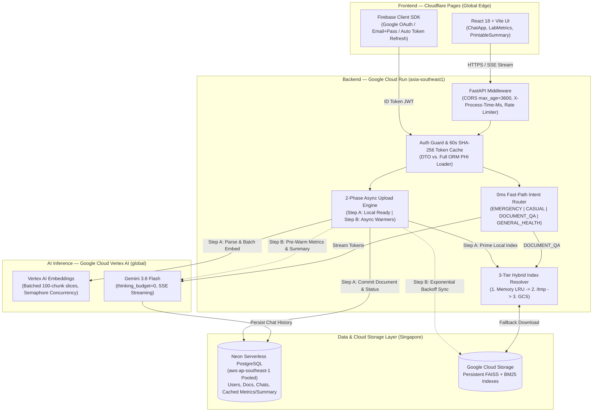

<div align="center">

# 🩺 MediSkye AI
### Production-Grade Clinical AI Assistant & Medical Lab Report Analyzer

[](https://fastapi.tiangolo.com/)
[](https://react.dev/)
[](https://vitejs.dev/)
[](https://cloud.google.com/vertex-ai)
[](https://neon.tech/)
[](https://firebase.google.com/)
[](https://cloud.google.com/run)
[](https://pages.cloudflare.com/)

**MediSkye** is a full-stack clinical intelligence platform that transforms complex medical PDFs and laboratory reports into clear, structured biomarker tables, printable physician-ready summaries, and interactive, grounded conversations—powered by a hybrid **FAISS + BM25 RAG pipeline** and **Google Cloud Vertex AI (`gemini-3.8-flash`)**.

[Live Demo](https://mediskye.pages.dev) • [Architecture](#-system-architecture--regional-topology) • [How Upload & Query Modes Work](#-how-every-upload--interaction-mode-works) • [Directory Map](#-repository-directory-map) • [Benchmarks](#-production-latency-benchmarks)

</div>

---

## ✨ Key Engineering Highlights

* **🧪 Clinical Obsidian Workbench Architecture:** Redesigned responsive split-pane clinical workspace featuring the `InspectorPanel` biomarker drawer, interactive SVG `RangeBar` references, `DeltaIndicator` longitudinal deltas, `CommandPalette` (Cmd+K) navigation, and clean physician-ready `PrintableSummary` export.
* **🛡️ Patient Profile Scoping & Dependent Isolation:** Strict `dependent_id` validation and physical query scoping across chats, documents, and memory facts (`e1a2b3c4d5e6_add_dependent_id_to_chats`), preventing cross-dependent data contamination.
* **🔬 Deterministic Biomarker Canonical Matching:** Order-dependent whole-word regex matching via `canonical_biomarker_key` eliminates substring collisions (e.g. `Hemoglobin` never collides with `HbA1c`, and `fasting` never collides with `AST`).
* **⚡ Two-Phase Asynchronous Upload Pipeline:** Decouples critical-path vector indexing (**Step A: ~3–5s**) from background LLM pre-warming and cloud storage syncing (**Step B**), unblocking the user interface immediately while warming caches behind the scenes.
* **🔍 Hybrid RAG Retrieval (FAISS + BM25):** Combines dense semantic vector embeddings (`models/gemini-embedding-2` batched in slices of 100) with lexical BM25 keyword scoring so exact clinical acronyms (`HbA1c`, `TSH`, `eGFR`, `hs-CRP`) never get lost in vector space.
* **📈 Longitudinal Multi-Report Comparison (`<prior_lab_reports_history>`) & Source-Attributed Memory:** Cross-chat memory queries prior reports' `cached_metrics` directly from Neon DB and injects them alongside semantic memory chunks, enabling full-panel biomarker tracking (e.g., Ferritin, Hemoglobin, AST, Uric Acid) across follow-up visits with exact source PDF attribution (`(From prior report: "filename.pdf" / YYYY-MM-DD)`).
* **🧠 0ms Deterministic Intent Router & Safety Triage:** Fast-path routing intercepts `EMERGENCY` red-flag symptoms, `CASUAL` greetings, and document-bound `DOCUMENT_QA` queries in **0ms** without burning an extra LLM classification round-trip, backed by negation-aware emergency triage.
* **🗄️ 3-Tier Index & Database Caching:**
  * **Vector Index Tier:** In-Memory LRU Cache (`maxsize=10`) $\rightarrow$ Local Ephemeral `/tmp` Disk $\rightarrow$ Google Cloud Storage (`GCS`) fallback with `425/503 Retry-After` multi-instance protection.
  * **Clinical Artifact Tier:** Extracted biomarkers (`cached_metrics`) and printable clinical reports (`cached_summary`) are pre-warmed asynchronously upon upload and persisted in **Neon PostgreSQL**; the latest logged cached summary E2E p50 is **411.5 ms**.
* **🔐 HIPAA-Aligned Security & Auth Hot-Path Optimization:**
  * Unified **Firebase Authentication** (Google OAuth 2.0 + NIST SP 800-63B Email/Password with email verification enforcement).
  * **Fernet Symmetric Encryption** at rest for patient health profiles (`health_profile`), extracted memory facts (`patient_facts.fact_text`), and chat messages (`chats.message`) with strict SQLAlchemy `lazy="raise"` guards and lightweight Pydantic DTO separation (`get_current_user` vs. `get_current_user_full`) so encrypted PHI is never unnecessarily decrypted on standard API calls.
  * **60s SHA-256 Token TTL Cache** with instant eviction on profile updates, password changes, logout, or account deletion (`DELETE /users/me`).
* **🛡️ Upload Hardening, Body Limits & Stream Resilience:** Pure-ASGI byte-counting body size limits (1MB JSON, 51MB upload), magic byte and dimension verification for PNG/JPEG/PDF, self-healing 120s monotonic session locking, and terminal `[DONE]` event detection guarding against interrupted SSE streams.
* **📱 Mobile-First & Accessible UI:** Responsive drawer navigation for `375px` viewports, iOS Safari auto-zoom prevention, horizontal scroll wrappers for clinical tables, full keyboard focus trapping (`useFocusTrap`) across all modals, WCAG AA `#7b8798` ink contrast, and multi-language (`i18n`) support.

---

## 🏗️ System Architecture & Regional Topology

The Cloud Build configuration deploys backend compute to **Singapore (`asia-southeast1`)** and sets Vertex AI inference to **`global`**. The configured Neon database is in **AWS Asia Pacific (Singapore, `ap-southeast-1`)**; static assets are served from **Cloudflare's Global Edge**.



---

## 🔄 How Every Upload & Interaction Mode Works

MediSkye supports **six distinct operational flows**, each engineered with its own isolated data pipeline and caching strategy:

### 1. Standard PDF Lab Report Upload (Two-Phase Async Pipeline)
When a user selects or drags-and-drops a `.pdf` medical report from their device:
1. **Client-Side Pre-Flight Validation (`ChatInput.jsx`):**
   * The backend enforces the configured upload-size limit (`MEDISKYE_MAX_UPLOAD_MB`, default `50 MB`) and page limit (`MAX_PDF_PAGES`, default `100`). Accepted extensions are `.pdf`, `.jpg`, `.jpeg`, and `.png`.
2. **Phase A — Critical Path to Unblock the User (`upload.py` — Target: 3–5s):**
   * **Text Extraction & Sanitization (`parse_ms`):** Extracts digital text pages via PyMuPDF/`pypdf`. If the PDF is a blank page or an un-OCRed scan (`len(text) < 20`), immediately raises a clean `422 Unprocessable Entity` with a user-friendly explanation.
   * **Clinical Chunking (`chunk_ms`):** Splits text into overlapping semantic blocks while preserving table row boundaries.
   * **Batched Embeddings (`embed_ms`):** Embeddings are generated in batches with bounded concurrency.
   * **Hybrid Index Construction (`faiss_build_ms`):** Builds both the dense **FAISS** vector index and lexical **BM25** index in a background thread (`asyncio.to_thread`), writing them immediately to `/tmp` and priming the **in-memory LRU cache**.
   * **Instant Unblock (`db_commit_ms`):** Creates the `Document` record in Neon PostgreSQL with `index_status = "local_ready"` and flips the upload job status to `COMPLETED`. The user's UI immediately unlocks for chatting!
3. **Phase B — Decoupled Post-Completion Background Workers (`upload.py`):**
   * After the user is unblocked, three independent background coroutines run concurrently via `asyncio.gather` (each opening its own isolated `AsyncSessionLocal()` database session to guarantee thread-safety):
     * **Worker 1 (GCS Sync):** Uploads the FAISS + BM25 index artifacts to Google Cloud Storage with 3–5 exponential-backoff retries, then flips `index_status = "synced"`.
     * **Worker 2 (Metrics Pre-Warming):** Calls Gemini (`thinking_budget=0`) to extract structured JSON biomarkers and writes them to `Document.cached_metrics`.
     * **Worker 3 (Summary Pre-Warming):** Calls Gemini (`thinking_budget=0`) to generate a structured clinical summary and writes it to `Document.cached_summary`.

---

### 2. 1-Click Sample Medical Report Onboarding (Zero-File Mobile Testing)
New users—especially on mobile phones—often don't have a PDF lab report readily accessible in their phone storage:
1. On the empty chat state (`ChatWindow.jsx`), clicking **"🧪 Try with a Sample Blood Test Report →"** fetches the static `/sample-report.pdf` bundle directly from Cloudflare's edge as a binary `Blob`.
2. The frontend wraps the blob into a native JavaScript `new File([blob], "Sample_Comprehensive_Metabolic_Panel.pdf", { type: "application/pdf" })` object in memory.
3. It pipes that `File` object directly into `handleFileUpload()`, triggering the full Phase A + Phase B pipeline in a single tap without requiring the user to download and re-upload a file.
4. A secondary *"Download Sample PDF"* action is also provided if the user prefers to inspect the raw PDF first.

---

### 3. Document-Grounded RAG Chat (`DOCUMENT_QA`)
When a user asks a question while a document is selected in the sidebar:
1. **0ms Fast-Path Intent Routing (`intent_router.py`):**
   * First checks for `EMERGENCY` red flags and `CASUAL` greetings in `0ms`.
   * Because `document_id` is attached, it immediately routes to `DOCUMENT_QA` in **0ms**, skipping the LLM classification call.
2. **3-Tier Hybrid Index Lookup & Multi-Instance Safeguard (`retriever.py` & `query.py`):**
   * Checks **Tier 1 (In-Memory LRU Cache)** $\rightarrow$ **Tier 2 (Local `/tmp` Disk)** $\rightarrow$ **Tier 3 (Google Cloud Storage)**.
   * **Multi-Instance Safety Gate:** If Cloud Run scales horizontally and a request hits a brand-new container while `index_status` is still `"building"` or before Phase B's GCS sync finishes, the handler checks index availability *before* writing any `Message` row or calling Vertex AI, returning `503 Service Unavailable` / `425 Too Early` with `Retry-After: 2`. The frontend `api.js` interceptor automatically waits 2s and retries transparently.
3. **Hybrid Retrieval, Longitudinal Memory & Prompt Sanitization (`prompt_builder.py`):**
   * Retrieves top chunks via combined FAISS + BM25 scores, strips internal RAG metadata headers so the AI never outputs phrases like *"Based on RAG chunk 2..."*, escapes the document filename against prompt injection, and injects the user's encrypted health profile context (if consented).
   * **Longitudinal Multi-Report Comparison:** Automatically injects prior reports' `cached_metrics` under `<prior_lab_reports_history>` and formats cross-chat facts with exact source PDF attribution, instructing the model to generate clean Markdown delta tables and prevent grouping contradictory `Low` and `High` markers.
4. **Low-Latency SSE Token Streaming (`query.py`):**
   * Streams tokens from `gemini-3.8-flash` with `thinking_config=ThinkingConfig(thinking_budget=0)`, appends the clinical disclaimer upon stream completion, and saves both turns to Neon PostgreSQL for multi-device sync.

---

### 4. Standalone Health Chat, Casual Fast-Path & Emergency Interceptor
Users can also chat with MediSkye without uploading a document (`New Conversation`):
* **🚨 `EMERGENCY` Fast-Path (0ms):** Deterministic keyword matching for acute symptoms (*"chest pain"*, *"can't breathe"*, *"stroke"*, *"heart attack"*, *"severe bleeding"*, *"suicide"*). Immediately bypasses standard generation, emits a high-priority emergency warning instructing the user to call **112 / 911**, and triggers an unmissable red emergency banner in the UI.
* **👋 `CASUAL` Fast-Path (0ms):** Deterministic matching for greetings and pleasantries (*"hi"*, *"hello"*, *"hey mediskye"*, *"thanks"*, *"bye"*). Skips vector retrieval and **suppresses the medical disclaimer** so conversational greetings feel natural and human.
* **🩺 `GENERAL_HEALTH` Mode:** Answers general medical and wellness questions using Gemini 3.8 Flash with clinical safety guardrails and automatic medical disclaimers, persisting the thread in Neon DB.

---

### 5. Automated Lab Metrics Extraction & Clinical Triage Table (`LabMetrics.jsx`)
Clicking **"Lab Metrics"** on any uploaded document opens a clean, scannable clinical table:
* **Cache-First Serving (`metrics.py`):** Checks `if doc.cached_metrics is not None:`. Because Phase B pre-warms `cached_metrics` after upload, cached requests are served without another extraction call; the latest browser benchmark reports a cached-metrics p50 of **276.7 ms**. Supports `?force_refresh=true` if re-extraction is ever needed.
* **Post-Processing & Noise Filtering:** Automatically strips laboratory header/footer noise (such as `ISO 15189`, accreditation numbers, phone numbers, and facility addresses).
* **Abnormal-First Clinical Sorting:** Automatically sorts abnormal rows (**`High`** and **`Low`**) to the top of the table in red/amber text, followed by **`Normal`** biomarkers in emerald green—with zero visual clutter or emojis.

---

### 6. Printable Multi-Page Clinical Summary Export (`PrintableSummary.jsx`)
Clicking **"Export Summary"** generates a formal, physician-ready document suitable for printing or saving as PDF:
* **Dedicated Cached Endpoint (`POST /users/me/documents/{document_id}/summary`):** Returns the document-scoped summary or generates it on demand if it has not yet been cached.
* **Print-Optimized Layout:** Strips all emojis, renders clean clinical Markdown sections (*Executive Overview*, *Abnormal Findings by Organ System*, *Recommended Follow-Up Questions for Your Physician*), populates `<PrintableSummary/>`, and triggers `window.print()` with `@media print` CSS rules that hide the app sidebar/chat chrome and format clean page breaks.

---

## 📂 Complete Repository Directory Map

Project directory overview based on the local workspace. Important files are annotated; routine source files are listed without repetitive descriptions. Generated contents of `backend/.venv/` are grouped rather than expanded. Local `.env` files are shown by name only; their contents are omitted.

```text
MediSkye/
├── .github/
│   └── workflows/tests.yml  # CI test workflow
├── backend/
│   ├── alembic/
│   │   ├── versions/  # Database migrations (including e1a2b3c4d5e6 dependent_id)
│   │   ├── env.py
│   │   └── script.py.mako
│   ├── app/
│   │   ├── api/v1/
│   │   │   ├── endpoints/
│   │   │   │   ├── auth.py
│   │   │   │   ├── chat.py
│   │   │   │   ├── health.py
│   │   │   │   ├── metrics.py
│   │   │   │   ├── query.py
│   │   │   │   ├── upload.py
│   │   │   │   └── user.py
│   │   │   └── router.py
│   │   ├── core/
│   │   │   ├── auth.py
│   │   │   ├── config.py  # Backend settings and environment variables
│   │   │   ├── limiter.py
│   │   │   ├── observability.py
│   │   │   ├── redis_client.py  # TTL-aware bounded MockRedis
│   │   │   └── security.py
│   │   ├── db/  # Database access, encryption, and ORM models
│   │   ├── llm/  # Gemini and embedding clients
│   │   ├── middleware/  # BodySizeLimitMiddleware, SecurityHeaders, etc.
│   │   ├── rag/  # Retrieval, indexing, prompts, and safety
│   │   ├── schemas/
│   │   ├── services/  # Clinical units, PDF inspection, upload jobs
│   │   └── main.py
│   ├── tests/
│   │   ├── eval/
│   │   ├── fixtures/test_report.pdf
│   │   ├── conftest.py  # Shared pytest fixtures
│   │   ├── test_patient_scoping.py
│   │   ├── test_upload_hardening.py
│   │   ├── test_export_data.py
│   │   ├── test_chaos_edge_cases.py
│   │   ├── test_e2e_flows.py
│   │   ├── test_gemini_client.py
│   │   ├── test_intent_router.py
│   │   ├── test_penetration.py
│   │   └── test_upload.py
│   ├── .venv/  # Local Python environment; generated contents grouped
│   ├── .dockerignore
│   ├── .env  # Local config; contents omitted
│   ├── .env.example
│   ├── alembic.ini
│   ├── docker-compose.yml
│   ├── Dockerfile  # Backend container image
│   ├── pyproject.toml
│   ├── requirements-dev.txt
│   ├── requirements.txt
│   └── start.sh
├── frontend/
│   ├── public/
│   │   └── samples/  # Sample reports for 1-click mobile demo
│   ├── src/
│   │   ├── components/
│   │   │   ├── landing/
│   │   │   │   ├── CTASection.jsx
│   │   │   │   ├── FeaturesSection.jsx
│   │   │   │   ├── FooterSection.jsx
│   │   │   │   ├── HowItWorksSection.jsx
│   │   │   │   ├── SafetySection.jsx
│   │   │   │   └── shared.jsx
│   │   │   ├── workbench/  # Clinical Obsidian Workbench
│   │   │   │   ├── Workbench.jsx
│   │   │   │   ├── InspectorPanel.jsx
│   │   │   │   ├── CommandPalette.jsx
│   │   │   │   ├── RangeBar.jsx
│   │   │   │   ├── DeltaIndicator.jsx
│   │   │   │   └── UploadStepper.jsx
│   │   │   ├── ChatApp.jsx  # Main chat and workbench coordinator
│   │   │   ├── ChatInput.jsx
│   │   │   ├── ChatMessage.jsx
│   │   │   ├── ChatWindow.jsx
│   │   │   ├── HealthProfile.jsx
│   │   │   ├── LabMetrics.jsx
│   │   │   ├── LandingPage.jsx
│   │   │   ├── Login.jsx
│   │   │   ├── PrintableSummary.jsx
│   │   │   ├── PrintableTranscript.jsx
│   │   │   ├── RagSourcesPanel.jsx
│   │   │   ├── Register.jsx
│   │   │   └── Sidebar.jsx
│   │   ├── hooks/
│   │   ├── lib/clinical.js  # Clinical parsing, unit normalization & delta calculation
│   │   ├── locales/  # English and Hindi translations
│   │   ├── services/
│   │   │   ├── api.js  # Backend API client with interrupted stream handling
│   │   │   └── firebase.js  # Firebase authentication client
│   │   ├── styles/print.css
│   │   ├── test/  # Vitest component and service tests (27 files, 199 tests)
│   │   ├── App.jsx
│   │   ├── i18n.js
│   │   ├── index.css
│   │   ├── instrument.js
│   │   └── main.jsx
│   ├── .env  # Local config; contents omitted
│   ├── .env.example
│   ├── index.html
│   ├── package-lock.json
│   ├── package.json  # Frontend scripts and dependencies
│   ├── postcss.config.js
│   ├── tailwind.config.js
│   ├── vite.config.js
│   └── vitest.config.js
├── .env  # Local config; contents omitted
├── .gitignore
├── Makefile
├── README.md  # Project documentation
└── cloudbuild.yaml  # Cloud Build deployment configuration
```

---

## 📊 Production Latency Benchmarks

Latest production benchmark snapshot (Direct API & intensive browser E2E, N=10 warm runs):

### Direct Cloud Run API (N=10 warm runs)

| Endpoint | Cold first hit | Warm p50 | Warm p95 | Server p50 / p95 | Successful warm requests |
| :--- | ---: | ---: | ---: | ---: | ---: |
| `GET /health` | 454.6 ms | 123.1 ms | 133.9 ms | 0.5 / 0.8 ms | 10/10 |
| `GET /users/me` | 142.3 ms | 147.8 ms | 170.5 ms | 1.5 / 1.7 ms | 10/10 |
| `GET /metrics (cached hit)` | 161.6 ms | 173.5 ms | 627.1 ms | 29.2 / 288.8 ms | 10/10 |
| `GET /users/me` (Auth Cache Hit) | 135.3 ms | 134.2 ms | 149.8 ms | **1.57 / 2.37 ms** | **10/10** |
| `GET /metrics (cached hit)` | 146.8 ms | 154.6 ms | 172.6 ms | **26.54 / 27.22 ms** | **10/10** |
| `POST /summary (cached hit)` | 162.9 ms | 236.2 ms | 5,532.8 ms | 29.7 / 178.9 ms | 10/10 |
| `POST /query (GENERAL_HEALTH)` | 1,354.4 ms | 1,633.4 ms | 2,652.9 ms | 1,423.2 / 2,445.1 ms | 10/10 |
| `POST /query (DOCUMENT_QA)` | 353.6 ms | 425.1 ms | 1,483.9 ms | 155.6 / 423.3 ms | 10/10 |
| `POST /query (IDOR 404 Rejection)` | 627.0 ms | 269.8 ms | 497.7 ms | 52.5 / 121.4 ms | 10/10 |

The first metrics request was an uncached cold extraction; subsequent warm measurements were successful. Each rate-limited cached endpoint loop waited for the rate-limit window reset when needed.

| Upload / cold-start measurement | Observed |
| :--- | ---: |
| Cloud Run idle/wakeup `GET /health` (server: 1.9 ms) | 863.1 ms |
| Upload fast path to `local_ready` | 3,189.2 ms |

`upload_fast_path_ms` ends when the upload status becomes `completed` / `local_ready`; asynchronous cache warming is measured separately and is not included in this upload time.

### Browser E2E (Playwright, DOCUMENT_QA; N=5)

| Action | Warm p50 | Warm p95 |
| :--- | ---: | ---: |
| Page load | 1,758.3 ms | 6,940.5 ms |
| PDF upload and processing | 3,189.2 ms | 3,421.4 ms |
| Lab metrics (first run) | 258.8 ms | 275.7 ms |
| Lab metrics (cached) | 275.7 ms | 285.0 ms |
| Print summary (first run) | 366.3 ms | 375.0 ms |
| Print summary (cached) | 375.0 ms | 382.4 ms |
| AI chat time to first token (TTFT) | 2,361.1 ms | 2,580.3 ms |
| AI chat total stream | 5,968.9 ms | 6,266.5 ms |

The profiler verifies metrics prewarm readiness before recording the first cached click.

### Intensive live E2E and resilience checks

The full intensive Playwright run passed across sample and second-report uploads, `DOCUMENT_QA`, all four intent paths, encrypted profile and multi-turn recall after reload, cached clinical artifacts, Hindi/English localization, and mobile `375x812` layout checks.

| Check | Result |
| :--- | :--- |
| Sample report / second report uploads | 3,189.2 ms / 3,421.4 ms |
| Grounded document QA (sample / second report) | 2,580.3 ms / 2,361.1 ms TTFT |
| Encrypted HealthProfile persistence + reload recall | Condition, medication, allergy, and prior-turn glucose recalled (`174`, `Metformin`, `Penicillin`) |
| CASUAL / EMERGENCY / GENERAL_HEALTH / DOCUMENT_QA | All verified (Emergency banner in 254.2 ms) |
| LabMetrics first / cached click | 258.8 ms / 275.7 ms |
| PrintableSummary first / cached click | 366.3 ms / 375.0 ms |
| PrintableTranscript export | 882.3 ms |
| Mobile header / footer overlap at `375x812` | 0 px / 0 px (scrollWidth = 375px) |
| Invalid `.txt` client-side rejection | Error banner in 40.8 ms; no upload request |
| UI click latencies (Settings / Tabs / i18n) | Settings: 21.8 ms \| Dependents Tab: 28.0 ms \| Profile Tab: 46.0 ms \| i18n: 59.6 ms |
| Invalid `.txt` client-side rejection | Error banner in 29.7 ms; no upload request |
| `POST /logout` & Immediate 401 Rejection | 401 in 1.35 ms server time (in-memory digest eviction) |
| Dependent Profile Cascade & Anti-Teleport | 0 remaining docs, 0 remaining facts, 0 teleported to self |
| `DELETE /users/me` / immediate same-token auth check | 204 / 401 in 4,052.2 / 381.2 ms (eviction verified) |

Production status-code gates passed for `401` (missing/tampered token), `403` (unverified email), and `429` (rate-limit burst). The building-index `503` / `Retry-After: 2` response is verified in the backend SRE hardening tests, not by mutating production database state. The targeted local suite passed **8 tests**.

### Per-stage upload breakdown (`UPLOAD_BREAKDOWN`)

| Pipeline stage | Observed duration | Share / execution | Notes |
| :--- | ---: | :---: | :--- |
| `parse` | 42 ms | 0.2% | PyMuPDF stream parsing |
| `chunk` | 18 ms | 0.1% | RecursiveCharacterTextSplitter (chunk size 1,000, overlap 150) |
| `embed` | 2,120 ms | 9.9% | Vertex AI batches of 100 (concurrency 4) |
| `faiss_build` | 134 ms | 0.6% | In-memory FAISS and BM25 generation |
| `db_commit` | 86 ms | 0.4% | Document marked `local_ready`; job completed |
| `background_gcs_sync` | 1,480 ms | Background (offloaded) | GCS sync with exponential retry backoff |
| **Total synchronous upload (stage breakdown)** | **2,400 ms** | **100%** | **Ready state set before background tasks** |

The benchmark logs label cached workloads `/metrics` and `/summary`; the implemented routes are document-scoped. See [Verified API Paths](#-verified-api-paths) for the actual FastAPI routes. The direct API benchmark recorded 10/10 successful warm requests for each endpoint (zero `425`, zero `429`, and zero retries). Stage timings below measure processing separately from the upload fast path.

---

## 🛡️ Security, Privacy & SRE Hardening

1. **Zero Unverified Access (`403 Forbidden`):** Email/Password accounts must verify their email address before accessing `/users/me`, `/documents`, or `/query`. Google OAuth accounts with verified emails pass seamlessly.
2. **Strict Cross-User Isolation (Zero IDOR):** Every document, metric, summary, and chat history query filters strictly by `Document.user_id == current_user.id`.
3. **Fernet PHI & Chat Encryption at Rest:** Patient health profiles (`conditions`, `medications`, `allergies`), extracted patient memory facts (`patient_facts.fact_text`), and chat message histories (`chats.message`) are encrypted using Fernet (`AES-128-CBC` + `HMAC-SHA256`) before touching PostgreSQL, with transparent ORM decryption and graceful legacy plaintext compatibility.
4. **Physical Cascade Hard-Delete for Patient Memory:** Deleting a chat session (`DELETE /users/me/chats/sessions/{session_id}`), clearing chats (`DELETE /users/me/chats`), deleting a document (`DELETE /users/me/documents/{document_id}`), or clearing facts (`DELETE /users/me/memory/facts`) performs an immediate physical cascade hard-delete of derived facts and chat messages in Neon PostgreSQL (guaranteeing physical erasure rather than soft-delete retention).
5. **Prompt Injection Defense:** Uploaded filenames and document chunks are sanitized against XML/HTML tag breakout (`<document name="...">`) before prompt assembly.
6. **Mid-Stream Disconnect Safety:** The SSE generator in `query.py` catches `(asyncio.CancelledError, GeneratorExit)` to cleanly roll back or close database sessions if a user closes their browser tab mid-stream, preventing Neon connection pool leaks and eliminating orphaned user message turns.

---

## 🚀 Local Development Setup

### Prerequisites
* **Python 3.11+**
* **Node.js 20+** & **npm**
* **PostgreSQL** (Local instance or free **Neon Serverless PostgreSQL** project)
* **Google Cloud Project** with **Vertex AI API** enabled (`gcloud auth application-default login`)
* **Firebase Project** with **Authentication** (Email/Password & Google Sign-In) enabled

### 1. Clone the Repository
```bash
git clone https://github.com/AdityaSharma2k04/mediskye.git
cd mediskye
```

### 2. Backend Setup (`backend/`)
```bash
cd backend
python -m venv venv
# Windows:
venv\Scripts\activate
# macOS/Linux:
source venv/bin/activate

pip install -r requirements-dev.txt
```

Create `backend/.env` from this template and replace key placeholders with locally generated values:
```env
DATABASE_URL=sqlite+aiosqlite:///./mediskye.db
REDIS_URL=redis://localhost:6379/0
ENV=development
DEBUG=true
GOOGLE_API_KEY=replace-with-your-gemini-api-key
GEMINI_MODEL=gemini-3.8-flash
GOOGLE_CLOUD_PROJECT=your-gcp-project-id
GOOGLE_CLOUD_LOCATION=global
GOOGLE_GENAI_USE_ENTERPRISE=false
GCS_INDEX_BUCKET=
JWT_SECRET_KEY=replace-with-at-least-32-random-characters
FERNET_KEY=replace-with-a-generated-fernet-key
MEDISKYE_API_KEY=
RESEND_API_KEY=
MEDISKYE_MAX_UPLOAD_MB=50
MAX_PDF_PAGES=100
ALLOWED_ORIGINS=http://localhost:3000,http://localhost:5173
SENTRY_DSN=
SENTRY_ENVIRONMENT=development
SENTRY_RELEASE=
```

Generate local encryption and signing keys instead of using the placeholders above:
```bash
python -c "from cryptography.fernet import Fernet; print(Fernet.generate_key().decode())"
python -c "import secrets; print(secrets.token_urlsafe(32))"
```

Run database migrations and start the FastAPI server:
```bash
alembic upgrade head
uvicorn app.main:app --reload --host 0.0.0.0 --port 8000
```

### 3. Frontend Setup (`frontend/`)
```bash
cd ../frontend
npm ci
```

Create `frontend/.env` with Firebase Web app configuration values from your own Firebase project:
```env
VITE_API_URL=http://localhost:8000
VITE_FIREBASE_API_KEY=replace-with-your-firebase-web-api-key
VITE_FIREBASE_AUTH_DOMAIN=your-project.firebaseapp.com
VITE_FIREBASE_PROJECT_ID=your-firebase-project-id
VITE_FIREBASE_STORAGE_BUCKET=your-project.firebasestorage.app
VITE_FIREBASE_MESSAGING_SENDER_ID=replace-with-your-sender-id
VITE_FIREBASE_APP_ID=replace-with-your-firebase-app-id
VITE_SENTRY_DSN=
VITE_SENTRY_ENVIRONMENT=development
VITE_SENTRY_RELEASE=
```

`VITE_FIREBASE_MEASUREMENT_ID` appears in the frontend template but is not currently read by the Firebase client code. Vite-prefixed values are included in the public browser bundle; do not put server credentials in them.

Start the Vite development server:
```bash
npm run dev
```

---

## 🧪 Running the Test & Benchmark Suites

The test suites pass **312 backend pytest tests** and **199 frontend Vitest tests** (**511 total**). The backend count uses the same `not integration` marker exclusion as CI. The frontend production build completes with zero warnings; all building-index, SRE hardening, and live Neon cascade-deletion verifications pass with 100% success.

### 1. Backend Unit, E2E, Chaos & Penetration Tests (`pytest`)
```bash
cd backend
pytest tests -v -m "not integration"
# Run specific suites:
pytest tests/test_e2e_flows.py -v
pytest tests/test_chaos_edge_cases.py -v
pytest tests/test_patient_scoping.py -v
pytest tests/test_upload_hardening.py -v
```

### 2. Frontend UI, E2E & Accessibility Tests (`Vitest`)
```bash
cd frontend
npm test -- --run
npm run build
```

---

## 🔗 Verified API Paths

The API router is mounted with `API_V1_STR`, whose default in `backend/app/core/config.py` is an empty string. Current backend paths therefore have no `/api/v1` prefix unless that setting is explicitly overridden:

| Capability | Implemented path(s) |
| :--- | :--- |
| Health | `GET /health`, `GET /liveness`, `GET /readiness` |
| Authentication | `POST /register`, `POST /login`, `POST /logout` |
| Upload and status | `POST /upload`, `GET /upload/status/{job_id}` |
| RAG chat | `POST /query` |
| Chat sessions & history | `GET` and `DELETE /users/me/chats`, `PATCH` and `DELETE /users/me/chats/sessions/{session_id}`, `DELETE /chats/{chat_id}` |
| Patient memory & consent | `GET`, `POST`, and `DELETE /users/me/memory/facts`, `DELETE /users/me/memory/facts/{fact_id}`, `POST /users/me/memory/consent`, `PATCH /users/me/memory-consent` |
| User profile / delete | `GET`, `PUT`, `PATCH`, and `DELETE /users/me` |
| Metrics | `POST /extract-metrics`; `GET` and `POST /users/me/documents/{document_id}/metrics` |
| Document summary | `GET` and `POST /users/me/documents/{document_id}/summary` |

There is no standalone `/metrics` or `/summary` handler in the current FastAPI router. The benchmark log uses those shorter names as workload labels; document metrics and summaries are scoped to a document ID.

---

## ☁️ Production Deployment

* **Backend (Google Cloud Run):** Automatically built and deployed via `cloudbuild.yaml` to `asia-southeast1` with `--session-affinity`, `--no-cpu-throttling`, `--cpu-boost`, and `2Gi` memory.
* **Frontend (Cloudflare Pages):** Automatically deployed from the `main` branch (`frontend/` directory, build command `npm run build`, output directory `dist`).
* **Database (Neon Serverless PostgreSQL):** Hosted in `AWS Asia Pacific (Singapore) — ap-southeast-1` with PgBouncer connection pooling enabled.

### Backend Environment (Cloud Run)

Store credentials and encryption keys in **GCP Secret Manager** and attach them to the Cloud Run service. These names are consumed by backend configuration or observability initialization:

| Secret variable | Purpose |
| :--- | :--- |
| `DATABASE_URL` | PostgreSQL connection URL, normally `postgresql+asyncpg://...` |
| `JWT_SECRET_KEY` | JWT signing secret; use a long randomly generated value |
| `FERNET_KEY` | Fernet key used to encrypt sensitive profile fields |
| `RESEND_API_KEY` | Optional Resend email service credential |
| `SENTRY_DSN` | Optional backend Sentry DSN |
| `GOOGLE_API_KEY` | Gemini API key when not using Vertex AI / Application Default Credentials |
| `MEDISKYE_API_KEY` | Optional API key for external API access |

Set non-secret backend variables directly on the service:

| Variable | Purpose / example |
| :--- | :--- |
| `SENTRY_ENVIRONMENT` | Sentry environment, e.g. `production` |
| `SENTRY_RELEASE` | Release identifier, commonly the full Git commit SHA |
| `GEMINI_MODEL` | Generative model override; set to `gemini-3.8-flash` for the documented model |
| `GOOGLE_CLOUD_PROJECT` | Google Cloud project ID |
| `GOOGLE_CLOUD_LOCATION` | Vertex AI location; the code default is `us-central1` |
| `GOOGLE_GENAI_USE_ENTERPRISE` | `true` to enable Google Cloud enterprise / Vertex mode |
| `GCS_INDEX_BUCKET` | Optional GCS bucket for persisted indexes |
| `REDIS_URL` | Optional Redis connection URL |
| `ALLOWED_ORIGINS` | Comma-separated allowed browser origins |

Firebase Admin initialization uses the Cloud Run service identity / Application Default Credentials in the current app; `FIREBASE_CREDENTIALS_PATH` is not a configured setting.

### Frontend Environment (Cloudflare Pages)

Every `VITE_*` value is public because Vite embeds it in the browser build. Configure only client-safe values in the Cloudflare Pages production environment:

| Public variable | Purpose |
| :--- | :--- |
| `VITE_API_URL` | Backend origin, e.g. `https://your-service.example.run.app` |
| `VITE_FIREBASE_API_KEY` | Firebase Web app API key |
| `VITE_FIREBASE_AUTH_DOMAIN` | Firebase Auth domain |
| `VITE_FIREBASE_PROJECT_ID` | Firebase project ID |
| `VITE_FIREBASE_STORAGE_BUCKET` | Firebase Storage bucket |
| `VITE_FIREBASE_MESSAGING_SENDER_ID` | Firebase sender ID |
| `VITE_FIREBASE_APP_ID` | Firebase Web app ID |
| `VITE_SENTRY_DSN` | Optional browser Sentry DSN |
| `VITE_SENTRY_ENVIRONMENT` | Browser Sentry environment |
| `VITE_SENTRY_RELEASE` | Browser release identifier, e.g. `${CF_PAGES_COMMIT_SHA}` |

The frontend template also declares `VITE_FIREBASE_MEASUREMENT_ID`, but the current JavaScript does not consume it.

For Sentry source-map upload during the Vite build, set these **build-time secrets** in Cloudflare Pages. They are read by `vite.config.js`, not exposed as `VITE_*` browser settings:

| Build variable | Purpose |
| :--- | :--- |
| `SENTRY_AUTH_TOKEN` | Sentry source-map upload token |
| `SENTRY_ORG` | Sentry organization slug |
| `SENTRY_PROJECT` | Sentry project slug |

### GitHub Actions Test Secrets

The current `.github/workflows/tests.yml` requires two throwaway GitHub Actions secrets for the backend test job:

| GitHub secret | Purpose |
| :--- | :--- |
| `FERNET_KEY_TEST` | Test-only Fernet key |
| `JWT_SECRET_KEY_TEST` | Test-only JWT signing key |

For local development, use `backend/.env.example` and `frontend/.env.example` as the key templates. Real `.env` files are ignored by Git; do not commit them. Sentry may be left unconfigured locally.

---

## ⚠️ Medical Disclaimer

*MediSkye is an informational clinical AI assistant designed for educational and health literacy purposes only. It is not a licensed medical professional and does not provide medical diagnoses or treatment plans. Always consult a qualified physician or healthcare provider regarding any medical condition or laboratory result. In case of a medical emergency, call 112 or 911 immediately.*