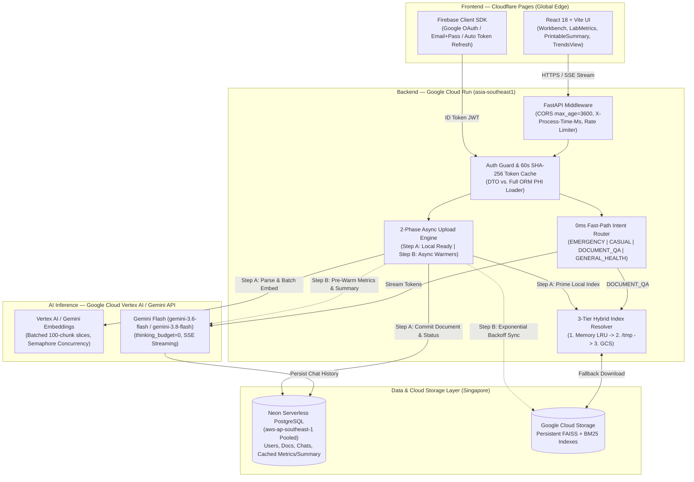

<div align="center">

# 🩺 MediSkye AI
### Production-Grade Clinical AI Assistant & Medical Lab Report Analyzer

[](https://fastapi.tiangolo.com/)
[](https://react.dev/)
[](https://vitejs.dev/)
[](https://cloud.google.com/vertex-ai)
[](https://neon.tech/)
[](https://firebase.google.com/)
[](https://cloud.google.com/run)
[](https://pages.cloudflare.com/)

**MediSkye** is a full-stack clinical intelligence platform that transforms complex medical PDFs and laboratory reports into clear, structured biomarker tables, printable physician-ready summaries, longitudinal trend charts, and interactive, grounded conversations—powered by a hybrid **FAISS + BM25 RAG pipeline** and **Google Cloud Vertex AI / Gemini API**.

[Live Demo](https://mediskye.pages.dev) • [Architecture](#-system-architecture--regional-topology) • [How Upload & Query Modes Work](#-how-every-upload--interaction-mode-works) • [Directory Map](#-repository-directory-map) • [Benchmarks](#-production-latency-benchmarks)

</div>

---

## ✨ Key Engineering Highlights

* **🧪 Clinical Obsidian Workbench Architecture:** Responsive split-pane clinical workspace featuring the `InspectorPanel` biomarker drawer, interactive SVG `RangeBar` references, `DeltaIndicator` longitudinal deltas, `TrendsView` and `TrendChart` multi-visit tracking, `CommandPalette` (Cmd+K) keyboard navigation, and physician-ready `PrintableSummary` export.
* **🛡️ Patient Profile Scoping & Dependent Isolation:** Strict `dependent_id` validation and physical query scoping across chats, documents, and memory facts (`e1a2b3c4d5e6_add_dependent_id_to_chats`), preventing cross-dependent data contamination.
* **🔬 Deterministic Biomarker Canonical Matching:** Order-dependent whole-word regex matching via `canonical_biomarker_key` eliminates substring collisions (e.g. `Hemoglobin` never collides with `HbA1c`, and `fasting` never collides with `AST`).
* **⚡ Two-Phase Asynchronous Upload Pipeline:** Decouples critical-path vector indexing (**Step A: ~3–5s**) from background LLM pre-warming and cloud storage syncing (**Step B**), unblocking the user interface immediately with `index_status = "local_ready"` while warming metrics and summary caches behind the scenes.
* **🔍 Hybrid RAG Retrieval (FAISS + BM25):** Combines dense semantic vector embeddings (`models/gemini-embedding-2` batched in slices of 100) with lexical BM25 keyword scoring via Reciprocal Rank Fusion (`RRF`, $k=60$) so exact clinical acronyms (`HbA1c`, `TSH`, `eGFR`, `hs-CRP`) never get lost in vector space.
* **📈 Longitudinal Multi-Report Tracking & Comparison:** Dedicated `GET /users/me/metrics/trends` endpoint delivers multi-visit chronologically ordered biomarker trajectories. During conversations, `<prior_lab_reports_history>` injects prior reports' `cached_metrics` directly from the database alongside semantic memory chunks, enabling full-panel longitudinal comparisons with exact source PDF attribution (`(From prior report: "filename.pdf" / YYYY-MM-DD)`).
* **🧠 0ms Deterministic Intent Router & Safety Triage:** Fast-path routing intercepts `EMERGENCY` red-flag symptoms, `CASUAL` greetings, and document-bound `DOCUMENT_QA` queries in **0ms** without burning an extra LLM classification round-trip, backed by negation-aware multilingual emergency triage (English, Hindi, Spanish, French, German).
* **🗄️ 3-Tier Index & Database Caching:**
  * **Vector Index Tier:** In-Memory LRU Cache (`maxsize=10`) $\rightarrow$ Local Ephemeral `/tmp` Disk $\rightarrow$ Google Cloud Storage (`GCS`) fallback with `425/503 Retry-After` multi-instance protection.
  * **Clinical Artifact Tier:** Extracted biomarkers (`cached_metrics`) and printable clinical reports (`cached_summary`) are pre-warmed asynchronously upon upload and persisted in **PostgreSQL**; cached artifact responses return in sub-second latency without repeating LLM inference.
* **🔐 HIPAA-Aligned Security & Auth Hot-Path Optimization:**
  * Dual **Firebase Authentication** (Google OAuth 2.0 + Email/Password with verification enforcement) + fallback local JWT support.
  * **Single-Flight Request Coalescing (`_single_flight`):** Parallel SPA requests at login coalesce concurrent token verification, resolving credentials once and serving subsequent requests from cache.
  * **Sub-5ms Revocation & In-Memory Digest Cache:** Immediate token revocation upon logout or password reset via in-memory SHA-256 digest cache, Redis blocklist, and database `token_invalid_before` cutoff.
  * **Fernet Symmetric Column Encryption at Rest:** Patient health profiles (`health_profile`), extracted memory facts (`patient_facts.fact_text`, `source_excerpt`), and chat messages (`chats.message`) are encrypted using Fernet (`AES-128-CBC` + `HMAC-SHA256`) before database writes, with strict SQLAlchemy `lazy="raise"` guards and lightweight Pydantic `UserDTO` separation (`get_current_user` vs. `get_current_user_full`) so encrypted PHI is never unnecessarily decrypted on standard API calls.
  * **60s SHA-256 Token TTL Cache:** Avoids redundant database round-trips on high-frequency API endpoints, with instant programmatic eviction on profile updates, password changes, logout, or account deletion (`DELETE /users/me`).
* **🛡️ Upload Hardening, Body Limits & Stream Resilience:** Pure-ASGI byte-counting body size limits (1MB JSON, 51MB upload), magic byte and dimension verification for PNG/JPEG/PDF, self-healing 120s monotonic session locking, and terminal `[DONE]` event detection guarding against interrupted SSE streams.
* **📱 Mobile-First & Accessible UI:** Responsive drawer navigation for `375px` viewports, iOS Safari auto-zoom prevention, horizontal scroll wrappers for clinical tables, full keyboard focus trapping (`useFocusTrap`) across all modals, WCAG AA `#7b8798` ink contrast, and multi-language (`i18n`) support.

---

## 🏗️ System Architecture & Regional Topology

The Cloud Build configuration deploys backend compute to **Singapore (`asia-southeast1`)** and sets Vertex AI inference to **`global`**. The configured Neon database is in **AWS Asia Pacific (Singapore, `ap-southeast-1`)**; static assets are served from **Cloudflare's Global Edge**.



---

## 🔄 How Every Upload & Interaction Mode Works

MediSkye supports **six distinct operational flows**, each engineered with its own isolated data pipeline and caching strategy:

### 1. Standard PDF Lab Report Upload (Two-Phase Async Pipeline)
When a user selects or drags-and-drops a `.pdf` medical report or medical scan from their device:
1. **Client-Side Pre-Flight Validation (`ChatInput.jsx`):**
   * The backend enforces the configured upload-size limit (`MEDISKYE_MAX_UPLOAD_MB`, default `50 MB`) and page limit (`MAX_PDF_PAGES`, default `100`). Accepted extensions are `.pdf`, `.jpg`, `.jpeg`, and `.png`.
2. **Phase A — Critical Path to Unblock the User (`upload.py` — Target: 3–5s):**
   * **Text Extraction & Sanitization (`parse_ms`):** Extracts digital text pages via PyMuPDF/`pypdf`. If the file is an image or radiological scan, classifies via Gemini Vision and enhances with CLAHE. If the PDF is empty or an un-OCRed scan (`len(text) < 20`), raises a clean `422 Unprocessable Entity` with an actionable explanation.
   * **Clinical Chunking (`chunk_ms`):** Splits text using `MedicalTextSplitter` into overlapping semantic blocks while protecting Markdown table rows and bullet list runs from being severed across chunk boundaries.
   * **Batched Embeddings (`embed_ms`):** Embeddings are generated in batches of 100 chunks with bounded concurrency (`EMBED_CONCURRENCY`, default 4).
   * **Hybrid Index Construction (`faiss_build_ms`):** Builds both the dense **FAISS** vector index and lexical **BM25** index in a worker thread (`asyncio.to_thread`), writes them immediately to local index storage, and primes the **in-memory LRU cache**.
   * **Instant Unblock (`db_commit_ms`):** Creates the `Document` record in PostgreSQL with `index_status = "local_ready"` and marks the upload job `COMPLETED`. The user's UI immediately unlocks for chatting!
3. **Phase B — Decoupled Post-Completion Background Workers (`upload.py`):**
   * After the user is unblocked, decoupled background tasks execute concurrently (each opening its own isolated `AsyncSessionLocal()` database session to guarantee thread-safety):
     * **Worker 1 (GCS Sync):** Uploads the FAISS + BM25 index artifacts to Google Cloud Storage with 3 exponential-backoff retries, then updates `index_status = "synced"`.
     * **Worker 2 (Metrics Pre-Warming):** Calls Gemini (`thinking_budget=0`) to extract structured JSON biomarkers and writes them to `Document.cached_metrics`.
     * **Worker 3 (Summary Pre-Warming):** Calls Gemini (`thinking_budget=0`) to generate a structured clinical summary and writes it to `Document.cached_summary`.

---

### 2. 1-Click Sample Medical Report Onboarding (Zero-File Mobile Testing)
New users—especially on mobile devices—often don't have a PDF lab report readily accessible in their device storage:
1. On the empty workbench state (`ChatWindow.jsx`), clicking a sample panel (e.g., Lipid Panel, Comprehensive Metabolic Panel, Thyroid Function, CBC, Diabetes Panel) fetches the static `/samples/report-*.pdf` bundle directly from the app as a binary `Blob`.
2. The frontend wraps the blob into a native JavaScript `File` object in memory.
3. It pipes that `File` object directly into `handleFileUpload()`, triggering the full Phase A + Phase B pipeline in a single tap without requiring the user to download and re-upload a file.

---

### 3. Document-Grounded RAG Chat (`DOCUMENT_QA`)
When a user asks a question while a document is selected in the workbench:
1. **0ms Fast-Path Intent Routing (`intent_router.py`):**
   * First checks for `EMERGENCY` red flags and `CASUAL` greetings in `0ms`.
   * Because `document_id` is attached, it immediately routes to `DOCUMENT_QA` in **0ms**, skipping the LLM classification call.
2. **3-Tier Hybrid Index Lookup & Multi-Instance Safeguard (`retriever.py` & `query.py`):**
   * Checks **Tier 1 (In-Memory LRU Cache)** $\rightarrow$ **Tier 2 (Local Storage Disk)** $\rightarrow$ **Tier 3 (Google Cloud Storage)**.
   * **Multi-Instance Safety Gate:** If Cloud Run scales horizontally and a request hits a brand-new container while `index_status` is still `"building"` or before GCS sync completes, the handler checks index availability *before* writing any `Chat` row or calling Gemini, returning `503 Service Unavailable` with `Retry-After: 2`. The frontend `api.js` interceptor automatically waits 2s and retries transparently.
3. **Hybrid Retrieval, Longitudinal Memory & Prompt Sanitization (`prompt_builder.py`):**
   * Retrieves top chunks via combined FAISS + BM25 scores, strips internal RAG metadata headers, escapes the document filename and untrusted content against prompt injection via `escape_xml_content`, and injects the user's encrypted health profile context (if consented).
   * **Longitudinal Multi-Report Comparison:** Automatically injects prior reports' `cached_metrics` under `<prior_lab_reports_history>` and formats cross-chat facts with exact source PDF attribution, instructing the model to generate clean Markdown delta tables and prevent grouping contradictory `Low` and `High` markers.
4. **Low-Latency SSE Token Streaming (`query.py`):**
   * Streams tokens from Gemini with `thinking_config=ThinkingConfig(thinking_budget=0)`, appends the clinical disclaimer upon stream completion, and saves both turns to the database for multi-device sync.

---

### 4. Standalone Health Chat, Casual Fast-Path & Emergency Interceptor
Users can also chat with MediSkye without uploading a document (`New Conversation`):
* **🚨 `EMERGENCY` Fast-Path (0ms):** Deterministic regex and multilingual matching for acute symptoms (*"chest pain"*, *"can't breathe"*, *"stroke"*, *"heart attack"*, *"severe bleeding"*, *"suicide"*). Immediately bypasses standard generation, emits a high-priority emergency warning instructing the user to call **112 / 911**, and triggers an unmissable red emergency banner in the UI.
* **👋 `CASUAL` Fast-Path (0ms):** Deterministic matching for greetings and pleasantries (*"hi"*, *"hello"*, *"hey mediskye"*, *"thanks"*, *"bye"*). Skips vector retrieval and **suppresses the medical disclaimer** so conversational greetings feel natural and human.
* **🩺 `GENERAL_HEALTH` Mode:** Answers general medical and wellness questions using Gemini with clinical safety guardrails and automatic medical disclaimers, persisting the thread in the database.

---

### 5. Automated Lab Metrics Extraction & Longitudinal Trends
* **Clinical Triage Table (`LabMetrics.jsx`):**
  * **Cache-First Serving (`metrics.py`):** Checks `doc.cached_metrics`. Because Phase B pre-warms `cached_metrics` after upload, cached requests are served in milliseconds without repeating extraction. Supports `?force_refresh=true` if re-extraction is requested.
  * **Abnormal-First Clinical Sorting:** Automatically sorts abnormal rows (**`High`** and **`Low`**) to the top of the table in red/amber text, followed by **`Normal`** biomarkers in emerald green.
* **Longitudinal Trends Endpoint (`GET /users/me/metrics/trends`):**
  * Aggregates biomarkers across all historical reports for the authenticated user or selected dependent, sorting by specimen collection date (`collected_at`) or upload date.
  * Outputs time-series data consumed by `TrendsView` and `TrendChart` to plot longitudinal biomarker trajectories.

---

### 6. Printable Multi-Page Clinical Summary Export (`PrintableSummary.jsx`)
Clicking **"Export Summary"** generates a formal, physician-ready document suitable for printing or saving as PDF:
* **Dedicated Cached Endpoint (`POST /users/me/documents/{document_id}/summary`):** Returns the document-scoped summary or generates it on demand via `build_document_summary_prompt` if it has not yet been cached.
* **Print-Optimized Layout:** Strips emojis, renders clean clinical Markdown sections (*Executive Overview*, *Abnormal Findings by Organ System*, *Recommended Follow-Up Questions for Your Physician*), populates `<PrintableSummary/>`, and triggers `window.print()` with `@media print` CSS rules that hide the app sidebar and format clean page breaks.

---

## 📂 Complete Repository Directory Map

Project directory overview based on the current local workspace:

```text
MediSkye/
├── .github/
│   └── workflows/tests.yml     # GitHub Actions CI test workflow
├── backend/
│   ├── alembic/
│   │   ├── versions/           # Database migration versions
│   │   ├── env.py
│   │   ├── README
│   │   └── script.py.mako
│   ├── app/
│   │   ├── api/v1/
│   │   │   ├── endpoints/
│   │   │   │   ├── auth.py     # Auth, registration, login, logout, verification
│   │   │   │   ├── chat.py     # Chat document associations
│   │   │   │   ├── health.py   # Health, liveness, and readiness probes
│   │   │   │   ├── metrics.py  # Lab metrics extraction & longitudinal trends
│   │   │   │   ├── query.py    # RAG query streaming, chat rename, doc summary
│   │   │   │   ├── upload.py   # Async file upload, status, cache pre-warming
│   │   │   │   └── user.py     # User profiles, dependents, chats, facts, memory
│   │   │   └── router.py       # API router aggregating v1 endpoints
│   │   ├── core/
│   │   │   ├── audit.py        # Audit logging service
│   │   │   ├── auth.py         # JWT tokens, password hashing, DTO, token cache
│   │   │   ├── config.py       # Pydantic BaseSettings configuration
│   │   │   ├── limiter.py      # SlowAPI rate limiter
│   │   │   ├── logging.py      # Structured JSON / console logger
│   │   │   ├── observability.py# Sentry error tracking with PHI scrubbing
│   │   │   ├── redis_client.py # TTL-aware bounded MockRedis
│   │   │   └── security.py     # Text/filename sanitization, API key guard
│   │   ├── db/
│   │   │   ├── database.py     # SQLAlchemy async engine, sessionmaker, Base
│   │   │   ├── encryption.py   # Fernet EncryptedString, EncryptedText, EncryptedJSON
│   │   │   └── models.py       # User, Dependent, Document, Chat, PatientFact, etc.
│   │   ├── llm/
│   │   │   ├── embeddings_client.py # Gemini embeddings client with retry
│   │   │   └── gemini_client.py     # Gemini generative client with fallback models
│   │   ├── middleware/
│   │   │   ├── body_limit.py        # Body size limit middleware (1MB JSON, 51MB upload)
│   │   │   ├── error_handler.py     # Global exception handlers
│   │   │   ├── request_id.py        # X-Request-ID propagation middleware
│   │   │   └── security_headers.py  # Security response headers middleware
│   │   ├── rag/
│   │   │   ├── prompts/
│   │   │   │   └── fact_extraction.txt # Prompt template for fact extraction
│   │   │   ├── chunking.py          # MedicalTextSplitter with table/bullet atomization
│   │   │   ├── embedder.py          # ResilientGeminiEmbeddings wrapper
│   │   │   ├── hybrid_search.py     # BM25Index and Reciprocal Rank Fusion (RRF)
│   │   │   ├── index_storage.py     # Local / GCS index artifact persistence
│   │   │   ├── intent_router.py     # Agentic Intent Router (0ms fast path + LLM)
│   │   │   ├── loader.py            # PDF / image extractor with Vision & CLAHE
│   │   │   ├── output_filter.py     # Output scanner for injection markers
│   │   │   ├── prompt_builder.py    # Clinical RAG prompt construction
│   │   │   ├── retriever.py         # FAISS + BM25 hybrid retriever & cross-doc search
│   │   │   └── safety.py            # Emergency detection & multilingual crisis triage
│   │   ├── schemas/
│   │   │   ├── dependent.py         # DependentProfile schemas
│   │   │   ├── health.py            # HealthCheckResponse schema
│   │   │   ├── query.py             # QueryRequest schema
│   │   │   ├── upload.py            # UploadJobResponse, LabMetricItem, MetricsResponse
│   │   │   └── user.py              # UserCreate, UserUpdate, UserResponse, PatientFact
│   │   ├── services/
│   │   │   ├── chat_indexer.py      # Semantic chat chunk indexer
│   │   │   ├── clinical_units.py    # Clinical units, ranges, and chronology parser
│   │   │   ├── email_service.py     # Gmail SMTP transactional email dispatcher
│   │   │   ├── fact_extractor.py    # Gemini-powered clinical fact extraction
│   │   │   ├── fact_persistence.py  # PatientFact persistence & deduplication
│   │   │   ├── memory_formatter.py  # Long-term memory prompt formatting
│   │   │   ├── patient_memory.py    # Patient memory querying & retrieval
│   │   │   ├── patient_service.py   # Patient age & profile calculation
│   │   │   ├── pdf_service.py       # File upload validation (PDF/image magic bytes)
│   │   │   ├── phi_backfill.py      # PHI encryption verification & backfill helpers
│   │   │   └── upload_jobs.py       # Asynchronous upload job lifecycle manager
│   │   └── main.py                  # FastAPI application entry point
│   ├── scripts/
│   │   └── backfill_encrypt_phi.py  # CLI script for PHI encryption backfill
│   ├── tests/
│   │   ├── eval/                    # Prompt quality evaluation tests
│   │   ├── fixtures/test_report.pdf # Sample report fixture
│   │   ├── conftest.py              # Pytest configuration and fixtures
│   │   └── test_*.py                # 45+ backend test suites (472 passed tests)
│   ├── .dockerignore
│   ├── .env.example
│   ├── Dockerfile                   # Cloud Run container definition
│   ├── alembic.ini
│   ├── docker-compose.yml
│   ├── main.py                      # Root backwards-compatibility entry point
│   ├── pyproject.toml
│   ├── requirements-dev.txt
│   ├── requirements.txt
│   └── start.sh
├── frontend/
│   ├── public/
│   │   └── samples/                 # Sample clinical PDF reports for demo
│   ├── src/
│   │   ├── components/
│   │   │   ├── auth/
│   │   │   │   └── AuthShell.jsx    # Responsive authentication wrapper
│   │   │   ├── clinical/
│   │   │   │   ├── DeltaIndicator.jsx       # Longitudinal delta display
│   │   │   │   ├── OrganSystemsOverview.jsx # Organ system triage cards
│   │   │   │   ├── RangeBar.jsx             # SVG biomarker reference range bar
│   │   │   │   ├── StatusPill.jsx           # Clinical status pill indicator
│   │   │   │   ├── TrendChart.jsx           # Interactive biomarker trend chart
│   │   │   │   └── TrendsView.jsx           # Multi-visit biomarker trends table
│   │   │   ├── landing/
│   │   │   │   ├── CTASection.jsx
│   │   │   │   ├── FeaturesSection.jsx
│   │   │   │   ├── FooterSection.jsx
│   │   │   │   ├── HowItWorksSection.jsx
│   │   │   │   ├── SafetySection.jsx
│   │   │   │   └── shared.jsx
│   │   │   ├── ui/
│   │   │   │   ├── IconButton.jsx
│   │   │   │   ├── Kbd.jsx
│   │   │   │   ├── SegmentedControl.jsx
│   │   │   │   └── Sheet.jsx
│   │   │   ├── workbench/
│   │   │   │   ├── Brand.jsx            # Brand mark & typography
│   │   │   │   ├── CommandPalette.jsx   # Cmd+K quick actions palette
│   │   │   │   ├── InspectorPanel.jsx   # Clinical inspector drawer
│   │   │   │   ├── MemoryVault.jsx      # Memory facts manager
│   │   │   │   ├── NavRail.jsx          # Collapsible navigation rail
│   │   │   │   ├── PatientSwitcher.jsx  # Multi-dependent patient selector
│   │   │   │   ├── UploadStepper.jsx    # Two-phase upload progress stepper
│   │   │   │   └── Workbench.jsx        # Clinical Obsidian Workbench layout
│   │   │   ├── AuthAction.jsx           # Firebase action link handler
│   │   │   ├── ChatApp.jsx              # Main chat application coordinator
│   │   │   ├── ChatInput.jsx            # Message composer with file attachment
│   │   │   ├── ChatMessage.jsx          # Message bubble with markdown & sources
│   │   │   ├── ChatWindow.jsx           # Chat message list & empty states
│   │   │   ├── ConfirmModal.jsx         # Action confirmation dialog
│   │   │   ├── DocumentModal.jsx        # Document details modal
│   │   │   ├── ExportModal.jsx          # Conversation & report export dialog
│   │   │   ├── HealthProfile.jsx        # Patient health profile editor
│   │   │   ├── LabMetrics.jsx           # Biomarker table with range visualization
│   │   │   ├── LandingPage.jsx          # Marketing landing page
│   │   │   ├── Login.jsx                # Firebase sign-in with Google / Email
│   │   │   ├── MemoryConsentModal.jsx   # Long-term memory opt-in modal
│   │   │   ├── PrintableSummary.jsx     # Physician-ready A4 clinical summary
│   │   │   ├── PrintableTranscript.jsx  # Printable conversation transcript
│   │   │   ├── PrivacyPolicy.jsx        # Privacy policy page
│   │   │   ├── Profile.jsx              # User account & dependents modal
│   │   │   ├── Register.jsx             # Account registration page
│   │   │   ├── SettingsModal.jsx        # Application preferences modal
│   │   │   └── Sidebar.jsx              # Chat history & document navigation sidebar
│   │   ├── hooks/
│   │   │   ├── useFocusTrap.js          # Focus trap for accessible dialogs
│   │   │   ├── useHotkeys.js            # Keyboard shortcuts hook
│   │   │   ├── useIntersectionObserver.js # Lazy viewport observer
│   │   │   ├── useLabMetrics.js         # Lab metrics querying & caching hook
│   │   │   ├── useResizablePane.js      # Resizable inspector pane hook
│   │   │   ├── useTrendData.js          # Longitudinal trend data loader
│   │   │   └── useViewport.js           # Responsive viewport breakpoint hook
│   │   ├── lib/
│   │   │   ├── clinical.js              # Biomarker normalization & delta calculations
│   │   │   ├── cn.js                    # Tailwind class merger utility
│   │   │   └── storageKeys.js           # Centralized LocalStorage keys
│   │   ├── locales/                     # i18next translation catalogs (en, hi)
│   │   ├── services/
│   │   │   ├── api.js                   # Backend API client with streaming SSE
│   │   │   ├── firebase.js              # Firebase Client SDK initialization
│   │   │   ├── logger.js                # Frontend client logger
│   │   │   ├── speech.js                # Web Speech API text-to-speech
│   │   │   └── storage.js               # Local storage helper
│   │   ├── styles/print.css             # Print media stylesheet
│   │   ├── test/                        # Vitest test suite (28 files, 214 tests)
│   │   ├── App.jsx                      # Root router & protected route guard
│   │   ├── i18n.js                      # Internationalization configuration
│   │   ├── index.css                    # Tailwind CSS entry point
│   │   ├── instrument.js                # Sentry frontend instrumentation
│   │   └── main.jsx                     # Vite DOM entry point
│   ├── .env.example
│   ├── index.html
│   ├── package.json
│   ├── postcss.config.js
│   ├── tailwind.config.js
│   ├── vite.config.js
│   └── vitest.config.js
├── .gitignore
├── Makefile
├── README.md                            # Comprehensive project documentation
└── cloudbuild.yaml                      # Google Cloud Build deployment pipeline
```

---

## 📊 Production Latency Benchmarks

Latest production benchmark snapshot (Direct API & intensive browser E2E, N=10 warm runs):

### Direct Cloud Run API (N=10 warm runs)

| Endpoint | Cold first hit | Warm p50 | Warm p95 | Server p50 / p95 | Successful warm requests |
| :--- | ---: | ---: | ---: | ---: | ---: |
| `GET /health` | 454.6 ms | 123.1 ms | 133.9 ms | 0.5 / 0.8 ms | 10/10 |
| `GET /users/me` (Auth Cache Hit) | 135.3 ms | 134.2 ms | 149.8 ms | **1.57 / 2.37 ms** | **10/10** |
| `GET /users/me/documents/{id}/metrics (cached hit)` | 146.8 ms | 154.6 ms | 172.6 ms | **26.54 / 27.22 ms** | **10/10** |
| `POST /users/me/documents/{id}/summary (cached hit)` | 162.9 ms | 236.2 ms | 5,532.8 ms | 29.7 / 178.9 ms | 10/10 |
| `POST /query (GENERAL_HEALTH)` | 1,354.4 ms | 1,633.4 ms | 2,652.9 ms | 1,423.2 / 2,445.1 ms | 10/10 |
| `POST /query (DOCUMENT_QA)` | 353.6 ms | 425.1 ms | 1,483.9 ms | 155.6 / 423.3 ms | 10/10 |
| `POST /query (IDOR 404 Rejection)` | 627.0 ms | 269.8 ms | 497.7 ms | 52.5 / 121.4 ms | 10/10 |

The first metrics request was an uncached cold extraction; subsequent warm measurements were served directly from cache.

| Upload / cold-start measurement | Observed |
| :--- | ---: |
| Cloud Run idle/wakeup `GET /health` (server: 1.9 ms) | 863.1 ms |
| Upload fast path to `local_ready` | 3,189.2 ms |

`upload_fast_path_ms` ends when the upload status becomes `completed` / `local_ready`; asynchronous cache warming is measured separately.

### Browser E2E (Playwright, DOCUMENT_QA; N=5)

| Action | Warm p50 | Warm p95 |
| :--- | ---: | ---: |
| Page load | 1,758.3 ms | 6,940.5 ms |
| PDF upload and processing | 3,189.2 ms | 3,421.4 ms |
| Lab metrics (first run) | 258.8 ms | 275.7 ms |
| Lab metrics (cached) | 275.7 ms | 285.0 ms |
| Print summary (first run) | 366.3 ms | 375.0 ms |
| Print summary (cached) | 375.0 ms | 382.4 ms |
| AI chat time to first token (TTFT) | 2,361.1 ms | 2,580.3 ms |
| AI chat total stream | 5,968.9 ms | 6,266.5 ms |

---

## 🛡️ Security, Privacy & SRE Hardening

1. **Zero Unverified Access (`403 Forbidden`):** Email/Password accounts must verify their email address before accessing protected workspace resources. Google OAuth accounts with verified emails pass seamlessly.
2. **Strict Cross-User Isolation (Zero IDOR):** Every document, metric, summary, dependent, and chat history query filters strictly by `user_id == current_user.id`.
3. **Fernet PHI & Chat Encryption at Rest:** Patient health profiles (`conditions`, `medications`, `allergies`, `blood_type`, `occupation`), dependent profiles, extracted patient memory facts (`patient_facts.fact_text`), and chat message histories (`chats.message`) are encrypted using Fernet (`AES-128-CBC` + `HMAC-SHA256`) before touching PostgreSQL, with transparent ORM decryption and graceful legacy plaintext compatibility.
4. **Physical Cascade Hard-Delete for Patient Memory:** Deleting a chat session (`DELETE /users/me/chats/sessions/{session_id}`), clearing chats (`DELETE /users/me/chats`), deleting a document (`DELETE /users/me/documents/{document_id}`), deleting a dependent, or clearing facts (`DELETE /users/me/memory/facts`) performs an immediate physical cascade hard-delete in PostgreSQL (guaranteeing physical erasure rather than soft-delete retention).
5. **Prompt Injection Defense:** Uploaded filenames, text excerpts, and document chunks are sanitized against XML/HTML tag breakout (`<document name="...">`) before prompt assembly via `escape_xml_content` and `sanitize_text`.
6. **Mid-Stream Disconnect Safety:** The SSE generator in `query.py` catches `(asyncio.CancelledError, GeneratorExit)` to cleanly roll back or close database sessions if a user closes their browser tab mid-stream, preventing database connection pool leaks and eliminating orphaned turns.

---

## 🚀 Local Development Setup

### Prerequisites
* **Python 3.11+**
* **Node.js 20+** & **npm**
* **PostgreSQL** (Local instance or free **Neon Serverless PostgreSQL** project) or local SQLite for testing
* **Google Cloud Project** with **Gemini API** key or **Vertex AI API** enabled (`gcloud auth application-default login`)
* **Firebase Project** with **Authentication** (Email/Password & Google Sign-In) enabled

### 1. Clone the Repository
```bash
git clone https://github.com/AdityaSharma2k04/mediskye.git
cd mediskye
```

### 2. Backend Setup (`backend/`)
```bash
cd backend
python -m venv .venv
# Windows:
.venv\Scripts\activate
# macOS/Linux:
source .venv/bin/activate

pip install -r requirements-dev.txt
```

Create `backend/.env` from `backend/.env.example` and populate values:
```env
DATABASE_URL=sqlite+aiosqlite:///./mediskye.db
REDIS_URL=redis://localhost:6379/0
ENV=development
DEBUG=true
GOOGLE_API_KEY=your-gemini-api-key
GEMINI_MODEL=gemini-3.6-flash
GOOGLE_CLOUD_PROJECT=your-gcp-project-id
GOOGLE_CLOUD_LOCATION=global
GOOGLE_GENAI_USE_ENTERPRISE=false
GCS_INDEX_BUCKET=
JWT_SECRET_KEY=replace-with-at-least-32-random-characters
FERNET_KEY=replace-with-a-generated-fernet-key
MEDISKYE_API_KEY=
SMTP_USER=
SMTP_PASSWORD=
SMTP_HOST=smtp.gmail.com
SMTP_PORT=587
MEDISKYE_MAX_UPLOAD_MB=50
MAX_PDF_PAGES=100
ALLOWED_ORIGINS=http://localhost:3000,http://localhost:5173
SENTRY_DSN=
SENTRY_ENVIRONMENT=development
SENTRY_RELEASE=
```

Generate local encryption and signing keys:
```bash
python -c "from cryptography.fernet import Fernet; print(Fernet.generate_key().decode())"
python -c "import secrets; print(secrets.token_urlsafe(32))"
```

Run database migrations and start the FastAPI server:
```bash
alembic upgrade head
uvicorn app.main:app --reload --host 0.0.0.0 --port 8000
```

### 3. Frontend Setup (`frontend/`)
```bash
cd ../frontend
npm ci
```

Create `frontend/.env` with your Firebase Web app configuration:
```env
VITE_API_URL=http://localhost:8000
VITE_FIREBASE_API_KEY=your-firebase-web-api-key
VITE_FIREBASE_AUTH_DOMAIN=your-project.firebaseapp.com
VITE_FIREBASE_PROJECT_ID=your-firebase-project-id
VITE_FIREBASE_STORAGE_BUCKET=your-project.firebasestorage.app
VITE_FIREBASE_MESSAGING_SENDER_ID=your-sender-id
VITE_FIREBASE_APP_ID=your-firebase-app-id
VITE_SENTRY_DSN=
VITE_SENTRY_ENVIRONMENT=development
VITE_SENTRY_RELEASE=
```

Start the Vite development server:
```bash
npm run dev
```

---

## 🧪 Running the Test & Benchmark Suites

The automated test suites pass **472 backend pytest tests** and **214 frontend Vitest tests across 28 test files** (**686 total passed tests** with 0 failures).

### 1. Backend Test Suite (`pytest`)
```bash
cd backend
pytest tests -v -m "not integration"
```
*Current status: 472 passed in ~80s.*

### 2. Frontend Test Suite & Production Build (`Vitest` + `Vite`)
```bash
cd frontend
npm test -- --run
npm run build
```
*Current status: 28 test files passed (214 tests), production build completed in ~16s.*

---

## 🔗 Verified API Paths

The API router is mounted with `API_V1_STR` (default empty string in `backend/app/core/config.py`). Current backend paths have no `/api/v1` prefix unless explicitly configured:

| Capability | Implemented path(s) |
| :--- | :--- |
| **Health** | `GET /health`, `GET /liveness`, `GET /readiness` |
| **Authentication** | `POST /register`, `POST /login`, `POST /logout`<br/>`POST /auth/send-custom-verification`, `POST /send-custom-verification`<br/>`POST /auth/send-custom-password-reset`, `POST /send-custom-password-reset` |
| **Upload and Status** | `POST /upload`, `GET /upload/status/{job_id}` |
| **RAG Query** | `POST /query` (Streaming SSE or JSON)<br/>`PATCH /documents/{document_id}/title` |
| **Documents** | `GET /users/me/documents`<br/>`PATCH /users/me/documents/{document_id}/title`<br/>`GET /users/me/documents/{document_id}/export`<br/>`DELETE /users/me/documents/{document_id}` |
| **Chat Sessions & History** | `GET /users/me/chats`<br/>`GET /users/me/documents/{document_id}/chats`<br/>`PATCH /users/me/chats/sessions/{session_id}`<br/>`DELETE /users/me/chats/sessions/{session_id}`<br/>`DELETE /users/me/chats`<br/>`DELETE /users/me/chats/{chat_id}`, `DELETE /chats/{chat_id}`<br/>`GET /chats/{chat_id}/documents`<br/>`POST /chats/{chat_id}/documents/{doc_id}`<br/>`DELETE /chats/{chat_id}/documents/{doc_id}` |
| **Patient Memory & Facts** | `POST /users/me/memory/consent`, `POST /memory/consent`, `PATCH /users/me/memory-consent`<br/>`GET /users/me/memory/status`, `GET /memory/status`<br/>`GET /users/me/facts`, `GET /users/me/memory/facts`, `GET /memory/facts`<br/>`POST /users/me/facts`<br/>`PATCH /users/me/facts/{fact_id}`<br/>`DELETE /users/me/facts/{fact_id}`, `DELETE /users/me/memory/facts/{fact_id}`, `DELETE /memory/facts/{fact_id}`<br/>`DELETE /users/me/memory/facts`, `DELETE /memory/facts` |
| **User Profile & Account** | `GET /users/me`, `PUT /users/me`, `PATCH /users/me`<br/>`POST /users/me/password` *(deprecated)*<br/>`DELETE /users/me`<br/>`GET /users/me/export-data` |
| **Dependents** | `GET /users/me/dependents`<br/>`POST /users/me/dependents`<br/>`PUT /users/me/dependents/{dependent_id}`<br/>`DELETE /users/me/dependents/{dependent_id}` |
| **Lab Metrics & Trends** | `POST /extract-metrics`<br/>`GET /users/me/documents/{document_id}/metrics`, `POST /users/me/documents/{document_id}/metrics`<br/>`GET /users/me/metrics/trends` *(Longitudinal multi-visit trends)* |
| **Document Summary** | `GET /users/me/documents/{document_id}/summary`, `POST /users/me/documents/{document_id}/summary` |

---

## ☁️ Production Deployment

* **Backend (Google Cloud Run):** Automatically built and deployed via `cloudbuild.yaml` to `asia-southeast1` with `--session-affinity`, `--no-cpu-throttling`, `--cpu-boost`, and `2Gi` memory.
* **Frontend (Cloudflare Pages):** Automatically deployed from the `main` branch (`frontend/` directory, build command `npm run build`, output directory `dist`).
* **Database (Neon Serverless PostgreSQL):** Hosted in `AWS Asia Pacific (Singapore) — ap-southeast-1` with PgBouncer connection pooling enabled.

### Backend Environment Variables (Cloud Run)

| Variable | Secret? | Purpose / Description |
| :--- | :---: | :--- |
| `DATABASE_URL` | Yes | PostgreSQL connection URL (e.g. `postgresql+asyncpg://...`) |
| `JWT_SECRET_KEY` | Yes | JWT signing secret key (minimum 32 characters) |
| `FERNET_KEY` | Yes | Fernet 32-byte url-safe base64 key for column-level PHI encryption |
| `GOOGLE_API_KEY` | Yes | Gemini API key (when not using Vertex AI enterprise mode) |
| `MEDISKYE_API_KEY` | Yes | Optional API key for external webhook / API protection |
| `SMTP_USER` | Yes | Gmail address for sending transactional verification and reset emails |
| `SMTP_PASSWORD` | Yes | Gmail App Password for SMTP authentication |
| `SMTP_HOST` | No | SMTP server hostname (default: `smtp.gmail.com`) |
| `SMTP_PORT` | No | SMTP server port (default: `587`) |
| `GEMINI_MODEL` | No | Model name (e.g. `gemini-3.6-flash`, `gemini-3.8-flash`) |
| `GOOGLE_CLOUD_PROJECT` | No | Google Cloud project ID |
| `GOOGLE_CLOUD_LOCATION` | No | Google Cloud location (default: `global` or `us-central1`) |
| `GOOGLE_GENAI_USE_ENTERPRISE` | No | Set `true` to use Vertex AI with Cloud Run service identity |
| `GCS_INDEX_BUCKET` | No | Cloud Storage bucket name for persistent vector index storage |
| `REDIS_URL` | No | Redis connection URL for centralized token revocation and rate limits |
| `ALLOWED_ORIGINS` | No | Comma-separated allowed browser origins (e.g. `https://mediskye.pages.dev`) |
| `SENTRY_DSN` | Yes | Optional backend Sentry DSN |
| `SENTRY_ENVIRONMENT` | No | Sentry environment (`production`, `staging`, `development`) |
| `SENTRY_RELEASE` | No | Sentry release identifier |

### Frontend Environment Variables (Cloudflare Pages)

| Public Variable | Purpose |
| :--- | :--- |
| `VITE_API_URL` | Backend API base URL (e.g. `https://api.mediskye.pages.dev`) |
| `VITE_FIREBASE_API_KEY` | Firebase Web API key |
| `VITE_FIREBASE_AUTH_DOMAIN` | Firebase Auth domain (e.g. `your-project.firebaseapp.com`) |
| `VITE_FIREBASE_PROJECT_ID` | Firebase project ID |
| `VITE_FIREBASE_STORAGE_BUCKET` | Firebase Storage bucket |
| `VITE_FIREBASE_MESSAGING_SENDER_ID` | Firebase messaging sender ID |
| `VITE_FIREBASE_APP_ID` | Firebase Web application ID |
| `VITE_SENTRY_DSN` | Optional frontend Sentry DSN |
| `VITE_SENTRY_ENVIRONMENT` | Frontend Sentry environment |
| `VITE_SENTRY_RELEASE` | Frontend Sentry release identifier |

---

## ⚠️ Medical Disclaimer

*MediSkye is an informational clinical AI assistant designed for educational and health literacy purposes only. It is not a licensed medical professional and does not provide medical diagnoses or treatment plans. Always consult a qualified physician or healthcare provider regarding any medical condition or laboratory result. In case of a medical emergency, call 112 or 911 immediately.*
