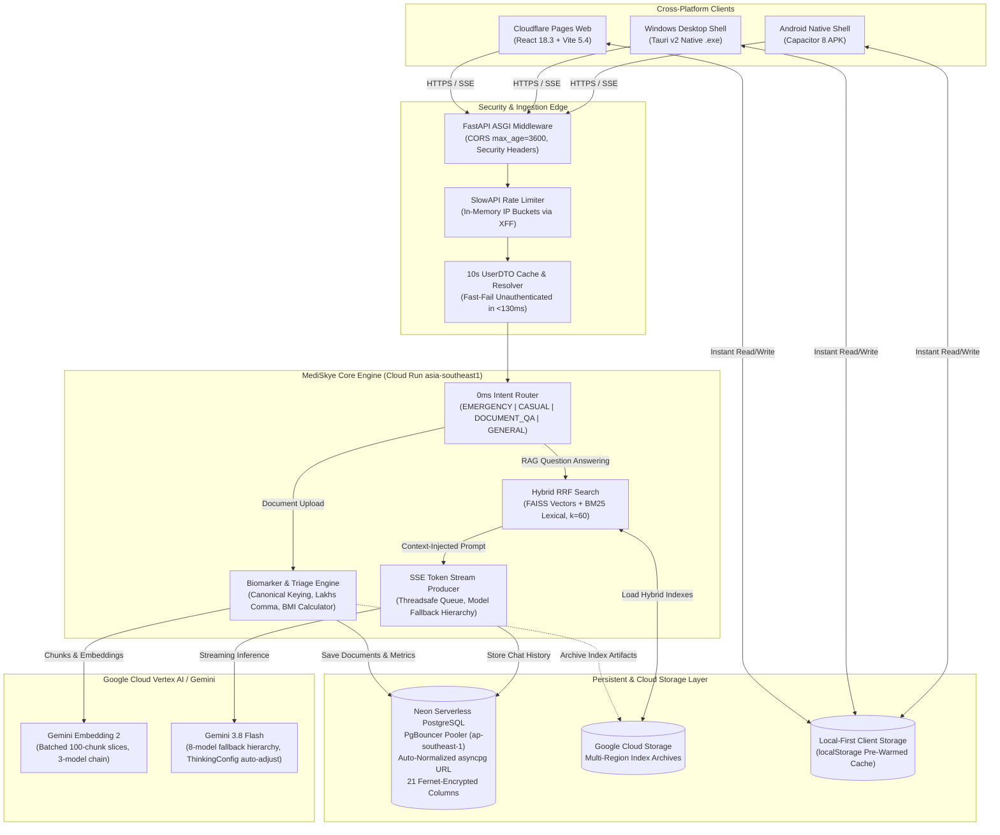

<div align="center">

# 🩺 MediSkye: Personal and Family Health Intelligence App
#### Web • Windows Desktop (Tauri v2) • Android (Capacitor 8) • Google Cloud Run

[](https://fastapi.tiangolo.com/)
[](https://react.dev/)
[](https://v2.tauri.app/)
[](https://capacitorjs.com/)
[](https://cloud.google.com/run)
[](https://cloud.google.com/vertex-ai)
[](https://neon.tech/)
[](https://vitest.dev/)
[](https://pytest.org/)

**MediSkye** is an enterprise-grade clinical intelligence platform and longitudinal companion that ingests laboratory reports, digital PDFs, mobile camera captures, and radiographic scans. It extracts structured biomarker data, tracks multi-visit trends across family members with strict profile isolation, and conducts safe, contextual clinical conversations powered by a **Hybrid FAISS + BM25 RAG pipeline** and **Google Gemini 3.8 Flash** with an 8-model fallback hierarchy.

[Live Web App](https://mediskye.pages.dev) • [Architecture](#-system-architecture) • [Core Capabilities](#-core-capabilities) • [Benchmarks & QA](#-performance--qa-verification-summary) • [Multi-Platform Setup](#-local-development--multi-platform-build-guide)

</div>

---

## 🌟 Executive Overview & Value Proposition

Diagnostic medical reports and laboratory tests are frequently fragmented, overwhelming, and difficult for patients and caregivers to interpret over time. MediSkye bridges the gap between raw clinical metrics and compassionate human understanding through:

1. **Multimodal Clinical Ingestion:** Digitizes laboratory reports, clinical summaries, and imaging studies from native digital PDFs, scanned documents, and direct mobile camera snapshots with automatic perspective normalization.
2. **Deterministic Triage & Canonical Mapping:** Eliminates hallucinated laboratory values through regex-anchored canonical biomarker keying (`canonical_biomarker_key`), international number parsing, unit normalization, and near-boundary clinical alerting before LLM inference.
3. **Deterministic Anthropometrics & Real-Time BMI Engine:** Computes real-time BMI and standard WHO categorization (`Underweight`, `Normal weight`, `Overweight`, `Obese`) across account owners and family dependents, injecting a standardized `**Patient Profile & BMI Snapshot:**` header across report summaries and conversational prompts.
4. **Adaptive Conversational Guidance:** Delivers exhaustive 7-section clinical walkthroughs on initial report queries, transitioning seamlessly into warm, concise bedside dialogue on follow-up turns without repetitive boilerplate or lost safety boundaries.
5. **Longitudinal Family Health Tracking:** Offers strict, physical data isolation between the account owner (`self`) and family dependents (`UUID`), comparing multi-visit biomarker trajectories with automated delta calculation ($\Delta_{abs}$, $\Delta_{\%}$, directional alerts).
6. **Encrypted Patient Memory Vault:** Persists verified clinical facts (allergies, chronic conditions, surgical history, medications) with document provenance in 21 Fernet-encrypted database columns (`AES-128-CBC` + `HMAC-SHA256`).
7. **100% Upfront Cloud Hydration & Local-First Resilience:** Downloads complete multi-profile clinical databases on launch, guaranteeing zero-latency profile switching and full offline availability with anti-glitch connectivity debouncing (`1200ms`).

---

## 🚀 Core Capabilities

### 1. Multimodal Ingestion & Camera Normalization
* **Format Versatility:** Native extraction from digital PDFs (`PyMuPDF`), scanned forms (`Tesseract OCR`), direct camera captures (`.jpg`, `.jpeg`, `.png`, `.webp`), and chest radiographs.
* **Intelligent Camera Normalization (`normalizeCameraFile`):** Mobile camera photos (e.g. `image.jpg`, `blob`) are dynamically normalized into standardized lab artifacts (`Lab_Report_Photo_YYYY-MM-DD.jpg`) with hardware environment camera targeting (`capture="environment"`).
* **Radiology Preprocessing:** Automatically identifies radiographic images and applies Contrast Limited Adaptive Histogram Equalization (**CLAHE**) to enhance lung parenchymal and skeletal contours prior to clinical review.
* **Table Header Propagation:** Detects multi-page laboratory tables and propagates column headers across page breaks so continuation rows retain analyte, result, and reference range semantics.
* **Specimen Collection Chronology:** Extracts specimen collection dates (`extract_specimen_collection_date`), flags future-dated collections (`check_is_future_date`) for clinical review, and chronologically orders multi-visit longitudinal records (`parse_report_chronology`).

### 2. Deterministic Biomarker & Triage Engine
* **100 Canonical Analyte Keys:** Resolves core hematologic, metabolic, hepatic, renal, lipid, thyroid, cardiac, and urinalysis biomarkers (`hemoglobin`, `glucose`, `hba1c`, `creatinine`, `egfr`, `platelets`, `ferritin`, `vitamin_b12`, `vitamin_d`, `tsh`, `ldl`, `hdl`, `triglycerides`, `alt`, `ast`, `urine_protein`, etc.) via regex-anchored `canonical_biomarker_key` matching.
* **International Number Parsing:** Handles Indian lakhs formatting (`2,38,000 /uL`), western thousand commas (`238,000`), European decimal commas (`12,5 g/dL`), and relational comparators (`< 0.5`, `> 60`).
* **Urinalysis Dipstick Disambiguation:** Disambiguates urine qualitative tests (`Urine Protein: Nil`, `Urine Sugar: Negative`) from serum quantitative panels, preventing false abnormal collisions.
* **Near-Boundary Alerting:** Clinically tags normal values near reference thresholds (within 15% of bounded ranges, 10% of upper-bounded limits, or 5% of lower-bounded limits — e.g. Fasting Glucose at `99 mg/dL` where normal is `70–99`), prompting proactive follow-up recommendations.
* **Longitudinal Delta Tracking:** Automatically compares successive tests, computing absolute differences ($\Delta_{abs}$), percentage shifts ($\Delta_{\%}$), and clinical directional alerts (e.g. `Notable Drop (-11.7%)`).

### 3. Real-Time Anthropometrics & BMI Engine
* **Biometric Profile Integration:** Dedicated `height_cm` and `weight_kg` storage on `User` and `DependentProfile` records.
* **WHO Clinical Categorization:** Automatic BMI computation (`compute_bmi_info`) categorizing metrics into standard clinical classifications:
  * **Underweight:** $< 18.5$
  * **Normal weight:** $18.5 - 24.9$
  * **Overweight:** $25.0 - 29.9$
  * **Obese:** $\ge 30.0$
* **Context Injection Mandate:** Injects anthropometric snapshots into `<patient_profile>` and `<patient_context>`, surfacing the standardized header across all report overviews and Turn 1 walkthroughs:
  ```markdown
  **Patient Profile & BMI Snapshot:** {name} | {age} Y | {sex} | Height: {h} cm | Weight: {w} kg | Calculated BMI: {bmi}
  ```

### 4. Hybrid Clinical RAG Pipeline
* **Medical-Aware Chunking (`MedicalTextSplitter`):** Splits clinical narratives on structural paragraph boundaries (chunk size: 1200 chars, overlap: 200 chars) while preserving markdown table row integrity.
* **Dense Semantic Embeddings:** Encodes document chunks via Google Gemini Embeddings (`gemini-embedding-2`), batched in slices of 100 with semaphore concurrency (`EMBED_CONCURRENCY`), backed by an embedding fallback chain (`gemini-embedding-2` $\to$ `gemini-embedding-001` $\to$ `text-embedding-004`).
* **Lexical BM25 Search (`BM25Index`):** Evaluates exact token matches to prevent misidentifying medical abbreviations (`HbA1c`, `eGFR`, `TSH`, `SGOT`, `SGPT`).
* **Reciprocal Rank Fusion (RRF):** Fuses dense vector and sparse lexical ranks using $RRF(k=60)$ to surface the top clinical passages with sub-millisecond retrieval execution (`0.21ms` p50).

### 5. Adaptive Conversational Guidance
* **Turn 1 Walkthrough:** Delivers a comprehensive 7-section clinical briefing:
  1. *Executive Summary & Triage Overview*
  2. *Reassuring & Within-Range Findings*
  3. *Borderline & Out-of-Range Markers*
  4. *Longitudinal Comparison with Past Tests*
  5. *Potential Correlated Explanations*
  6. *Dietary & Lifestyle Considerations*
  7. *Targeted Physician Discussion Questions*
* **Turn 2+ Bedside Guidance:** Follow-up queries condense chat history via `condense_chat_history`, omitting structured headings in favor of concise, empathetic, non-repetitive answers while maintaining clinical disclaimers for medication change inquiries.
* **Instant Emergency Interception:** 0ms multilingual regex triage detects emergency symptoms (chest pain, breathing difficulty, severe bleeding, stroke signs, self-harm) across English, Hindi, Spanish, French, and German, immediately returning localized emergency helpline numbers (112, 911, 999, 15).

### 6. Multi-Profile Family Isolation & Memory Vault
* **Cryptographic Tenant Scoping:** Every document, chat session, trend trajectory, and memory fact is strictly bound to `user_id` and either `dependent_id = NULL` (`self`) or a specific `dependent_id = <UUID>`.
* **Zero Cross-Profile Contamination:** Verified across comprehensive isolation test specifications (S1–S9): switching active family members never bleeds documents, cached summaries, or metric deltas.
* **Encrypted Patient Memory Vault:** Extracts persistent clinical facts (allergies, chronic conditions, medications) into 21 Fernet-encrypted database columns (`AES-128-CBC` + `HMAC-SHA256`) with document provenance tracking.

### 7. 100% Upfront Cloud Hydration & Local-First UX
* **100% Complete Hydration:** On initial login, `syncAllProfilesInBackground` pre-fetches documents, chat histories, lab metrics, report summaries (`cached_summary`), longitudinal trends (`/users/me/metrics/trends`), and Memory Vault facts (`/users/me/facts`) for `self` and all dependent profiles into `localStorage`.
* **Clean Loading Overlay:** Displays a clean, professional modal (`"Please wait while we load your clinical database"`) without ugly UUIDs or technical progress fractions.
* **Anti-Glitch Network Debouncing:** Monitors hardware (`ConnectivityManager`) and browser network events with a 1200ms debounce timer (`DEBOUNCE_OFFLINE_MS`), preventing transient Wi-Fi drops from flashing offline warning pills.
* **1-Click Clinical Export & Print:**
  * **PrintableSummary:** Generates clean, 2-page A4 physician summaries for immediate clinical consultation.
  * **ExportModal:** Exports complete chat transcripts and structured lab metrics in JSON or PDF formats with immediate visual confirmation feedback.

---

## 🏗️ System Architecture



---

## 📊 Performance & QA Verification Summary

The complete codebase undergoes rigorous automated verification across **645 backend test specifications** and **314 frontend Vitest specifications**.

### Granular Pipeline Benchmark Metrics

All pipeline micro-benchmarks (50 iterations, Python 3.14 runtime) and live Cloud Run probes (`asia-southeast1`) were recorded during the production QA sign-off:

| Component / Operation | Metric Tested | Result | Industry Benchmark | Compliance Status |
| :--- | :--- | :---: | :---: | :---: |
| **Live Cloud Run Health Check** | Cold Start TLS Handshake | `268.34 ms` | `< 500 ms` | ⚡ **OPTIMAL** |
| **Live Cloud Run Health Check** | Sequential Warm p50 | `131.63 ms` | `< 200 ms` | ⚡ **OPTIMAL** |
| **Live Cloud Run Health Check** | 10 Concurrent Load | `263.80 ms` | `< 400 ms` | ⚡ **OPTIMAL** |
| **Protected Auth Gate** | Unauthenticated 401 Fast-Fail | `126.95 ms` | `< 150 ms` | ⚡ **OPTIMAL** |
| **CORS Preflight** | Browser OPTIONS Preflight | `122.90 ms` | `< 150 ms` | ⚡ **OPTIMAL** |
| **Biomarker Extraction** | 25-Analyte Complex Blood Panel | `6.20 ms` | `< 25 ms` | ⚡ **SUB-10MS** |
| **Clinical Unit Normalization** | 5-Report Longitudinal Delta Calc | `8.54 ms` | `< 30 ms` | ⚡ **SUB-10MS** |
| **BMI & Anthropometrics** | Real-time BMI & WHO Category | `0.02 ms` | `< 1 ms` | ⚡ **SUB-MS** |
| **Prompt Synthesis: Turn 1** | 7-Section Structured Walkthrough | `0.03 ms` | `< 5 ms` | ⚡ **SUB-MS** |
| **Chat History Condenser** | 10-Turn Full History Reduction | `0.12 ms` | `< 5 ms` | ⚡ **SUB-MS** |
| **Prompt Synthesis: Turn 2** | Follow-Up Bedside Context Builder | `0.19 ms` | `< 5 ms` | ⚡ **SUB-MS** |
| **Clinical Safety & Emergency** | 500-Word Multilingual Regex Scan | `2.04 ms` | `< 15 ms` | ⚡ **INSTANT** |
| **Medical Chunking** | 10-Page (~25k chars) Markdown Split | `0.66 ms` | `< 10 ms` | ⚡ **INSTANT** |
| **BM25 Lexical Indexing** | Inverted Index Build on Chunks | `1.48 ms` | `< 10 ms` | ⚡ **INSTANT** |
| **Reciprocal Rank Fusion** | Score Fusion & Ranking (k=60) | `0.21 ms` | `< 2 ms` | ⚡ **SUB-MS** |

### Automated QA Test Suite Results

```text
============================= Pytest Backend Results =============================
645 passed, 8 deselected in 123.71s (0:02:03) - 100% GREEN

Key Test Suites:
• test_async_concurrency.py               -> Non-blocking SSE stream & fallback resilience
• test_biomarker_hints.py                 -> Canonical markers, near-boundary flags, lakhs commas
• test_metrics_chronology_and_collision.py -> Chronological sorting, unit conversions, delta alerts
• test_memory_models.py                   -> Encrypted fact persistence & dependent personalization
• test_prompt_quality_regression.py       -> Synthesis shape, Turn 1 vs Turn 2 prompt rules
• test_upload_hardening.py                -> Magic byte verification, pixel dimensions, OCR fallbacks
• test_auth_cache.py                      -> Token caches, email verification, rate limits
• test_phi_column_encryption.py           -> Fernet round-trip & undecryptable token error safety
• test_bmi_calculation.py                 -> BMI computation, WHO categorization, context injection

============================= Vitest Frontend Results =============================
Test Files  38 passed (38)
Tests       314 passed (314) - 100% GREEN
Duration    116.08s

Key Test Suites:
• ProfileIsolation.test.jsx         -> Strict S1-S9 multi-profile document & chat scoping
• BmiAndHydrationSync.test.jsx       -> Offline debounce & 100% profile hydration sync
• WorkbenchHeader.test.jsx          -> Overflow-visible header, dropdown rendering, no clipping
• LocalFirstCacheSync.test.js       -> Multi-profile local storage pre-warming & sync
• ChatApp.test.jsx                  -> Immediate upload promotion & stream buffer safety
• ExportModal.test.jsx              -> Full transcript & metrics JSON/PDF export
• WorkbenchComponents.test.jsx      -> UploadStepper, RangeBar, LabMetrics filters, OrganSystemsOverview
• SettingsModal.test.jsx            -> Safe account deletion & credential hygiene
• LabMetrics.test.jsx               -> Semantic clinical tables & delta badges
```

---

## 🛠️ Complete Tech Stack Reference

| Layer | Technology | Purpose & Architecture |
| :--- | :--- | :--- |
| **Frontend Framework** | React 18.3 + Vite 5.4 | Single Page Application with modular code splitting & lazy loading |
| **Styling & Animation** | Tailwind CSS 3.4 + Framer Motion 11 | Clinical Obsidian dark design system, glassmorphism, spring physics |
| **Desktop Shell** | Tauri v2 (Rust + WebView2) | Ultra-lightweight Windows desktop binary (`.exe`) with loopback OAuth |
| **Mobile Shell** | Capacitor 8 | Native Android compilation with custom hardware connectivity bridges |
| **Backend Framework** | FastAPI 0.115+ (Python 3.14) | High-throughput asynchronous ASGI microservice with Pydantic v2 validation |
| **ASGI Web Server** | Uvicorn | High-throughput asynchronous ASGI web server (`uvicorn[standard]`) |
| **Database** | Neon Serverless PostgreSQL | Pooled serverless PostgreSQL with PgBouncer connection reuse (`ap-southeast-1`) |
| **ORM & Migrations** | SQLAlchemy 2.0 (Async) + Alembic | Asynchronous querying via `asyncpg` with automated schema migrations |
| **Database URL Handling**| `normalize_async_database_url` | Strips `channel_binding`, handles `ssl=require`, sets `statement_cache_size=0` |
| **Vector Search** | FAISS (Facebook AI Similarity Search) | Dense vector cosine similarity search |
| **Lexical Search** | BM25 (`rank-bm25`) | Probabilistic sparse keyword relevance scoring for medical terms |
| **OCR & PDF Extraction** | PyMuPDF (fitz) + Tesseract | High-fidelity table and scanned character extraction |
| **Primary LLM** | Google Gemini 3.8 Flash | Low-latency multimodal clinical reasoning with `ThinkingConfig` auto-adaptation |
| **Model Fallback Chain** | Gemini 3.8 $\to$ 3.6 $\to$ 3.5 $\to$ 2.5 $\to$ 2.0 $\to$ 1.5 | Resilient 8-model fallback hierarchy preventing outage disruptions |
| **Embedding Models** | Gemini Embedding 2 $\to$ 001 $\to$ Text-004 | 3-model embedding fallback chain for high-dimensional clinical vectorization |
| **Authentication** | Firebase Authentication + JWT | Google OAuth 2.0, verified email/password, HS256/RS256 JWTs, SHA-256 revocation/cache digests |
| **Monitoring & Telemetry**| Sentry SDK (React & FastAPI) | Distributed exception tracking and performance tracing |
| **Cloud Hosting** | Google Cloud Run (`asia-southeast1`) | Auto-scaling containerized microservice environment with 8s fault-tolerant boot |

---

## 💻 Local Development & Multi-Platform Build Guide

### Prerequisites
* **Python:** `3.11` to `3.14` (with virtual environment support)
* **Node.js:** `v20.x` – `v24.x` (`v22` in CI)
* **Rust:** `1.75+` (required only for compiling Windows Tauri `.exe`)
* **Android Studio & SDK:** Platform 34+ (required only for compiling Android APK)

---

### 1. Backend Setup (Local FastAPI Server)

```bash
# Navigate to backend directory (or install from root requirements.txt)
cd backend

# Create and activate Python virtual environment
python -m venv .venv
# On Windows PowerShell:
.\.venv\Scripts\Activate.ps1
# On Linux/macOS:
source .venv/bin/activate

# Install dependencies
pip install -r requirements.txt

# Configure environment variables
cp .env.example .env
# Edit .env with your GOOGLE_API_KEY, DATABASE_URL, FERNET_KEY, and JWT_SECRET_KEY

# Run database migrations
alembic upgrade head

# Start local backend with hot-reload
uvicorn app.main:app --host 0.0.0.0 --port 8000 --reload
```

---

### 2. Frontend Setup (Local Web App)

```bash
# Navigate to frontend directory
cd frontend

# Install Node dependencies
npm install

# Configure environment variables
cp .env.example .env
# Ensure VITE_API_URL points to http://localhost:8000 (or your Cloud Run URL)

# Start Vite development server
npm run dev
# App will be accessible at http://localhost:3000
```

---

### 3. Running Automated QA Test Suites

```bash
# Run Backend Pytest Suite (excluding live integration tests)
cd backend
# On Windows PowerShell:
.\.venv\Scripts\pytest.exe tests -m "not integration" -q
# On Linux/macOS:
.venv/bin/pytest tests -m "not integration" -q

# Run Frontend Vitest Suite
cd frontend
npm test -- --run

# Run Frontend Production Build & Asset Measurement
npm run build
```

---

### 4. Compiling Windows Desktop App (Tauri v2)

```bash
cd frontend

# Run desktop app in live development mode
npm run tauri:dev

# Build production Windows installer (.exe / .msi)
npm run tauri:build
# The output binary will be located in:
# frontend/src-tauri/target/release/bundle/nsis/MediSkye_1.0.0_x64-setup.exe
```

---

### 5. Compiling Android App (Capacitor 8)

```bash
cd frontend

# Build web distribution and sync to Android project
npm run cap:sync

# Open project in Android Studio
npm run cap:open

# Assemble debug APK directly from command line (Windows)
npm run android:build
# On Linux/macOS:
# npm run cap:sync && cd android && ./gradlew assembleDebug
# The output APK will be located in:
# frontend/android/app/build/outputs/apk/debug/app-debug.apk
```

---

### 6. Google Cloud Run Deployment

Deploy the containerized FastAPI backend to Google Cloud Run via Google Cloud Build:

```bash
# Authenticate with Google Cloud
gcloud auth login
gcloud config set project mediskye-backend

# Submit build to Cloud Build
gcloud builds submit --config cloudbuild.yaml
```

---

## 🔒 Security, Privacy & HIPAA-Aligned Architecture

* **Fernet Symmetric Encryption at Rest:** 21 sensitive patient columns—including diagnoses, medications, allergies, blood markers, and conversational facts—are encrypted with Fernet (`AES-128-CBC` + `HMAC-SHA256`) prior to SQL persistence.
* **Transient PHI in Hot Cache:** High-throughput in-memory token caches utilize `UserDTO` to strip decrypted clinical PHI, preventing plaintext medical data from lingering in RAM.
* **Strict Single-Tenant Patient Boundaries:** All database queries are explicitly filtered by `user_id` and validated against dependent profile ownership before query execution.
* **Instant Token Revocation:** Password resets, manual logouts, and account deletions instantly invalidate tokens via in-memory SHA-256 digest blacklists, a durable PostgreSQL `revoked_tokens` blocklist, and database timestamp cutoffs (`token_invalid_before`).
* **Zero-Retention LLM Privacy:** Prompts dispatched to Google Cloud Vertex AI / Gemini are processed under enterprise privacy terms where customer data is not retained or used for foundation model training.
* **Fault-Tolerant Container Lifespan:** An 8.0-second timeout guard on database initialization allows Cloud Run containers to boot reliably even during transient serverless cold starts.

---

## 📄 License & Medical Disclaimer

**License:** Distributed under the MIT License. See [LICENSE](LICENSE) for details.

> [!IMPORTANT]
> **Clinical Disclaimer:** MediSkye is an artificial intelligence assistant designed for educational and informational health exploration. MediSkye does not provide medical diagnoses, treatment plans, or emergency intervention. Always consult a qualified physician or healthcare provider regarding any medical condition or laboratory report. In case of a medical emergency, call your local emergency services (112, 911, 999) immediately.
