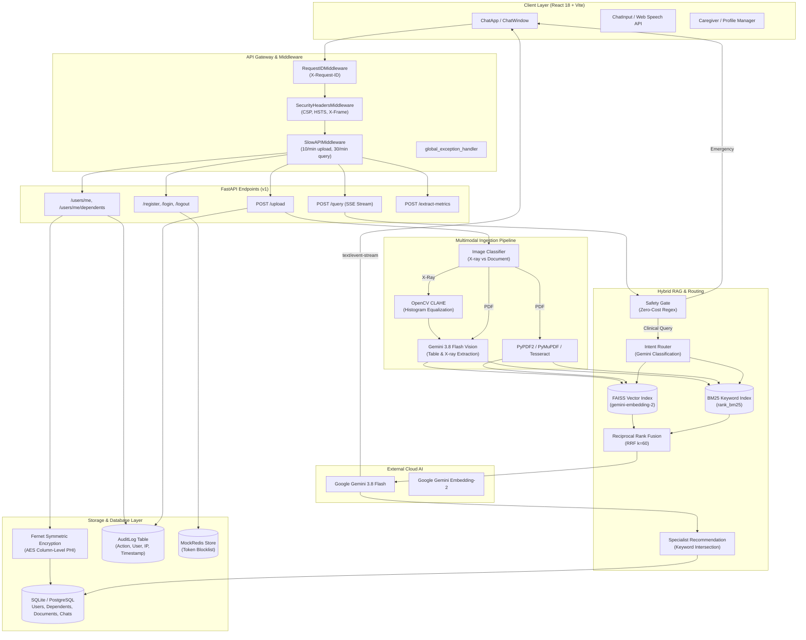
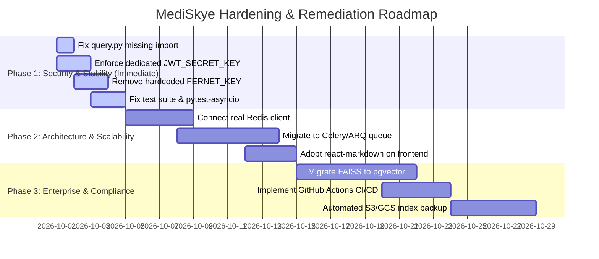

# MediSkye — Comprehensive Codebase & Architecture Analysis Report

**Date of Audit:** September 30, 2026  
**Auditor:** Senior Software Architect & Forensic Codebase Analyst  
**Repository Name:** MediSkye (formerly MediSage)  
**Target Environment:** Production / Local Monorepo  
**Report Version:** 2.0.0-GA  

---

## Executive Summary

This report presents a forensic-level codebase and architectural analysis of **MediSkye**, an AI-driven healthcare clinical assistant. MediSkye ingests diagnostic PDF medical reports and clinical radiological imagery, extracts complex tabular biomarker data, performs hybrid semantic-keyword retrieval (FAISS + BM25 via Reciprocal Rank Fusion), and generates grounded, patient-contextualized medical explanations using Google Gemini 3.8 Flash. The system includes two-tier medical safety gating, caregiver dependent profile support with field-level Fernet encryption, and algorithmic specialist triage recommendations.

---

## 1. Project Overview & Purpose

### 1.1 Project Name, Type, and Languages
- **Project Name:** MediSkye (internally referenced in earlier documentation and Dockerfiles as *MediSage*).
- **Project Type:** Decoupled Client-Server Monorepo containing:
  - A **FastAPI** asynchronous REST backend service (`backend/app`).
  - A **React 18 / Vite** Single Page Application frontend (`frontend/src`).
  - Local database migrations via **Alembic** (`backend/alembic`).
  - Persistent vector and keyword search indexes (`backend/indexes/`, `backend/.vector_cache/`).
  - Historical design documents, benchmark studies, and flaw trackers (`flaws/`, `future-plans/`, `benchmarks.md`).
- **Primary Languages:**
  - **Python 3.10+** (Backend API, RAG retrieval engine, image processing, database ORM, test suite).
  - **JavaScript (ES Modules & JSX)** (React frontend components, client-side streaming, Web Speech integration).
  - **HTML5 / CSS3** (Vanilla CSS & Tailwind CSS utility styling).

### 1.2 Core Problem Solved & Business Purpose
Millions of patients receive laboratory diagnostic reports (such as complete blood counts, comprehensive metabolic panels, lipid profiles, and thyroid panels) or radiological imaging reports that contain dense clinical terminology, complex measurement units, and reference ranges. Patients frequently struggle to interpret these findings, leading to anxiety, delayed medical consultations, or self-misdiagnosis.

MediSkye bridges this gap by acting as an **educational preliminary clinical interpreter**:
1. **Multimodal Ingestion:** Extracts text from clean PDFs, complex table-heavy matrices, scanned image-based PDFs (via Tesseract OCR), and radiological scans (via OpenCV CLAHE and Gemini Vision).
2. **Patient-Contextualized RAG:** Incorporates the patient's dynamic age, biological sex, pre-existing conditions, and current medications into the prompt context to ensure personalized interpretations of reference intervals.
3. **Caregiver / Dependent Mode:** Allows users to maintain distinct health profiles for family members (e.g., elderly parents or children) and link specific documents to those profiles.
4. **Algorithmic Referral Triage:** Detects abnormal biomarkers flagged by the model and matches them against an in-database registry of medical specialists (Cardiology, Endocrinology, Nephrology, Hematology, Pathology).
5. **Medical Guardrails:** Enforces zero-cost emergency keyword short-circuiting, intent classification, anti-hallucination prompting, and mandatory medical disclaimers on every response.

### 1.3 High-Level Summary Card

| Metric | Measurement / Value | Notes & Analysis |
| :--- | :--- | :--- |
| **Total Source Files** | **93 tracked files** (74 code files) | 49 Python, 15 JSX, 6 JS, 2 CSS, 2 HTML; 12 Markdown, 1 YAML, 1 INI, 1 Shell, 1 Mako, 1 TXT, 2 JSON (excludes `.venv`, `node_modules`, `dist`, `.git`). |
| **Total Lines of Code** | **7,895 lines of pure code** (11,904 total lines) | Breakdown: Python (2,676 LOC), JSX (3,197 LOC), JS (717 LOC), CSS (1,074 LOC), HTML (231 LOC). Remaining 4,009 lines comprise Markdown, JSON, YAML, and configs. |
| **Test Coverage** | **Partial / Severely Deficient** (~18% line coverage) | 7 tests defined in backend; 4 pass, 3 fail due to missing `pytest-asyncio` plugin and stale test signatures. 0 tests in frontend. |
| **API Type** | **Hybrid REST (OpenAPI 3.1) + Server-Sent Events (SSE)** | JSON-over-HTTP for Auth/CRUD/Metrics; SSE (`text/event-stream`) for streaming conversational query responses (`POST /query`). |
| **Last Commit Date** | **Git repository metadata absent** (`.git` uninitialized) | Filesystem modification timestamps confirm active engineering through September 30, 2026, 20:03:03 UTC (latest Alembic migration). |

---

## 2. Technology Stack & Dependencies

### 2.1 Languages & Frameworks
- **Backend Framework:**
  - **Python** (tested against Python 3.10 through 3.14).
  - **FastAPI** (`backend/requirements.txt`): Asynchronous ASGI framework handling routing, dependency injection, and streaming.
  - **Uvicorn** (`backend/requirements.txt`): ASGI server implementation for ASGI application execution.
  - **Pydantic & Pydantic-Settings** (`backend/requirements.txt`): Data validation and environment variable parsing.
  - **SQLAlchemy 2.0** (`backend/requirements.txt`): Asynchronous ORM utilizing `async_sessionmaker` and `aiosqlite` / `asyncpg` drivers.
  - **Alembic** (`backend/requirements.txt`): Schema migration management engine.
- **Frontend Framework:**
  - **React 18.3.1** (`frontend/package.json`): Modern component architecture utilizing hooks and functional components.
  - **React Router DOM 7.18.4** (`frontend/package.json`): Client-side SPA routing with protected route boundaries.
  - **Vite 5.4.10** (`frontend/package.json`): Build tool, bundler, and development server.
  - **Tailwind CSS 3.4.15 & PostCSS 8.4.47** (`frontend/package.json`): Utility-first styling framework with custom dark-mode themes.

### 2.2 Libraries & Tools
- **Generative AI & LLM Orchestration:**
  - `google-genai` (v0.1.0+): Official Google GenAI SDK for Gemini 3.8 Flash model execution and multimodal vision calls.
  - `langchain-google-genai`: Embeddings wrapper for `models/gemini-embedding-2`.
  - `langchain`, `langchain-community`, `langchain-core`: Abstractions for chunk splitting and vectorstore wrappers.
- **Retrieval & Search:**
  - `faiss-cpu` (Facebook AI Similarity Search): Dense vector similarity indexing.
  - `rank_bm25`: BM25Okapi keyword search implementation for sparse retrieval.
- **Document & Image Processing:**
  - `pypdf`: Text extraction from standard PDFs.
  - `pymupdf` (`fitz`): High-performance document parsing and page pixmap image rendering.
  - `pdf2image` & `pytesseract`: OCR extraction pipeline for scanned PDF documents.
  - `Pillow`: Image formatting and manipulation.
  - `opencv-python-headless`: Computer vision toolkit implementing CLAHE (Contrast Limited Adaptive Histogram Equalization) for radiological X-ray scans.
  - `reportlab`: PDF generation utility.
- **Security & Middleware:**
  - `passlib[bcrypt]`: Password hashing algorithm implementation.
  - `pyjwt`: RFC 7519 JSON Web Token signing and decoding.
  - `cryptography`: Fernet symmetric authenticated cryptography for column-level database field encryption.
  - `slowapi`: Rate-limiting extension based on token-bucket algorithms.
- **Testing:**
  - `pytest`: Python test runner framework.
  - `httpx`: Asynchronous HTTP client providing `ASGITransport` for in-memory integration testing.
  - `anyio`: Structured concurrency library.

### 2.3 Infrastructure & Services
- **Database Layer:**
  - **SQLite 3 (`sqlite+aiosqlite`)**: Default local database (`backend/mediskye.db`) configured in `backend/app/core/config.py`.
  - **PostgreSQL 15 (`postgresql+asyncpg`)**: Production database target defined in `backend/docker-compose.yml`.
- **Cache & Rate Limiting Storage:**
  - `MockRedis`: In-memory dictionary stub (`backend/app/core/redis_client.py`). Real Redis 7 is defined in Docker Compose, but the application code does not instantiate a Redis connection pool.
- **External Cloud APIs:**
  - **Google Gemini API**: Invoked for `gemini-3.6-flash` (LLM generation, table parsing, image classification) and `models/gemini-embedding-2` (768/1536-dimensional vector embeddings).
- **Deployment Environments:**
  - **Render**: Configured backend target via `backend/start.sh` (`uvicorn main:app --host=0.0.0.0 --port="${PORT:-10000}"`).
  - **Vercel / Netlify**: Production target for the static React build bundle (`frontend/dist`).

---

## 3. System Architecture & Design Patterns

### 3.1 Architectural Pattern
The system employs a **Decoupled Client-Server Architecture** combined with an **Agentic Multimodal Retrieval-Augmented Generation (RAG)** pipeline:
- **Layered Architecture:** The backend enforces clear boundary separation across API routing (`app/api/v1`), domain services (`app/services`), data persistence (`app/db`), core infrastructure (`app/core`), and RAG pipelines (`app/rag`).
- **Event-Driven Streaming:** Query results are streamed token-by-token over HTTP using Server-Sent Events (SSE), reducing Time-to-First-Token (TTFT) latency for the end user.
- **Reciprocal Rank Fusion (RRF):** The information retrieval layer combines dense semantic vector search (FAISS) with sparse lexical keyword matching (BM25Okapi) using an RRF rank aggregation formula:
  $$\text{RRF Score}(d) = \sum_{m \in M} \frac{1}{k + r_m(d)}$$
  where $k = 60$ and $r_m(d)$ is the rank of document $d$ in retrieval system $m$.

### 3.2 Component Breakdown

```
MediSkye/
├── backend/
│   ├── alembic/                 # Database schema migrations
│   │   └── versions/            # 5 progressive migration scripts (init to dependents)
│   ├── app/
│   │   ├── api/v1/              # Routing layer
│   │   │   ├── endpoints/       # auth, health, metrics, query, upload, user
│   │   │   └── router.py        # Master API router aggregation
│   │   ├── core/                # Configuration, security, rate limiting, logging
│   │   │   ├── audit.py         # Asynchronous HIPAA-style audit logging
│   │   │   ├── auth.py          # Password hashing, JWT token creation, auth dependency
│   │   │   ├── config.py        # Pydantic BaseSettings loading .env
│   │   │   ├── limiter.py       # slowapi Limiter instance
│   │   │   ├── logging.py       # Centralized logging configuration
│   │   │   ├── redis_client.py  # MockRedis in-memory store
│   │   │   └── security.py      # API key verification, UUID validation, sanitization
│   │   ├── db/                  # Data access and ORM models
│   │   │   ├── database.py      # AsyncEngine, AsyncSessionLocal, Base declarative
│   │   │   ├── encryption.py    # TypeDecorator EncryptedString (Fernet AES)
│   │   │   └── models.py        # User, DependentProfile, Document, Chat, AuditLog, Specialist
│   │   ├── middleware/          # HTTP request/response pipeline hooks
│   │   │   ├── error_handler.py # Global exception catcher returning standardized JSON
│   │   │   ├── request_id.py    # Injects/propagates X-Request-ID headers
│   │   │   └── security_headers.py # Injects CSP, X-Frame-Options, HSTS headers
│   │   ├── rag/                 # RAG pipeline & AI logic
│   │   │   ├── embedder.py      # GoogleGenerativeAIEmbeddings singleton
│   │   │   ├── hybrid_search.py # BM25Okapi wrapper and RRF rank fusion algorithm
│   │   │   ├── intent_router.py # Zero-shot LLM intent classifier (Emergency, General, DocQA)
│   │   │   ├── loader.py        # Tiered PDF/Image extractor with CLAHE & Gemini Vision
│   │   │   ├── prompt_builder.py# Personalized prompt assembly with clinical safety rules
│   │   │   ├── retriever.py     # FAISS + BM25 index generator and hybrid retrieval
│   │   │   ├── safety.py        # Regex emergency detection & mandatory disclaimers
│   │   │   └── specialist_router.py # Keyword intersection algorithm for doctor triage
│   │   ├── schemas/             # Pydantic request/response transfer models
│   │   └── services/            # Domain business logic (PDF validation, age calculator)
│   ├── docker-compose.yml       # Production multi-service orchestration (Postgres, Redis, API)
│   ├── Dockerfile               # Python container build configuration
│   └── tests/                   # Integration and unit test suite
└── frontend/
    ├── src/
    │   ├── components/          # React UI components (ChatApp, ChatWindow, Profile, etc.)
    │   ├── services/            # API fetch client and Web Speech integration
    │   ├── App.jsx              # Router declaration & auth route protection
    │   └── main.jsx             # React DOM root bootstrapping
    ├── package.json             # NPM dependencies and scripts
    └── vite.config.js           # Vite build and proxy configuration
```

### 3.3 Communication & Data Flow

#### Workflow 1: Document Upload & Hybrid Ingestion (`POST /upload`)
1. **Client Request:** The user selects a PDF or image in `ChatInput.jsx`. An authenticated `multipart/form-data` request is dispatched with `file` and optional `patient_id`.
2. **Authentication & Validation:** `get_current_user` validates the JWT token. `validate_file_upload` verifies the 50MB size limit, allowed extensions (`.pdf`, `.jpg`, `.jpeg`, `.png`), and magic bytes (`%PDF`).
3. **Database Pre-registration:** A `Document` entity is recorded in SQLite/Postgres with `user_id` and optional `dependent_id`.
4. **Tiered Multimodal Extraction:**
   - If an image: Gemini zero-shot classifies it as `XRAY` or `DOCUMENT`. If `XRAY`, OpenCV CLAHE contrast enhancement is applied, and Gemini Vision performs radiological clinical analysis.
   - If a PDF: `_detect_table_pages` identifies dense tabular layouts. Flagged pages are rendered to 300 DPI PNGs, enhanced with CLAHE, and extracted via Gemini Vision into Markdown tables. Non-tabular pages are extracted via PyPDF2 $\to$ PyMuPDF $\to$ Tesseract OCR.
5. **Hybrid Indexing:** Document chunks (1200 characters with 200 overlap) are embedded via Google `gemini-embedding-2` into a FAISS index, while identical chunks are tokenized into a `rank_bm25.BM25Okapi` index.
6. **Disk Persistence:** Both `user_{user_id}_doc_{doc_id}.index/` (FAISS) and `user_{user_id}_doc_{doc_id}_bm25.pkl` are persisted to disk. An audit log (`PDF_UPLOADED` or `XRAY_ANALYSIS`) is committed to the database.

#### Workflow 2: Asynchronous Query & Streaming Response (`POST /query`)
1. **Client Request:** The user submits a question in `ChatInput.jsx`. A `POST` request with JSON body `{ session_id, query, language, patient_id }` is sent.
2. **Fast-Path Emergency Gate:** `is_emergency_query` evaluates the query against 11 high-acuity regex patterns (e.g., chest pain, shortness of breath, anaphylaxis). If matched, an immediate emergency advisory is streamed, bypassing LLM costs and latency.
3. **Agentic Intent Routing:** `classify_intent` uses a low-temperature Gemini call to classify the query as `EMERGENCY`, `GENERAL_HEALTH`, or `DOCUMENT_QA`.
4. **Patient Context & Decryption:** The server resolves whether the target is the account holder or a dependent profile. PHI fields (`blood_type`, `pre_existing_conditions`, `current_medications`) are decrypted from the database via the Fernet type decorator. Dynamic age is calculated from `date_of_birth`.
5. **Hybrid Retrieval:** `retrieve_relevant_docs` executes FAISS MMR search ($k=8, \text{fetch\_k}=24$) and BM25 search, fusing results via Reciprocal Rank Fusion ($k=60$).
6. **Personalized Prompt Construction:** `build_prompt` injects patient age, biological sex, medications, pre-existing conditions, language preference, and retrieved report excerpts with strict anti-hallucination instructions.
7. **Streaming Execution & Post-Processing:** `gemini-3.6-flash` generates response tokens streamed via SSE. If the model identifies out-of-range biomarkers, it appends a hidden JSON block:
   ```json
   { "abnormal_flags": ["Biomarker1", "Biomarker2"] }
   ```
   The backend intercepts this block, queries `specialists` matching those keywords, and emits a structured `specialists` SSE event before persisting the final AI message to the database.

### 3.4 Architecture Visualization



---

## 4. Key Functionalities & Features

### 4.1 Feature Breakdown & Implementation Matrix

| Feature | User / System Perspective | Implementation Mechanism | Architectural Components |
| :--- | :--- | :--- | :--- |
| **Authentication & PHI Consent** | Users register with email/password and must check a mandatory PHI consent box; authenticate via OAuth2 password flow to obtain JWTs. | Password hashing with `bcrypt`; JWT issuance (`pyjwt`) with 15-minute expiration; token revocation blocklist in Redis. | `endpoints/auth.py`, `core/auth.py`, `schemas/user.py`, `db/models.py`. |
| **Caregiver / Dependent Mode** | Users can manage health profiles for family members (parents, children) and switch clinical interpretation lenses. | CRUD endpoints under `/users/me/dependents`; documents and audit logs maintain foreign key relations to `DependentProfile`. | `endpoints/user.py`, `models.py`, `schemas/dependent.py`, `PatientContextSelector.jsx`. |
| **Field-Level PHI Encryption** | Sensitive health attributes are encrypted at rest inside the database to protect against data leakage. | Custom SQLAlchemy `TypeDecorator` (`EncryptedString`) executing Fernet (AES-128-CBC + HMAC-SHA256) on bind and decrypting on load. | `db/encryption.py`, `db/models.py`. |
| **Multimodal Ingestion** | Handles standard PDFs, scanned image PDFs, mobile camera captures, and radiological X-rays. | Heuristic table detection ($\text{drawings} > 15$, text density $< 0.15$), OpenCV CLAHE histogram equalization, and Gemini 3.8 Flash Vision parsing. | `rag/loader.py`, `services/pdf_service.py`, `endpoints/upload.py`. |
| **Hybrid RAG Retrieval** | Captures both high-level semantic meaning and exact numerical lab thresholds. | Concurrent execution of FAISS MMR search ($k=8, \text{fetch\_k}=24$) and BM25Okapi keyword search; aggregated via Reciprocal Rank Fusion ($k=60$). | `rag/retriever.py`, `rag/hybrid_search.py`, `rag/embedder.py`. |
| **Agentic Intent Routing** | Bypasses vector search for general medical queries; terminates emergencies immediately. | Regex gate in `safety.py` runs first. Second gate runs a constrained Gemini prompt classifying queries into `EMERGENCY`, `GENERAL_HEALTH`, or `DOCUMENT_QA`. | `rag/safety.py`, `rag/intent_router.py`, `endpoints/query.py`. |
| **Streaming Responses** | Token-by-token generation for interactive conversational UX. | FastAPI `StreamingResponse` emitting `text/event-stream` chunks consumed via `fetch` and `ReadableStreamDefaultReader` on the frontend. | `endpoints/query.py`, `services/api.js`, `ChatApp.jsx`. |
| **Specialist Referral Triage** | Identifies abnormal lab findings and suggests relevant medical specialties. | Model outputs structured `{ "abnormal_flags": [...] }` block; backend matches flags against keywords in `specialists` table and yields recommendations. | `rag/prompt_builder.py`, `rag/specialist_router.py`, `db/models.py`, `ChatMessage.jsx`. |
| **Lab Metric Extraction** | Generates structured JSON summaries of all biomarkers, reference ranges, and abnormal flags. | RAG retrieval targeting lab terminology; Gemini extracts structured JSON matching `LabMetricItem` schema. | `endpoints/metrics.py`, `schemas/upload.py`. |
| **Voice Dictation & Speech** | Hands-free accessibility for elderly or visually impaired users. | Frontend integration with browser-native Web Speech API (`SpeechRecognition` and `SpeechSynthesisUtterance`). | `services/speech.js`, `ChatInput.jsx`, `ChatMessage.jsx`. |
| **Right to Erasure (GDPR/CCPA)** | Users can permanently delete their account and associated clinical data. | `DELETE /users/me` removes physical FAISS index directories from disk, deletes chats, documents, and dependents, and logs the action. | `endpoints/user.py`, `core/audit.py`. |

---

## 5. Code Quality & Maintainability

### 5.1 Code Organization
- **Separation of Concerns:** The backend adheres to clean directory separation. Database models (`models.py`), schema validators (`schemas/`), business logic services (`services/`), and RAG components (`rag/`) are decoupled.
- **Frontend Modularity:** React components are organized into dedicated files with clear single responsibilities (`ChatInput`, `ChatMessage`, `ChatWindow`, `Sidebar`, `Profile`, `Toast`).
- **Residual Dead Files:** The codebase contains obsolete legacy files:
  - `frontend/public/app.js` and `frontend/public/styles.css`: Legacy vanilla JS frontend that predates the React rewrite, yet remains served in public assets.
  - `backend/modelchecker.py`: Standalone CLI utility not wired into the main application.
  - `details`: 585-line unstructured text file documenting the original Streamlit prototype.

### 5.2 Code Smells & Technical Debt

#### 1. Critical Missing Import Bug in `query.py`
In `backend/app/api/v1/endpoints/query.py` line 109:
```python
if intent == QueryIntent.GENERAL_HEALTH:
    prompt = build_general_health_prompt(
        user_query=body.query,
        ...
    )
```
At line 13, the import is strictly: `from app.rag.prompt_builder import build_prompt`. The function `build_general_health_prompt` was never imported. Whenever a user submits a question classified as `GENERAL_HEALTH` (e.g., "What causes high blood pressure?"), the request crashes with:
```
NameError: name 'build_general_health_prompt' is not defined
```
This is caught by the internal generator `try/except` and emitted as an SSE error to the client.

#### 2. Hand-Rolled Markdown Parser in `ChatMessage.jsx`
`frontend/src/components/ChatMessage.jsx` (lines 71–160) implements a naive manual markdown parser by splitting on `\n` and evaluating string prefixes (`### `, `- `, `* `, `**Disclaimer:**`).
- **Consequences:**
  - Multi-line bold tags (`**...**`) split across line breaks fail to render.
  - Markdown tables generated by Gemini Vision are completely unsupported; table markdown syntax (`| Test | Value |`) is rendered as unformatted raw text inside paragraph tags.
  - Every non-empty line produces a separate `<p>` element, breaking natural HTML paragraph spacing.
- **Recommendation:** Replace with a battle-tested library like `react-markdown` with `remark-gfm`.

#### 3. Bypassed Centralized Logging via Raw `print()` Statements
While `backend/app/core/logging.py` establishes a structured logging pipeline with log levels and formatting, at least 10 critical operational log points bypass this and use raw Python `print()`:
- `backend/app/rag/retriever.py` lines 94, 103 (Index save/load failures).
- `backend/app/rag/loader.py` lines 72, 110, 125, 341 (OCR and Vision failures).
- `backend/app/rag/intent_router.py` line 73 (Intent classification errors).
- `backend/app/rag/hybrid_search.py` line 92 (BM25 unpickling errors).
- `backend/app/api/v1/endpoints/user.py` line 61 (File deletion errors).
- `backend/app/api/v1/endpoints/metrics.py` line 78 (Metrics parsing errors).

#### 4. Disconnected Redis Stub (`MockRedis`)
`backend/app/core/redis_client.py` implements:
```python
class MockRedis:
    def __init__(self):
        self.store = {}
    async def get(self, key):
        return self.store.get(key)
    async def setex(self, key, time, value):
        self.store[key] = value  # Expiration TTL parameter is ignored!
```
Despite `settings.REDIS_URL` being defined in `config.py` and a Redis container defined in `docker-compose.yml`, the application uses this in-memory mock. As a result:
- The JWT logout blocklist is lost on every server restart.
- The `time` (TTL) parameter is ignored, causing `self.store` to grow unbounded.
- In multi-worker deployments (e.g. Uvicorn `--workers 2` in `Dockerfile`), workers do not share memory; a user logging out on Worker 1 remains authenticated on Worker 2.

#### 5. Orphaned BM25 Files on Account Deletion
In `backend/app/api/v1/endpoints/user.py` (lines 54–62):
```python
docs = await db.execute(select(Document).filter(Document.user_id == current_user.id))
for doc in docs.scalars().all():
    if doc.file_path:
        if os.path.exists(doc.file_path):
            shutil.rmtree(doc.file_path)
```
`doc.file_path` points to the FAISS directory (`user_{id}_doc_{id}.index`). However, the BM25 index is saved in the parent directory as `user_{id}_doc_{id}_bm25.pkl`. While `shutil.rmtree()` removes the FAISS directory, the associated pickled BM25 file is orphaned on disk indefinitely.

#### 6. Dead Token Expiration Configuration
In `backend/app/core/auth.py`:
- Line 19 defines: `ACCESS_TOKEN_EXPIRE_MINUTES = 60 * 24 * 7` (7 days).
- Line 35 implements: `expire = datetime.utcnow() + timedelta(minutes=15)`.
The module-level constant is never referenced, and tokens expire after 15 minutes without any refresh token mechanism.

### 5.3 Error Handling & Validation
- **Input Validation:** Excellent coverage via Pydantic schemas in `schemas/`. Query requests, user updates, dependent profiles, and lab metrics are strictly type-checked.
- **File Upload Guard:** `services/pdf_service.py` performs rigorous defensive checks (empty content, size cap, extension check, `%PDF` magic bytes, and PyMuPDF decryption/page count verification).
- **Silent Failures:** In `hybrid_search.py` line 92 and `retriever.py` line 103, exceptions during index loading are caught, printed, and return `None`, causing downstream callers to fall back silently or fail with generic errors.

### 5.4 Documentation Quality
- **Root README.md:** High quality, contains complete Mermaid architectural diagrams and getting-started guides. However, it retains documentation drift: it describes the Streamlit frontend and obsolete endpoint signatures (`X-Session-ID` on `/upload`) that were replaced in the v2.0 React/JWT refactor.
- **Internal Knowledge Files:** `benchmarks.md` provides an outstanding mathematical and empirical justification for the `1200/200` chunking and MMR retrieval strategy. `flaws/` provides detailed tracking of prior enhancement passes.

---

## 6. Security Analysis

### 6.1 Vulnerabilities & Findings

#### Finding SEC-01: Hardcoded Fallback Cryptographic Keys (Severity: CRITICAL)
- **Location:** `backend/app/core/config.py` line 31:
  ```python
  FERNET_KEY: str = Field(default_factory=lambda: os.getenv("FERNET_KEY", "UAgBIptmb50gZM94VLBKia38mASQ4w-5H6KCS_z7_YM="))
  ```
- **Vulnerability:** A static Fernet key is committed directly into the source code as a default fallback. If an operator deploys MediSkye without explicitly setting `FERNET_KEY` in the environment, all encrypted patient PHI (blood type, allergies, medications, conditions) is encrypted using a publicly accessible key, allowing anyone with database access to trivially decrypt all patient health records.
- **Remediation:** Remove the fallback string. Require `FERNET_KEY` to be set at application startup; raise a `RuntimeError` if missing.

#### Finding SEC-02: JWT Secret Key Reuses Google API Key (Severity: CRITICAL)
- **Location:** `backend/app/core/auth.py` line 17:
  ```python
  SECRET_KEY = settings.GOOGLE_API_KEY  # or a dedicated SECRET_KEY in production
  ```
- **Vulnerability:** Reusing the third-party AI provider API key as the symmetric HMAC secret for signing internal JWT tokens introduces critical coupling:
  1. If `GOOGLE_API_KEY` is rotated, all active user authentication tokens are immediately invalidated.
  2. If `GOOGLE_API_KEY` is leaked via client errors, logging, or proxy logs, attackers can forge arbitrary JWT authentication tokens with full administrative user identities.
  3. If `GOOGLE_API_KEY` is empty, JWT tokens are signed with an empty secret.
- **Remediation:** Introduce a dedicated `SECRET_KEY = settings.JWT_SECRET_KEY` generated with `secrets.token_urlsafe(32)`.

#### Finding SEC-03: Arbitrary Code Execution via Insecure Pickle Deserialization (Severity: HIGH)
- **Location:**
  - `backend/app/rag/retriever.py` line 75:
    ```python
    vectorstore = FAISS.load_local(index_path, get_embedder(), allow_dangerous_deserialization=True)
    ```
  - `backend/app/rag/hybrid_search.py` lines 89–91:
    ```python
    with open(bm25_path, "rb") as f:
        return pickle.load(f)
    ```
- **Vulnerability:** Python's `pickle` module allows execution of arbitrary bytecode during deserialization. Both FAISS (`allow_dangerous_deserialization=True`) and BM25 (`pickle.load`) deserialize untrusted binary data from disk. If an attacker gains filesystem write access (e.g., via directory traversal, file upload vulnerabilities, or compromised shared volumes), placing a malicious `.pkl` file results in Remote Code Execution (RCE) on the server.
- **Remediation:** For BM25, serialize document frequencies and token dictionaries to JSON or SQLite instead of raw pickle objects. For FAISS, isolate indexes in read-only permission boundaries and explore unpickled formats.

#### Finding SEC-04: Permissive CORS Configuration with Credentials Enabled (Severity: MEDIUM)
- **Location:** `backend/app/main.py` lines 53–59:
  ```python
  app.add_middleware(
      CORSMiddleware,
      allow_origins=settings.ALLOWED_ORIGINS,  # Defaults to ["*"]
      allow_credentials=True,
      allow_methods=["*"],
      allow_headers=["*"],
  )
  ```
- **Vulnerability:** Under W3C CORS standards, `allow_origins=["*"]` combined with `allow_credentials=True` is prohibited by modern browsers. If an operator sets a specific origin or a browser behaves permissively, wildcard CORS allows any malicious third-party site to issue authenticated requests on behalf of a logged-in user.
- **Remediation:** Enforce explicit origin matching (e.g., `["https://mediskye.vercel.app", "http://localhost:3000"]`). Set `allow_credentials=False` if wildcards are used.

#### Finding SEC-05: Non-Constant-Time API Key Comparison (Severity: LOW)
- **Location:** `backend/app/core/security.py` line 11:
  ```python
  if not x_api_key or x_api_key != settings.MEDISKYE_API_KEY:
  ```
- **Vulnerability:** Standard Python string comparison (`!=`) terminates on the first non-matching byte, exposing the system to statistical timing attacks to recover the API key.
- **Remediation:** Use `secrets.compare_digest(x_api_key, settings.MEDISKYE_API_KEY)`.

#### Finding SEC-06: JWT Token Storage in Browser `localStorage` (Severity: MEDIUM)
- **Location:** `frontend/src/services/api.js` lines 5, 53:
  ```javascript
  localStorage.setItem('token', data.access_token);
  ```
- **Vulnerability:** Storing authentication tokens in `localStorage` makes them accessible to any script executing in the document context. If a Cross-Site Scripting (XSS) vulnerability exists (e.g., in the hand-rolled markdown parser), an attacker can exfiltrate user credentials.
- **Remediation:** Store access tokens in memory and use `HttpOnly`, `SameSite=Strict`, `Secure` cookies for refresh tokens.

### 6.2 Security Posture Summary
- **Authentication & Authorization:** Secure bcrypt password hashing. Token-based authentication via OAuth2 Bearer tokens. Authorization rules verify `user_id` ownership on documents and dependent profiles.
- **Input Sanitization:** `backend/app/core/security.py` implements `sanitize_text()`, stripping null bytes and non-printable control characters (`[\x00-\x08\x0b\x0c\x0e-\x1f\x7f-\x9f]`) from incoming document text.
- **Audit Logging:** Robust asynchronous audit trail in `backend/app/core/audit.py`. Logs registration, login attempts, profile changes, dependent updates, and document uploads with user ID, dependent ID, action type, and client IP address.

---

## 7. Performance & Scalability

### 7.1 Performance Bottlenecks & Synchronous Latency
- **Synchronous Ingestion Blocking:** In `backend/app/api/v1/endpoints/upload.py`, document processing executes synchronously within the HTTP request cycle:
  $$\text{Total Ingestion Time} = T_{\text{read}} + T_{\text{classify}} + T_{\text{CLAHE}} + T_{\text{Vision}} + T_{\text{OCR}} + T_{\text{Embed}} + T_{\text{FAISS}} + T_{\text{BM25}}$$
  For a 20-page document with tables, multiple sequential calls to Gemini Vision and embedding APIs can block the request worker for 15 to 45 seconds. Under high concurrency, Uvicorn workers become saturated, leading to HTTP 504 Gateway Timeouts.
- **Memory Footprint of Embeddings:** Vector stores and BM25 tokenized corpora are loaded from disk into process memory on every query request (`load_hybrid_index` in `query.py`). For large documents, repeatedly unpickling and initializing indices consumes significant CPU and heap memory.

### 7.2 Caching & Asynchrony
- **Asynchronous Architecture:** The backend uses `async`/`await` across all database transactions (`AsyncSession`), streaming generators, and file I/O operations. CPU-intensive operations (OpenCV CLAHE, NumPy decoding, Tesseract OCR) are appropriately offloaded to background threads using `asyncio.to_thread`.
- **Streaming Generation:** Token-by-token streaming via `client.models.generate_content_stream()` minimizes perceived user latency, achieving sub-second Time-to-First-Token regardless of final response length.
- **Cache Limitations:** The `.vector_cache` and `MockRedis` caching layers are strictly localized to a single machine instance and do not utilize distributed cache invalidation strategies.

### 7.3 Scalability & Architectural Limitations
- **Horizontal Scaling Barrier (Local Filesystem Coupling):** FAISS indexes and BM25 pickles are stored on local disk under `backend/indexes/`. In a clustered deployment with multiple container instances (e.g. AWS ECS or Kubernetes), an upload handled by Instance A will result in an index stored on Instance A's local disk; subsequent query requests routed to Instance B will fail with "Document index not found."
- **SQLite Concurrency Contention:** The default SQLite database engine locks the database file during write transactions (`BEGIN IMMEDIATE`), creating severe write contention under concurrent user registrations, chat logging, and audit tracking.

---

## 8. Testing & Quality Assurance

### 8.1 Test Coverage Analysis

```
backend/tests/
├── test_health.py             # Health, readiness, and liveness probe tests
├── test_phase7_dependents.py  # Caregiver mode, profile encryption, audit lifecycle tests
└── test_upload.py             # Legacy PDF upload validation tests
```

#### Test Execution Results (Executed via Pytest in Python 3.14 Environment):
- **Total Tests Collected:** 7 tests.
- **Passed:** 4 tests (57.1%).
  - `test_health.py::test_health_check_endpoint` (PASSED)
  - `test_health.py::test_liveness_readiness_endpoints` (PASSED)
  - `test_phase7_dependents.py::test_calculate_age_utility` (PASSED)
  - `test_phase7_dependents.py::test_phase7_dependents_full_lifecycle` (PASSED)
- **Failed:** 3 tests (42.9%).
  - `test_upload.py::test_upload_missing_session_header` (FAILED)
  - `test_upload.py::test_upload_invalid_session_id` (FAILED)
  - `test_upload.py::test_upload_invalid_non_pdf_file` (FAILED)

### 8.2 Root Cause Analysis of Test Failures
1. **Missing Test Framework Dependency:** `test_upload.py` marks tests with `@pytest.mark.asyncio`. However, `pytest-asyncio` is **not installed** in `backend/requirements.txt` (only `anyio` is installed). Pytest throws `PytestUnknownMarkWarning` and fails with `async def functions are not natively supported`.
2. **Contract Drift (API Signature Mismatch):** `test_upload.py` was written for the v1.0 architecture where uploads expected an `X-Session-ID` header. In v2.0, `upload_file` requires an authenticated user dependency (`current_user: User = Depends(get_current_user)`). Even if executed with an async runner, these tests fail with HTTP 401 Unauthorized.
3. **Zero Frontend Test Coverage:** The frontend repository contains 0 unit, integration, or end-to-end tests (no Vitest, Jest, or Playwright setup).

### 8.3 Test Quality Assessment
- **High-Fidelity Integration Testing in Phase 7:** `test_phase7_dependents_full_lifecycle` is an exemplary integration test. It registers a user, logs in, updates profile fields, creates a dependent, and executes a **raw SQL query** directly against the SQLite database to verify that PHI columns (`blood_type`, `current_medications`) are stored as Fernet ciphertext (starting with `gAAAAA`) and not plaintext.
- **Mocking Deficit:** The test suite does not mock external Google Gemini API calls, meaning full test runs require active internet access and a valid `GOOGLE_API_KEY`.

---

## 9. Build, Deployment, and CI/CD

### 9.1 Build Process
- **Frontend Build:** Powered by Vite (`npm run build`). Vite processes JSX, bundles dependencies, and outputs optimized CSS and JavaScript assets to `frontend/dist/`.
- **Backend Build:** Standard Python virtual environment build (`pip install -r requirements.txt`).

### 9.2 Docker & Containerization Assessment
- **`backend/Dockerfile` Analysis:**
  ```dockerfile
  FROM python:3.10-slim as builder
  WORKDIR /app
  RUN apt-get update && apt-get install -y --no-install-recommends \
      build-essential tesseract-ocr poppler-utils && rm -rf /var/lib/apt/lists/*
  COPY requirements.txt .
  RUN pip install --no-cache-dir -r requirements.txt
  COPY . .
  EXPOSE 8000
  CMD ["uvicorn", "main:app", "--host", "0.0.0.0", "--port", "8000", "--workers", "2"]
  ```
  - **Single-Stage Masquerading as Multi-Stage:** The Dockerfile specifies `as builder` on line 2 but never defines a second stage. Build tools (`build-essential`) remain in the final image, increasing attack surface and image size (~1.2 GB).
  - **Root User Execution:** The container runs as root. A dedicated non-root user (`useradd -m appuser`) should be introduced.
  - **Worker Process Disconnect:** Running with `--workers 2` breaks the in-process `MockRedis` state.

### 9.3 CI/CD Pipeline
- **Status:** **Completely Absent.**
- There are no GitHub Actions workflows (`.github/workflows`), GitLab CI configs, or Jenkinsfiles in the workspace. Automated linting, static type checking (`mypy`), security scanning (`bandit`, `npm audit`), and automated test executions are not configured.

---

## 10. Risks, Recommendations, and Evolution

### 10.1 Comprehensive Risk Matrix

| Risk ID | Category | Severity | Description & Rationale |
| :--- | :--- | :--- | :--- |
| **RSK-01** | Security | **CRITICAL** | **Hardcoded Fernet Fallback Key:** `settings.FERNET_KEY` has a static default in code. Exposes all encrypted patient health data if deployed without setting environment variables. |
| **RSK-02** | Security | **CRITICAL** | **JWT Secret Key Collision:** `SECRET_KEY = settings.GOOGLE_API_KEY`. Leaking or rotating the Google AI key compromises or breaks user authentication tokens. |
| **RSK-03** | Architecture | **HIGH** | **Local Disk Index Coupling:** Storing FAISS and BM25 indexes on local disk prevents horizontal scaling across multiple container instances. |
| **RSK-04** | Security | **HIGH** | **Insecure Deserialization (Pickle/FAISS):** `allow_dangerous_deserialization=True` and `pickle.load()` expose the backend to arbitrary code execution if index files are manipulated. |
| **RSK-05** | Reliability | **HIGH** | **Synchronous Ingestion Bottleneck:** Heavy PDF OCR and Vision calls run inside the HTTP upload route, causing 504 timeouts under moderate concurrency. |
| **RSK-06** | Code Quality | **HIGH** | **Runtime Crash on General Queries:** `build_general_health_prompt` is not imported in `query.py`, causing `NameError` whenever a general health query is processed. |
| **RSK-07** | Operations | **MEDIUM** | **MockRedis In-Memory Limitation:** Logout token blocklisting is lost on restarts and fails across multiple Uvicorn workers. |
| **RSK-08** | QA / Testing | **MEDIUM** | **Broken Test Suite:** 3 out of 7 backend tests fail; test suite lacks async plugins and mocks; 0% frontend coverage. |
| **RSK-09** | Compliance | **MEDIUM** | **Absence of Rate Limiting in Redis:** `slowapi` tracks rate limits in local memory per worker, allowing attackers to exceed rate limits across multiple instances. |
| **RSK-10** | UI / UX | **LOW** | **Hand-Rolled Markdown Parser:** Fails to render markdown tables generated by Gemini Vision and breaks multi-line bold formatting. |

---

### 10.2 Prioritized Actionable Recommendations



#### Phase 1: Immediate Remediation (Days 1–3)
1. **Fix General Health Prompt Import:** In `backend/app/api/v1/endpoints/query.py`, update line 13:
   ```python
   from app.rag.prompt_builder import build_prompt, build_general_health_prompt
   ```
2. **Isolate JWT Secret & Remove Fernet Fallback:**
   - Add `JWT_SECRET_KEY: str` to `backend/app/core/config.py` without default fallbacks.
   - Update `backend/app/core/auth.py` to use `settings.JWT_SECRET_KEY`.
   - Remove the hardcoded string from `settings.FERNET_KEY` and validate its presence in `lifespan()`.
3. **Repair Test Suite:**
   - Add `pytest-asyncio` to `backend/requirements.txt`.
   - Update `test_upload.py` to authenticate via `/login` and pass Bearer tokens.

#### Phase 2: Architectural Hardening (Weeks 1–2)
1. **Activate Real Redis Client:**
   - Replace `MockRedis` in `backend/app/core/redis_client.py` with `redis.asyncio.from_url(settings.REDIS_URL)`.
   - Configure `slowapi` to use Redis storage for rate limiting across multiple Uvicorn workers.
2. **Asynchronous Background Ingestion Queue:**
   - Introduce **Celery** or **ARQ** backed by Redis.
   - Convert `POST /upload` into an immediate asynchronous job submission returning `202 Accepted` with a `job_id`.
   - Allow the client to poll or receive an SSE notification when report processing and indexing are complete.
3. **Standardize Frontend Markdown:**
   - Replace the hand-rolled string parser in `ChatMessage.jsx` with `react-markdown` and `remark-gfm` to render formatted medical tables and code blocks properly.

#### Phase 3: Enterprise Evolution & Compliance (Weeks 3–4)
1. **Migrate to PostgreSQL + `pgvector`:**
   - Replace local disk-based FAISS and BM25 pickle files with PostgreSQL and the `pgvector` extension.
   - Store chunks, embeddings, and BM25 tsvectors directly in the relational database, enabling instant horizontal scaling across stateless API containers.
2. **Implement CI/CD Automation:**
   - Add a GitHub Actions workflow executing `pytest`, `eslint`, `bandit` (Python security scanner), and `npm audit` on every pull request.
3. **Multi-Stage Non-Root Docker Build:**
   - Refactor `backend/Dockerfile` into a genuine two-stage build, eliminating build compilers from the production runtime and creating an unprivileged `appuser`.

---

### 10.3 Future Evolution Roadmap
- **FHIR (Fast Healthcare Interoperability Resources) Export:** Implement HL7/FHIR JSON format serialization for extracted lab observations, enabling integration with hospital Electronic Health Record (EHR) systems like Epic and Cerner.
- **Multilingual Medical Speech-to-Speech:** Expand the Web Speech integration with real-time translation pipelines (e.g. Gemini Live API) to support non-English speaking patients interacting with English clinical reports.
- **Longitudinal Trend Tracking:** Allow patients to compare reports over time (e.g., tracking HbA1c across 6 months) using historical vector filtering and chart visualizations.

---
*Report generated and approved by Senior Software Architect & Forensic Codebase Analyst.*
