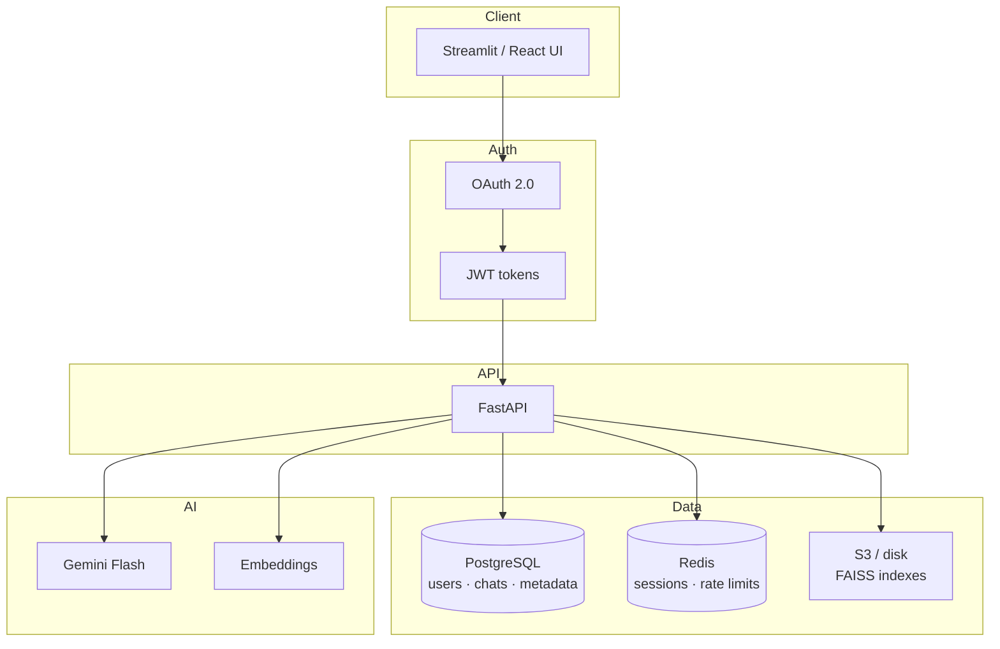

# MediSkye — Future Plans

This folder is **local-only** (listed in `.gitignore`) and is not pushed to GitHub.

Use it to decide what to build in **Enhancement Pass 4 and beyond**. These are not current bugs — they are deliberate next-step upgrades after the first three compatibility and hardening passes.

---

## Enhancement decision guide

| If you need… | Consider building… | Priority |
|--------------|-------------------|----------|
| Real user accounts | OAuth 2.0 + JWT | High |
| Data that survives restarts | PostgreSQL + Redis | High |
| Production-grade auth | Replace shared API key with per-user tokens | High |
| Better RAG on tables | Hybrid search + structured parsing | Medium |
| HIPAA-style readiness | Encryption, retention policy, audit logs | Medium |
| Phase 2 triage | Symptom classifier + urgency routing | Medium |
| Phase 3 doctors | Doctor DB + geo/specialty matching | Low |
| Mobile / SMS | React Native or Twilio integration | Low |

---

## Pass 4 — Infrastructure & auth (recommended next)

### OAuth 2.0 + JWT

**Why:** Current auth is a single shared `MEDISKYE_API_KEY`. Real users need individual identity.

**Plan:**
- Add OAuth providers (Google, Apple, or email magic link)
- Issue short-lived JWT access tokens + refresh tokens
- Protect `/upload` and `/query` with `Authorization: Bearer <token>`
- Map `user_id` from JWT instead of anonymous browser UUID

**Stack options:**
- `authlib` or `python-jose` + `passlib` on FastAPI
- Streamlit: custom login component or migrate UI to React/Next.js for proper OAuth redirect flow

---

### PostgreSQL

**Why:** In-memory `vectorstores` dict is lost on restart and cannot scale horizontally.

**Plan:**
- Store user profiles, sessions, upload metadata, chat history
- Tables: `users`, `sessions`, `uploads`, `chat_messages`
- Use SQLAlchemy or asyncpg

**Schema sketch:**
```
users (id, email, created_at)
sessions (id, user_id, created_at, expires_at)
uploads (id, session_id, filename, page_count, created_at)
chat_messages (id, session_id, role, content, created_at)
```

---

### Redis

**Why:** Fast session lookup, rate-limit counters, and vector-store cache across workers.

**Plan:**
- Session → vectorstore mapping in Redis (or Redis as cache in front of disk-backed FAISS)
- Rate limiting via Redis instead of in-process slowapi (works with multiple Render instances)
- TTL on sessions (e.g. auto-delete after 24h)

**Keys example:**
```
session:{uuid}:vectorstore_meta
ratelimit:{ip}:upload
ratelimit:{ip}:query
```

---

## Pass 5 — RAG & product quality

### Persistent vector storage

- Save FAISS indexes to disk or S3 per session
- Reload on cold start instead of forcing re-upload
- Option: pgvector in PostgreSQL for unified storage

### Hybrid retrieval

- Combine FAISS vector search + BM25 keyword search
- Better for exact lab values (e.g. "HGB 13.2")

### Structured lab parsing

- Detect table rows in PDFs (pdfplumber / camelot)
- Store `{test_name, value, unit, ref_range}` as structured JSON

### Full medical triage (Phase 2)

- Symptom + report → emergency / routine / self-care
- ML classifier or rules engine on top of Gemini

---

## Pass 6 — Compliance & enterprise

| Feature | Description |
|---------|-------------|
| Privacy policy + consent UI | Checkbox before first upload |
| Data retention | Auto-delete sessions after N hours (Redis TTL + cron) |
| `DELETE /session/{id}` | Right to erasure |
| Encryption at rest | Encrypt FAISS files and PDFs on disk (AES-256) |
| Audit logging | Who uploaded, when, IP (minimal, no report content) |
| HIPAA review | Legal review before handling real PHI at scale |

---

## Pass 7 — Platform expansion (roadmap Phases 3–5)

### Doctor recommendation engine (Phase 3)
- Doctor database with specialty, location, ratings
- Match specialty from report keywords (e.g. elevated TSH → endocrinologist)

### Helper / assisted mode (Phase 4)
- Family member uploads on behalf of patient
- SMS/email notification to patient with summary link

### Mobile & offline (Phase 5)
- React Native or Flutter app
- SMS gateway (Twilio) for low-bandwidth users
- Offline PDF cache + sync when online

---

## Pass 8 — Advanced AI & System Architecture (Elite Features)

### Hybrid Search + RRF (Advanced RAG)
- **Why:** Vector search misses exact numbers (e.g., "HbA1c 6.5"). 
- **Plan:** Combine FAISS (Semantic) with BM25/Elasticsearch (Keyword) using Reciprocal Rank Fusion (RRF).

### Streaming Responses (SSE / WebSockets)
- **Why:** Waiting for a full LLM response causes poor UX.
- **Plan:** Stream Gemini's output token-by-token directly to Streamlit using Server-Sent Events.

### Agentic Routing (Multi-Agent Architecture)
- **Why:** Users might ask general medical questions instead of report questions.
- **Plan:** Put an LLM router at the front to direct queries to specialized agents (e.g., Symptom Checker, RAG pipeline).

### Background Task Queues (Celery)
- **Why:** Extracting text from 50-page PDFs blocks the main API thread.
- **Plan:** Send PDF processing to a Redis + Celery worker queue and poll status from the frontend.

### Structured Table Parsing (Vision AI)
- **Why:** Standard PDF parsers often scramble complex medical tables.
- **Plan:** Pass PDF pages as images to Gemini 1.5 Flash Vision to extract structured JSON data for perfect tabular RAG.

---

## Tech stack evolution (target architecture)



---

## Suggested order of implementation

1. **PostgreSQL + Redis** — fix cold start and memory leak (biggest UX win)
2. **OAuth + JWT** — replace shared API key
3. **Persistent FAISS** — survive Render restarts
4. **Frontend forms** — fix rerun bugs (can be done earlier, smaller scope)
5. **Hybrid RAG** — accuracy improvement
6. **Compliance layer** — before public launch with real patient data
7. **Triage + doctors + mobile** — product roadmap phases
8. **Advanced AI (Agents, Hybrid RAG, Streaming)** — to reach elite tier

---

## Notes

- Keep `flaws/` for tracking what is **broken today**
- Keep `future-plans/` for tracking what to **build next**
- Neither folder should be pushed to GitHub (see `.gitignore`)
